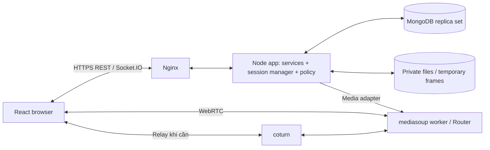
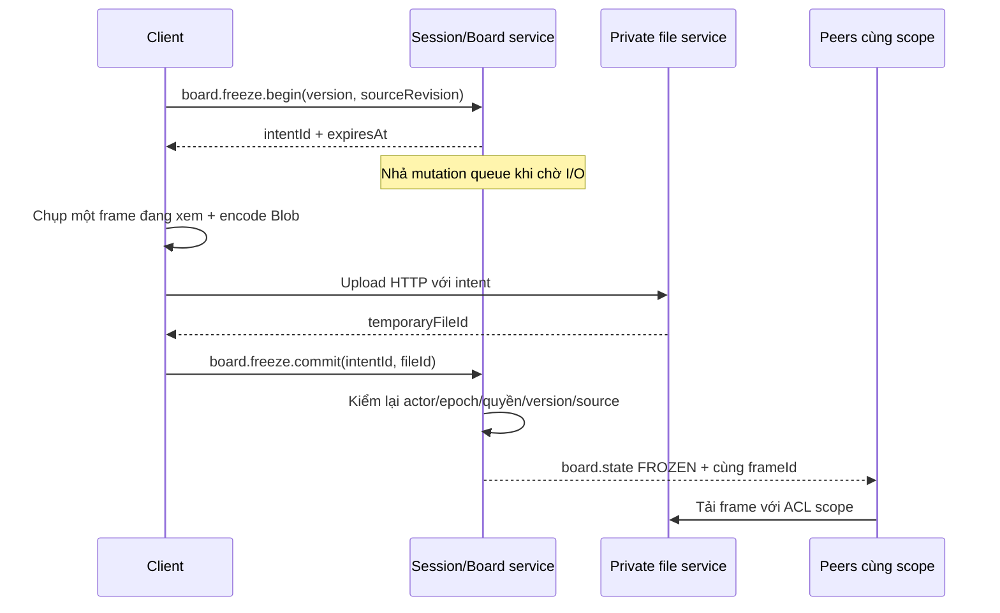

# CoLearnia — Technical plan

**Phiên bản:** 2.0 · 24/10/2026  
**Đề tài:** Nền tảng học nhóm trực tuyến tích hợp chia sẻ màn hình và tương tác thời gian thực.  
**Nhóm:** 5 thành viên, ký hiệu A–E để gán tên khi khởi động.  
**Thời gian mục tiêu:** 4 tuần xây dựng và kiểm thử tích hợp; 1–2 tuần tiếp theo hoàn thiện triển khai, tài liệu và chuẩn bị bảo vệ.  
**Trạng thái:** phạm vi sản phẩm đã thống nhất; kiến trúc nền được chọn cho triển khai; nền media cần qua PoC đầu tuần 1. Chưa có mã nguồn hoặc số đo để xác nhận hiệu năng và lịch hoàn thành.

Tài liệu là cơ sở chung để tạo backlog, viết contracts, triển khai và nghiệm thu. Các quy tắc nghiệp vụ dưới đây là thiết kế của CoLearnia; không phải API có sẵn của thư viện. Thông số ghi “khởi đầu” hoặc “mục tiêu thử” phải được kiểm chứng, không dùng làm cam kết hiệu năng.

## Mục lục

1. [Mục tiêu, ràng buộc và phạm vi](#1-mục-tiêu-ràng-buộc-và-phạm-vi)
2. [Luồng nghiệm thu và mô hình nghiệp vụ](#2-luồng-nghiệm-thu-và-mô-hình-nghiệp-vụ)
3. [Công nghệ và quyết định kiến trúc](#3-công-nghệ-và-quyết-định-kiến-trúc)
4. [Kiến trúc, module và trạng thái](#4-kiến-trúc-module-và-trạng-thái)
5. [Phân quyền phát, nhận và công bố](#5-phân-quyền-phát-nhận-và-công-bố)
6. [Cuộc gọi, camera và chia sẻ màn hình](#6-cuộc-gọi-camera-và-chia-sẻ-màn-hình)
7. [Freeze, vẽ cơ bản và presentation](#7-freeze-vẽ-cơ-bản-và-presentation)
8. [Điều hành, hỗ trợ và âm lượng](#8-điều-hành-hỗ-trợ-và-âm-lượng)
9. [Dữ liệu, lịch sử và tính nhất quán](#9-dữ-liệu-lịch-sử-và-tính-nhất-quán)
10. [REST, sự kiện và contracts](#10-rest-sự-kiện-và-contracts)
11. [Reconnect và vòng đời tài nguyên](#11-reconnect-và-vòng-đời-tài-nguyên)
12. [Màn hình và cấu trúc repository](#12-màn-hình-và-cấu-trúc-repository)
13. [Bảo mật, giới hạn và retention](#13-bảo-mật-giới-hạn-và-retention)
14. [Kiểm thử và tiêu chí hoàn thành](#14-kiểm-thử-và-tiêu-chí-hoàn-thành)
15. [Phân công và hợp đồng tích hợp](#15-phân-công-và-hợp-đồng-tích-hợp)
16. [Lộ trình 4 tuần và giai đoạn hoàn thiện](#16-lộ-trình-4-tuần-và-giai-đoạn-hoàn-thiện)
17. [Triển khai và vận hành](#17-triển-khai-và-vận-hành)
18. [Rủi ro, thay đổi và việc khởi động](#18-rủi-ro-thay-đổi-và-việc-khởi-động)
19. [Glossary và nguồn tham khảo](#19-glossary-và-nguồn-tham-khảo)

## 1. Mục tiêu, ràng buộc và phạm vi

### 1.1. Mục tiêu sản phẩm

CoLearnia cung cấp Workspace lâu dài cho lớp hoặc nhóm học. Thành viên trao đổi trong kênh văn bản, vào phòng để gọi mic/camera và chia sẻ màn hình. Trong buổi học có điều hành, các nhóm nói và vẽ riêng nhưng vẫn nhận màn hình, tiếng giảng chung. Nhóm có thể dừng hình để cùng giải bài, nhận hỗ trợ, rồi công bố bài làm trước phòng.

**Build xong sau tuần 4** nghĩa là toàn bộ chức năng thuộc scope đã tích hợp, chạy trên staging qua Internet, có xử lý lỗi và đạt kiểm thử bắt buộc. Hoàn thành module riêng hoặc chạy mock không được tính là hoàn thành luồng sản phẩm. Tuần 5–6 không được lập kế hoạch như thời gian viết phần lõi còn thiếu.

### 1.2. Phạm vi bắt buộc và mức triển khai

Tất cả các dòng dưới đây thuộc bản hiện tại, bao gồm camera, tài liệu, hỗ trợ riêng và trình bày toàn phòng.

| ID | Chức năng | Mức triển khai và tiêu chí chính |
|---|---|---|
| AUTH-01 | Tài khoản | Đăng ký/đăng nhập/đăng xuất; refresh còn phiên; logout và hết hạn chặn REST/socket/media |
| WS-01 | Workspace | Tạo, liệt kê, sửa tên, xóa; một owner, admin/member; tạo owner membership nguyên tử |
| WS-02 | Lời mời | Link có hạn dùng, thu hồi và giới hạn lượt; join lặp không trùng thành viên |
| WS-03 | Thành viên | Xem, đổi admin/member, loại thành viên, chuyển owner; không tự nâng quyền |
| CH-01 | Kênh TEXT/LIVE | Tạo/đổi tên/xóa; loại bất biến; kênh còn khi phòng trống; quyền WORKSPACE/RESTRICTED đơn giản |
| CHAT-01 | Chat | Tin văn bản, ảnh/tệp đính kèm, phân trang lịch sử kênh; có pending/error và chống gửi trùng |
| FILE-01 | Tài liệu | Upload/download qua API kiểm quyền; chưa có sửa nội dung hay quản lý phiên bản |
| LIVE-01 | Vào/rời | Lobby thiết bị, danh sách tham gia; một phiên sống/kênh và một call owner/tài khoản |
| LIVE-02 | Mic và camera | Bật/tắt, chọn thiết bị cơ bản; truyền thật qua Internet; từ chối thiết bị vẫn có thể vào xem |
| LIVE-03 | Screen share | Một nguồn chính, có lease; quyền share rõ; browser Stop dọn nguồn; screen audio khi môi trường hỗ trợ |
| HOST-01 | Điều hành | FREE/MODERATED, nhận/chuyển host có thông báo và xác nhận; không chiếm host đang hợp lệ |
| GRP-01 | Nhóm nhỏ | Host tạo/phân/chuyển/đóng nhóm; thành viên nhìn thấy nhóm và phạm vi hiện tại |
| GRP-02 | Nguồn chung, trao đổi riêng | Screen chung; mic/camera/chat/board riêng đúng nhóm; chuyển nhóm thu đường nhận cũ |
| BOARD-01 | Vẽ cơ bản | Bút, màu, con trỏ, undo nét gần nhất của mình, clear theo quyền; không làm tẩy theo từng điểm |
| FREEZE-01 | Freeze/resume | Một frame chung/scope, audio tiếp tục; resume đến hình hiện tại, ẩn nét cũ |
| HELP-01 | Hỗ trợ riêng | Gửi tin/ảnh hỏi host; host vào hỗ trợ có thông báo; tiếng hỗ trợ không sang nhóm khác |
| FLOOR-01 | Phát biểu nhóm | Mời toàn bộ nhóm; từng người consent; chỉ mic đang bật của người đồng ý phát toàn phòng |
| PRESENT-01 | Công bố bài làm | Một projection của context đã chọn, hình+nét; không công bố chat/history hay camera nhóm |
| AUDIO-01 | Âm lượng | Mỗi người 0–100% cục bộ; giảm tiếng thảo luận khi announcement rồi khôi phục đúng |
| REC-01 | Reconnect | Xác thực lại, snapshot lọc quyền, khôi phục media theo trạng thái hiện tại; không lấy lại grant cũ |

Camera chưa có nền ảo, bộ lọc, làm đẹp. Vẽ chưa có hình khối, text, transform, nhận dạng chữ, bảng vô hạn hoặc CRDT. Quản lý quyền không có permission override nhiều tầng.

### 1.3. Ngoài scope của đợt này

- Quiz, câu hỏi/bình chọn A/B/C/D; đồng hồ; trạng thái tiến độ nhóm.
- Thư viện bài làm, lưu/export ảnh lời giải lâu dài thành artifact.
- Freeze cá nhân tách khỏi board nhóm; screen share riêng song song từng nhóm.
- Ghi hình toàn phiên, VOD/HLS, phụ đề AI, chạy code trên server, điều khiển máy từ xa.

Không xây collections, endpoints hoặc màn hình cho những phần trên trong đợt này. Frame tạm phục vụ freeze và ảnh được người dùng gửi vào chat là hai luồng riêng; hệ thống không tự lưu frame thành tài liệu.

### 1.4. Ràng buộc và giả định phải theo dõi

| Nội dung | Quyết định/giả định hiện tại | Người theo dõi |
|---|---|---|
| Nhóm và thời gian | 5 người, 4 tuần build + 1–2 tuần hoàn thiện | Cả nhóm |
| Ngày bắt đầu/nộp | Chưa có ngày lịch; tuần tính từ kickoff | E ghi vào backlog |
| Giờ làm thực tế | Chưa xác nhận; khai báo giờ/người/tuần trước khi nhận issue | Từng người |
| Ngân sách | Chưa xác nhận; cần VPS/public IP, domain/TLS, băng thông và backup | E |
| Kỹ năng WebRTC | Chưa xác nhận; PoC để đo năng lực triển khai | B+C, D hỗ trợ |
| MongoDB | Chọn cho kế hoạch; A xác nhận yêu cầu học phần khi kickoff | A |
| Browser | Chrome/Edge desktop là môi trường nghiệm thu; Firefox kiểm bổ sung; mobile để sau | D+E |
| Runtime | Một app instance, một mediasoup worker ban đầu; không HA | B+E |
| Mất server | Kết thúc media cũ, join mới; không cam kết giữ nét chưa lưu | B+C+D |

Đây là kế hoạch mục tiêu, chưa là lời bảo đảm hoàn thành trong 4 tuần. Không tự đưa chức năng chính sang “nếu kịp”. Nếu capacity thiếu, nhóm cập nhật quyết định phạm vi/lịch một cách rõ ràng theo mục 18.

## 2. Luồng nghiệm thu và mô hình nghiệp vụ

### 2.1. Ba luồng bắt buộc

**UC-01 — Tổ chức việc học:** đăng ký/đăng nhập → tạo Workspace → mời thành viên → tạo TEXT/LIVE → gửi tin/ảnh/tệp → thành viên khác đọc/tải đúng quyền. Người ngoài không tải được tệp bằng ID/URL lấy được.

**UC-02 — Học nhóm tự do:** vào LIVE → bật mic/camera → một người share → cả phòng cùng freeze, vẽ và chỉnh âm lượng → resume → rời/vào lại. Không cần bật chế độ host để gọi tự do.

**UC-03 — Buổi học có hướng dẫn:** nhận host → share bài giảng → chia ít nhất hai nhóm → riêng tư mic/camera/chat/board, chung screen và tiếng giảng → freeze/vẽ → hỏi host, host hỗ trợ riêng → quay lại hướng dẫn → mời nhóm, từng người consent → công bố bài làm → thu quyền → đóng nhóm/phiên.

Kiểm lỗi và reconnect được chèn vào cả ba luồng, không chỉ demo đường đi thành công.

### 2.2. Mô hình và thời gian tồn tại

```text
User
└── Workspace
    ├── Membership: owner / admin / member
    ├── Channel TEXT → Conversation CHANNEL → Message / Attachment
    └── Channel LIVE → LiveSession hiện tại
                        ├── Participants + host + MAIN
                        ├── BreakoutGroup A → chat + BoardContext riêng
                        ├── BreakoutGroup B → chat + BoardContext riêng
                        └── FloorGrant + PresentationView tạm
```

| Khái niệm | Vòng đời |
|---|---|
| Workspace/Channel | Lâu dài đến khi xóa; LIVE channel không phải cuộc gọi |
| LiveSession | Một lượt sử dụng LIVE; ACTIVE → ENDING → ENDED |
| SessionParticipant | Danh tính tham gia phiên; khác membership trong Workspace |
| MAIN | Phạm vi người chưa vào nhóm; không là một kênh mới |
| BreakoutGroup | Thuộc đúng một session; runtime và dữ liệu riêng bị khóa khi đóng |
| BoardContext | Ngữ cảnh hình/nét của MAIN hoặc group, có version riêng |
| Producer/Consumer | Object mediasoup trong RAM; không khôi phục bằng ID sau restart |

Các bất biến: tối đa một session ACTIVE/ENDING giữ chỗ mỗi LIVE channel; một call owner generation/tài khoản; một main share; một floor active; một presentation active; một Consumer cho mỗi participant/producer.

## 3. Công nghệ và quyết định kiến trúc

### 3.1. Stack

| Thành phần | Lựa chọn | Quy tắc sử dụng |
|---|---|---|
| Web | React + TypeScript + Vite | Một app; giữ call controller khi đổi tab/panel |
| UI | Tailwind, components chung | Mic/camera/scope/consent có trạng thái nhất quán |
| State | Zustand + TanStack Query | Session projection và REST cache tách nhau; không persist track/transport |
| Server | Node.js 24 LTS + Express + TypeScript | Pin patch và lockfile sau compatibility smoke test |
| Validation/contracts | Zod trong packages/contracts | Kiểm runtime ở biên; types không thay validation |
| Database | MongoDB + Mongoose, replica set một node | Transaction cho thao tác nhiều bản ghi; không có HA |
| Realtime | Socket.IO | Signaling, chat, board; ack/dedupe/snapshot do app xây |
| Media | WebRTC, mediasoup v3, mediasoup-client | Lựa chọn dự kiến, qua ADR-001/PoC trước khi Accepted |
| Audio | Web Audio API/GainNode | Một output path/track; discussion và priority riêng |
| Board | Canvas 2D, pointer events | Tọa độ chuẩn hóa, server ordering, undo của mình |
| Files | Private disk volumes + API | Upload HTTP, kiểm quyền khi tải; không public static directory |
| Deploy | VPS Linux + Compose + Nginx + coturn | Staging tuần 1; một app instance; port media trực tiếp |
| CI | GitHub Actions | Lint/typecheck/tests/build; image theo commit SHA |

Không cần Next.js, Kafka, Kubernetes hoặc một media microservice riêng cho topology đầu tiên. Framework web không giải quyết thay policy và vòng đời media.

### 3.2. Sổ quyết định

| ADR | Quyết định | Trạng thái và cách xác nhận |
|---|---|---|
| ADR-001 | mediasoup; một Router/LiveSession | **Proposed**; B+C chứng minh isolation/share/revoke/TURN/reconnect; D kiểm freeze trong 3 ngày đầu |
| ADR-002 | Một backend chia module, một instance | Chọn cho bản này; thêm instance cần thiết kế owner/lock/state mới |
| ADR-003 | Mongo replica set một node | Chọn; A+E smoke test transaction/migration trên Linux tuần 1 |
| ADR-004 | Freeze chung scope, một frame; vẽ cơ bản | Chọn; D+C kiểm race/version/ACL |
| ADR-005 | Dữ liệu kênh bền vững, private session history chỉ đọc trong phiên | Chọn; kiểm bằng API/socket negative tests |
| ADR-006 | Không bật Socket.IO packet recovery cho private session | Chọn; app auth + snapshot/history có ACL khi reconnect |

ADR-001: mediasoup cho app kiểm soát việc tạo/đóng từng Consumer; đánh đổi là tự làm signaling/lifecycle. LiveKit là phương án thay thế cần chứng minh policy tương đương; selective subscription UI không đủ bằng chứng. Mesh không là hướng triển khai bản chính. Chỉ duy trì một SFU. Nếu PoC thất bại, phân biệt lỗi IP/ICE/cấu hình với thiếu năng lực triển khai, ghi quyết định cùng bằng chứng trước khi đổi.

Mỗi ADR trong repo ghi context, constraints, alternatives, decision, consequences, owner/reviewer, kết quả xác nhận và trigger xem lại. Gate thất bại không tự cho phép cắt camera/breakout/presentation.

## 4. Kiến trúc, module và trạng thái



HTTPS/Socket.IO là control plane; RTP audio/video/screen là media plane. Ảnh/tệp đi HTTP; event chỉ mang ID/metadata. Nginx không là HTTP proxy cho RTP. Một Router thuộc một worker; thêm CPU không tự chia một phiên lên nhiều lõi. [mediasoup scalability](https://mediasoup.org/documentation/v3/scalability/).

### 4.1. Chủ sở hữu trạng thái

| Module | Sở hữu | Không được tự làm |
|---|---|---|
| Auth/Workspace/Channel | Auth, membership, channel access | Tự cho admin nghe nhóm chưa tham gia |
| Session manager | SessionState, participant/group, queue, call epoch | Chờ upload/picker/client ack lâu trong queue |
| Policy | canPublish/canConsume/canReadBoard/canReadFile/projectSessionFor | Gọi UI hoặc tự tạo media |
| Media adapter | Worker/router/transports/producers/consumers | Tin scope/owner do client khai |
| Board service | Intent, frame context, strokes, board sequence | Ghi DB từng pointer event |
| Chat/File service | Dữ liệu bền vững, dedupe, metadata/ACL | Phục vụ file chỉ vì biết ID |
| Frontend controller | Runtime track/audio registry và projection để render | Cấp quyền dựa vào state cục bộ |

REST/socket handlers validate/auth → gọi cùng application service → trả envelope. Không sao chép policy vào từng handler. Media adapter tối thiểu có publish/closeProducer/reconcileAllowedSources/closeParticipant/getStats; không dựng framework nhiều SFU trước nhu cầu.

### 4.2. Runtime và thứ tự thay đổi

```ts
type SessionState = {
  id: string; epoch: string;
  mode: 'FREE' | 'MODERATED';
  status: 'ACTIVE' | 'ENDING' | 'ENDED';
  policyRevision: number;
  hostParticipantId: string | null;
  hostVoiceScope: 'GLOBAL' | 'GROUP' | 'MAIN';
  helpTargetGroupId: string | null;
  breakoutEnabled: boolean;
  mainScreenProducerId: string | null;
  screenSourceRevision: number;
  activeFloorGrantId: string | null;
  activePresentationId: string | null;
  announcementId: string | null;
};
```

Session manager serialize mutation quyền, không serialize mọi điểm vẽ. Chuyển nhóm/kick/revoke: dựng deny barrier → tính state mới → đóng media/fanout trái quyền → commit state → cấp media mới → gửi projection mới. Nếu lỗi, giữ nguồn bị thu ở trạng thái đóng, yêu cầu resync; không giữ tiếng riêng để UI trông liền mạch. Phần audio đã nhận/buffer không thể thu hồi tuyệt đối.

`policyRevision` dùng cho quyền; `boardVersion` cho context; `strokeSequence` cho nét; `epoch` cho đời session; `callGeneration` cho chủ kết nối. Reserve intent ngắn trong queue, nhả queue cho I/O rồi kiểm epoch/version/quyền lại khi commit. Mọi resource đang tạo phải được đăng ký pending để revoke có thể hủy, hoặc đóng ngay khi phát hiện state đã cũ.

## 5. Phân quyền phát, nhận và công bố

### 5.1. Ba lớp quyền

Workspace: owner/admin/member. Session: host/member. Grant cụ thể: publish/share, board, floor, presentation. Admin không mặc nhiên là host và không nghe nhóm riêng. Owner/admin quản lý kênh; member không tự đổi role. RESTRICTED dùng allowlist rõ; owner/admin quản lý cấu hình không đồng nghĩa tự có quyền đọc private session.

Host chỉ điều hành session mà mình đang tham gia. FREE không có breakout. Một participant có thể yêu cầu chuyển FREE → MODERATED và nhận host nếu chưa có host, qua mutation nguyên tử và thông báo toàn phòng; không cướp host. Chuyển về FREE đóng nhóm, floor/presentation/help/announcement theo đúng thứ tự thu quyền.

### 5.2. Quyền publish

| Nguồn/thao tác | FREE | MODERATED |
|---|---|---|
| MIC | Participant tự bật/tắt; tối đa một nguồn | Tương tự; nơi nhận theo policy, không theo client |
| CAMERA | Participant tự bật/tắt; tối đa một nguồn | Tương tự; không tự global khi floor active |
| Xin share | Participant hợp lệ, không có lease khác | Host; hoặc người được host cấp share grant hiện hành |
| SCREEN | Chỉ chủ lease, một nguồn video | Cùng quy tắc và share grant còn hạn |
| SCREEN_AUDIO | Tối đa một audio đi kèm lease/screen | Cùng quy tắc; thu cùng screen/grant |
| Freeze/vẽ | Participant trong MAIN có board access | Participant cùng group; host khi đang hỗ trợ; MAIN theo board access |
| Clear board | Chủ frame còn trong scope, hoặc chủ share ở LIVE | Thêm host nếu có quyền đọc/vẽ context hiện tại |

Undo chỉ tác động nét do mình tạo. Server kiểm actor, transport ownership, kind/source, quota, epoch, grant và lease. Khi lease/grant bị thu, nguồn liên quan cũng bị đóng. Share grant không phải floor grant.

Server kiểm quyền publish và định tuyến, không chứng thực được nội dung audio thật sự là mic hay tab chỉ từ nhãn nguồn. Bản đầu không cam kết chống publisher cố ý đưa nội dung khác vào track được phép công bố.

### 5.3. Quyền nhận và đọc

| Nguồn | Người được nhận |
|---|---|
| Main screen + screen audio | Participant đang có quyền session/channel |
| MIC/CAMERA trong FREE | Các participant MAIN, trừ chính nguồn cần tránh self audio |
| MIC/CAMERA thành viên khi breakout | Cùng group; MAIN chỉ nghe/xem MAIN; host được nhận group đang hỗ trợ |
| MIC host khi GLOBAL | Cả session |
| MIC host khi GROUP | Chỉ group đang hỗ trợ |
| CAMERA host trong MODERATED | Cả session; không dùng camera để suy ra quyền audio |
| MIC người có floor ACTIVE + consent | Toàn session, lấy hợp với quyền nhóm, không nhân đôi |
| CAMERA người có floor | Giữ phạm vi cũ; không tự mở rộng |
| Board/chat nhóm | Participant hiện thuộc nhóm; host đọc board/chat khi đang hỗ trợ |
| HOST_PRIVATE | Người gửi và đúng host nhận ban đầu, khi phiên ACTIVE và cả hai còn quyền kênh |
| Presentation | Participant session đọc projection đã chọn khi presentation còn ACTIVE |

`canConsume` kiểm đúng đời Producer và trạng thái hiện tại, rồi mới kiểm codec bằng `router.canConsume()`. Được quyền mới tạo/resume Consumer; thu quyền đóng Consumer server. Danh sách nguồn và event được lọc; Socket.IO room chỉ do server quản lý. [mediasoup communication](https://mediasoup.org/documentation/v3/communication-between-client-and-server/).

### 5.4. Snapshot và dữ liệu lịch sử

`projectSessionFor(viewer)` chỉ trả metadata được phép: danh sách nhóm/số người có thể công khai trong session; producer IDs private, frame URL, nét, tin riêng và consent cá nhân chỉ tới audience phù hợp. Không gửi raw runtime map. Presentation không dùng endpoint board riêng của group.

Khi đổi scope: rời fanout cũ, cập nhật `audienceEpoch`, xóa dữ liệu private cũ trong client cache, rồi nhận snapshot mới. Client bỏ event cũ theo epoch/version nhưng server vẫn phải chặn phát sai. Không bật tự replay packet private của Socket.IO; reconnect dùng snapshot mới và API lịch sử có ACL. [Socket.IO recovery](https://socket.io/docs/v4/connection-state-recovery/).

Người mới vào group được đọc phần lịch sử group trong phiên đang ACTIVE; người rời mất quyền đọc tiếp. Host chỉ đọc group khi đang hỗ trợ. Đóng group/session khóa API đọc private, không mở rộng sang Workspace. Nội dung đã được người nhận xem hoặc tải không thể thu hồi khỏi bộ nhớ/ảnh chụp của họ.

## 6. Cuộc gọi, camera và chia sẻ màn hình

### 6.1. Join và quyền sở hữu call

1. `POST /channels/:cid/live-session/join` xác thực membership/channel, lấy khóa channel và tìm/tạo session; unique DB bảo vệ bản ghi; dọn Router tạo thừa nếu DB insert thất bại.
2. Cấp join ticket một lần, hạn 60 giây, gắn auth session/user/channel/session epoch. API retry cùng requestId không tạo phiên/ticket dùng song song.
3. `session.join` consume ticket, kiểm lại quyền, giữ khóa theo user để cấp callGeneration. Nếu tài khoản đã gọi nơi khác, trả `CALL_ALREADY_ACTIVE`, UI yêu cầu người dùng chủ động chuyển phiên.
4. Chuyển phiên: deny nguồn cũ → đóng tài nguyên cũ → tăng generation → bind participant mới. Late event từ socket cũ không đóng call mới. Unique participant theo session không thay registry toàn user.
5. Trả projection, RTP capabilities, tham số send/recv transport. Client tạo transport, connect và xin publish nguồn được phép.
6. Consumer server tạo paused → client gắn track và báo ready → server kiểm lại quyền/generation → resume hoặc close. [mediasoup communication](https://mediasoup.org/documentation/v3/communication-between-client-and-server/).

Quy ước tránh deadlock: khi thực sự cần khóa lồng nhau, thứ tự là user ownership → channel lifecycle → session mutation; không lấy user/channel lock từ trong session queue. REST lấy channel lock đơn lẻ phải nhả trước khi trả ticket. Takeover giữ quyền chuyển theo user, reconcile từng session tuần tự, không khóa hai session cùng lúc; không giữ bất kỳ mutex nào khi chờ callback client. Cleanup registry dùng compare-and-delete theo generation để không cần đảo thứ tự khóa. Mọi close idempotent. Join bị hủy/time out phải dọn participant/ticket/resource pending.

### 6.2. Thiết bị và camera

- Xin mic/camera từ thao tác người dùng; lỗi permission/device có thông báo. Mic/camera tắt không bị server tự bật.
- Đổi thiết bị bằng thay track tương thích hoặc đóng/tạo nguồn có kiểm quyền; một generation không có hai Producer MIC/CAMERA hoạt động.
- Cấu hình thử đầu tiên: camera khoảng 360p–480p/15fps, screen ưu tiên chữ rõ khoảng 720p–1080p/5–15fps; là điểm bắt đầu để đo, không bảo đảm chất lượng mọi mạng.
- Bản nghiệm thu 5 participant phải hiển thị được các camera hợp lệ. Khi thử tải cao hơn, page/pin tile và subscribe theo viewport; không nhận camera trái quyền dù UI ẩn.
- Codec baseline được chọn sau smoke test browser mục tiêu, ghi chính xác vào config/lockfile; chưa cần nhiều codec hay simulcast phức tạp trước khi có số đo.

### 6.3. Share lease và browser picker

Flow chính để giữ user activation: xin lease từ server → khi được cấp hiển thị nút **“Chọn màn hình để chia sẻ”** → click gọi `getDisplayMedia()` trực tiếp → tạo Producer nếu lease/grant còn hợp lệ. Nếu hết lease/hủy picker/thua quyền: stop toàn bộ track vừa lấy, release lease và báo thử lại. Không giữ queue khi chờ picker.

API yêu cầu thao tác người dùng và browser picker; không tự chọn màn hình hay tái dùng quyền capture. Audio phụ thuộc browser/OS/nguồn người dùng chọn. [MDN getDisplayMedia](https://developer.mozilla.org/en-US/docs/Web/API/MediaDevices/getDisplayMedia).

Lease chờ picker khởi đầu 30 giây; khi commit chuyển thành share ownership gắn participant/generation, được giám sát theo signaling lease. Browser Stop/track ended/rời/kick/thu share grant: đóng SCREEN và SCREEN_AUDIO, release ownership, tăng source revision, hủy freeze intent cũ, xóa live overlay cũ. Frame đã FROZEN vẫn có thể dùng đến resume/cleanup nhưng hiển thị nguồn cũ đã dừng; không giả còn live.

Một Producer có thể được nhận qua nhiều lý do quyền, nhưng chỉ tạo một Consumer mỗi receiver/producer. Client registry cũng chống attach audio hai lần.

## 7. Freeze, vẽ cơ bản và presentation

### 7.1. Board và thao tác cơ bản

Mỗi scope có một board chung: MAIN ở phòng tự do/phần phòng chính, hoặc một group. Thành viên freeze/resume tác động đúng scope, UI ghi rõ “Tạm dừng hình của nhóm” và “Cho nhóm trở lại trực tiếp”. Chưa có freeze cá nhân.

```ts
type BoardState = {
  id: string; scopeId: string; version: number;
  status: 'LIVE' | 'FREEZING' | 'FROZEN';
  sourceRevision: number; frameId: string | null;
  strokeSequence: number;
};
type Stroke = {
  id: string; boardId: string; contextVersion: number;
  frameId: string | null; sourceRevision: number;
  authorParticipantId: string; // server gán
  points: Array<{ x: number; y: number }>; // 0..1
  color: string; width: number;
};
```

- Bút, palette màu, con trỏ, undo nét gần nhất của mình; clear toàn context theo quyền ở mục 5 và xác nhận.
- FROZEN cho nét bền trong context hiện tại; LIVE dùng con trỏ/nét chỉ ngắn tự hết hạn, chưa có tracking vật thể/trang.
- Tọa độ tính trên vùng hình thật, loại letterbox; resize và device pixel ratio không làm trôi nét.
- Preview/cursor batch tối đa 20 lần/giây, cho phép mất; stroke commit có UUID, ack, sequence và version. Mất sequence lấy board snapshot đã lọc quyền.
- Server gán author, kiểm membership/context hiện tại, màu/width/points/bytes. Undo là tombstone nét của mình, không cho xóa nét người khác bằng sửa ID.
- Không dùng DB write cho từng điểm; runtime có stroke log/snapshot đủ khôi phục khi socket rớt ngắn trong cùng đời server.

### 7.2. Freeze và resume



Client chụp video remote đang nhận hoặc screen track local nếu chính mình share; kiểm có frame giải mã sẵn/kích thước hợp lệ. Không suy mọi ảnh màu đen là lỗi. Dùng Canvas `drawImage(video, ...)`, không DOM screenshot toàn máy. [MDN drawImage](https://developer.mozilla.org/en-US/docs/Web/API/CanvasRenderingContext2D/drawImage).

Server reserve intent có hạn và actor/context/generation; chỉ một intent thắng. Commit kiểm file thuộc intent, format/dimensions/size và các revision. Snapshot là ảnh do participant hợp lệ cung cấp; server không cam kết chứng thực ảnh chính xác tuyệt đối với bài giảng. Khi source đổi trước commit trả `SOURCE_CHANGED`; khi quyền đổi trả deny; request cũ không được ghi đè context mới. Hỏng upload/hết hạn trả LIVE và dọn file orphan.

Video live tiếp tục nhận/giải mã dưới lớp ảnh, audio graph giữ nguyên. Khi FROZEN, nét gắn frame/source revision đã chốt, không bị từ chối chỉ vì giảng viên đã đổi nguồn mới ở phía live.

Resume hủy intent pending nếu có, tăng boardVersion, đóng context cũ, bỏ lớp ảnh/nét để thấy video hiện tại. Không replay đoạn bỏ qua. Nếu nguồn không còn, hiển thị “Chưa có nguồn chia sẻ”, không giả live. Không có `artifact.save`, library hoặc export lâu dài trong scope này.

### 7.3. Công bố hình và nét của nhóm

- Host mời group; mỗi thành viên trong tập được mời được tự chấp nhận hoặc từ chối. Participant mới vào sau không tự thừa hưởng lời mời/consent.
- Một thành viên đã consent chọn context của nhóm để công bố; server kiểm đang ở group và grant thuộc group đó. Chỉ một presentation active.
- `PresentationView` chứa audience session, grantId, source mode, frame reference nếu FROZEN, bản nét được chọn và contextVersion. Toàn phòng đọc projection qua endpoint/event riêng, không mở ACL của board gốc.
- Với FROZEN: giữ cùng frame, nhận cập nhật nét hợp lệ của chính context được công bố. Nếu nhóm resume/clear/chuyển context, projection giữ bản hình+nét cuối của lượt; không tự nhảy trang. Muốn đổi nội dung thì stop/start lượt công bố rõ ràng.
- Với LIVE: hiển thị main screen hiện tại và các nét chỉ ngắn từ context đã chọn. Source đổi thì xóa overlay cũ; không hứa nét bám slide. Không chuyển sang một screen share nhóm thứ hai.
- Host revoke/stop/đóng group hoặc session: khóa endpoint presentation, đóng fanout và grant, thu global Consumer rồi trở về view chung. Nội dung đã xem không thu hồi khỏi máy người nhận.

Frame đang presentation giữ tham chiếu dù board nhóm đã resume. Clear hoặc undo sau khi projection tách khỏi context cũ không được tác động nhầm hình live mới. Khi hết mọi tham chiếu, frame vào cleanup queue.

## 8. Điều hành, hỗ trợ và âm lượng

### 8.1. Host, group và hỗ trợ

- Trong MODERATED, host tạo group và phân participant; người chưa phân thuộc MAIN. Host không là thành viên mọi group.
- Chuyển group thu media/chat/board cũ trước, cập nhật membership và cấp nguồn mới. Close group thu floor/presentation liên quan, về MAIN; private history bị khóa.
- Thành viên gửi text/ảnh/tệp tới đúng host qua HOST_PRIVATE; ảnh có thể chọn upload hoặc gửi ảnh chụp canvas hiện tại theo quyền. Đây là tệp tin nhắn trong phiên, không là thư viện/đầu ra lâu dài.
- `host.help.enter` cấp quyền group đích, chuyển MIC host sang GROUP, hiển thị host đã vào trước khi mở scope hỗ trợ. Vào B thì thu A trước.
- `host.help.leave` có thao tác ghi rõ quay lại hướng dẫn toàn phòng. Nếu MIC đang bật, UI yêu cầu xác nhận chuyển phạm vi; không tự phát global chỉ vì timeout/mất mạng.
- Hỏi bằng tin nhắn không tự đổi scope mic. Host cũ giữ quyền đọc tin gửi riêng cho mình trong phiên theo ACL; host mới không tự nhận lịch sử đó. Người gửi có thể gửi câu hỏi mới cho host mới.

### 8.2. Floor, consent và trạng thái kết hợp

`FloorGrant`: INVITED → ACTIVE → REVOKED/EXPIRED; có invitedParticipantIds, consent set và policyRevision. Host start khi ít nhất một người consent; người được mời có thể consent sau khi ACTIVE nếu vẫn trong tập mời/group. Người từ chối vẫn ở nhóm, không phát toàn phòng. MIC tắt không tự bật; người có MIC đang bật vẫn cần consent khi chuyển global.

Thành viên rời group/rời phiên mất consent; reconnect sau mất control lease phải consent lại. Revoke đóng đường global, không đóng mic nhóm còn hợp lệ. Tập quyền được lấy hợp để không phát hai lần.

Để giảm trạng thái chồng chéo, bản đầu chỉ một hoạt động điều hành chính tại một thời điểm: **hỗ trợ riêng hoặc lượt floor/presentation**. Host phải kết thúc hỗ trợ trước khi mở lượt trình bày. Announcement từ hỗ trợ riêng yêu cầu xác nhận kết thúc help và chuyển GLOBAL; không tự quay lại hỗ trợ sau announcement. Announcement trong lượt trình bày chỉ duck tiếng thảo luận, không thu grant âm thầm.

### 8.3. Chuyển host và host mất mạng

Transfer cần target đang tham gia chấp nhận, có expiry. Khi commit: kết thúc help/floor/presentation/announcement, thu quyền host cũ/share grant điều hành, chuyển role và tăng revision. Để đơn giản, dừng main share khi transfer nếu nguồn phụ thuộc quyền cũ; người có quyền mới chủ động share lại.

Host mới không tự bật mic/camera; MIC đang bật ở scope cũ được pause trong media policy tới khi xác nhận scope điều hành. Host cũ trở về member/MAIN với quyền bình thường; không giữ quyền nghe group hỗ trợ trước đó.

Host mất signaling: không chuyển mic GROUP thành GLOBAL. Giữ vai trò trong grace; hết grace thu media/help/grants điều hành, đặt host trống, giữ room MODERATED. Sau đó participant có thể chủ động nhận host bằng mutation nguyên tử có thông báo; role Workspace không cho phép tiếp quản sớm hoặc nghe ngầm. Người khác vẫn xem main screen còn hợp lệ; main share của host mất lease phải dừng.

### 8.4. Audio graph

```text
remote mic mỗi người → participantGain → discussionBus ─┐
host/global floor   → participantGain → priorityBus   ─┼→ master → output
screen audio        → screenGain      → screenBus    ─┘
```

Mỗi track chỉ đi một bus theo scope hiện tại, không nhân stream. `effectiveGain = master × participantGain × busGain × announcementFactor`; chỉ discussionBus có factor giảm khi thông báo. Không giảm chính host/floor đang được ưu tiên. Ramp gain ngắn; khi kết thúc chỉ bỏ factor, không ghi đè gain cá nhân; mute local vẫn là 0.

Preference lưu cục bộ theo user/Workspace/người nói, không theo producerId tạm. Không gắn cùng track vào audio element có tiếng và Web Audio output. Có nút bật âm thanh khi autoplay chặn, không loop mic local ra loa. Nhiều nguồn có thể cộng gây clipping dù từng gain ≤1; thử headroom/limiter khi cần. Announcement tối đa 30 giây, có timeout khôi phục cả khi host rớt. Volume không thay quyền: nguồn trái quyền không được nhận dù gain=0.

## 9. Dữ liệu, lịch sử và tính nhất quán

### 9.1. MongoDB bền vững

| Collection | Trường/ràng buộc chính |
|---|---|
| users | emailNormalized unique, passwordHash, displayName, status |
| authSessions | userId, tokenHash unique, expiresAt, revokedAt; TTL dọn, request vẫn tự kiểm hạn |
| workspaces | name, ownerId duy nhất, deletedAt; ownerId và membership role đồng bộ |
| memberships | workspaceId+userId unique, role, status |
| invitations | tokenHash unique, workspaceId, expiresAt, revokedAt, maxUses, uses |
| channels | workspaceId, type bất biến, name/order, accessMode, allowedUserIds, deletedAt |
| conversations | kind CHANNEL/SESSION/GROUP/HOST_PRIVATE, scope refs, participants cho tin riêng, closedAt, purgeAt |
| messages | conversationId, senderId, clientMessageId, text, attachmentIds, createdAt; dedupe unique |
| files | storageKey unique, uploaderId, purpose, accessRef, mime/size/dimensions, state, expiresAt |
| liveSessions | channelId, epoch, mode, hostUserId, status, startedAt/endedAt, revision |
| sessionParticipants | sessionId+userId unique, joinedAt/leftAt, current group metadata; không là nguồn runtime sau restart |
| auditEvents | actor, action, scope/target, revision, timestamp; không lưu chat/audio/token |

Không tạo SavedArtifact, polls, votes hoặc timers trong bản này. GroupRuntime không bắt buộc có collection: dữ liệu private chỉ được đọc khi session/group runtime còn hợp lệ. Conversation giữ refs và closedAt/purgeAt để khóa và dọn dù runtime đã mất.

Index bắt buộc: messages unique `(conversationId,senderId,clientMessageId)`; history `(conversationId,createdAt,_id)`; liveSessions unique channelId với partial filter status ACTIVE/ENDING; indexes tra membership/channel/files; TTL cho auth/purge metadata phù hợp. Migration tạo index và test trên bản Mongo được pin, không chỉ dựa autoIndex của Mongoose.

Một Workspace có đúng một owner. Không có thao tác hạ/xóa owner trực tiếp; transfer cập nhật ownerId và roles trong transaction. Owner rời phải transfer trước hoặc xóa Workspace.

### 9.2. Runtime

SessionRuntime giữ state/queue/participants; GroupRuntime giữ membership; MediaRuntime giữ objects thật; BoardRuntime giữ intents/frame/strokes; GrantRuntime giữ floor/consent/projection; ActiveCallRegistry theo user giữ callGeneration. Không serialize transport/producer vào DB. Presence socket không là identity lâu dài.

### 9.3. Quyền lịch sử và retention

| Dữ liệu | Quyền đọc | Kết thúc/xóa |
|---|---|---|
| CHANNEL chat/tệp | Membership và channel access hiện tại | Lưu đến khi kênh/Workspace xóa; soft delete khóa đọc ngay |
| SESSION chat | Participant hiện tại, session ACTIVE | Khóa khi ENDED, purge sau 24 giờ |
| GROUP chat/tệp | Cùng group đang mở; host đang hỗ trợ | Rời nhóm mất quyền đọc tiếp; close group/session khóa ngay, purge sau 24 giờ |
| HOST_PRIVATE | Hai bên ban đầu còn quyền session/channel | Không chuyển audience khi transfer host; khóa khi ENDED, purge sau 24 giờ |
| Frame/nét | Board ACL hoặc presentation ACL riêng | Không là bài lưu; giữ khi đang được dùng, dọn sau mất tham chiếu |

Retention 24 giờ là mặc định vận hành khởi đầu để cleanup, không phải tính năng xem lại. Người ngoài runtime không được tải file private kể cả metadata chưa purge. Người mới vào group có thể đọc lịch sử group trong phiên đang mở; chính sách này phải hiển thị trong mô tả nhóm/room.

Files CHANNEL chỉ gắn được vào đúng conversation/channel tương ứng. File nhóm/private không được gắn vào tin toàn Workspace bằng đổi attachmentId. Upload trước lưu STAGED với owner/scope; commit message atomically bind file READY; upload bỏ dở được dọn. Tin hỏi host có ảnh canvas là private attachment, không mở endpoint frame nhóm cho host khi host chưa được cấp board access.

### 9.4. Transaction và đồng bộ runtime

Mongo replica set một node được cấu hình từ dev/CI/staging. Transaction nhiều document cần deployment hỗ trợ; không gọi mediasoup hoặc chờ upload bên trong transaction DB. [MongoDB transactions](https://www.mongodb.com/docs/manual/core/transactions/).

| Thao tác | Cách bảo đảm |
|---|---|
| Tạo Workspace | Workspace + owner membership + conversation/kênh mặc định nếu có trong một transaction |
| Nhận invitation | Kiểm expiry/revoke/maxUses và upsert membership trong transaction; user đã là member không tốn lượt |
| Transfer owner | Kiểm owner hiện tại/target; đổi ownerId và role hai bên nguyên tử |
| Gửi message + attachment | Validate ACL và bind STAGED file cùng insert message; retry dùng unique clientMessageId |
| Create live session | Khóa channel + unique DB; runtime Router chỉ được công bố khi metadata hợp lệ; failure cleanup |
| Kick/đổi quyền/xóa kênh | Đặt deny barrier theo scope → đóng media/fanout → ghi DB → reconcile runtime → phát snapshot |

Nếu DB lỗi sau thu media, không tự mở lại nguồn: participant nhận trạng thái cần resync, chỉ khôi phục sau khi xác thực DB và policy. Barrier phải chặn REST/file/socket liên quan, không chỉ handler kick. Sau crash, không có media runtime cũ; bootstrap đánh dấu phiên cũ ENDED và đóng conversation private trước khi cho join mới.

Message insert thành công nhưng crash trước ack/fanout: retry trả đúng message cũ sau kiểm quyền, history lấy lại được. Không tuyên bố exactly-once toàn mạng hoặc thêm message broker chỉ vì trường hợp này.

## 10. REST, sự kiện và contracts

### 10.1. Quy ước chung

REST `/api/v1`; Zod validate ở biên. Cookie auth `HttpOnly; Secure; SameSite=Lax`, CSRF token+Origin cho mutation và socket handshake; actor lấy từ auth session. API không trả raw Mongoose error. Session hết hạn/logout thu socket và media, không chỉ clear UI.

`GET /auth/csrf` cấp token bootstrap gắn cookie CSRF có chữ ký để form đăng ký/đăng nhập hoạt động trước auth; server kiểm chữ ký, Origin và token gửi lại. Sau login rotate auth/CSRF, trả token mới cho header HTTP/socket handshake; không đưa session secret vào client. Cookie CSRF và cookie auth có mục đích riêng.

```ts
// REST
{ data: {}, requestId: 'uuid' }
{ error: { code: 'FORBIDDEN', message: '...' }, requestId: 'uuid' }
// Client -> server: lệnh session
{
  requestId: 'uuid', sessionId: '...', epoch: '...',
  callGeneration: 3, expectedPolicyRevision: 18, payload: {}
}
// Ack
{ ok: true, requestId: 'uuid', policyRevision: 19, data: {} }
{ ok: false, requestId: 'uuid', error: { code: 'STALE_STATE', message: '...' } }
// Server -> client: chỉ audience được phép
{
  eventId: 'uuid', sessionId: '...', epoch: '...',
  audienceEpoch: 4, policyRevision: 19, type: 'group.updated', payload: {}
}
```

Policy mutation yêu cầu expectedPolicyRevision; board dùng contextVersion/strokeSequence riêng; chat không bắt gửi policy revision cho mỗi tin nhưng luôn kiểm ACL. Ack nghĩa server đã xử lý, không bảo đảm mọi peer đã render. Client nhận STALE_STATE resync trước khi yêu cầu lại; không tự phát lại mic/share/consent.

Idempotency key gồm actor+operation+scope+requestId và payload hash. Cùng ID khác payload trả conflict. Trước trả kết quả cũ vẫn kiểm quyền; không trả ticket/file/private data đã mất quyền. Cache runtime khởi đầu 10 phút, tối đa 10.000 kết quả/app, loại ticket đã consume khỏi khả năng dùng lại. Message dedupe bền theo DB. Retry quá cache phải lấy state trước, không tự coi thao tác chưa chạy.

HTTP: 400 malformed, 401 chưa/hết auth, 403 sai quyền, 404 không thấy tài nguyên, 409 conflict/stale/busy, 413 quá dung lượng, 429 quota. Error codes chính: `STALE_STATE`, `SOURCE_CHANGED`, `INTENT_EXPIRED`, `SHARE_BUSY`, `CALL_ALREADY_ACTIVE`, `FORBIDDEN`, `QUOTA_EXCEEDED`, `SESSION_ENDED`, `HOST_BUSY`, `MEDIA_UNAVAILABLE`.

### 10.2. REST chính

| Method/path sau /api/v1 | Công việc/quyền |
|---|---|
| GET /auth/csrf | Bootstrap CSRF cho form; không trả auth/session secret |
| POST /auth/register, /auth/login, /auth/logout; GET /auth/me | Auth, rate limit; logout thu session liên quan |
| GET, POST /workspaces | List theo membership; tạo Workspace |
| GET, PATCH, DELETE /workspaces/:wid | Member đọc; owner/admin sửa tên; owner xóa |
| GET /workspaces/:wid/members | Member hợp lệ |
| PATCH, DELETE /workspaces/:wid/members/:uid | Owner đổi admin/member; owner/admin loại member; admin không sửa/xóa owner/admin khác |
| POST /workspaces/:wid/owner-transfer | Owner → target member; transaction |
| POST /workspaces/:wid/invitations; DELETE /invitations/:iid | Owner/admin tạo/thu link |
| POST /invitations/accept | Token trong body; transaction, không log |
| GET, POST /workspaces/:wid/channels | Filter access; owner/admin tạo |
| PATCH, DELETE /channels/:cid | Owner/admin; type bất biến; thu phiên và file access khi xóa |
| GET /channels/:cid/messages?before=... | Chỉ TEXT + channel access; cursor phân trang |
| POST /channels/:cid/messages | CHANNEL message service, dedupe |
| GET /conversations/:id/messages?before=... | ACL theo kind; session/group phải ACTIVE/open |
| POST /channels/:cid/live-session/join | Kiểm LIVE/access, tìm/tạo session, join ticket |
| POST /sessions/:sid/leave | Participant/generation; idempotent |
| POST /files; GET /files/:fid/content | Upload staged có purpose/scope; tải kiểm ACL/expiry/barrier mỗi request |
| POST /sessions/:sid/freeze-frames | Multipart intent; upload tạm, không commit board |
| GET /sessions/:sid/boards/:bid/frame | Board ACL hiện tại, file còn tham chiếu hợp lệ |
| GET /sessions/:sid/presentations/:pid/frame | Chỉ presentation ACTIVE + participant access; không dùng quyền board riêng |

Upload đi HTTP, không truyền Base64 file/video qua Socket.IO. Chat socket/REST gọi cùng message service. Lịch sử trả cursor và giới hạn trang; không tải toàn bộ conversation một request.

### 10.3. Lệnh realtime

| Nhóm | Command | Kiểm chính |
|---|---|---|
| Phiên | session.join/leave/resync | Ticket/auth/epoch/generation; projection |
| Call ownership | call.takeover | Thao tác xác nhận user; thu call cũ trước |
| Host/mode | session.setMode; host.transfer.invite/accept | Host hiện tại/target; revision; cleanup activity |
| Transport | media.transport.create/connect | Direction và transport owner |
| Publish | media.producer.create/pause/resume/close | canPublish + owner + source/kind + quota |
| Receive | media.consumer.create/ready/close | canConsume ở create và ready; dedupe |
| Share | screen.grant/revoke/acquire/release | Host grant, lease/generation/expiry |
| Nhóm | group.create/assign/close | Host; thu scope cũ trước |
| Hỗ trợ | host.help.enter/leave | Host, activity conflict và xác nhận scope |
| Chat | message.send | Conversation ACL + clientMessageId |
| Freeze | board.freeze.begin/commit; board.resume | Intent, version, source/generation |
| Vẽ | board.cursor; board.stroke.preview/commit/undo; board.clear | Board ACL, author, sequence/quota |
| Floor | floor.invite/accept/decline/start/revoke | Tập mời, consent, membership hiện tại |
| Công bố | presentation.start/stop | Active floor, context được chọn, projection ACL |
| Thông báo | announcement.start/stop | Host, scope GLOBAL, ID/deadline |

Events tương ứng: `session.snapshot`, `participant.joined/left`, `group.updated`, `host.changed`, `media.available/closed`, `consumer.closed`, `screen.changed`, `board.state/stroke`, `floor.changed`, `presentation.changed`, `announcement.changed`, `message.created`, `session.ending/ended`. Không có event quiz/timer/library.

### 10.4. Giao nhận và khôi phục

Socket.IO giữ thứ tự trên kết nối nhưng mặc định không bảo đảm giao nhận đúng một lần. App tự làm ack/dedupe và resync. [Socket.IO delivery guarantees](https://socket.io/docs/v4/delivery-guarantees/).

- Message: validate → insert/bind → ack → fanout; mất event lấy history.
- Private event không buffer để tự replay sau reconnect; cursor/preview có thể mất.
- Client chặn thao tác nhạy cảm khi offline, bỏ pending command cũ trước resync; không để Socket.IO tự flush một lệnh floor/share/board cũ sang scope mới.
- Private clients cần reset cache theo audienceEpoch. Gap sequence board lấy snapshot; policy revision gap không đồng nghĩa thiếu event vì các audience được nhận tập event khác nhau.
- Trong contracts phải có schema command/ack/event, payload giới hạn và ví dụ allow/deny; ID/tên giống nhau ở frontend/backend.

## 11. Reconnect và vòng đời tài nguyên

### 11.1. Control lease và resume

Socket disconnect không chứng minh media đã ngừng. Khi server nhận disconnect: chuyển participant sang RECONNECTING, chặn mutation mới, kết thúc announcement của nguồn đó, thu floor consent của participant và reconcile ngay các Consumer global. Không được giữ quyền global chỉ vì mic WebRTC còn chạy. Với mạng đứt mà chưa được phát hiện, control lease có deadline server và heartbeat; cửa sổ phát hiện này phải được đo.

Giữ call ownership/nhóm tối đa 30 giây từ disconnect hoặc control lease hết hạn để reconnect; media thông thường còn lại được đóng chậm nhất cuối grace. Trong grace vẫn áp dụng mọi kick/move/revoke mới. Deadline không kéo dài bởi request cũ/generation cũ. Sau grace, đóng toàn bộ participant resources và phải join/consent lại.

Resume ticket ngắn hạn, một lần, gắn auth/session epoch/callGeneration, rotate sau mỗi resume. Khi reconnect: auth và Origin/CSRF lại → kiểm registry/current membership → bind socket mới → gửi projection mới → recreate/reconcile transport nếu cần. Ticket không chứa quyền cũ để phục hồi. Nếu hết ticket nhưng còn auth hợp lệ, server chỉ cấp lại quyền resume sau kiểm participant/call ownership hiện hành; không chiếm call thiết bị mới.

### 11.2. Bảng vòng đời

| Tình huống | Xử lý bắt buộc |
|---|---|
| Transport failed | Close mapping cũ; ICE restart hoặc tạo transport theo adapter; không nhân Producer |
| Rời phòng chủ động | Hủy intent/ticket/grant; leave fanout; close tracks/audio nodes/client controller và tài nguyên server |
| Kick/mất channel access/logout/auth expiry | Deny barrier; close media/socket liên quan, chặn file/REST ngay |
| Chuyển nhóm | Thu old scope trước, cấp new scope; hủy floor consent/intent cũ |
| Group đóng | Thu presentation/floor/help; về MAIN; khóa history, dọn board không còn refs |
| Stop share | Close screen + audio; invalidate intent/live overlay; frame frozen có trạng thái nguồn đã dừng |
| Host rớt | Giữ scope an toàn, không auto global; hết grace thu host activity, cho tiếp quản rõ ràng |
| Người cuối rời | Empty grace 60 giây rồi ENDING → close Router → ENDED; join phải tránh race với reaper |
| Host kết thúc phiên | ENDING ngay, deny join/mutation, thu tất cả resources và khóa private conversations |
| Worker chết | ENDED phiên liên quan, invalidate epoch, báo client join phiên mới; worker restart có health rõ |
| App restart | Invalidate runtime/resume đời cũ; đóng metadata stale/private history trước readiness |
| Xóa kênh/Workspace | Khóa đọc trước cleanup; kết thúc session; file không tiếp tục được cấp qua URL cũ |

Resource generation giúp late `transportclose/producerclose/disconnect` không xóa nhầm object đời mới. Mọi close idempotent; đóng server phải báo client và ngược lại, không trông chờ thư viện tự đồng bộ nghiệp vụ.

## 12. Màn hình và cấu trúc repository

### 12.1. Màn hình

Auth; Workspace list/join invitation; Workspace shell; TEXT channel; lobby; RoomPage dùng chung FREE/MODERATED; group panel; host controls; invitation/consent/presentation view; quản lý thành viên/kênh.

RoomPage có main screen hoặc projection, camera tiles, danh sách người, chat, scope badge, mic/camera/share/volume/board controls. Hiển thị rõ “MIC trong nhóm / toàn phòng / đang hỗ trợ” và “hình đã dừng, tiếng vẫn trực tiếp”. Mọi chuyển phạm vi công bố phải nhìn thấy được. Chat/panel chuyển tab không unmount call controller.

Không tạo màn hình quiz/timer/library, hoặc hai ứng dụng độc lập cho phòng nhóm và lớp học. Chưa yêu cầu avatar upload để hoàn thành Workspace; ảnh gửi chat/tệp vẫn thuộc scope.

### 12.2. Repository

```text
colearnia/
  apps/web/src/
    features/{auth,workspaces,channels,chat,live,groups,board,audio}/
    lib/{api,socket,media}/
    components/
  apps/server/src/
    modules/{auth,workspaces,channels,messages,files}/
    realtime/{handlers,schemas,rooms}/
    live/{session-manager,policy,media,groups,board,floor}/
    jobs/{file-cleanup,session-reaper}/
  packages/contracts/
  infra/{nginx,coturn,mongo}/
  docs/{adr,contracts,runbooks,test-evidence}/
  docker-compose.yml
  .env.example
```

Web RoomController giữ MediaStream/transport/audio nodes trong runtime registry, Zustand chỉ giữ projection cần render; không persist object media. Chịu được mount/unmount development lặp và cleanup có kiểm generation. Contracts không import Mongoose hoặc mediasoup runtime classes.

## 13. Bảo mật, giới hạn và retention

### 13.1. Biên tin cậy

Browser có thể sửa mọi request. Server tự tra actor/owner/scope/permission và validate schema; UUID không phải quyền. Trust boundary gồm REST, socket, upload/file read, SFU publish/consume và TURN credentials. Tệp/ảnh client cung cấp không có bảo đảm nguồn gốc tuyệt đối.

- Password băm Argon2id hoặc bcrypt với cấu hình được đo; chọn một implementation khi kickoff, không lưu plaintext/token raw trong DB/log.
- Cookie session rotate sau login, có expiry server. Socket có timer hết hạn và kiểm auth khi lệnh nhạy cảm; logout/revoke lan tới cuộc gọi tương ứng. TTL DB không thay kiểm expiry.
- Same origin qua Nginx là cấu hình chính; CORS/Origin allowlist, CSRF cho cookie-auth mutation/socket handshake; không wildcard credential.
- Chat render text; không chèn user text qua innerHTML. Upload tên ngẫu nhiên ngoài public; kiểm MIME thực/kích thước/dimensions, từ chối HTML/SVG/script/executable.
- Allowlist bản đầu: PNG/JPEG/WebP, PDF, TXT; loại bài học khác chỉ thêm sau kiểm rủi ro và thống nhất. File download có Content-Disposition phù hợp, nosniff; private files/frame no-store.
- WebRTC mã hóa đường truyền; không tuyên bố E2EE người dùng với topology này. TURN có credential ngắn hạn, quota và không anonymous relay.
- Không log audio/nội dung chat/token/password; audit metadata cấp/thu quyền, actor/scope/revision/requestId.
- Khi bị thu quyền, chặn request/stream mới và ngừng stream đang phục vụ khi server nhận biết thay đổi; bytes đã gửi không thể thu hồi.

### 13.2. Cấu hình khởi đầu

| Tài nguyên | Giá trị khởi đầu |
|---|---|
| File attachment | 10 MiB/file; 4 attachment/message; quota Workspace 500 MiB |
| Frame tạm | 1920×1080, 2 MiB; quota bytes tạm/session 20 MiB |
| Message | 4.000 ký tự; trang history tối đa 50 tin |
| Stroke | 2.000 điểm/nét, giới hạn width/palette; 1.000 nét/context và 2 MiB dữ liệu nét/context |
| Cursor/preview | 20 batch/giây/user; không ghi DB |
| Producer | MIC/CAMERA/SCREEN/SCREEN_AUDIO tối đa một mỗi loại theo quyền/lease |
| Consumer | Một/participant/producer |
| Share picker lease / freeze intent | 30 giây / 15 giây |
| Join/resume ticket | 60 giây, một lần, rotate |
| Control lease / socket grace | 30 giây / tối đa 30 giây sau disconnect/lease expiry |
| Heartbeat app | 5 giây khi kết nối; server rate limit và theo dõi deadline |
| Empty room grace | 60 giây |
| Announcement | Tối đa 30 giây; factor discussion thử ban đầu 0,3 |
| Auth session | 7 ngày khởi đầu; expiry tuyệt đối và revoke server |
| Login rate limit | Thử ban đầu 5 lần thất bại/phút/IP+account; tuning tránh khóa nhầm |
| Mutation/chat limit | Thử ban đầu 20 lệnh nhạy cảm/10 giây/user; chat 5 tin/giây/user, burst 10 |
| Upload concurrency | 2 upload/user; giới hạn tổng bytes và in-flight/session |

Không áp cùng limiter command cho stroke preview; mỗi lớp có quota riêng. Giới hạn tính cả payload bytes/points và request count. Đạt quota trả lỗi rõ; không treo room. Các timeout là chính sách app, không phải lời hứa phát hiện mọi mạng lỗi trong đúng số giây đó.

### 13.3. Cleanup

- Sweeper mỗi 60 giây: STAGED/orphan frame quá 15 phút; context hết refs dọn sau grace tối đa 5 phút; không xóa frame đang board/presentation sử dụng.
- Private session messages/files khóa ngay khi close và purge sau 24 giờ. Metadata tombstone chỉ giữ đủ audit không chứa nội dung riêng.
- Kênh/Workspace soft delete: khóa đọc ngay, purge tệp không còn references sau 7 ngày theo job; không có chức năng restore UI trong scope.
- Cleanup kiểm cả disk lẫn metadata; TTL Mongo không tự xóa file. Quota áp dụng trước upload/commit, sweeper không là cách duy nhất ngăn đầy disk.
- Worker/process crash: bootstrap và sweep đối chiếu epoch/reference; không phụ thuộc người dùng đóng tab đúng cách.

## 14. Kiểm thử và tiêu chí hoàn thành

### 14.1. Workload nghiệm thu

**Profile bắt buộc ban đầu:** 5 participant = 1 host + 2 group × 2 người; một main screen; camera của cả 5 được bật và nhận đúng quyền; 30 phút; ít nhất hai mạng độc lập; Chrome và Edge desktop. Ghi máy/OS/browser/VPS/region, bitrate/độ phân giải và ICE selected candidate.

**Profile mở rộng để đo:** tăng tới 10 rồi 12 participant, camera nhận tối đa 4 tile/client; chạy cùng test matrix nếu capacity cho phép. Đây chưa là cam kết phát hành 12 người. Giới hạn phát hành do số đo quyết định. Profile 5 người cũng chưa được xem là đã đạt nếu chưa có evidence.

Test forced TURN riêng phải chứng minh selected relay candidate và traffic thật; chỉ cấu hình TURN URL không tính là pass. Không dùng 5 tab một máy thay bằng chứng hai mạng/thiết bị khi đánh giá camera/audio/ICE.

### 14.2. Quality scenarios

Các ngưỡng dưới đây là **mục tiêu thử ban đầu trên profile/mạng đã ghi**, được giữ nguyên làm baseline hoặc cập nhật có lý do sau PoC; chưa là SLA.

| ID | Tình huống | Mục tiêu và phép đo |
|---|---|---|
| Q-01 | Join có nguồn đang phát | p95 ≤8 giây từ xác nhận join tới audio/video frame đầu; tách signaling/media |
| Q-02 | Xem screen chung | p95 độ trễ quan sát ≤1,5 giây; đồng hồ tại nguồn/receiver, không trừ timestamp hai máy chưa đồng bộ |
| Q-03 | Freeze frame ≤2 MiB | p95 ≤2 giây click tới peer cùng scope hiển thị; ghi tốc độ mạng, số mẫu |
| Q-04 | Vẽ | p95 stroke commit → ack ≤500 ms; độ trễ peer đo qua vòng đi-về/clock offset riêng |
| Q-05 | Revoke/chuyển nhóm | Không có Consumer trái policy sau commit; mục tiêu thu Consumer p95 ≤1 giây; đo buffer audio riêng |
| Q-06 | Reconnect | Không khôi phục grant/consent cũ; mục tiêu p95 ≤10 giây sau mạng trở lại ổn định trong cùng epoch |
| Q-07 | Cleanup | Sau 20 vòng join/leave và hết grace, resource count trở về baseline; không tăng disk/RAM không giới hạn |
| Q-08 | Riêng tư | Không tạo Consumer/đọc API/file/event private trái quyền, kể cả request tự tạo |

Thu ít nhất 20 mẫu cho thao tác lặp Q-01/Q-03/Q-04/Q-06, báo p50/p95 và số lỗi; sample nhỏ không chứng minh ổn định ở tải lớn. Báo WebRTC RTT/jitter/packet loss, worker CPU/RAM/egress và resource count. UI “không hiện” hoặc chỉ “không nghe thấy” không đủ chứng minh isolation.

### 14.3. Test matrix bắt buộc

| ID | Phạm vi | Ca quan trọng | Owner/reviewer |
|---|---|---|---|
| T-01 | Auth/Workspace | Sai Workspace/channel, tự nâng role, transfer owner, hết auth khi socket mở | A/C |
| T-02 | DB concurrency | Invitation maxUses đồng thời, join cùng channel, rollback tạo Workspace, message dedupe | A/E |
| T-03 | Camera/mic/share | Hai mạng, chọn thiết bị, denied, browser Stop, hai người xin share, lease hết trong picker | B/D |
| T-04 | Publish/consume | Giả nguồn/owner/transport/grant; Consumer ready sau revoke; duplicate receive | B/C |
| T-05 | Group isolation | Hai nhóm đồng thời nói/vẽ/chat; move/kick; host hỗ trợ chỉ đúng nhóm; camera không tự global | C/B |
| T-06 | Board | Cùng frame, resize/letterbox, undo đúng author, quota, hai freeze, resume trước upload xong | D/C |
| T-07 | Floor/presentation | Mời cả nhóm, một người từ chối, mic tắt, member mới/rời, projection không lộ private history | C/D |
| T-08 | Hình/tiếng | Freeze trang 3, nguồn sang 5, audio liên tục, resume tới 5; giữ frame presentation khi nhóm resume | D/B |
| T-09 | Audio | Group+global cùng nguồn không echo; local mute; duck/restore; announcement host rớt | D/B |
| T-10 | History/file | Attachment sai scope, file URL sau kick, group đóng/ENDED, host mới không đọc tin cũ | A/C |
| T-11 | Reconnect | Move/revoke khi mất mạng; socket cũ; hai thiết bị/two-channel takeover; private packet cũ | E/C+B |
| T-12 | Network/failure | Forced TURN, chặn signaling còn media, worker/app restart, cleanup sau leave/crash | B+E/C |
| T-13 | End-to-end | UC-01/02/03 trên staging, người mới dùng không cần sửa DB | E/toàn nhóm |
| T-14 | Operate | Build Linux, deploy SHA, backup/restore, health/rollback và test tải tăng dần | E/A+B |

Mỗi feature ID phải gắn issue, PR, reviewer và ít nhất test/evidence liên quan. Unit policy kiểm cả allow/deny; integration DB chạy replica set; API/socket test dùng hai danh tính khác quyền; WebRTC dùng browser/client thật, HTTP load test không thay media test. Automation bằng Vitest/Supertest/Playwright hoặc công cụ tương đương do nhóm chọn một bộ thống nhất; không cần tự động hóa toàn bộ kiểm âm thanh vật lý để được demo sớm.

### 14.4. Definition of Done

UI + xử lý server + runtime validation + ACL + trạng thái lỗi + cleanup + contracts cập nhật + test phù hợp + demo tích hợp staging. Bug lộ tiếng/dữ liệu/track trái quyền là blocker. Ngoài quyền riêng tư, bug crash luồng chính/mất tin đã ack/không join hai mạng cũng chặn nghiệm thu. Không đánh dấu hoàn thành chỉ vì build pass, localhost một browser hoặc video giả.

## 15. Phân công và hợp đồng tích hợp

### 15.1. Trách nhiệm A–E

| Người | Frontend + backend | Đầu ra | Reviewer chính |
|---|---|---|---|
| A | Auth/forms, Workspace/sidebar/kênh/thành viên/tệp; models, auth, transactions, file ACL | AUTH/WS/CH/FILE, data migrations | C quyền; E deploy |
| B | Lobby/camera tiles/device/share; mediasoup transport/producer/consumer, metrics/cleanup | LIVE và media adapter; phối hợp REC | C routing; D client/audio |
| C | Group/host/consent UI; SessionState, policy, grants/help/floor, transfer | HOST/GRP/HELP/FLOOR, policy core | B media; E races/recovery |
| D | Canvas/freeze/volume/presentation view; board ACL/intents/strokes và audio graph | BOARD/FREEZE/AUDIO; PRESENT cùng C | C ACL; B audio |
| E | Chat/composer/reconnect UI; message/dedupe; CI/Compose/staging/test harness/runbooks | CHAT, tích hợp REC, vận hành | A data; B+C recovery |

Testing do người làm module chịu, không dồn E. B+C cùng PoC routing; D hỗ trợ freeze, E hỗ trợ Internet/TURN. B hỗ trợ D audio/track lifecycle; C hỗ trợ D board ACL. Mỗi module có runbook ngắn để người khác debug khi owner bận.

### 15.2. Contracts phải có ngay tuần 1

| Giao diện | Bên cung cấp → sử dụng | Đầu ra cần thống nhất |
|---|---|---|
| Identity/channel access | A → B/C/D/E | Actor, membership/current access, deny barrier, expiry |
| Session projection/policy | C → B/D/E | Scope, epoch/revision/generation, host/group/grant state |
| Media registry | B → C/D/E | Stable participant/source ID, track generation, screen readiness, close callbacks |
| Board context | D → C/E | Context/frame/version/sequence, refs, projection lifecycle |
| Message/file | A+E → C/D | Purpose/scope, staged bind, history ACL, upload/error envelope |
| Reconnect protocol | C+B → E+D | Auth/resume, snapshot/reset, resource reconcile, consent reset |

D có thể dựng canvas với video test trong development nhưng chỉ được nghiệm thu FREEZE sau khi tích hợp screen thật. Tương tự, UI host/group không hoàn thành nếu media scope còn mock.

### 15.3. Capacity và quy trình

Không dùng lại ước lượng 535–655 giờ của bản 10 tuần như một cam kết cho bản này. Mốc 4 tuần giữ scope chính và cần ước lượng lại sau spike. Tổng capacity = `4 × tổng giờ thực tế mỗi người/tuần`; lập lịch feature trên khoảng 75% capacity, giữ khoảng 25% cho review/học/tích hợp/fix. Ví dụ mỗi người 20 giờ/tuần → 400 giờ gross, khoảng 300 giờ feature; đây là ví dụ tính toán, chưa là xác nhận đủ sức cho scope.

Trước cuối ngày 3, từng owner ước lượng còn lại theo feature, ghi dependency và confidence; đối chiếu tổng capacity. Nếu thiếu, lập phương án có nêu chức năng/lịch bị ảnh hưởng để nhóm quyết định, không âm thầm hạ tiêu chí.

Main luôn build được; PR nhỏ theo luồng có UI+server+test; contract thay trước hoặc cùng PR, người dùng contract review. Tích hợp hằng ngày, demo chung ít nhất 2 lần/tuần, công khai blocker. Người thay code giải quyết conflict với owner module; không ghép 5 bản app riêng cuối kỳ. Mỗi người phải học và giải thích phần liên quan trong lúc làm, tuần cuối dành củng cố kiến thức.

### 15.4. Truy vết tính năng tới nghiệm thu

“Mốc tích hợp” là mốc chức năng phải chạy trong luồng thật; tất cả còn phải qua hồi quy và DoD tuần 4. Issue/PR và đường dẫn evidence được bổ sung trong backlog khi triển khai, không ghi giả kết quả ở đây.

| Feature | Use case | Test bắt buộc liên quan | Owner | Mốc tích hợp |
|---|---|---|---|---|
| AUTH-01 | UC-01/02/03 | T-01, T-11, T-13 | A | Tuần 1–2 |
| WS-01/02/03 | UC-01 | T-01, T-02, T-13 | A | Tuần 2–3 |
| CH-01 | UC-01/02/03 | T-01, T-02, T-10 | A | Tuần 2 |
| CHAT-01 | UC-01/03 | T-02, T-05, T-10, T-13 | E | Tuần 2 |
| FILE-01 | UC-01/03 | T-02, T-10, T-13 | A+E | Tuần 2 |
| LIVE-01 | UC-02/03 | T-02, T-11, T-12 | B+C | Tuần 1–2 |
| LIVE-02/03 | UC-02/03 | T-03, T-04, T-12 | B | Tuần 2 |
| HOST-01 | UC-03 | T-01, T-05, T-07, T-11 | C | Tuần 3 |
| GRP-01/02 | UC-03 | T-04, T-05, T-11 | C+B | Tuần 2 |
| BOARD-01/FREEZE-01 | UC-02/03 | T-05, T-06, T-08 | D | Tuần 2–3 |
| HELP-01 | UC-03 | T-05, T-10, T-11 | C | Tuần 3 |
| FLOOR-01 | UC-03 | T-04, T-07, T-11 | C+B | Tuần 3 |
| PRESENT-01 | UC-03 | T-07, T-08, T-10 | C+D | Tuần 3 |
| AUDIO-01 | UC-02/03 | T-04, T-09 | D+B | Tuần 3 |
| REC-01 | UC-01/02/03 | T-01, T-11, T-12, T-13 | E+B+C+D | Tuần 3 |
| CI/deploy/runbook | UC-01/02/03 | T-13, T-14 | E, cả nhóm hỗ trợ | Staging tuần 1; release tuần 4 |

## 16. Lộ trình 4 tuần và giai đoạn hoàn thiện

Tuần tính từ kickoff, chưa gắn ngày khi chưa có lịch bắt đầu. Các chức năng được triển khai theo lát cắt tuần tự để tích hợp, **không chuyển camera/tài liệu/help/presentation thành phần tùy chọn**.

| Mốc | A | B | C | D | E | Đầu ra chung |
|---|---|---|---|---|---|---|
| Ngày 1–3 | Auth/membership skeleton, replica set | Mic/screen/camera tối thiểu hai mạng, TURN | Session/group policy, move/revoke | Freeze frame chung thử, audio tiếp tục | HTTPS/staging/Compose, evidence | Gate nền media; hợp đồng nền |
| Cuối tuần 1 | Auth + Workspace/channel API/UI skeleton | Media registry/lobby cơ bản | Host FREE/MODERATED, group skeleton | Canvas/board version, freeze contract | Chat skeleton, CI | Join qua Workspace trên staging, core policy tests |
| Tuần 2 | Invitation/member/file/chat ACL | Mic/camera/share lease hoàn chỉnh, cleanup | Groups/host tools, isolation/reconcile, help skeleton | Pen/cursor/undo, freeze/resume tích hợp, audio graph | Chat bền, file composer, reconnect skeleton | UC-01 và phần chính UC-02; hai group đúng scope |
| Tuần 3 | Kick/owner transfer/transactions hoàn thiện | Recovery, pending consumer races, share grants | Help/floor/consent/transfer host | Presentation hình+nét, volume/ducking, frame races | Tích hợp REC, E2E UC-01/02/03 | Toàn scope có luồng thật; khóa thêm tính năng |
| Tuần 4 | API/file negative tests, fix | Browser/network/resource/load tests, fix | Revoke/group/host races, fix | Board/presentation/audio tests, UX lỗi | Bug triage, deploy SHA, evidence | Release candidate đủ DoD, blocker = 0 |
| Tuần 5 | Data/permission report | Media explanation | Domain/policy explanation | Freeze/audio explanation | Restore/rollback/runbook/demo script | Production hardening, tài liệu, rehearsal |
| Tuần 6 nếu có | Cả nhóm sửa lỗi và diễn tập; không mở scope mới | | | | | Bảo vệ và bàn giao |

### Gate G1 — hết ngày 3

Có 5 participant, hai group, mic/camera hoạt động đúng quyền, chung screen, chuyển nhóm/revoke thật, frame freeze chung có audio, TURN forced relay. UI có thể thô. Lưu commit, cấu hình và bằng chứng. Đạt thì ADR-001 Accepted; chưa đạt thì báo nguyên nhân và timebox xử lý/đổi hướng ngay, không tiếp tục xây nhiều UI phụ thuộc chưa chắc.

### Gate G2 — cuối tuần 2

Người mới đăng nhập → Workspace → kênh → chat/tệp → LIVE mic/camera/share, chia hai nhóm. Freeze/vẽ/audio ở mức tích hợp; group isolation không có blocker. Nếu chưa đạt, dừng chỉnh giao diện trang trí và tập trung dependency/bottleneck. Không bỏ chức năng lõi mà không cập nhật phạm vi với nhóm.

### Gate G3 — cuối tuần 3

UC-01/02/03 đi hết, có help/floor/presentation/volume/reconnect; không cần thao tác DB. Đóng băng tính năng. Lỗi còn lại có owner và bước tái hiện. Không đưa quiz/library/timer vào vì còn tuần dự phòng.

### Gate G4 — cuối tuần 4

Đạt mục 14 trên staging, không còn blocker; có image/tag/config, demo data, metrics report, contracts/schema và hướng dẫn chạy. Nếu thiếu luồng bắt buộc thì ghi đúng phần chưa đạt, không gọi bản rút gọn là đã xong đề tài.

## 17. Triển khai và vận hành

### 17.1. Topology bản đầu

Một VPS Linux có public IPv4, Docker Compose: Nginx, Node app với một mediasoup worker/WebRtcServer và một Router/session, Mongo replica set một node, coturn. Private volumes: DB/permanent files/temp frames. Một app process; không chạy nhiều PM2/Node replicas hoặc rolling deploy chồng phiên bản khi session state còn trong RAM.

Profile VPS thử ban đầu có thể là 2 vCPU/4 GiB RAM, cần đo tại G1 và tuần 4 trước khi xác nhận đủ. Không mua/chọn nhà cung cấp trước khi thống nhất budget. App, worker, DB, TURN chia tài nguyên; một worker chỉ dùng một lõi cho media. Media capacity không suy từ số CPU tổng.

### 17.2. Network và port

Chọn Docker bridge networking với mapping port tường minh. `MEDIA_LISTEN_IP=0.0.0.0` trong container, `MEDIA_ANNOUNCED_ADDRESS` là public IP truy cập được. Config/certificate theo hostname, không gửi container IP làm ICE candidate public.

| Cổng host khởi đầu | Dịch vụ | Quy tắc |
|---|---|---|
| TCP 80 | Nginx | Redirect/ACME khi dùng HTTP challenge |
| TCP 443 | Nginx | HTTPS frontend, REST, Socket.IO upgrade/timeouts |
| UDP + TCP 40000 | mediasoup WebRtcServer worker 1 | Map cùng số vào container; RTP trực tiếp |
| UDP + TCP 3478 | coturn | STUN/TURN authenticated |
| TCP 5349 | coturn TLS | TURN hostname và certificate riêng; thử mạng thật |
| UDP 49160–49200 | TURN relay range | Map/allow đúng range, đo quota; không mở port tùy ý |
| Mongo/app/metrics nội bộ | Không public | DB admin, API nội bộ, health/metrics qua private network |

Một WebRtcServer thuộc một worker. Nếu thêm worker, mỗi worker có WebRtcServer/port không xung đột, cập nhật mapping/firewall; không dùng chung cổng 40000 cho mọi worker. [mediasoup API](https://mediasoup.org/documentation/v3/mediasoup/api/).

Coturn cấu hình public/private address theo network thực, short-lived credentials, relay range và quota. Nginx TCP443 và TURN/TLS không tự bind chung IP:port; bản đầu dùng 5349, không cam kết qua mọi firewall. Nếu mạng bảo vệ bắt buộc TURN/TLS443, E+B phải giải quyết IP riêng hoặc routing L4 phù hợp và thử trước rehearsal; không chỉ đổi hostname. TURN không thay SFU.

### 17.3. Env và CI

`.env.example`: APP_ORIGIN, PUBLIC_BASE_URL, MONGO_URI/replicaSet, SESSION_SECRET, AUTH_TTL, TURN_SECRET/TURN_URLS, MEDIA_LISTEN_IP, MEDIA_ANNOUNCED_ADDRESS, MEDIA_PORT, FILE_ROOT/TEMP_ROOT, quotas/timeouts. Secrets ở CI/server, không commit. Pin Node patch, mediasoup/server-client, Mongo image và lockfile sau smoke test; không dùng floating latest trong release.

CI: install lockfile → lint/typecheck → policy/contract tests → integration với Mongo replica set → build web/server → build Linux image → tag commit SHA. Browser E2E đủ điều kiện chạy CI; test camera/audio/network thật có evidence staging bổ sung. Native mediasoup worker phải build/start được trên image Linux từ tuần 1.

Deploy: migration/index compatibility check → thông báo và drain session đang sống → backup nếu thay dữ liệu → restart image cụ thể → readiness → smoke UC-01/02/03. Zero-downtime không là scope vì runtime trong RAM. Rollback image chỉ khi schema tương thích; runbook ghi cách rollback/migrate forward.

### 17.4. Backup, health và quan sát

Backup MongoDB và permanent files cùng manifest metadata, giữ bản ngoài VPS theo budget; thử restore ít nhất một lần trước bàn giao. Tạm dừng write trong backup bản đầu nếu chưa có snapshot nhất quán. Không backup frame/chat private chờ purge như tài liệu lâu dài; kiểm policy retention trong backup.

Liveness kiểm process; readiness kiểm DB, index/migration/bootstrap, media worker. Worker chết không báo khỏe giả. Metrics: participants, transport/producer/consumer, pending operations, worker CPU/RAM, egress, disk/quota, cleanup lag, permission denies và ICE failures. Logs liên kết requestId/sessionId/participantId/revision/generation, không chứa nội dung riêng.

Shutdown: deny join/mutation → báo ending → close media → cập nhật DB/conversation → dừng worker/process. Không dựa riêng onbeforeunload browser để cleanup.

### 17.5. Băng thông và budget

```text
payload GB ≈ 0,45 × Σ(bitrate nhận_i tính bằng Mbps × thời gian_i tính bằng giờ)
           ≈ 0,45 × aggregate egress Mbps × elapsed hours
```

Ví dụ tính toán: 5 receiver × screen 2 Mbps × 1 giờ ≈4,5 GB payload; không cộng số receiver thêm lần nữa vào aggregate egress. Camera/mic/overhead/retransmission cộng riêng. Actual screen receiver có thể ít hơn khi chủ share không tự consume.

Dự toán tách compute, egress, file storage, TURN relay path và backup. Tính cả lượt rehearsal/test; TURN có các chặng tùy bố trí, không mặc định nhân đôi mọi traffic. Nếu chi phí cao, giảm bitrate/camera tile nhận theo viewport trong quyền hợp lệ và đo lại; không bỏ camera khỏi scope.

## 18. Rủi ro, thay đổi và việc khởi động

### 18.1. Rủi ro và phản ứng

| Rủi ro | Dấu hiệu/gate | Xử lý | Owner |
|---|---|---|---|
| Media không chạy Internet | G1 không qua | Kiểm ICE/IP/ports/TURN; timebox; ADR đổi nền nếu có bằng chứng | B+E |
| Lộ nhóm/private snapshot | Consumer/file/event trái quyền | Block release; sửa policy/projection/reconcile; negative tests | C+B+A |
| Capacity thiếu | Ước lượng sau ngày 3 vượt giờ thực | Ghép hỗ trợ, giảm polish, trình phương án scope/lịch cho nhóm | Cả nhóm |
| Freeze/race lệch hình | Hai intent/frame khác, stale commit | Một frame/intent, version/epoch, pending cancel | D+C |
| Echo/clipping | Audio lặp hoặc cộng quá lớn | Một output path, Consumer dedupe, gain/headroom test | B+D |
| Data/runtime lệch | Kick lỗi, invitation mất lượt | Barrier, transaction và reconcile; failure injection | A+C |
| Tích hợp trễ | Cuối tuần 2 vẫn mock media/group | Dừng polish, demo hằng ngày tới khi qua gate | E+module owners |
| Đầy disk/leak | Counts/bytes tăng sau leave | Quota, ref-count, sweeper, resource baseline tests | D+E+B |
| Thiếu người hiểu module | Một người vắng là không debug được | Review chéo và runbook ngắn; pair bottleneck | Cả nhóm |

### 18.2. Quy tắc thay đổi

Được tự đơn giản hóa trong mức đã chốt: layout, animation, avatar, cấu hình codec/bitrate, camera pagination, cách undo nguyên nét và công cụ vận hành tối thiểu. Không tự cắt tài khoản/Workspace/chat/tệp, camera, nhóm riêng, freeze/vẽ cơ bản, help, floor/presentation, volume hoặc reconnect.

Nếu cần đổi chức năng chính/SFU/lịch: ghi vấn đề, bằng chứng, lựa chọn, chi phí, ảnh hưởng UC/test; nhóm xác nhận và cập nhật version/scope. Không giảm kiểm quyền, dùng video giả thay cuộc gọi hoặc đặt gain=0 để che nguồn không nên nhận. Lát cắt học tự do và moderated là thứ tự xây, không là quyền bỏ lát cắt sau.

### 18.3. Checklist khởi động

1. Gán A–E, reviewer; ghi giờ/người/tuần, ngày bắt đầu/nộp, budget và yêu cầu học phần. Các ô này còn chưa xác nhận, không tự bịa thành cam kết.
2. Tạo repo/lockfile/contracts; chốt naming scope/epoch/revision/generation và định dạng lỗi.
3. A+E cấu hình replica set/migrations; B+E đưa Linux staging/HTTPS/SFU/TURN lên ngay.
4. B+C làm PoC routing/camera/share/revoke; D thử frame/audio; E ghi evidence G1.
5. Tạo issues từ feature IDs, UC, test IDs; owner cập nhật giờ còn lại cuối ngày 3.
6. Triển khai theo lịch tích hợp tuần 1–4, khóa thêm tính năng sau tuần 3.

### 18.4. Đầu ra bàn giao

Source và lockfile chạy lại được; website Internet; Compose/env example không secrets; migrations/schema; REST/socket contracts; ADR đã có evidence; test matrix/quyền nhóm; báo cáo phép đo đúng điều kiện; backup/restore/deploy/rollback runbooks; dữ liệu và kịch bản demo. Cả 5 người giải thích được control/media plane, quyền nhóm, freeze/resume và cleanup của luồng chính.

## 19. Glossary và nguồn tham khảo

### 19.1. Glossary

| Thuật ngữ | Nghĩa dùng trong CoLearnia |
|---|---|
| Workspace / Channel | Không gian và kênh lâu dài; khác session media |
| Session / MAIN / Group | Phiên đang sống, phạm vi phòng chính và phạm vi nhóm |
| Scope / audience | Nơi quyền áp dụng / tập người thực tế được nhận |
| Producer / Consumer | Nguồn media gửi vào SFU / đường nhận nguồn cho một participant |
| Epoch / generation | Đời session / đời quyền sở hữu call hoặc object; vô hiệu sự kiện cũ |
| Revision / version / sequence | Phiên bản policy / context board / thứ tự nét riêng |
| Lease / intent | Quyền giữ nguồn tạm có hạn / thao tác chờ commit có version |
| Floor grant / consent | Quyền được mời phát biểu / đồng ý của từng người |
| Presentation projection | Phần hình/nét được công bố, không là toàn bộ board riêng |
| Snapshot | Bản trạng thái được lọc quyền; frame snapshot là ảnh tạm khác khái niệm này |
| Staging / release candidate | Môi trường tích hợp Internet / bản đủ điều kiện nghiệm thu cuối |

### 19.2. Tài liệu chính thức và code tham khảo

Các nguồn giải thích cơ chế nền; thông số, schemas, quyền và phân công của CoLearnia do nhóm thiết kế. Đã đối chiếu các điểm media/recovery/transaction trọng yếu ngày 24/10/2026; các nguồn bổ trợ kế thừa lượt review 23–24/10. Khi triển khai, lưu version/commit nguồn tham khảo, không coi branch hiện tại là bằng chứng đã chạy.

- [mediasoup: Communication Between Client and Server](https://mediasoup.org/documentation/v3/communication-between-client-and-server/).
- [mediasoup: API / WebRtcServer](https://mediasoup.org/documentation/v3/mediasoup/api/).
- [mediasoup: Scalability](https://mediasoup.org/documentation/v3/scalability/) và [Installation](https://mediasoup.org/documentation/v3/mediasoup/installation/).
- [Socket.IO: Delivery guarantees](https://socket.io/docs/v4/delivery-guarantees/), [Recovery](https://socket.io/docs/v4/connection-state-recovery/) và [Rooms](https://socket.io/docs/v4/rooms/).
- [MongoDB: Transactions](https://www.mongodb.com/docs/manual/core/transactions/) và [Partial indexes](https://www.mongodb.com/docs/manual/core/index-partial/).
- [MDN: getDisplayMedia](https://developer.mozilla.org/en-US/docs/Web/API/MediaDevices/getDisplayMedia), [drawImage](https://developer.mozilla.org/en-US/docs/Web/API/CanvasRenderingContext2D/drawImage), [GainNode](https://developer.mozilla.org/en-US/docs/Web/API/GainNode).
- [WebRTC: TURN](https://webrtc.org/getting-started/turn-server).
- [arc42 overview](https://arc42.org/overview/), [C4 diagrams](https://c4model.com/diagrams), [MADR](https://adr.github.io/madr/).
- [mediasoup-demo Peer.ts](https://github.com/versatica/mediasoup-demo/blob/v3/server/src/Peer.ts): tham khảo lifecycle; app vẫn cần policy riêng.
- [eduMEET](https://github.com/edumeet/edumeet), [MiroTalk SFU](https://github.com/miroslavpejic85/mirotalksfu), [LiveKit Meet](https://github.com/livekit-examples/meet), [BigBlueButton](https://github.com/bigbluebutton/bigbluebutton): tham khảo kiến trúc/workflow; không fork mặc định hoặc suy hiệu năng từ tính năng quảng bá. Kiểm license của đúng phần code trước tái sử dụng.

### 19.3. Thay đổi so với bản 23/10/2026

- Lịch 10+2 tuần chuyển thành 4 tuần build + 1–2 tuần hoàn thiện, có gate ngày 3/tuần 2/3/4 và staging từ tuần 1.
- Giữ camera, tài liệu, hỗ trợ riêng, floor/presentation trong scope bắt buộc; định nghĩa mức cơ bản thay vì chuyển thành phần tùy chọn.
- Loại quiz/timer/status/library/artifact và contracts/models tương ứng; frame tạm vẫn phục vụ freeze.
- Bổ sung publish policy, snapshot/history ACL, owner duy nhất, host transfer, call generation và reconnect không replay private.
- Chốt Mongo replica set/transaction, DB–runtime barrier, attachment binding, retention/ref-count cleanup.
- Làm rõ freeze queue không chờ I/O, share picker activation, nguồn snapshot do client cung cấp và giới hạn thu hồi dữ liệu.
- Bổ sung profile 5 người có camera, quality targets chưa đo, test IDs/owner, worker/port topology và công thức budget không nhân trùng.
- Giữ các mục chưa biết là giả định cần xác nhận; ADR media chỉ Accepted sau PoC có evidence, không khẳng định feasibility/hiệu năng khi chưa chạy.
