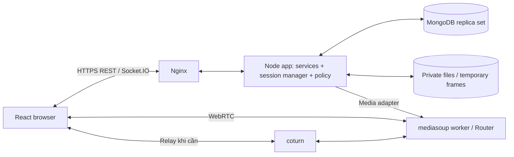

# Kiến trúc CoLearnia

**Trạng thái:** Kiến trúc đích. Đã có connector/entry points và native media runtime; service/policy/session/board nghiệp vụ chưa triển khai.

Trích chuyển nguyên nội dung tương ứng từ [technical plan v2.1](technical-plan.md) ngày 26/10/2026. Đây là nguồn chi tiết cho các mục được chuyển; số mục giữ theo baseline để truy vết. Thay đổi quy tắc cần cập nhật tại đây và review ảnh hưởng tới contract/test, không tạo bản sao song song.

## 4. Kiến trúc, module và trạng thái



HTTPS/Socket.IO là control plane; RTP audio/video/screen là media plane. Ảnh/tệp đi HTTP; event chỉ mang ID/metadata. Nginx không là HTTP proxy cho RTP. Một Router thuộc một worker; thêm CPU không tự chia một phiên lên nhiều lõi. [mediasoup scalability](https://mediasoup.org/documentation/v3/scalability/).

### 4.1. Chủ sở hữu trạng thái

| Module                 | Sở hữu                                                           | Không được tự làm                            |
| ---------------------- | ---------------------------------------------------------------- | -------------------------------------------- |
| Auth/Workspace/Channel | Auth, membership, channel access                                 | Tự cho admin nghe nhóm chưa tham gia         |
| Session manager        | SessionState, participant/group, queue, call epoch               | Chờ upload/picker/client ack lâu trong queue |
| Policy                 | canPublish/canConsume/canReadBoard/canReadFile/projectSessionFor | Gọi UI hoặc tự tạo media                     |
| Media adapter          | Worker/router/transports/producers/consumers                     | Tin scope/owner do client khai               |
| Board service          | Intent, frame context, strokes, board sequence                   | Ghi DB từng pointer event                    |
| Chat/File service      | Dữ liệu bền vững, dedupe, metadata/ACL                           | Phục vụ file chỉ vì biết ID                  |
| Frontend controller    | Runtime track/audio registry và projection để render             | Cấp quyền dựa vào state cục bộ               |

REST/socket handlers validate/auth → gọi cùng application service → trả envelope. Không sao chép policy vào từng handler. Media adapter tối thiểu có publish/closeProducer/reconcileAllowedSources/closeParticipant/getStats; không dựng framework nhiều SFU trước nhu cầu.

### 4.2. Runtime và thứ tự thay đổi

```ts
type SessionState = {
  id: string;
  epoch: string;
  mode: 'FREE' | 'MODERATED';
  status: 'ACTIVE' | 'ENDING' | 'ENDED';
  policyRevision: number;
  hostParticipantId: string | null;
  hostVoiceScope: 'GLOBAL' | 'GROUP' | 'MAIN';
  helpTargetGroupId: string | null;
  breakoutEnabled: boolean;
  mainScreenProducerId: string | null;
  screenSourceRevision: number;
  activeFloorGrantId: string | null;
  activePresentationId: string | null;
  announcementId: string | null;
};
```

Session manager serialize mutation quyền, không serialize mọi điểm vẽ. Chuyển nhóm/kick/revoke: dựng deny barrier → tính state mới → đóng media/fanout trái quyền → commit state → cấp media mới → gửi projection mới. Nếu lỗi, giữ nguồn bị thu ở trạng thái đóng, yêu cầu resync; không giữ tiếng riêng để UI trông liền mạch. Phần audio đã nhận/buffer không thể thu hồi tuyệt đối.

`policyRevision` dùng cho quyền; `boardVersion` cho context; `strokeSequence` cho nét; `epoch` cho đời session; `callGeneration` cho chủ kết nối. Reserve intent ngắn trong queue, nhả queue cho I/O rồi kiểm epoch/version/quyền lại khi commit. Mọi resource đang tạo phải được đăng ký pending để revoke có thể hủy, hoặc đóng ngay khi phát hiện state đã cũ.

## Source hiện có và các bước triển khai tiếp

- Web hiện là shell và status query; server có health/status, connector Mongo, Socket.IO từ chối handshake khi auth chưa có, native worker/WebRtcServer và Router factory.
- Các service, policy, handlers nghiệp vụ và RoomController trong thiết kế trên vẫn là đích triển khai. Không tạo đầy đủ tầng rỗng để đánh dấu kiến trúc đã xong.
- ESLint guard kiểm web → server, server → web và contracts → app/runtime adapters. Chưa enforce mọi layer bên trong server; bổ sung khi module thật có mặt.
- [Model DB](database/model.md) và [lifecycle](database/lifecycle.md) xác định ranh giới bền vững/tạm. Không lưu transport/Producer hoặc coi participant metadata là runtime sau restart.
- [Workflow AI](ai/workflow.md) mô tả kiểm tra và giới hạn guard. Thay kiến trúc cần ghi ảnh hưởng contracts, dữ liệu, quyền, cleanup và evidence.
