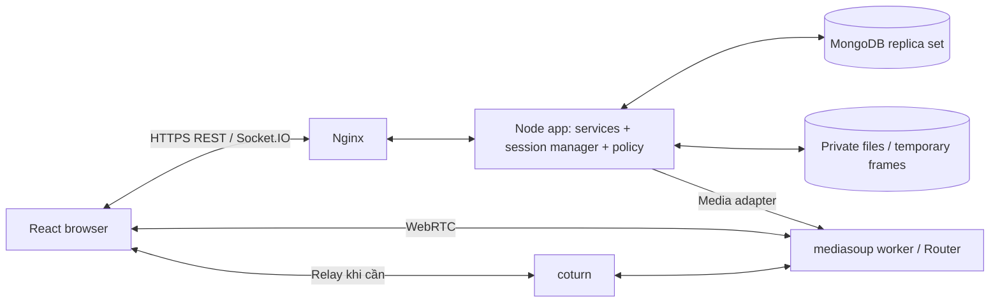

# Kiến trúc CoLearnia

**Trạng thái:** Kiến trúc đích. Đã có connector/entry points và native media runtime; service/policy/session/board nghiệp vụ chưa triển khai.

Nguồn ban đầu được trích chuyển từ [technical plan v2.1](technical-plan.md) ngày 26/10/2026. Đã cập nhật theo quyết định team ngày 27/10/2026 trong technical plan v2.3. Đây là nguồn chi tiết hiện hành cho các mục được chuyển; số mục giữ theo baseline để truy vết. Thay đổi quy tắc cần cập nhật tại đây và review ảnh hưởng tới contract/test, không tạo bản sao song song.

## 4. Kiến trúc, module và trạng thái



HTTPS/Socket.IO là control plane; RTP audio/video/screen là media plane. Ảnh/tệp đi HTTP; event chỉ mang ID/metadata. Nginx không là HTTP proxy cho RTP. Một Router thuộc một worker; thêm CPU không tự chia một phiên lên nhiều lõi. [mediasoup scalability](https://mediasoup.org/documentation/v3/scalability/).

### Capacity và độ ổn định bản đầu

[Capacity hiện hành](capacity.md) giữ gate chức năng 5 người, hướng kiểm chứng 10 → 25 rồi thử 50; chưa cam kết mức phát hành hoặc 100 người. Giữ một app process/mediasoup worker, một Router/LIVE và MongoDB Docker. Khi share, presentation lớn/thumbnail bên cạnh; camera nhận theo viewport/pin, thử tối đa 4 từ xa/client, server điều chỉnh Consumer thật. Audio không bị cắt vì camera ngoài viewport; selection không vượt policy nhóm. Tile/pin/presence tần suất cao không ghi DB.

Khi triển khai phải có queue/in-flight hữu hạn theo scope/process, deadline/backpressure, cleanup batch và metrics DB pool/gate/event-loop/worker/network. Pool Mongo đã do driver quản lý nhưng cấu hình chưa được đo; không tạo connection/user. Redis/Node worker pool/multi-worker chỉ chọn bằng task và bằng chứng nút thắt. Restart bản đầu kết thúc phiên; không thêm replicas/HA khi authority và khóa còn RAM. Xem capacity trước sửa topology hoặc tuyên bố 25/50 đạt.

### 4.1. Chủ sở hữu trạng thái

| Module                 | Sở hữu                                                           | Không được tự làm                            |
| ---------------------- | ---------------------------------------------------------------- | -------------------------------------------- |
| Auth/Workspace/Channel | Auth, membership, channel access                                 | Tự cho admin nghe nhóm chưa tham gia         |
| Session manager        | SessionState, participant/group, queue, call epoch               | Chờ upload/picker/client ack lâu trong queue |
| Policy                 | canPublish/canConsume/canReadBoard/canReadFile/projectSessionFor | Gọi UI hoặc tự tạo media                     |
| Media adapter          | Worker/router/transports/producers/consumers                     | Tin scope/owner do client khai               |
| Board service          | Intent, frame context, strokes, board sequence                   | Ghi DB từng pointer event                    |
| Chat/File service      | Dữ liệu bền vững, dedupe, metadata/ACL                           | Phục vụ file chỉ vì biết ID                  |
| Frontend controller    | Runtime track/audio registry và projection để render             | Cấp quyền dựa vào state cục bộ               |

REST/socket handlers validate/auth → gọi cùng application service → trả envelope. Không sao chép policy vào từng handler. Media adapter tối thiểu có publish/closeProducer/reconcileAllowedSources/closeParticipant/getStats; không dựng framework nhiều SFU trước nhu cầu.

Chat/File service dùng chung hạ tầng message/dedupe/attachment nhưng kiểm audience theo conversation kind như [messaging](product/messaging.md). CHANNEL/DIRECT và thread TEXT hoạt động ngoài cuộc gọi; không phụ thuộc SessionRuntime hoặc callGeneration. SESSION/GROUP/HOST_PRIVATE kiểm thêm runtime phiên/nhóm; HOST_PRIVATE giữ đúng hai bên ban đầu, chỉ đích gửi câu hỏi Host mới phải là host hiện tại. Host mới không có lịch sử cặp cũ. Workspace service sở hữu transaction tạo general; không tạo nhánh chat service riêng cho DM chỉ để nhân bản logic.

Subscription được kiểm ở server, không tin conversationId/rootMessageId từ client. DM không fanout vào room Workspace; thread kế thừa audience kênh. Thu quyền phải chặn REST/file, rời room socket và hủy pending fanout; frontend xóa cache không thay deny barrier. Pending message sau đổi quyền phải kiểm lại trước commit/fanout. Các ranh giới này là thiết kế đích, ESLint import guard chưa chứng minh thực thi ACL.

### 4.2. Runtime và thứ tự thay đổi

```ts
type SessionState = {
  id: string;
  epoch: string;
  status: 'ACTIVE' | 'ENDING' | 'ENDED';
  policyRevision: number;
  hostParticipantId: string | null;
  hostVoiceScope: 'GUIDANCE' | 'GROUP' | 'MAIN'; // GUIDANCE chỉ MAIN + DISCUSSION
  helpTargetGroupId: string | null;
  breakoutEnabled: boolean; // có group; không quyết định policy của mọi group
  mainScreenProducerId: string | null;
  mainScreenSourceRevision: number;
  announcementId: string | null;
  groupPhase: 'GUIDANCE' | 'ACTIVITY'; // hai loại nhóm không hoạt động đồng thời
  activityRoundId: string | null; // TIMER-01; deadline trong runtime round
};
```

Một kiểu cuộc họp: tạo LiveSession và gán người bắt đầu làm host nguyên tử; join phiên hiện có không tự lấy host. Không còn session mode FREE/MODERATED hoặc share grant MAIN theo host. MAIN và mỗi ACTIVITY dùng lease/ownership theo scope; chuyển host không tự đóng MAIN share còn hợp lệ. Host mất mạng quá grace chọn ngẫu nhiên participant hợp lệ làm host tạm; giữ danh tính người cũ và revision để tự hoàn quyền khi quay lại hợp lệ trong cùng phiên. Chuyển host chủ động có hiệu lực ngay sau kiểm quyền/revision, không cần người nhận chấp nhận. Host chủ động rời khi còn quyền kết thúc phiên; người đã bàn giao rời như thành viên. Không có ứng viên/host tạm mất mạng theo [vòng đời host](product/live-session.md#83-chuyển-host-và-host-mất-mạng).

Session manager serialize mutation quyền, không serialize mọi điểm vẽ. Chuyển nhóm/kick/revoke: dựng deny barrier → tính state mới → đóng media/fanout trái quyền → commit state → cấp media mới → gửi projection mới. Nếu lỗi, giữ nguồn bị thu ở trạng thái đóng, yêu cầu resync; không giữ tiếng riêng để UI trông liền mạch. Riêng bắt đầu ACTIVITY thất bại một phần phải hủy lượt theo [group modes](product/group-modes.md): thu ACTIVITY vừa mở, đưa người còn quyền về MAIN, không khôi phục DISCUSSION cũ; chỉ báo đã hủy khi cleanup hoàn tất. Không xem resync là kết quả phục hồi sản phẩm đủ cho nhánh này. Phần audio đã nhận/buffer không thể thu hồi tuyệt đối.

`policyRevision` dùng cho quyền; `boardVersion` cho context; `strokeSequence` cho nét; `epoch` cho đời session; `callGeneration` cho chủ kết nối. Reserve intent ngắn trong queue, nhả queue cho I/O rồi kiểm epoch/version/quyền lại khi commit. Mọi resource đang tạo phải được đăng ký pending để revoke có thể hủy, hoặc đóng ngay khi phát hiện state đã cũ.

## Source hiện có và các bước triển khai tiếp

- Web hiện là shell và status query; server có health/status, connector Mongo, Socket.IO từ chối handshake khi auth chưa có, native worker/WebRtcServer và Router factory.
- Các service, policy, handlers nghiệp vụ và RoomController trong thiết kế trên vẫn là đích triển khai. Không tạo đầy đủ tầng rỗng để đánh dấu kiến trúc đã xong.
- ESLint guard kiểm web → server, server → web và contracts → app/runtime adapters. Chưa enforce mọi layer bên trong server; bổ sung khi module thật có mặt.
- [Model DB](database/model.md) và [bước 3 trong lifecycle](database/lifecycle.md) xác định nơi lưu/vòng đời E01–E16, ranh giới bền vững/tạm và phục hồi sau restart. Không lưu transport/Producer hoặc coi participant metadata là runtime sau restart.
- [Workflow AI](ai/workflow.md) mô tả kiểm tra và giới hạn guard. Thay kiến trúc cần ghi ảnh hưởng contracts, dữ liệu, quyền, cleanup và evidence.

### Group policy và source registry v2.3

Theo [group modes](product/group-modes.md), GroupRuntime phân biệt DISCUSSION/ACTIVITY. DISCUSSION create kiểm tên/mục đích/roster/quyền/phase rồi tạo ngay; không host approve/reject hoặc hàng chờ xét. Roster chỉ là điều kiện để chủ động join, chưa cấp membership/private. Serialize create/join với phase/start/close; retry không nhân nhóm. ACTIVITY có cấu hình thủ công hoặc random preview được host kiểm/chỉnh trước start; start kiểm lại roster hiện hành.

Media registry định danh nguồn bằng scope + source ID/generation/revision, không dùng một screenSourceRevision toàn phiên để invalidate screen của nhóm độc lập. MAIN có lease độc quyền; mỗi ACTIVITY cũng có lease độc quyền riêng; member tự bấm share, không host duyệt. Hai group có thể share độc lập; trong một group chỉ một nguồn active/reserved thắng. Board intent gắn cả board scope và source scope; nhóm DISCUSSION đọc MAIN source nhưng giữ board riêng. Countdown là activity round runtime có deadline; lượt bắt đầu thành công phải có deadline. Khi đến hạn, session manager serialize kết thúc đúng round/epoch, dựng deny barrier, thu ACTIVITY/help/share/chat/board, chuyển người còn quyền về MAIN và pause mic; hoàn tất cleanup mới về GUIDANCE. Reconnect phải reconcile deadline trước khi cấp scope; callback trễ/lặp không đóng lượt mới, cleanup idempotent. Không chờ host hoặc thêm lệnh host kết thúc ACTIVITY thủ công.

Không auto tạo Router cho từng group hoặc thay topology chỉ vì thêm modes; tiếp tục PoC một Router/LiveSession và đo lại media capacity theo cả hai mode. Snapshot/pending resource/deny barrier phải lọc mode, source và audience, kể cả host/announcement.

### Rời hỗ trợ chủ động

Theo xác nhận 29/10/2026 tại [policy](product/groups-media-policy.md#81-host-group-và-hỗ-trợ), host.help.leave thu đường nhận/phát nhóm cũ trước rồi chuyển host về MAIN, giữ trạng thái bật/tắt mic, không chờ xác nhận mic riêng. Chỉ thời điểm sau chuyển phạm vi mới phát theo MAIN/DISCUSSION; không gắn cùng một luồng đồng thời vào nhóm hỗ trợ và MAIN. Cleanup do mất mạng/đóng nhóm/đổi host không tự áp chuyển mic chung này.

### Thiết kế document bước 4

[Collection-design](database/collection-design.md) giữ dữ liệu dài hạn qua reference; nhúng cặp private/attachment IDs/scope nhỏ có giới hạn. Channel access PRIVATE tra membership ACTIVE + grant đúng incarnation, không giữ allowedUserIds song song. Context/phase/group/board/media vẫn runtime; metadata DB dùng khóa/cleanup, không là authority cấp grant sau restart. [Bước 5](database/integrity-and-migrations.md) đã đặc tả đồng bộ mutation DB/runtime; chưa là implementation.

### Đồng thời DB ở bước 5

[Integrity bước 5](database/integrity-and-migrations.md) thêm Workspace mutation gate cho ACL/commit dữ liệu bền của bản một process. Lock order mở rộng là user ownership → Workspace gate → channel lifecycle → session mutation; không acquire ngược từ callback session và không chờ upload/client trong queue. Unique/CAS/transaction bổ sung bảo đảm dữ liệu, không thay runtime deny/ACL. Thêm app instance hoặc migration writes khi app đang phục vụ sẽ phá giả định, cần thiết kế khác trước triển khai. Gate hiện là phương án bảo toàn quyền của MVP, chưa là giải pháp đã đạt C-25/C-50; đo queue wait/hold/depth và chỉ thu hẹp coordination qua task race/revoke riêng theo [integrity](database/integrity-and-migrations.md#44-cổng-kiểm-chứng-trước-công-bố-capacity).

## Ranh giới I/O và hiệu lực quyền

Theo [integrity](database/integrity-and-migrations.md#41-cơ-chế-chung), giữ queue không giữ deadline đứng yên: kiểm deadline/epoch/quyền sau await và trước grant/read/fanout. Write DB đi qua deadline không cho phép phát nội dung scope đã hết hạn; reconcile kết quả commit thay rollback giả giữa DB và RAM. Download dùng registry stream để revoke/expiry hủy truyền; nhả gate trước stream byte, không trì hoãn thu quyền tới khi tải xong.

## Board theo quyết định 02/11/2026

[Board service](product/board-collaboration.md) phân biệt MAIN overlay LIVE (host hiện hành ở MAIN/hướng dẫn) với board nhóm có freeze intent/frame. Share ownership không cấp quyền vẽ MAIN. MAIN không reserve/upload frame freeze; đổi/dừng nguồn MAIN xóa overlay đúng revision, đổi host thu quyền mutation cũ. Nhóm không mất frame FROZEN hợp lệ chỉ vì nguồn live đổi. Nét thường MAIN tồn tại tới clear/context nguồn kết thúc, nét tự biến mất có lifecycle riêng; chưa chốt thời gian/fade. Không thêm collection hoặc ghi Mongo theo điểm vẽ.

### Vòng đời DISCUSSION và giới hạn help — cập nhật 02/11/2026

Theo [group modes](product/group-modes.md), Session manager phân biệt nhóm đã tạo hợp lệ chưa ai vào với nhóm đã có người, không đếm roster thành membership. Join lại chỉ thành công khi DISCUSSION còn mở/còn người, actor thuộc roster và phase/quyền còn hợp lệ. Người cuối cùng chủ động về MAIN hoặc rời LIVE làm nhóm tự kết thúc; serialize leave với join/close, chặn cấp quyền mới và thu private scope, intent, frame/nét trước khi báo đóng. Không tái tạo nhóm từ roster cũ. Nhóm tạo hợp lệ chưa ai vào vẫn chờ; disconnect đi qua reconnect/grace, không tự áp nhánh leave chủ động. Chưa chọn field/enum mới hoặc cách xử lý nhóm rỗng do sự cố sau grace.

Help chỉ nhắm ACTIVITY còn mở trong lượt hiệu lực; policy từ chối vào hỗ trợ DISCUSSION. Host ở MAIN trả lời HOST_PRIVATE cho DISCUSSION, không được nhận board/chat/media nhóm chỉ vì role host. ACTIVITY không tự kết thúc theo số người; deadline/cleanup hiện hành vẫn áp dụng.

## Bổ sung recording MAIN sau kickoff 02/11

RECORD-01 theo [nguồn nghiệp vụ](product/recording.md): host điều khiển ghi màn hình/camera/âm thanh MAIN; lưu theo phiên để thành viên còn quyền kênh xem. Không ghi nhóm riêng hoặc chuyển recorder theo host hỗ trợ. Chưa có implementation hoặc benchmark. Proposal M3 chủ trì, M4 cung cấp host/scope/lifecycle, M2 lưu/phục vụ byte/ACL, M1 quyền kênh.

Cần chọn capture/composition/encode, bố cục/số camera/codec và cách phát, trạng thái xử lý, idempotency, cleanup khi stop/end/error/restart, quota/retention/quyền xóa. Chưa chốt thư viện, topology recorder, collection hoặc schema executable. Không coi recorder là participant được nghe mọi scope. Không giữ queue/mutex phiên khi chờ encode/lưu file; task phải thiết kế gate tài nguyên và giao diện cleanup. Đo CPU/RAM/disk/network cùng media/chat/board/TURN trước khi chốt capacity; PoC clip vài phút không là giới hạn thời lượng sản phẩm. REC-01 vẫn là reconnect, không dùng mã đó cho recording.
