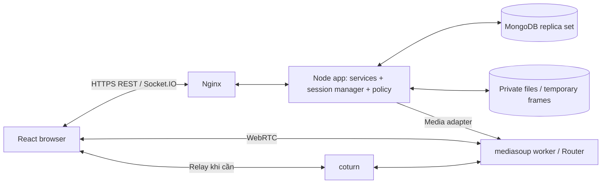

# Kiến trúc CoLearnia

**Trạng thái:** Kiến trúc đích. Đã có connector/entry points và native media runtime; service/policy/session/board nghiệp vụ chưa triển khai.

Nguồn ban đầu được trích chuyển từ [technical plan v2.1](technical-plan.md) ngày 26/10/2026. Đã cập nhật theo quyết định team ngày 27/10/2026 trong technical plan v2.3. Đây là nguồn chi tiết hiện hành cho các mục được chuyển; số mục giữ theo baseline để truy vết. Thay đổi quy tắc cần cập nhật tại đây và review ảnh hưởng tới contract/test, không tạo bản sao song song.

## 4. Kiến trúc, module và trạng thái



HTTPS/Socket.IO là control plane; RTP audio/video/screen là media plane. Ảnh/tệp đi HTTP; event chỉ mang ID/metadata. Nginx không là HTTP proxy cho RTP. Một Router thuộc một worker; thêm CPU không tự chia một phiên lên nhiều lõi. [mediasoup scalability](https://mediasoup.org/documentation/v3/scalability/).

### 4.1. Chủ sở hữu trạng thái

| Module                 | Sở hữu                                                           | Không được tự làm                            |
| ---------------------- | ---------------------------------------------------------------- | -------------------------------------------- |
| Auth/Workspace/Channel | Auth, membership, channel access                                 | Tự cho admin nghe nhóm chưa tham gia         |
| Session manager        | SessionState, participant/group, queue, call epoch               | Chờ upload/picker/client ack lâu trong queue |
| Policy                 | canPublish/canConsume/canReadBoard/canReadFile/projectSessionFor | Gọi UI hoặc tự tạo media                     |
| Media adapter          | Worker/router/transports/producers/consumers                     | Tin scope/owner do client khai               |
| Board service          | Intent, frame context, strokes, board sequence                   | Ghi DB từng pointer event                    |
| Chat/File service      | Dữ liệu bền vững, dedupe, metadata/ACL                           | Phục vụ file chỉ vì biết ID                  |
| Frontend controller    | Runtime track/audio registry và projection để render             | Cấp quyền dựa vào state cục bộ               |

REST/socket handlers validate/auth → gọi cùng application service → trả envelope. Không sao chép policy vào từng handler. Media adapter tối thiểu có publish/closeProducer/reconcileAllowedSources/closeParticipant/getStats; không dựng framework nhiều SFU trước nhu cầu.

Chat/File service dùng chung hạ tầng message/dedupe/attachment nhưng kiểm audience theo conversation kind như [messaging](product/messaging.md). CHANNEL/DIRECT và thread TEXT hoạt động ngoài cuộc gọi; không phụ thuộc SessionRuntime hoặc callGeneration. SESSION/GROUP/HOST_PRIVATE kiểm thêm runtime phiên/nhóm/host hiện tại. Workspace service sở hữu transaction tạo general; không tạo nhánh chat service riêng cho DM chỉ để nhân bản logic.

Subscription được kiểm ở server, không tin conversationId/rootMessageId từ client. DM không fanout vào room Workspace; thread kế thừa audience kênh. Thu quyền phải chặn REST/file, rời room socket và hủy pending fanout; frontend xóa cache không thay deny barrier. Pending message sau đổi quyền phải kiểm lại trước commit/fanout. Các ranh giới này là thiết kế đích, ESLint import guard chưa chứng minh thực thi ACL.

### 4.2. Runtime và thứ tự thay đổi

```ts
type SessionState = {
  id: string;
  epoch: string;
  status: 'ACTIVE' | 'ENDING' | 'ENDED';
  policyRevision: number;
  hostParticipantId: string | null;
  hostVoiceScope: 'GUIDANCE' | 'GROUP' | 'MAIN'; // GUIDANCE chỉ MAIN + DISCUSSION
  helpTargetGroupId: string | null;
  breakoutEnabled: boolean; // có group; không quyết định policy của mọi group
  mainScreenProducerId: string | null;
  mainScreenSourceRevision: number;
  announcementId: string | null;
  groupPhase: 'GUIDANCE' | 'ACTIVITY'; // hai loại nhóm không hoạt động đồng thời
  activityRoundId: string | null; // TIMER-01; deadline trong runtime round
};
```

Một kiểu cuộc họp: tạo LiveSession và gán người bắt đầu làm host nguyên tử; join phiên hiện có không tự lấy host. Không còn session mode FREE/MODERATED hoặc share grant MAIN theo host. MAIN và mỗi ACTIVITY dùng lease/ownership theo scope; chuyển host không tự đóng MAIN share còn hợp lệ. Host mất mạng quá grace chọn ngẫu nhiên participant hợp lệ làm host tạm; giữ danh tính người cũ và revision để tự hoàn quyền khi quay lại hợp lệ trong cùng phiên. Các nhánh nhiều sự cố/rời chủ động theo [vòng đời host](product/live-session.md#83-chuyển-host-và-host-mất-mạng).

Session manager serialize mutation quyền, không serialize mọi điểm vẽ. Chuyển nhóm/kick/revoke: dựng deny barrier → tính state mới → đóng media/fanout trái quyền → commit state → cấp media mới → gửi projection mới. Nếu lỗi, giữ nguồn bị thu ở trạng thái đóng, yêu cầu resync; không giữ tiếng riêng để UI trông liền mạch. Phần audio đã nhận/buffer không thể thu hồi tuyệt đối.

`policyRevision` dùng cho quyền; `boardVersion` cho context; `strokeSequence` cho nét; `epoch` cho đời session; `callGeneration` cho chủ kết nối. Reserve intent ngắn trong queue, nhả queue cho I/O rồi kiểm epoch/version/quyền lại khi commit. Mọi resource đang tạo phải được đăng ký pending để revoke có thể hủy, hoặc đóng ngay khi phát hiện state đã cũ.

## Source hiện có và các bước triển khai tiếp

- Web hiện là shell và status query; server có health/status, connector Mongo, Socket.IO từ chối handshake khi auth chưa có, native worker/WebRtcServer và Router factory.
- Các service, policy, handlers nghiệp vụ và RoomController trong thiết kế trên vẫn là đích triển khai. Không tạo đầy đủ tầng rỗng để đánh dấu kiến trúc đã xong.
- ESLint guard kiểm web → server, server → web và contracts → app/runtime adapters. Chưa enforce mọi layer bên trong server; bổ sung khi module thật có mặt.
- [Model DB](database/model.md) và [lifecycle](database/lifecycle.md) xác định ranh giới bền vững/tạm. Không lưu transport/Producer hoặc coi participant metadata là runtime sau restart.
- [Workflow AI](ai/workflow.md) mô tả kiểm tra và giới hạn guard. Thay kiến trúc cần ghi ảnh hưởng contracts, dữ liệu, quyền, cleanup và evidence.

### Group policy và source registry v2.3

Theo [group modes](product/group-modes.md), GroupRuntime có mode DISCUSSION/ACTIVITY, membership và context riêng; request lưu tên/mục đích/requester/danh sách đề xuất để host duyệt. Không dùng một cờ breakoutEnabled để cấp cùng nguồn cho mọi nhóm. Pending request không tạo quyền nghe/vẽ/share. Approval tạo danh sách đủ điều kiện; người được chọn bấm Vào nhóm mới cấp membership. Phase GUIDANCE cho DISCUSSION; host đóng DISCUSSION trước ACTIVITY, hết lượt về MAIN/GUIDANCE. TTL/cancel/field limits là chi tiết task, không tự thêm chuyển mode tại chỗ.

Media registry định danh nguồn bằng scope + source ID/generation/revision, không dùng một screenSourceRevision toàn phiên để invalidate screen của nhóm độc lập. MAIN có lease độc quyền; mỗi ACTIVITY cũng có lease độc quyền riêng; member tự bấm share, không host duyệt. Hai group có thể share độc lập; trong một group chỉ một nguồn active/reserved thắng. Board intent gắn cả board scope và source scope; nhóm DISCUSSION đọc MAIN source nhưng giữ board riêng. Countdown là activity round runtime có deadline, không gọi closeAll khi expired.

Không auto tạo Router cho từng group hoặc thay topology chỉ vì thêm modes; tiếp tục PoC một Router/LiveSession và đo lại media capacity theo cả hai mode. Snapshot/pending resource/deny barrier phải lọc mode, source và audience, kể cả host/announcement.
