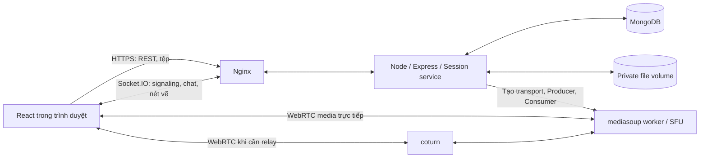
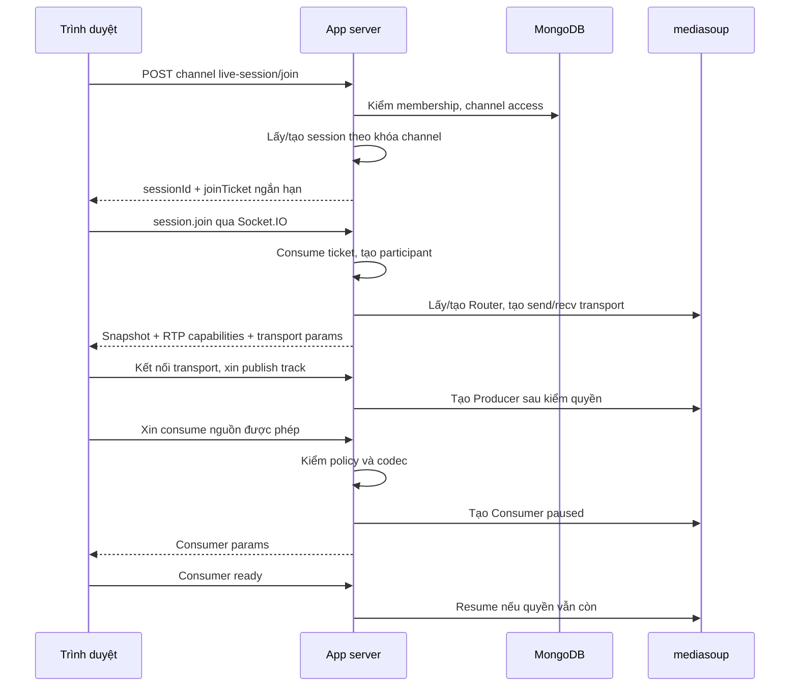
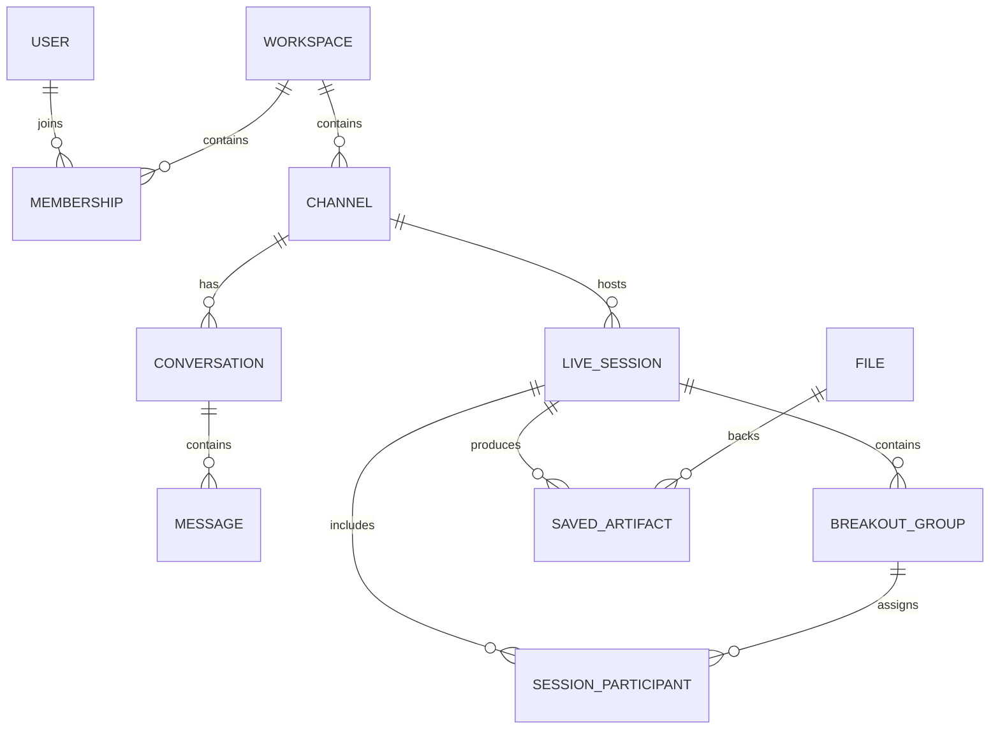

# StudyWeave — Tài liệu chức năng và hướng triển khai

**Tên đề tài:** Nền tảng học nhóm trực tuyến tích hợp chia sẻ màn hình và tương tác thời gian thực.  
**Đối tượng đọc:** toàn bộ nhóm phát triển, 5 thành viên.  
**Ngày biên soạn:** 23/10/2026.  
**Phạm vi:** kế hoạch triển khai, hợp đồng giao tiếp và tiêu chí hoàn thành; chưa phải mã nguồn hay kết quả thử tải.

Tài liệu này chuyển bản giới thiệu sản phẩm thành các đầu việc kỹ thuật. Các thông số giới hạn bên dưới là cấu hình khởi đầu để phát triển, không phải cam kết hiệu năng. Lịch làm việc sử dụng khung 10 tuần và 2 tuần dự phòng.

## Mục lục

1. [Phạm vi sản phẩm](#1-phạm-vi-sản-phẩm)
2. [Mô hình Workspace → kênh → phiên → nhóm](#2-mô-hình-workspace--kênh--phiên--nhóm)
3. [Kiến trúc và công nghệ](#3-kiến-trúc-và-công-nghệ)
4. [Danh sách chức năng phải triển khai](#4-danh-sách-chức-năng-phải-triển-khai)
5. [Quyền và quy tắc nghe/nhìn](#5-quyền-và-quy-tắc-nghenhìn)
6. [Luồng gọi điện và chia sẻ màn hình](#6-luồng-gọi-điện-và-chia-sẻ-màn-hình)
7. [Tạm dừng hình, nét vẽ và trở lại trực tiếp](#7-tạm-dừng-hình-nét-vẽ-và-trở-lại-trực-tiếp)
8. [Phát biểu theo nhóm và hỗ trợ riêng](#8-phát-biểu-theo-nhóm-và-hỗ-trợ-riêng)
9. [Âm lượng cá nhân](#9-âm-lượng-cá-nhân)
10. [Mô hình dữ liệu](#10-mô-hình-dữ-liệu)
11. [API và sự kiện realtime](#11-api-và-sự-kiện-realtime)
12. [Màn hình và cấu trúc mã nguồn](#12-màn-hình-và-cấu-trúc-mã-nguồn)
13. [Kết nối lại, vòng đời và dọn tài nguyên](#13-kết-nối-lại-vòng-đời-và-dọn-tài-nguyên)
14. [Bảo mật và giới hạn tài nguyên](#14-bảo-mật-và-giới-hạn-tài-nguyên)
15. [Kiểm thử và cách đo](#15-kiểm-thử-và-cách-đo)
16. [Phân công 5 thành viên](#16-phân-công-5-thành-viên)
17. [Lộ trình và các mốc tích hợp](#17-lộ-trình-và-các-mốc-tích-hợp)
18. [Triển khai và vận hành](#18-triển-khai-và-vận-hành)
19. [Rủi ro và cách cắt phạm vi](#19-rủi-ro-và-cách-cắt-phạm-vi)
20. [Việc cần bắt đầu và nguồn tham khảo](#20-việc-cần-bắt-đầu-và-nguồn-tham-khảo)

## 1. Phạm vi sản phẩm

### 1.1. Hệ thống cần làm được gì?

- Người dùng tạo Workspace, mời thành viên và tạo các kênh.
- Kênh văn bản chứa tin nhắn, ảnh và tài liệu được lưu lâu dài.
- Kênh trực tiếp là phòng gọi: thành viên vào để bật mic/camera, chia sẻ màn hình, chỉ bài và trao đổi.
- Phòng tự do phục vụ nhóm bạn học bình thường.
- Phiên có người điều hành hỗ trợ chia nhóm, hướng dẫn toàn lớp, vào hỗ trợ nhóm và mời nhóm trình bày.
- Nhóm nhỏ nghe/nói riêng nhưng vẫn nhận màn hình hướng dẫn chung.
- Người học tạm dừng hình để giải thích; tiếng vẫn tiếp tục. Trở lại trực tiếp là xem ngay hình hiện tại.
- Nhóm được mời có quyền phát biểu cho cả nhóm và công bố đúng nội dung cùng nét vẽ của mình.
- Người nghe chỉnh âm lượng từng người trên máy của mình.

### 1.2. Các mức triển khai

| Mức | Nội dung | Điều kiện hoàn thành |
|---|---|---|
| P0 — lõi | Tài khoản, Workspace, thành viên, kênh, chat/tệp, gọi và chia sẻ, nhóm nhỏ, phân quyền media, dừng hình/vẽ, phát biểu nhóm, âm lượng, reconnect | Có luồng hoàn chỉnh trên Internet; quyền riêng tư được kiểm thử |
| P1 — bổ trợ | Lưu ảnh kèm nét vẽ, thư viện bài làm, trạng thái nhóm, đồng hồ, câu hỏi A/B/C/D | Làm sau khi luồng P0 ổn định |
| Ngoài phạm vi | Kho video VOD/HLS, lộ trình cá nhân, ghi hình toàn phiên, phụ đề AI, chạy code trên server, điều khiển máy từ xa | Không đưa vào backlog của bản đầu |

P0 là phạm vi sản phẩm đích, không phải tất cả đều phải xuất hiện trong nguyên mẫu đầu tiên. Cần có gọi thật và quyền nhận media thật trước khi mở rộng giao diện.

### 1.3. Quy ước cho bản đầu

- Ưu tiên Chrome/Edge trên máy tính; Firefox kiểm thử bổ sung. Điện thoại chưa là môi trường nghiệm thu chính.
- Mỗi tài khoản có một kết nối gọi hoạt động tại một thời điểm. Một thiết bị khác xin vào sẽ yêu cầu chuyển phiên, tránh nhân đôi mic.
- Mỗi phiên có một màn hình chia sẻ chính. Chia sẻ màn hình riêng song song ở từng nhóm để giai đoạn sau.
- Một nhóm được trình bày toàn lớp tại một thời điểm. Cả nhóm được cấp quyền nói; từng người tự xác nhận tham gia phát biểu và bật mic.
- Chưa cố định số người/phòng hoặc số nhóm tối đa. Cấu hình ban đầu dùng để thử, giới hạn phát hành phải dựa trên phép đo.
- Phiên tự do hoạt động khi có người vào; không cần mở chế độ điều hành để học.

## 2. Mô hình Workspace → kênh → phiên → nhóm

```text
User
└── Workspace: Công nghệ Web (IT4409)
    ├── Membership: owner / admin / member
    ├── TEXT channel: thông-báo-chung
    ├── TEXT channel: tài-liệu-bài-giảng
    ├── TEXT channel: hỏi-đáp-bài-tập
    ├── LIVE channel: Sảnh Tự Học
    │   └── LiveSession đang hoạt động khi có người tham gia
    └── LIVE channel: Phòng Bài Giảng Chính
        └── LiveSession
            ├── Người điều hành và nội dung chung
            ├── BreakoutGroup 1
            ├── BreakoutGroup 2
            └── BreakoutGroup 3
```

| Khái niệm | Tồn tại bao lâu? | Không được nhầm với |
|---|---|---|
| Workspace | Đến khi chủ sở hữu xóa | Một cuộc gọi |
| Channel | Được lưu trong Workspace | Một Socket.IO room |
| LiveSession | Một lần sử dụng phòng trực tiếp; đóng khi hết người sau thời gian chờ hoặc người điều hành kết thúc | Kênh LIVE cố định |
| SessionParticipant | Một người tham gia phiên, có nhóm và trạng thái | Membership trong Workspace |
| BreakoutGroup | Thuộc đúng một LiveSession | Kênh LIVE mới hoặc Workspace mới |
| BoardContext | Ngữ cảnh nét vẽ của phòng tự do hoặc một nhóm | Thư viện ảnh bài làm |
| Producer / Consumer | Đối tượng media đang sống trong mediasoup | Bản ghi MongoDB dùng lại sau restart |

**Bất biến:** một channel LIVE có tối đa một LiveSession đang hoạt động. Tạo phiên và tham gia phải là thao tác server có khóa theo channel; hai người vào cùng lúc không tạo hai phiên.

Workspace/kênh còn tồn tại khi phòng trống. Khi phiên kết thúc, group và transport của phiên đóng; tin nhắn trong kênh và bài đã lưu vẫn còn theo quyền Workspace.

## 3. Kiến trúc và công nghệ

### 3.1. Stack triển khai chính

| Thành phần | Lựa chọn | Mục đích và đánh đổi |
|---|---|---|
| Frontend | React + TypeScript + Vite | Một ứng dụng, có kiểu dữ liệu dùng chung với backend |
| UI | Tailwind CSS; component dùng chung | Xây workspace sidebar, màn hình phòng, panel thành viên và công cụ vẽ |
| Client state | Zustand cho session; TanStack Query cho REST | Không trộn danh sách kênh với vòng đời transport/media |
| Backend | Node.js 24 LTS + Express + TypeScript | REST, auth, nghiệp vụ, Socket.IO; khóa phiên bản dependency bằng lockfile |
| Database | MongoDB + Mongoose | Theo nền tảng môn học; schema/index vẫn phải chặt chẽ |
| Signaling & events | Socket.IO | Request/ack, thông báo trạng thái, chat phòng, nét vẽ |
| Media | WebRTC + mediasoup v3 + mediasoup-client | Server quyết định tạo/đóng từng Consumer; linh hoạt cho phạm vi nhóm và toàn lớp |
| Mic mixing tại client | Web Audio API / GainNode | Âm lượng từng track, theo nhóm, giảm tiếng khi thông báo |
| Vẽ | Canvas 2D + pointer events | Chỉ cần bút, màu, con trỏ, undo của mình; chưa cần bảng trắng đầy đủ |
| Tệp | Disk volume ngoài thư mục public, truy cập qua API kiểm quyền | Ít thành phần ở bản đầu; có interface để đổi sang object storage |
| Reverse proxy | Nginx | HTTPS, frontend, REST và Socket.IO; không dùng làm đường truyền RTP |
| NAT traversal | coturn | TURN có credential ngắn hạn cho mạng không đi thẳng tới SFU |
| Triển khai | Một VPS Linux + Docker Compose | Dễ theo dõi và demo, có giới hạn mở rộng rõ |
| CI | GitHub Actions | Typecheck, test, build image; triển khai staging theo bản có tag |

**Đây là lựa chọn kiến trúc cho kế hoạch này, không phải công nghệ đã triển khai.** mediasoup làm tăng phần code signaling và vòng đời media; đánh đổi lấy khả năng kiểm soát quyền nhận từng track ngay trên server.

### 3.2. Vì sao chọn mediasoup thay vì nhúng sẵn một cuộc gọi?

| Phương án | Lợi ích | Điểm cần cân nhắc |
|---|---|---|
| mediasoup | Backend tự tạo Consumer sau khi kiểm quyền; mô hình một phiên có nhiều nhóm logic rõ | Phải tự viết signaling, lifecycle, reconnect và UI |
| LiveKit | SDK và thành phần phòng dựng sẵn, giảm thời gian gọi cơ bản | Phải chứng minh chính sách subscription cho nhóm/toàn lớp được cưỡng chế phía server, không chỉ bằng UI; không coi phòng logic và phòng media tự nhiên là một |
| Mesh WebRTC tự viết | Dễ thử với hai người | Số kết nối và uplink tăng khi nhiều người; khó phù hợp màn hình chung và chuyển phạm vi |

Không triển khai đồng thời hai SFU. Nếu đổi lựa chọn, thay ở mốc PoC, trước khi cả nhóm phụ thuộc hợp đồng media.

### 3.3. Hai đường truyền khác nhau



- **Control plane:** auth, quyền, nhóm, nguồn chia sẻ, trạng thái, thao tác vẽ.
- **Media plane:** audio/video/screen qua WebRTC, không qua event chat hoặc request JSON.
- Tệp ảnh/đính kèm đi qua HTTPS; chỉ ID và metadata xuất hiện trong event.

**Một LiveSession dùng một mediasoup Router ở bản đầu.** BreakoutGroup là phạm vi nghiệp vụ trong Router này, không tạo SFU room riêng rồi cố kéo màn hình qua lại. Server lập danh sách Consumer được phép cho từng người. Không có nghĩa ai trong cùng Router cũng được nhận mọi track.

Theo tài liệu, mediasoup là SFU, không tự decode/transcode media; mỗi worker dùng một lõi CPU. Không suy từ số người trong demo thành một mức tải được bảo đảm. [Nguồn S2](#nguồn-tham-khảo).

## 4. Danh sách chức năng phải triển khai

Mỗi dòng phải có cả giao diện, xử lý server và kiểm thử phần quyền liên quan. ID dùng khi chia issue hoặc PR.

| ID / mức | Chức năng | Frontend | Backend / dữ liệu | Tiêu chí hoàn thành |
|---|---|---|---|---|
| AUTH-01 / P0 | Đăng ký, đăng nhập, đăng xuất | Form, lỗi, phiên hết hạn | Hash mật khẩu, session cookie, logout hủy session | Refresh vẫn đăng nhập; logout chặn cả REST lẫn socket |
| WS-01 / P0 | Tạo Workspace | Form tên/ảnh; danh sách workspace | Workspace + owner membership | Tạo xong xuất hiện sidebar; không tạo trùng do gửi lại |
| WS-02 / P0 | Lời mời | Tạo/copy link, nhận lời mời | Token băm, expiry, revoke, join idempotent | Link hết hạn/thu hồi không dùng được; join hai lần không trùng membership |
| WS-03 / P0 | Thành viên và quyền | Danh sách, đổi role, xóa thành viên | Owner/admin/member; kiểm quyền mọi mutation | Không tự nâng quyền; không xóa owner cuối cùng |
| CH-01 / P0 | Kênh TEXT/LIVE | Tạo, đổi tên, xóa; tách loại kênh | Channel workspace/type/order/access | Không gửi chat TEXT vào LIVE bằng cách sửa type; LIVE vẫn hiện khi trống |
| CHAT-01 / P0 | Chat kênh | Phân trang, gửi, pending/error | Message, attachment ACL, event sau khi lưu | Không mất tin đã ack; gửi lại không nhân đôi |
| FILE-01 / P0 | Upload/download | Chọn tệp, tiến độ, thông báo lỗi | Kiểm loại/dung lượng; private path; kiểm quyền khi tải | Người ngoài Workspace không mở file bằng URL lấy được |
| LIVE-01 / P0 | Vào/rời phòng | Lobby thiết bị; danh sách tham gia | Join/create LiveSession, Participant, presence | Hai người vào đồng thời chung session; rời phòng đóng tài nguyên |
| LIVE-02 / P0 | Mic/camera | Toggle, device picker, denied permission | Producer/Consumer, giới hạn publish | Thật sự nghe/xem từ mạng khác; mic muted không tự bật |
| LIVE-03 / P0 | Chia sẻ màn hình | Nút share, browser picker, stop | Share lease, source revision, screen producer | Một nguồn chính; bấm Stop trên browser dọn được state |
| HOST-01 / P0 | Chế độ điều hành | Nhận/chuyển quyền, trạng thái host | Mode/host/revision; authorization | Không chiếm host đang tồn tại; chuyển host có event |
| GRP-01 / P0 | Tạo/chuyển/đóng nhóm | Danh sách con dưới phòng, phân thành viên | Group + membership, reconcile media | Rời nhóm A không tiếp tục nhận audio/chat A |
| GRP-02 / P0 | Nội dung chung, tiếng riêng | Main screen + panel nhóm | Screen cho cả session, mic theo chính sách | Hai nhóm nói đồng thời không nghe nhầm nhau |
| BOARD-01 / P0 | Con trỏ, bút và undo | Canvas, tọa độ chuẩn hóa | Board version, stroke log, fanout có ACL | Nhóm B không nhận nét nhóm A; undo chỉ nét mình |
| FREEZE-01 / P0 | Tạm dừng hình / trở lại trực tiếp | Một khung hình cố định; audio giữ nguyên | Snapshot tạm + board context | Dừng trang 3; resume thấy trang hiện tại; không tạo ảnh thư viện |
| HELP-01 / P0 | Hỏi riêng, host vào hỗ trợ | Tin tới host; thông báo host vào | Private conversation, helpTargetGroupId | Host hỗ trợ nhóm A không phát tiếng riêng sang B |
| FLOOR-01 / P0 | Mời cả nhóm trình bày | Invitation, accept, scope badge | Grant + consent + policy revision | Mọi thành viên được mời; chỉ người đồng ý và bật mic ra toàn lớp |
| PRESENT-01 / P0 | Công bố hình và nét nhóm | Chọn nội dung, presentation view | Presentation projection + ACL riêng | Không đưa chat/history nhóm ra toàn lớp; revoke chặn đọc tiếp |
| AUDIO-01 / P0 | Volume, ducking | Thanh từng người/nhóm, reset | Local preference; event announcement | Không ảnh hưởng người khác; kết thúc thông báo khôi phục đúng |
| REC-01 / P0 | Reconnect | Reconnecting/sync state | Resume ticket, snapshot mới, epoch | Không lấy lại quyền phát biểu đã bị thu hồi |
| SAVE-01 / P1 | Lưu ảnh + nét vẽ | Export, chọn nơi gửi | Durable SavedArtifact, owner/audience | Xem lại sau phiên; đúng ảnh và nét |
| STATUS-01 / P1 | Trạng thái nhóm | Đang làm/Cần trợ giúp/Đã xong | GroupStatus có version | Host nhận cập nhật; nhóm khác không sửa được |
| TIMER-01 / P1 | Đồng hồ | Countdown, hết giờ | Deadline của server, pause/extend | Máy khác đồng hồ vẫn cùng deadline; không xóa bài khi hết giờ |
| QUIZ-01 / P1 | A/B/C/D | Tạo, trả lời, kết quả | Poll + Vote, deadline, audience | Một phiếu/user hoặc group; không lộ đáp án trước công bố |
| LIB-01 / P1 | Thư viện bài làm | Danh sách, mở, chia sẻ/xóa | SavedArtifact và file ACL | Không tự công bố mọi snapshot tạm |

## 5. Quyền và quy tắc nghe/nhìn

### 5.1. Ba lớp quyền

1. **Workspace role:** owner/admin/member — quản lý không gian và kênh.
2. **Session role:** host/member — điều hành đúng phiên hiện tại. Admin Workspace không mặc nhiên là host hoặc được nghe mọi nhóm.
3. **Media/board grant:** được nhận track nào, vẽ vào board nào, công bố nội dung nào, đến bao giờ.

Mỗi Channel có `accessMode=WORKSPACE` hoặc `RESTRICTED`, và danh sách thành viên khi restricted. Nhóm không triển khai permission override phức tạp kiểu Discord ở bản đầu. Role nào tạo/sửa kênh phải cố định trong một policy: owner/admin; member có thể tạo Workspace riêng.

### 5.2. Ma trận media khi có breakout

| Nguồn | Người được nhận mặc định | Khi có trạng thái đặc biệt |
|---|---|---|
| Main screen + screen audio | Thành viên session có quyền ở kênh | Dừng hình không cắt audio; display chính có thể chuyển sang bài trình bày |
| Mic/camera của thành viên | Cùng nhóm; người ở sảnh chính cùng phạm vi MAIN | Mic ra toàn lớp khi có grant + consent; camera không tự ra toàn lớp |
| Mic của host | Cả session khi `hostVoiceScope=GLOBAL` | Khi host vào hỗ trợ: chỉ target group; global announcement phải đổi scope rõ |
| Camera của host | Cả session trong chế độ hướng dẫn | Không dùng camera làm cổng nhận audio |
| Board riêng | Cùng nhóm; host khi đã vào hỗ trợ | Bài được công bố có projection chỉ đọc cho cả session |
| Chat nhóm | Thành viên đang có quyền nhóm | Không được mở rộng vì group đang trình bày |
| Tin hỏi host | Người gửi và host được phân công | Không fanout sang nhóm hoặc toàn session |

Trong phòng FREE chưa chia nhóm: mọi người thuộc scope MAIN, nhận mic/camera của nhau. Khi chuyển sang breakout, phải đóng các Consumer cũ không còn quyền; không chỉ đổi nhãn nhóm.

**Hàm trung tâm:** `canConsume(viewer, producer, sessionState)` và `canReadBoard(viewer, board, sessionState)`. REST, socket, file API và media đều gọi policy tương ứng; không sao chép logic riêng ở từng handler.

### 5.3. Server là nơi cưỡng chế quyền

- Client xin nhận `producerId`; server tự tra owner, session, kind, group và revision, không tin `userId/groupId` tự khai.
- `router.canConsume()` chỉ kiểm tương thích media, **không thay cho authorization**.
- Được quyền mới tạo Consumer; bị thu quyền phải pause/close Consumer phía server.
- Danh sách Producer và event cũng chỉ gửi cho người được phép thấy.
- Socket.IO room chỉ là kênh fanout do backend quản lý; client không tự join bằng một chuỗi group ID. [Nguồn S4](#nguồn-tham-khảo).
- Chia sẻ Workspace không đồng nghĩa được nghe một cuộc gọi chưa tham gia.

### 5.4. Thay đổi quyền phải tuần tự và fail closed

Mỗi session có hàng đợi mutation và `policyRevision` tăng dần. Khi move group, kết thúc presentation, host chuyển scope hoặc kick:

1. Đánh dấu chuyển trạng thái; chặn yêu cầu consume dùng revision cũ.
2. Tính quyền mới, đóng Consumer và membership fanout không còn quyền.
3. Commit trạng thái mới; tạo các Consumer mới được phép.
4. Gửi snapshot/event với revision mới.

Nếu reconcile lỗi: giữ media bị thu hồi ở trạng thái đóng, báo reconnect; không duy trì audio riêng vì giao diện đã đổi. Gói audio đã gửi và buffer nhỏ phía người nghe có thể còn phát trong thời gian ngắn; đo khoảng này, không hứa thu hồi âm thanh tức thời tuyệt đối.

## 6. Luồng gọi điện và chia sẻ màn hình

### 6.1. Join phòng



Tách send/receive transport theo mediasoup-client. Tạo Consumer paused rồi resume sau khi client sẵn sàng, đồng thời kiểm lại quyền tại resume. Các bước này dựa trên giao tiếp chính thức của mediasoup; signaling còn lại do ứng dụng xây dựng. [Nguồn S1](#nguồn-tham-khảo).

### 6.2. Mic, camera và screen

- `getUserMedia` lấy mic/camera sau thao tác người dùng; denied permission vẫn cho vào xem nếu có quyền.
- `getDisplayMedia` mở browser picker; ứng dụng không tự chọn hay tự bật screen share. Chỉ chạy từ secure context và thao tác người dùng. [Nguồn S5](#nguồn-tham-khảo).
- Trước khi share, xin lease nguồn chính. Nếu hai người xin cùng lúc: một người nhận lease; người kia nhận `SHARE_BUSY`.
- Lease có timeout trong lúc người dùng đang chọn màn hình; hủy picker phải trả lease.
- Tạo producer có `source=MIC|CAMERA|SCREEN|SCREEN_AUDIO`, server suy ra owner; không cho client giả nhãn MIC thành SCREEN_AUDIO để phát toàn lớp.
- Screen audio chỉ được chấp nhận kèm share lease hiện hành; đây là dữ liệu người chia sẻ chọn công bố, không dùng làm đường lách mic riêng.
- Camera chọn độ phân giải vừa đủ; screen ưu tiên chữ rõ hơn FPS. Không tự encode lại video tại app server.
- Browser bấm Stop share: xử lý `track.ended`, đóng producer, tăng `screenSourceRevision`, thông báo người xem.
- Audio hệ thống của screen share phụ thuộc browser/OS/nguồn chọn; mic là nguồn tiếng chính, không coi screen audio luôn có.

### 6.3. Không phát một track hai lần

Một mic có thể thuộc nhóm và đồng thời được phép ra toàn lớp trong lúc trình bày. Server lấy **hợp** các quyền, không tạo hai Consumer cho cùng `(participantId, producerId)`. Client cũng dùng map track ID để không attach hai audio element cho cùng nguồn. Nếu host vừa là người trong nhóm vừa là người nghe toàn lớp, vẫn chỉ nghe mỗi nguồn một lần.

## 7. Tạm dừng hình, nét vẽ và trở lại trực tiếp

### 7.1. Hành vi phải giữ đúng

> Đang xem trang 3 → tạm dừng hình để giải thích, vẫn nghe tiếng → người giảng sang trang 5 → trở lại trực tiếp thì thấy trang 5. Không phát lại từ trang 3; không tự tạo bài trong thư viện.

Tạm dừng không gọi `pause()` trên nguồn phát của người giảng và không dừng audio element. Giữ video trực tiếp nhận/giải mã ở phía dưới, hiển thị lớp hình tĩnh và canvas lên trên. Resume bỏ lớp tĩnh để hiện video hiện tại; nếu track đã mất thì hiển thị lỗi nguồn, không giả làm live.

### 7.2. Phạm vi thao tác chung

Để các bạn cùng vẽ nhìn đúng một hình, `BoardContext` dùng chung:

- Phòng FREE: một context cho scope MAIN.
- Trong breakout: một context cho mỗi group; thao tác không tác động host hoặc nhóm khác.
- Trong bản đầu, thành viên bấm freeze/resume làm thay đổi context của nhóm đang cùng giải thích. Giao diện ghi rõ **“Tạm dừng hình của nhóm” / “Cho nhóm trở lại trực tiếp”**.
- Không tạo thêm chế độ cá nhân giữ một hình khác rồi vẫn vẽ chung vào context này. Nếu phát triển việc xem riêng sau này, phải tách view cá nhân khỏi board chung.

Đây là quy tắc kỹ thuật để tránh hai người nhìn hai trang nhưng dùng cùng nét vẽ. Không biến freeze thành quy trình tạo bảng, chọn ảnh hoặc lưu thư viện trong giao diện.

### 7.3. Quy trình freeze

1. Client kiểm tra remote screen có `videoWidth/videoHeight`, không phải frame đen/chưa sẵn sàng.
2. Xin `freezeIntent` với `expectedBoardVersion` và `screenSourceRevision`.
3. Server cấp intent có thời hạn; context ở trạng thái `FREEZING`, khóa intent cạnh tranh.
4. Client dùng `drawImage(video, ...)` lấy đúng một frame, chuyển Blob WebP/PNG, upload HTTPS vào vùng tạm. API `drawImage` nhận video làm nguồn ảnh; không chụp toàn màn hình máy bằng DOM screenshot. [Nguồn S6](#nguồn-tham-khảo).
5. Commit freeze với `temporaryFileId`, kích thước, source revision. Server kiểm intent, quyền, loại ảnh và dung lượng.
6. Server tăng board version, tạo `frameId`, đặt `FROZEN`; phát ID và metadata cho cùng phạm vi.
7. Mọi người tải cùng frame qua endpoint có ACL, dựng canvas đúng kích thước. Bắt đầu vẽ sau khi frame sẵn sàng.

Ảnh tạm là chi tiết triển khai để cùng nhìn một khung, không phải bài làm đã lưu. Upload lỗi/intent hết hạn → trả LIVE, giải phóng khóa; client thấy lỗi và thử lại. Nếu source thay trước commit → `SOURCE_CHANGED`, không ghép frame cũ vào nguồn mới.

### 7.4. Dữ liệu nét vẽ

```ts
type Stroke = {
  id: string;               // UUID cho idempotency
  authorParticipantId: string;
  boardId: string;
  frameId: string | null;  // bắt buộc nếu FROZEN
  sourceRevision: number;
  points: Array<{ x: number; y: number }>; // tọa độ 0..1
  color: string;            // allowlist
  width: number;            // giới hạn
};
```

- Tính tọa độ trong vùng video thực, loại phần viền letterbox; resize không làm nét trôi.
- Cursor và stroke preview gửi theo batch/throttle, không ghi DB từng điểm.
- Stroke hoàn tất có ack, ID chống lặp, server sequence và version; client mất gói lấy snapshot lại.
- Undo là tombstone/xóa nét do mình tạo; host hoặc người có quyền clear board cần xác nhận.
- Sau resume: đóng frame context cũ, ẩn nét cũ; không gửi nét cũ sang live context mới.
- Khi LIVE, ưu tiên con trỏ/nét chỉ ngắn tự hết hạn. Không tuyên bố nét bám vật thể hay nhận biết trang tự động; người chia sẻ cuộn trang thì nét bền sẽ sai vị trí.
- Giới hạn points, strokes, bytes và tốc độ gửi ở server để tránh làm treo cả nhóm.

Không cần CRDT cho MVP: server quyết định thứ tự, thêm nét theo ID và undo nét của tác giả; snapshot phục hồi. Không triển khai text editor nhiều người hoặc vector object transform trong cùng milestone.

### 7.5. Resume và lưu ảnh là hai thao tác khác nhau

- `board.resume`: hủy trạng thái FROZEN của scope, tăng version, chuyển LIVE; audio không đổi; nét cũ không đè lên hình mới.
- Snapshot/nét đóng được đánh dấu cleanup và xóa khỏi vùng tạm; không đưa vào library. Nếu đang được presentation dùng, giữ tham chiếu tạm cho đến khi presentation kết thúc.
- `artifact.save`: người dùng chủ động lưu ảnh+nét vẽ thành SavedArtifact lâu dài, có tên và audience. Export từ đúng frame + stroke snapshot, không dùng `drawImage` lại video đã sang trang khác.
- Hạn mức vùng tạm và tiến trình cleanup không được phụ thuộc việc người dùng đóng tab đúng cách.

## 8. Phát biểu theo nhóm và hỗ trợ riêng

### 8.1. State chính

```ts
type SessionState = {
  id: string;
  mode: 'FREE' | 'MODERATED';
  status: 'ACTIVE' | 'ENDING' | 'ENDED';
  hostParticipantId: string | null;
  hostVoiceScope: 'GLOBAL' | 'GROUP' | 'MAIN';
  helpTargetGroupId: string | null;
  breakoutEnabled: boolean;
  mainScreenProducerId: string | null;
  screenSourceRevision: number;
  activeFloorGrantId: string | null;
  activePresentationId: string | null;
  announcementId: string | null;
  policyRevision: number;
};
```

### 8.2. Mời cả nhóm phát biểu

1. Host chọn group → tạo `FloorGrant` với trạng thái `INVITED`, tập thành viên tại thời điểm mời.
2. Mỗi người thấy “Nhóm được mời phát biểu toàn phòng”; người đang bật mic vẫn phải xác nhận chuyển phạm vi.
3. Người chấp nhận có `presentationConsent=true`; host bắt đầu lượt sau khi đã có người sẵn sàng.
4. Grant ACTIVE làm các mic đủ điều kiện được consume toàn session; không tự bật mic hay camera.
5. Nhóm chọn nội dung công bố. Nguồn LIVE dùng main screen hiện tại + live overlay ngắn; nguồn FROZEN dùng đúng frame + stroke context.
6. Toàn lớp vào presentation view. Chat nhóm và những frame khác vẫn private.
7. Host kết thúc/thu quyền → đóng Consumer toàn lớp không còn quyền, clear consent, trở lại nhóm; tăng policyRevision.

Toàn bộ nhóm có quyền chấp nhận, không giới hạn một đại diện. Người mới chuyển vào nhóm sau lúc mời không tự thừa hưởng consent; nhận lời mời mới. Người chuyển ra nhóm mất quyền cũ trước khi join nhóm mới.

**Không sửa trực tiếp ACL toàn bộ board nhóm thành public.** Tạo `PresentationView` chỉ chứa context đã chọn và cập nhật được phép. Endpoint frame của presentation kiểm session/grant đang ACTIVE. Khi revoke, không cấp URL đọc mới; nội dung đã được xem không thể thu hồi khỏi bộ nhớ hoặc ảnh chụp của người nhận.

Nếu dùng frame đã dừng: cả lớp thấy frame đó dù host đã đổi trang; audio vẫn theo scope hiện tại. Nhóm resume trong lúc frame đang trình bày không được làm projection nhảy trang ngầm; giữ frame của lượt cho đến khi host kết thúc hoặc nhóm chọn cập nhật rõ ràng.

### 8.3. Host hỗ trợ và thông báo

- `host.help.enter(groupId)` chuyển mic host sang target group, cấp host quyền nhận mic/board nhóm; hiển thị host đã vào.
- `host.help.leave` thu quyền nghe nhóm cũ rồi trở về scope GLOBAL/MAIN theo mode hiện tại.
- Hỏi riêng bằng tin nhắn không tự đổi mic scope.
- Trước khi broadcast từ hỗ trợ riêng: host xác nhận GLOBAL, server đổi quyền; không nhân đôi cùng mic vào hai chế độ vô tình.
- Announcement là event có ID, thời hạn và người được phép phát, không chỉ lệnh UI. Quyền media và volume ducking là hai lớp riêng.

## 9. Âm lượng cá nhân

### 9.1. Audio graph

```text
remote mic A → Gain A ─┐
remote mic B → Gain B ─┼→ Group bus → master → loa/tai nghe
remote host → Gain H ─┤  (đường host có hệ số riêng)
screen audio → Gain S ─┘
```

Có thể dùng một GainNode cho mỗi track và phân loại bus logic, không cần nhân đôi stream. GainNode là thành phần thay đổi biên độ audio; đây là công cụ nền để xây điều khiển volume. [Nguồn S7](#nguồn-tham-khảo).

```text
effectiveGain = master × participantGain × scopeGain × announcementFactor
```

- Tất cả giá trị 0..1; volume 0 là im lặng ở phía người nghe.
- Announcement factor chỉ tác động nguồn thảo luận nhóm, không làm giảm chính host/nhóm đang trình bày được ưu tiên.
- Khi announcement kết thúc, bỏ factor, không ghi đè participantGain; người đang bị mute local vẫn ở 0.
- Dùng ramp ngắn để tránh tiếng “click” khi kéo volume hoặc ducking.
- Lưu preference trên client theo user/Workspace + người nói, không theo producer ID tạm. Logout xóa dữ liệu cục bộ phù hợp.
- Không đồng thời attach một track vào audio element có tiếng và Web Audio output; sẽ nghe lặp.
- `AudioContext.resume()` cần thao tác người dùng khi autoplay bị chặn; có nút “Bật âm thanh”.
- Mất kết nối host khi announcement đang chạy phải có timeout khôi phục, không để tiếng nhóm nhỏ vĩnh viễn.

**Volume không cấp quyền:** không tạo track/Consumer của người không được phép nghe, kể cả đặt gain=0.

## 10. Mô hình dữ liệu

### 10.1. Dữ liệu bền vững trong MongoDB

| Collection | Trường chính | Index / ràng buộc |
|---|---|---|
| users | emailNormalized, passwordHash, displayName, avatarFileId, status | unique emailNormalized |
| authSessions | userId, tokenHash, expiresAt, revokedAt | unique tokenHash; TTL expiresAt + kiểm hết hạn trong request |
| workspaces | name, ownerId, avatarFileId, createdAt, deletedAt | ownerId; soft delete |
| memberships | workspaceId, userId, role, status | unique workspaceId+userId |
| invitations | workspaceId, tokenHash, expiresAt, revokedAt, maxUses, uses | unique tokenHash; join có điều kiện chống vượt maxUses |
| channels | workspaceId, type, name, order, accessMode, allowedUserIds, deletedAt | workspaceId+order; type immutable sau tạo |
| messages | conversationId, senderId, clientMessageId, text, attachmentIds, createdAt | unique conversationId+senderId+clientMessageId; cursor createdAt+_id |
| conversations | kind, workspaceId, channelId/sessionId/groupId, participantIds | CHANNEL/GROUP/HOST_PRIVATE/SESSION; chủ thể tham chiếu đúng kind |
| files | uploaderId, workspaceId, storageKey, mime, size, purpose, accessRef, expiresAt | unique storageKey; metadata không chứa public URL mặc định |
| liveSessions | channelId, mode, hostUserId, status, startedAt, endedAt, revision | partial unique channelId khi status=ACTIVE hoặc ENDING |
| sessionParticipants | sessionId, userId, joinedAt, leftAt, groupId | unique sessionId+userId; presence socket không lưu làm nguồn thật |
| savedArtifacts | workspaceId, sessionId, groupId, fileId, title, visibility, createdBy | workspaceId+createdAt; file ACL dựa visibility |
| polls / votes | sessionId, options, responseMode, closesAt, status; pollId, voterKey, answer | unique pollId+voterKey; answer allowlist, deadline server |
| auditEvents | actorId, sessionId/workspaceId, action, targetId, revision, timestamp | sessionId+timestamp; không lưu audio/token |

`voterKey=user:userId` hoặc `group:groupId`. Đổi thành viên không tạo thêm một phiếu nhóm. Tệp GROUP gắn session/group, không dựa vào việc “biết ID là tải được”.

Khi đổi quyền hoặc kick: cập nhật DB và phát hiệu lực tới session đang sống. API đọc cũng truy vấn trạng thái membership hiện hành; ticket cũ không giữ quyền mãi.

### 10.2. Trạng thái sống trong bộ nhớ app server

| Map / đối tượng | Nội dung |
|---|---|
| SessionRuntime | State máy chủ, queue mutation, participants |
| MediaRuntime | worker/router, transports, producers, consumers |
| GroupRuntime | member IDs, help state, status, channel fanout |
| BoardRuntime | LIVE/FREEZING/FROZEN, version, frame ref, strokes |
| GrantRuntime | floor grant, consent, presentation projection |
| TimerRuntime | startsAt, endsAt, pause/remaining |

Runtime chứa object thật, không serialize transport vào MongoDB. Lưu metadata cần thiết cho lịch sử, không dùng ID media trước restart để gọi tiếp.

Snapshot tạm nằm trong vùng file riêng; metadata có expiresAt và cleanup. Chỉ SavedArtifact mới là tài liệu lâu dài. Nếu server restart, phiên media kết thúc và phải join lại; không cam kết giữ nét chưa lưu. TTL MongoDB không xóa file disk và không phải cơ chế hết hạn tức thời — cần sweeper.

### 10.3. Quan hệ chính



BREAKOUT_GROUP thể hiện quan hệ nghiệp vụ; runtime nằm trong bộ nhớ, không bắt buộc một collection riêng ở bản đầu.

## 11. API và sự kiện realtime

### 11.1. Quy ước chung

- REST: `/api/v1`; UUID/ObjectId opaque; validate schema bằng Zod; không gửi raw Mongoose error.
- Auth cookie `HttpOnly + Secure + SameSite=Lax`; API mutation kiểm CSRF token và Origin. Socket handshake kiểm session cookie + Origin + CSRF handshake.
- Request từ client không tự quyết định actorId; lấy từ phiên xác thực.
- HTTP: 400 malformed, 401 chưa đăng nhập, 403 sai quyền, 404 tài nguyên không thấy, 409 conflict/version, 413 quá dung lượng, 429 quá giới hạn.
- REST response `{ data, requestId }`; error `{ error:{ code,message,details? }, requestId }`.
- Socket command có `requestId`, `expectedRevision` khi thay state. Ack là kết quả xử lý, không phải thông báo mọi người đã hiển thị xong.
- Retry bằng cùng requestId phải trả kết quả cũ hoặc nhận biết đã làm; không bật lại mic/nhân đôi lời mời.

### 11.2. REST chính

| Method / path | Công việc | Quyền / điểm kiểm tra |
|---|---|---|
| POST /auth/register | Tạo tài khoản | validate email, password, rate limit |
| POST /auth/login | Tạo session | password hash, CSRF session mới |
| POST /auth/logout | Thu hồi session | đóng socket và media của phiên auth |
| GET /auth/me | User hiện tại | cookie hợp lệ |
| GET, POST /workspaces | Danh sách / tạo | user đăng nhập |
| GET, PATCH, DELETE /workspaces/:wid | Đọc / sửa / xóa mềm | member / admin / owner |
| GET /workspaces/:wid/members | Thành viên | member |
| PATCH, DELETE /workspaces/:wid/members/:uid | Đổi role / loại thành viên | admin/owner; bảo vệ owner |
| POST /workspaces/:wid/invitations | Tạo link | admin/owner |
| DELETE /invitations/:iid | Thu hồi | admin cùng Workspace |
| POST /invitations/accept | Nhận lời mời | token trong body; không log token |
| GET, POST /workspaces/:wid/channels | Danh sách / tạo | lọc quyền / admin |
| PATCH, DELETE /channels/:cid | Sửa / xóa | admin, cleanup phiên đang chạy |
| GET /channels/:cid/messages?before=... | Lịch sử TEXT | channel access; cursor |
| POST /channels/:cid/messages | Gửi chat TEXT | TEXT + access + clientMessageId |
| POST /channels/:cid/live-session/join | Lấy/tạo session + join ticket | LIVE + access + single-active-session |
| POST /sessions/:sid/leave | Rời phiên chủ động | participant, idempotent |
| POST /files | Upload tài liệu | purpose, scope ACL, multipart |
| GET /files/:fid/content | Đọc file | kiểm accessRef và expiry tại mỗi request |
| POST /sessions/:sid/freeze-frames | Upload frame tạm | freezeIntent, actor, source revision |
| GET /sessions/:sid/presentations/:pid/frame | Frame đang công bố | participant + presentation ACTIVE |
| POST /sessions/:sid/artifacts | Lưu ảnh+nét chủ động | board access + audience |
| GET /workspaces/:wid/artifacts | Thư viện | filter visibility |
| DELETE /artifacts/:aid | Xóa bài đã lưu | tác giả hoặc người quản lý |

Upload/tệp chạy HTTP; không nhét Base64 video hoặc file lớn vào Socket.IO. Tin nhóm/private gửi qua realtime và được lưu qua cùng message service. Lịch sử dùng `GET /conversations/:id/messages` kiểm quyền kind tương ứng.

### 11.3. Event envelope

```ts
// Client → server
{
  requestId: 'uuid',
  sessionId: '...',
  expectedRevision: 18,
  payload: { /* dữ liệu theo command */ }
}

// Ack
{ ok: true, requestId: 'uuid', revision: 19, data: {} }
// hoặc
{ ok: false, requestId: 'uuid', error: { code: 'STALE_STATE', message: '...' } }

// Server → client
{ eventId: 'uuid', sessionId: '...', revision: 19, type: 'group.updated', payload: {} }
```

### 11.4. Command client → server

| Nhóm | Command | Payload chính |
|---|---|---|
| Phiên | session.join / leave / resync | joinTicket hoặc lastSeenRevision |
| Điều hành | session.setMode / host.transfer | mode; targetParticipantId |
| Media | media.transport.create / connect | direction; transportId, dtlsParameters |
| Publish | media.producer.create / pause / resume / close | transportId, source, kind, rtpParameters; producerId |
| Receive | media.consumer.create / ready / close | producerId, recvRtpCapabilities; consumerId |
| Screen | screen.acquire / release | leaseId; producerId khi commit |
| Nhóm | group.create / assign / close | name; groupId, participantIds |
| Hỗ trợ | host.help.enter / leave | targetGroupId |
| Tin nhắn | message.send | conversationId, clientMessageId, text, attachmentIds |
| Board | board.freeze.begin / commit / resume | expectedBoardVersion; intentId, temporaryFileId |
| Nét vẽ | board.cursor / stroke.preview / stroke.commit / stroke.undo / clear | boardId, contextVersion, strokeId, points |
| Phát biểu | floor.invite / accept / start / revoke | groupId; grantId; participant consent |
| Công bố hình | presentation.start / stop | grantId, boardId, contextVersion, sourceMode |
| Thông báo | announcement.start / stop | announcementId, duration |
| Mở rộng | group.status / timer.start / extend / poll.open / vote / close | groupId; deadline; pollId, option |

Event server: `session.snapshot`, `participant.joined/left`, `group.updated`, `media.available/closed`, `consumer.closed`, `screen.changed`, `board.state/stroke`, `floor.changed`, `presentation.changed`, `announcement.changed`, `message.created`, `timer.changed`, `poll.changed`.

Mỗi command phải có schema và handler; danh sách trên là contract để chia việc, không phải khẳng định API đã tồn tại.

### 11.5. Tin nhắn, version và khôi phục

- Socket.IO đảm bảo thứ tự trên kết nối, nhưng không tự đảm bảo giao nhận đúng một lần khi rớt mạng. [Nguồn S3](#nguồn-tham-khảo).
- Tin nhắn: validate → insert với unique clientMessageId → ack → fanout; client chưa nhận event vẫn lấy lại được qua lịch sử.
- Command session: server serialize mutation; revision cũ trả STALE_STATE và yêu cầu resync.
- Stroke: dùng sequence riêng theo board; không tăng policyRevision cho từng điểm vẽ.
- Cursor/preview: cho phép mất; stroke commit và permission mutation: cần ack, dedupe, snapshot.
- Không dùng socket.id làm user ID hoặc quyền lâu dài; socket đổi sau reconnect.

## 12. Màn hình và cấu trúc mã nguồn

### 12.1. Các màn hình

| Màn hình | Thành phần |
|---|---|
| Đăng nhập/đăng ký | Form, validation, session |
| Danh sách Workspace | Tạo, tham gia lời mời, chọn Workspace |
| Workspace shell | Sidebar Workspace → TEXT/LIVE channels → child groups |
| Kênh TEXT | Message list, composer, attachment, tải lịch sử |
| Lobby / vào LIVE | Mic/camera picker, thử thiết bị, nút bật audio |
| Phòng FREE | Main share, video tiles, members, chat, volume, draw |
| Phòng MODERATED | Thêm host toolbar, groups, floor grant, announcement |
| Group view | Shared main screen, private group chat/board, scope badges |
| Quản lý Workspace | Members, role, invitation, channel CRUD |
| Thư viện P1 | SavedArtifact list, ảnh, visibility |

Không tạo hai app “phòng nhóm” và “lớp học”: dùng chung RoomPage với state khác nhau. Chat sidebar không làm unmount video hoặc transport khi chuyển tab.

### 12.2. Repo

```text
studyweave/
  apps/
    web/src/
      features/{auth,workspaces,channels,chat,live,groups,board,audio,polls}/
      lib/{api,socket,media}/
      components/
    server/src/
      modules/{auth,workspaces,channels,messages,files}/
      realtime/{handlers,schemas,rooms}/
      live/{session-manager,policy,media,groups,board,floor}/
      jobs/{file-cleanup,session-reaper}/
  packages/contracts/       # Zod schemas, event/API types; không chứa DB model
  infra/{nginx,coturn}/
  docker-compose.yml
  docs/
```

Backend giữ các module trong một ứng dụng. mediasoup worker là subprocess media của ứng dụng, không phải một microservice nghiệp vụ. Không cần Kafka, Kubernetes hoặc Redis trong bản một instance.

## 13. Kết nối lại, vòng đời và dọn tài nguyên

| Tình huống | Xử lý |
|---|---|
| Socket rớt ngắn, media còn | Hiển thị reconnecting; tạm chặn mutation nhạy cảm; server vẫn có timeout quyền |
| Socket trở lại | Xác thực lại, resume ticket, lấy full snapshot; reconcile media theo quyền mới |
| Transport failed | Đóng mapping cũ, tạo transport mới hoặc ICE restart khi phù hợp; không tạo Producer trùng |
| Rời room | Close producers/consumers/transports của participant; leave fanout scopes; cập nhật count |
| Người cuối rời | Giữ session một khoảng grace cấu hình, sau đó close Router và đánh dấu ENDED |
| Host mất mạng | Không chuyển hỗ trợ riêng thành global; chờ host reconnect hoặc transfer có quyền |
| Group đóng | Thu quyền group, đóng Consumer private, clear group board khi hết tham chiếu; về MAIN |
| Xóa kênh / kick | Thu quyền trước, disconnect media, chặn API/file tương ứng |
| Worker chết | Báo lỗi session, đóng phiên liên quan, join phiên mới; không giả còn live |
| Server restart | Phiên media cũ không phục hồi object; cleanup stale sessions và yêu cầu join mới |
| Stop share | End producer, release lease, invalidate sourceRevision; nét live cũ hết hiệu lực |

Timeout khởi đầu: socket grace 30 giây, phòng trống 60 giây, share lease 30 giây, announcement tối đa 30 giây. Đây là cấu hình phát triển cần kiểm tra UX, không phải thời gian phát hiện lỗi chắc chắn của mạng.

Tất cả close phải idempotent. Cần xử lý cả hành động chủ động và event `transportclose/producerclose` để xóa map hai phía. Đóng resource server phải có thông báo phù hợp cho client; không chờ thư viện tự đồng bộ nghiệp vụ.

## 14. Bảo mật và giới hạn tài nguyên

### 14.1. Bảo mật

- Mật khẩu băm Argon2id hoặc bcrypt theo cấu hình kiểm thử; không log mật khẩu hoặc token.
- Cookie session không cho JavaScript đọc; rotate sau login; logout, kick và membership change cập nhật socket/media.
- CORS allowlist, kiểm Origin cho socket, CSRF cho mutation cookie-auth; không dùng wildcard kèm credential.
- Tin nhắn render text; nếu thêm rich text phải sanitize. Không đưa user text vào `innerHTML`.
- Kiểm quyền theo chuỗi `Workspace → Channel → LiveSession → Group/Grant/File` trên server.
- Media/WebRTC được mã hóa trên đường truyền; **không tuyên bố E2EE giữa người dùng** trong kiến trúc SFU này nếu chưa thiết kế và kiểm chứng thêm.
- TURN có credential ngắn hạn, không public anonymous relay; giới hạn quota và lifetime.
- File xác minh type thực tế, kích thước, tên lưu ngẫu nhiên; không chạy tệp upload, không phục vụ HTML/SVG tùy ý inline.
- Private frame/file dùng `Cache-Control: private, no-store` khi cần; không public directory listing. Export đã tải về không thu hồi được.
- Không ghi payload chat riêng/audio vào logs. Audit quyền: ai cấp/thu quyền, group nào, revision, thời gian.

### 14.2. Giới hạn phát triển khởi đầu

| Tài nguyên | Giá trị bắt đầu | Lý do |
|---|---|---|
| Tệp đính kèm | 10 MiB/tệp; allowlist ảnh/PDF/văn bản/tệp bài học được thống nhất | Chặn upload vô hạn |
| Frame tạm | Tối đa 1920×1080 và 2 MiB | Đủ đọc chữ, giảm truyền ảnh; nén/resize trước upload |
| Text message | 4.000 ký tự | Chặn payload cực lớn |
| Cursor/preview | Tối đa 20 batch/giây/người | Không gửi theo mọi pointer event |
| Stroke commit | Tối đa 2.000 điểm/nét; chia nét dài | Giới hạn xử lý canvas và server |
| Board | Tối đa 1.000 nét/context và quota bytes | Không chỉ giới hạn số nét |
| Active microphone | Một Producer MIC/participant | Tránh phát trùng |
| Media consume | Một Consumer/participant/producer | Tránh echo do gắn hai lần |

Các limiter xử lý cả CPU/bytes và request count; có quota Workspace cho disk. Khi đạt giới hạn, trả lỗi rõ, không làm treo cả phiên.

## 15. Kiểm thử và cách đo

### 15.1. Kiểm thử bắt buộc

| Loại | Ca quan trọng | Bằng chứng |
|---|---|---|
| Unit policy | Cùng/khác nhóm; host hỗ trợ; floor consent; revoke; admin không tự nghe | Bảng test `canConsume/canReadBoard` có allow và deny |
| Integration | DB unique, join race, invitation maxUses, message dedupe | Gửi đồng thời, kiểm chỉ một kết quả đúng |
| API permission | User A sửa Workspace B; tải frame private; xóa owner | 403/404 nhất quán, dữ liệu không lộ |
| Socket permission | Giả groupId, producerId, grantId; event ngoài room | Không tạo Consumer và không fanout private |
| Media functional | Mic/camera, share, browser Stop, permission denied | Máy khác thật sự nghe/xem đúng |
| Group isolation | Hai nhóm nói/vẽ cùng lúc; chuyển nhóm khi đang nói | Nhóm ngoài không có track/consumer/chat/board private |
| Floor | Mời cả nhóm; một người từ chối; revoke trong lúc đang nói | Chỉ consent users ra toàn lớp; không mở camera tự động |
| Freeze | Trang 3 freeze, tiếng vẫn chạy, nguồn chuyển 5, resume | Trang 5 xuất hiện; không replay; không có artifact mới |
| Race | Hai freeze/share cùng lúc, resume khi upload chưa xong | Một intent thắng; request cũ không ghi đè state mới |
| Reconnect | Grant bị thu khi mất mạng; vào lại | Không khôi phục quyền cũ; không Producer trùng |
| Audio | Local mute, chỉnh gain, announcement, cùng group+global | Không đổi người khác, không double audio, restore đúng |
| Browser/network | Chrome/Edge; Firefox; hai mạng; TURN forced relay | Ghi môi trường, lỗi, thông số ICE |
| Load | Nhiều client media thật tăng dần | CPU/RAM/egress, chất lượng và resource count |

Kiểm isolation phải quan sát Consumer/track hoặc packet routing; “UI không hiện” và “nghe không thấy” chưa đủ. Không đọc được tài nguyên bằng request tự tạo là một phần nghiệm thu.

### 15.2. Chỉ số

- Join time: từ xác nhận join đến first audio/video frame nhận được, ghi riêng signaling/media.
- Screen latency: đồng hồ hiển thị tại nguồn, quay/quan sát nguồn và receiver; thống kê trong điều kiện cụ thể.
- Audio quality: packet loss, jitter, RTT từ WebRTC stats; ghi cả trường hợp TURN.
- Freeze time: click → context commit → receiver hiển thị cùng frame.
- Annotation delay: client gửi commit → server ack; thời gian hiện ở peer phải tính clock offset hoặc đo qua vòng đi-về, không lấy timestamp hai máy lệch nhau.
- Revocation: server bắt đầu thu quyền → Consumer đóng; quan sát phần tiếng còn trong buffer riêng.
- Resource leak: sau nhiều vòng join/leave, transport/producer/consumer trở về mức ban đầu; disk tạm được dọn.
- Báo cáo p50/p95 và số mẫu. Không coi một lần chạy tốt là bảo đảm tải.

Mục tiêu thử nội bộ có thể bắt đầu với 2 client, rồi 2 nhóm nhỏ, sau đó tăng số lượng. Đây là trình tự đo, không chốt quy mô demo. HTTP load test không thay thế browser/WebRTC load test.

### 15.3. Definition of Done chung

Một chức năng hoàn thành khi có UI, server validation/permission, lỗi hiển thị, cleanup, contract cập nhật, test phù hợp và demo tích hợp trên staging. Các chức năng quyền nhóm phải có negative test. Không nhận “đã xong” chỉ vì chạy được ở localhost trên một trình duyệt.

## 16. Phân công 5 thành viên

Mỗi người có phần frontend/backend, đầu ra độc lập và người review. Mã A–E là vị trí để nhóm gán tên.

| Người | Trách nhiệm chính | Frontend + backend | Đầu ra và phụ thuộc | Người review |
|---|---|---|---|---|
| A | Tài khoản, Workspace, channel, file | Auth forms, sidebar, quản lý; models, auth, RBAC, upload/file ACL | AUTH/WS/CH/FILE; cung cấp identity và policy nền cho các module | B review quyền; E review deploy |
| B | Media foundation, thiết bị | Lobby, media tiles, mic/cam/share; mediasoup lifecycle, transport, producer/consumer | LIVE; cùng C xây canConsume; interface track registry cho D | C review routing; D review client cleanup |
| C | Phiên, nhóm, điều hành và quyền | Group panel, host tools, floor badges; state queue, policy revision, grants, host help | HOST/GRP/HELP/FLOOR; cần media adapter từ B và auth từ A | B review policy-media; E review concurrency |
| D | Freeze, nét vẽ, âm lượng | Canvas, pointer, freeze/resume, mixer; board state/ACL, frame intents, temporary cleanup | BOARD/FREEZE/AUDIO; presentation projection cùng C; cần screen track từ B | C review ACL; B review audio |
| E | Chat, tích hợp, vận hành và tiện ích | Chat/composer và trạng thái; messages/dedupe, CI, Compose, staging, monitoring | CHAT/REC tích hợp; P1 status/timer/poll sau P0; test harness cùng cả nhóm | A review data; C review session recovery |

E không chịu toàn bộ testing; người làm module chịu kiểm thử của module. B và D là hai hướng có độ bất định lớn nhất: mỗi hướng có một người hỗ trợ cố định để tránh thành nút thắt.

Ước lượng để phân bổ: A 95–115 giờ, B 115–140, C 110–135, D 115–140, E 100–125; tổng khoảng 535–655 giờ P0 và tích hợp. Đây là ước lượng kỹ thuật ban đầu; sau PoC phải cập nhật theo năng lực thực tế. P1 chỉ lấy vào phần năng lực còn lại, không nhét thêm vào số giờ này.

### Quy trình phối hợp

- Mỗi issue có ID chức năng, contract, acceptance và reviewer; PR ngắn theo vertical slice.
- Thay contract trong `packages/contracts` trước hoặc cùng PR; người dùng contract review.
- Nhánh main luôn build được. Không để mỗi người giữ một bản app riêng tới cuối kỳ mới ghép.
- Media policy, group scope và board version không tự đặt tên khác nhau ở frontend/backend.
- Hằng tuần demo trên cùng staging; ghi lỗi bằng bước tái hiện, không chỉ ảnh chụp lỗi.
- Conflict: người thay code chủ động rebase/resolve và nhờ owner module kiểm tra; không ghi đè file người khác bằng bản cũ.

## 17. Lộ trình và các mốc tích hợp

Tính theo tuần kể từ khi nhóm bắt đầu triển khai, không gắn ngày lịch khi chưa có lịch học chính thức.

| Tuần | Đầu ra chung | A | B | C | D | E |
|---|---|---|---|---|---|---|
| 1 | Repo, contracts, gọi/screen Internet tối thiểu | Auth skeleton + membership | 2 client mic/screen qua SFU | Session/policy skeleton | Screen overlay + thử frame | Compose/staging/HTTPS, chat skeleton |
| 2 | **PoC cổng quyết định**: hai nhóm riêng, chung screen, revoke thật | Workspace/channel API | Consumer allow/deny, TURN | Group move + grant/revoke | Freeze tiếng liên tục + resume | Test isolation, logs, cleanup metrics |
| 3 | Workspace → kênh → join thật | UI CRUD + invitations | Devices/camera/share lease | FREE/MODERATED + host | Board scopes/version | Chat bền vững + dedupe |
| 4 | Nhóm và hỗ trợ riêng hoạt động | File ACL | Media reconcile, no echo | Help/private/global scope | Strokes/undo/frame intent | Session chat, reconnect UI |
| 5 | Tạm dừng hình và volume hoàn chỉnh | Quản lý thành viên/kick | Transport recovery | Permission mutation queue | Freeze races + mixer | Reconnect tích hợp + cleanup |
| 6 | **MVP tích hợp P0** | Kiểm quyền chéo | Fix media | Floor/presentation consent | Presentation hình+nét | E2E ba luồng sử dụng |
| 7 | **Feature freeze P0**; nhận P1 đủ sức | SavedArtifact/file | Tối ưu subscribe | Group status/timer | Export ảnh, library UI | Quiz/status tích hợp |
| 8 | Kiểm thử hệ thống tập trung | API/security | Network/TURN/load | Races/revocation | Resize/audio/browser | Test matrix + bug triage |
| 9 | **Bản Internet để bảo vệ**; kiểm restore/rollback | Seed tài khoản demo | Media observability | State/admin fix | UX lỗi cuối | Deploy tagged image, backup |
| 10 | Rehearsal và bàn giao | Luồng Workspace | Giải thích media | Giải thích scope | Giải thích freeze/audio | Demo script, báo cáo số đo |
| 11–12 | Dự phòng | Sửa lỗi và hoàn thiện kiểm thử theo ưu tiên | | | | |

**Cổng tuần 2:** không qua được isolation + screen + TURN thì không mở thêm nhiều tính năng. Đơn giản hóa media scope hoặc thay SFU có bằng chứng ACL ở mốc này. Không chờ tới tuần 8 mới thử Internet.

**Cổng tuần 6:** một người mới có thể đăng nhập → vào Workspace → kênh → phòng → học và chia sẻ → vào nhóm → freeze/vẽ → phát biểu → rời, không cần thao tác DB thủ công.

**Đóng băng tuần 7:** P1 chưa hoàn chỉnh được cắt khỏi bản trình diễn; không thêm AI/ghi hình/VOD vì còn thời gian dự phòng.

## 18. Triển khai và vận hành

### 18.1. Bản một VPS

```text
Internet
  ├── TCP 443 → Nginx → frontend / api / socket
  ├── Media UDP/TCP đã cấu hình → mediasoup WebRtcServer
  └── TURN/STUN và relay range đã cấu hình → coturn → SFU

Private Compose network
  ├── app server (Node + mediasoup workers)
  ├── MongoDB (không public port)
  └── volumes: database / permanent files / temporary frames
```

- Chọn public IP/DNS, cấu hình `announcedAddress` của SFU đúng với địa chỉ client truy cập, không gửi địa chỉ container vào ICE candidate public.
- Chốt một media UDP port và TCP fallback bằng WebRtcServer theo phiên bản mediasoup; không mở ngẫu nhiên toàn bộ port range.
- TURN có listening/relay ports và public address riêng cấu hình rõ. TURN/TLS trên 443 không cùng bind IP:port với Nginx một cách tự động; cần IP riêng hoặc thiết kế routing tương thích. Bản đầu có thể dùng hostname/cổng TLS riêng và phải thử mạng thực tế.
- Nginx proxy HTTP/Socket.IO; WebRTC RTP không đi qua HTTP reverse proxy thông thường.
- Chọn VPS kiểm soát port UDP/TCP; không giả định hosting frontend/serverless chạy được media worker hoặc TURN.
- Bản Linux phải thử từ tuần 1. Native worker khi cài mediasoup có thể được tải bản dựng sẵn hoặc build theo nền tảng; không để tới cuối mới phát hiện image thiếu runtime. [Nguồn S8](#nguồn-tham-khảo).

TURN giải quyết một số kết nối không đi trực tiếp được, không thay thế SFU và không bảo đảm mọi firewall đều cho qua. [Nguồn S9](#nguồn-tham-khảo).

### 18.2. Env và CI

Env chính: `APP_ORIGIN`, `PUBLIC_BASE_URL`, `MONGO_URI`, `SESSION_SECRET`, `TURN_SECRET`, `TURN_URLS`, `MEDIA_LISTEN_IP`, `MEDIA_ANNOUNCED_ADDRESS`, `MEDIA_PORT`, `FILE_ROOT`, `TEMP_FRAME_TTL`, các quota và timeout.

- Commit `.env.example` không chứa secret; secret ở server/CI store.
- CI: install theo lockfile → lint/typecheck → tests → build web/server → build image → tag commit SHA.
- Staging triển khai tag cụ thể; rollback image phải phù hợp migration hiện tại. Schema thay đổi có migration/compatibility note.
- Seed dữ liệu demo không có mật khẩu production hoặc token cứng trong code.
- Backup MongoDB và permanent files cùng metadata; thử restore ít nhất một lần. Frame tạm không cần backup.

### 18.3. Logs và theo dõi

- RequestId/eventId/sessionId/participantId/revision liên kết lỗi, không ghi nội dung private.
- Metrics: participants, producer/consumer/transport count, worker CPU, process RAM, outbound Mbps, disk/tệp tạm, failures, cleanup lag.
- Health: app/db/worker; worker chết phải làm readiness phù hợp thay vì trả “healthy” giả.
- Có shutdown handler: ngừng nhận join, báo session ending, close media, flush metadata, dừng process.

### 18.4. Tính dung lượng và ngân sách

Không cố định nhà cung cấp hoặc mức tiền trong tài liệu này khi nhóm chưa chốt budget. Dự toán phải tách compute, egress, permanent storage, TURN và backup.

```text
payload GB ≈ 0,45 × tổng bitrate nhận (Mbps) × giờ-người nhận
```

Ví dụ **chỉ để tính toán**, 20 người mỗi người nhận một screen 2 Mbps trong 1 giờ: khoảng 18 GB payload, 40 Mbps outbound tại SFU. Camera, mic, overhead và retransmission cộng thêm. Nếu 20 người đều nhận camera của 19 người khác, tải rất khác; vì vậy cần giới hạn camera hiển thị/subscription theo viewport và group.

SFU không tự giảm bài toán về “một video cho tất cả”: mỗi Consumer tạo ra outbound riêng. TURN có thể tạo thêm các chặng tính phí theo cách bố trí; phải tránh cộng trùng hoặc bỏ sót egress khi lập dự toán.

## 19. Rủi ro và cách cắt phạm vi

| Rủi ro | Dấu hiệu sớm | Xử lý | Người chính |
|---|---|---|---|
| Khó tích hợp SFU | Tuần 1 vẫn chưa gọi được ngoài LAN | Dành B+C cùng PoC; kiểm IP/port/ICE, chưa làm nhiều UI | B |
| Lộ tiếng nhóm | Consumer vẫn tồn tại sau move/revoke | Chặn phát hành; policy unit + reconcile server trước UI | C |
| Freeze lệch khung | Mỗi client chụp riêng một frame | Một intent/frame chung; version + source revision | D |
| Chồng tiếng/echo | Nghe cùng người hai lần | Dedup producer/consumer và một output path | B+D |
| Nét vẽ lag/phình | Gửi từng pointer event, memory tăng | Batch, quota, commit+snapshot, cleanup | D |
| Phụ thuộc một người | Module không có reviewer hoặc contract | Review chéo; ghi runbook, chia vertical slice | Cả nhóm |
| Local ổn, production hỏng | Chỉ thử một máy, không TURN | Staging từ tuần 1, hai mạng và forced relay | E |
| Chậm tích hợp | Module chỉ có mock cuối tuần 4 | Demo end-to-end mỗi tuần, contract chung | E |

Khi phải giảm 30–40% công việc:

1. Cắt toàn bộ P1 khỏi mốc phát hành đầu.
2. Giảm công cụ vẽ còn pen/cursor/clear; bỏ undo nâng cao và thư viện.
3. Giữ camera ở mức cơ bản hoặc giảm số tile hiển thị; ưu tiên mic + screen rõ chữ.
4. Giữ Workspace, TEXT/LIVE, nhóm riêng, screen chung, freeze/resume, volume và cấp quyền nhóm. Đây là bản chất sản phẩm.
5. Không dùng MP4 tĩnh thay cuộc gọi thật; không bỏ kiểm quyền để “demo cho chạy”.

Nếu P0 vẫn quá tải, phát hành theo hai lát cắt có nghiệm thu: (1) Workspace + học nhóm tự do có mic/screen/freeze/vẽ; (2) bổ sung điều hành, breakout và trình bày. Không đánh dấu lát cắt 1 là đã hoàn thành toàn bộ đề tài.

## 20. Việc cần bắt đầu và nguồn tham khảo

### Năm việc đầu tiên

1. Gán tên A–E, thống nhất cách đặt ID và tạo backlog từ bảng chức năng.
2. Tạo repo/contract/session policy skeleton; chọn Node LTS và lock dependency tương thích.
3. B+E dựng Linux staging có HTTPS, mediasoup và TURN; hai client từ hai mạng gọi thật.
4. C viết bảng quyền và negative tests; D thử freeze một frame mà audio không dừng.
5. A dựng Workspace → Channel → join; tích hợp luồng này ngay khi PoC media chạy.

### Nguồn tham khảo

Tài liệu chính thức đã đối chiếu ngày 23/10/2026. Các cấu trúc dữ liệu, endpoint, scope, timeout và phân công ở trên là thiết kế cho StudyWeave, không phải API có sẵn của các thư viện.

- **S1 — mediasoup, signaling và vòng đời Producer/Consumer:** [Communication Between Client and Server](https://mediasoup.org/documentation/v3/communication-between-client-and-server/).
- **S2 — mediasoup, SFU/worker/router và giới hạn mở rộng:** [Scalability](https://mediasoup.org/documentation/v3/scalability/).
- **S3 — Socket.IO, thứ tự và bảo đảm giao nhận:** [Delivery guarantees](https://socket.io/docs/v4/delivery-guarantees/).
- **S4 — Socket.IO, room do server quản lý:** [Rooms](https://socket.io/docs/v4/rooms/).
- **S5 — trình duyệt chọn và cấp quyền chia sẻ màn hình:** [MDN getDisplayMedia](https://developer.mozilla.org/en-US/docs/Web/API/MediaDevices/getDisplayMedia).
- **S6 — lấy một frame video lên canvas:** [MDN drawImage](https://developer.mozilla.org/en-US/docs/Web/API/CanvasRenderingContext2D/drawImage).
- **S7 — điều khiển âm lượng:** [MDN GainNode](https://developer.mozilla.org/en-US/docs/Web/API/GainNode).
- **S8 — native worker và quá trình cài mediasoup:** [Installation](https://mediasoup.org/documentation/v3/mediasoup/installation/).
- **S9 — TURN:** [WebRTC TURN server](https://webrtc.org/getting-started/turn-server).
- **S10 — lựa chọn bản Node LTS:** [Node.js Release Working Group](https://github.com/nodejs/Release).

---

**Đầu ra cuối của nhóm:** mã nguồn có thể chạy lại, website trên Internet, contract/API, sơ đồ dữ liệu, bộ kiểm thử quyền nhóm, báo cáo phép đo trong điều kiện cụ thể và hướng dẫn vận hành. Cả 5 thành viên phải giải thích được luồng media, quyền nhóm và freeze/resume, kể cả khi không trực tiếp viết module đó.
