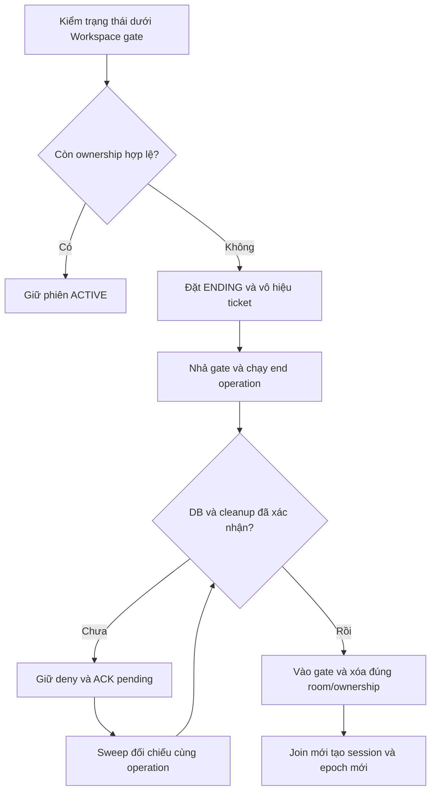

# Đối chiếu metadata và kết thúc phiên rỗng — SCRUM-87

Source: `session-metadata-write.ts`, `session-repository.ts`, `main-join-registry.ts` và `session-end-operation.ts` trong `apps/server/src/live/session-manager`. Dùng chung [coordinator](../runbooks/operation-coordination.md), [cleanup](session-transitions.md), [end](session-end.md) và [reconnect](main-reconnect.md).

## Cổng nội bộ

Không thêm REST/socket event hoặc biến môi trường. Actor, quyền và các ID mutation do server chuẩn bị; dữ liệu metadata không phải token cấp quyền.

| Cổng                                             | Input                                               | Kết quả / cách dùng                                                                                                                                                                                                                                   |
| ------------------------------------------------ | --------------------------------------------------- | ----------------------------------------------------------------------------------------------------------------------------------------------------------------------------------------------------------------------------------------------------- |
| `repository.readMutation`                        | `{sessionId: ObjectId, epoch, userId?: ObjectId}`   | `{version, participant, activeParticipants}` trong một transaction đọc primary/snapshot trên connection chung. `participant` chỉ đọc khi có userId; đếm participation chưa có leftAt để kiểm completion. Không trả snapshot này trực tiếp cho client. |
| `createSessionMetadataWrite(repository, intent)` | `{kind: "create"                                    | "join"                                                                                                                                                                                                                                                | "beginEnding" | "completeEnding", input}`; input là input repository hiện hành | Handle `run(assertCurrent?)`: gửi mutation một lần; khi chưa rõ thì các lần sau chỉ đọc lại. Kết quả đã xác nhận gồm revision và participantId nếu có. |
| `endOperation.reconcile()`                       | Handle end/token/targets đã được registry chấp nhận | Tiếp tục cleanup và đối chiếu các bước metadata đã gửi. Không tạo lại operation, không ghi lặp begin/complete. Trả ACK pending/completed cùng requestId ban đầu.                                                                                      |
| `registry.sweepExpired()`                        | Callback maintenance từ composition                 | Đối chiếu room chưa rõ, tiếp tục disconnect cleanup còn thiếu, kiểm ownership dưới Workspace gate, chuẩn bị end rồi chạy cleanup/DB I/O của end bên ngoài gate.                                                                                       |
| `registry.stats().uncertainRooms`                | Không có                                            | Số room còn kết quả metadata chưa xác nhận; không chứa user ID, token hoặc nội dung riêng.                                                                                                                                                            |

## Bằng chứng xác nhận một thao tác

Giữ input gốc, session/epoch, revision dự kiến và timestamp của mutation trong handle RAM. Không tạo input/timestamp mới để retry cùng thao tác. Repository vẫn giữ transaction/CAS và giới hạn retry commit hiện hành.

- Mọi read-back phải khớp session/epoch, đúng revision kết quả, status và updatedAt của intent. Revision tiến xa hơn, null, lỗi đọc hoặc lệch dữ liệu đều chưa đủ bằng chứng; không kết luận đã rollback.
- Create còn kiểm Workspace/kênh/host và participation gốc. Join kiểm user, joinedAt, MAIN, lastScopeAt và leftAt=null trong cùng snapshot. Join upsert có thể trả participantId đã tồn tại; không đoán ID từ candidate trước ghi.
- Complete end còn yêu cầu ENDED, host=null, endedAt đúng intent và không còn participation mở. Metadata đã ENDED vẫn chưa đủ để bỏ runtime deny nếu các adapter chưa xác nhận cleanup.
- Guard được kiểm trước/sau I/O và trước dùng lại kết quả đã xác nhận. Sau join còn đọc lại auth/access/fence của M1, kiểm socket/deadline trước công bố ownership và snapshot.

Create được xác nhận ngay trong cùng yêu cầu có thể tiếp tục cấp ticket sau kiểm quyền hiện hành. Nếu Router đã bị đóng khi create chưa rõ, sweep chỉ kết thúc reservation đã được xác nhận; không dựng lại Router/quyền từ DB. Join thất bại chưa được xác nhận đánh dấu intent cũ không còn dùng được. Sau read-back, không tự công bố candidate ownership cũ; người dùng cần ý định join mới và kiểm quyền mới.

Mỗi room giữ tối đa một metadata write chưa rõ; số room/ownership/end record vẫn chịu các cap hiện hành. Mỗi lượt sweep chỉ đối chiếu handle hiện hành, các lời gọi cùng handle dùng chung I/O. Room cần end mới nhưng hết slot được hoãn riêng, không làm dừng đối chiếu các end record đã nhận của room khác; không xóa sớm slot replay hoặc gia hạn TTL để nhường chỗ. Lượt sweep sau xử lý room đã hoãn khi có slot. Trường hợp null/revision vượt dự kiến không được tự ghi lại hoặc xóa room để giải phóng unique index; giữ deny, theo dõi uncertainRooms và điều tra DB/lifecycle. Shutdown/bootstrap giữ luồng riêng, không phục hồi runtime từ dữ liệu cũ.

Issue kiểm lại deadline 10 giây ngay sau await đối chiếu metadata, trước cả nhánh replay ticket. Read-back xác nhận được DB không cho phép trả ticket bằng request đã quá hạn; ticket còn TTL có thể được replay ở request sau với budget mới, không đổi expiresAt và không ghi lại mutation cũ.

## Ownership và quyết định end

Ownership giữ phiên khi auth/access/fence còn hợp lệ và có kết nối hiện hành, hoặc đang trong reconnect grace chưa hết hạn. Blocked, quyền nền bị thu, auth hết hạn hoặc grace đã hết đều không giữ phiên. Ticket chưa dùng và participation DB không thay call ownership.

Reservation ban đầu chưa có lần join giữ cửa sổ cấp ticket hiện hành để người dùng hoàn tất vào phòng. Sau khi đã có lần join, ticket còn hạn không kéo dài phiên khi không còn ownership hợp lệ; không có empty grace.

Join và quyết định end dùng cùng Workspace gate:

Join commit trước thì ownership mới giữ phiên. ENDING trước thì ticket cũ không join được, issue mới bị chặn tới khi cleanup xong. System end dùng cùng cleanup PARTICIPANT/SCOPE, CAS và record replay của host end; không chỉ đóng Router rồi ghi ENDED. Không đợi video READY hoặc byte purge nếu adapter đã xác nhận thu quyền/pending intent theo contract.

Các lượt reconcile có budget control mới, nhưng guard của lượt cũ vẫn hết hiệu lực; callback tới muộn không được sống lại theo deadline mới. Bước metadata đã xác nhận không bị ghi lại. TTL replay 60 giây chỉ bắt đầu lần đầu hoàn tất, không gia hạn bởi sweep/retry.

## Tích hợp và giới hạn

Composition phải gọi sweep khi có biến đổi lifecycle và tại deadline grace, có thể dùng maintenance định kỳ để bù lỗi; không dùng chu kỳ 60 giây để cộng thêm thời gian chờ cho phiên rỗng. Factory chưa tự mount timer/HTTP/socket vào ứng dụng production; việc ghép auth/media và scheduler thật thuộc cổng tích hợp MAIN. Bản này kiểm quyết định tại thời điểm callback được gọi, chưa chứng minh scheduler hoặc cuộc gọi trình duyệt đã chạy.

Composition inject repository có `readMutation` và endCleanup M2/M3/M5 thật. Thiếu cleanup thì không tự ghi ENDED. Mỗi instance dùng chung coordinator/connection, không tạo pool hoặc runtime registry thứ hai. Kết quả kiểm chứng và lệnh chạy lại ở [evidence SCRUM-87](../test-evidence/2026-11-12-scrum-87-session-reconciliation.md).
