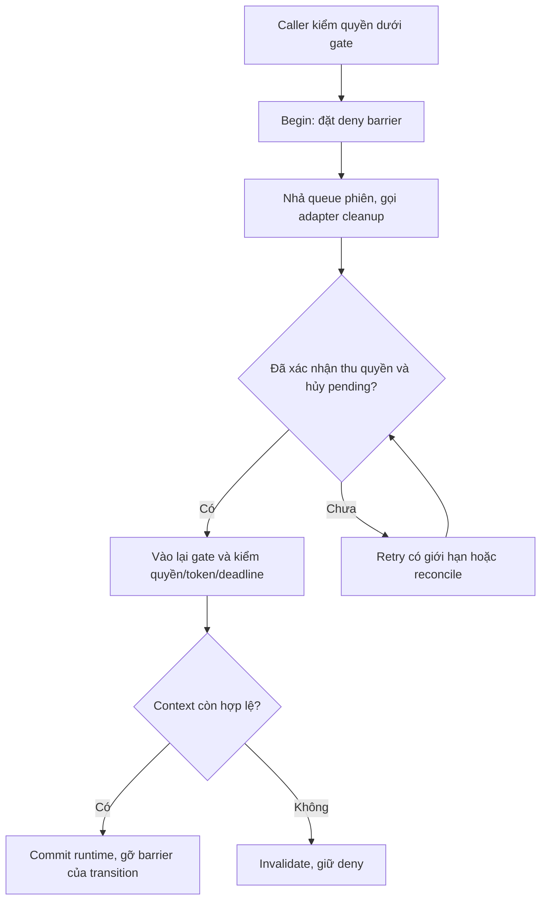

# Điều phối transition và cleanup phiên — SCRUM-72

Core ở [session-transition.ts](../../apps/server/src/live/session-manager/session-transition.ts), dùng trực tiếp request/result và `CleanupSessionResources` của [SCRUM-23](session-context.md). [Admission cleanup](../../apps/server/src/live/session-manager/cleanup-admission.ts) giới hạn I/O thực sự đang chạy. M3 review chính; M1 đối chiếu context gate, M2/M5 đối chiếu adapter cleanup tương ứng.

## 1. Phạm vi và thứ tự xử lý

Một transition giữ một request cleanup đã xác định tại server: operationId, session/epoch, transitionToken, target, reason và callGeneration khi target là participant. Request được parse, chụp và đóng băng; retry không tìm lại participant mới theo userId hoặc thay target bằng audience hiện tại.

Core không tự lấy khóa User/Workspace/channel/session. Các hàm có hậu tố `Held` chạy trong đoạn điều phối caller đang giữ; vì không gọi ngược outer gate nên M1 có thể truyền context hiện tại. Không giữ MongoDB transaction khi đợi adapter. Adapter không được lấy lại outer gate mà caller đang giữ hoặc chờ việc cần gate đó. Nếu cần DB/revalidation khác, trả kết quả về caller để vào lại đúng thứ tự thay vì gọi từ cleanup.

## 2. API nội bộ

`beginSessionTransition(request, context, adapters, options)` nhận:

| Tham số                         | Nội dung / trách nhiệm                                                                                                                                                                                                              |
| ------------------------------- | ----------------------------------------------------------------------------------------------------------------------------------------------------------------------------------------------------------------------------------- |
| `request`                       | `SessionCleanupRequest` của SCRUM-23; chỉ tạo sau khi server kiểm actor, đích và scope                                                                                                                                              |
| `context.assertHeld()`          | Xác nhận caller đang giữ đúng User/Workspace và channel/session context cần thiết. Wrapper tại composition root phải kiểm context thật; không nhận cờ bỏ qua khóa từ client                                                         |
| `context.isCurrent(request)`    | Kiểm đồng bộ snapshot quyền hiện hành, auth expiry, epoch, callGeneration, operation/token còn được registry chọn, role/phase và deadline đích. Caller xác minh lại M1 trước khi gọi commit; hàm này không làm I/O hoặc tự lấy gate |
| `adapters`                      | Đủ ba hàm `media`, `messaging`, `board`, cùng chữ ký `CleanupSessionResources`. Không thay adapter chưa có bằng hàm trả thành công giả để bật handler                                                                               |
| `options.userId`                | Actor đã xác thực tại server, dùng tính admission; không phải userId client khai                                                                                                                                                    |
| `options.admission`             | Mặc định dùng cùng `sessionCleanupAdmission` trong process. Instance riêng chỉ dùng trong test; không tạo pool riêng cho từng phiên/miền trong production                                                                           |
| `options.now`, `options.random` | Clock monotonic và nguồn jitter; mặc định `performance.now`/`Math.random`. Clock lỗi hoặc lùi thì giữ deny                                                                                                                          |

Các hàm trên handle:

| Hàm                            | Kết quả và điều kiện                                                                                                                                     |
| ------------------------------ | -------------------------------------------------------------------------------------------------------------------------------------------------------- |
| `blocks(audience)`             | Cho biết deny barrier còn chặn grant/read/fanout của audience đó không. Registry đưa kết quả vào `blocked` của policy trước mỗi lần kiểm                 |
| `runForeground()`              | Chạy cleanup có timeout/retry hữu hạn; gọi lại trả cùng promise, không nhân thao tác                                                                     |
| `reconcile()`                  | Đợi foreground rồi chạy tối đa một kế hoạch đối soát hậu cảnh. Gọi lại trả cùng promise; không tự loop vô hạn                                            |
| `inspect()`                    | Trạng thái CLEANING/READY/DEGRADED/CANCELLED/COMMITTED, barrierActive, cờ xác nhận và trạng thái/attempt của từng adapter; không trả lỗi thô của adapter |
| `invalidateHeld(context)`      | Vô hiệu transition ngay, dừng chờ foreground và giữ barrier. End/revoke/deadline gọi bước này trước, không chờ I/O hoặc một queue do core tạo            |
| `commitHeld(context, commit)`  | Chỉ chạy callback khi tất cả adapter xác nhận và context vẫn hợp lệ. Callback đồng bộ trả `true` sau khi commit runtime; lặp lại không commit lần hai    |
| `retireCancelledHeld(context)` | Chỉ gỡ barrier của transition đã hủy sau khi cleanup được xác nhận. Không phục hồi scope, host hoặc tài nguyên của transition cũ                         |

Các API là hàm nội bộ, không thêm REST route/socket command. Thiếu gate hoặc input nội bộ sai ném lỗi để caller map qua lỗi chung; adapter không được đưa stack/raw DB error tới client. Commit chưa sẵn sàng hoặc context đã cũ trả `CONFLICT`; callback commit ném lỗi trả `INTERNAL_ERROR` và giữ deny.

## 3. Barrier, kết quả adapter và commit

Đích `SCOPE` chặn đúng scope trong session/epoch, không chặn nhóm khác. Đích `PARTICIPANT` và `PARTICIPANT_SCOPE` chặn participant/callGeneration đó trong lúc transition chưa hoàn tất, kể cả audience đích mới. Cleanup vẫn chỉ tác động target cũ đã chụp. Chặn cả audience đích ngăn quyền mới lọt ra nếu một bước cập nhật runtime thất bại giữa chừng. Participant khác và ownership/generation mới không bị barrier cũ tác động.

Registry giữ handle hiện hành và các barrier đang dọn; tổng hợp `blocks(...)` vào policy, không coi chỉ một snapshot quyền đọc còn `true` là đã qua barrier. Pending resource M2/M3/M5 vẫn phải kiểm operation/token/generation khi hoàn tất và tự dọn đúng resource cũ. Không dùng việc gỡ UI, gain âm lượng bằng 0 hoặc một callback Promise thành công thay xác nhận thu quyền.

Adapter phải trả đúng toàn bộ identity và target của request theo schema. Core chỉ xác nhận khi `permissionRevoked: true` và `pendingInvalidated: true`; `cleanupPending` có thể còn true cho byte/ref/finalize. Thiếu adapter, echo sai token/generation/target hoặc tổ hợp cờ không hợp lệ không được bỏ qua. Echo sai được ghi nhận `CONFLICT`, không tự retry cùng dữ liệu sai. Lỗi adapter được chuyển thành `DEPENDENCY_UNAVAILABLE` có retry giới hạn, không lưu message thô.

READY chỉ nói phần cleanup đã đủ điều kiện. Quyền mới chỉ được commit khi caller vào lại gate và `isCurrent` vẫn đúng. Callback commit chỉ cập nhật runtime đồng bộ: scope/host/audience/policyRevision hoặc barrier nghiệp vụ phù hợp với plan đã kiểm. Không await DB/media/upload trong callback. Nếu cần metadata bền, caller xử lý transaction/read-back ở ngoài đoạn commit runtime rồi kiểm lại token và quyền. Exception hoặc kết quả `false` giữ deny; caller đối chiếu phần metadata/runtime đã đổi, không báo rollback thành công khi kết quả chưa rõ.

Khi invalidate, callback đến muộn chỉ cập nhật kết quả của request cũ và trả slot I/O khi tác vụ thật kết thúc; nó không đổi CANCELLED thành READY hoặc tự gọi commit. Nếu foreground đã hết budget, completion muộn không tự mở quyền; chỉ kế hoạch reconcile được xác nhận và một lần commit có kiểm lại context mới được tiếp tục. Reconcile đã hết budget vẫn giữ DEGRADED; cần xử lý vận hành/plan mới theo quyền hiện hành.

## 4. Budget và tích hợp

Theo `sessionControlBudget`, mỗi lần chờ adapter tối đa 2 giây. Foreground thử ban đầu và tối đa hai retry sau 250/750 ms, jitter ±20%, trong deadline tổng 10 giây từ begin. Các adapter chạy đồng thời trong admission; không nhân deadline theo người tham gia bằng vòng lặp chờ tuần tự. Với plan nhiều target, caller lập tất cả handle trong đoạn nhận plan rồi chạy cleanup song song, không tạo một cửa sổ 10 giây mới sau mỗi target.

Timeout không hủy được I/O trong chữ ký adapter hiện hành. Promise còn chạy tiếp tục chiếm slot; core không gọi chồng adapter đó. Slot chỉ trả ở `finally` khi tác vụ thật settle. Admission mặc định 2 I/O/user, 8/session, 32/process; hết slot thì defer trong budget, chưa được báo đã thu quyền. Begin/đặt deny/invalidate không cần slot I/O và không bị pool đầy ngăn lại.

Reconcile cùng operation/token thử tại các mốc 1/3/10 giây tính từ sau foreground, mỗi adapter/operation vẫn chỉ một tác vụ chạy. Hết kế hoạch thì trả DEGRADED và giữ deny để caller ghi cảnh báo/đối soát vận hành; không tạo operation ID mới để che lỗi của thao tác cũ. Byte/ref/process finalize thuộc adapter có `cleanupPending`, không giữ foreground đợi hoàn tất các công việc đó.

Core không đăng ký queue/mutex khác với cổng dùng chung của M1. Composition root phải nối `HeldTransitionContext` với context đang được giữ theo thứ tự User ownership → Workspace → channel → session. Chưa import API gate từ nhánh M1 chưa merge. Registry SCRUM-82 sẽ sở hữu handle/dedupe/admission mutation/retention, chọn token hiện hành và đưa barrier vào context policy; core không phải replay cache hoặc toàn bộ registry. Thu quyền MAIN/end/reconnect nối ở các task tương ứng, không coi begin một handle là nghiệp vụ đã chạy trên socket.

## 5. Kiểm chứng

[Test coordinator](../../apps/server/src/live/session-manager/session-transition.test.ts) chạy thuật toán thật với adapter điều khiển được và fake clock: gate đang giữ; deny trước/sau I/O; ack đúng/sai; timeout giữ slot; retry/reconcile hữu hạn; context đổi; callback đến muộn; invalidation và commit lỗi. [Test policy](../../apps/server/src/live/policy/session-policy.test.ts) nối barrier của handle vào `blocked`, kiểm media/board/projection bị từ chối tới khi cleanup và commit hoàn tất.

Chưa có provider M1/M2/M3/M5 thực tế trong luồng cuộc gọi, handler socket hoặc gate tích hợp hai mạng/TURN. Fixture không chứng minh đã đóng Producer/Consumer, file stream hoặc board intent thật; các adapter và registry phải cung cấp bằng chứng ở task tích hợp.
