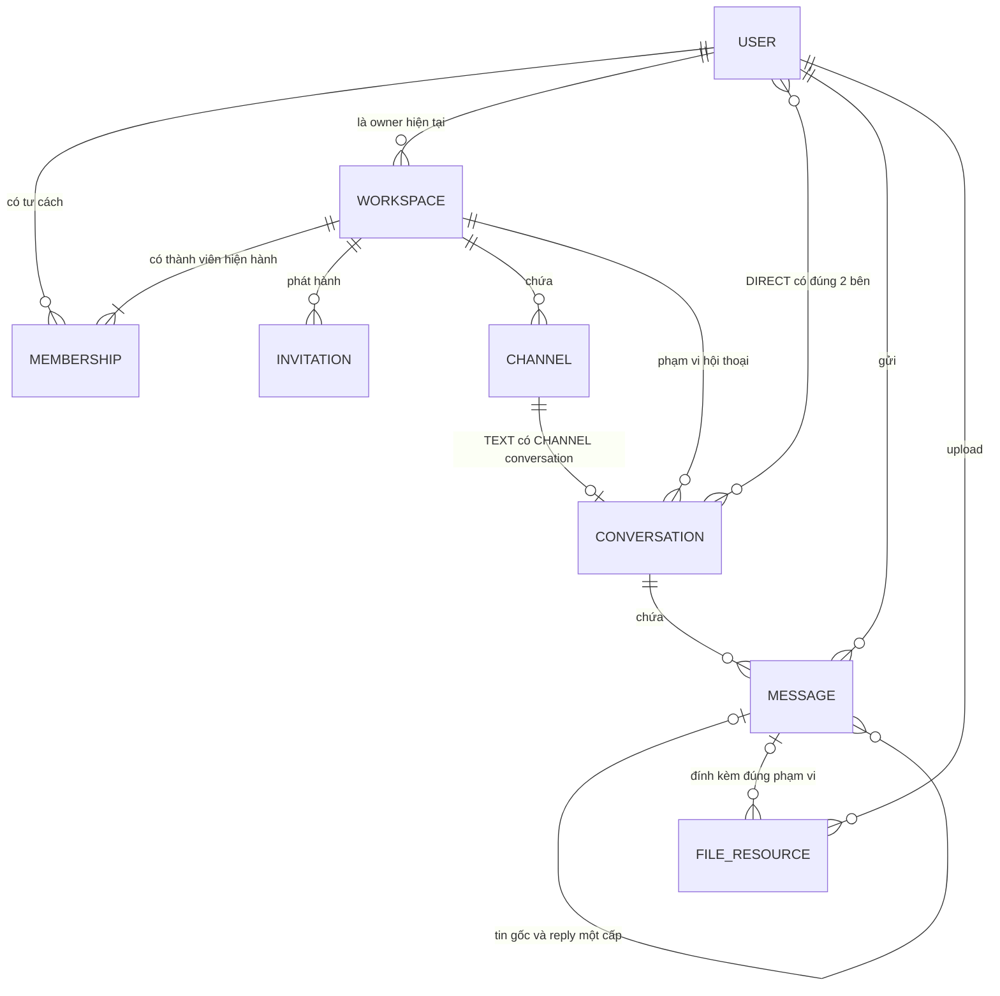
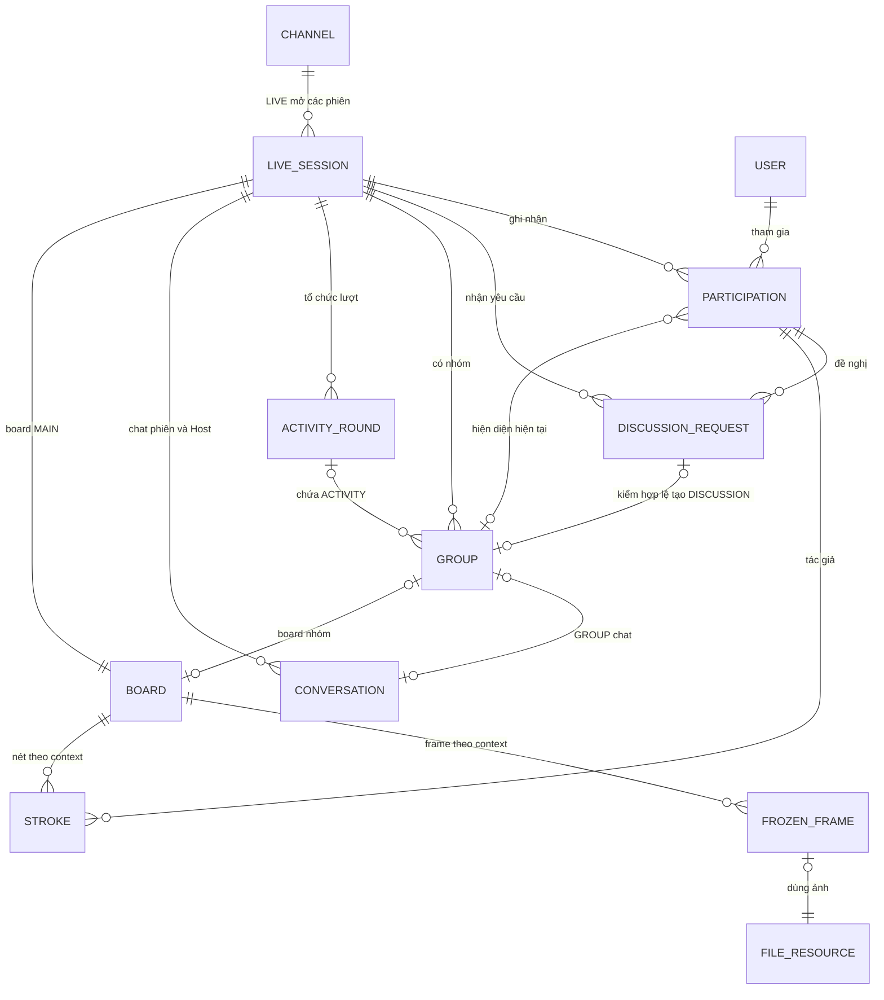

# Bước 2 — Mô hình dữ liệu nghiệp vụ CoLearnia

**Trạng thái:** bản đề xuất mô hình khái niệm để review, ngày 01/11/2026; dựa trên UC đã chốt. Đi cùng [bảng truy vết bước 1](uc-data-map.md). Đây không phải ERD vật lý, Mongoose schema hoặc yêu cầu tạo 16 collection. Không thay MongoDB/Mongoose, [model khung](model.md) hay [lifecycle](lifecycle.md).

Mục tiêu: thống nhất dữ liệu nào tồn tại về mặt nghiệp vụ, liên hệ với ai/cái gì và quy tắc phải giữ. Tài liệu này không sở hữu field types, enum chi tiết, nhúng/tham chiếu hoặc index: các lựa chọn hiện hành nằm ở bước 4–5 được liên kết phía dưới; migration chưa thực thi. Tên tiếng Anh chỉ giúp đối chiếu tài liệu/code sau này, chưa chốt tên collection.

## 1. Danh sách thực thể/khái niệm cốt lõi

“Thông tin cần biết” dưới đây là thông tin nghiệp vụ, chưa là danh sách field phải lưu. Mã E phục vụ truy vết ở các bước phân tích dữ liệu, gồm [nơi lưu/vòng đời bước 3](lifecycle.md).

| Mã  | Khái niệm                                | Thông tin cần biết                                                                                                        | Người/luồng sở hữu thay đổi                                                                  |
| --- | ---------------------------------------- | ------------------------------------------------------------------------------------------------------------------------- | -------------------------------------------------------------------------------------------- |
| E01 | Người dùng — User                        | Danh tính tài khoản, email, tên hiển thị, trạng thái và thông tin xác thực được bảo vệ                                    | Đăng ký; xác thực theo ACC-01/02. Chưa thêm quản trị tài khoản/profile CRUD                  |
| E02 | Workspace                                | Tên, owner hiện tại, hiệu lực không gian                                                                                  | Người dùng tạo; admin/owner đổi tên; owner chuyển quyền/xóa theo WS-01/03/04/11              |
| E03 | Tư cách thành viên — Membership          | Người nào thuộc Workspace nào, vai trò owner/admin/member và hiệu lực                                                     | Tạo Workspace, nhận lời mời, owner đổi role/transfer, admin/owner loại thành viên            |
| E04 | Lời mời Workspace — Invitation           | Workspace đích, hiệu lực, hạn dùng, giới hạn và số lần nhận                                                               | Admin/owner tạo/thu hồi; hệ thống ghi nhận khi nhận thành công theo WS-05/06/07              |
| E05 | Kênh — Channel                           | Workspace, tên, loại TEXT/LIVE, phạm vi truy cập và hiệu lực                                                              | Admin/owner tạo/đổi tên/xóa/quản lý quyền qua WS-15; general sinh cùng Workspace             |
| E06 | Hội thoại — Conversation                 | Bối cảnh CHANNEL/DIRECT/SESSION/GROUP/HOST_PRIVATE, phạm vi và hai bên nếu riêng                                          | Tạo TEXT, mở DM khi gửi, các luồng chat cuộc họp; kết thúc theo phạm vi                      |
| E07 | Tin nhắn — Message                       | Hội thoại, tác giả, nội dung, thời điểm, ảnh/tệp kèm; tin gốc nếu là reply                                                | Thành viên gửi/reply; host trả lời tin riêng theo MSG/LIVE. Chưa có sửa/xóa tin thủ công     |
| E08 | Tài nguyên tệp/ảnh — File resource       | Người upload, mục đích, phạm vi được đọc, đặc điểm tệp và việc đã gắn vào nội dung hợp lệ hay chưa                        | Luồng gửi tin/chụp frame và cleanup; không là thư viện tài liệu độc lập                      |
| E09 | Phiên họp — LiveSession                  | Kênh LIVE, thời điểm/vòng đời phiên, host hiện hành, phase giảng/hoạt động                                                | Thành viên bắt đầu phiên; host chuyển/kết thúc; hệ thống xử lý mất mạng/kết thúc runtime     |
| E10 | Sự tham gia phiên — SessionParticipation | Người dùng trong phiên nào, tình trạng tham gia và vị trí MAIN/nhóm hiện tại                                              | LIVE-01/02, chuyển nhóm/tự về MAIN, mất quyền/kết thúc phiên                                 |
| E11 | Ngữ cảnh tạo DISCUSSION                  | Phiên, requester, tên/mục đích/roster và kết quả create được kiểm hợp lệ ngay; không hàng chờ xét                         | GRP-02/04; runtime thao tác/dedupe, không thực thể quản lý phê duyệt                         |
| E12 | Nhóm — Group                             | Phiên sở hữu, loại DISCUSSION/ACTIVITY, tên, hiệu lực, nguồn hình theo mode                                               | Create hợp lệ hoặc host chuẩn bị nhóm; đóng DISCUSSION/ACTIVITY theo luồng riêng             |
| E13 | Lượt hoạt động — ActivityRound           | Phiên, cấu hình nhóm/phân công dự kiến, thời lượng chung, deadline và tình trạng lượt                                     | Host chuẩn bị/đặt thời lượng/bắt đầu; hệ thống kết thúc khi hết giờ hoặc hủy lượt lỗi        |
| E14 | Board theo phạm vi — Board               | Phạm vi MAIN chỉ overlay LIVE do host vẽ; nhóm LIVE/FREEZING/FROZEN, ngữ cảnh, nguồn hình đang theo dõi và frame hiện tại | BOARD-01/02/05; thay nguồn/thu quyền/kết thúc phạm vi                                        |
| E15 | Khung hình đã dừng — FrozenFrame         | Ảnh được chốt cho board/context, người cung cấp, nguồn và ngữ cảnh tại lúc chụp                                           | Freeze thành công; resume/đóng context làm hết tham chiếu theo lifecycle                     |
| E16 | Nét vẽ — Stroke                          | Board/context/frame hoặc nguồn, tác giả và nét; tình trạng undo/clear                                                     | BOARD-02, gồm BOARD-03/04 đã gộp; MAIN nét thường/tự biến mất; nhóm LIVE tạm, FROZEN giữ nét |

E15 biểu diễn **vai trò của ảnh được dùng làm frame**, sử dụng tài nguyên E08; chưa đòi một bản ghi hay collection frame tách riêng. E11–E16 vẫn phải được biểu diễn trong mô hình nghiệp vụ dù phần lớn trạng thái nhóm/board hiện được định hướng là runtime. “Có khái niệm” không đồng nghĩa “phải ghi MongoDB”.

## 2. Các quan hệ và số lượng

Số lượng tính theo một đối tượng nguồn; quan hệ hiện hành khác dữ liệu lịch sử/tombstone còn chờ dọn. Ràng buộc hiện hành phải được giữ bằng thiết kế sau, không suy thành unique index trực tiếp ở bước này.

| Quan hệ                                  | Số lượng / quy tắc nghiệp vụ                                                                                                                                                                                                                                                                             |
| ---------------------------------------- | -------------------------------------------------------------------------------------------------------------------------------------------------------------------------------------------------------------------------------------------------------------------------------------------------------- |
| User — Membership — Workspace            | User có 0..n membership; Workspace còn hiệu lực có 1..n membership hiện hành. Mỗi cặp User–Workspace có một tư cách hiện hành, không nhân bản khi nhận lời mời lại                                                                                                                                       |
| Workspace — owner                        | Mỗi Workspace có đúng 1 owner là thành viên hợp lệ trong chính Workspace. Không suy thành giới hạn một Workspace cho mỗi user; cách biểu diễn owner và role cần nhất quán                                                                                                                                |
| Workspace — Invitation                   | Một lời mời thuộc đúng 1 Workspace; Workspace có 0..n lời mời. Đây là link có thể nhiều lượt dùng theo giới hạn, không phải một lời mời bắt buộc gắn đúng một người nhận                                                                                                                                 |
| Workspace — Channel                      | Một kênh thuộc đúng 1 Workspace; tạo Workspace sinh 1 general TEXT. Sau tạo có 0..n kênh theo CRUD hiện hành, không tự cấm xóa hoặc tái tạo general                                                                                                                                                      |
| Channel — quyền truy cập                 | WORKSPACE dùng membership hợp lệ; PRIVATE còn cần allowlist theo baseline. Tên, role quản trị hoặc biết channelId không thay quyền đọc                                                                                                                                                                   |
| TEXT Channel — CHANNEL Conversation      | Kênh TEXT có đúng 1 hội thoại CHANNEL trong vòng đời kênh; một hội thoại loại này thuộc đúng 1 kênh TEXT. LIVE dùng các hội thoại gắn phiên, không dùng hội thoại TEXT giả                                                                                                                               |
| Workspace — DIRECT Conversation          | Một DM thuộc đúng 1 Workspace và đúng 2 User khác nhau. Một cặp không phân biệt thứ tự có tối đa 1 DIRECT trong Workspace; quyền đọc vẫn phụ thuộc membership hiện tại                                                                                                                                   |
| Conversation — Message — tác giả         | Hội thoại có 0..n tin; mỗi tin thuộc đúng 1 hội thoại và có đúng 1 tác giả User. Với meeting, tác giả còn phải có tư cách tham gia hợp lệ lúc gửi                                                                                                                                                        |
| Message gốc — Reply                      | Tin gốc có 0..n reply; mỗi reply có đúng 1 tin gốc trong cùng CHANNEL/TEXT. Tin gốc không là reply; không lồng thread ở DM/meeting                                                                                                                                                                       |
| Message — File resource                  | Tin có 0..n ảnh/tệp hợp lệ theo loại hội thoại. Tài nguyên đang upload có thể chưa gắn tin; khi gắn phải đúng người/phạm vi. Không mở quyền bằng tái dùng attachmentId; [bước 4](collection-design.md) chọn một file bind một message hoặc một frame context, không chia sẻ một fileId qua nhiều đích    |
| LIVE Channel — LiveSession               | Kênh LIVE có 0..n phiên qua thời gian, tối đa 1 phiên ACTIVE/ENDING theo baseline; một phiên thuộc đúng 1 kênh LIVE. Kết thúc phiên không xóa kênh                                                                                                                                                       |
| LiveSession — Participation — User       | Phiên có 0..n bản ghi tham gia, mỗi User tối đa 1 tư cách tham gia trong một phiên; reconnect không nhân người. Có metadata không chứng minh người đang kết nối/còn quyền                                                                                                                                |
| Participation — vị trí                   | Khi đã tham gia hoàn tất và không chuyển tiếp, một người ở MAIN hoặc đúng 1 Group của cùng phiên. Có thể chưa có nhóm. Trạng thái đang chuyển phải được biểu diễn ở bước chi tiết, không gán đồng thời hai audience                                                                                      |
| LiveSession — host                       | Khi vận hành bình thường có đúng 1 participant giữ quyền host. Tạm thời có thể không có host connected khi mọi ownership đang trong grace; kế vị/hoàn quyền theo policy đã chốt tại live-session, không suy từ nullable metadata                                                                         |
| LiveSession — DiscussionRequest          | Phiên có 0..n yêu cầu; yêu cầu thuộc đúng 1 phiên, có 1 người đề nghị đang tham gia và danh sách người dự kiến cùng phiên. Không suy người đề nghị luôn tự nằm trong danh sách nếu nguồn chưa chốt                                                                                                       |
| Discussion creation — DISCUSSION         | Một lần create hợp lệ tạo một nhóm/roster, retry không nhân nhóm; dữ liệu sai không tạo nhóm. Không quyết định phê duyệt hoặc hàng chờ host.                                                                                                                                                             |
| LiveSession — Group                      | Phiên có 0..n nhóm qua các lượt; mỗi Group thuộc đúng 1 phiên, có đúng 1 mode. MAIN là phạm vi chung của phiên, không là một nhóm ACTIVITY/DISCUSSION                                                                                                                                                    |
| ActivityRound — ACTIVITY Group           | Một lượt hợp lệ khi bắt đầu chứa 1..n nhóm ACTIVITY; cấu hình đang chuẩn bị có thể chưa đủ nhóm. Mỗi ACTIVITY thuộc đúng 1 lượt trong cùng phiên; DISCUSSION không thuộc lượt ACTIVITY                                                                                                                   |
| LiveSession — ActivityRound              | Phiên có 0..n lượt qua thời gian; tối đa 1 lượt ACTIVITY đang chạy/chuyển tiếp cần điều phối. Không mở lượt khác vượt cleanup của lượt hiện tại                                                                                                                                                          |
| Group — roster/phân công — Participation | DISCUSSION có danh sách hợp lệ; ACTIVITY có phân công dự kiến. Hai quan hệ này là điều kiện chuyển/vào, **khác hiện diện thực tế**; một người về MAIN sớm không làm mất deadline của lượt                                                                                                                |
| Scope — Conversation cuộc họp            | MAIN dùng SESSION; nhóm dùng GROUP của chính nhóm. Mỗi phạm vi dùng một hội thoại Everyone tương ứng, không trộn qua nhóm khác. HOST_PRIVATE gắn phiên và đúng hai bên ban đầu; [bước 4](collection-design.md) chọn cùng cặp user/cùng phiên dùng lại hội thoại còn mở, không đổi audience theo host mới |
| Scope — Board                            | MAIN và mỗi Group có một board chung trong đời phạm vi; không board frozen cá nhân. Board của DISCUSSION theo nguồn MAIN nhưng không dùng chung frame/nét với MAIN/nhóm khác                                                                                                                             |
| Board — Frame — File resource            | MAIN không có frame; board nhóm có 0..1 frame hiện hành; mỗi frame thuộc một board/context và sử dụng 1 ảnh E08. Ảnh cũ còn refs/chờ dọn không là frame hiện hành hoặc bài đã lưu                                                                                                                        |
| Board/context — Stroke — tác giả         | Context có 0..n nét; mỗi nét thuộc 1 board/context, có 1 participant tác giả. Nét frozen gắn frame đó; LIVE nhóm chỉ dẫn tạm; LIVE MAIN chỉ host, nét thường hoặc tự biến mất theo board policy                                                                                                          |

Chưa đặt số lượng tối đa thành viên nhóm, số file/tin, số nhóm/lượt hoặc duration bằng phỏng đoán. Giới hạn kỹ thuật/đo tải và validation cụ thể thuộc các bước tiếp theo.

## 3. Hai góc nhìn của cùng mô hình

Ký hiệu Mermaid dưới đây chỉ mô tả quan hệ khái niệm; đường nối không phải foreign key SQL hoặc lựa chọn nhúng/tham chiếu MongoDB. Các ràng buộc điều kiện như loại kênh/nhóm và quyền đọc phải đọc cùng bảng mục 2.

### Không gian học tập và trao đổi

Quan hệ MESSAGE–FILE_RESOURCE đã được cụ thể hóa ở [bước 4](collection-design.md): mỗi file chỉ bind tối đa một message hoặc một frame context theo purpose; frame không đồng thời là attachment. Tương tự, quan hệ User–Conversation có điều kiện “đúng hai bên” cho DIRECT, không áp sang CHANNEL/Everyone.

### Cuộc họp, nhóm và cộng tác

Group ở đây dùng chung một ký hiệu cho hai mode: quan hệ với Request chỉ áp DISCUSSION; quan hệ với Round chỉ áp ACTIVITY. Mỗi board thuộc MAIN **hoặc** một Group, không đồng thời cả hai; chỉ board nhóm có frame, qua nhiều context nhưng chỉ 0..1 hiện hành. Hiện diện ở hình khác roster/phân công trước khi vào. Bảng mục 2 là nguồn số lượng có điều kiện, tránh suy mỗi Group phải có cả request và round.

## 4. Vai trò và quan hệ không biến thành thực thể quản lý mới

| Khái niệm                          | Biểu diễn nghiệp vụ ở bước này                                                                            | UC sở hữu / ràng buộc                                                                              |
| ---------------------------------- | --------------------------------------------------------------------------------------------------------- | -------------------------------------------------------------------------------------------------- |
| Owner/admin/member                 | Vai trò trong E03; owner của E02 phải nhất quán với vai trò                                               | WS-09/11; không có bảng UserHost/UserAdmin riêng                                                   |
| Host/host tạm/người cần hoàn quyền | Quan hệ vai trò của E09 với E10 và trạng thái bàn giao/phục hồi                                           | LIVE-01, GRP-01 và HS-01; host thuộc phiên, không thuộc Workspace vĩnh viễn                        |
| Chuyển quyền host                  | Thay đổi trực tiếp quan hệ host sau kiểm actor/đích/revision; không có yêu cầu chấp nhận hoặc lời mời chờ | GRP-01; chưa cần thực thể lưu lịch sử bàn giao độc lập                                             |
| Đang hỗ trợ nhóm                   | Quan hệ tạm giữa host và đúng 1 nhóm ACTIVITY đích tại một thời điểm                                      | GRP-12; host không cần nằm trong roster như thành viên thường để được hỗ trợ; không là ticket      |
| Nguồn chia sẻ                      | Người đang publish, scope sở hữu và đời nguồn; board tham chiếu nguồn hợp lệ                              | LIVE-05; MAIN và mỗi ACTIVITY 0..1 nguồn riêng, DISCUSSION tham chiếu MAIN và không có nguồn riêng |
| Thread                             | Quan hệ tin gốc–reply của E07                                                                             | MSG-06; không cần UC tạo/quản lý thread hoặc bảng thread mặc định                                  |
| Countdown                          | Thời lượng/deadline thuộc E13                                                                             | GRP-11 và hết giờ tự động; không có danh mục đồng hồ/timer chung                                   |
| Thông báo hướng dẫn                | Hành vi phát nguồn đúng audience trong phiên                                                              | GRP-13; chưa phải một bài đăng hay nội dung thông báo cần lưu vĩnh viễn                            |
| Phiên truy cập / audit             | Dữ liệu hỗ trợ xác thực và kiểm soát theo baseline                                                        | ACC-02/03 và các thay đổi cần audit; phân biệt với E09, không thêm UC quản trị riêng               |

## 5. Các quy tắc phải giữ khi chuyển sang thiết kế MongoDB

1. **Quyền hiện tại thắng lịch sử:** còn tài liệu/tệp trong DB không đồng nghĩa được đọc; owner/admin không mặc nhiên đọc DM hay mọi nhóm. Tư cách Workspace, tham gia phiên và hiện diện/hỗ trợ nhóm là các lớp khác nhau.
2. **Không nhân danh tính:** User khác Membership, Participation và socket/device; một người đổi role hoặc reconnect không trở thành User mới. Không coi metadata tham gia cũ là quyền sau restart.
3. **Không trộn không gian:** Channel LIVE có nhiều phiên qua thời gian; MAIN khác Group; hội thoại SESSION/GROUP/HOST_PRIVATE khác DIRECT bền theo Workspace.
4. **Tách dự kiến và thực tế:** người trong danh sách hợp lệ DISCUSSION chưa vào nhóm; phân ACTIVITY lúc chuẩn bị chưa chuyển scope; có cấu hình thời lượng chưa có deadline đang chạy. Kiểm lại quyền trước khi chuyển.
5. **Tách nguồn, frame và attachment:** nguồn share có thể dừng khi frame đã chốt còn dùng được; mỗi board/context giữ frame/nét riêng. Ảnh gửi chat có ACL/vòng đời theo hội thoại, không tự dùng frameId để mở board riêng hoặc công khai nhóm.
6. **Không biến runtime thành lịch sử sản phẩm:** hết giờ kết thúc đúng lượt, người về MAIN sớm chỉ rời bản thân; restart không phục hồi media/nhóm cũ từ các ID trong MongoDB. Recording MAIN theo quyết định mới có lifecycle riêng; không suy File/Frame đồng nghĩa đã có pipeline ghi hình.
7. **Thay đổi liên quan phải nhất quán:** tạo Workspace/general/owner; nhận lời mời/membership; transfer owner; gửi tin/gắn tệp; bắt đầu/kết thúc phiên và nhóm. Cơ chế DB/runtime cụ thể vẫn theo bước 3–5 và [lifecycle](lifecycle.md).

## 6. Quyết định bổ sung và điểm còn mở

| Chủ đề và nguồn                                                                                        | Quy tắc hiện hành                                                                                                                                                             | Tác động thiết kế                                                                                   |
| ------------------------------------------------------------------------------------------------------ | ----------------------------------------------------------------------------------------------------------------------------------------------------------------------------- | --------------------------------------------------------------------------------------------------- |
| [DM rejoin](../product/messaging.md)                                                                   | Cả hai membership hợp lệ lại thì đọc được lịch sử DM còn lưu                                                                                                                  | Giữ E06 cùng cặp/Workspace; không suy userId đủ quyền khi membership vô hiệu                        |
| [DISCUSSION create](../product/group-modes.md)                                                         | Tạo tự động sau kiểm quyền/phase/tên/mục đích/roster; không host xét/hủy pending                                                                                              | E11 chỉ là ngữ cảnh thao tác runtime, không thực thể phê duyệt hoặc collection mới                  |
| [Thời lượng ACTIVITY](../product/group-modes.md)                                                       | Số nguyên 1–120 phút trước bắt đầu; không sửa/gia hạn/tạm dừng khi chạy                                                                                                       | E13 có thời lượng chung/deadline server; không thêm collection timer                                |
| [Kênh PRIVATE](../product/messaging.md)                                                                | Owner/admin quản lý danh sách, nội dung chỉ người được cấp; thêm/re-add thấy lịch sử còn lưu, gỡ mất quyền ngay; bị loại rồi rejoin Workspace cần owner/admin cấp lại PRIVATE | E05 giữ quan hệ truy cập; UC-WS-15 tạo/thay đổi quan hệ; không đổi WORKSPACE/PRIVATE sau tạo        |
| [Không có ứng viên hoặc host tạm mất mạng](../product/live-session.md#83-chuyển-host-và-host-mất-mạng) | Đã chốt giữ đích gốc, elect tạm khi cần và end khi không còn ownership grace                                                                                                  | Giữ đích gốc qua host tạm, chờ grace hiện có nếu chưa có ứng viên, auth/access bị thu không tự hoàn |

[Bước 3](lifecycle.md) chọn request/nhóm/round/board/nét và bản nháp nhóm trong runtime, frame dùng tài nguyên E08, refs DB phục vụ khóa/cleanup. [Bước 4](collection-design.md) đã chọn file binding một đích, cặp HOST_PRIVATE theo phiên, cấu trúc cleanup và field; index/validator/concurrency tiếp tục ở bước 5. Chúng không phải tính năng mới đã được duyệt. [Model hiện có](model.md) vẫn là khung định hướng: không tự bỏ collection nền hoặc bổ sung collection cho mọi khái niệm ở đây.

## 7. Kết quả bàn giao và bước tiếp

- Bước 1 có bảng đủ 46 UC và kiểm chiều ngược về dữ liệu; bước 2 có danh mục 16 khái niệm, quan hệ/số lượng, hai góc nhìn và các ràng buộc phân biệt.
- Đã giữ các UC gộp trong luồng sở hữu; chỉ bổ sung UC-WS-15 đã được đồng ý; không thêm tính năng ngoài quyết định, migration, seed, schema hoặc thay Astah từ task này.
- Đây là phân tích để review, chưa chứng minh collection/schema nghiệp vụ đã chạy. Kiểm liên kết/format không xác nhận thiết kế DB đã được nghiệm thu hoặc bảo đảm tính đúng đắn runtime.
- [Bước 3 — nơi lưu/vòng đời](lifecycle.md) đã được viết từ mô hình này; [bước 4 — collection/document](collection-design.md) đã cụ thể hóa field và nhúng/tham chiếu; [bước 5](integrity-and-migrations.md) đã đặc tả index/validation/concurrency/migration; [bước 6](review-2026-11-01.md) ghi review chéo và giới hạn kiểm chứng. Không dùng bản sơ đồ khái niệm này để tạo schema tự động.

### Vòng đời nhóm làm rõ ngày 02/11/2026

DISCUSSION đã tạo hợp lệ chưa ai vào khác với nhóm đã có người. Khi còn người, roster hợp lệ cho phép chủ động vào lại; người cuối cùng chủ động rời làm nhóm tự kết thúc, roster không mở lại nhóm cũ. Disconnect thu membership DISCUSSION ngay; nhóm từng có người rỗng thì đóng, reconnect về MAIN. E12/hiện diện vẫn là runtime; không phát sinh thực thể/collection. Quyết định 04/11 ở [group modes](../product/group-modes.md).

## Delta thiết kế sau kickoff 02/11

RECORD-01 / UC-LIVE-11–12 / FR-15-01–03 bổ sung metadata bản ghi gắn LiveSession/kênh, trạng thái ghi/xử lý/sẵn sàng/lỗi ở mức hành vi, tham chiếu video byte và cleanup. Video thuộc kho tệp; không nhúng byte vào MongoDB hoặc tái dùng FRAME/attachment để vượt ACL. Xem [recording](../product/recording.md) và [model](model.md). 13 collection/16 khái niệm cũ mô tả phạm vi trước recording, chưa là thiết kế recording hoàn tất; chưa chốt field/index/migration mới.

Quyền xem kiểm membership và channel access hiện tại, kể cả PRIVATE, không dựa vào participant cũ; xóa kênh/Workspace và thu quyền phải được tính trong lifecycle. Stop/end hoàn tất hoặc báo lỗi, dọn tài nguyên/tệp dở dang; quota/retention/quyền xóa và xử lý restart còn chờ proposal. DISCUSSION tạo hợp lệ ngay, không trạng thái host xét/hủy pending; random preview chỉ là cấu hình ACTIVITY, không tự chuyển người.
