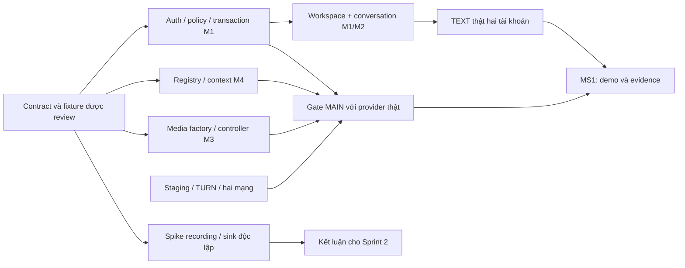

# Sprint 1 — nền tảng và luồng đầu tiên

**Phạm vi chốt ngày 05/11/2026:** sprint đầu dài 2 tuần. **Sprint Goal:** người dùng đăng nhập, mở Workspace, chat TEXT và gọi MAIN cơ bản trên staging; có bằng chứng tích hợp thật và kết luận PoC recording sớm. [Ba milestone](milestones-and-sprints.md) giữ tiêu chí đầy đủ; [WBS](task-consolidation.md) giữ nguồn task/AC/estimate. Mã M1–M5 là miền, không tự suy tên hoặc tài khoản Jira của người trùng tên.

Đây là kế hoạch giao việc, không phải bảng trạng thái. Khi nhập Jira, trường assignee theo người thực hiện dưới đây; owner miền vẫn chịu trách nhiệm thiết kế/review phần mình. Không tạo lại ticket nếu phần quy ước chung đã hoàn thành; chỉ giao phần schema/fixture/handler của task còn thiếu. Chưa có task nào được đánh dấu Done từ kế hoạch này.

## 1. Ưu tiên và thứ tự kéo việc

| Mức | Ý nghĩa                                                                                               | Cách xử lý                                                                                                                                     |
| --- | ----------------------------------------------------------------------------------------------------- | ---------------------------------------------------------------------------------------------------------------------------------------------- |
| P0  | Provider dùng chung, đường tới luồng demo hoặc gate an toàn/tích hợp bắt buộc                         | Khi nhiều task cùng sẵn sàng, làm/review trước P1. Cùng P0: task mở khóa người khác trước task chỉ phục vụ mình.                               |
| P1  | Việc cần trong sprint nhưng có thể làm độc lập hoặc sau provider: UI chi tiết, PoC recording, R2 test | Không để các spike này giữ người đang phải giao auth/transaction/context. Nếu provider bị chặn, người thực hiện chuyển sang P1 sẵn sàng.       |
| P2  | Chuẩn bị board sớm; không nằm trong 80 task chính và không chặn MS1                                   | Chỉ kéo khi không có việc chính sẵn sàng hoặc phần hỗ trợ/review cần ưu tiên. Chưa xong chuyển Sprint 2, không tính là FR board đã hoàn thành. |

P0/P1 là ưu tiên **thực thi Sprint 1**, không thay P0/P1 của product backlog. P1 vẫn cần cho kết quả sprint; không dùng P1 làm lý do bỏ PoC đến cuối dự án. Lượt A–D là thứ tự giao đầu ra, không phải bốn sprint nhỏ hoặc buộc mọi người chờ xong cả lượt.

| Lượt                         | Mục tiêu / mốc kiểm                                                                                                                                                       | Điều kiện chuyển tiếp                                                                                                                                        |
| ---------------------------- | ------------------------------------------------------------------------------------------------------------------------------------------------------------------------- | ------------------------------------------------------------------------------------------------------------------------------------------------------------ |
| **A — Mở đường**             | Ưu tiên đầu sprint: schema/API cụ thể, typed identity/access/context, transaction port, shell/controller contract, hạ tầng/test accounts. Checkpoint sau 2 ngày làm việc. | Provider/consumer có ví dụ và fixture chạy được; chốt các quyết định mục 3. Các phần độc lập của B có thể bắt đầu ngay khi port tương ứng được review.       |
| **B — Làm các phần nền**     | Auth/Workspace/conversation; registry/coordinator/projection MAIN; transport/producer/consumer; shell. Mục tiêu kiểm luồng đầu tiên giữa sprint.                          | Có thể nối thật từng cặp M1–M2, M1–M4, M3–M4; lỗi thiếu interface được xử lý trước khi mở rộng. Không đợi tất cả B mới ghép.                                 |
| **C — Ghép trải nghiệm**     | Form/list/channel, TEXT hai tài khoản, MAIN screen/audio/source sync; PoC recording và storage test theo timebox.                                                         | Kết nối đúng identity/context thật; người không có quyền bị từ chối; chuẩn bị fixture 5 người và hai mạng. Recording không là prerequisite của D.            |
| **D — Kiểm bằng luồng thật** | M4-T11.1 và M3-T17.4 kiểm theo điều kiện riêng; đủ cả hai trước M3-T15.1, không bắt hai việc này chờ nhau nếu không cần. Dành khoảng cuối sprint cho gate và sửa lỗi.     | Auth/ACL, source, media, stream và staging đúng phần kiểm; evidence ghi PASS/FAIL, ca chưa chạy và resource cleanup. Không lấy schema/mock làm kết quả gate. |
| **E — Board sớm, tùy sức**   | Sáu task P2, có thể chạy song song khi người hỗ trợ đang chờ provider.                                                                                                    | Contract/stage cần thiết có sẵn, không chiếm review trên đường tới gate MAIN; chưa thay nghiệm thu board tích hợp.                                           |

Lượt chỉ là hướng điều phối. **Cột phụ thuộc của từng task mới quyết định có được bắt đầu không.** Task trong A cũng có thể chờ task A khác. Không giao đồng loạt mọi P0 ngay ngày đầu hoặc chờ “xong M1” mới bắt đầu M2/M3/M4.

### Chọn việc khi có nhiều task cùng ưu tiên

Trong 80 task chính có 70 task P0. Vì vậy, nhãn P0 không đủ để quyết định việc tiếp theo; PM và người thực hiện chọn trong các task đã đủ điều kiện theo thứ tự:

1. **Mở khóa người khác:** contract/fixture được review, transaction port, auth/socket/access, context/source, shell/controller và điều kiện staging. Ưu tiên PR đang chặn consumer trước mở task mới chỉ phục vụ riêng mình.
2. **Ghép luồng thật:** nối auth–Workspace–TEXT và auth–registry–media MAIN ngay khi provider tương ứng sẵn sàng. Hai luồng chạy độc lập, không buộc TEXT xong mới kiểm MAIN.
3. **Hoàn thiện trải nghiệm cần demo:** form/list/sidebar, timeline/composer, lobby/tiles và trạng thái lỗi. UI mở khóa consumer như shell/controller vẫn thuộc bước 1, không đẩy toàn bộ FE xuống sau backend.
4. **Chốt bằng chứng nghiệm thu:** ưu tiên lỗi khiến ca kiểm không đạt và các gate D khi đủ điều kiện. Test gần thay đổi và kiểm quyền đi cùng implementation; không chờ bước này mới test.

PoC recording có checkpoint riêng cuối tuần đầu nên được PM đặt chỗ từ checkpoint ngày 2, không đợi hết mọi P0 mới bắt đầu. Nếu M2 đang phải giao provider chat/auth hoặc staging, PM bố trí hỗ trợ và cập nhật người thực hiện trên Jira, giữ reviewer M3 cho kỹ thuật media. Không lấy việc board P2 làm ưu tiên hơn hỗ trợ/review đang chặn luồng chính.

### Giao việc đầu tiên

Sau khi pull baseline và chạy preflight local, có thể giao ngay năm việc sau; không cần chờ feature của người khác:

| Người thực hiện | Task đầu tiên | Đầu ra bàn giao ngay sau task                                                                       |
| --------------- | ------------- | --------------------------------------------------------------------------------------------------- |
| M1              | M1-T1.1       | Auth/profile DTO và identity fixture; báo rõ phần chưa chốt, gửi M4 review                          |
| M2              | M2-T1.1       | Identity/access và transaction interface để M1-T2.4 và factory có thể bắt đầu                       |
| M3              | M3-T1.1       | Join/source contract để controller, registry và media triển khai độc lập                            |
| M4              | M4-T1.1       | Typed IDs/envelope và ví dụ MAIN; tiếp T1.2, không chờ auth UI                                      |
| M5              | M3-T2.1       | Lobby/preview với browser thật, có xử lý quyền thiết bị; tiếp T2.2 hoặc controller khi contract tới |

Nếu một task đã có phần quy ước được làm ở lượt trước, chỉ thực hiện phần còn thiếu; không đóng lại toàn task từ tài liệu chung hoặc tính lại công đã dùng. Kéo task tiếp theo theo cột phụ thuộc, không lấy thứ tự dòng trong bảng làm lịch.

Hình chỉ tóm tắt đường ghép; schema không thay provider thật ở gate. Spike recording có đầu ra riêng, không có mũi tên chặn MAIN. TEXT và MAIN đều cần cho MS1, nhưng không đặt TEXT UI làm prerequisite của gate media.

## 2. Khối lượng và phân công

**80 task chính =379 giờ cơ sở; 6 task P2 =24 giờ tùy sức.** Từng task giữ estimate 2–8 giờ nguồn, không cộng task cha hoặc giảm theo cảm giác AI sẽ làm nhanh hơn.

| Người thực hiện | Giờ task chính | Review PR ngoài phần đã tính trong task | Dự phòng sửa/ghép | PM/điều phối | Tổng đặt chỗ chính | P2 tối đa |
| --------------- | -------------: | --------------------------------------: | ----------------: | -----------: | -----------------: | --------: |
| M1              |             78 |                                       8 |                 4 |           12 |                102 |         0 |
| M2              |             90 |                                       8 |                 4 |            0 |                102 |         0 |
| M3              |             78 |                                       8 |                 4 |            0 |                 90 |         0 |
| M4              |             86 |                                       8 |                 4 |            0 |                 98 |         0 |
| M5              |             47 |                                       4 |                 2 |            0 |                 53 |        24 |
| **Tổng**        |        **379** |                                  **36** |            **18** |       **12** |            **445** |    **24** |

- 54 giờ review/dự phòng được **phân từ 198 giờ dự phòng WBS hiện có**, không cộng thêm lần nữa; còn 144 giờ chưa phân cho Sprint 2–3. Đây là ngân sách sử dụng khi cần, không phải task buffer để đánh dấu Done. Contract review/PoC/integration đã có trong task thì không tính lại giờ đó như review PR bổ sung.
- 12 giờ PM là đặt chỗ lịch bổ sung của M1, chưa tính trong 1.378 giờ kỹ thuật. P2 chỉ tiêu thụ 24 giờ cơ sở đã có trong WBS nếu được kéo vào, không cộng vào ngân sách chính 445 giờ trước khi nhận.
- Kế hoạch này vẫn căng: M1/M2 khoảng 102 giờ/2 tuần gồm các khoản trên. **Không mặc định vừa 10 ngày ×8 giờ.** Ngay checkpoint đầu phải đối chiếu giờ còn lại và output, đổi hỗ trợ/thứ tự hoặc cập nhật forecast nếu lệch; không giải quyết bằng hạ AC hoặc giả Done. Team đã xác nhận ưu tiên dự án, nên không chờ khảo sát thời gian thêm.
- M5 nhận các phần UI có contract rõ để giảm tải M1/M3; công ít hơn ở gói chính để có chỗ đọc nguồn, sửa sau review và làm board P2. Không giao thêm auth policy, coordinator hoặc media core chỉ để cân bằng con số. Owner M1/M3/M4 review phần UI thuộc miền mình.
- M2 hỗ trợ model User, thử băm mật khẩu và PoC recording cố định/staging; M3 vẫn chốt đúng kỹ thuật media và kiểm kết quả. M4 hỗ trợ model Workspace/grant và TURN. Không có hai người cùng giữ trách nhiệm writer cuối cùng hoặc cùng sửa model một miền mà không phối hợp.

**Khối lượng còn lại:** chưa kéo P2 thì 167 task nguồn /801 giờ cơ sở ở Sprint 2–3; kéo đủ P2 thì còn 161 task /777 giờ. Đây là backlog còn lại, chưa tự chia đều vào hai sprint. Tổng WBS không tăng vì đổi người thực hiện.

## 3. Các điều kiện cần đóng trước code phụ thuộc

| Đầu ra cần có                                                                   | Provider / reviewer, task đang chịu công                          | Người dùng / thời điểm                                                                                                                                                     |
| ------------------------------------------------------------------------------- | ----------------------------------------------------------------- | -------------------------------------------------------------------------------------------------------------------------------------------------------------------------- |
| Auth DTO, cookie/CSRF/Origin, error schema và identity port                     | M1-T1.1/T4.4/T4.2; M4 review; M2 hỗ trợ spike băm M1-T3.1         | M2/M4 bắt đầu với fixture đã review, đổi sang auth thật trước gate; chốt package/tham số sau spike trước T3.2, không tự bỏ CSRF để ghép nhanh                              |
| Connection/transaction/index preflight trên DB test cô lập                      | M1-T2.4; M2 review transaction port                               | M2-T2.1 và M4-T2.1. Kiểm hiện trạng Mongo Docker trước; không tạo connection/pool riêng từng miền                                                                          |
| Channel/membership policy và User/Workspace coordination                        | M1-T1.2/T5.1/T5.2/T5.3; M4 review                                 | M2/M4 dùng typed context, adapter thu quyền; không lấy host/admin từ payload hoặc chỉ kiểm ở FE                                                                            |
| Runtime identity, scope/projection, cancel/cleanup result và Router/source port | M4-T1.1/T1.2; M3-T1.1/T1.2/T1.3/T1.4; review chéo                 | M4 registry và M3 media dùng fixture để viết độc lập; provider thật phải có trước T11.1/T15.1                                                                              |
| TEXT send/history/subscribe, checkpoint/cursor và giới hạn                      | M2-T1.1/T1.3/T1.6; M1/M4 review phần liên quan                    | Service/FE text; Q9 phải có kết luận sau timebox, chưa chốt không triển khai catch-up bằng timestamp rồi coi không sót                                                     |
| Props shell/panel và một call controller                                        | M1-T1.2/T7.2 + M3-T1.1/T3.1/T3.2; M5 thực hiện UI                 | M2 panel, M4 projection, M5 stage. Không dựng thêm socket/call controller trong từng panel                                                                                 |
| Staging/TLS/hostname/IP, quyền triển khai, mạng và R2 test                      | PM cấp đầu mối/quyền môi trường; M3-T17.1–T17.4/M2-T3.6 kiểm      | Ghi thiếu gì ngay đầu sprint. Dùng fixture cho phần độc lập; thiếu hạ tầng thì gate còn blocked, không đổi thành localhost pass. Không mua/deploy từ lượt lập kế hoạch này |
| Recorder fixture và writer test                                                 | M2-T1.2/T9.1, hỗ trợ M3-T9.1–T9.4; reviewer M3, M4 phần lifecycle | M2 tạo thử output cố định Linux/RTP/helper theo contract M3; thử sink/backpressure/finalize và ghi số đo. Chưa có READY, video sản phẩm hay bằng chứng 3 tiếng             |

Các quyết định kỹ thuật trong task được owner đề xuất/chốt qua reviewer đúng miền theo baseline. Nếu phát hiện phải đổi sản phẩm/quyền/quota chưa chốt, đưa PM quyết định ngay; không biến phần mở thành blocker cho mọi miền khác. Không đặt một buổi duyệt cả team làm prerequisite của các task nền.

## 4. Những phụ thuộc được làm rõ để tránh vòng chờ

1. **M1-T2.4 ↔ M2-T2.1:** chốt transaction interface ở M2-T1.1 trước; M1 cung cấp session, M2 viết factory từ interface. Kiểm rollback nguyên tử chung tại M1-T6.2; không bắt connection đợi mọi model.
2. **M3-T4.1 ↔ M4-T2.2:** registry dùng Router/resource adapter fixture từ contract; transport factory dùng context fixture từ M4-T1.2. Không yêu cầu hai implementation hoàn chỉnh chờ nhau. M4-T11.1 bắt buộc Router, context và auth thật, không nghiệm thu vòng đời sản phẩm từ fixture.
3. **M2-T4.1 và M4-T9.1/T9.2:** có thể kiểm service/port bằng identity/access/cleanup fixture đã review từ T1, không chờ form UI của M1. Trước TEXT thật M2-T5.2, nối M1-T4.4/T4.2/T5.1/T5.3 và adapter M2 ngừng subscription/fanout, bỏ cache đúng phạm vi; trước gate M4-T11.1, nối M1-T4.2/T5.3 và M3 thật. Không mở route công khai hoặc đánh dấu ACL thực đã đạt từ mock.
4. **M3-T5.1/T6.1:** WBS ghi T4/T1 rộng; trong MAIN dùng các task T4.1/2/3/4/6/7 và contract M4 tối thiểu. Không đợi ICE restart T4.5, replacement T5.4 hay nhóm T7. Những tính năng này vẫn là task Sprint 2, không bị bỏ khỏi scope. Gate này không nghiệm thu toàn bộ FR-05 hoặc reconnect nâng cao.
5. **M4-T10.2:** MAIN projection/resync có thể ghép với slot/fixture chat/board theo contract; không chờ board nhóm hoặc meeting chat. Test MAIN thật ở T11.1, còn UI/callback private của nhóm kiểm lại khi provider nhóm đã có.
6. **Auth/Workspace trước panel:** M5 làm lobby/shell/controller sau contract, song song backend; form auth và chọn Workspace hoàn tất với API thật theo task. M2 timeline dùng fixture ở T5.1, nối thật ở T5.2; không lấy screenshot Figma làm phần FE đã xong.
7. **Board và recording không chặn gate MAIN:** source/stage contract vẫn làm ở A, renderer P2 có thể bắt đầu độc lập. M3-T15.1 không chờ M5 overlay, M3-T12 hoặc writer sản phẩm M2; PoC recorder có report riêng. Không đổi FRAME/video thành file công khai để demo.
8. **Chạy lại không đồng nghĩa làm lại:** M4-T11.1 kiểm protocol/lifecycle/FE resync; M3-T17.4 kiểm đường mạng/rollback; M3-T15.1 kiểm media 5 người. Có thể dùng chung một buổi test nhưng từng task lưu kết luận đúng phạm vi và công của mình; không nhân ba lần cùng thời gian họp.

AC gốc vẫn áp dụng cho từng task. Dependency fixture chỉ cho phép làm phần thuần/adapter trước; một dòng chưa đủ AC thực thì giữ chưa Done và ghi phần đã có. Lỗi khi ghép thật phải quay lại owner task liên quan, không đẩy sang một task “integrate” không có người chịu trách nhiệm.

## 5. Danh sách Sprint 1 theo người thực hiện

Mỗi dòng là một task con trong WBS; ID gốc giữ nguyên dù người hỗ trợ thực hiện. Cột phụ thuộc ghi **điều kiện tối thiểu để bắt đầu phần implementation** trong Sprint 1; phạm vi fixture/tích hợp thật được giải thích tại mục 4. Reviewer trong bảng là người chính; owner/provider liên quan vẫn review phần interface của mình như mục 3 và WBS nguồn. AC chi tiết vẫn lấy ở [bảng tổng hợp nguồn](task-consolidation.md#5-dùng-bảng-tổng-hợp-để-tạo-task). Không tạo thêm ticket cho dòng tổng hoặc mã A–E.

### Người phụ trách M1 — 78 giờ chính

| Task nguồn | Đầu ra                                                                                                                                        | Giờ | Ưu tiên / lượt | Reviewer chính | Chờ tối thiểu                                                 |
| ---------- | --------------------------------------------------------------------------------------------------------------------------------------------- | --: | -------------- | -------------- | ------------------------------------------------------------- |
| M1-T1.1    | Chốt contract auth/profile và lỗi; ghi input, output, quyền, giới hạn còn cần quyết định                                                      |   4 | P0 / A         | M4             | Không chờ task khác; kiểm điều kiện môi trường/contract mục 3 |
| M1-T1.2    | Chốt contract Workspace/kênh và interface M2/M4; cập nhật Zod PRIVATE/ObjectId, kiểm consumer và ghi kết quả review                           |   6 | P0 / A         | M4             | Không chờ task khác; kiểm điều kiện môi trường/contract mục 3 |
| M1-T2.4    | Cung cấp connection/transaction session dùng chung; thử rollback với M2 và preflight index/migration trên DB riêng, ghi cách rollback         |   4 | P0 / A         | M4             | M2-T1.1                                                       |
| M1-T3.2    | Đăng ký và cấp phiên: kiểm tự đăng nhập, email trùng và input lỗi                                                                             |   6 | P0 / B         | M4             | M1-T1.1, M1-T2.1, M1-T2.4, M1-T3.1                            |
| M1-T3.3    | Đăng nhập và cấp phiên mới: kiểm thông tin sai, giới hạn thử và phối hợp khóa User với đổi mật khẩu                                           |   6 | P0 / B         | M4             | M1-T3.2, M1-T5.2                                              |
| M1-T4.4    | Viết middleware đọc/kiểm phiên HTTP, API phiên hiện tại và cấp/kiểm CSRF theo contract; kiểm cookie hết hạn, giả mạo và lỗi xác thực          |   6 | P0 / B         | M4             | M1-T3.2, M1-T2.1                                              |
| M1-T4.2    | Xác thực socket bằng cùng phiên; kiểm Origin, CSRF theo contract và từ chối phiên không hợp lệ                                                |   4 | P0 / B         | M4             | M1-T4.4, M4-T1.2                                              |
| M1-T4.3    | Đăng xuất/hết hạn phiên: thu phiên, cập nhật UI và gọi adapter đóng kết nối; kiểm bằng adapter giả, ca thật kiểm ở T15.2                      |   6 | P0 / C         | M4             | M1-T4.1, M1-T4.2, M1-T5.3                                     |
| M1-T5.1    | Viết policy membership/role/channel access dùng chung; kiểm bảng ca cho phép và từ chối                                                       |   6 | P0 / B         | M4             | M1-T2.3, M1-T1.2                                              |
| M1-T5.2    | Viết cơ chế điều phối User/Workspace theo thứ tự khóa baseline; kiểm thao tác đồng thời, nhả khóa khi lỗi và interface để các miền dùng chung |   4 | P0 / A         | M4             | M1-T1.1, M1-T1.2                                              |
| M1-T5.3    | Viết điều phối chặn truy cập và gọi adapter thu quyền đúng phạm vi; kiểm lỗi cleanup bằng adapter giả                                         |   6 | P0 / B         | M4             | M1-T5.1, M1-T5.2, M4-T1.2                                     |
| M1-T6.1    | Tạo Workspace, OWNER, general và conversation trong transaction chung với M2; kiểm kết quả thành công                                         |   6 | P0 / B         | M4             | M1-T2.2, M1-T2.3, M1-T5.1, M1-T5.2, M2-T2.1                   |
| M1-T6.2    | Kiểm rollback, retry và yêu cầu tạo lặp; bảo đảm không có Workspace hoặc conversation dở dang                                                 |   2 | P0 / B         | M4             | M1-T6.1                                                       |
| M1-T10.1   | Làm API và form tạo kênh TEXT/LIVE theo accessMode; tạo conversation TEXT với M2, kiểm quyền và rollback khi lỗi                              |   6 | P0 / C         | M4             | M1-T7.1, M1-T5.2, M2-T2.1                                     |
| M1-T10.2   | Làm API list nội dung/list quản trị và UI sidebar/quản trị; kiểm phân trang, kênh không có quyền và không lộ nội dung PRIVATE qua quyền admin |   6 | P0 / C         | M4             | M1-T10.1                                                      |

### Người phụ trách M2 — 90 giờ chính

| Task nguồn | Đầu ra                                                                                                  | Giờ | Ưu tiên / lượt | Reviewer chính | Chờ tối thiểu                                                          |
| ---------- | ------------------------------------------------------------------------------------------------------- | --: | -------------- | -------------- | ---------------------------------------------------------------------- |
| M1-T2.1    | Tạo model/index/validator User và authSession; kiểm unique email, phiên hết hạn và dữ liệu không hợp lệ |   6 | P0 / B         | M1             | M1-T1.1, M1-T2.4                                                       |
| M1-T3.1    | Thử thư viện/cấu hình băm và giới hạn tác vụ; ghi số đo CPU/RAM/thời gian, đề xuất cấu hình để review   |   4 | P0 / A         | M1             | Không chờ task khác; kiểm điều kiện môi trường/contract mục 3          |
| M2-T1.1    | Chốt identity, general, quyền/thu quyền và ngân sách handler chung                                      |   4 | P0 / A         | M1             | Không chờ task khác; kiểm điều kiện môi trường/contract mục 3          |
| M2-T1.2    | Review port reserve/writer/finalize/fail với Việt, ghi trách nhiệm mỗi bên                              |   4 | P0 / A         | M1             | Không chờ task khác; kiểm điều kiện môi trường/contract mục 3          |
| M2-T1.3    | Thử có giới hạn subscribe/history và checkpoint theo commit, chốt Q9                                    |   4 | P0 / A         | M1             | M2-T1.1, M1-T2.4                                                       |
| M2-T1.4    | Thử Busboy/file-type/sharp trên runtime pin; chốt hướng Q3                                              |   4 | P0 / A         | M1             | Không chờ task khác; kiểm điều kiện môi trường/contract mục 3          |
| M2-T1.6    | Viết contract strict cho send/history/subscribe và ví dụ consumer                                       |   4 | P0 / A         | M1             | M2-T1.1, M2-T1.3                                                       |
| M2-T2.1    | Model conversation chung và factory CHANNEL cho general                                                 |   4 | P0 / B         | M1             | M2-T1.1, M1-T2.4                                                       |
| M2-T2.2    | Model tin gốc, khóa retry và index history TEXT                                                         |   4 | P0 / B         | M1             | M2-T2.1, M2-T1.6                                                       |
| M2-T4.1    | TEXT text-only: send/history/dedupe và lỗi trên cùng service REST/socket                                |   6 | P0 / C         | M1             | M2-T1.6, M2-T2.2, M1-T1.1, M1-T1.2                                     |
| M2-T4.2    | Subscribe-first, catch-up nhiều trang, mốc L/H và invalidation                                          |   6 | P0 / C         | M1             | M2-T4.1, M2-T1.3                                                       |
| M2-T5.1    | Timeline/composer TEXT, đang gửi/lỗi/thử lại với fixture đúng contract                                  |   4 | P1 / C         | M1             | M2-T1.6, M1-T7.2                                                       |
| M2-T5.2    | Nối TEXT thật và subscribe/history; demo hai tài khoản chỉ gửi văn bản                                  |   4 | P0 / C         | M1             | M2-T5.1, M2-T4.2, M1-T6.2, M1-T7.1, M1-T4.4, M1-T5.1, M1-T4.2, M1-T5.3 |
| M2-T9.1    | Thử có giới hạn output M3 → sink M2; chốt writer/seek/finalize                                          |   4 | P1 / C         | M1             | M2-T1.2, M3-T9.3                                                       |
| M2-T3.6    | Kết nối R2 chung, kho thử riêng tư và cấu hình backend                                                  |   4 | P1 / C         | M1             | M2-T1.4                                                                |
| M3-T9.1    | Spike Python/PyGObject/helper trên Linux                                                                |   4 | P1 / C         | M3             | Không chờ task khác; kiểm điều kiện môi trường/contract mục 3          |
| M3-T9.2    | Fixture mediasoup RTP/RTCP nguồn cố định                                                                |   4 | P1 / C         | M3             | M3-T9.1                                                                |
| M3-T9.3    | Spike ghi cố định và stop/finalize                                                                      |   6 | P1 / C         | M3             | M3-T9.2                                                                |
| M3-T9.4    | Báo cáo PoC và quyết định bước sau                                                                      |   2 | P1 / C         | M3             | M3-T9.3, M2-T9.1                                                       |
| M3-T17.1   | Rà cấu hình staging từ Docker/nginx hiện có và chốt checklist môi trường                                |   4 | P0 / A         | M4             | Không chờ task khác; kiểm điều kiện môi trường/contract mục 3          |
| M3-T17.2   | Chuẩn bị và thử triển khai app/Mongo trên staging được cấp                                              |   4 | P0 / A         | M4             | M3-T17.1                                                               |

### Người phụ trách M3 — 78 giờ chính

| Task nguồn | Đầu ra                                                               | Giờ | Ưu tiên / lượt | Reviewer chính | Chờ tối thiểu                                                             |
| ---------- | -------------------------------------------------------------------- | --: | -------------- | -------------- | ------------------------------------------------------------------------- |
| M3-T1.1    | Ví dụ join/source/envelope và quyền M3–M4                            |   4 | P0 / A         | M4             | Không chờ task khác; kiểm điều kiện môi trường/contract mục 3             |
| M3-T1.2    | Contract revoke/pending/cleanup và ack                               |   4 | P0 / A         | M4             | M3-T1.1, M4-T1.2                                                          |
| M3-T1.3    | Contract SourceDescriptor/snapshot/event/revision                    |   4 | P0 / A         | M4             | M3-T1.1, M4-T1.2                                                          |
| M3-T1.4    | Review REST proof, ICE fencing và strict API schemas                 |   4 | P0 / A         | M4             | M3-T1.2, M3-T1.3                                                          |
| M3-T4.1    | Transport factory, signaling create/connect                          |   6 | P0 / B         | M4             | M3-T1.4, M3-T3.1, M4-T1.2                                                 |
| M3-T4.2    | Producer/Consumer paused-ready                                       |   6 | P0 / B         | M4             | M3-T4.1                                                                   |
| M3-T4.3    | Pending registry và callback stale                                   |   4 | P0 / B         | M4             | M3-T4.2                                                                   |
| M3-T4.4    | REST bootstrap/ICE và HTTP context proof FE/BE                       |   8 | P0 / C         | M4             | M3-T4.1, M3-T1.4, M3-T17.3                                                |
| M3-T4.6    | Snapshot nguồn/own resources và FE reconcile                         |   8 | P0 / C         | M4             | M3-T4.2, M3-T1.3, M4-T3.4                                                 |
| M3-T4.7    | Media delta stream, sequence và bounded buffer                       |   6 | P0 / C         | M4             | M3-T4.6                                                                   |
| M3-T5.1    | Toggle mic/camera                                                    |   4 | P0 / C         | M4             | M3-T2.2, M3-T4.3, M3-T4.4, M3-T4.7                                        |
| M3-T6.1    | Acquire lease và picker/hủy                                          |   4 | P0 / C         | M4             | M3-T4.3, M3-T1.3, M4-T3.3                                                 |
| M3-T6.2    | Publish/Stop SCREEN + SCREEN_AUDIO                                   |   5 | P0 / C         | M4             | M3-T6.1                                                                   |
| M3-T8.1    | AudioGraph MAIN một output/track; chống nhân tiếng và xử lý autoplay |   5 | P0 / C         | M4             | M3-T4.3, M3-T3.2, M4-T1.2                                                 |
| M3-T15.1   | Gate MAIN sớm 5 người/hai mạng/TURN                                  |   6 | P0 / D         | M4             | M3-T4.7, M3-T5.3, M3-T6.2, M3-T8.1, M3-T17.4, M4-T11.1, M1-T10.1, M1-T4.3 |

### Người phụ trách M4 — 86 giờ chính

| Task nguồn | Đầu ra                                                                                                                | Giờ | Ưu tiên / lượt | Reviewer chính | Chờ tối thiểu                                                                                                         |
| ---------- | --------------------------------------------------------------------------------------------------------------------- | --: | -------------- | -------------- | --------------------------------------------------------------------------------------------------------------------- |
| M1-T2.2    | Tạo model/index/validator Workspace, membership và invitation; kiểm ràng buộc owner, một link hiện hành và membership |   6 | P0 / B         | M1             | M1-T1.2, M1-T2.4                                                                                                      |
| M1-T2.3    | Tạo model/index/validator kênh và PRIVATE grant; kiểm grant gắn đúng lần membership và ràng buộc unique               |   4 | P0 / B         | M1             | M1-T1.2, M1-T2.4                                                                                                      |
| M3-T17.3   | Cấu hình TURN và kiểm credential/relay trên staging                                                                   |   4 | P0 / A         | M3             | M3-T17.1                                                                                                              |
| M4-T1.1    | Typed IDs, command/ack/error và ví dụ schema phiên                                                                    |   4 | P0 / A         | M3             | Không chờ task khác; kiểm điều kiện môi trường/contract mục 3                                                         |
| M4-T1.2    | Contract auth/context/cleanup và budget control/snapshot                                                              |   4 | P0 / A         | M3             | M4-T1.1                                                                                                               |
| M4-T1.3    | Timebox 4 giờ: kiểm fixture kế vị Q1 và contract/PoC Q7                                                               |   4 | P0 / A         | M3             | Không chờ task khác; kiểm điều kiện môi trường/contract mục 3                                                         |
| M4-T2.1    | Schema/index metadata phiên/participant và repository transaction/CAS                                                 |   6 | P0 / B         | M3             | M4-T1.1, M1-T2.4                                                                                                      |
| M4-T2.2    | Registry, join intent/ticket và MAIN tối thiểu gắn auth/access stamps                                                 |   6 | P0 / B         | M3             | M4-T2.1, M4-T3.1, M4-T3.2, M1-T1.2, M3-T1.1                                                                           |
| M4-T2.4    | Bootstrap phiên cũ và query metadata phiên có giới hạn                                                                |   6 | P0 / B         | M3             | M4-T2.1, M4-T1.2                                                                                                      |
| M4-T3.1    | Policy thuần và projection MAIN/nhóm theo actor                                                                       |   4 | P0 / B         | M3             | M4-T1.2                                                                                                               |
| M4-T3.2    | Coordinator, deny barrier, transition token và cleanup result                                                         |   4 | P0 / B         | M3             | M4-T1.2                                                                                                               |
| M4-T3.3    | Share lease MAIN/ACTIVITY và media gate create/ready                                                                  |   4 | P0 / B         | M3             | M4-T3.1, M4-T3.2, M3-T1.3                                                                                             |
| M4-T3.4    | Snapshot/event envelope, audienceEpoch và projectionSequence                                                          |   4 | P0 / B         | M3             | M4-T3.1, M4-T1.2                                                                                                      |
| M4-T7.2    | End/host voluntary leave và shutdown idempotent                                                                       |   6 | P0 / B         | M3             | M4-T2.2, M4-T3.2                                                                                                      |
| M4-T9.1    | Revoke tối thiểu MAIN gắn authSession/access, hủy ticket/pending                                                      |   4 | P0 / B         | M3             | M4-T2.2, M4-T3.2, M1-T1.2                                                                                             |
| M4-T9.2    | Reconnect/resync MAIN theo quyền hiện tại                                                                             |   4 | P0 / B         | M3             | M4-T2.2, M4-T3.4, M1-T1.1                                                                                             |
| M4-T9.3    | Read-back outcome và kết thúc phiên rỗng                                                                              |   4 | P0 / B         | M3             | M4-T2.1, M4-T2.2, M4-T3.2                                                                                             |
| M4-T9.4    | Worker death/restart đi qua end/reconcile                                                                             |   4 | P0 / B         | M3             | M4-T2.4, M4-T7.2                                                                                                      |
| M4-T11.1   | Gate tích hợp MAIN đầu tiên với auth/media thật                                                                       |   4 | P0 / D         | M3             | M1-T5.3, M1-T4.2, M4-T2.2, M4-T9.1, M4-T9.2, M4-T10.2, M3-T4.4, M3-T4.7, M3-T8.1, M1-T4.3, M1-T10.1, M4-T7.2, M4-T9.3 |

### Người phụ trách M5 — 47 giờ chính, 24 giờ mở rộng

| Task nguồn | Đầu ra                                                                                                                    | Giờ | Ưu tiên / lượt | Reviewer chính | Chờ tối thiểu                                                 |
| ---------- | ------------------------------------------------------------------------------------------------------------------------- | --: | -------------- | -------------- | ------------------------------------------------------------- |
| M1-T4.1    | Làm form đăng ký/đăng nhập, lấy phiên hiện tại và tải lại trang; kiểm cookie/CSRF và thông báo lỗi                        |   6 | P0 / C         | M1             | M1-T3.3, M1-T4.4                                              |
| M1-T7.1    | Làm API danh sách Workspace có quyền và UI chọn/tạo/mở; kiểm trạng thái chưa có Workspace, lỗi tạo và truy cập trái quyền |   6 | P0 / C         | M1             | M1-T4.1, M1-T6.2, M1-T5.1                                     |
| M1-T7.2    | Dựng shell/sidebar và vị trí nhúng chat/cuộc gọi bằng fixture đúng contract                                               |   4 | P0 / B         | M1             | M1-T1.2, M3-T1.1, M2-T1.1                                     |
| M3-T2.1    | Lobby chọn thiết bị và preview                                                                                            |   4 | P1 / C         | M3             | Không chờ task khác; kiểm điều kiện môi trường/contract mục 3 |
| M3-T2.2    | Hủy lobby và lỗi thiết bị                                                                                                 |   4 | P1 / C         | M3             | M3-T2.1                                                       |
| M3-T3.1    | CallController ngoài vòng đời panel                                                                                       |   4 | P0 / B         | M3             | M3-T1.1                                                       |
| M3-T3.2    | RoomShell và StrictMode cleanup                                                                                           |   6 | P0 / B         | M3             | M3-T3.1                                                       |
| M3-T5.3    | Camera tiles và trạng thái server pause                                                                                   |   3 | P1 / C         | M3             | M3-T5.1                                                       |
| M3-T17.4   | Kiểm đường mạng hai mạng và diễn tập rollback app staging                                                                 |   4 | P0 / D         | M3             | M3-T17.2, M3-T17.3, M3-T5.1, M3-T6.2, M3-T8.1, M4-T2.4        |
| M4-T10.2   | State FE MAIN/resync và cache private theo audience                                                                       |   6 | P0 / C         | M4             | M4-T3.4, M4-T9.2, M3-T3.2                                     |
| M5-W1.1    | Định nghĩa phong bì `boardCommandEnvelopeSchema` & Lệnh Freeze, Resume                                                    |   2 | P2 / E         | M3             | M4-T1.2, M3-T1.3                                              |
| M5-W1.2    | Định nghĩa Schemas cho Stroke, State, Sync pagination & Error codes                                                       |   2 | P2 / E         | M3             | M5-W1.1                                                       |
| M5-W2.1    | Thuật toán tách letterbox/pillarbox và tính vùng hiển thị thực của video                                                  |   4 | P2 / E         | M3             | Không chờ task khác; kiểm điều kiện môi trường/contract mục 3 |
| M5-W2.2    | Thuật toán chuẩn hóa con trỏ và lượng tử hóa tọa độ 4 chữ số thập phân                                                    |   4 | P2 / E         | M3             | M5-W2.1                                                       |
| M5-W3.1    | Canvas 2D freehand rendering engine & làm mượt đường cong Bezier                                                          |   6 | P2 / E         | M3             | M5-W2.2                                                       |
| M5-W9.1    | Xây dựng Component `StageCanvasOverlay.tsx` gắn vào Call Stage                                                            |   6 | P2 / E         | M3             | M5-W1.2, M5-W3.1, M3-T3.2                                     |

## 6. Các checkpoint và xử lý blocker

- **Sau 2 ngày làm việc:** PM kiểm auth/transaction/context/source/shell contracts và quyền staging; đối chiếu tải M1/M2, đặt chỗ PoC recording trong tuần đầu và giao hỗ trợ nếu đang tranh người với provider chính. Task provider chưa có đầu ra phải được xử lý trước mở thêm consumer. Không đợi daily sau mới báo thiếu tài khoản/TLS/port.
- **Cuối tuần đầu — PoC recording:** có kết quả ban đầu hoặc blocker tái hiện được từ M3-T9.1–T9.3/M2-T9.1: môi trường Linux/helper, output RTP cố định, ghi/stop/finalize và khả năng nhận output của sink đã kiểm tới đâu. Chưa chạy tới bước nào thì ghi rõ, kèm người xử lý và bước thử tiếp theo. Cuối sprint M3-T9.4 phải có kết luận trong timebox để chọn việc Sprint 2; checkpoint tuần đầu không đòi pipeline sản phẩm hoặc video READY.
- **Giữa sprint:** demo một luồng đăng nhập/Workspace/TEXT và một cặp MAIN thật theo phần đã có; nếu đang chỉ chạy fixture thì ghi rõ. Kiểm kết quả spike hash/history/recorder, dự báo lại các task còn lại và tải M1/M2/M3/M4. Đây là checkpoint điều chỉnh, không tuyên bố toàn bộ giữa sprint phải đã có đủ 5 người.
- **Khoảng cuối sprint:** khóa thêm P2, ưu tiên ghép/provider thật và gate D. Nếu luồng chính chưa tới staging, PM điều chỉnh forecast và người hỗ trợ ngay; không dồn cả test và deploy vào buổi review cuối.
- **Review cuối sprint:** demo theo MS1, ghi ca đạt/chưa đạt và lý do; chọn task Sprint 2 theo các prerequisite thật đã hoàn thành. Không tự chuyển ticket sang Done khi hết 2 tuần.

Mỗi người chỉ giữ một task implementation chính đang chạy; có thể chờ review một PR trong khi nhận task Ready tiếp theo. Task mở khóa người khác cần PR nhỏ và review trong ngày khi có thể; PM điều phối reviewer nếu người chính bận. Không tạo chain `blocks` giữa hai task chỉ vì chúng cùng owner hoặc cùng lượt A/B.

**Báo sớm khi:** thiếu provider/môi trường, chưa chốt contract cần dùng, hoặc dự kiến vượt estimate. Nội dung ngắn: task/đầu ra đã chạy/giờ dùng/phần thiếu/người cần xử lý/tác động tới consumer. PM có thể giao hỗ trợ, tách phần còn lại thành task mới hoặc điều chỉnh sprint; không âm thầm để “mai làm tiếp” nhiều ngày. Nếu consumer có fixture hợp lệ, tiếp tục phần độc lập; vẫn giữ cổng tích hợp thật.

**Trước khi nhập Jira:** mỗi dòng có assignee theo miền-người đã được PM giao, reviewer, nguồn FR/AC/kiến trúc, priority, estimate giờ và link prerequisite. Copy AC task nguồn; với task nền ghi mục tiêu kỹ thuật thay vì bịa thêm FR. Mã trong bảng là trace ID, không là Jira key. Tạo `blocks` chỉ cho dependency đã ghi, phân biệt task implementation với ticket kết quả kiểm tích hợp; không tự tạo status board thứ hai trong repo.

## 7. Output và kịch bản demo cuối Sprint 1

**Đầu ra cần bàn giao:** một bản staging gắn commit/build xác định; luồng tài khoản → Workspace → TEXT và MAIN cơ bản chạy với provider thật; evidence ca quyền/vòng đời/mạng; báo cáo PoC recording có kết luận và việc cần làm tiếp. Checklist dưới đây dùng để trình bày kết quả, không thay AC của task hoặc tiêu chí MS1.

Demo khoảng **15–20 phút**, M1 điều phối; owner miền giải thích và người thực hiện task thao tác phần đã tích hợp. Chuẩn bị sẵn năm tài khoản có membership/kênh hợp lệ và một tài khoản ngoài phạm vi trên môi trường thử. Công chuẩn bị/kiểm đã nằm trong các task UI/gate/evidence và ngân sách điều phối, không tạo thêm sáu ticket từ bảng demo.

| Phần / thời lượng              | Thao tác và kết quả cần thấy                                                                                                                                                                                      | Task/evidence chính                                                                                                                        |
| ------------------------------ | ----------------------------------------------------------------------------------------------------------------------------------------------------------------------------------------------------------------- | ------------------------------------------------------------------------------------------------------------------------------------------ |
| **Tài khoản — 2 phút**         | Đăng ký tự có phiên; đăng xuất, đăng nhập và tải lại trang. Phiên được duy trì đúng; request/socket dùng phiên đã thu bị từ chối.                                                                                 | M1-T3.2/T3.3/T4.1/T4.2/T4.3/T4.4; ca từ chối có thể trình bày bằng evidence.                                                               |
| **Workspace/kênh — 3 phút**    | Tạo Workspace, thấy general, mở TEXT; tạo/mở kênh LIVE. UI gọi API thật, có OWNER/general/conversation đầy đủ.                                                                                                    | M1-T6.1/T6.2/T7.1/T7.2/T10.1/T10.2; rollback trình bày bằng test/evidence.                                                                 |
| **TEXT — 3 phút**              | Hai tài khoản có quyền gửi/đọc văn bản, thử lại cùng tin không nhân bản; nối lại nhận phần tin bị lỡ. Tài khoản ngoài phạm vi bị từ chối.                                                                         | M2-T4.1/T4.2/T5.2; kiểm thu quyền bỏ subscription/cache theo đúng phạm vi.                                                                 |
| **MAIN — 6 phút**              | Năm người vào qua lobby, bật/tắt mic/camera; một người share rồi dừng, người khác share tiếp. Thử người thứ hai share khi nguồn còn bận để thấy không chiếm nguồn. Có hình/tiếng thật, không chỉ trạng thái UI.   | M3-T2.1/T2.2/T5.1/T5.3/T6.1/T6.2/T8.1/T15.1; M4-T11.1.                                                                                     |
| **Vòng đời/quyền — 3 phút**    | Một thành viên thường rời rồi vào lại đúng quyền; một thành viên thường logout khi đang kết nối thì tài nguyên liên quan bị thu; cuối cùng host kết thúc phiên cho mọi người. UI và server thống nhất trạng thái. | M1-T4.3, M4-T7.2/T9.1/T9.2/T9.3/T11.1, M3-T15.1. Không dùng host logout để minh họa thành viên logout; kế vị host đầy đủ thuộc sprint sau. |
| **Bằng chứng và PoC — 3 phút** | Trình bày kết quả hai mạng/forced TURN với relay bytes, kiểm rollback app và báo cáo ghi cố định/sink: cấu hình, tệp thử nếu có, số đo, kết luận hoặc blocker.                                                    | M3-T17.4/T15.1/T9.4, M2-T9.1. Recording PoC chưa là chức năng ghi/xem video của sản phẩm.                                                  |

Trước demo, ghi rõ thành viên thử được chuẩn bị bằng **fixture kiểm thử hợp lệ**; invitation/join sản phẩm chưa thuộc Sprint 1. Không bypass auth hoặc sửa DB trực tiếp trong buổi trình bày. Tài khoản mới tạo Workspace riêng của mình; để demo nhiều người cùng kênh, chuyển sang Workspace đã chuẩn bị sẵn với quyền hợp lệ, không giả luồng mời đã hoàn thành.

Evidence ghi commit/build, môi trường/profile thử, bước tái hiện và kết quả **đạt / chưa đạt / chưa chạy** cho từng ca. Các ca rollback, race, DB lỗi, ranh giới catch-up và thu quyền chi tiết có thể dùng log/test hoặc bản ghi thử trước; demo trực tiếp không cần lặp toàn bộ. Nếu mạng demo lỗi, dùng evidence đúng bản build và nói rõ phần không chạy trực tiếp; evidence còn thiếu thì MS1 chưa đủ tiêu chí.

Cuối buổi, đối chiếu đủ ba đầu ra: **trải nghiệm TEXT thật**, **MAIN năm người có kiểm mạng/quyền/vòng đời**, **kết luận PoC recording**. Nhóm DISCUSSION/ACTIVITY, board, DM/thread/file, invitation và recording sản phẩm tiếp tục ở Sprint 2–3; chưa trình bày chúng như feature đã xong. Sprint 1 không nghiệm thu đầy đủ F-05 hoặc capacity 25/50 người.
