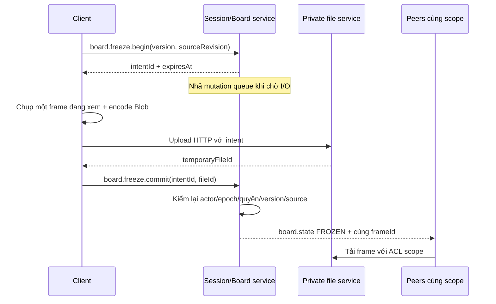

# Freeze và vẽ cơ bản

**Trạng thái:** Luồng đích; chưa có board/freeze nghiệp vụ trong scaffold.

Nguồn ban đầu được trích chuyển từ [technical plan v2.1](../technical-plan.md) ngày 26/10/2026. Đã cập nhật theo quyết định team ngày 27/10/2026 trong technical plan v2.3. Đây là nguồn chi tiết hiện hành cho các mục được chuyển; số mục giữ theo baseline để truy vết. Thay đổi quy tắc cần cập nhật tại đây và review ảnh hưởng tới contract/test, không tạo bản sao song song.

## 7. Freeze và vẽ cơ bản

### 7.1. Board và thao tác cơ bản

Mỗi scope có một board chung: MAIN ở phòng tự do/phần phòng chính, hoặc một group. Thành viên freeze/resume tác động đúng scope, UI ghi rõ “Tạm dừng hình của nhóm” và “Cho nhóm trở lại trực tiếp”. Chưa có freeze cá nhân.

```ts
type BoardState = {
  id: string;
  scopeId: string;
  version: number;
  status: 'LIVE' | 'FREEZING' | 'FROZEN';
  sourceScopeId: string; // MAIN cho DISCUSSION; group scope cho ACTIVITY
  sourceId: string | null; // nguồn cụ thể: screen duy nhất đang share trong ACTIVITY
  sourceRevision: number;
  frameId: string | null;
  strokeSequence: number;
};
type Stroke = {
  id: string;
  boardId: string;
  contextVersion: number;
  frameId: string | null;
  sourceScopeId: string; // MAIN cho DISCUSSION; group scope cho ACTIVITY
  sourceId: string | null; // nguồn cụ thể: screen duy nhất đang share trong ACTIVITY
  sourceRevision: number;
  authorParticipantId: string; // server gán
  points: Array<{ x: number; y: number }>; // 0..1
  color: string;
  width: number;
};
```

- Bút, palette màu, con trỏ, undo nét gần nhất của mình; clear toàn context theo quyền ở mục 5 và xác nhận.
- FROZEN cho nét bền trong context hiện tại; LIVE dùng con trỏ/nét chỉ ngắn tự hết hạn, chưa có tracking vật thể/trang.
- Tọa độ tính trên vùng hình thật, loại letterbox; resize và device pixel ratio không làm trôi nét.
- Preview/cursor batch tối đa 20 lần/giây, cho phép mất; stroke commit có UUID, ack, sequence và version. Mất sequence lấy board snapshot đã lọc quyền.
- Server gán author, kiểm membership/context hiện tại, màu/width/points/bytes. Undo là tombstone nét của mình, không cho xóa nét người khác bằng sửa ID.
- Không dùng DB write cho từng điểm; runtime có stroke log/snapshot đủ khôi phục khi socket rớt ngắn trong cùng đời server.

### 7.2. Freeze và resume



Client chụp video remote đang nhận hoặc screen track local nếu chính mình share; kiểm có frame giải mã sẵn/kích thước hợp lệ. Không suy mọi ảnh màu đen là lỗi. Dùng Canvas `drawImage(video, ...)`, không DOM screenshot toàn máy. [MDN drawImage](https://developer.mozilla.org/en-US/docs/Web/API/CanvasRenderingContext2D/drawImage).

Server reserve intent có hạn và actor/context/generation; chỉ một intent thắng. Commit kiểm file thuộc intent, format/dimensions/size và các revision. Snapshot là ảnh do participant hợp lệ cung cấp; server không cam kết chứng thực ảnh chính xác tuyệt đối với bài giảng. Khi source đổi trước commit trả `SOURCE_CHANGED`; khi quyền đổi trả deny; request cũ không được ghi đè context mới. Hỏng upload/hết hạn trả LIVE và dọn file orphan.

Video của nguồn hợp lệ đã chọn tiếp tục nhận/giải mã dưới lớp ảnh, audio graph giữ nguyên theo group mode. Khi FROZEN, nét gắn frame/source revision đã chốt, không bị từ chối chỉ vì giảng viên đã đổi nguồn mới ở phía live.

Resume hủy intent pending nếu có, tăng boardVersion, đóng context cũ, bỏ lớp ảnh/nét để thấy video hiện tại. Không replay đoạn bỏ qua. Nếu nguồn không còn, hiển thị “Chưa có nguồn chia sẻ”, không giả live. Không có `artifact.save`, library hoặc export lâu dài trong scope này.

### 7.3. Board khi kết thúc chia nhóm

Khi host đưa tất cả về MAIN, board nhóm không được công bố hoặc chuyển thành board MAIN. Thu quyền đọc/vẽ context nhóm, hủy intent còn chờ và dọn frame/nét hết tham chiếu theo lifecycle. MAIN dùng board của chính MAIN; không tự nhập nét hoặc ảnh nhóm vào đó.

Theo quyết định team 27/10/2026, bản này không có projection công bố hình+nét, endpoint frame presentation hoặc thư viện/export bài làm. Phát biểu sau thảo luận dùng mic thông thường tại MAIN; xem [quy tắc về phòng chung](groups-media-policy.md#82-kết-thúc-chia-nhóm-và-về-phòng-chung).

### 7.4. Board source theo group mode

Theo [group modes](group-modes.md), board DISCUSSION dùng MAIN screen, không cho nhóm share riêng. ACTIVITY dùng nguồn thuộc nhóm, không tự nhận/fallback MAIN. Intent/stroke/snapshot gắn sourceScopeId, sourceId và revision ngoài board scope/version để không áp nét hoặc request cũ lên nguồn khác. ACTIVITY dùng screen duy nhất đang share của nhóm theo quyết định đã chốt; đổi người share tăng source revision, invalidate intent/live overlay cũ, không gắn nét sai nguồn. Không có nguồn hợp lệ thì báo rõ thay vì giả live.

Đóng nhóm/rời nhóm hủy pending intent và thu quyền frame/overlay. Quy tắc giữ frame FROZEN khi nguồn dừng vẫn áp trong context hợp lệ; không biến frame nhóm thành dữ liệu MAIN.
