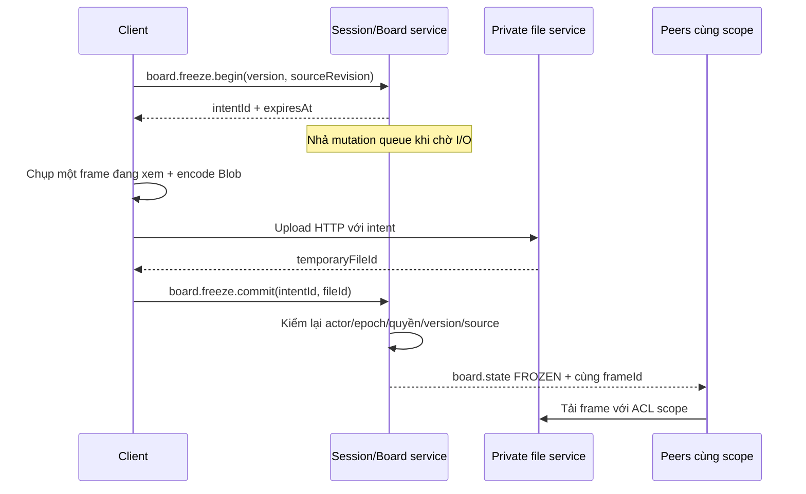

# Freeze, vẽ cơ bản và công bố

**Trạng thái:** Luồng đích; chưa có board/freeze/presentation nghiệp vụ trong scaffold.

Trích chuyển nguyên nội dung tương ứng từ [technical plan v2.1](../technical-plan.md) ngày 26/10/2026. Đây là nguồn chi tiết cho các mục được chuyển; số mục giữ theo baseline để truy vết. Thay đổi quy tắc cần cập nhật tại đây và review ảnh hưởng tới contract/test, không tạo bản sao song song.

## 7. Freeze, vẽ cơ bản và presentation

### 7.1. Board và thao tác cơ bản

Mỗi scope có một board chung: MAIN ở phòng tự do/phần phòng chính, hoặc một group. Thành viên freeze/resume tác động đúng scope, UI ghi rõ “Tạm dừng hình của nhóm” và “Cho nhóm trở lại trực tiếp”. Chưa có freeze cá nhân.

```ts
type BoardState = {
  id: string;
  scopeId: string;
  version: number;
  status: 'LIVE' | 'FREEZING' | 'FROZEN';
  sourceRevision: number;
  frameId: string | null;
  strokeSequence: number;
};
type Stroke = {
  id: string;
  boardId: string;
  contextVersion: number;
  frameId: string | null;
  sourceRevision: number;
  authorParticipantId: string; // server gán
  points: Array<{ x: number; y: number }>; // 0..1
  color: string;
  width: number;
};
```

- Bút, palette màu, con trỏ, undo nét gần nhất của mình; clear toàn context theo quyền ở mục 5 và xác nhận.
- FROZEN cho nét bền trong context hiện tại; LIVE dùng con trỏ/nét chỉ ngắn tự hết hạn, chưa có tracking vật thể/trang.
- Tọa độ tính trên vùng hình thật, loại letterbox; resize và device pixel ratio không làm trôi nét.
- Preview/cursor batch tối đa 20 lần/giây, cho phép mất; stroke commit có UUID, ack, sequence và version. Mất sequence lấy board snapshot đã lọc quyền.
- Server gán author, kiểm membership/context hiện tại, màu/width/points/bytes. Undo là tombstone nét của mình, không cho xóa nét người khác bằng sửa ID.
- Không dùng DB write cho từng điểm; runtime có stroke log/snapshot đủ khôi phục khi socket rớt ngắn trong cùng đời server.

### 7.2. Freeze và resume



Client chụp video remote đang nhận hoặc screen track local nếu chính mình share; kiểm có frame giải mã sẵn/kích thước hợp lệ. Không suy mọi ảnh màu đen là lỗi. Dùng Canvas `drawImage(video, ...)`, không DOM screenshot toàn máy. [MDN drawImage](https://developer.mozilla.org/en-US/docs/Web/API/CanvasRenderingContext2D/drawImage).

Server reserve intent có hạn và actor/context/generation; chỉ một intent thắng. Commit kiểm file thuộc intent, format/dimensions/size và các revision. Snapshot là ảnh do participant hợp lệ cung cấp; server không cam kết chứng thực ảnh chính xác tuyệt đối với bài giảng. Khi source đổi trước commit trả `SOURCE_CHANGED`; khi quyền đổi trả deny; request cũ không được ghi đè context mới. Hỏng upload/hết hạn trả LIVE và dọn file orphan.

Video live tiếp tục nhận/giải mã dưới lớp ảnh, audio graph giữ nguyên. Khi FROZEN, nét gắn frame/source revision đã chốt, không bị từ chối chỉ vì giảng viên đã đổi nguồn mới ở phía live.

Resume hủy intent pending nếu có, tăng boardVersion, đóng context cũ, bỏ lớp ảnh/nét để thấy video hiện tại. Không replay đoạn bỏ qua. Nếu nguồn không còn, hiển thị “Chưa có nguồn chia sẻ”, không giả live. Không có `artifact.save`, library hoặc export lâu dài trong scope này.

### 7.3. Công bố hình và nét của nhóm

- Host mời group; mỗi thành viên trong tập được mời được tự chấp nhận hoặc từ chối. Participant mới vào sau không tự thừa hưởng lời mời/consent.
- Một thành viên đã consent chọn context của nhóm để công bố; server kiểm đang ở group và grant thuộc group đó. Chỉ một presentation active.
- `PresentationView` chứa audience session, grantId, source mode, frame reference nếu FROZEN, bản nét được chọn và contextVersion. Toàn phòng đọc projection qua endpoint/event riêng, không mở ACL của board gốc.
- Với FROZEN: giữ cùng frame, nhận cập nhật nét hợp lệ của chính context được công bố. Nếu nhóm resume/clear/chuyển context, projection giữ bản hình+nét cuối của lượt; không tự nhảy trang. Muốn đổi nội dung thì stop/start lượt công bố rõ ràng.
- Với LIVE: hiển thị main screen hiện tại và các nét chỉ ngắn từ context đã chọn. Source đổi thì xóa overlay cũ; không hứa nét bám slide. Không chuyển sang một screen share nhóm thứ hai.
- Host revoke/stop/đóng group hoặc session: khóa endpoint presentation, đóng fanout và grant, thu global Consumer rồi trở về view chung. Nội dung đã xem không thu hồi khỏi máy người nhận.

Frame đang presentation giữ tham chiếu dù board nhóm đã resume. Clear hoặc undo sau khi projection tách khỏi context cũ không được tác động nhầm hình live mới. Khi hết mọi tham chiếu, frame vào cleanup queue.
