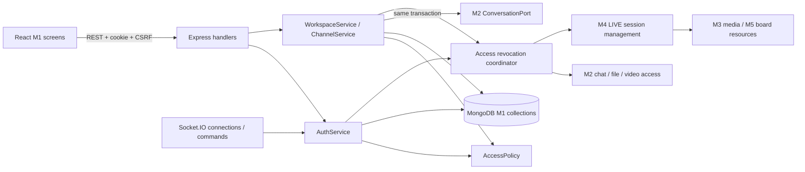
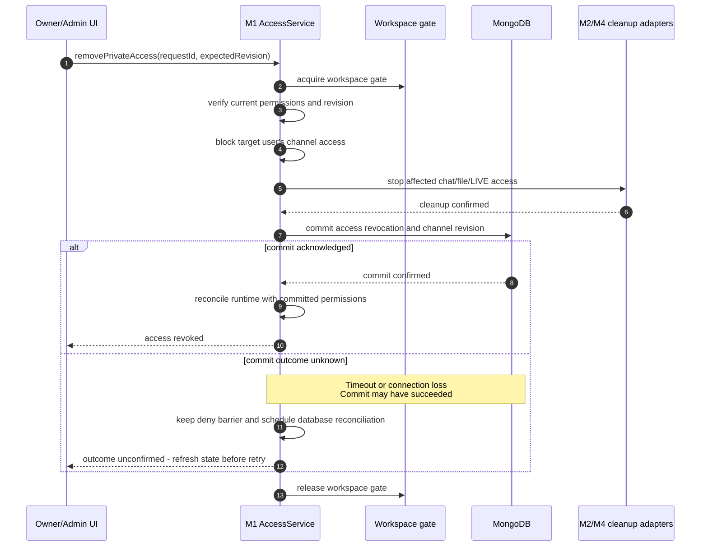

# M1 — Tài khoản, Workspace và quyền truy cập kênh

**API/backend dùng chung:** theo [quy ước](../contracts/api-conventions.md) và [mã lỗi](../contracts/error-codes.md). Bảng payload/result bên dưới mô tả dữ liệu nghiệp vụ nằm trong envelope chung; lỗi riêng của miền còn cần schema, status và consumer review trước implementation.

Status: Draft (bản nháp chờ review) · Author: Chưa ghi tên người phụ trách · Size: L (phạm vi lớn theo nhận định ban đầu; team chưa có tiêu chí chung cho nhãn Size)

Ngày: 03/11/2026. Reviewer: chờ phân công; M2 và M4 cần cùng review những phần phối hợp với M1.

> **TL;DR** — M1 phụ trách đăng ký/đăng nhập, hồ sơ tên hiển thị/avatar, đổi mật khẩu, Workspace, thành viên và quyền truy cập kênh TEXT/LIVE. Đăng ký thành công sẽ tự đăng nhập. Người mở link mời phải đăng nhập hoặc đăng ký, sau đó chủ động xác nhận tham gia Workspace. Đổi mật khẩu thành công đăng xuất tất cả phiên; avatar lưu Cloudinary, công khai qua URL; chỉ chính chủ được thay/xóa.
> Triển khai trong repository hiện có với React, Express, Socket.IO, Zod và MongoDB/Mongoose. M1 phụ trách bảy collection; phối hợp M2 tạo phần hội thoại của kênh `general` trong cùng transaction và M4 thu quyền các kết nối LIVE đang mở.
> WBS có 56 task con, mỗi task 2–8 giờ; tổng 268 giờ cơ sở và 32 giờ dự phòng tạm tính, tương đương 37.5 ngày công. Chưa phải cam kết lịch; cần review effort theo năng lực và số giờ thực có. Công M2–M5 cung cấp và công PM tính riêng.

**Phối hợp và lập kế hoạch:** xem [quy ước chung của 5 proposal](README.md#quy-ước-chung-trước-khi-lập-sprint). Phân biệt task của bên cung cấp, task tích hợp của bên dùng và ca kiểm chung; không cộng lại cùng một đầu ra hoặc coi estimate là lịch cam kết.

## 1. Context

Các miền chat, file, LIVE và board cần dùng chung cách xác thực tài khoản và kiểm tra quyền. Chỉ hoàn thành các thao tác tạo/xem/sửa/xóa là chưa đủ: khi quyền bị thu, người dùng cũng phải ngừng sử dụng được những kết nối và tài nguyên đang mở.

Hiện trạng mã nguồn được kiểm tra ngày 03/11/2026:

- Server có Express, cấu trúc trả lỗi thống nhất và mã theo dõi yêu cầu (requestId); chưa có endpoint auth/Workspace nghiệp vụ trong `apps/server/src/app.ts`.
- `apps/server/src/lib/database.ts` có phần kết nối MongoDB, chưa có model nghiệp vụ M1. Docker Mongo và kết nối ứng dụng không đồng nghĩa transaction/index đã được kiểm chứng.
- `apps/server/src/realtime/server.ts` kiểm Origin và đang từ chối mở kết nối khi chưa có xác thực; chưa triển khai hết hạn/thu phiên.
- `packages/contracts/src/workspace.ts` có schema tạo Workspace/kênh nhưng còn `RESTRICTED`; `common.ts` còn dùng ID tài nguyên tổng quát. Cần thay bằng PRIVATE và schema ObjectId theo nguồn hiện hành trước khi M1 sử dụng.
- Web mới có khung giao diện và trang trạng thái, chưa có các màn M1. Figma là draft để thống nhất bố cục; không phải API hoặc quyền đã triển khai.

PROFILE-01 bổ sung ngày 03/11, cập nhật avatar ngày 04/11: M1 chính, M2 phối hợp Cloudinary; đổi mật khẩu thu tất cả phiên, avatar công khai qua URL. Thiết kế thực thi ở mục 6.2 còn chờ review.

Nguồn: [phân miền](../product/delivery-domains.md), [17 FR M1 trong PB-01–03](../product/functional-requirements.md), [Workspace](../product/workspace-channels.md), [messaging/PRIVATE](../product/messaging.md), [technical plan](../technical-plan.md), [architecture](../architecture.md), [DB model](../database/model.md), [integrity](../database/integrity-and-migrations.md), [contracts](../contracts/README.md).

Các lựa chọn ghi **Đề xuất** đang chờ review, không tự thay quyết định trong tài liệu baseline. Các endpoint và interface bên dưới chưa được triển khai. T1–T19 là mã nhóm công việc, Tn.m là task con trong proposal; chưa phải mã task trên Jira/GitHub.

## 2. Objective

Một người có thể tạo tài khoản, tạo Workspace hoặc tham gia qua lời mời, sau đó sử dụng đúng các kênh mình có quyền. Owner/admin quản lý trong phạm vi được phép; mọi thay đổi quyền phải có hiệu lực với cả thao tác mới và tài nguyên đang mở.

## 3. Goals / Non-goals

**Goals**

| Goal | Kết quả                                                                                                                                                                 | FR bao phủ                                     |
| ---- | ----------------------------------------------------------------------------------------------------------------------------------------------------------------------- | ---------------------------------------------- |
| G1   | Đăng ký rồi tự đăng nhập; đăng nhập lại, giữ phiên khi tải lại trang; đăng xuất thu phiên đang dùng                                                                     | FR-01-01–03                                    |
| G2   | Tạo Workspace cùng bản ghi thành viên OWNER, `general` TEXT/WORKSPACE và conversation; xem/đổi tên/xóa đúng quyền                                                       | FR-02-01–03                                    |
| G3   | Owner/admin quản lý một link mời hiện hành, sao chép lại/tắt/tạo lại; không hạn hoặc giới hạn lượt. Người nhận đăng nhập rồi xác nhận tham gia, không trùng membership. | FR-02-04–05                                    |
| G4   | Xem thành viên, đổi ADMIN/MEMBER, loại thành viên; luôn giữ một owner hợp lệ                                                                                            | FR-02-06–07                                    |
| G5   | Tạo/liệt kê/mở/đổi tên/xóa TEXT/LIVE; quản lý PRIVATE, tách quyền cấu hình khỏi quyền nội dung                                                                          | FR-03-01–04                                    |
| G6   | Đăng xuất/hết hạn phiên/loại thành viên/gỡ PRIVATE/xóa Workspace hoặc kênh phải chặn API, sự kiện, file và LIVE đúng phạm vi                                            | Xuyên FR-01-03, FR-02-02/03/07, FR-03-02/03/04 |
| G7   | Xem/sửa tên hiển thị, cập nhật/xóa avatar và đổi mật khẩu của chính mình; quên mật khẩu làm sau                                                                         | FR-01-04–06                                    |

**Non-goals**

- Quên mật khẩu, xác minh email, OAuth, đổi email/bio/trường hồ sơ khác; mời qua email tự động hoặc nhập mã Workspace. Sửa tên hiển thị/avatar và đổi mật khẩu hiện tại đã thuộc scope PROFILE-01.
- Phần triển khai tin nhắn, trả lời theo thread, tải file/video và lưu hội thoại do M2 phụ trách; thiết bị/media do M3, phiên LIVE/nhóm do M4, board do M5 phụ trách.
- Thiết kế lại toàn bộ database, thêm Redis/microservice/nhiều bản ứng dụng chạy đồng thời, hoặc cam kết khả năng phục vụ 25/50 người khi chưa đo thử.
- Thay đổi type/accessMode sau tạo, tự tạo kênh lưu lâu dài cho mỗi nhóm DISCUSSION/ACTIVITY, hoặc bảo vệ `general` thành bất biến; chuyển owner Workspace không thuộc MVP. Không tự tạo lại `general` đã xóa.
- Chốt sprint hoặc cam kết ngày giao chỉ từ estimate của tài liệu này.

## 4. Open questions & assumptions

Các quyết định sản phẩm giữ theo [nguồn nghiệp vụ](../product/workspace-channels.md): không chuyển owner trong MVP; đổi mật khẩu thu tất cả phiên; avatar lưu Cloudinary và công khai qua URL (cập nhật 04/11). Cookie session theo baseline. Bảng dưới giữ mã Q để truy vết các quyết định và phần còn cần review.

M1/M2/M4 làm rõ chi tiết kỹ thuật trước task phụ thuộc; team bổ sung người phụ trách và thời gian thực có tại Q7. Các giá trị chưa chốt như giới hạn đầu vào và ảnh; cách lưu/tái tạo token link mời để sao chép lại phải được thống nhất trước khi triển khai.

| #   | Question / assumption                                                                                                 | Why it matters                                                                     | Owner                          | Needed by                   | Status                                                                                                                         |
| --- | --------------------------------------------------------------------------------------------------------------------- | ---------------------------------------------------------------------------------- | ------------------------------ | --------------------------- | ------------------------------------------------------------------------------------------------------------------------------ |
| Q1  | Chọn thư viện Argon2id, kiểm build trên Node/Linux image đang dùng; đo thời gian băm, RAM và số tác vụ chạy đồng thời | Giới hạn tài nguyên xác thực để tránh làm chậm media                               | M1, reviewer kỹ thuật          | T3.1 thử; chốt trước T3.2   | Đề xuất Argon2id; thư viện/phiên bản và tham số tối ưu chưa chốt                                                               |
| Q2  | Chuẩn hóa email; giới hạn password/displayName; cách phân trang mặc định                                              | Giao diện/backend kiểm cùng quy tắc; tránh trải nghiệm khác nhau hoặc bị lạm dụng  | M1, team review sản phẩm       | Trước T1/T3/T8              | Tên/mật khẩu được PM đồng ý 06/11; schema/email chờ M4 review SCRUM-12; phân trang ở T1.2                                      |
| Q3  | Phiên 7 ngày trong plan là giá trị khởi đầu; cookie/CSRF contract và HTTPS local                                      | Phải kiểm tự đăng nhập, cookie và hết hạn phiên bằng trình duyệt thật              | M1, người phụ trách môi trường | Trước T4                    | Giữ hướng baseline; review cấu hình, không tự gia hạn phiên sau mỗi lần sử dụng                                                |
| Q4  | M2 cung cấp thao tác tạo conversation dùng cùng Mongoose connection/transaction session                               | Thiếu sẽ không tạo Workspace hoàn chỉnh nguyên tử                                  | M1 + M2                        | Trước T6                    | Cần review interface ở 6.2                                                                                                     |
| Q5  | M2/M4 nhận yêu cầu thu quyền, chặn thao tác chờ/gửi sự kiện và xác nhận dọn tài nguyên theo thứ tự khóa chung         | Nếu thiếu phần này, chỉ nghiệm thu được xác thực và tạo/xem/sửa/xóa trong riêng M1 | M1 + M2 + M4                   | Trước T5, kiểm thật T12–T15 | Review chốt chặn và hàm phối hợp; mock chưa chứng minh tích hợp thật                                                           |
| Q6  | Dữ liệu/index hiện có, công cụ và quyền chạy migration trên DB đích                                                   | Không thể mặc định DB trống hoặc xóa dữ liệu để tạo index                          | M1 + người vận hành            | Trước T2 áp dụng trên DB    | Chưa kiểm DB trong task proposal                                                                                               |
| Q7  | Tên owner/reviewer, số giờ/ngày thực có và lịch các miền phụ thuộc                                                    | Quyết định thời gian hoàn thành, nhất là người làm M1 kiêm PM                      | Team                           | Trước cam kết sprint        | Chờ team cung cấp tên/giờ thực có; ước lượng chưa là lịch giao                                                                 |
| Q8  | Xử lý khi dọn tài nguyên lỗi hoặc chưa biết commit thành công chưa; đối chiếu DB và thử lại cùng M2/M4                | Không được mở lại quyền hoặc báo hoàn tất giả                                      | M1 + M2 + M4                   | Review T5                   | Thiết kế hướng ở 6.2; cần kiểm thử bằng cách chủ động gây lỗi                                                                  |
| Q9  | Có cần chuyển owner Workspace không?                                                                                  | Ảnh hưởng phạm vi quản trị                                                         | Team                           | Đã chốt 03/11               | Bỏ khỏi MVP; người tạo giữ OWNER và cấp ADMIN hỗ trợ, không xây owner-transfer                                                 |
| Q10 | Thiết kế upload và dọn avatar Cloudinary; thu tất cả phiên sau đổi mật khẩu                                           | Có thêm phụ thuộc M2/M4 và bổ sung thiết kế DB                                     | M1 + M2 + M4                   | Trước T18/T19               | Nghiệp vụ đã chốt 03/11: thu tất cả phiên; avatar Cloudinary công khai qua URL (04/11). Upload, giới hạn và cleanup còn review |

## 5. High-level design

M1 xử lý tài khoản, Workspace và quyền truy cập kênh trong backend hiện có. Các module M1–M5 cùng chạy trong một ứng dụng backend; không tách thành năm dịch vụ riêng.

Yêu cầu HTTP và kết nối Socket.IO dùng chung cách xác thực người dùng và kiểm tra quyền. MongoDB lưu tài khoản, phiên đăng nhập, thành viên Workspace và quyền vào kênh. Bộ nhớ của ứng dụng giữ các kết nối và tài nguyên đang hoạt động, cùng trạng thái tạm để chặn thao tác khi đang thu quyền. Server kiểm tra quyền hiện hành; không tin vai trò do client gửi lên hoặc chỉ dựa vào việc socket đang nằm trong một phòng.

### Cách đọc sơ đồ

Mỗi ô là một thành phần phần mềm; mũi tên thể hiện thành phần nào gọi hoặc phối hợp với thành phần nào. Đây là sơ đồ cấu trúc, không mô tả thứ tự xử lý đầy đủ của một yêu cầu. Các tên trong hình là tên kỹ thuật dự kiến, chưa phải các module đã triển khai.

| Thành phần trong hình                | Trách nhiệm chính                                                                                                                                                                                                                                        |
| ------------------------------------ | -------------------------------------------------------------------------------------------------------------------------------------------------------------------------------------------------------------------------------------------------------- |
| React M1 screens                     | Các màn đăng nhập, hồ sơ, Workspace, thành viên và quản lý kênh.                                                                                                                                                                                         |
| Express handlers                     | Nhận yêu cầu HTTP, kiểm tra dữ liệu đầu vào và gọi phần xử lý tương ứng. Cookie mang thông tin phiên; CSRF bảo vệ yêu cầu thay đổi dữ liệu theo cơ chế của technical plan.                                                                               |
| AuthService                          | Xác định người gọi là ai, phiên đăng nhập còn hiệu lực không; xử lý đăng ký, đăng nhập và thu phiên. Socket.IO dùng chung cơ chế xác thực này.                                                                                                           |
| AccessPolicy                         | Kiểm tra quyền thực hiện thao tác trên Workspace/kênh cụ thể. Ví dụ: ADMIN được quản lý danh sách PRIVATE nhưng vẫn cần được thêm vào kênh để đọc nội dung.                                                                                              |
| WorkspaceService / ChannelService    | Xử lý nghiệp vụ Workspace, thành viên và kênh sau khi kiểm tra quyền; đọc/ghi các collection M1 trong MongoDB.                                                                                                                                           |
| M2 ConversationPort                  | Giao diện gọi nội bộ do M2 cung cấp để tạo conversation, tức nơi lưu và tổ chức tin nhắn của kênh. Khi tạo Workspace, phần này chạy trong cùng transaction với Workspace, owner membership và kênh `general`: tất cả cùng thành công hoặc cùng rollback. |
| Access revocation coordinator        | Điều phối thu quyền sau logout, đổi mật khẩu, loại thành viên hoặc gỡ quyền kênh. Ngoài cập nhật dữ liệu, cần ngừng truy cập các tài nguyên đang mở trong đúng phạm vi bị thu.                                                                           |
| M2 chat / file / video access        | M2 ngừng gửi sự kiện chat và chặn truy cập file/video khi người dùng không còn quyền; dọn các tài nguyên liên quan theo vòng đời đã thống nhất. Thu quyền không đồng nghĩa xóa lịch sử tin nhắn hoặc file.                                               |
| M4 LIVE session management → M3 / M5 | M4 điều phối việc rời LIVE khi quyền mất hiệu lực, phối hợp M3 đóng tài nguyên mic/camera/share và M5 thu quyền board liên quan. M1 không trực tiếp thao tác trên media hoặc canvas.                                                                     |

Ví dụ: một thành viên bị loại khỏi Workspace trong lúc đang chat và gọi LIVE. M1 chặn thao tác mới, phối hợp M2/M4 thu tài nguyên rồi ghi membership mất hiệu lực; M2 chặn chat/file/video và M4 xử lý rời LIVE, thu tài nguyên media/board. Không chờ người dùng tải lại trang mới áp dụng quyền mới. Thứ tự cập nhật dữ liệu, chặn thao tác và xử lý lỗi được trình bày ở mục 6.

- **Entrypoint and why:** dùng REST cho đăng ký/đăng nhập và các thao tác quản trị cần trả kết quả trực tiếp. Socket.IO phục vụ trao đổi thời gian thực, nhận cập nhật quyền và đóng kết nối khi cần; kết nối socket được xác thực bằng cùng phiên đăng nhập. Các miền gọi nhau qua interface nội bộ, không cần thêm API mạng giữa các module.
- **Components touched:** dự kiến tổ chức phần server thành các thư mục `apps/server/src/auth/`, `workspaces/`, `channels/` và phần dùng chung trong `lib/`; giao diện nằm trong `apps/web/src/features/auth/`, `workspaces/`, `channels/`. Schema kiểm tra dữ liệu dùng Zod tại `packages/contracts/src/`. Đây là cấu trúc đề xuất. Tách phần nhận yêu cầu, xử lý nghiệp vụ/kiểm quyền và truy cập dữ liệu khi cần để dễ kiểm thử và bảo trì.
- **Shared infrastructure:** dùng chung kết nối MongoDB và pool do Mongoose quản lý; pool là tập kết nối được tái sử dụng cho các truy vấn. Những thao tác cần transaction chung phải dùng cùng connection và transaction session. M1 phụ trách model/index của M1; M2 phụ trách conversation và truy vấn tin nhắn; M4 phụ trách trạng thái LIVE và thứ tự khóa khi phối hợp các thao tác đồng thời.
- **Alternatives considered:** giữ cookie session theo baseline thay vì chuyển sang JWT lưu trong localStorage. Kiểm quyền tại server, vì ẩn nút trên giao diện không bảo vệ được API/file/socket. Tạo `general` và conversation trong cùng transaction để tránh Workspace thiếu phần chat. Giữ các miền trong cùng backend để giảm công việc giao tiếp và vận hành cho MVP.

### Luồng giao diện và điều hướng

| Tình huống                                             | Trải nghiệm dự kiến                                                                                                                     |
| ------------------------------------------------------ | --------------------------------------------------------------------------------------------------------------------------------------- |
| Đăng nhập thông thường                                 | Xem danh sách Workspace mình còn là thành viên và nút Tạo Workspace.                                                                    |
| Chưa có Workspace                                      | Hiển thị hướng dẫn tạo Workspace. Nếu đang mở link mời, tiếp tục lời mời đó; không bắt tạo Workspace riêng.                             |
| Tạo Workspace                                          | Nhập tên → chờ tạo đầy đủ Workspace, owner membership, `general` và conversation → mở Workspace mới. Nếu lỗi, thông báo và cho thử lại. |
| Mở link mời                                            | Giữ thông tin lời mời → đăng nhập/đăng ký nếu cần → xem Workspace được mời → chủ động bấm Tham gia Workspace.                           |
| Đăng ký từ lời mời                                     | Tạo tài khoản và phiên đăng nhập cùng thành công, tự đăng nhập rồi quay lại lời mời; không tự nhận lời mời.                             |
| Đã là thành viên Workspace được mời                    | Mở Workspace hiện có; không tạo membership trùng.                                                                                       |
| Link đã tắt hoặc đã được thay thế                      | Thông báo link không còn dùng được; không yêu cầu đăng ký lại hoặc tạo membership dở dang.                                              |
| Không có quyền đọc kênh PRIVATE                        | Không hiển thị kênh trong danh sách nội dung; biết ID cũng không mở được.                                                               |
| Owner/admin quản lý PRIVATE mà mình chưa được thêm vào | Màn quản trị chỉ hiển thị thông tin cấu hình cần thiết để quản lý kênh. Muốn đọc nội dung vẫn phải được thêm vào danh sách truy cập.    |

Đường dẫn giao diện **đề xuất**: `/login`, `/register`, `/workspaces`, `/workspaces/:wid`, `/workspaces/:wid/channels/:cid`, `/invite`. Bố cục chung dành vùng nội dung cho chat M2 và cuộc gọi M3. Phần duy trì cuộc gọi của M3 cần hoạt động độc lập với trang nội dung đang mở để chuyển trang không vô tình ngắt cuộc gọi. Mỗi màn có trạng thái đang xử lý, lỗi, chưa có dữ liệu, cùng nút thử lại hoặc xác nhận xóa/loại thành viên khi cần.

**Giữ lời mời khi chuyển qua đăng nhập — phương án cần review:** link có dạng `/invite#token=...`. Giao diện đọc mã mời rồi bỏ phần `#token=...` khỏi thanh địa chỉ bằng history replace trước khi tải dữ liệu. Lưu tạm mã trong sessionStorage theo tab, có thời hạn, để tải lại trang hoặc chuyển qua đăng nhập vẫn quay về đúng lời mời. Xóa mã khi tham gia thành công, hủy, link không còn hợp lệ hoặc logout; không gửi mã vào analytics/log. Nếu mất thông tin tạm, yêu cầu mở lại link.

`returnTo` chỉ chứa đường dẫn nội bộ đã cho phép, không chứa mã mời hoặc URL tùy ý. Người có mã mời có thể dùng nó để xin tham gia Workspace nếu link còn hợp lệ, nên mã này cần được bảo vệ; mã mời không thay thế phiên đăng nhập. Cookie xác thực vẫn không lưu trong Web Storage. M1 review phương án này trước T1/T8.

## 6. Detailed design

### 6.1 Database

M1 dùng bảy collection nền đã được thiết kế. Avatar lưu trên Cloudinary; đề xuất thêm `User.avatar = { publicId, secureUrl } | null` trong [collection-design 3.1](../database/collection-design.md#31-users). Đây là bổ sung thiết kế tài liệu, chưa có schema/code hoặc migration. M1/M2 còn review cách upload, xác minh metadata và dọn ảnh. Bảng dưới tóm tắt dữ liệu và index nền; field/null/enum ở [collection-design 3.1–3.7](../database/collection-design.md).

| Collection          | Invariant / dữ liệu chính                                                                                                     | Query / index hiện hành cần dùng                                      |
| ------------------- | ----------------------------------------------------------------------------------------------------------------------------- | --------------------------------------------------------------------- |
| users               | emailNormalized duy nhất, passwordHash private, displayName, avatar, status                                                   | `uq_user_email`                                                       |
| authSessions        | userId, tokenHash, expiresAt, revokedAt; không lưu token gốc hoặc ID socket                                                   | `uq_auth_token`, `ttl_auth_expiry`, `ix_auth_user`                    |
| workspaces          | ownerId xác định OWNER hiện hành, revision, deletedAt                                                                         | `_id`; list đi qua memberships                                        |
| memberships         | Một cặp Workspace/user, ACTIVE/REMOVED, role, incarnation/revision                                                            | `uq_membership_pair`, `ix_membership_user`, `ix_membership_workspace` |
| invitations         | Một document/Workspace giữ link hiện hành, trạng thái bật/tắt và revision; không hạn/lượt. Cách lưu/tái tạo token cần review. | `uq_invitation_token`, `uq_invitation_workspace`                      |
| channels            | TEXT/LIVE và WORKSPACE/PRIVATE độc lập, bất biến sau tạo; revision/deletedAt                                                  | `ix_channel_workspace`                                                |
| channelAccessGrants | channelId + membershipId duy nhất, quyền được cấp phải khớp lần gia nhập hiện hành                                            | `uq_channel_membership_grant`, `ix_grant_member`                      |

Tên và cấu hình index lấy từ [integrity mục 2](../database/integrity-and-migrations.md). Không thêm index unique cho owner hoặc tên kênh khi chưa có quy tắc sản phẩm tương ứng. Dùng thiết kế `auditEvents` hiện hành để ghi thay đổi quyền có ý nghĩa; không bổ sung màn quản trị nhật ký hoặc tự chọn thời hạn lưu.

**Những thao tác cần transaction**

- **Đăng ký:** băm mật khẩu ngoài transaction; tạo User và authSession trong cùng transaction. Chỉ trả cookie khi biết chắc commit thành công. Nếu dữ liệu đã lưu nhưng response bị mất, người dùng có thể đăng nhập bằng tài khoản đã tạo; không tạo thêm tài khoản. Phiên chưa được trình duyệt nhận sẽ hết hạn theo cấu hình.
- **Tạo Workspace:** tạo Workspace, membership OWNER, kênh `general` TEXT/WORKSPACE và conversation CHANNEL của M2 trong cùng transaction/connection. Không gửi socket hoặc thực hiện tác động ngoài DB trong callback transaction; chỉ gửi thông báo sau khi xác nhận commit.
- **Nhận lời mời:** kiểm link, Workspace và membership; tạo/kích hoạt lại membership trong transaction, dưới khóa điều phối Workspace. Nếu đã ACTIVE, trả membership hiện có. Khi gia nhập lại, tăng incarnation đúng một lần để quyền PRIVATE của lần gia nhập cũ không còn hợp lệ. Không tự khôi phục vai trò quản trị khi nguồn nghiệp vụ chưa chốt.
- **Cấp/gỡ quyền PRIVATE:** kiểm quyền quản trị và thành viên đích đang ACTIVE trong cùng Workspace. Nếu quyền thực sự thay đổi, cập nhật bản ghi quyền và channel revision trong cùng transaction. Thêm lại quyền không tự khôi phục nhóm hoặc kết nối media cũ.
- **Xóa Workspace/kênh:** dưới gate, đặt chốt chặn truy cập trong runtime → phối hợp M2/M4 thu tài nguyên đang mở → lưu trạng thái đã xóa (tombstone), revision và audit trong transaction/CAS → đối chiếu và gửi cập nhật. Chỉ dọn dữ liệu/file vật lý sau đó, theo từng đợt và vòng đời của mỗi miền. Chốt chặn runtime không phải tombstone trong DB; lỗi cleanup/commit xử lý theo mục 6.2, không báo xóa thành công khi kết quả chưa rõ. Không dùng một transaction để xóa toàn bộ lịch sử và file.

**Backfill / migration:** chưa thực hiện trong task viết proposal. Trước khi triển khai, kiểm dữ liệu/index đang có và thử sao lưu/khôi phục trong môi trường riêng theo [kế hoạch migration](../database/integrity-and-migrations.md). Nếu DB có dữ liệu `RESTRICTED`, phải có migration sang `PRIVATE` được review; chỉ sửa enum trong code là chưa đủ. Không tự chạy `syncIndexes`, reset hoặc seed để che lỗi. Ngoài môi trường test, tắt autoIndex/autoCreate và kiểm tra schema/index khi ứng dụng báo sẵn sàng phục vụ. Thời hạn lưu User/lời mời/audit còn mở. TTL tự dọn phiên hết hạn không thay thế việc kiểm tra hạn phiên khi xử lý yêu cầu.

### 6.2 API

**Chi tiết auth/profile — SCRUM-12:** [contract hiện hành để M4 review](../contracts/auth-profile.md) cụ thể hóa input/output, giới hạn tên/mật khẩu được PM đồng ý ngày 06/11, CSRF, lỗi và ví dụ. Schema ở `packages/contracts/src/auth.ts`; chưa có handler tương ứng. Các điểm kỹ thuật còn mở có owner/task trong contract; avatar upload vẫn ở T1.3.

Đường dẫn chung là `/api/v1`. Request/response dùng schema Zod strict trong contracts để kiểm dữ liệu và từ chối field không được khai báo. Kết quả thành công có dạng `{ data, requestId }`; lỗi có dạng `{ error: { code, message }, requestId }`. ID của đối tượng lưu trong DB dùng ObjectId dạng hex; requestId dùng UUID. Không trả passwordHash, tokenHash hoặc lỗi Mongoose thô ra client. Bảng dưới là API dự kiến để review, chưa phải endpoint đã chạy.

| Method / path                                  | Request chính                                                | Response / quyền                                                                                                                                                   |
| ---------------------------------------------- | ------------------------------------------------------------ | ------------------------------------------------------------------------------------------------------------------------------------------------------------------ |
| GET `/auth/csrf`                               | Không cần auth                                               | Khởi tạo CSRF bằng cookie có chữ ký theo plan; không cấp phiên đăng nhập                                                                                           |
| POST `/auth/register`                          | email, password, displayName                                 | Thông tin User được phép trả về + CSRF mới; Set-Cookie auth mới sau commit, tự đăng nhập                                                                           |
| POST `/auth/login`                             | email, password                                              | Thông tin User được phép trả về + CSRF mới; cấp mới session/CSRF của trình duyệt hiện tại                                                                          |
| GET `/auth/me`                                 | Cookie                                                       | Thông tin User được phép trả về khi phiên hiện hành còn hiệu lực                                                                                                   |
| POST `/auth/logout`                            | Cookie, CSRF                                                 | Thu phiên hiện tại, xóa cookie; lặp an toàn, không logout mọi thiết bị                                                                                             |
| GET / POST `/workspaces`                       | POST: name, requestId                                        | Danh sách Workspace còn là thành viên / Workspace mới và kênh đầu tiên; người gọi đã đăng nhập                                                                     |
| GET / PATCH / DELETE `/workspaces/:wid`        | PATCH: name; thao tác thay đổi có requestId/revision phù hợp | Member đọc, owner/admin sửa, owner xóa                                                                                                                             |
| GET `/workspaces/:wid/members`                 | cursor, limit                                                | Member ACTIVE; thông tin user/role cần hiển thị, không lộ dữ liệu xác thực                                                                                         |
| PATCH / DELETE `/workspaces/:wid/members/:uid` | role hoặc remove, expectedRevision, requestId                | Chỉ owner đổi ADMIN/MEMBER; owner/admin loại thành viên theo ma trận dưới                                                                                          |
| POST `/workspaces/:wid/invitations`            | requestId                                                    | Owner/admin; tạo link khi chưa có; nếu link đang bật, trả link đó. Khi đã tắt, dùng thao tác tạo lại. Không tự sinh nhiều link.                                    |
| GET `/workspaces/:wid/invitations`             | —                                                            | Owner/admin; lấy link hiện hành để sao chép và trạng thái bật/tắt, revision hiện hành; khi tắt không trả token dùng được. Không tạo/đổi link; không trả tokenHash. |
| DELETE `/workspaces/:wid/invitations/current`  | requestId, expectedRevision                                  | Owner/admin; tắt link hiện hành, gọi lại an toàn; không loại thành viên đã tham gia.                                                                               |
| POST `/workspaces/:wid/invitations/regenerate` | requestId, expectedRevision                                  | Owner/admin; thay token và bật link mới nguyên tử; link cũ mất hiệu lực, thành viên hiện có không bị ảnh hưởng.                                                    |
| POST `/invitations/preview`                    | token                                                        | Sau đăng nhập, trả tên Workspace, khả năng tham gia và membership hiện có; không cấp membership/không lộ danh sách thành viên.                                     |
| POST `/invitations/accept`                     | token, requestId                                             | Sau đăng nhập và người dùng xác nhận; trả Workspace/membership hoặc lỗi link hiện tại                                                                              |
| GET / POST `/workspaces/:wid/channels`         | POST: name, type, accessMode, requestId                      | Chỉ liệt kê kênh có quyền đọc/sử dụng nội dung; owner/admin tạo                                                                                                    |
| GET `/workspaces/:wid/channels/manage`         | cursor, limit                                                | **Đề xuất thêm:** owner/admin đọc thông tin phục vụ quản trị, tách list nội dung                                                                                   |
| PATCH / DELETE `/channels/:cid`                | name hoặc delete, expectedRevision, requestId                | Owner/admin; không cho sửa type/accessMode                                                                                                                         |
| GET `/channels/:cid/access`                    | cursor, limit                                                | Owner/admin; danh sách quyền PRIVATE hiện hành và thành viên liên quan, không trả nội dung kênh                                                                    |
| PUT / DELETE `/channels/:cid/access/:uid`      | requestId, expectedRevision                                  | **Đề xuất đường dẫn WS-15:** owner/admin cấp/gỡ PRIVATE cho thành viên hiện hành                                                                                   |

**Quy tắc link đã chốt:** tối đa một link đang bật; sao chép lại không sinh link mới, không hạn/lượt. Owner/admin tắt hoặc tạo lại được; ai có link hợp lệ đều có thể đăng nhập rồi xác nhận tham gia.

**Chống thao tác link từ trang cũ:** GET trả revision của bản ghi invitation, không dùng revision Workspace thay thế. Tắt/tạo lại gửi `expectedRevision`; dưới Workspace gate, server kiểm quyền và cập nhật có điều kiện theo revision đó. Revision không khớp trả `CONFLICT` (409 theo mapping đang đề xuất), không thay token/trạng thái; UI tải lại trước khi người dùng xác nhận thao tác mới. Thay đổi thành công tăng revision. Gửi lại cùng requestId/payload không áp dụng thao tác lần nữa lên link mới hơn; không tự lấy revision mới để thử lại một thao tác cũ. Tắt link đã tắt tại đúng revision hiện hành là no-op.

**Thiết kế token còn mở:** chính sách một link không hạn/lượt đã chốt ngày 04/11; cách lưu hoặc tái tạo token để owner/admin sao chép lại chưa chốt. Chỉ lưu tokenHash là không đủ. M1 cần đề xuất cơ chế, bảo vệ khóa nếu dùng mã hóa và cập nhật schema/contract trước T8; không coi các field hiện tại là schema hoàn chỉnh. Không tự giảm estimate T8 khi chưa review phần này.

Các endpoint preview, quản trị lời mời và danh sách quyền PRIVATE cụ thể hóa UC hiện có, cần review trước khi các miền khác viết code gọi chúng. Danh sách quản trị có phân trang; quyền đọc thông tin quản trị không cấp quyền đọc nội dung kênh. Tạo kênh TEXT cần M2 tạo conversation trong cùng transaction; tạo kênh LIVE chưa bắt đầu cuộc họp. M1 không cung cấp API tin nhắn hoặc vào LIVE: M2/M4 gọi phần kiểm quyền dùng chung trước khi xử lý nghiệp vụ của mình.

Mã lỗi chung áp dụng: `VALIDATION_ERROR` (400), `AUTH_REQUIRED`/`INVALID_CREDENTIALS` (401), `FORBIDDEN`/`CSRF_INVALID` (403), `NOT_FOUND` (404), `EMAIL_EXISTS`/`CONFLICT` (409), `INVITATION_UNAVAILABLE` (410), `RATE_LIMITED` (429), `DEPENDENCY_UNAVAILABLE` (503). Bảng mã/status chung đã có tại contracts; schema từng endpoint và middleware vẫn triển khai theo task nền, giữ cấu trúc trả lỗi hiện có. Đăng nhập sai dùng thông báo chung. Với đối tượng người gọi không được phép biết tới, trả 404 theo quy tắc đã thống nhất. Nếu revision không còn khớp, yêu cầu tải lại dữ liệu thay vì ghi đè thay đổi mới bằng dữ liệu cũ.

**Permissions — quyền theo vai trò**

| Thao tác                                              | MEMBER                        | ADMIN                              | OWNER                                                                             |
| ----------------------------------------------------- | ----------------------------- | ---------------------------------- | --------------------------------------------------------------------------------- |
| Xem Workspace/member, nội dung WORKSPACE              | Có, khi membership ACTIVE     | Có                                 | Có                                                                                |
| Đổi tên Workspace; tạo/đổi tên/xóa kênh; tạo/thu link | Không                         | Có                                 | Có                                                                                |
| Đổi ADMIN/MEMBER; xóa Workspace                       | Không                         | Không                              | Có                                                                                |
| Loại thành viên                                       | Không                         | Chỉ MEMBER, không owner/admin khác | Người khác trong Workspace, không dùng thao tác loại thành viên để bỏ chính OWNER |
| Quản lý danh sách PRIVATE                             | Không                         | Có, kể cả ngoài danh sách          | Có, kể cả ngoài danh sách                                                         |
| Đọc/gửi/tải/vào LIVE của PRIVATE                      | Chỉ khi được cấp quyền hợp lệ | Cũng cần được cấp quyền            | Cũng cần được cấp quyền                                                           |

Mọi quyền trong bảng đều yêu cầu tài khoản và phiên đăng nhập hợp lệ, Workspace/kênh chưa xóa, cùng membership hiện hành. Host chỉ là vai trò trong cuộc họp, không tự có quyền quản trị Workspace. M1 kiểm quyền tài khoản/Workspace/kênh; quyền vào nhóm do M4 xử lý, quyền đọc DM theo nghiệp vụ M2.

**Auth, CSRF và password**

- Dùng cookie xác thực `HttpOnly; Secure; SameSite=Lax`, danh sách Origin được phép và CSRF signed-cookie theo plan. Token phiên là chuỗi ngẫu nhiên không mang thông tin người dùng, DB chỉ lưu hash. Token phiên và CSRF có mục đích riêng; cấp mới sau đăng nhập/đăng ký, không dùng lại ID trước xác thực. Kiểm CSRF và Origin ở cả mutation HTTP (kể cả register/login) và socket handshake theo baseline. `GET /auth/me` đặt no-store; không lưu bí mật xác thực trong localStorage.
- Kiểm thời điểm hết hạn cố định trên HTTP và lệnh socket nhạy cảm. Khi hết hạn, bộ hẹn giờ đóng tài nguyên của phiên dù người dùng không gửi yêu cầu mới. Khởi động lại ứng dụng không phục hồi cuộc gọi/nhóm từ metadata. Logout thông thường chỉ thu phiên đang dùng, không ảnh hưởng phiên ở trình duyệt khác.
- **Đề xuất Argon2id** để băm mật khẩu. Tham số bắt đầu đo thử không thấp hơn mức OWASP được viện dẫn: m=19 MiB, t=2, p=1; lưu salt và tham số trong chuỗi hash. Chưa chốt thư viện hoặc tham số production. Chọn cách băm bất đồng bộ, giới hạn số tác vụ chạy/chờ để tránh quá tải CPU/RAM; không giữ khóa Workspace lúc băm. [OWASP Password Storage](https://cheatsheetseries.owasp.org/cheatsheets/Password_Storage_Cheat_Sheet.html).
- Việc cấp mới phiên và bảo vệ cookie tham khảo [OWASP Session Management](https://cheatsheetseries.owasp.org/cheatsheets/Session_Management_Cheat_Sheet.html). Kiểm bằng HTTPS local hoặc cấu hình dev đã review; không tắt Secure trong production để tiện thử.
- Chốt quy tắc đầu vào và giới hạn tần suất trong Q2/Q3 trước khi viết handler. Không tự cắt khoảng trắng hoặc sửa nội dung mật khẩu, không ghi body đăng nhập/lời mời vào log. Không thêm xác minh email vào luồng đăng ký này.

**Internal contracts** — interface gọi nội bộ giữa các module. Tên và dữ liệu dưới đây là đề xuất để các miền review, không phải API mạng:

| Provider → consumer    | Interface / semantics                                                                                                                                                                                        | Failure / acceptance                                                                                                                                        |
| ---------------------- | ------------------------------------------------------------------------------------------------------------------------------------------------------------------------------------------------------------ | ----------------------------------------------------------------------------------------------------------------------------------------------------------- |
| M1 → HTTP/socket/M2/M4 | `requireAuth` trả userId, authSessionId, expiresAt sau kiểm hiệu lực; `resolveChannelAccess` trả membershipId/incarnation/revision, revision/type của kênh, cùng quyền quản trị và quyền nội dung riêng biệt | Kết quả chỉ dùng trong thao tác đang được điều phối, không phải quyền vĩnh viễn. Server xác định người gọi; từ chối khi phạm vi truy cập mất hiệu lực       |
| M2 → M1                | `createChannelConversation({ workspaceId, channelId, dbSession })` dùng chính transaction/connection của bên gọi                                                                                             | Không mở transaction riêng hoặc gửi sự kiện trong callback; lỗi phải rollback toàn bộ thao tác tạo Workspace/kênh TEXT                                      |
| M1 → M2/M4             | Coordinator `revokeAccess({ kind, authSessionId?, workspaceId?, userId?, channelId?, revision, operationId })` chọn đúng phạm vi và gọi hàm phối hợp đã đăng ký                                              | M2 chặn gửi/ghi/tải dữ liệu tương ứng; M4 điều phối người tham gia/media/board. Gửi thông báo mà không chờ xác nhận chưa chứng minh dọn tài nguyên hoàn tất |
| M1 → FE / consumers    | Sau commit, gửi thông tin tối thiểu để bên sử dụng tải lại dữ liệu, ví dụ kênh đổi quyền hoặc phiên bị thu                                                                                                   | Không gửi tên/nội dung PRIVATE cho người không có quyền; FE tải lại theo quyền hiện tại. Thu quyền phía server không phụ thuộc client xác nhận              |

**Gửi lại yêu cầu, xử lý đồng thời và thu quyền**

**Gửi lại yêu cầu:** nhận diện thao tác bằng người gọi, loại thao tác, phạm vi, requestId và hash của payload theo plan. Cùng mã yêu cầu nhưng khác nội dung phải báo conflict. Trước khi trả lại kết quả cũ, vẫn kiểm tra phiên và quyền hiện tại. Bộ nhớ lưu kết quả có giới hạn, không bảo đảm một thao tác chỉ chạy đúng một lần sau khi ứng dụng khởi động lại. Việc tạo dữ liệu cần unique index và các quy tắc chống trùng; giao diện tải lại trạng thái sau timeout. Link mời hiện hành phải sao chép lại được; GET không tạo hoặc đổi link. Tạo/tạo lại phải chống xử lý trùng theo requestId; response cũ không được trả một token đã bị thay thế hoặc tắt. Chốt cơ chế lưu/tái tạo token trong T1 trước T8; tokenHash đơn lẻ không khôi phục được link. Không ghi token vào log hoặc trả cho member thường.

**Thứ tự khóa:** quyền điều phối theo User → Workspace gate → vòng đời kênh → thay đổi trạng thái phiên LIVE. Chỉ lấy những khóa cần cho thao tác; khi gọi lại từ M4, không lấy khóa Workspace theo chiều ngược lại. Khóa dùng để tránh các thao tác đồng thời ghi đè hoặc áp dụng quyền sai. Không giữ khóa trong lúc băm mật khẩu, upload, truyền file hoặc chờ client. Sau một bước bất đồng bộ (`await`), thao tác đọc/gửi dữ liệu nhạy cảm cần kiểm tra lại quyền; không lưu cố định role hoặc quyền PRIVATE trong socket đến hết phiên.

**Thu quyền:** xử lý tuần tự các thay đổi trên cùng phạm vi; đặt chốt chặn tạm (deny barrier) để không cấp thêm quyền hoặc cho thao tác đang chờ lọt qua. Theo baseline, phối hợp M2/M4 thu media/fanout và tài nguyên trái quyền trước khi ghi thay đổi quyền/trạng thái xóa/revision vào DB bằng transaction hoặc CAS; sau đó đối chiếu trạng thái và gửi cập nhật. Chỉ báo hoàn tất khi phần dọn tài nguyên đã xác nhận. Không thể thu hồi nội dung đã gửi đến client; cần chặn việc tiếp tục nhận, phát hoặc tải dữ liệu. Logout/hết hạn thu theo authSessionId; loại thành viên thu theo membership; gỡ PRIVATE thu theo kênh và thành viên. Không đóng mọi socket của tài khoản cho một thay đổi quyền chỉ thuộc một kênh.

**Xử lý lỗi:** nếu biết chắc DB chưa commit, đối chiếu lại dữ liệu và trạng thái đang chạy trước khi gỡ chốt chặn. Nếu chưa biết commit thành công hay thất bại (unknown commit), tiếp tục chặn và kiểm tra kết quả trong DB; không báo thành công hoặc khẳng định đã rollback. Nếu phần thu tài nguyên lỗi, giữ chặn và thử lại; nếu tài nguyên đã đóng nhưng DB lỗi, không tự mở lại nguồn. Trả trạng thái lỗi để phía gọi kiểm tra lại, không báo hoàn tất. Callback transaction có thể chạy lại, nên không đặt trong đó các tác động ngoài DB mà không thể thực hiện lặp an toàn.

#### Sequence — Gỡ quyền thành viên khỏi kênh PRIVATE

**Tình huống:** owner/admin gỡ A khỏi kênh PRIVATE trong lúc A đang mở chat hoặc tham gia LIVE của kênh. M1 phải phối hợp M2/M4 ngừng truy cập đang mở và lưu việc gỡ quyền; chỉ sửa bản ghi MongoDB hoặc ẩn kênh trên giao diện là chưa đủ. Đây là thiết kế đề xuất cho một thao tác quản trị, không phải luồng đăng nhập → chọn Workspace → vào kênh; luồng giao diện nằm ở mục 5.

| Thành phần / thuật ngữ | Nhiệm vụ trong tình huống này                                                                                                                                      |
| ---------------------- | ------------------------------------------------------------------------------------------------------------------------------------------------------------------ |
| M1 AccessService       | Kiểm yêu cầu và điều phối việc gỡ quyền của A trong đúng kênh.                                                                                                     |
| Workspace gate         | Xếp thứ tự các thao tác cần phối hợp trong cùng Workspace, tránh dùng quyền cũ giữa lúc đang thay đổi quyền. Đây là cơ chế trong backend, không phải server riêng. |
| Deny barrier           | Chốt chặn truy cập của A trong phạm vi đang thu quyền; các đường cấp tài nguyên/đọc/gửi liên quan phải kiểm chốt này.                                              |
| M2/M4 cleanup adapters | Các hàm nội bộ: M2 ngừng chat/file tương ứng; M4 điều phối rời LIVE và thu media/board qua các miền phụ trách. Không đóng mọi kết nối của A ngoài phạm vi bị gỡ.   |

**Cách đọc:** đọc từ trên xuống. Mũi tên liền là lời gọi xử lý; nét đứt là kết quả trả về. Trong khung `alt`, chỉ chạy một nhánh theo kết quả lưu DB, sau đó đi tiếp đến bước nhả gate. Tên lời gọi và điều kiện giữ bằng tiếng Anh để đối chiếu khi triển khai; các hàm nội bộ không phải HTTP API riêng.

- **Nhánh thành công:** MongoDB xác nhận đã lưu; M1 đối chiếu trạng thái đang chạy với quyền mới rồi báo đã gỡ quyền. Đối chiếu ở đây không khôi phục tài nguyên đã đóng.
- **Nhánh chưa rõ kết quả:** có thể mất kết nối hoặc hết thời gian chờ trước khi nhận xác nhận từ MongoDB. M1 giữ chốt chặn, sắp xếp kiểm tra lại DB và báo chưa xác nhận được kết quả; không khẳng định thao tác đã thành công hoặc đã rollback. Việc kiểm tra/thử lại phải tiếp tục dùng gate khi cần phối hợp, không giữ gate vô hạn để chờ DB phục hồi.
- **Nhả gate không phải khôi phục quyền:** gate cho phép thao tác khác tiếp tục; chốt chặn vẫn được giữ khi kết quả chưa rõ. Chỉ xử lý chốt chặn sau khi đối chiếu quyền DB và trạng thái đang chạy; không tự mở lại media đã đóng.

Để hình gọn, sơ đồ chỉ minh họa hai nhánh sau yêu cầu lưu DB. Sai quyền hoặc revision thì từ chối trước khi đặt chốt chặn. Nếu M2/M4 thu tài nguyên thất bại, giữ chặn, chưa ghi thay đổi quyền vào DB và thử lại an toàn. Nếu biết chắc DB không commit, đối chiếu quyền và trạng thái đang chạy trước khi gỡ chốt chặn; không tự mở lại tài nguyên. Mọi nhánh phải nhả gate theo thứ tự khóa của baseline, kể cả khi có lỗi.

**Limits — giới hạn tài nguyên**

Giữ giới hạn body JSON 32 KiB hiện tại và giới hạn tên theo contracts/baseline. T1 cần xác định cách phân trang bằng cursor và giới hạn số kết quả mỗi trang; không tải toàn bộ collection hoặc truy vấn DB riêng cho từng người nhận. Pool kết nối và hàng chờ thao tác theo Workspace cần giới hạn, timeout và số liệu theo dõi. Ghi rõ cấu hình trước khi thử tải; không chọn kích thước pool chỉ bằng số người họp. Giới hạn riêng số tác vụ băm mật khẩu chạy đồng thời và đang chờ. Đo cùng mic/camera/share vì các miền dùng chung máy; kiểm CRUD riêng chưa chứng minh hệ thống chịu được tải LIVE.

### Hồ sơ và đổi mật khẩu (PROFILE-01)

**Phạm vi đã chốt:** màn Hồ sơ cá nhân gồm email chỉ đọc, tên hiển thị sửa được, ảnh hiện tại/chọn ảnh mới/xóa ảnh, và khu vực đổi mật khẩu riêng. Không thêm ngày sinh, địa chỉ, bio, đổi email hoặc quên mật khẩu. Không có ảnh dùng chữ cái từ tên. Tách lưu hồ sơ khỏi submit mật khẩu để không bắt người dùng nhập mật khẩu khi chỉ đổi tên/ảnh; chỉ đổi mật khẩu mới yêu cầu mật khẩu hiện tại.

**API đề xuất cho hồ sơ** (base `/api/v1`, đều kiểm auth; thao tác thay đổi dữ liệu có CSRF):

| Method / path                | Request                                 | Response / invariants                                                                                  |
| ---------------------------- | --------------------------------------- | ------------------------------------------------------------------------------------------------------ |
| GET `/users/me`              | Cookie                                  | Hồ sơ của actor: id, email, displayName, thông tin avatar; không trả passwordHash                      |
| PATCH `/users/me`            | displayName, requestId                  | Chỉ tên hiển thị, không nhận userId/role/email từ client; cập nhật dữ liệu hiển thị và cache liên quan |
| PUT `/users/me/avatar`       | uploadId từ file service M2, requestId  | Xác minh lượt upload Cloudinary đúng chủ, lưu publicId/secureUrl; lỗi không thay ảnh cũ                |
| DELETE `/users/me/avatar`    | requestId                               | Đặt avatar = null, hiển thị chữ cái từ tên; dọn Cloudinary qua M2, lặp an toàn                         |
| POST `/auth/change-password` | currentPassword, newPassword, requestId | Xác minh mật khẩu hiện tại, cập nhật hash có CAS, thu tất cả phiên và yêu cầu đăng nhập lại            |

**Quy tắc nghiệp vụ (cập nhật 04/11):** avatar lưu Cloudinary, công khai qua URL; ai có link đều xem được. Chỉ chính chủ được thay/xóa. API thông tin thành viên vẫn kiểm quyền hiển thị; không áp dụng URL công khai cho file chat/video cuộc họp. Đổi mật khẩu thành công đăng xuất tất cả phiên và yêu cầu đăng nhập lại; nhập sai mật khẩu hiện tại hoặc dữ liệu không hợp lệ thì giữ nguyên phiên. Chi tiết tại [nguồn nghiệp vụ PROFILE-01](../product/workspace-channels.md).

**Avatar — thiết kế đề xuất:**

- M1 làm giao diện và lưu `avatar: { publicId, secureUrl } | null` trên User. M2 cung cấp phần tích hợp Cloudinary, kiểm tra ảnh và dọn ảnh cũ. Không bắt buộc tạo bản ghi files CHAT/FRAME cho avatar.
- Giao diện dùng `secureUrl` để hiển thị; backend dùng `publicId` để quản lý ảnh. Metadata phải đến từ lượt upload đã xác minh đúng người dùng, không chỉ tin URL/publicId client gửi. Không đưa Cloudinary API secret vào frontend.
- Upload/xử lý ảnh ngoài khóa DB. Sau khi ảnh mới hợp lệ, cập nhật User bằng CAS theo ảnh/version hiện tại; chỉ dọn ảnh cũ khi xác nhận lưu thành công. Cloudinary không nằm trong transaction MongoDB: cần xử lý ảnh upload nhưng chưa gắn và thử dọn lại khi lỗi. Không xóa ảnh vẫn đang dùng khi hai yêu cầu thay ảnh chạy đồng thời.
- **Còn cần review M1/M2 trước T18:** upload qua backend hay upload trực tiếp có chữ ký; kiểu dữ liệu/contract của `uploadId`; định dạng, dung lượng, kích thước, xử lý metadata; cách xóa/invalidate ảnh cũ và dọn upload dở. Chưa chốt giá trị cấu hình hoặc package. Giữ estimate hiện tại để review lại sau khi thống nhất luồng này.
- Xóa avatar làm ứng dụng ngừng dùng ảnh và yêu cầu xóa trên Cloudinary; không cam kết thu hồi ngay mọi bản CDN/cache hoặc bản đã tải. Quy tắc truy cập Cloudinary tham khảo [delivery types](https://cloudinary.com/documentation/upload_parameters#delivery_types).

**Đổi mật khẩu — thiết kế đề xuất:**

- Xác minh `currentPassword`, kiểm `newPassword` theo contract; không ghi mật khẩu vào log. Băm/xác minh ngoài transaction.
- Dùng chung khóa User với luồng đăng nhập; kiểm lại phiên và hash/version trước khi cập nhật bằng CAS. Đặt chốt chặn theo User và phối hợp M2/M4 thu tài nguyên của tất cả phiên trước khi transaction lưu hash mới và thu phiên trong DB; không cho đăng nhập từ mật khẩu cũ trong lúc đổi.
- Sau khi xác nhận commit, xóa cookie trên trình duyệt đang dùng và chuyển về đăng nhập. Nếu kết quả commit chưa rõ, đối chiếu DB trước khi thử lại; không dọn tài nguyên trong callback transaction có thể chạy lại.
- Dùng chung giới hạn tần suất và số tác vụ băm với luồng auth. Kiểm thử đăng nhập đồng thời và thu phiên trên nhiều trình duyệt. M4 xử lý đây là mất hiệu lực xác thực, không phải host chủ động rời cuộc họp.

### 6.3 Rollout, flag & observability

Phần này mô tả cách đưa chức năng vào sử dụng, theo dõi lỗi/tải và xử lý khi cần quay về phiên bản cũ.

Không thêm cờ bật/tắt theo Workspace như trong proposal mẫu: xác thực là nền bắt buộc, không có đường bỏ qua khi tắt. Chia triển khai thành các PR nhỏ. Trên môi trường staging, chỉ mở luồng tích hợp khi contract, index và các hàm phối hợp thật đã sẵn sàng. Nếu thiếu phần dọn tài nguyên, chưa nghiệm thu luồng liên quan; không dùng hàm rỗng thay cleanup trong production.

Trình tự triển khai: kiểm dữ liệu/index/validator trước migration → chạy migration được review trong môi trường được phép → build contracts và các phần sử dụng cùng phiên bản → kiểm ứng dụng sẵn sàng phục vụ → thử nhanh auth/Workspace/PRIVATE → kiểm tích hợp M2/M4. Giữ Nginx, cùng origin và HTTPS theo baseline. Cấu hình tài khoản Cloudinary, credential phía server và giới hạn upload chưa được kiểm tra; M1/M2 xác nhận trong task tích hợp, không đưa secret vào tài liệu/frontend. Tên biến cấu hình mới cho Cloudinary, phiên, chữ ký CSRF và giới hạn băm được chốt trong PR triển khai; cập nhật `.env.example` và hướng dẫn vận hành. Không đặt secret hoặc giá trị mặc định giả trong proposal.

Log ghi requestId, thao tác, ID người gọi, phạm vi/revision, kết quả và thời gian; không ghi email, mật khẩu, token gốc hoặc nội dung riêng tư. Theo dõi số lần xác thực bị từ chối/giới hạn tần suất, thời gian và số tác vụ băm, thời gian chờ pool DB, độ dài hàng chờ và thời gian giữ khóa Workspace, số lần transaction thử lại/xung đột, cùng số lần dọn tài nguyên còn chờ/thất bại. Ngưỡng cảnh báo cần chọn sau đo thử; chưa có số đo hoặc cam kết SLA.

Rollback: xử lý các phiên đang hoạt động theo runbook trước khi khởi động lại; chỉ quay về phiên bản ứng dụng cũ khi tương thích schema và contract PRIVATE. Không khôi phục token hoặc quyền đã thu để tiện rollback. Không xóa collection/index đang có dữ liệu. Nếu schema không tương thích, cần kế hoạch bảo trì hoặc migration tiếp được review. Replica set một node chưa có khả năng chịu mất máy (HA).

### 6.4 Test strategy

Bảng dưới là các ca kiểm thử dự kiến để nghiệm thu M1; chưa phải kết quả kiểm thử. Xem giải nghĩa loại kiểm thử và thuật ngữ tại Appendix.

| ID  | Level                   | Tình huống / kết quả cần đạt                                                                                                                                                                                                                                                                                                                                                                                                  | Goals / FR             |
| --- | ----------------------- | ----------------------------------------------------------------------------------------------------------------------------------------------------------------------------------------------------------------------------------------------------------------------------------------------------------------------------------------------------------------------------------------------------------------------------- | ---------------------- |
| A1  | Unit + Integration      | Đăng ký hợp lệ tạo User và phiên, tự đăng nhập; email trùng hoặc dữ liệu sai không tạo tài khoản dở dang; đăng nhập sai không cấp phiên                                                                                                                                                                                                                                                                                       | G1 / FR-01-01/02       |
| A2  | Browser + Integration   | Kiểm cookie/CSRF/Origin; CSRF thiếu/sai bị từ chối; tải lại trang giữ phiên; hết hạn/logout chặn HTTP/socket/media của đúng phiên, giữ các phiên khác                                                                                                                                                                                                                                                                         | G1/G6 / FR-01-02/03    |
| U1  | Browser + Integration   | Chỉ sửa tên chính mình; từ chối tên sai hoặc yêu cầu sửa email/role; cập nhật tên tại các màn hiển thị mà không sửa sai dữ liệu lịch sử                                                                                                                                                                                                                                                                                       | G7 / FR-01-04          |
| U2  | File + Integration      | Thử chọn/thay/xóa ảnh và ảnh lỗi/quá giới hạn; từ chối file sai chủ/mục đích. Thay đồng thời không xóa ảnh đang dùng. Chỉ chính chủ được thay/xóa; URL ảnh đọc công khai, kể cả sau rời Workspace. Từ chối metadata giả; kiểm lỗi cập nhật DB/xóa Cloudinary và ảnh upload chưa gắn                                                                                                                                           | G7 / FR-01-05          |
| U3  | Auth race + Integration | Sai currentPassword không thu phiên. Đổi đúng thì mật khẩu mới có hiệu lực, thu tất cả phiên/socket/media và buộc đăng nhập lại. Đăng nhập đồng thời không tạo phiên từ hash cũ; chưa rõ commit thì không báo sai kết quả                                                                                                                                                                                                     | G7 / FR-01-06          |
| W1  | Datastore + Integration | Chủ động gây lỗi từng bước tạo Workspace/general; rollback đầy đủ, gửi lại không tạo OWNER hoặc conversation trùng                                                                                                                                                                                                                                                                                                            | G2 / FR-02-01          |
| W2  | Integration + UI        | Liệt kê đúng Workspace còn quyền, đổi tên đúng vai trò; chỉ OWNER được xóa. Sau xóa chặn tài nguyên đang mở và có thể thử dọn lại khi lỗi                                                                                                                                                                                                                                                                                     | G2/G6 / FR-02-02/03    |
| I1  | Browser + Integration   | Mở lời mời khi chưa đăng nhập, đăng ký/đăng nhập rồi trở về đúng lời mời; chỉ tham gia sau xác nhận; thành viên ACTIVE không tạo membership mới                                                                                                                                                                                                                                                                               | G3 / FR-02-04/05       |
| I2  | Datastore race          | Hai admin cùng đọc revision: một người tạo lại, người kia tắt/tạo lại với revision cũ bị conflict, link mới không đổi. Retry cùng requestId không áp lại thay đổi; sao chép lại không đổi link; tạo đồng thời vẫn chỉ một link hiện hành; tạo lại/tắt chạy cùng accept cho kết quả theo thứ tự xử lý dưới Workspace gate. Link cũ hoặc đã tắt không cấp membership mới. Join đồng thời không trùng; rejoin không hồi PRIVATE. | G3 / FR-02-04/05       |
| P1  | Unit + Integration      | Thành viên xem đúng danh sách, không tự nâng quyền; chỉ OWNER đổi ADMIN/MEMBER; ADMIN không loại OWNER/ADMIN khác; API đổi role không được sửa OWNER                                                                                                                                                                                                                                                                          | G4 / FR-02-06/07       |
| C1  | Integration + UI        | Tạo TEXT/LIVE với hai accessMode; liệt kê/mở/đổi tên đúng quyền; từ chối đổi type/accessMode sau tạo; xóa LIVE phải dọn tài nguyên thật                                                                                                                                                                                                                                                                                       | G5/G6 / FR-03-01/02/03 |
| C2  | Integration + UI        | Owner/admin xem được danh sách quyền PRIVATE để thêm/gỡ; ngoài danh sách vẫn không đọc/gửi/tải/vào LIVE. Thêm lại thấy lịch sử còn lưu; gỡ quyền chặn thao tác chờ, sự kiện và luồng tải                                                                                                                                                                                                                                      | G5/G6 / FR-03-04       |
| R1  | Fault injection + race  | Thu quyền đồng thời với gửi tin/upload/vào LIVE; chủ động gây lỗi commit và hàm phối hợp, rồi thử lại. Không cho quyền cũ tiếp tục có hiệu lực hoặc báo hoàn tất khi chưa xong                                                                                                                                                                                                                                                | G6 / các FR revoke     |
| B1  | Self-test               | Tự thử luồng đăng nhập sai/đúng, chưa có Workspace, tạo Workspace, mời người thứ hai, cấp PRIVATE rồi gỡ lúc người đó đang sử dụng                                                                                                                                                                                                                                                                                            | G1–G7                  |

Kiểm thử DB dùng replica set và index/validator thật trong DB/volume riêng, không reset DB đang dùng. Các ca khóa/thời gian/hết hạn dùng dữ liệu và đồng hồ kiểm thử xác định để lặp lại được. Mock chỉ kiểm cách gọi interface, chưa chứng minh dữ liệu giữa các nhóm được cách ly. Kiểm `listIndexes`, rollback, kết quả commit chưa rõ và kế hoạch truy vấn theo ma trận DB hiện hành. Kiểm bằng trình duyệt cả thành công, chưa có dữ liệu và lỗi. Chỉ nghiệm thu tích hợp khi có phần triển khai thật của M2/M4/M3/M5; ghi rõ phần còn bị chặn do phụ thuộc.

Mỗi PR build contracts trước khi kiểm các package sử dụng; chạy ESLint cho file đổi, typecheck theo package và Vitest cho bộ kiểm thử liên quan. Trước PR chạy `pnpm check`. Thay đổi media cần thêm media smoke và kiểm hành vi thực tế; worker khởi động thành công chưa chứng minh đã thu nguồn mic/camera/share đúng. Task viết proposal chưa chạy các ca nghiệp vụ/DB/media trong bảng trên.

## 7. Impact on other services

Bảng dưới liệt kê các module trong cùng ứng dụng cần phối hợp với M1, không phải các microservice mới. Cột Breaking? cho biết thay đổi có buộc phần sử dụng hiện tại phải sửa theo hay không.

| Service / consumer    | Change needed                                                                                    | Breaking?                                                  | Order                                              | Owner                    |
| --------------------- | ------------------------------------------------------------------------------------------------ | ---------------------------------------------------------- | -------------------------------------------------- | ------------------------ |
| contracts             | Schema xác thực, thông tin user/lỗi, ObjectId, PRIVATE và request M1                             | Có: enum khung cũ thay đổi, sửa phần sử dụng cùng PR       | T1 trước phần code phụ thuộc                       | M1, M2/M4 review         |
| M2 conversation       | Hàm tạo conversation CHANNEL cho general/TEXT trong transaction chung                            | Interface mới; dùng cùng connection và transaction session | Trước khi hoàn tất T6/T10                          | M2 cung cấp, M1 tích hợp |
| M2 message/file/video | Dùng xác thực/kiểm quyền chung; theo dõi luồng tải đang mở và nhận yêu cầu thu quyền             | Thay cách cấp/thu quyền truy cập                           | Thống nhất ở T5; kiểm T12–T15                      | M2, M1 review quyền      |
| M2 avatar file        | Tích hợp Cloudinary, xác minh upload đúng chủ và dọn ảnh; không có transaction chung với MongoDB | Mở rộng thiết kế file, chưa triển khai                     | Review chi tiết Q10 trước T18                      | M2 cung cấp, M1 tích hợp |
| M4 session manager    | Gắn authSessionId với người tham gia LIVE, kiểm quyền kênh và thu tài nguyên đúng phạm vi        | Interface mới                                              | Thống nhất ở T5, trước nghiệm thu thu quyền LIVE   | M4 + M1                  |
| M3/M5                 | M4 yêu cầu dọn media/board và thao tác đang chờ; không lấy quyền Workspace từ UI                 | Theo contract với M4                                       | Tích hợp sau khi các hàm phối hợp đã có            | M3/M5 qua M4             |
| Web shell             | Trang xác thực/Workspace/sidebar/cài đặt; vùng chat/cuộc gọi và tải lại dữ liệu cũ               | Thay khung giao diện; giữ cuộc gọi khi chuyển trang        | Sau T1; giao diện dữ liệu mẫu có thể làm song song | M1 + M2/M3               |
| Runtime/DB deployment | Transaction session, danh sách index cần có, kiểm trước migration và khi ứng dụng sẵn sàng       | Task tài liệu chưa tự áp schema                            | Trước khi có dữ liệu nghiệp vụ thật                | M1 và người vận hành     |

## 8. Design evaluation

### 8.1 Effort

M1 khó ở việc kiểm quyền, phối hợp các miền và xử lý thao tác đồng thời. Phạm vi gồm bảy collection, metadata avatar Cloudinary trên User, 17 FR và tích hợp M2/M4. WBS chia theo đầu ra gồm cả giao diện, backend và kiểm thử; nên chia PR theo đầu ra để review được, không gom toàn bộ M1 vào một PR code.

Ưu tiên thống nhất interface xác thực/kiểm quyền, ConversationPort và phần phối hợp thu quyền để các miền khác có thể bắt đầu. Giao diện có thể làm song song bằng dữ liệu mẫu sau khi review contract, nhưng dữ liệu mẫu chưa chứng minh luồng tích hợp đã chạy. Người phụ trách M1 kiêm PM cần team hỗ trợ review hoặc nhận những task cụ thể khi thiếu thời gian; không tự gán người hoặc cắt FR trong proposal. AI hỗ trợ viết code, nhưng người phụ trách vẫn phải thiết kế, kiểm chứng và giải thích được phần mình làm.

### 8.2 Risk

Likelihood là khả năng xảy ra, Impact là mức ảnh hưởng; H = cao, M = trung bình. Level là mức ưu tiên xử lý rủi ro theo đánh giá ban đầu.

| Risk                                                                            | Likelihood | Impact | Level      | Mitigation                                                                                        |
| ------------------------------------------------------------------------------- | ---------- | ------ | ---------- | ------------------------------------------------------------------------------------------------- |
| M2/M4 chưa có interface hoặc hàm phối hợp, M1 làm CRUD xong nhưng chưa tích hợp | H          | H      | Cao        | Thống nhất sớm ở T1/T5, kiểm contract và đặt lịch demo tích hợp; ghi rõ phần bị chặn do phụ thuộc |
| Cho phép đọc PRIVATE chỉ vì là owner/admin hoặc dùng vai trò cũ trong cache     | M          | H      | Cao        | Tách quyền quản trị/nội dung, kiểm lại quyền và chạy C2/R1                                        |
| Thử lại transaction hoặc chưa rõ commit gây dữ liệu trùng/báo nhầm rollback     | M          | H      | Cao        | Dùng unique index/CAS, không tác động ngoài DB trong callback; đối chiếu DB và chủ động thử lỗi   |
| Băm mật khẩu và hàng chờ trong cùng ứng dụng làm chậm media                     | M          | H      | Cao        | Giới hạn tác vụ băm/chờ, băm ngoài khóa và đo tải kết hợp; chưa cam kết số người phục vụ          |
| Figma thay đổi hoặc thiếu màn xác thực/cài đặt khiến giao diện phải làm lại     | M          | M      | Trung bình | Thống nhất luồng tối thiểu, component chung và trạng thái trước khi tinh chỉnh hình thức          |
| Ước lượng bỏ sót PM/review hoặc cho rằng dùng AI thì không cần kiểm thử         | H          | H      | Cao        | Ghi rõ giờ thực có, tính PM riêng, giữ khoảng dự phòng và phân task hỗ trợ sau review             |
| Mã mời/returnTo bị ghi vào log hoặc điều hướng sai đích                         | M          | H      | Cao        | Không đưa token vào returnTo/log; chỉ cho đường dẫn nội bộ; kiểm I1 và vòng đời dữ liệu lưu tạm   |

Code/schema chỉ quay về phiên bản cũ khi đủ điều kiện tương thích. Dữ liệu đã xóa vật lý và nội dung đã gửi tới client không thể giả định thu hồi được. Vì vậy cần đánh dấu xóa, chặn truy cập trước, rồi dọn dữ liệu theo thời hạn lưu; không mặc định mọi thay đổi đều đảo ngược được.

## 9. WBS

WBS giữ T1–T19 làm **nhóm công việc** để truy vết các phần thiết kế. Task con Tn.m là đơn vị dự kiến đưa lên Jira; các mã này chưa phải mã Jira. Mỗi task con có một đầu ra kiểm được và estimate **2–8 giờ tập trung**, ưu tiên đầu ra vừa sức; có thể là 2, 4, 6 hoặc 8 giờ tùy độ phức tạp. Không ép công việc vào mốc 4 giờ. Không tạo Issue giao nguyên một nhóm lớn.

Giờ đã gồm triển khai, kiểm thử liên quan và sửa sau review thông thường của M1; không gồm thời gian chờ. M2/M4 ước lượng phần họ cung cấp trong proposal riêng. Tổng từng nhóm dưới đây được tính từ task con; đây vẫn là estimate sơ bộ để review, chưa phải cam kết hoàn thành trong ngày.

### Tổng hợp theo nhóm

| ID  | Nhóm công việc                                                                                                             | Layer / file dự kiến       | Depends on                                      | Tổng giờ | Serves   |
| --- | -------------------------------------------------------------------------------------------------------------------------- | -------------------------- | ----------------------------------------------- | -------- | -------- |
| T1  | Thống nhất schema Zod, API và dữ liệu trả về của M1 với M2/M4; đổi RESTRICTED thành PRIVATE và dùng ObjectId trong phần M1 | contracts, review          | —                                               | 14       | G1–G7    |
| T2  | Viết model/index/validator M1; hỗ trợ transaction chung và kiểm migration trong DB riêng                                   | database                   | T1, Q6                                          | 20       | G1–G5    |
| T3  | Viết đăng ký/đăng nhập, cấp phiên mới; đo và giới hạn tác vụ băm mật khẩu                                                  | auth BE/tests              | T1, T2, Q1/Q2                                   | 16       | G1       |
| T4  | Làm giao diện xác thực, tải lại trạng thái đăng nhập, cookie/CSRF, xác thực socket và thu phiên khi logout/hết hạn         | web/auth/realtime          | T3, Q3, T5 contract                             | 22       | G1/G6    |
| T5  | Viết kiểm quyền dùng chung, khóa điều phối Workspace và hàm phối hợp thu quyền; kiểm thao tác đồng thời và lỗi             | shared policy/coordination | T1, T2, Q5/Q8                                   | 22       | G2–G6    |
| T6  | Tạo Workspace, OWNER, general và conversation trong cùng transaction; kiểm rollback khi lỗi                                | Workspace BE, M2 port      | T2, T5, Q4 provider                             | 8        | G2       |
| T7  | Làm màn chọn/tạo/mở/đổi tên Workspace, danh sách đúng quyền và bố cục ghép chat/cuộc gọi                                   | Workspace FE/BE            | T4, T6                                          | 12       | G2       |
| T8  | Tạo/sao chép lại/tắt/tạo lại/nhận link mời; kiểm một link hiện hành, retry, nhận đồng thời và gia nhập lại                 | invitations BE/tests       | T4, T5, T6, Q2; review token T1                 | 20       | G3       |
| T9  | Làm giao diện nhận lời mời qua đăng nhập/đăng ký, giữ mã mời và xử lý lỗi                                                  | invite FE/browser          | T7, T8                                          | 6        | G1/G3    |
| T10 | Tạo/liệt kê/đổi tên kênh TEXT/LIVE, WORKSPACE/PRIVATE; tách dữ liệu quản trị khỏi nội dung                                 | channels FE/BE             | T5, T7, M2 ConversationPort                     | 16       | G5       |
| T11 | Làm danh sách và đổi vai trò thành viên trên FE/BE; kiểm quyền và cập nhật đồng thời bằng CAS                              | members FE/BE              | T5, T7                                          | 10       | G4       |
| T12 | Loại thành viên qua giao diện/API, thu tài nguyên đang mở và giữ quyền ngoài Workspace đó                                  | members + adapters         | T11, M2/M4 provider                             | 10       | G4/G6    |
| T13 | Xem danh sách, cấp/gỡ/cấp lại quyền PRIVATE trên giao diện; áp dụng ngay với tài nguyên đang mở                            | access FE/BE + adapters    | T10, M2/M4 provider                             | 14       | G5/G6    |
| T14 | Xóa kênh/Workspace: xác nhận trên UI, đánh dấu xóa, thử dọn lại khi lỗi và hiển thị trạng thái                             | lifecycle FE/BE            | T10, T12, T13                                   | 18       | G2/G5/G6 |
| T15 | Kiểm luồng hai người dùng với M2/M4 thật; kiểm thu quyền, thao tác đồng thời và commit chưa rõ; ghi nhận lỗi tích hợp      | integration/browser        | T4, T6–T14, T17–T19, M2/M4/M3/M5 phần liên quan | 14       | G1–G7    |
| T16 | Viết hướng dẫn vận hành/cấu hình, migration và rollback; thử nhanh trên staging và bàn giao                                | docs/ops                   | T15                                             | 8        | G1–G7    |
| T17 | Làm hồ sơ tên hiển thị trên FE/BE; cập nhật dữ liệu hiển thị và kiểm đúng chủ hồ sơ                                        | profile FE/BE              | T3, T4, T1 contracts                            | 8        | G7       |
| T18 | Chọn/thay/xóa avatar Cloudinary; kiểm đúng chủ và metadata, tích hợp dọn ảnh với M2                                        | profile + M2 file port     | T17, Q10, M2 avatar provider                    | 14       | G7       |
| T19 | Đổi mật khẩu trên FE/BE; kiểm cập nhật đồng thời, thu tất cả phiên và tài nguyên liên quan                                 | auth + M4 revoke           | T3, T4, T5, Q10                                 | 16       | G7/G6    |

### Task con để giao việc

Mã task dùng để truy vết, không phải thứ tự triển khai: T4.4 (xác thực HTTP/phiên/CSRF) cần làm trước giao diện T4.1. Các ca lỗi và đồng thời thuộc chức năng được kiểm ngay trong task đó; T15 kiểm bổ sung khi ghép các miền thật.

Bảng tổng hợp chỉ nêu phụ thuộc giữa các nhóm; khi giao việc dùng phụ thuộc chi tiết của task con. Phụ thuộc task con ghi theo nhóm nghĩa là cần hoàn tất nhóm đó; nếu chỉ cần một phần thì ghi đúng mã task con. Task nghiên cứu kết thúc bằng kết quả thử, quyết định đề xuất và phần chưa rõ; hết thời lượng phải báo để review, không tự kéo dài hoặc coi thử nghiệm là feature đã xong.

**T1**

| ID   | Đầu ra và kiểm tra hoàn thành                                                                                        | Phụ thuộc / điều kiện bắt đầu                                                              | Giờ |
| ---- | -------------------------------------------------------------------------------------------------------------------- | ------------------------------------------------------------------------------------------ | --- |
| T1.1 | Chốt contract auth/profile và lỗi; ghi input, output, quyền, giới hạn còn cần quyết định.                            | Q2/Q3; chốt contract đổi mật khẩu, Q10 phần thu phiên; Q1 thử ở T3.1, avatar review ở T1.3 | 4   |
| T1.2 | Chốt contract Workspace/kênh và interface M2/M4; cập nhật Zod PRIVATE/ObjectId, kiểm consumer và ghi kết quả review. | M2/M4 review; Q4/Q5, Q2 cách lưu token; không chờ T1.1 nếu phần giao tiếp đã rõ            | 6   |
| T1.3 | Chốt contract upload/xác minh/gắn/xóa avatar với M2; ghi metadata, lỗi và trách nhiệm cleanup để T18 triển khai.     | Q10, M2 review; dùng contract user ở T1.1                                                  | 4   |

**T2**

| ID   | Đầu ra và kiểm tra hoàn thành                                                                                                          | Phụ thuộc / điều kiện bắt đầu                                        | Giờ |
| ---- | -------------------------------------------------------------------------------------------------------------------------------------- | -------------------------------------------------------------------- | --- |
| T2.1 | Tạo model/index/validator User và authSession; kiểm unique email, phiên hết hạn và dữ liệu không hợp lệ.                               | T1.1; Q6                                                             | 6   |
| T2.2 | Tạo model/index/validator Workspace, membership và invitation; kiểm ràng buộc owner, một link hiện hành và membership.                 | T1.2; Q6                                                             | 6   |
| T2.3 | Tạo model/index/validator kênh và PRIVATE grant; kiểm grant gắn đúng lần membership và ràng buộc unique.                               | T1.2; Q6                                                             | 4   |
| T2.4 | Cung cấp connection/transaction session dùng chung; thử rollback với M2 và preflight index/migration trên DB riêng, ghi cách rollback. | Q6; interface transaction M2; connector hiện có; không chờ T2.1–T2.3 | 4   |

**T3**

| ID   | Đầu ra và kiểm tra hoàn thành                                                                          | Phụ thuộc / điều kiện bắt đầu                                                       | Giờ |
| ---- | ------------------------------------------------------------------------------------------------------ | ----------------------------------------------------------------------------------- | --- |
| T3.1 | Thử thư viện/cấu hình băm và giới hạn tác vụ; ghi số đo CPU/RAM/thời gian, đề xuất cấu hình để review. | Q1/Q2; không chờ chốt thư viện mới được thử thư viện                                | 4   |
| T3.2 | Đăng ký và cấp phiên: kiểm tự đăng nhập, email trùng và input lỗi.                                     | T1.1, T2.1, T2.4, T3.1; Q1/Q2 đã review                                             | 6   |
| T3.3 | Đăng nhập và cấp phiên mới: kiểm thông tin sai, giới hạn thử và phối hợp khóa User với đổi mật khẩu.   | T3.2, T5.2; quy tắc phối hợp đăng nhập/đổi mật khẩu đã chốt ở T1.1; không chờ T19.1 | 6   |

**T4**

| ID   | Đầu ra và kiểm tra hoàn thành                                                                                                         | Phụ thuộc / điều kiện bắt đầu                                                               | Giờ |
| ---- | ------------------------------------------------------------------------------------------------------------------------------------- | ------------------------------------------------------------------------------------------- | --- |
| T4.4 | Viết middleware đọc/kiểm phiên HTTP, API phiên hiện tại và cấp/kiểm CSRF theo contract; kiểm cookie hết hạn, giả mạo và lỗi xác thực. | T1.1, T2.1, T3.2; Q3                                                                        | 6   |
| T4.1 | Làm form đăng ký/đăng nhập, lấy phiên hiện tại và tải lại trang; kiểm cookie/CSRF và thông báo lỗi.                                   | T3.3, T4.4; Q3                                                                              | 6   |
| T4.2 | Xác thực socket bằng cùng phiên; kiểm Origin, CSRF theo contract và từ chối phiên không hợp lệ.                                       | T4.4; contract đăng ký kết nối của M2/M4, Q3; không chờ policy Workspace nếu chỉ kiểm phiên | 4   |
| T4.3 | Đăng xuất/hết hạn phiên: thu phiên, cập nhật UI và gọi adapter đóng kết nối; kiểm bằng adapter giả, ca thật kiểm ở T15.2.             | T4.1, T4.2, T5.3                                                                            | 6   |

**T5**

| ID   | Đầu ra và kiểm tra hoàn thành                                                                                                                  | Phụ thuộc / điều kiện bắt đầu             | Giờ |
| ---- | ---------------------------------------------------------------------------------------------------------------------------------------------- | ----------------------------------------- | --- |
| T5.1 | Viết policy membership/role/channel access dùng chung; kiểm bảng ca cho phép và từ chối.                                                       | T1.2, T2.3                                | 6   |
| T5.2 | Viết cơ chế điều phối User/Workspace theo thứ tự khóa baseline; kiểm thao tác đồng thời, nhả khóa khi lỗi và interface để các miền dùng chung. | T1.1, T1.2; Q5/Q8; không phụ thuộc T3/T19 | 4   |
| T5.3 | Viết điều phối chặn truy cập và gọi adapter thu quyền đúng phạm vi; kiểm lỗi cleanup bằng adapter giả.                                         | T5.1, T5.2; Q5 contract đã review         | 6   |
| T5.4 | Xử lý kết quả commit chưa rõ và đối chiếu lại quyền; kiểm retry, giữ chặn và không tự mở lại tài nguyên.                                       | T5.3; Q8                                  | 6   |

**T6**

| ID   | Đầu ra và kiểm tra hoàn thành                                                                          | Phụ thuộc / điều kiện bắt đầu             | Giờ |
| ---- | ------------------------------------------------------------------------------------------------------ | ----------------------------------------- | --- |
| T6.1 | Tạo Workspace, OWNER, general và conversation trong transaction chung với M2; kiểm kết quả thành công. | T2.2, T2.3, T2.4, T5.1, T5.2; Q4 provider | 6   |
| T6.2 | Kiểm rollback, retry và yêu cầu tạo lặp; bảo đảm không có Workspace hoặc conversation dở dang.         | T6.1                                      | 2   |

**T7**

T7.2 cung cấp shell bằng fixture trước; T7.3 nối đổi tên sau API Workspace. Tổng T7 vẫn 12 giờ. T13.2/T13.3 và T14.2/T14.4 tách implementation khỏi kiểm provider thật, giữ nguyên tổng T13/T14.

| ID   | Đầu ra và kiểm tra hoàn thành                                                                                              | Phụ thuộc / điều kiện bắt đầu                     | Giờ |
| ---- | -------------------------------------------------------------------------------------------------------------------------- | ------------------------------------------------- | --- |
| T7.1 | Làm API danh sách Workspace có quyền và UI chọn/tạo/mở; kiểm trạng thái chưa có Workspace, lỗi tạo và truy cập trái quyền. | T4.1, T4.4, T5.1, T6.2                            | 6   |
| T7.2 | Dựng shell/sidebar và vị trí nhúng chat/cuộc gọi bằng fixture đúng contract.                                               | T1.2; component contract M2/M3/M4; không chờ T7.1 | 4   |
| T7.3 | Làm API/UI đổi tên Workspace và xử lý revision cũ.                                                                         | T7.1, T7.2; policy T5.1/T5.2                      | 2   |

**T8**

| ID   | Đầu ra và kiểm tra hoàn thành                                                                                                                                                       | Phụ thuộc / điều kiện bắt đầu                                | Giờ |
| ---- | ----------------------------------------------------------------------------------------------------------------------------------------------------------------------------------- | ------------------------------------------------------------ | --- |
| T8.1 | Tạo/lấy lại link hiện hành; kiểm quyền owner/admin, bảo vệ token và không tự xoay link khi sao chép.                                                                                | T1.2, T2.2, T4.4, T5.1, T5.2, T6.2; cách lưu token đã review | 6   |
| T8.2 | Tắt/tạo lại link theo expectedRevision; kiểm hai admin dùng revision cũ bị conflict, retry không tác động link mới, không loại thành viên đã tham gia.                              | T8.1                                                         | 4   |
| T8.3 | Preview/nhận link và gia nhập lại; kiểm xác nhận chủ động, đồng thời, không trùng membership và không phục hồi PRIVATE cũ.                                                          | T8.1, T8.2; T2.4                                             | 6   |
| T8.4 | Làm màn owner/admin xem và sao chép link, tắt/tạo lại với xác nhận; gửi revision đã đọc; kiểm conflict yêu cầu tải lại, quyền và không hiển thị link đã tắt như link còn dùng được. | T7.1, T8.1, T8.2                                             | 4   |

**T9**

| ID   | Đầu ra và kiểm tra hoàn thành                                                                            | Phụ thuộc / điều kiện bắt đầu | Giờ |
| ---- | -------------------------------------------------------------------------------------------------------- | ----------------------------- | --- |
| T9.1 | Làm luồng mở link qua đăng ký/đăng nhập rồi xác nhận tham gia; kiểm giữ mã mời và không tự gia nhập.     | T4.1, T7.1, T8.3              | 4   |
| T9.2 | Hoàn thiện trạng thái link không còn dùng được, đã là thành viên và lỗi mạng; kiểm lại trên trình duyệt. | T9.1                          | 2   |

**T10**

| ID    | Đầu ra và kiểm tra hoàn thành                                                                                                                  | Phụ thuộc / điều kiện bắt đầu                           | Giờ |
| ----- | ---------------------------------------------------------------------------------------------------------------------------------------------- | ------------------------------------------------------- | --- |
| T10.1 | Làm API và form tạo kênh TEXT/LIVE theo accessMode; tạo conversation TEXT với M2, kiểm quyền và rollback khi lỗi.                              | T2.3, T2.4, T4.4, T5.1, T5.2, T7.1; M2 ConversationPort | 6   |
| T10.2 | Làm API list nội dung/list quản trị và UI sidebar/quản trị; kiểm phân trang, kênh không có quyền và không lộ nội dung PRIVATE qua quyền admin. | T10.1                                                   | 6   |
| T10.3 | Đổi tên kênh trên UI/API; kiểm revision cũ và không sửa type/accessMode.                                                                       | T10.2                                                   | 4   |

**T11**

| ID    | Đầu ra và kiểm tra hoàn thành                                                                                          | Phụ thuộc / điều kiện bắt đầu | Giờ |
| ----- | ---------------------------------------------------------------------------------------------------------------------- | ----------------------------- | --- |
| T11.1 | Làm API/UI danh sách thành viên, phân trang và dữ liệu hiển thị; kiểm membership hiện hành, không lộ dữ liệu xác thực. | T4.4, T5.1, T7.1              | 4   |
| T11.2 | Cấp/gỡ ADMIN trên UI/API; kiểm chỉ OWNER, giữ vai trò OWNER, cập nhật đồng thời và UI tải lại khi revision cũ.         | T11.1, T5.2                   | 6   |

**T12**

| ID    | Đầu ra và kiểm tra hoàn thành                                                                                                            | Phụ thuộc / điều kiện bắt đầu           | Giờ |
| ----- | ---------------------------------------------------------------------------------------------------------------------------------------- | --------------------------------------- | --- |
| T12.1 | Làm API loại thành viên qua điều phối thu quyền; kiểm đúng Workspace, audit theo baseline, retry và lỗi commit/cleanup bằng adapter giả. | T4.4, T5.3, T5.4, T11.1; M2/M4 contract | 6   |
| T12.2 | Làm UI xác nhận và kiểm adapter M2/M4 thật: ngừng tài nguyên bị thu, giữ quyền ở Workspace khác.                                         | T12.1; M2/M4 provider                   | 4   |

**T13**

| ID    | Đầu ra và kiểm tra hoàn thành                                                                    | Phụ thuộc / điều kiện bắt đầu             | Giờ |
| ----- | ------------------------------------------------------------------------------------------------ | ----------------------------------------- | --- |
| T13.1 | Làm danh sách/cấp/cấp lại PRIVATE trên UI/API; kiểm đúng membership hiện hành và quyền quản trị. | T10.2, T5.1, T5.2                         | 6   |
| T13.2 | Làm API gỡ PRIVATE qua coordinator; kiểm retry/lỗi bằng adapter giả.                             | T13.1, T5.3, T5.4; cleanup contract M2/M4 | 4   |
| T13.3 | Nối UI gỡ PRIVATE và kiểm chat/file/LIVE đang mở với M2/M4 thật.                                 | T13.2; M2/M4 provider thật                | 4   |

**T14**

| ID    | Đầu ra và kiểm tra hoàn thành                                                                | Phụ thuộc / điều kiện bắt đầu                                 | Giờ |
| ----- | -------------------------------------------------------------------------------------------- | ------------------------------------------------------------- | --- |
| T14.1 | Xóa kênh trên UI/API: xác nhận, thu quyền, đánh dấu xóa; kiểm không tự tạo lại general.      | T10.2, T5.3, T5.4; M2/M4 provider; không chờ hoàn tất T12/T13 | 6   |
| T14.2 | Làm API xóa Workspace qua coordinator và kiểm bằng adapter giả.                              | T5.3, T5.4, T7.1; contract đánh dấu xóa/cleanup M2/M4         | 4   |
| T14.3 | Kiểm dọn lại sau lỗi và trạng thái xóa trên UI; giữ chặn truy cập khi cleanup chưa hoàn tất. | T14.2, T14.4                                                  | 4   |
| T14.4 | Làm UI xác nhận xóa Workspace và kiểm với M2/M4 thật.                                        | T14.2; M2/M4 provider thật                                    | 4   |

**T15**

| ID    | Đầu ra và kiểm tra hoàn thành                                                                             | Phụ thuộc / điều kiện bắt đầu                                                 | Giờ |
| ----- | --------------------------------------------------------------------------------------------------------- | ----------------------------------------------------------------------------- | --- |
| T15.1 | Kiểm tích hợp hai tài khoản: auth → tạo Workspace → mời → kênh/profile/avatar; ghi bằng chứng và kết quả. | T4, T6–T11, T17/T18; M2 conversation/avatar thật; không chờ T12–T14/T19       | 4   |
| T15.2 | Kiểm tích hợp thu quyền khi chat/file/LIVE đang mở; xác nhận không ảnh hưởng phạm vi còn quyền.           | T4.3, T12, T13.3, T14.3/T14.4, T19; M2/M4/M3/M5 thật theo ca; không chờ T15.1 | 6   |
| T15.3 | Kiểm tích hợp thao tác đồng thời và commit chưa rõ; ghi lỗi tái hiện được, kết quả và vấn đề còn chặn.    | T5.4, T6.2, T8.3, T12–T14, T19; Q8; không chờ T15.1/T15.2                     | 4   |

**T16**

| ID    | Đầu ra và kiểm tra hoàn thành                                                                        | Phụ thuộc / điều kiện bắt đầu                   | Giờ |
| ----- | ---------------------------------------------------------------------------------------------------- | ----------------------------------------------- | --- |
| T16.1 | Hoàn thiện runbook cấu hình, migration/rollback và các giới hạn đã kiểm; người review làm theo được. | Soạn từ T2.4/T4; hoàn thiện sau các kết quả T15 | 4   |
| T16.2 | Chạy smoke trên staging theo luồng M1, lưu bằng chứng và bàn giao phần còn mở.                       | T16.1; staging sẵn sàng                         | 4   |

**T17**

| ID    | Đầu ra và kiểm tra hoàn thành                                                                          | Phụ thuộc / điều kiện bắt đầu          | Giờ |
| ----- | ------------------------------------------------------------------------------------------------------ | -------------------------------------- | --- |
| T17.1 | Làm API xem/sửa tên của chính mình, email chỉ đọc; kiểm input và từ chối sửa hồ sơ người khác.         | T1.1, T2.1, T4.4                       | 4   |
| T17.2 | Làm màn hồ sơ và cập nhật tên ở các màn liên quan; kiểm lỗi lưu và không yêu cầu mật khẩu khi đổi tên. | T17.1, T4.1; contract projection M2/M4 | 4   |

**T18**

| ID    | Đầu ra và kiểm tra hoàn thành                                                                                          | Phụ thuộc / điều kiện bắt đầu        | Giờ |
| ----- | ---------------------------------------------------------------------------------------------------------------------- | ------------------------------------ | --- |
| T18.1 | Tích hợp chọn/upload avatar Cloudinary qua M2; kiểm upload đúng chủ, lỗi upload và metadata được xác minh.             | T1.3, T17.1; Q10, M2 avatar provider | 4   |
| T18.2 | Thay/xóa tham chiếu avatar và dọn ảnh cũ qua M2; kiểm cập nhật đồng thời, lỗi DB/cleanup, giữ ảnh cũ khi lưu thất bại. | T18.1                                | 6   |
| T18.3 | Hoàn thiện UI chọn/thay/xóa và ảnh mặc định; kiểm quyền chính chủ và URL công khai theo quyết định hiện hành.          | T18.1, T18.2, T17.2                  | 4   |

**T19**

| ID    | Đầu ra và kiểm tra hoàn thành                                                                                          | Phụ thuộc / điều kiện bắt đầu                 | Giờ |
| ----- | ---------------------------------------------------------------------------------------------------------------------- | --------------------------------------------- | --- |
| T19.1 | Làm API đổi mật khẩu: kiểm mật khẩu hiện tại, validation và phối hợp khóa/CAS với đăng nhập.                           | T1.1, T3.3, T4.4, T5.2; Q10 phần đổi mật khẩu | 6   |
| T19.2 | Thu tất cả phiên sau đổi mật khẩu; kiểm socket/media với M4 và không đi theo nhánh host chủ động rời.                  | T19.1, T4.2, T5.3; M4 provider                | 6   |
| T19.3 | Làm form cảnh báo đăng xuất mọi phiên, xóa cookie và yêu cầu đăng nhập lại; kiểm hai trình duyệt, lỗi không đăng xuất. | T19.2, T4.1, T4.3                             | 4   |

### Cách nhận việc và báo tiến độ

- Trước khi giao task, chốt người phụ trách, reviewer, tiêu chí chấp nhận và phụ thuộc; gắn FR/AC tương ứng. Task con kế thừa Goal/FR của nhóm cha, không tự mở rộng phạm vi.
- Chọn task vừa với số giờ thực có trong ngày. Nếu chỉ có 4 giờ thì không nhận task 8 giờ với kỳ vọng xong trong ngày; tách tiếp theo đầu ra hoặc điều chỉnh kế hoạch cùng team. Không chia thành những việc vụn không kiểm được kết quả.
- Báo ngay khi phát hiện phụ thuộc chưa sẵn sàng, điều chưa chốt, rủi ro hoặc khả năng vượt estimate; không chờ daily hay hết ngày. Ghi **đã làm được gì, đang vướng gì, ảnh hưởng và cần ai hỗ trợ** trên Jira và báo người liên quan trong nhóm. Daily dùng để tổng hợp, không thay việc báo sớm.
- Chưa xong thì cập nhật phần còn lại và estimate mới; không ghi Done chỉ vì hết giờ. Task vượt dự kiến được review để hỗ trợ, tách phần còn lại hoặc đổi kế hoạch; không âm thầm chuyển hạn sang hôm sau. Task chờ phụ thuộc phải được đánh dấu blocked và ghi bên cần hỗ trợ.
- Done nghĩa là có đầu ra, kiểm thử liên quan đã chạy và review theo quy trình team. Thời gian chờ reviewer không tính là giờ tập trung; theo dõi riêng để không che thời gian thực tế. Một PR có thể gồm vài task con cùng đầu ra, không bắt buộc mỗi task có một PR.

T4 bắt đầu theo từng phụ thuộc của task con, không chờ toàn bộ T5. T12/T13/T14 thu quyền và kiểm tích hợp trong chức năng tương ứng; T15 kiểm lại luồng liên miền, không thay phần nghiệm thu đó. Lỗi tích hợp phát hiện ở T15 được ghi thành bug/task có tiêu chí và estimate riêng; cập nhật tổng và dùng dự phòng nếu phù hợp, không giấu toàn bộ công sửa lỗi trong một task “test và fix” kéo dài.

## 10. Estimation

Một ngày công (pd) = **8 giờ tập trung**, không phải một ngày lịch của sinh viên. Estimate task gồm code, kiểm thử liên quan và sửa sau review thông thường; thời gian chờ người review/provider theo dõi riêng. Công của M2–M5 và PM chưa nằm trong bảng.

| Thành phần                      | Giờ | Ngày công |
| ------------------------------- | --- | --------- |
| Cơ sở — cộng task con           | 268 | 33.5      |
| Dự phòng tạm giữ để team review | 32  | 4         |
| Tổng để đối chiếu năng lực      | 300 | 37.5      |

Bản trước có 192 giờ cơ sở. Review task phát hiện phần thiếu, phụ thuộc chưa đúng và các đầu ra phức tạp bị ép vào 4 giờ; ước lượng mới là **268 giờ cơ sở**. Không giữ tổng cũ bằng cách chia đều hoặc hạ giờ cho đẹp. Dự phòng 32 giờ kế thừa bản trước, chưa được kiểm chứng là đủ; không dùng để che scope đã biết. Các kịch bản Best/Expected/Worst cũ không còn dùng vì chưa được ước lượng lại theo task mới.

Đây là đề xuất để review, chưa là cam kết. Task 6–8 giờ giả định contract đã rõ, nền dùng chung/provider sẵn sàng và người làm hiểu phần đó. Nếu không thỏa, báo blocker hoặc tách task khảo sát có giới hạn thời gian, rồi ước lượng lại; không mặc định AI giúp hoàn tất trong mốc giờ này. Với task 8 giờ, nếu người nhận chỉ có 4 giờ/ngày thì cần tách tiếp theo đầu ra trước khi đưa vào kế hoạch một ngày.

Với tổng 300 giờ, 20 giờ tập trung/tuần tương đương khoảng 15.0 tuần, 32 giờ/tuần khoảng 9.4 tuần, chưa tính chờ và PM. Vì vậy M1 hiện **chưa có cơ sở cam kết một người hoàn tất trong 6–7 tuần**. Trước chốt sprint, team cần điền giờ thực có, review các task 6–8 giờ và phân người hỗ trợ phù hợp hoặc thống nhất lịch/phạm vi. Không tự bỏ FR.

T15 là kiểm tích hợp xuyên miền, không cộng lại các ca đã tính trong task chức năng. Lỗi phát hiện thêm phải ghi task, estimate và cập nhật phần dự phòng/tổng; không tính trùng sửa sau review thông thường. Sau demo sớm đăng nhập → tạo Workspace, dùng giờ thực tế để cập nhật estimate còn lại.

## Appendix

### Thuật ngữ dùng trong proposal

Tên API, field và enum giữ nguyên để đối chiếu với code. Các thuật ngữ sau được dùng theo nghĩa:

| Thuật ngữ                                 | Nghĩa trong tài liệu                                                                                                            |
| ----------------------------------------- | ------------------------------------------------------------------------------------------------------------------------------- |
| FR / AC / UC                              | Yêu cầu chức năng / tiêu chí chấp nhận / ca sử dụng. Mã dùng để truy ngược từ thiết kế và task tới nghiệp vụ.                   |
| Contract / interface / consumer           | Quy ước gọi và dữ liệu trao đổi / cách một module gọi module khác / phần sử dụng quy ước đó.                                    |
| Schema / validator / index                | Cấu trúc dữ liệu / quy tắc kiểm dữ liệu / cấu trúc hỗ trợ truy vấn hoặc ràng buộc không trùng trong DB.                         |
| Membership / grant / ACL                  | Bản ghi người dùng thuộc Workspace / quyền được cấp / quy tắc xác định ai được truy cập.                                        |
| Revision / incarnation                    | Phiên bản để phát hiện dữ liệu thay đổi / số lần gia nhập để phân biệt quyền của lần tham gia cũ và mới.                        |
| Transaction / commit / rollback           | Nhóm thay đổi DB cùng thành công hoặc thất bại / xác nhận lưu / hủy thay đổi chưa commit.                                       |
| CAS (compare-and-set)                     | Chỉ cập nhật nếu dữ liệu hoặc phiên bản vẫn khớp điều kiện đã kiểm; tránh ghi đè từ trạng thái cũ.                              |
| Idempotency / retry                       | Thực hiện lại cùng yêu cầu không tạo tác động trùng / thử lại khi lỗi hoặc chưa nhận được kết quả.                              |
| Race / unknown commit / reconcile         | Các thao tác đồng thời có thể làm kết quả sai / chưa biết DB đã lưu hay chưa / đối chiếu lại trạng thái để xử lý tiếp.          |
| Gate / barrier / adapter                  | Khóa điều phối thao tác cùng phạm vi / chốt chặn tạm khi thu quyền / hàm kết nối cơ chế thu quyền với phần xử lý của từng miền. |
| Projection / invalidation / fanout        | Tập field được phép trả về / báo dữ liệu cũ cần tải lại / gửi sự kiện tới các kết nối có quyền.                                 |
| Runtime / cleanup / retention             | Trạng thái, kết nối và tài nguyên khi ứng dụng đang chạy / dọn tài nguyên / thời gian giữ dữ liệu.                              |
| Purpose / binding                         | Mục đích sử dụng file / thông tin file được gắn với hồ sơ, tin nhắn hoặc đối tượng nào.                                         |
| Mock / fixture / fault injection          | Thành phần giả lập / dữ liệu hoặc môi trường mẫu xác định / chủ động gây lỗi để kiểm cách hệ thống xử lý.                       |
| Unit / integration / browser / smoke test | Kiểm phần nhỏ riêng lẻ / kiểm các phần phối hợp / kiểm bằng trình duyệt / thử nhanh luồng cốt lõi.                              |
| Rollout / staging / rollback              | Đưa chức năng vào sử dụng / môi trường thử tích hợp trước production / quay về phiên bản cũ khi tương thích.                    |
| WBS / pd / buffer                         | Bảng phân chia công việc / ngày công 8 giờ tập trung / công dự phòng cho rủi ro và phần phát sinh.                              |

### Truy vết trước review

| Cụm              | FR                | WBS chính   | Kiểm tra |
| ---------------- | ----------------- | ----------- | -------- |
| Auth             | FR-01-01/02/03    | T3/T4/T5    | A1/A2    |
| Profile/password | FR-01-04–06       | T17/T18/T19 | U1/U2/U3 |
| Workspace        | FR-02-01/02/03    | T6/T7/T14   | W1/W2    |
| Invitation       | FR-02-04/05       | T8/T9       | I1/I2    |
| Member/role      | FR-02-06/07       | T11/T12     | P1/R1    |
| Channel/PRIVATE  | FR-03-01/02/03/04 | T10/T13/T14 | C1/C2/R1 |

### Checklist buổi review

- Team xác nhận đủ 17 FR, luồng đăng ký và nhận lời mời; mở link mời chưa đồng nghĩa trở thành thành viên Workspace.
- M2 xác nhận hàm tạo conversation cùng transaction và cách thu quyền chat/file/video. M4 xác nhận cách gắn authSessionId với người tham gia LIVE, thứ tự khóa và phối hợp M3/M5 dọn tài nguyên.
- Review API preview/manage, cách giữ mã mời, dữ liệu quyền được phép trả về và cách xử lý commit chưa rõ hoặc hàm phối hợp bị lỗi. Chọn thư viện băm, tham số và giới hạn đầu vào trước task phụ thuộc.
- Điền người phụ trách, reviewer, số giờ thực có và công của các miền phối hợp. Điều chỉnh WBS và khoảng ước lượng trước khi đưa task lên công cụ quản lý và chốt sprint.

Mẫu cấu trúc: [feature proposal sample](../templates/feature-proposal-sample.md). Chỉ tham khảo cấu trúc; không áp schema MySQL/gRPC hoặc estimate của ví dụ vào M1. Mermaid ở proposal là sơ đồ thiết kế kỹ thuật, không thay UC/Activity Astah đã có. Tài liệu này không chứng minh đã triển khai hoặc chạy các ca nghiệm thu.
