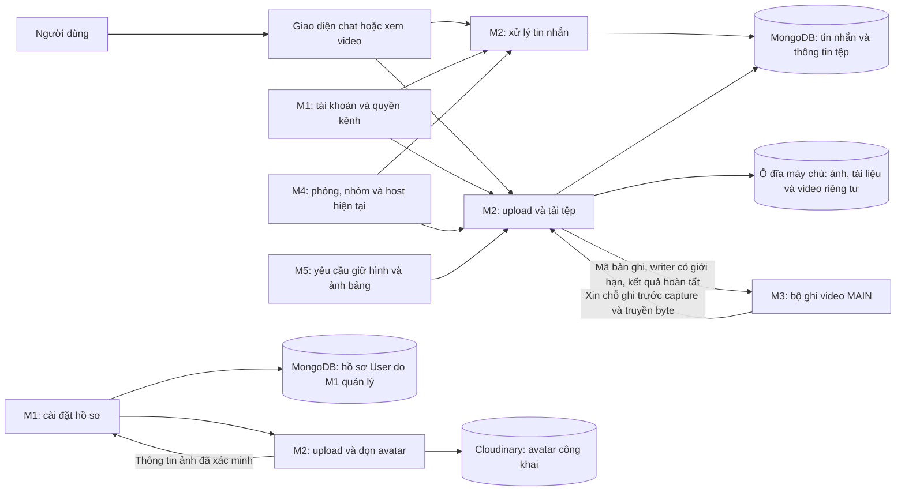
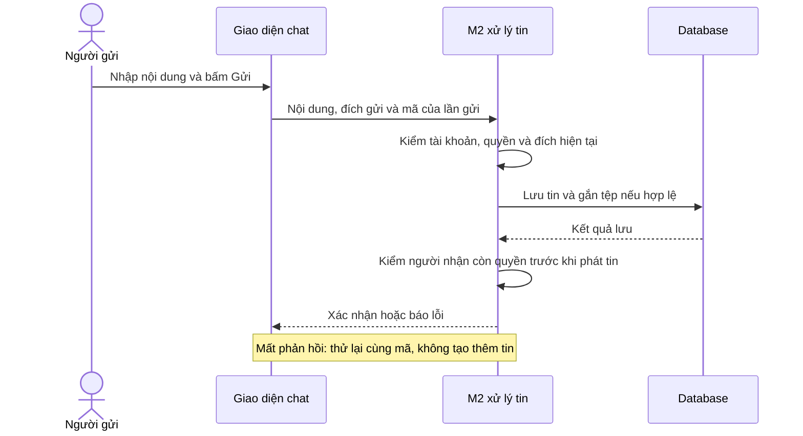

# M2 — Chat, tệp, avatar và xem lại bản ghi

**Status:** Draft để review · **Ngày:** 04/11/2026 · **Người phụ trách:** Minh Quân 15 · **Reviewer cần phối hợp:** M1, M4; M3/M5 review điểm giao · **Size đề xuất:** XL, chia thành nhiều task và kiểm lại sau phần tích hợp đầu tiên.

> **Tóm tắt** — Xây phần nhắn tin trong kênh TEXT, tin nhắn riêng 1–1, trả lời theo thread và chat trong cuộc họp. Người dùng có thể gửi văn bản, ảnh, tệp; đọc lại lịch sử; thử gửi lại khi lỗi mà không tạo hai tin giống nhau.
>
> M2 làm giao diện chat, lưu tin nhắn và quản lý tệp. M1 cung cấp tài khoản và quyền truy cập kênh; M4 xác định người dùng đang ở phòng nào và ai đang là host. M3 cung cấp khung cuộc gọi và chức năng ghi hình; M5 cung cấp phần giữ hình, vẽ và ảnh chụp bảng. M2 cũng làm phần lưu và xem lại video đúng quyền, đồng thời cung cấp upload và dọn avatar Cloudinary cho M1. Avatar công khai có luồng riêng, không dùng cách lưu/tải của tệp chat và video riêng tư.
>
> Phạm vi có 11 yêu cầu chức năng chính của M2 và phần phối hợp avatar FR-01-05 do M1 phụ trách chính. WBS giữ 12 nhóm T1–T12, tách task con 2–8 giờ theo đầu ra để giao việc và theo dõi phụ thuộc. Task và ước lượng ở cuối dùng để team thảo luận, chưa phải lịch cam kết. Proposal này mô tả cách làm, chưa triển khai chức năng hoặc thay cấu trúc dữ liệu thực tế.

## 1. Context

CoLearnia có hai nhu cầu trao đổi khác nhau. Ngoài giờ học, thành viên nhắn tin và gửi tài liệu trong Workspace. Trong buổi học, họ cần nói chuyện bằng tin nhắn với phòng hiện tại hoặc hỏi riêng host. Hai phần có thể dùng chung cách lưu tin và tệp, nhưng không có cùng quyền đọc và thời gian lưu.

Ví dụ: rời cuộc gọi không làm mất lịch sử DM. Ngược lại, một người đã về MAIN không được tiếp tục mở chat của nhóm nhỏ chỉ vì vẫn nhớ đường dẫn cũ.

Theo [phân chia miền](../product/delivery-domains.md), M2 phụ trách chat, tệp và xem lại bản ghi. Yêu cầu nghiệm thu lấy từ [FR/AC](../product/functional-requirements.md), [messaging](../product/messaging.md), [chat họp và hỗ trợ](../product/groups-media-policy.md), [recording](../product/recording.md). Thiết kế dùng chung theo [kiến trúc](../architecture.md), [dữ liệu](../database/collection-design.md), [vòng đời dữ liệu](../database/lifecycle.md), [quy tắc nhất quán](../database/integrity-and-migrations.md) và [sức chứa](../capacity.md).

Phần avatar đối chiếu với [proposal M1 tại commit 8243a8d](https://github.com/Lightning1507/CoLearnia/blob/8243a8d63f1f1e7f865468dfb3ff0bc2d7108269/docs/proposals/m1-workspace-auth.md): avatar lưu Cloudinary, URL công khai; chỉ chính chủ được thay/xóa. M1 làm giao diện và lưu thông tin ảnh trên User; M2 cung cấp upload đã kiểm tra và cleanup, tức dọn ảnh bỏ dở/không còn dùng. Một số nguồn trong checkout này còn ghi chưa yêu cầu avatar; phần bổ sung dưới đây là đầu ra phối hợp theo review M1, cần đồng bộ nguồn chung trước code phụ thuộc, chưa sửa baseline hoặc schema thực thi trong lượt này.

Source hiện có mới là bộ khung: web có màn trạng thái, server có các đường kiểm tra hoạt động, kết nối realtime chưa cho vào khi chưa có xác thực. Chưa có màn chat, xử lý tin nhắn, upload/download hoặc trang xem lại video. Các thiết kế trong tài liệu chưa chứng minh các chức năng này đã chạy.

## 2. Objective

Thành viên gửi được nội dung đến đúng người, tìm lại được cuộc trao đổi và biết tin đã gửi thành công hay chưa. Người không còn quyền phải bị chặn cả tin nhắn mới, lịch sử và tệp đang tải. Người mở lại kênh LIVE tìm được video của các phiên đã kết thúc và xem đúng quyền. M1 có thể dùng phần upload/dọn avatar M2 cung cấp mà không phải tự viết lại; ảnh công khai không làm thay đổi quyền tệp chat/video.

## 3. Goals / Non-goals

| Goal | Kết quả                                                                                                    | FR chính / phối hợp                             |
| ---- | ---------------------------------------------------------------------------------------------------------- | ----------------------------------------------- |
| G1   | Nhắn văn bản, ảnh, tệp trong TEXT; đọc lịch sử theo trang và đúng thứ tự                                   | FR-04-01, FR-04-03; M1                          |
| G2   | Hiện đang gửi/thành công/lỗi; thử lại không nhân tin, không âm thầm đổi nội dung tin đã gửi                | FR-04-02                                        |
| G3   | Upload, gắn tệp vào tin và tải xuống đúng quyền; kiểm dung lượng, loại tệp và dọn tệp bỏ dở                | FR-04-04                                        |
| G4   | DM đúng hai người trong cùng Workspace; mất quyền thì chặn, gia nhập lại hợp lệ thì đọc lịch sử còn lưu    | FR-12-01, FR-12-02; M1                          |
| G5   | Trả lời một cấp trong TEXT; có số trả lời, lịch sử riêng; không đẩy mọi câu trả lời vào dòng chat chính    | FR-13-01, FR-13-02                              |
| G6   | Chat họp gửi đến Everyone của phòng hiện tại hoặc đúng host; không lộ tin giữa các nhóm                    | FR-09-01, FR-09-02; M3/M4                       |
| G7   | Cung cấp ảnh giữ hình cho M5; lưu và tìm video theo kênh hoặc phiên để xem lại đúng quyền                  | FR-15-03 và phần phối hợp FR-04-04; M1/M3/M4/M5 |
| G8   | Cung cấp upload avatar Cloudinary đã kiểm tra đúng chủ, loại ảnh và giới hạn; dọn ảnh bỏ dở/ảnh cũ an toàn | Phối hợp FR-01-05; M1 chính, M2 hỗ trợ          |

**Ngoài phần M2 tự triển khai:** đăng nhập/quản lý thành viên, điều hành nhóm, truyền mic/camera và công cụ vẽ. M2 vẫn phải nối các phần này để luồng người dùng chạy đầy đủ.

Bản đầu không thêm DM nhóm, DM xuyên Workspace, thread trong DM/chat họp, sửa/xóa tin, biểu cảm, trạng thái đang gõ hoặc thông báo đã đọc. Không biến ảnh bảng thành thư viện bài làm. Không làm lại bộ ghi hình của M3 và không tự thêm Redis hay nhiều server chạy song song.

## 4. Các điểm cần thống nhất

Các bên thống nhất phần giao tiếp trước khi code phụ thuộc. Trong thời gian chờ, M2 vẫn có thể làm giao diện hoặc thử các luồng chat/tệp độc lập. Những quy tắc sản phẩm đã chốt tiếp tục theo nguồn hiện hành.

| ID  | Nội dung cần thống nhất                                                                                                                                                                                                                                  | Bên phối hợp                                                      | Cần chốt trước                                                                            |
| --- | -------------------------------------------------------------------------------------------------------------------------------------------------------------------------------------------------------------------------------------------------------- | ----------------------------------------------------------------- | ----------------------------------------------------------------------------------------- |
| Q1  | M1 trả thông tin người dùng/quyền kênh thế nào; M2 tham gia tạo general cùng Workspace ra sao; cách báo khi người dùng bị gỡ quyền.                                                                                                                      | Minh Quân 15 – Minh Quân 16                                       | T2–T4                                                                                     |
| Q2  | M4 cung cấp phòng hiện tại, nhóm, host, giờ kết thúc và thông báo chuyển phòng thế nào; khi đóng nhóm, M2 phải dọn xong những gì.                                                                                                                        | Minh Quân 15 – Hoàng Quân                                         | T6                                                                                        |
| Q3  | Hướng thử Busboy nhận multipart dạng stream, file-type nhận diện định dạng và sharp kiểm/chuẩn hóa ảnh; chốt phần dùng chung và allowlist riêng cho chat/frame/avatar. Kiểm phiên bản trên Node/Linux đang pin, số liệu RAM/timeout trước chọn package.  | Minh Quân 15; Minh Quân 16 review quyền/avatar, Minh review frame | T1.4 khảo sát tối đa 4 giờ, kết luận trước T3.1/T3.2; không chặn TEXT text-only           |
| Q4  | Vị trí panel chat và mục Bản ghi theo kênh; dữ liệu kênh/phiên M4 cung cấp; định dạng video và cách phát/tua trên trình duyệt.                                                                                                                           | Minh Quân 15 – Việt – Hoàng Quân; Minh Quân 16 review quyền kênh  | T5/T6/T9                                                                                  |
| Q5  | Chốt M2 cấp nơi ghi/dung lượng trước capture và M3 nối output vào writer; mã start/attempt, trạng thái, hết disk/hủy/finalize/restart, định dạng phát và quota/retention/quyền xóa. Không chờ video ghi xong mới bàn giao cho M2.                        | Minh Quân 15 – Việt; Hoàng Quân và Minh Quân 16 review điểm giao  | T1.2, T9.1; trước PoC recording tích hợp và bật T9                                        |
| Q6  | M5 cấp yêu cầu giữ hình và xác nhận ảnh còn được dùng thế nào; khi trở lại hình trực tiếp hoặc đóng nhóm thì thông báo dọn ảnh ra sao.                                                                                                                   | Minh Quân 15 – Minh                                               | T7                                                                                        |
| Q7  | Chốt giới hạn số yêu cầu chờ/đang chạy, tổng byte, thời gian chờ/chạy và hủy cho từng loại thao tác, theo người/phạm vi và toàn app process; cả pool DB và phần dành cho thu quyền. Giá trị hữu hạn phải có trong config/contract trước khi bật handler. | Minh Quân 15 cùng M1/M4 và các miền dùng tài nguyên chung         | T1 chốt khung; trước bật T3/T4/T6, T7/T9/T12 áp cùng nguyên tắc; T11 chỉ đo và điều chỉnh |
| Q8  | Chốt cách M1 gọi upload/dọn avatar M2, kiểm ảnh và giới hạn Cloudinary; dữ liệu trả đã xác minh, cách chọn/thay/xóa đồng thời, theo dõi ảnh bỏ dở và thử dọn lại sau restart. Thống nhất cấu hình phía server, không đưa credential vào frontend.        | Minh Quân 15 – Minh Quân 16                                       | Review T1; trước bật T12 và trước M1 tích hợp avatar                                      |

| Q9 | Chốt subscribe-first và mốc đồng bộ theo tin đã commit, cách tải bù nhiều trang và gộp theo ID. Không dùng timestamp hoặc ID tin realtime cuối cùng làm mốc an toàn nếu còn tin commit muộn. | Minh Quân 15; Minh Quân 16/Hoàng Quân review quyền và thứ tự ghi | T1.3 thử tối đa 4 giờ; chốt trước T4.2/T5.2 |

**Điểm cần đồng bộ với mẫu M3 được cung cấp:** mẫu mô tả ghi hình tiếp tục qua đổi host, các đoạn video riêng sau mỗi lần Dừng/Record và hướng dùng GStreamer để tạo video ở server. File recording.md trong checkout này chưa ghi đầy đủ các cập nhật đó. M2 đưa các nội dung này vào phần phối hợp Q4/Q5; trước khi triển khai phần phụ thuộc cần thống nhất và cập nhật nguồn chung. Viết lại proposal không tự thay quyết định recording trong repo.

## 5. High-level design

Dùng một phần xử lý chat và một phần xử lý tệp chung cho cả ứng dụng. Khác biệt nằm ở việc người này có được đọc/gửi vào hội thoại đó ngay lúc này không.

MongoDB lưu tin nhắn và thông tin quản lý tệp; nội dung ảnh chat, tài liệu, ảnh giữ hình và video nằm trên ổ đĩa máy chủ, chỉ tải qua API có kiểm quyền. Avatar là nhánh riêng: nội dung ảnh nằm trên Cloudinary, còn M1 lưu thông tin ảnh đã được M2 xác minh trên User. URL avatar cho phép đọc công khai, kể cả sau khi rời Workspace; không áp cách đọc này cho tệp chat/video. Không đưa video vào database hoặc gửi tệp qua Socket.IO. Socket.IO dùng để gửi lệnh và nhận tin mới; HTTP dùng cho lịch sử và truyền tệp.

Giao diện dùng chung ô soạn tin, danh sách tin, phần đính kèm và thông báo lỗi. TEXT có thêm panel thread; DM có danh sách riêng; chat họp nằm trong khung cuộc gọi M3. M2 không dựng thêm một trang gọi khác.

**Các lựa chọn đã cân nhắc:** tách mỗi loại chat thành một hệ thống riêng sẽ lặp cách gửi lại và quản lý tệp; lưu chat họp chỉ trong bộ nhớ sẽ không khớp thiết kế lịch sử hiện có. Vì vậy dùng chung nền lưu tin, kiểm quyền riêng cho từng loại. Tệp đi qua đường tải có xác thực, thay vì đường dẫn công khai mà ai biết cũng mở được.

## 6. Detailed design

### 6.1. Dữ liệu và trách nhiệm

Một **hội thoại** là nơi chứa tin nhắn, chẳng hạn chat của một kênh, một cặp DM hoặc một nhóm trong cuộc họp. **Thread** là chuỗi trả lời gắn với một tin gốc. **Thông tin tệp** gồm người tải lên, dung lượng, loại tệp, tệp thuộc hội thoại nào và khi nào được dọn; không phải toàn bộ nội dung tệp.

| Nơi lưu          | Nội dung                                                             | Điều cần giữ đúng                                                                      |
| ---------------- | -------------------------------------------------------------------- | -------------------------------------------------------------------------------------- |
| `conversations`  | Hội thoại của kênh TEXT, cặp DM, MAIN, nhóm hoặc cặp người dùng–host | Mỗi nơi/cặp chỉ có một hội thoại tương ứng. Hai người ở hai Workspace có hai DM riêng. |
| `messages`       | Người gửi, nội dung, thời gian, tệp đính kèm, tin gốc nếu là trả lời | Người gửi lấy từ đăng nhập. Trả lời phải thuộc đúng tin gốc trong cùng kênh.           |
| `files`          | Thông tin tệp, nơi lưu nội bộ, trạng thái, quyền và lịch dọn         | Một tệp chỉ gắn một đích. Ảnh giữ hình không tự biến thành tệp đính kèm chat.          |
| Kho tệp riêng    | Nội dung ảnh, tài liệu và video                                      | Không mở công khai; mỗi lần tải đều kiểm quyền.                                        |
| Bộ nhớ đang chạy | Các lượt upload/download và kết nối nhận tin đang mở                 | Dùng để hủy khi mất quyền, không dùng thay dữ liệu thành viên/nhóm của M1/M4.          |

M1 tạo Workspace, owner, kênh general và hội thoại của kênh trong cùng một lần lưu: hoặc có đủ, hoặc không tạo phần nào. M2 cung cấp thao tác tạo hội thoại cho M1 dùng, không tạo general bằng một yêu cầu chạy sau.

Giữ cấu trúc và các ràng buộc đã có trong [thiết kế DB](../database/collection-design.md). Database cần ngăn trùng cặp DM, trùng hội thoại theo phòng/nhóm và trùng lần gửi. Lưu tin có tệp hoặc trả lời thread phải hoàn tất cùng việc gắn tệp/cập nhật số trả lời; lỗi giữa chừng không để lại tin thành công nhưng thiếu tệp.

M1 sở hữu thông tin avatar trên User, theo đề xuất `{ publicId, secureUrl } | null`. M2 không tạo một bản hồ sơ người dùng thứ hai hoặc gắn avatar vào conversation. M1/M2 chốt nơi theo dõi lượt upload và việc dọn ảnh Cloudinary để có thể tiếp tục sau restart; đây là phần thiết kế bổ sung ở Q8, không mặc định dùng nguyên schema ATTACHMENT/FRAME của chat.

Recording là phần dữ liệu mới cần M2–M3 thống nhất ở 6.5. Không coi 13 collection trước recording đã đủ cho video. Khi triển khai có thay cấu trúc dữ liệu phải kiểm dữ liệu hiện có và có kế hoạch chuyển đổi/khôi phục riêng; proposal này không chạy các thao tác đó.

### 6.2. Gửi tin, đọc lịch sử và thử lại

**Gửi tin:** người dùng bấm Gửi → giao diện hiện Đang gửi → server kiểm quyền và nội dung → lưu tin cùng tệp nếu có → xác nhận thành công và gửi tới người được đọc. Chỉ hiển thị thành công sau khi có kết quả lưu xác định.

**Thử lại:** mỗi lần gửi có một mã `clientMessageId`. Nếu mạng đứt sau khi server đã lưu nhưng trước lúc giao diện nhận được phản hồi, thử lại bằng cùng mã sẽ trả về tin đã có. Nếu cùng mã nhưng nội dung khác, server báo xung đột thay vì ghi đè tin cũ. Kiểm quyền cả khi trả lại tin đã lưu; mã cũ không giúp đọc nội dung sau khi bị gỡ quyền.

Về kỹ thuật, khóa chống trùng gồm hội thoại + người gửi + mã lần gửi. Khi có tệp hoặc tăng số trả lời, các bước lưu chạy trong cùng transaction, tức cùng thành công hoặc cùng hủy. Nếu chưa biết lần lưu đã thành công hay chưa, server tra lại theo mã trước khi kết luận; không tự tạo tin mới hoặc báo chắc chắn thất bại.

**Lịch sử và thread:** tải từng trang, tối đa 50 tin/trang theo cấu hình hiện tại; đề xuất mặc định 30. Mốc tải tiếp dựa trên thời gian và ID tin để các tin cùng thời điểm vẫn có thứ tự ổn định. Dòng chính của TEXT chỉ có tin gốc; trả lời nằm trong panel thread, có lịch sử riêng và số trả lời. Thử lại không tăng số trả lời hai lần. Không cho lấy tin của kênh khác hoặc một câu trả lời làm gốc mới.

**Nối lịch sử với realtime khi mở hội thoại/reconnect — hướng đề xuất Q9:**

Nếu tải lịch sử xong mới đăng ký nhận realtime, tin được lưu giữa hai bước có thể bị sót. Socket.IO mặc định không tự gửi lại sự kiện server mà client đã bỏ lỡ; phần bù tin do ứng dụng thực hiện. Theo [delivery guarantees](https://socket.io/docs/v4/delivery-guarantees/), proposal chọn subscribe trước rồi tải bù có mốc, không bật replay packet private.

| Bước                     | Client và server thực hiện                                                                                                                                                                                                                     | Điều kiện để đi tiếp                                                                                                                                                         |
| ------------------------ | ---------------------------------------------------------------------------------------------------------------------------------------------------------------------------------------------------------------------------------------------- | ---------------------------------------------------------------------------------------------------------------------------------------------------------------------------- |
| 1. Chuẩn bị              | Client gắn listener nhận tin trước khi gửi `conversation.subscribe`; tạo lượt đồng bộ riêng cho conversation/root và context hiện tại.                                                                                                         | Bỏ lượt cũ khi logout, đổi hội thoại hoặc scope; chưa coi cache cũ là quyền.                                                                                                 |
| 2. Subscribe             | Server kiểm auth/ACL và context M4 nếu là chat họp, đăng ký audience rồi xác lập mốc tin đã commit H trong cùng điều phối với đường ghi/fanout. Ack trả `subscriptionId`, `syncToken`, H và context hiện hành.                                 | Mọi tin thuộc khoảng trước/đến H phải đọc được qua history có quyền; tin commit sau ranh giới đã có subscription tiếp nhận. Không có khoảng giữa “chốt H” và “bắt đầu nhận”. |
| 3. Giữ tin mới và tải bù | Trong lúc đọc history, client tạm giữ event của đúng subscription/context. Reconnect dùng mốc L của lần đồng bộ hoàn tất trước; đọc khoảng sau L tới H. Lần mở đầu lấy trang mới nhất tới H, còn lịch sử cũ tải tiếp bằng cursor thông thường. | L và H do server cấp/xác minh, không phải đồng hồ client hoặc ID cuối thấy trên UI. H cố định cho cả lượt tải để tin mới không đẩy lệch trang.                               |
| 4. Đọc đủ trang          | API trả `nextCursor/hasMore` trong cùng `syncToken`; reconnect tiếp tục từng trang cho tới hết khoảng (L,H], kể cả hơn 50 tin. Đọc replies dùng root riêng; timeline TEXT chỉ nhận root.                                                       | Không lấy một trang rồi báo đã bù xong. Mỗi trang kiểm lại auth/ACL/context/deadline; cursor không tự cấp quyền.                                                             |
| 5. Gộp                   | Gộp history, ack gửi và event tạm theo message ID; tin đang gửi đối chiếu thêm `clientMessageId`. Event reply chỉ cập nhật đúng thread/root, không tăng count hai lần.                                                                         | Sắp theo thứ tự server; mỗi tin chỉ hiện một lần. Không tự lấy event cuối cùng làm checkpoint mới.                                                                           |
| 6. Hoàn tất              | Khi đã nhận đủ tới H và xử lý event tạm hợp lệ, đánh dấu lượt đồng bộ hoàn tất, lưu checkpoint H trong bộ nhớ client và chuyển nhận live bình thường.                                                                                          | Nếu rớt mạng giữa lượt, giữ checkpoint hoàn tất trước đó; lần sau subscribe lại rồi tải bù, cho phép dữ liệu trùng nhưng loại theo ID.                                       |

**Mốc đồng bộ khác cursor hiển thị:** cursor lịch sử hiện có dùng `(createdAt, _id)` để phân trang. ID/timestamp có thể được cấp trước commit, nên không mặc định “tin có ID lớn nhất đang thấy” nghĩa là mọi tin trước đó đã lưu đủ. `syncToken/checkpoint` là hợp đồng server về ranh giới commit. T1.3 có 4 giờ thử hai send commit lệch thứ tự và DB chậm để chốt cách biểu diễn/truy vấn mốc này dưới gate hiện có. Nếu cursor hiện tại không chứng minh được ranh giới, phải review đề xuất mốc theo thứ tự commit và delta dữ liệu/index cần thiết trước T4.2; không tự thêm field/migration, không công bố giải pháp chống sót đã hoàn tất chỉ từ tuple thời gian. Đây là điểm phải đóng trước code phụ thuộc, không để triển khai bằng một giả định ngầm.

Subscription/catch-up và buffer có giới hạn số tin/byte/thời gian theo Q7. Buffer đầy hoặc token hết hạn trả trạng thái cần đồng bộ lại, không âm thầm bỏ tin rồi báo thành công; hủy lượt cũ và xin lượt mới theo quyền hiện tại. Server restart làm token runtime cũ hết hiệu lực; yêu cầu snapshot/lượt mới, không dùng token để hồi grant nhóm. Mất quyền/đổi scope trong bất kỳ bước nào phải dừng history, thu subscription, xóa buffer/cache private tương ứng. Việc chặn vẫn ở server, không chỉ dựa client bỏ event.

Contract dự kiến bổ sung `syncToken, afterCheckpoint, throughCheckpoint, nextCursor` cho đường history thích hợp và checkpoint/context cho ack subscribe. Tên/encoding cuối cùng chốt Q9 cùng consumer; không bắt DM/TEXT mang session epoch khi không tham gia cuộc gọi. Không lưu nội dung private hoặc dữ liệu upload nhạy cảm vào localStorage.

**Ca kiểm bắt buộc:** tin đến ngay trước/giữa/sau subscribe ack và truy vấn history; hơn hai trang tin bị bỏ lỡ; nhiều tin cùng timestamp; commit muộn khác thứ tự cấp ID; event đến trước ack hoặc trùng history; reply không nhân count; rớt mạng giữa trang; buffer đầy; gỡ quyền/chuyển nhóm/hết giờ ngay khi tải bù. Chỉ nghiệm thu không sót sau khi đóng Q9 và chạy các ca này.

### 6.3. Upload, tải xuống và dọn tệp

Luồng upload có hai bước khác nhau: tải tệp lên máy chủ và gắn tệp đó vào tin nhắn. Upload xong chưa có nghĩa tệp đã thuộc một tin gửi thành công.

1. **Kiểm tra và giữ chỗ dung lượng:** xác thực người gửi, hội thoại đích, loại/kích thước được phép. Server ghi nhận quyền hiện tại và phần dung lượng dành cho lượt upload.
2. **Nhận tệp:** truyền từng phần vào kho riêng, kiểm kích thước trong lúc nhận. Kiểm loại tệp từ nội dung thực tế, không chỉ tin tên hoặc thông tin trình duyệt gửi lên. Ảnh phải kiểm đọc được và kích thước hợp lệ.
3. **Kiểm lại khi upload xong:** nếu quá hạn, người dùng mất quyền hoặc quyền đã thay đổi so với lần cấp upload thì hủy lượt cũ và yêu cầu tải lại. Không tự cấp quyền mới cho tệp đang chờ.
4. **Gắn vào tin:** khi bấm Gửi, kiểm đúng người upload/đúng hội thoại rồi lưu tin cùng việc gắn tệp. Hai tin tranh cùng một tệp thì chỉ một tin được dùng.
5. **Dọn khi lỗi hoặc bỏ dở:** hủy lượt ghi đang chạy, đánh dấu tệp cần xóa và dọn nội dung trước khi bỏ thông tin quản lý tệp.

Các trạng thái lưu trữ dùng theo thiết kế: `STAGED` là tệp tạm chưa gắn đích, `READY` là tệp đã gắn hợp lệ, `DELETE_PENDING` là chờ dọn. Trạng thái READY không tự cấp quyền đọc.

**Giới hạn khởi đầu:** 4.000 ký tự/tin, đếm thống nhất cả ký tự như emoji; tối đa 4 tệp/tin, 10 MiB/tệp, 500 MiB/Workspace và 2 lượt upload/người cùng lúc. Ảnh giữ hình tối đa 1920×1080, 2 MiB/ảnh; 20 MiB/phiên là cấu hình thử nhỏ. Video recording cần giới hạn riêng, không áp các mức này một cách máy móc.

**Tải xuống:** server kiểm quyền mỗi lần mở tệp, tải lại hoặc yêu cầu một đoạn video để tua. Tải đang mở được theo dõi để có thể dừng khi người dùng bị gỡ quyền, hết phiên đăng nhập hoặc nhóm đóng. Không giữ khóa xử lý chung trong suốt lượt tải. Nội dung không được phép chạy trực tiếp như mã trang web; cách kiểm loại tệp/thư viện cụ thể chốt ở Q3. Những byte đã gửi hoặc bản người dùng đã tải không thể thu hồi.

**Dung lượng và dọn tệp:** tính cả phần đang giữ chỗ và tệp chưa xóa xong; không trả dung lượng trong khi nội dung vẫn nằm trên disk. Sau sự cố phải đối chiếu database với kho tệp trước khi nhận upload mới ở phần chưa kiểm xong. Tác vụ dọn chạy lại không được trừ dung lượng thêm hoặc báo lỗi chỉ vì tệp đã xóa ở lần trước.

Theo [vòng đời hiện hành](../database/lifecycle.md), tác vụ dọn chạy khởi đầu mỗi 60 giây; upload bỏ dở quá 15 phút được dọn; ảnh giữ hình hết tham chiếu dọn sau khoảng chờ tối đa 5 phút. Chat riêng trong cuộc họp khóa ngay khi đóng và dọn sau 24 giờ. Tệp kênh/Workspace bị xóa dọn sau 7 ngày khi không còn được dùng. Đây là cấu hình khởi đầu, không tự áp cho recording. Khi dọn thread, dọn trả lời trước tin gốc và giữ đủ thông tin để tiếp tục nếu máy chủ dừng giữa chừng.

**Phối hợp M5:** M5 quyết định nhóm có được giữ ảnh đó không và ảnh còn đang dùng không; M2 quản lý việc lưu/tải/dọn ảnh. MAIN không có freeze nên không tạo ảnh giữ hình MAIN. Nếu muốn gửi ảnh bảng vào chat, tạo một tệp đính kèm riêng; không lấy tệp giữ hình đang dùng rồi đổi quyền. Người rời nhóm không làm ảnh của những người còn lại bị xóa.

#### 6.3.1. Hướng thử thư viện và phần dùng chung

Đây là hướng kỹ thuật để khảo sát, chưa cài package hoặc chọn phiên bản production trong PR tài liệu. Ưu tiên thử bộ nhỏ dưới đây trên Node 26/ESM và Linux image dự án; chỉ pin version và sửa lockfile trong PR implementation sau review.

| Phần                | Hướng thử                                                                                                                                                                           | Kết quả cần kiểm                                                                                                                                                                                                             |
| ------------------- | ----------------------------------------------------------------------------------------------------------------------------------------------------------------------------------- | ---------------------------------------------------------------------------------------------------------------------------------------------------------------------------------------------------------------------------- |
| Nhận multipart      | [Busboy](https://github.com/mscdex/busboy), nối stream vào writer bằng `node:stream/promises.pipeline` và hủy theo timeout/disconnect/revoke.                                       | Cấu hình rõ fileSize/files/fields/parts/header và giới hạn byte tổng; xử lý limit/truncated, drain hoặc hủy stream; không giữ cả file trong RAM, không dùng tên file client làm đường dẫn.                                   |
| Nhận diện định dạng | [file-type](https://github.com/sindresorhus/file-type), đọc mẫu đầu hoặc tệp tạm có giới hạn, đối chiếu loại được phép.                                                             | Đây chỉ là dấu hiệu định dạng từ nội dung nhị phân, không chứng minh file hợp lệ/an toàn. Loại không nhận diện được xử lý theo allowlist Q3, không đoán từ đuôi; tệp text không dùng phép nhận diện ảnh để coi đã kiểm xong. |
| Kiểm và xử lý ảnh   | [sharp](https://sharp.pixelplumbing.com/api-constructor/): đọc kích thước và thử decode có kiểm soát; cấu hình `limitInputPixels`, lỗi ảnh hỏng, giới hạn số lượt xử lý và timeout. | Kiểm riêng JPEG/PNG/WebP và file giả/hỏng/pixel quá lớn; không bật unlimited, không rasterize SVG/PDF tùy ý. Thử đủ để chứng minh nhận/kiểm thực sự có giới hạn RAM/CPU, không coi chỉ đọc metadata là đã decode ảnh hợp lệ. |
| Avatar Cloudinary   | [Cloudinary Node SDK](https://cloudinary.com/documentation/node_image_and_video_upload#the_upload_stream_method), thử upload qua backend và cleanup phía server.                    | Nhận `uploadId/publicId/secureUrl` qua kết quả đã xác minh đúng chủ; thử timeout/unknown response/xóa lỗi. Không dùng upload unsigned công khai hoặc credential frontend để rút ngắn luồng.                                  |

Q3/Q8 chốt allowlist sản phẩm trước bật handler, đặc biệt ảnh động, SVG và tệp không nhận diện được. Việc thư viện hỗ trợ một định dạng không tự có nghĩa ứng dụng cho phép. sharp có thành phần native; phải kiểm cài/chạy trên runtime thật và mức dùng tài nguyên khi cùng media. Timeout request không mặc định đã dừng công việc native; T1.4 phải thử hủy/giới hạn và ghi giới hạn còn lại, chưa tự thêm worker pool.

| Loại nội dung            | Dùng chung                                                                                       | Tách riêng                                                                                                                                                 |
| ------------------------ | ------------------------------------------------------------------------------------------------ | ---------------------------------------------------------------------------------------------------------------------------------------------------------- |
| Ảnh chat và tệp đính kèm | Parser stream, đếm byte, nhận diện nội dung; ảnh dùng bộ kiểm ảnh, lỗi và instrumentation chung. | ACL conversation, quota Workspace, STAGED → MESSAGE; file không ảnh không đi qua bộ resize ảnh. Meeting chỉ nhận ảnh.                                      |
| Frame nhóm               | Parser và kiểm ảnh có giới hạn.                                                                  | Intent/source/context M5, kích thước tối đa 1920×1080/2 MiB, quota frame, BOARD_FRAME; không tự crop/đổi tỷ lệ hoặc chuyển thành attachment.               |
| Avatar                   | Parser/kiểm ảnh và kiểu lỗi chung.                                                               | Chính chủ User, normalize/resize theo Q8, Cloudinary công khai, budget và cleanup riêng; không dùng quyền Workspace hoặc collection chat làm quyền avatar. |
| Video recorder           | Hạ tầng writer/disk byte budget và registry cleanup có thể dùng chung ở mức thấp.                | Không đi qua multipart/decoder ảnh; M3 encode, M2 nhận output nội bộ như mục 6.5.                                                                          |

**Nghiên cứu có thời hạn:** T1.4 tối đa 4 giờ cho Busboy/file-type/sharp; đầu ra là thử nghiệm cô lập với ảnh/tệp giả, quá size, ngắt stream, nhiều lượt đồng thời, RAM/time và kết luận chọn/pin hoặc điểm không đạt. T1.5 tối đa 4 giờ cho contract/avatar SDK cùng M1, dùng môi trường thử được cấp, không lấy secret production. Nếu thiếu môi trường hoặc hết thời gian mà chưa chứng minh được, ghi kết quả/blocker và ước lượng task tiếp; không kéo dài vô hạn hoặc gọi PoC đã pass. Hai task này không chặn việc làm TEXT chỉ có văn bản.

### 6.4. Quyền chat và thay đổi phòng/nhóm

| Nơi trao đổi        | Ai được đọc/gửi/nhận tin và tải tệp?                                                                                                                  |
| ------------------- | ----------------------------------------------------------------------------------------------------------------------------------------------------- |
| TEXT                | Thành viên còn quyền kênh. PRIVATE cần được cấp quyền riêng; owner/admin ngoài danh sách không tự đọc được nội dung. Thread theo cùng quyền của kênh. |
| DM                  | Đúng hai người, cả hai còn là thành viên hợp lệ của Workspace. Admin không có quyền đọc thay.                                                         |
| Everyone tại MAIN   | Người hiện ở MAIN trong phiên còn hoạt động; không gửi sang mọi nhóm.                                                                                 |
| Everyone trong nhóm | Người thực sự đang ở đúng nhóm còn mở; có tên trong danh sách dự kiến chưa đủ quyền. Host chỉ đọc khi hỗ trợ đúng ACTIVITY.                           |
| Host riêng          | Người gửi và đúng host nhận ban đầu; phiên còn hoạt động và cả hai còn quyền kênh. Host mới không nhận lịch sử của cặp cũ.                            |

Chat họp chỉ có văn bản/ảnh, không có tệp bất kỳ hoặc thread. Khi đổi nhóm hay đổi host trong lúc người dùng đang soạn/upload, server báo đích cũ không còn hợp lệ để người dùng xác nhận lại. Không tự chuyển câu hỏi riêng thành Everyone hoặc gửi sang host mới. Host cũ vẫn đọc phần gửi cho mình theo quyền đã chốt khi phiên còn hoạt động, nhưng không nhận câu hỏi mới chỉ vì từng là host.

DISCUSSION tạo ngay khi hợp lệ, từng người chủ động bấm vào; chưa vào thì chưa được đọc chat nhóm. Nhóm chưa ai vào vẫn chờ. Khi người cuối cùng chủ động rời một DISCUSSION đã có người, nhóm đóng và chat/ảnh bị khóa; mất mạng không tự coi là chủ động rời. ACTIVITY không đóng theo số người còn lại. Host không vào hỗ trợ DISCUSSION, mà hỏi/trả lời qua chat riêng khi ở MAIN.

**Khi bị thu quyền:** M1/M4 xác định thay đổi → chặn truy cập cũ → M2 ngừng phát tin, hủy upload/download liên quan và bỏ đăng ký nhận tin → giao diện bỏ dữ liệu riêng cũ → chỉ mở nội dung mới sau khi kiểm quyền. Nếu dọn chưa xong hoặc lưu quyền lỗi, giữ phần đã thu ở trạng thái chặn và kiểm tra lại; không báo hoàn tất giả.

DM giữ cùng hội thoại sau khi một người rời rồi gia nhập lại Workspace, nhưng chỉ mở khi cả hai tư cách thành viên đều hợp lệ. Quyền PRIVATE cũ không tự phục hồi, owner/admin phải thêm lại. Rời cuộc gọi không đóng lịch sử DM.

Phần kỹ thuật dùng cùng thứ tự xử lý đã chốt: quyền tài khoản nếu cần → Workspace → kênh → phiên. Không tạo một khóa riêng của M2 chạy trái thứ tự M1/M4; không giữ hàng đợi xử lý phiên khi chờ upload hoặc người dùng. Kiểm quyền trước lưu và trước phát tin. Với ACTIVITY, nếu hết giờ trong lúc chờ database thì không phát tin/cấp lại quyền nhóm cũ, dù tin có thể đã được lưu; xử lý kết quả và dọn theo vòng đời đã thống nhất.

### 6.5. Lưu và xem lại recording

M3 tạo video từ nội dung MAIN; M2 tham gia từ trước capture để giữ chỗ dung lượng và cấp bộ ghi tệp, sau đó lưu kết quả và cho xem lại. Không chờ M3 ghi xong một video lớn rồi mới kiểm chỗ lưu. Người xem cần còn là thành viên Workspace và còn quyền kênh LIVE hiện tại, kể cả PRIVATE. Từng tham gia buổi học hoặc biết URL không đủ quyền.

**Đề xuất trách nhiệm:** M2 làm đầu mối thiết kế thông tin bản ghi và kho tệp; M3 điều khiển quá trình ghi/xử lý và bàn giao kết quả. M4 cung cấp phiên/host hiện hành; M1 cung cấp quyền kênh. Đây là phần cần các bên review ở Q5, không phải cấu trúc DB đã chốt.

| Thông tin cần quản lý                                  | Mục đích                                                                                                   |
| ------------------------------------------------------ | ---------------------------------------------------------------------------------------------------------- |
| Mã bản ghi, Workspace, kênh và phiên gốc               | Tìm đúng video và kiểm quyền xem. Một phiên có thể có nhiều đoạn theo hướng mô tả của M3.                  |
| Người bắt đầu và các mốc thời gian                     | Hiển thị bản ghi nào, bắt đầu/kết thúc lúc nào; người bắt đầu không trở thành người duy nhất có quyền xem. |
| Đang ghi / đang xử lý / sẵn sàng / lỗi                 | Không cho xem như video hoàn chỉnh khi còn đang ghi hoặc xử lý lỗi.                                        |
| Tệp video, định dạng, thời lượng và dung lượng đã kiểm | Phát và tua đúng; theo dõi dung lượng thực tế.                                                             |
| Mã lần yêu cầu/xử lý và thông tin dọn tệp              | M3 gửi lại cùng kết quả không sinh thêm video; theo dõi và dọn được phần bỏ dở.                            |

Mẫu M3 đề xuất tách thông tin quá trình ghi vào `recordings`, còn nội dung video do kho tệp chung quản lý. M2 cần cùng Việt review phương án này, tên trường và ràng buộc dữ liệu; không tự thêm collection hoặc đổi loại ATTACHMENT/FRAME chỉ từ tài liệu đề xuất.

**Tìm lại video từ kênh:** mở kênh LIVE → mục Bản ghi → danh sách video của các phiên trong kênh, kể cả phiên đã kết thúc → chọn video sẵn sàng để xem. M2 cung cấp API danh sách theo kênh, không yêu cầu người dùng biết trước sessionId và không chờ một API lịch sử phiên của M4. M4 cung cấp ID phiên, kênh và thời gian liên quan khi tạo/cập nhật bản ghi; M3 cung cấp tiến trình xử lý và kết quả video.

Danh sách mới nhất trước, phân trang bằng cặp thời gian và ID để các bản ghi cùng thời điểm vẫn có thứ tự ổn định; đề xuất 30, tối đa 50 mục/trang. Mỗi mục có ID bản ghi/phiên, thời điểm, trạng thái và thời lượng khi đã xác định; không trả storageKey, đường dẫn nội bộ hoặc lỗi xử lý thô. Có trạng thái chưa có bản ghi/đang tải/lỗi. Người có quyền có thể thấy mục đang xử lý hoặc lỗi, nhưng chỉ video sẵn sàng mới được phát. API theo phiên vẫn phục vụ khi cần xem riêng một buổi; các đoạn của cùng phiên được giữ riêng.

Danh sách theo kênh, theo phiên và nội dung đều kiểm membership Workspace, kênh còn tồn tại và channel access hiện tại. Kênh PRIVATE kiểm quyền như các nội dung khác; người không có quyền không đọc được cả thông tin danh sách. Phiên kết thúc không tự khóa video hoàn tất; việc xóa kênh/Workspace hoặc hết retention video theo Q5 mới quyết định thu/dọn bản ghi. Mỗi yêu cầu tua/tải thêm đều kiểm quyền; bị gỡ PRIVATE trong lúc xem thì dừng truyền và chặn lần tải sau. Không trả đường dẫn tệp thật hoặc link công khai.

Truy vấn danh sách lọc kênh/Workspace và quyền hiện tại trước khi phân trang. Thiết kế dữ liệu recording ở Q5 phải có khóa liên kết phiên–kênh và index phục vụ thứ tự danh sách; API theo phiên cũng kiểm quan hệ này, không tin ID client. Khi triển khai cần đo truy vấn, không tải toàn bộ lịch sử phiên rồi lọc ở trình duyệt.

Chỉ đánh dấu sẵn sàng sau khi M3 hoàn tất tệp và M2 xác nhận nội dung/thông tin lưu hợp lệ. Lỗi lưu không làm kết thúc cuộc gọi. Không giữ cả video dài trong RAM hoặc khóa phiên khi chờ xử lý. Video dở sau lỗi/restart chưa được coi là xem được; cách giữ, cứu hoặc xóa phải theo Q5, không tự xóa hay khôi phục quá trình ghi.

Giới hạn dung lượng, thời gian lưu, quyền xóa, số video xử lý cùng lúc và cách xử lý khi hết disk cần chốt trước lưu thật. Kiểm clip vài phút để chứng minh luồng chạy, không coi đó là giới hạn thời lượng sản phẩm.

#### 6.5.1. Phối hợp M2–M3 trước, trong và sau capture

**Hướng ưu tiên để review với Việt:** M2 sở hữu tệp tạm và writer có giới hạn; M3 đưa output đã encode vào sink nội bộ do M2 cấp. M3 không mặc định tạo thêm một bản video đầy đủ ở chỗ riêng rồi mới copy sang M2. Giao tiếp là interface trong backend, không thêm upload video qua Socket.IO hoặc một dịch vụ mạng công khai. M3 vẫn sở hữu capture/ghép hình/trộn tiếng/encode; M4 cấp quyền/intent và lifecycle phiên.

| Giai đoạn       | M2 — storage/metadata                                                                                                                                 | M3 — recorder                                                                                                            | M4 / điều kiện công bố                                                                                                                      |
| --------------- | ----------------------------------------------------------------------------------------------------------------------------------------------------- | ------------------------------------------------------------------------------------------------------------------------ | ------------------------------------------------------------------------------------------------------------------------------------------- |
| Trước capture   | Kiểm disk và budget theo recording/session/process, tạo metadata STARTING và giữ reservation. Cấp recording ID, attempt ID và handle writer riêng.    | Chưa báo đang ghi hoặc tạo output không được theo dõi; chỉ khởi động sau reserve thành công.                             | M4 xác minh host, epoch, start intent còn hợp lệ; hết chỗ trả lỗi khởi động, call tiếp tục.                                                 |
| Capture đã chạy | Ghi nhận trạng thái đã xác minh qua lời gọi M3; không tự suy đang ghi từ việc tệp xuất hiện.                                                          | Báo capture thực sự chạy với đúng ID/attempt; M3/M4 kiểm lại ý định chưa bị hủy trước khi công bố RECORDING.             | Người vào sau nhận trạng thái đã lọc; đổi host không tạo writer mới chỉ vì đổi người điều khiển.                                            |
| Đang ghi        | Writer ghi từng phần, đếm byte thật, giữ buffer hữu hạn. Reservation phải tăng được trước khi vượt phần đã cấp; không vượt quota bằng cách chờ sweep. | Chấp hành backpressure/error của sink, không gom video dài trong RAM hoặc tiếp tục ghi vào tệp khác khi sink bị đóng.    | Q5/Q7 chốt trần và nhịp mở rộng reservation, số job/byte đồng thời; không giữ queue phiên khi truyền output.                                |
| Stop/end/hủy    | Chặn cấp writer mới cho cùng attempt khi đã dừng; giữ sink đang hoàn tất đúng thời hạn, theo dõi byte cần dọn.                                        | Ngừng nhận nguồn mới ở mốc dừng, flush/EOS dữ liệu đã thu rồi đóng đầu ra. Callback start muộn bị hủy theo đúng attempt. | Kết thúc cuộc gọi không chờ encode/READY; phần finalize hợp lệ vẫn chạy dù session runtime đã kết thúc, với giới hạn và quyền nội bộ riêng. |
| Hoàn tất        | Sau writer đóng/flush, kiểm byte/tệp/thông tin M3 bàn giao; lưu READY và chuyển reservation thành byte đã dùng đúng một lần.                          | Gửi mô tả output đã kiểm: định dạng, thời lượng khi xác định, kết quả hoàn tất, số byte; phối hợp kiểm phát/tua.         | Không READY chỉ vì nhận Stop ack, process thoát hoặc tệp có đuôi video.                                                                     |
| Lỗi/hết disk    | Writer từ chối/hủy và trả lỗi có recording ID; cập nhật trạng thái lỗi khi kết quả đã xác định, giữ byte chưa dọn trong quota, lên lịch cleanup.      | Dừng recorder/đầu ra đúng attempt, báo lỗi cho M4; không kết thúc call hoặc tự ghi tệp thay thế.                         | M4 phát trạng thái thật tới người còn quyền, không mở grant cũ để “cứu” bản ghi.                                                            |

Hủy trong STARTING cần chặn cả callback capture muộn. Nếu đã có byte, đánh dấu tài nguyên tạm cần đối soát theo Q5, không tự công bố READY hoặc âm thầm xóa như một chính sách đã chốt. M2 là writer duy nhất của trạng thái lưu trữ bền; M3 giữ tiến trình recorder và yêu cầu chuyển trạng thái, M4 dùng projection, tránh mỗi miền ghi một trạng thái READY khác nhau.

**Interface tối thiểu, tên dự kiến cho review:**

| Bên gọi → M2                            | Dữ liệu / kết quả chính                                                                                                           | Retry và lỗi                                                                                                                     |
| --------------------------------------- | --------------------------------------------------------------------------------------------------------------------------------- | -------------------------------------------------------------------------------------------------------------------------------- |
| M4/M3: `reserveRecording`               | Context server đã xác minh: Workspace/kênh/session/epoch, start key ổn định, budget. Trả `recordingId, attemptId` và reservation. | Cùng start key/payload trả cùng bản ghi; khác payload conflict. RequestId đơn lẻ không tự chứng minh dedupe bền.                 |
| M3: `openRecordingSink`                 | Đúng ID/attempt còn quyền xử lý; trả handle Writable/cancellation/deadline nội bộ, không đưa storageKey cho client.               | Một writer hoạt động/attempt; mở lại không tự reset tệp hoặc tạo bản sao. Seek/container phải qua PoC trước chọn implementation. |
| M3: `markCapturing / markStopping`      | Kết quả capture/dừng đã xác minh và revision/attempt dự kiến; trả trạng thái bền hiện tại.                                        | Lệnh trễ/sai attempt không ghi đè trạng thái mới. Runtime còn phải kiểm với M4 trước phát event.                                 |
| M3: `finalizeRecording`                 | Đúng ID/attempt, writer đã đóng và mô tả output; trả READY đã lưu hoặc kết quả lỗi/chưa xác định.                                 | Gọi lại cùng kết quả trả cùng artifact, không nhân file, reservation hoặc metadata. Kết quả khác của cùng attempt báo conflict.  |
| M3/M4: `abortRecording / failRecording` | Lý do hủy/lỗi an toàn, mốc cắt đầu vào, ID/attempt; trả tài nguyên đã dừng/phần đang dọn.                                         | Gọi lại an toàn; không chuyển READY thành FAILED vì callback cũ.                                                                 |
| M3/M4: `getRecordingResult`             | Tra theo start key hoặc recording ID/attempt sau timeout.                                                                         | Unknown commit phải read-back trước retry/fail; không báo “chưa tạo” rồi tạo thêm bản ghi.                                       |

Các thao tác metadata dùng kiểm revision/attempt và transaction/CAS khi cần; lời gọi disk/encode không ở trong callback transaction. Mã start chống trùng phải được tra bền cùng scope; không chỉ giữ trong RAM rồi mất sau restart. Schema/index recording và cách theo dõi reservation/attempt/cleanup chốt Q5 trước implementation, không tự chạy migration trong proposal này.

**T9.1 — thử giới hạn 4 giờ trước PoC tích hợp:** dùng output thử do M3 cấp để kiểm sink/backpressure, container có cần seek hay không, EOS/flush, ngắt/hết disk, finalize lặp và giới hạn RAM. Kết quả là interface được hai bên xác nhận và số đo đầu ra. Nếu GStreamer/output đã chọn không nối được qua Writable mà cần tệp seekable, dừng phần phụ thuộc và review phương án M2 cấp lease cho tệp tạm có hạn mức trước capture; phải chứng minh ai cưỡng chế byte/disk, đóng handle và bàn giao duy nhất. Không âm thầm để M3 tự giữ tệp không được M2 quản lý. Task thử không là bằng chứng pipeline media thật đã chạy.

Cleanup/khôi phục sau restart chỉ đối soát bản ghi/tệp dở và kết quả xác minh được, không tự hồi cuộc họp/recorder. Mọi đường fail/cancel/finalize giữ tệp/reservation đủ để tra lại sau lỗi, chỉ trả quota khi byte đã được dọn hoặc chuyển thành byte READY hợp lệ.

### 6.6. API và thông báo giữa các phần

API là cách giao diện gọi server để gửi/lấy dữ liệu. Socket.IO giúp server báo tin mới ngay khi có thay đổi. Bảng dưới giữ tên đường dẫn cho team triển khai; người đọc sản phẩm chỉ cần xem cột chức năng và điều kiện.

Các đường dẫn dùng tiền tố `/api/v1`. Tên có trong plan tiếp tục được dùng; tên sự kiện và API recording bổ sung là đề xuất cần review, chưa có nghĩa đã tồn tại trong code.

| API / lệnh                                                                  | Chức năng                                                                                       | Điều kiện chính                                                                                                                |
| --------------------------------------------------------------------------- | ----------------------------------------------------------------------------------------------- | ------------------------------------------------------------------------------------------------------------------------------ |
| `GET /channels/:cid/messages`                                               | Lấy từng trang tin gốc của TEXT                                                                 | Còn quyền kênh; không trộn trả lời thread vào dòng chính.                                                                      |
| `POST /channels/:cid/messages`                                              | Gửi tin hoặc trả lời thread                                                                     | Có mã lần gửi; tin gốc/tệp đúng hội thoại.                                                                                     |
| `POST /workspaces/:wid/direct-conversations`                                | Mở hoặc tìm lại DM với một người                                                                | Cả hai còn là thành viên hợp lệ; không tạo DM trùng.                                                                           |
| `GET /workspaces/:wid/direct-conversations`                                 | Lấy danh sách DM của mình                                                                       | Không trả thông tin cặp khác.                                                                                                  |
| `GET /conversations/:id/messages`                                           | History thường bằng cursor; chế độ tải bù dùng syncToken + khoảng checkpoint L/H và nextCursor  | Mỗi trang kiểm quyền/context, phân trang hết khoảng; không coi một trang là đã bù đủ.                                          |
| `POST /conversations/:id/messages`                                          | Gửi DM theo plan                                                                                | Cùng xử lý gửi tin, không mở cách đi vòng quyền chat họp.                                                                      |
| `GET /channels/:cid/messages/:mid/replies`                                  | Lấy trả lời của một tin gốc                                                                     | TEXT, cùng kênh, không thread lồng nhau.                                                                                       |
| `POST /files`, `GET /files/:fid/content`                                    | Upload và tải tệp                                                                               | Kiểm người gửi/đích/dung lượng; tải kiểm quyền mỗi lần.                                                                        |
| `POST /sessions/:sid/freeze-frames`, `GET /sessions/:sid/boards/:bid/frame` | Lưu/tải ảnh giữ hình của nhóm                                                                   | M5 xác nhận yêu cầu và ảnh còn được dùng; không áp MAIN.                                                                       |
| `message.send`                                                              | Gửi tin qua kết nối realtime                                                                    | Dùng cùng xử lý với REST; chat họp phải kiểm phòng/host dự kiến còn đúng.                                                      |
| Đề xuất: `conversation.subscribe`, `conversation.unsubscribe`               | Đăng ký nhận trước khi tải history; ack có subscriptionId, syncToken, mốc H và context hiện tại | Auth/ACL trước đăng ký; ranh giới commit H theo Q9, revoke thu cả buffer/lượt tải bù.                                          |
| Đề xuất: `message.created`, `conversation.invalidated`                      | Báo tin mới hoặc yêu cầu bỏ nội dung không còn quyền                                            | Chỉ gửi cho đúng người; dữ liệu từ phòng cũ không được mở lại.                                                                 |
| Đề xuất: `GET /channels/:cid/recordings?before=...&limit=...`               | Danh sách bản ghi của mọi phiên trong một kênh LIVE, mới nhất trước                             | Còn membership và quyền kênh hiện tại; có phân trang, không cần sessionId.                                                     |
| Đề xuất: `GET /sessions/:sid/recordings?before=...&limit=...`               | Xem riêng danh sách bản ghi của một phiên                                                       | Xác minh phiên thuộc kênh mà người xem còn quyền; phiên có thể đã kết thúc.                                                    |
| Đề xuất: `GET /recordings/:rid/content`                                     | Phát/tua nội dung một video                                                                     | Kiểm quyền kênh mỗi request, kể cả Range; chỉ mở khi video sẵn sàng.                                                           |
| Đề xuất nội bộ M1 → M2: upload/xác nhận sử dụng/dọn avatar                  | Trả thông tin Cloudinary đã xác minh và xử lý ảnh không còn dùng                                | Actor từ auth, chỉ chính chủ; không nhận URL/publicId tùy ý làm bằng chứng sở hữu. Không dùng endpoint tệp chat để đổi avatar. |

Đường history TEXT/thread cũng nhận chế độ tải bù của Q9 khi subscription tương ứng, giữ root/reply tách nhau; không tự dùng cursor của thread làm cursor timeline. Interface writer recording ở 6.5.1 chỉ nội bộ, không là HTTP handler mới.

Tin gửi gồm mã lần gửi, nội dung và ID tệp; thread có thêm tin gốc. Chat họp có thông tin phòng/host và phiên bản trạng thái dự kiến để server phát hiện đích đã đổi. Danh tính, vai trò và quyền luôn lấy từ server, không nhận theo lời khai của client.

Dữ liệu đầu vào được kiểm chặt bằng Zod trong `packages/contracts`. Các bên thống nhất dữ liệu gửi/nhận, lỗi và ví dụ thành công/sai quyền/trạng thái cũ trước khi làm phần phụ thuộc. Phản hồi theo cấu trúc chung của [contracts](../contracts/README.md), có mã yêu cầu để tra lỗi; không trả lỗi database thô. Phân biệt chưa đăng nhập, không đủ quyền, đích đã đổi, quá dung lượng và quá nhiều yêu cầu để giao diện báo rõ.

### 6.7. Triển khai từng phần và theo dõi

Làm lần lượt: TEXT + tệp → DM/thread → chat họp → ảnh giữ hình → xem lại video khi M3 sẵn sàng. Mỗi phần có cả giao diện, xử lý và kiểm thử để demo sớm. Không chờ đến cuối mới thêm thu quyền hoặc dọn tệp.

Giữ cấu hình khởi đầu 5 tin/giây/người, cho phép đợt ngắn tối đa 10 tin; upload 2 lượt/người. Đây chỉ là giới hạn theo người, chưa thay được giới hạn toàn process. Q7 phải được review và có giá trị hữu hạn trong config/contract trước khi mở handler upload/download T3, gửi tin T4 và chat họp T6; frame, video và avatar cũng tuân điều kiện này khi bật. T1 chốt khung và người sở hữu cấu hình; từng task cài giới hạn và kiểm quá tải ngay trong chức năng. T11 đo để điều chỉnh, không phải lần đầu thêm giới hạn. Không tạo một kết nối DB cho mỗi người. Khi quá tải phải còn xử lý được gỡ quyền/đóng nhóm, không để chúng mắc sau một hàng đợi chat vô hạn.

| Phạm vi                     | Cần chốt và cài trước khi nhận yêu cầu thật                                                                                                                                                     |
| --------------------------- | ----------------------------------------------------------------------------------------------------------------------------------------------------------------------------------------------- |
| Toàn app process            | Trần yêu cầu đang chạy/đang chờ và tổng byte đang xử lý; giới hạn stream/writer/upload Cloudinary, ngân sách disk/RAM; các giới hạn từng người/Workspace/session nằm trong ngân sách chung này. |
| Từng thao tác               | Thời gian chờ hàng đợi và thời hạn chạy, hủy khi timeout/mất quyền/client ngắt; giới hạn payload, độ dài hàng chờ và dung lượng giữ chỗ.                                                        |
| Database và khóa dùng chung | Pool Mongo, thời gian chờ/query và xử lý khi quá tải; tuân lock order, không giữ khóa khi truyền tệp hoặc chờ Cloudinary.                                                                       |
| Thu quyền và đóng scope     | Có phần xử lý ưu tiên hoặc hủy pending để gỡ quyền/đóng nhóm không bị hàng chat/file chặn; không bỏ lệnh thu quyền khi đầy.                                                                     |

Trong bảng này, process là toàn bộ ứng dụng server đang chạy; in-flight là những yêu cầu đang xử lý, còn deadline là thời hạn phải hoàn tất hoặc hủy. Giới hạn theo từng người phải nằm trong giới hạn chung của ứng dụng.

Giá trị nào chưa được review thì phần nhận yêu cầu tương ứng chưa bật; không dùng giá trị không giới hạn để chờ benchmark. Khi hết chỗ, trả lỗi bận/quá giới hạn rõ ràng và thử lại có giới hạn, không xếp hàng vô hạn. Kiểm tổng nhiều tài khoản cùng upload/tải, không chỉ thử một tài khoản.

Theo dõi thời gian gửi/lưu tin, số lần thử lại, lượt bị từ chối quyền, thời gian chờ xử lý, dung lượng đã dùng/đang giữ, số upload/download đang mở, disk còn trống và tệp dọn chậm. Với recording, theo dõi thêm thời gian hoàn tất và lỗi lưu. Log dùng mã yêu cầu/tin/tệp, không ghi nội dung DM, ảnh, video hoặc thông tin đăng nhập.

Nếu cần quay lại bản cũ: ngừng nhận thao tác mới ở phần lỗi, dừng tài nguyên liên quan và giữ đủ dữ liệu để đối chiếu. Kiểm bản cũ có hiểu dữ liệu mới trước khi dùng lại; không xóa collection/tệp để xử lý nhanh. Thay đổi môi trường hoặc chuyển đổi dữ liệu cần ghi trong PR implementation, proposal hiện chưa đổi cấu hình chạy.

### 6.8. Avatar Cloudinary — phần M2 cung cấp cho M1

Avatar là ảnh hồ sơ công khai, không phải tệp riêng của Workspace. M1 làm giao diện chọn/thay/xóa ảnh và cập nhật User; M2 nhận upload, kiểm ảnh, trả thông tin đã xác minh và dọn ảnh không còn dùng. Người đọc URL avatar không cần quyền kênh, nhưng chỉ chính chủ được thay/xóa qua ứng dụng. Ảnh chat, frame và video không được chuyển sang Cloudinary công khai qua luồng này.

**Luồng đề xuất để review Q8:** người dùng chọn ảnh ở màn M1 → M1 gửi yêu cầu đã xác thực sang phần avatar M2 → M2 kiểm đúng chủ, nội dung ảnh, kích thước/dung lượng và giới hạn xử lý → upload Cloudinary bằng cấu hình phía server → M2 trả mã lượt upload và tham chiếu ảnh đã xác minh → M1 kiểm lại chính chủ và lưu tham chiếu vào User. Không báo đổi avatar thành công chỉ vì Cloudinary đã nhận file nếu User chưa cập nhật được.

Không tin URL, publicId hoặc userId do client tự khai. Kết quả phải gắn đúng tài khoản, đúng mục đích avatar và đúng lượt upload do server quản lý; M1 chỉ nhận tham chiếu qua interface đã xác minh của M2. Có thể dùng chung phần kiểm nội dung ảnh nhưng tách luồng, namespace lưu, quyền đọc và budget avatar khỏi tệp chat/video. Giới hạn byte/kích thước/định dạng, thời hạn upload tạm và ngân sách Cloudinary cần Q8/Q7, không tự lấy quota Workspace 500 MiB hoặc retention tệp chat áp cho avatar.

**Thay/xóa và dọn ảnh:** không ghi đè cùng một tài nguyên cho mọi lần upload. Mỗi lần thay tạo tham chiếu mới; M1 kiểm trạng thái hồ sơ dự kiến trước khi cập nhật để hai lần thay đồng thời không ghi đè kết quả mới hơn. Chỉ đưa ảnh cũ vào danh sách dọn sau khi biết User đã đổi thành công, và kiểm ảnh không còn được User dùng trước khi xóa. Lần upload thua, người dùng hủy hoặc cập nhật User thất bại phải được theo dõi để dọn ảnh mới bỏ dở. Xóa avatar thực hiện gỡ tham chiếu khỏi User rồi yêu cầu M2 dọn đúng ảnh; không dùng quyền admin Workspace để xóa ảnh của người khác.

Cloudinary và MongoDB không nằm trong cùng transaction. Server tạo mã lượt và khóa tài nguyên ảnh dự kiến, ghi nhận đủ để tra lại trước khi gọi upload; mất phản hồi không tự tạo ảnh khác hoặc bỏ quên ảnh đã nhận. Nếu kết quả lưu User hoặc kết quả upload/xóa chưa rõ, kiểm lại theo mã lượt và tham chiếu hiện tại trước khi thử lại; không xóa ảnh có thể vừa được gắn vào User. M1/M2 điều phối xác nhận sử dụng và đánh dấu chờ dọn theo cùng tài khoản; ảnh đã đưa vào trạng thái chờ xóa không được gắn lại vào User. Theo dõi tác vụ dọn đủ bền để không mất sau restart; thống nhất nơi lưu/trạng thái ở Q8 trước triển khai. Khi Cloudinary lỗi, báo trạng thái thật và thử dọn lại có thời hạn, số lần và nhịp hữu hạn; không retry vô hạn trong request hoặc giữ khóa hồ sơ khi gọi dịch vụ ngoài.

Ảnh chưa gắn hồ sơ có thời hạn và được dọn theo cấu hình Q8; ảnh User còn dùng không bị dọn chỉ vì upload đã lâu. Không mặc định xóa avatar khi rời Workspace. Do URL avatar công khai, xóa ảnh ở nguồn không chứng minh bản đã tải hoặc cache bên ngoài biến mất ngay; M1/M2 thống nhất cách xử lý ảnh cũ mà không hứa thu hồi tuyệt đối.

**Đầu ra M2:** interface upload trả kết quả đã xác minh; xác nhận ảnh được dùng/bỏ lượt; cleanup ảnh cũ/bỏ dở và cách tra kết quả sau lỗi; lỗi giới hạn/mất xác thực/Cloudinary không sẵn sàng. M1 sở hữu API hồ sơ, UI và trường avatar trên User; M2 không mở một bộ API cập nhật User thứ hai. Cấu hình Cloudinary/credential chỉ đặt phía server, bổ sung tên biến và hướng dẫn trong PR implementation, không ghi secret vào proposal.

### 6.9. Test strategy và kiểm tích hợp

Mỗi task kiểm cả luồng đúng, luồng bị từ chối và lỗi. Bảng này là kế hoạch, chưa phải kết quả đã đạt.

| Nhóm kiểm                       | Ca chính / kết quả bắt buộc                                                                                                                                                                                                                                                                                                        | Goals           |
| ------------------------------- | ---------------------------------------------------------------------------------------------------------------------------------------------------------------------------------------------------------------------------------------------------------------------------------------------------------------------------------- | --------------- |
| TEXT và lịch sử                 | Tạo general đầy đủ cùng Workspace; gửi text/ảnh/file; tải nhiều trang đúng thứ tự, không lẫn trả lời vào dòng chính.                                                                                                                                                                                                               | G1/G3           |
| Thử lại và lưu đồng thời        | Mất phản hồi rồi thử lại chỉ có một tin; đổi nội dung cùng mã bị báo lỗi; hai tin dùng một tệp chỉ một thắng; lỗi lưu không để tin thiếu tệp.                                                                                                                                                                                      | G2/G3           |
| DM                              | Hai người mở cùng lúc vẫn một DM; người thứ ba/admin biết ID cũng không đọc; mất tư cách thành viên bị chặn, gia nhập lại hợp lệ mở lịch sử còn lưu.                                                                                                                                                                               | G4              |
| Thread                          | Chỉ trả lời tin gốc cùng TEXT; không tạo thread trong DM/chat họp; thử lại không tăng số trả lời hai lần.                                                                                                                                                                                                                          | G5              |
| Quyền kênh/tệp                  | Owner/admin ngoài PRIVATE bị chặn; gỡ người đang gửi/tải thì dừng; thêm lại không cứu lượt upload cũ nhưng đọc được tệp lịch sử còn lưu theo quyền mới.                                                                                                                                                                            | G1/G3/G5        |
| Chat họp                        | Everyone MAIN không sang nhóm; nhóm A không nhận nhóm B; host mới không thấy lịch sử cặp cũ; chuyển nhóm khi đang gửi không đổi đích tự động.                                                                                                                                                                                      | G6              |
| Nhóm và kết nối lại             | Danh sách dự kiến chưa vào nhóm không cấp quyền chat; host không vào chat DISCUSSION; người cuối chủ động rời đóng nhóm; hết giờ ACTIVITY hoặc kết nối lại không mở quyền cũ. Thử DB chậm đúng lúc hết giờ.                                                                                                                        | G6              |
| Upload và dọn tệp               | Loại tệp giả/quá hạn/quá dung lượng/disk đầy; máy chủ dừng giữa upload hoặc giữa lượt dọn; chạy dọn lại không mất tệp còn dùng hoặc tính sai dung lượng.                                                                                                                                                                           | G3              |
| Ảnh giữ hình                    | MAIN bị từ chối; nguồn đổi trước khi chốt ảnh bị báo lỗi; một người rời không xóa ảnh của nhóm; ảnh gửi chat là tệp riêng.                                                                                                                                                                                                         | G7, M5          |
| Recording                       | Mở lại kênh chứa nhiều phiên đã kết thúc vẫn tìm được video, phân trang đúng thứ tự khi trùng thời điểm, không lẫn kênh; theo phiên lọc đúng buổi. Không có bản ghi/đang xử lý/lỗi hiển thị rõ; người mất quyền không đọc được danh sách hay phát bằng ID/URL cũ; video chưa sẵn sàng không phát, revoke khi đang xem dừng truyền. | G7, FR-15-03    |
| Lịch sử ↔ realtime              | Tin lưu trước/giữa/sau subscribe và đọc history, event trước ack, nhiều tin cùng giờ/commit lệch thứ tự, hơn hai trang bị bỏ lỡ, rớt giữa trang, buffer đầy và mất quyền khi tải bù. Đúng root/thread, không sót sau khi chốt Q9, không nhân tin/count, không replay private.                                                      | G1/G2/G4/G5/G6  |
| Storage recording trước capture | Reserve thất bại không bắt đầu capture; sink giới hạn/backpressure; disk đầy/hủy/EOS/finalize lỗi không READY giả hoặc dừng call. Cùng start/attempt retry không nhân bản ghi; restart/unknown commit tra lại và dọn phần dở theo Q5.                                                                                              | G7, M3/M4       |
| Giới hạn trước handler          | Trước bật T3/T4/T6/T7/T9/T12 có cấu hình hữu hạn đã review; nhiều user cùng tải/upload vượt trần toàn process bị từ chối đúng; queue/byte/deadline có giới hạn, timeout hủy tài nguyên và thu quyền vẫn chạy được khi đầy.                                                                                                         | G1–G8           |
| Avatar Cloudinary               | M1 đổi/xóa đúng chủ; metadata giả, ảnh sai/quá giới hạn bị chặn. Cloudinary nhận ảnh nhưng DB lỗi thì không báo thành công giả; thay đồng thời không xóa ảnh đang dùng; ảnh bỏ dở và cleanup lỗi/restart được kiểm lại/thử dọn. URL avatar đọc công khai, tệp chat/video vẫn private.                                              | G8, M1 FR-01-05 |
| Tải kết hợp                     | Chat, upload, avatar, giữ hình, dọn tệp và ghi hình cùng cuộc gọi; đo DB, ngân sách toàn process và disk; T11 đo lại giới hạn đã cài ở từng task, quá tải vẫn thu quyền được.                                                                                                                                                      | Tất cả          |

Demo M2 cùng M1 thêm luồng chọn/thay/xóa avatar, có ca sai chủ và lỗi dọn; kiểm URL avatar công khai nhưng URL tệp chat/video vẫn cần quyền. Luồng xem lại bắt đầu từ kênh có nhiều phiên đã kết thúc, không nhập sessionId thủ công.

Demo chat M2: chat TEXT có ảnh/tệp → thử lại không trùng → trả lời thread → DM với ca người thứ ba bị chặn → chat Everyone/Host trong buổi học → chuyển nhóm/gỡ PRIVATE làm mất quyền nhận tin và tải tệp → xem clip MAIN thật khi nối được bộ ghi hình M3.

Giữ PoC 5 người, thử 25 rồi 50 nếu đạt điều kiện [capacity](../capacity.md). Dữ liệu mẫu hoặc video có sẵn chỉ giúp làm giao diện, không chứng minh luồng ghi/xem thật hay sức chứa đã đạt.

## 7. Impact on other services

Các miền cùng nằm trong một ứng dụng. Bảng ghi phần M2 cần nhận/cung cấp và người phối hợp; không có nghĩa các bên đã duyệt thiết kế.

| Miền / người phụ trách | Phần cần phối hợp với M2                                                                                                                                                                         | Thứ tự và tình huống kiểm thử chung                                                                                                                                 |
| ---------------------- | ------------------------------------------------------------------------------------------------------------------------------------------------------------------------------------------------ | ------------------------------------------------------------------------------------------------------------------------------------------------------------------- |
| **M1 — Minh Quân 16**  | Cung cấp người đăng nhập, quyền kênh và thông báo mất quyền; M2 cung cấp general/chat và upload Cloudinary đã xác minh, cleanup avatar. M1 giữ UI, API hồ sơ và tham chiếu trên User.            | Q1 trước T2–T4; Q8/T12 trước M1 tích hợp avatar. Kiểm general lỗi, revoke tệp, thay/xóa đúng chủ, thay đồng thời và DB/Cloudinary lỗi không xóa nhầm ảnh đang dùng. |
| **M2 — Minh Quân 15**  | Chủ trì chat, dữ liệu tin/tệp, upload/download, dọn tệp, danh sách video theo kênh/phiên và phần upload/dọn avatar Cloudinary.                                                                   | T1/Q7 trước bật handler; T12 cung cấp cho M1. Giữ phần đọc avatar công khai tách tệp chat/video private, không triển khai lại API hồ sơ của M1.                     |
| **M3 — Việt**          | M2 reserve/cấp writer trước capture, nhận byte có giới hạn, quản lý metadata/finalize/fail; M3 nối output, dừng nguồn/encode và trả artifact descriptor. M2 làm danh sách/phát video đúng quyền. | T1.2/T9.1 và Q5 trước PoC tích hợp; kiểm hết disk/hủy/EOS/finalize lặp và unknown commit; M4 nhận trạng thái theo đúng attempt.                                     |
| **M4 — Hoàng Quân**    | Cung cấp phòng/nhóm/host/deadline và đóng scope; xác lập quan hệ phiên–kênh cho metadata recording. M2 tự cung cấp danh sách video theo kênh, không chờ M4 làm API lịch sử phiên.                | Q2 trước T6; Q4/Q5 trước T9; Q7 dùng giới hạn/queue chung có đường ưu tiên thu quyền. Kiểm nhóm đóng và video phiên đã kết thúc vẫn theo quyền kênh hiện tại.       |
| **M5 — Minh**          | Cung cấp yêu cầu giữ hình và xác nhận ảnh còn được dùng. M2 cung cấp upload/lưu/tải/dọn ảnh và gửi ảnh chụp bảng thành tệp chat riêng.                                                           | Q6 trước T7. Kiểm yêu cầu cũ, nguồn đổi, trở lại hình trực tiếp và người rời nhóm; không xóa ảnh còn dùng.                                                          |

Phần cấu trúc dữ liệu trao đổi mới bổ sung vào `packages/contracts`; người cung cấp và người sử dụng cùng review. Nếu phải thay cấu trúc cũ, PR cần ghi rõ phần nào bị ảnh hưởng và thứ tự cập nhật. Không tự sửa mã các miền khác trong proposal này.

Mỗi điểm giao cần chốt: gửi dữ liệu gì, nhận kết quả gì, ai kiểm quyền, lúc nào hủy thao tác đang chờ và bên gọi hiển thị gì khi lỗi. Ít nhất có một ca dùng được và một ca bị từ chối để hai bên cùng kiểm trước khi coi đã ghép xong.

## 8. Design evaluation

### 8.1. Effort và tính khả thi

M2 là miền lớn vì cùng lúc có giao diện, dữ liệu, tệp và quyền thay đổi theo cuộc họp. Phần khó không chỉ là hiện tin nhắn, mà còn là gửi lại không trùng, không tải được nội dung sau mất quyền và dọn được tệp khi có sự cố.

Dùng React/Express/Socket.IO/MongoDB đã có trong dự án. Hướng thử Busboy/file-type/sharp ở Q3, có khảo sát giới hạn 4 giờ tại T1.4; phần Cloudinary/avatar chốt với M1 ở Q8 và có effort riêng T12. Không thêm hạ tầng chỉ để giảm thời gian viết code. Recording có nhiều điểm chờ M3 nên cần thử nối sớm, rồi ước lượng lại. AI hỗ trợ viết code không thay việc hiểu luồng, review và thử trên các tài khoản thật.

### 8.2. Risks

| Rủi ro                                                                 | Mức ảnh hưởng        | Cách giảm rủi ro                                                                                                                |
| ---------------------------------------------------------------------- | -------------------- | ------------------------------------------------------------------------------------------------------------------------------- |
| Tin hoặc tệp riêng tới sai người                                       | Cao, chặn nghiệm thu | Kiểm quyền tại server cho lịch sử/tin mới/tải tệp; thử khi đang chuyển nhóm hoặc bị gỡ quyền.                                   |
| Gửi lại tạo hai tin hoặc sai số trả lời                                | Cao                  | Mã lần gửi ổn định, ràng buộc chống trùng và lưu các phần liên quan cùng nhau; thử mất phản hồi.                                |
| Upload/tải quá nhiều làm chậm cả gỡ quyền                              | Cao                  | Giới hạn yêu cầu chờ, truyền tệp ngoài phần xử lý cần khóa; ưu tiên hoặc hủy tác vụ để thu quyền kịp.                           |
| Tệp bỏ dở làm đầy disk hoặc tính sai dung lượng                        | Cao                  | Giữ chỗ trước upload, chỉ trả dung lượng sau dọn thật, đối chiếu sau restart.                                                   |
| Thay quyền kênh khiến upload đang làm phải tải lại                     | Vừa                  | Báo rõ và cho thử lại bằng lượt mới; đo mức ảnh hưởng trước khi đề xuất tối ưu.                                                 |
| Các miền hiểu khác dữ liệu bàn giao                                    | Cao                  | Review mục 7 trước code phụ thuộc, demo ghép sớm và kiểm lỗi cùng nhau.                                                         |
| Video phát sinh dung lượng lớn hoặc không phát/tua được                | Cao                  | Chốt định dạng, giới hạn, thời gian lưu và cách bàn giao với Việt; PoC trước cam kết phần xem lại.                              |
| Avatar công khai lẫn với tệp riêng hoặc cleanup xóa nhầm ảnh đang dùng | Cao                  | Luồng/namespace/quyền riêng; xác minh chủ và phản hồi Cloudinary; kiểm trạng thái User trước dọn, theo dõi cleanup qua restart. |
| Bật handler khi chưa có trần toàn process                              | Cao                  | Q7 là điều kiện mở từng handler, kiểm overload trong T3–T6/T12; T11 chỉ kiểm tải và chỉnh cấu hình.                             |

## 9. WBS

T1–T12 là **nhóm công việc**; Tn.m là **task con để giao việc**, chưa phải Issue đã tạo. Minh Quân 15 chịu phần M2; các miền khác tự ước lượng provider và phần tích hợp họ sở hữu. Mỗi task dưới đây có đầu ra, kiểm thử/kiểm chứng, phụ thuộc và 2–8 giờ chủ động, gồm code, test gần thay đổi và review thông thường. Nghiên cứu có timebox ghi riêng, không mặc định PoC phải thành công trong số giờ đó.

### 9.1. Tổng hợp 12 nhóm

| Nhóm     | Phần việc                               | Số task con | Giờ cơ sở M2 | Phủ             |
| -------- | --------------------------------------- | ----------- | ------------ | --------------- |
| T1       | Chốt contract và thử các điểm chưa chắc | 6           | 24           | G1–G8           |
| T2       | Dữ liệu nền                             | 4           | 16           | G1–G5           |
| T3       | Upload và tải tệp riêng                 | 5           | 28           | G3              |
| T4       | Gửi tin và đồng bộ                      | 4           | 24           | G1/G2/G4/G5     |
| T5       | Giao diện chat Workspace                | 6           | 24           | G1–G5           |
| T6       | Chat cuộc họp                           | 4           | 24           | G6              |
| T7       | Ảnh giữ hình và canvas                  | 4           | 16           | G7 phần ảnh     |
| T8       | Dọn tệp và restart                      | 3           | 12           | G3/G6/G7        |
| T9       | Lưu và xem video                        | 6           | 32           | FR-15-03        |
| T10      | Kiểm tích hợp xuyên miền                | 4           | 24           | G1–G8           |
| T11      | Tải kết hợp và bàn giao                 | 4           | 16           | G1–G8           |
| T12      | Avatar hỗ trợ M1                        | 5           | 24           | G8, M1 FR-01-05 |
| **Tổng** |                                         | **55**      | **264**      |                 |

### 9.2. Task con theo đầu ra

#### T1 — Chốt contract và thử các điểm chưa chắc

| ID   | Đầu ra có thể review                                                       | Phụ thuộc / bên cung cấp                    | Giờ | Cách kiểm và kết quả cần có                                                                                                              |
| ---- | -------------------------------------------------------------------------- | ------------------------------------------- | --- | ---------------------------------------------------------------------------------------------------------------------------------------- |
| T1.1 | Chốt identity, general, quyền/thu quyền và ngân sách handler chung         | M1/M4 review Q1/Q2/Q7                       | 4   | Có input/output, lỗi và thứ tự khóa; ví dụ revoke không cấp lại quyền cũ.                                                                |
| T1.2 | Review port reserve/writer/finalize/fail với Việt, ghi trách nhiệm mỗi bên | M3/M4 review Q4/Q5                          | 4   | Hai bên xác nhận mã start/attempt, ai ghi byte và ai báo trạng thái khi hết disk/hủy.                                                    |
| T1.3 | Thử có giới hạn subscribe/history và checkpoint theo commit, chốt Q9       | T1.1; Mongo test/fixture cô lập             | 4   | Thử commit lệch thứ tự, tin đến giữa subscribe/history và hơn hai trang; ghi cơ chế mốc hoặc delta cần review, chưa đạt thì báo blocker. |
| T1.4 | Thử Busboy/file-type/sharp trên runtime pin; chốt hướng Q3                 | Môi trường thử Node/Linux, tệp giả          | 4   | Báo version thử, RAM/time, file giả/quá size/pixel và hủy stream; kết luận chọn hoặc việc cần thử tiếp.                                  |
| T1.5 | Chốt uploadId/avatar port và thử Cloudinary SDK với M1                     | T1.1; M1, Q8, tài khoản test được cấp       | 4   | Thử response giả/timeout và cleanup; ghi giới hạn, cách xác minh chủ; thiếu môi trường báo blocked.                                      |
| T1.6 | Viết contract strict cho send/history/subscribe và ví dụ consumer          | T1.1; T1.3; Review M1/M4, contracts package | 4   | Schema/fixture pass đúng/sai quyền/stale/cursor; tách phần text khỏi ảnh/avatar/recorder để làm sớm.                                     |

#### T2 — Dữ liệu nền

| ID   | Đầu ra có thể review                                           | Phụ thuộc / bên cung cấp                      | Giờ | Cách kiểm và kết quả cần có                                                                                        |
| ---- | -------------------------------------------------------------- | --------------------------------------------- | --- | ------------------------------------------------------------------------------------------------------------------ |
| T2.1 | Model conversation chung và factory CHANNEL cho general        | T1.1; M1 transaction chung                    | 4   | Cùng connection/dbSession; inject lỗi không để Workspace/general/conversation dở dang.                             |
| T2.2 | Model tin gốc, khóa retry và index history TEXT                | T2.1; T1.6; DB test cô lập                    | 4   | Unique retry, trang đúng scope/thứ tự; không cần model upload/DM để kiểm text-only.                                |
| T2.3 | Ràng buộc DIRECT, root/reply và index riêng                    | T2.1; T1.6; Q9 đã chốt phần dữ liệu liên quan | 4   | Hai open DM hội tụ; root chéo kênh/reply lồng bị từ chối; query mẫu có kế hoạch index.                             |
| T2.4 | Model files theo source, reservation/stamp và truy vấn cleanup | T1.1; Thiết kế DB hiện hành                   | 4   | Validate variant/null/state; READY không thiếu binding, STAGED có hạn; không đổi schema avatar/recording tùy tiện. |

#### T3 — Upload và tải tệp riêng

| ID   | Đầu ra có thể review                                                  | Phụ thuộc / bên cung cấp                                | Giờ | Cách kiểm và kết quả cần có                                                                          |
| ---- | --------------------------------------------------------------------- | ------------------------------------------------------- | --- | ---------------------------------------------------------------------------------------------------- |
| T3.1 | Nhận multipart stream, tạo STAGED/reserve trước ghi và cài trần chung | T1.4; T2.4; Auth M1, config Q7 được review              | 6   | File quá size, quá queue/byte và client ngắt đều hủy writer; RAM không tăng theo toàn bộ file.       |
| T3.2 | Kiểm nội dung ảnh/tệp và metadata đã xác minh                         | T3.1; Allowlist Q3                                      | 6   | Ảnh giả/hỏng/quá pixel bị chặn; kích thước thật đúng; file không ảnh không chạy resize ảnh.          |
| T3.3 | Bind attachment cùng lưu tin, trả lỗi và giải phóng khi abort         | T3.2; T4.1; T2.3; Quyền conversation chung              | 6   | Hai tin tranh một file chỉ một thắng; rollback không để READY sai hoặc tin thiếu attachment.         |
| T3.4 | Download/Range, registry stream và hủy sau revoke                     | T3.3; M1 revoke adapter                                 | 6   | URL/Range sai quyền bị chặn; đang tải bị hủy; không giữ gate suốt stream.                            |
| T3.5 | Kiểm lỗi/quota/overload của file handler trước bật thật               | T3.1; T3.2; T3.3; T3.4; Fixture nhiều user, disk/DB lỗi | 4   | Không vượt quota, không trả byte chưa xóa; hàng đợi đầy vẫn thu quyền được; có log/metric cần thiết. |

#### T4 — Gửi tin và đồng bộ

| ID   | Đầu ra có thể review                                                     | Phụ thuộc / bên cung cấp                        | Giờ | Cách kiểm và kết quả cần có                                                                                           |
| ---- | ------------------------------------------------------------------------ | ----------------------------------------------- | --- | --------------------------------------------------------------------------------------------------------------------- |
| T4.1 | TEXT text-only: send/history/dedupe và lỗi trên cùng service REST/socket | T1.6; T2.1; T2.2; Auth/channel access M1        | 6   | Hai user gửi/đọc được text; retry cùng mã không trùng, khác payload conflict; hoàn toàn không phụ thuộc T3/DM/thread. |
| T4.2 | Subscribe-first, catch-up nhiều trang, mốc L/H và invalidation           | T4.1; T1.3; Q9 phải đóng trước implementation   | 6   | Tin ở ranh giới không sót, event/history trùng gộp ID; token hết hạn/mất quyền/buffer đầy không báo đã đồng bộ.       |
| T4.3 | Mở/list/history/send DM với quyền hai bên và rejoin                      | T2.3; T4.1; T3.3; M1 membership/incarnation     | 6   | Open đồng thời không trùng; admin/người thứ ba bị deny; text/ảnh/file và rejoin đúng hội thoại.                       |
| T4.4 | Thread một cấp, reply count và history riêng                             | T2.3; T4.1; T3.3; Contract root/reply đã review | 6   | Reply không lên timeline; retry không tăng count hai lần; root chéo kênh/file sai scope bị deny.                      |

#### T5 — Giao diện chat Workspace

| ID   | Đầu ra có thể review                                                   | Phụ thuộc / bên cung cấp                   | Giờ | Cách kiểm và kết quả cần có                                                                                                |
| ---- | ---------------------------------------------------------------------- | ------------------------------------------ | --- | -------------------------------------------------------------------------------------------------------------------------- |
| T5.1 | Timeline/composer TEXT, đang gửi/lỗi/thử lại với fixture đúng contract | T1.6; Shell M1                             | 4   | UI có empty/loading/error; cùng clientMessageId khi retry, chỉnh ý định mới không ghi đè khóa cũ.                          |
| T5.2 | Nối TEXT thật và subscribe/history; demo hai tài khoản chỉ gửi văn bản | T5.1; T4.1; T4.2; Auth và kênh M1 thật     | 4   | Demo send/reconnect không sót/trùng, thu quyền bỏ cache; không chờ T3/T4.3/T4.4/T5.3–T5.5.                                 |
| T5.3 | Danh sách và panel DM, phân trang và chọn đích                         | T5.1; T4.3; M1 danh sách thành viên        | 4   | Chọn đúng người/Workspace, mất membership chặn và hiện lỗi; không lộ preview DM khác.                                      |
| T5.4 | Panel thread, root và số reply với cursor riêng                        | T5.1; T4.4; Shell M1                       | 4   | Trả lời/đọc thêm đúng root; đổi kênh đóng panel cũ, không nhân reply/count khi reconnect.                                  |
| T5.5 | Attachment UI: chọn/upload/gửi, lỗi và retry đúng loại chat            | T5.1; T3.3; File API M2                    | 4   | Upload chưa bind không hiện gửi thành công; chuyển đích cần xác nhận/upload mới theo quyền, không dùng lại file sai scope. |
| T5.6 | Kiểm UI đã ghép TEXT/DM/thread/file và dọn khi đổi user/quyền          | T5.2; T5.3; T5.4; T5.5; Hai tài khoản test | 4   | Tin hiện một lần; cache/private buffer bị bỏ đúng scope; không đưa nội dung nhạy cảm vào localStorage.                     |

#### T6 — Chat cuộc họp

| ID   | Đầu ra có thể review                                                | Phụ thuộc / bên cung cấp                           | Giờ | Cách kiểm và kết quả cần có                                                                                    |
| ---- | ------------------------------------------------------------------- | -------------------------------------------------- | --- | -------------------------------------------------------------------------------------------------------------- |
| T6.1 | Ánh xạ MAIN/GROUP/HOST_PRIVATE từ context M4, ACL và target dự kiến | T1.1; T2.1; M4 context/guard thật trước nghiệm thu | 6   | Roster chưa join không đọc; host chỉ help ACTIVITY; Host đích cũ trả stale, không đổi Everyone.                |
| T6.2 | Subscription/catch-up meeting theo epoch/audience/deadline          | T6.1; T4.2; M4 projection/invalidation             | 6   | Rejoin sau đóng nhóm không cấp history cũ; tin đến trong reconnect hoặc DB chậm qua deadline không fanout sai. |
| T6.3 | Panel Everyone/Host trong shell M3, text/ảnh và lỗi chuyển đích     | T6.1; T5.1; T3.3; M3 panel slot, M4 UI context     | 6   | Chat không ngắt call; chỉ text/ảnh; scope/host đổi hiện xác nhận mới, không tự gửi lại.                        |
| T6.4 | Kiểm close/revoke/overload và cleanup meeting liên miền             | T6.2; T6.3; M4 transition và M3 shell              | 6   | Pending upload/tin bị thu, stream dừng; last leave DISCUSSION/ACTIVITY deadline đúng; queue đầy vẫn cleanup.   |

#### T7 — Ảnh giữ hình và canvas

| ID   | Đầu ra có thể review                                      | Phụ thuộc / bên cung cấp                   | Giờ | Cách kiểm và kết quả cần có                                                             |
| ---- | --------------------------------------------------------- | ------------------------------------------ | --- | --------------------------------------------------------------------------------------- |
| T7.1 | Port intent upload frame và xác minh nguồn/context với M5 | T3.1; T3.2; M4/M5 review Q6                | 4   | MAIN/sai intent/ảnh vượt giới hạn bị deny; upload không giữ queue phiên.                |
| T7.2 | Bind BOARD_FRAME và kiểm lại quyền/context sau I/O        | T7.1; T3.3; M5 intent/version, M4 deadline | 4   | Nguồn đổi/hết giờ trước commit bị từ chối; READY chưa gắn runtime vẫn có đường cleanup. |
| T7.3 | Tải frame có quyền, release refs và lifecycle             | T7.2; T3.4; M5 xác nhận ref đang dùng      | 4   | Một người rời không xóa ảnh chung; resume/close khóa quyền trước rồi lên lịch dọn.      |
| T7.4 | Gửi ảnh canvas qua attachment riêng và kiểm luồng ghép    | T7.3; T5.5; M5 canvas được phép chụp       | 4   | Không đổi purpose/binding FRAME; host nhận ảnh riêng không tự có quyền board nhóm.      |

#### T8 — Dọn tệp và restart

| ID   | Đầu ra có thể review                                                 | Phụ thuộc / bên cung cấp                  | Giờ | Cách kiểm và kết quả cần có                                                                           |
| ---- | -------------------------------------------------------------------- | ----------------------------------------- | --- | ----------------------------------------------------------------------------------------------------- |
| T8.1 | Sweeper STAGED/DELETE_PENDING theo batch, writer/stream trước unlink | T3.1; T3.4; Lifecycle đã chốt             | 4   | Expiry deny dù chưa sweep; job lặp/ENOENT an toàn, chỉ trả quota sau byte được dọn.                   |
| T8.2 | Close conversation, dọn reply trước root và release frame refs       | T7.3; T6.1; M4 close/revoke, M5 ref       | 4   | Khóa quyền không chờ purge; crash giữa batch vẫn tìm được scope/file cần dọn.                         |
| T8.3 | Startup đối chiếu DB/disk/quota và hủy STAGED đời cũ                 | T8.1; T8.2; Bootstrap M4 trước nhận grant | 4   | Không mở lại group/board từ metadata, không nhận upload vào scope còn reconcile; báo disk không khớp. |

#### T9 — Lưu và xem video

| ID   | Đầu ra có thể review                                            | Phụ thuộc / bên cung cấp                            | Giờ | Cách kiểm và kết quả cần có                                                                                               |
| ---- | --------------------------------------------------------------- | --------------------------------------------------- | --- | ------------------------------------------------------------------------------------------------------------------------- |
| T9.1 | Thử có giới hạn output M3 → sink M2; chốt writer/seek/finalize  | T1.2; M3 output test, Q5                            | 4   | Đo backpressure/RAM/EOS/disk lỗi; ghi port được hai bên review hoặc thay phương án có kiểm soát, không giả pipeline thật. |
| T9.2 | Metadata/index và reserve theo start key/attempt trước capture  | T9.1; T2.4; Q5/schema delta được review; M4 context | 6   | Retry reserve một bản ghi, conflict payload khác; hết budget từ chối trước capture, không auto migration.                 |
| T9.3 | Writer nội bộ có byte budget, backpressure, timeout/cancel      | T9.2; T3.1; M3 kết nối output theo port             | 6   | Không buffer video dài; tăng reservation trước vượt; sink lỗi dừng đúng recorder, call vẫn sống.                          |
| T9.4 | Finalize/fail/cancel và read-back, restart/cleanup đúng attempt | T9.3; T8.3; M3 descriptor/EOS, M4 end signal        | 6   | Unknown commit tra lại; finalize lặp một artifact; không READY tệp dở, không fail bản READY do callback cũ.               |
| T9.5 | Danh sách video theo kênh/phiên có phân trang/index và quyền    | T9.2; M1 channel access, M4 quan hệ phiên–kênh      | 6   | Kênh nhiều phiên đã end vẫn tìm được video; không lẫn kênh, mất quyền chặn cả metadata.                                   |
| T9.6 | Trang phát/tua, trạng thái xử lý/lỗi và Range có ACL            | T9.5; T9.4; T3.4; M3 định dạng đã kiểm              | 4   | Chỉ READY mới phát; gỡ quyền đang xem dừng truyền; lỗi ghi không làm hỏng UI call.                                        |

#### T10 — Kiểm tích hợp xuyên miền

| ID    | Đầu ra có thể review                                            | Phụ thuộc / bên cung cấp                     | Giờ | Cách kiểm và kết quả cần có                                                                            |
| ----- | --------------------------------------------------------------- | -------------------------------------------- | --- | ------------------------------------------------------------------------------------------------------ |
| T10.1 | Demo M1 → general → TEXT/DM/thread/file với provider thật       | T5.6; T3.5; M1 auth/Workspace thật           | 6   | Ghi evidence allow/deny/rejoin/retry; không cần chờ recording để chạy demo chat.                       |
| T10.2 | Kiểm ranh giới history/realtime và scope khi ghép meeting/board | T4.2; T6.4; T7.4; M3/M4/M5 thật              | 6   | Inject hơn hai trang, commit muộn, event trùng/buffer đầy và revoke ở từng bước; không sót/rò quyền.   |
| T10.3 | Ghép avatar với API hồ sơ M1, lỗi đồng thời/Cloudinary/DB       | T12.5; M1 avatar thật, Cloudinary test       | 6   | Thay/xóa đúng chủ; DB lỗi giữ ảnh cũ, cleanup không xóa ảnh đang dùng, retry không bỏ quên tài nguyên. |
| T10.4 | Ghi → stop/end → lưu → tìm theo kênh → xem lại                  | T9.4; T9.6; M3 pipeline và M4 lifecycle thật | 6   | Cùng start không nhân, hết disk/hủy/finalize lỗi rõ; clip phát/tua được, không chứa nhóm riêng.        |

#### T11 — Tải kết hợp và bàn giao

| ID    | Đầu ra có thể review                                                      | Phụ thuộc / bên cung cấp                                     | Giờ | Cách kiểm và kết quả cần có                                                                                                    |
| ----- | ------------------------------------------------------------------------- | ------------------------------------------------------------ | --- | ------------------------------------------------------------------------------------------------------------------------------ |
| T11.1 | Tổng hợp metric/budget và ca overload của chat/file/meeting               | T3.5; T6.4; Config Q7 đã cài từ từng handler                 | 4   | Có số đo queue/pool/wait/byte; đường revoke vẫn chạy, không mới bắt đầu thêm giới hạn ở T11.                                   |
| T11.2 | Chạy fixture 5 người với call/chat/file/frame/avatar/recording            | T10.1; T10.2; T10.3; T10.4; Staging và các provider sẵn sàng | 4   | Ghi máy/network/workload/kết quả; chưa có bằng chứng thật thì ghi chưa đạt, không thay bằng mock.                              |
| T11.3 | Chạy đợt đo profile đã review, dữ liệu cũ và stress có giới hạn thời gian | T11.1; T11.2; Capacity gate, M3/M4 và đầu mối vận hành       | 4   | Báo p95/tài nguyên/lỗi và phần chưa thử; tăng 25 rồi 50 chỉ khi gate trước đạt, 4 giờ không là cam kết nghiệm thu mọi profile. |
| T11.4 | Hoàn thiện runbook/evidence và kiểm cổng repo trước bàn giao              | T11.2; T11.3; Các quyết định/config được ghi nguồn           | 4   | Hướng dẫn thử lại được, env chỉ nêu tên/mục đích, pnpm check và giới hạn thật; cập nhật estimate còn lại.                      |

#### T12 — Avatar hỗ trợ M1

| ID    | Đầu ra có thể review                                            | Phụ thuộc / bên cung cấp                                      | Giờ | Cách kiểm và kết quả cần có                                                                                      |
| ----- | --------------------------------------------------------------- | ------------------------------------------------------------- | --- | ---------------------------------------------------------------------------------------------------------------- |
| T12.1 | Theo dõi uploadId/ảnh dùng/bỏ và cleanup đủ bền                 | T1.5; M1 User metadata/CAS; Q8/Q7                             | 4   | Đúng chủ/mục đích, schema được review; restart còn tra được ảnh bỏ dở, không dùng files chat làm ACL avatar.     |
| T12.2 | Upload qua backend, kiểm ảnh và Cloudinary response             | T12.1; T1.4; T3.1; T3.2; Cloudinary test, auth M1             | 6   | Ảnh giả/quá giới hạn/metadata URL giả bị chặn; unknown response tra theo key, không upload bản sao mù.           |
| T12.3 | Xác nhận dùng/bỏ ảnh và phối hợp thay/xóa User                  | T12.2; M1 API hồ sơ thật hoặc contract test                   | 6   | CAS thua không xóa ảnh đang dùng; chỉ chính chủ đổi/xóa, avatar public không mở quyền tệp private.               |
| T12.4 | Cleanup Cloudinary có backoff/deadline và đối chiếu sau restart | T12.3; T8.1; Budget riêng Q8                                  | 4   | Ảnh chờ xóa không gắn lại; retry lặp an toàn, lỗi dọn được theo dõi và không giữ request/khóa vô hạn.            |
| T12.5 | Kiểm provider avatar và lỗi trước ghép với M1                   | T12.2; T12.3; T12.4; Fixture thay đồng thời/DB/Cloudinary lỗi | 4   | Có allow/deny/unknown-response/cleanup tests; ảnh User còn dùng không bị dọn, không hứa thu hồi cache công khai. |

### 9.3. Thứ tự làm sớm và báo vướng mắc

- **TEXT chỉ văn bản:** T1.1/T1.3/T1.6 → T2.1/T2.2 → T4.1/T4.2 → T5.1/T5.2. Có auth/kênh thật từ M1 thì demo hai người gửi/đọc/reconnect ngay; không chờ upload T3, DM/thread T4.3/T4.4, avatar hoặc recording. Factory general có thể review/test bằng transaction fixture trước, nhưng demo sản phẩm vẫn cần M1 thật.
- **Ảnh/file và DM/thread:** nối sau theo task con, không biến hoàn tất toàn nhóm T3 thành điều kiện cho send text. UI dùng fixture có ghi rõ để tiến triển độc lập, rồi thay bằng provider thật trước nghiệm thu.
- **Avatar:** T1.5/T12 có thể chạy khi contract và auth M1 sẵn sàng; chỉ phụ thuộc helpers file cụ thể, không chờ mọi chức năng video/board.
- **Recording:** T1.2/T9.1 phải ra kết quả thống nhất trước PoC tích hợp với Việt. T10.1 demo chat không phụ thuộc T10.4 recording; không dồn phát hiện disk/writer mismatch vào cuối.
- **Giới hạn/cleanup:** cài và kiểm trong chính task handler/writer. T10 là kiểm xuyên miền còn lại, T11 đo tải đã có giới hạn; không cộng lại unit tests hoặc đợi tới T11 mới thêm budget.

Mỗi task 6–8 giờ giả định contract/phụ thuộc đã rõ. Nếu người làm chỉ có 4 giờ/ngày thì tách tiếp theo đầu ra trước giao việc trong ngày; không gọi 8 giờ tập trung là “một ngày lịch” của mọi người. Task chưa có provider vẫn làm được fixture được ghi mock, nhưng không đánh dấu tích hợp thật đã xong.

Khi blocked hoặc có nguy cơ vượt estimate, báo ngay trong task/PR đang dùng: đầu ra đã có, kiểm nào đã chạy, phụ thuộc đang thiếu, thời gian đã dùng/còn dự kiến và quyết định cần người nào. Không chờ tới hết giờ hoặc buổi họp mới báo. Nếu khảo sát không đạt, ghi kết luận và đề xuất task tiếp có estimate; không lấy dự phòng để che đầu ra đã biết còn thiếu. WBS chỉ giữ thiết kế/phụ thuộc, không thêm bảng trạng thái cạnh tranh với công cụ giao việc chung.

## 10. Estimation

Đơn vị là giờ tập trung của M2. Tổng cơ sở được cộng từ **55 task con trong 12 nhóm**, không chia đều giờ để giữ tổng cũ. Công của M1/M3/M4/M5 và thời gian chờ provider tính riêng.

| Kịch bản      | Code / thiết kế | Kiểm thử / tích hợp | Review / tài liệu | Dự phòng | Tổng giờ M2 |
| ------------- | --------------- | ------------------- | ----------------- | -------- | ----------- |
| Thuận lợi     | 130             | 48                  | 14                | 24       | **216**     |
| Dự kiến sơ bộ | 166             | 66                  | 32                | 48       | **312**     |
| Bất lợi       | 228             | 96                  | 44                | 88       | **456**     |

**Đối soát bản review:** bản trước có 232 giờ cơ sở + 44 giờ dự phòng = 276 giờ. Khi tách đầu ra và làm rõ phần còn thiếu, cơ sở tăng **32 giờ**: T1 thêm 8 giờ cho chốt/thử các contract, T4 thêm 6 giờ cho ranh giới history–realtime, T6 thêm 2 giờ ghép context/catch-up, T9 thêm 12 giờ cho reserve/writer/finalize trước và trong capture, T10 thêm 4 giờ kiểm các tình huống xuyên miền bổ sung. Các nhóm còn lại giữ tổng nhưng chia rõ task và test. Cơ sở mới **264 giờ** khớp WBS; dự phòng 48 giờ đưa tổng dự kiến lên **312 giờ**. Đây là tăng 36 giờ so với bản trước, không phải giảm phạm vi hoặc ép số giờ để vừa lịch.

Khảo sát T1.3/T1.4/T1.5 và thử handoff T9.1 có giới hạn 4 giờ mỗi task. Nếu kết quả yêu cầu đổi cursor/schema, package không hợp runtime, output recorder không phù hợp sink hoặc thiếu môi trường, ghi blocker và ước lượng tiếp sau review; không coi 4 giờ là cam kết giải được mọi vấn đề. Chi phí implementation phát sinh được ghi lại, không âm thầm bổ sung vào task đã chốt.

| Giờ tập trung mỗi tuần | Đối chiếu 312 giờ dự kiến |
| ---------------------- | ------------------------- |
| 20 giờ                 | Khoảng 15,6 tuần          |
| 32 giờ                 | Khoảng 9,75 tuần          |
| 40 giờ                 | Khoảng 7,8 tuần           |

312 giờ tương đương 39 ngày công ở mức 8 giờ/ngày; chưa tính chờ review/provider hoặc PM. Vì vậy chưa đủ cơ sở hứa hoàn tất trong 6–7 tuần bằng một người. Sau khi tách task, Minh Quân 15 cần xác nhận giờ thực mỗi tuần và phần cần team hỗ trợ, nhất là UI/test tích hợp hoặc provider chung; chưa tự gán thêm người trong proposal.

Giả định auth/channel access M1 có sớm cho demo text; M4 cung cấp guard/context/close; M5 có intent/ref; Việt cùng chốt sink/output/lifecycle trước ghi tích hợp. T9 không bao gồm viết GStreamer/capture/encode của M3, T12 không gồm UI/API User của M1. Mỗi task có test gần thay đổi; T10 chỉ kiểm phần ghép còn lại, tránh tính trùng.

Kiểm lại effort sau luồng TEXT hai người, kết quả nghiên cứu Q3/Q9, avatar M1 và PoC recording. Nếu thời gian không đủ hoặc có nguy cơ vượt estimate, báo sớm với bằng chứng để team phân hỗ trợ hoặc thống nhất lịch; không tự bỏ FR, hạ kiểm quyền hay đổi kết quả test thành pass. Các số là ước lượng để review, không phải lịch cam kết.

## Appendix — Thuật ngữ và giới hạn xác minh

- **FR / AC:** yêu cầu chức năng và điều kiện dùng để kiểm chức năng đã làm đúng.
- **Thread:** chuỗi trả lời quanh một tin gốc trong TEXT.
- **API / contract:** cách các phần gọi nhau và thỏa thuận dữ liệu/lỗi giữa bên gửi, bên nhận.
- **Transaction:** nhóm thao tác lưu dữ liệu cùng thành công hoặc cùng hủy.
- **PoC:** thử nghiệm nhỏ để kiểm chứng cách làm trước khi triển khai đầy đủ.
- **Checkpoint / syncToken:** mốc và mã lượt đồng bộ do server cấp để nối lịch sử với tin mới; không tự cấp quyền đọc.
- **Writer / sink:** đầu nhận và ghi byte của video do M2 quản lý, có giới hạn và báo lỗi để M3 dừng recorder đúng lúc.
- **Timebox:** thời gian tối đa dành cho một lần thử/nghiên cứu; hết giờ phải báo kết quả hoặc blocker, không tự kéo dài.

Quyền và phạm vi theo nguồn product; dữ liệu theo [model DB](../database/model.md), chi tiết ở các nguồn đã dẫn. Phân biệt thiết kế đã chốt và phần chờ kiểm chứng theo [decision status](../decision-status.md). Mẫu M3 dùng để đối chiếu cách viết và điểm giao; không thay nguồn nghiệp vụ khi hai bên chưa đồng bộ.

Proposal chỉ sửa tài liệu M2 theo [hướng dẫn](README.md), không chứng minh chat/upload/recording đã chạy. Kết quả kiểm tài liệu ghi ở bàn giao/PR; không gán kết quả đó cho các ca sản phẩm ở mục 6.9.
