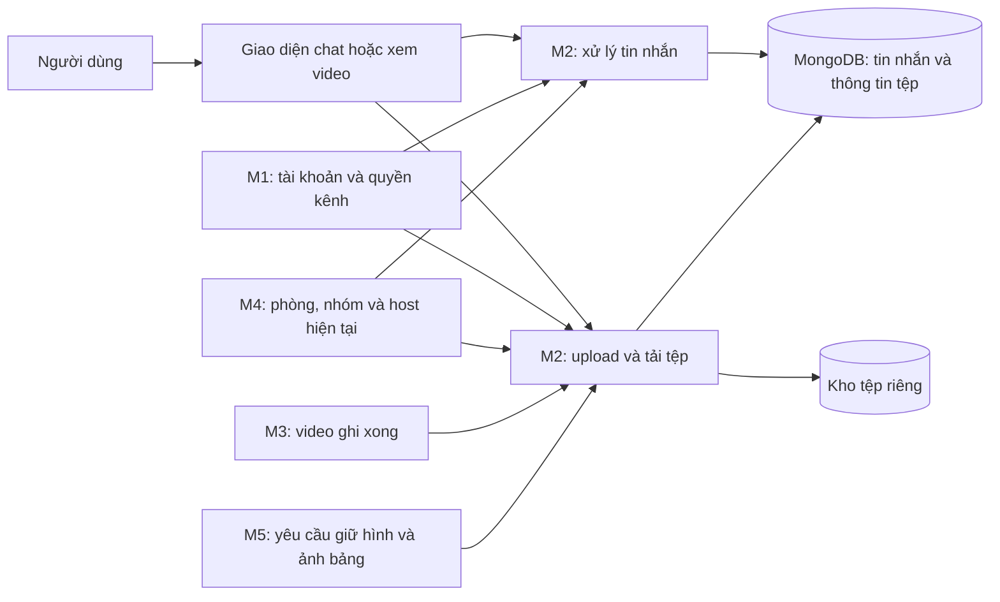
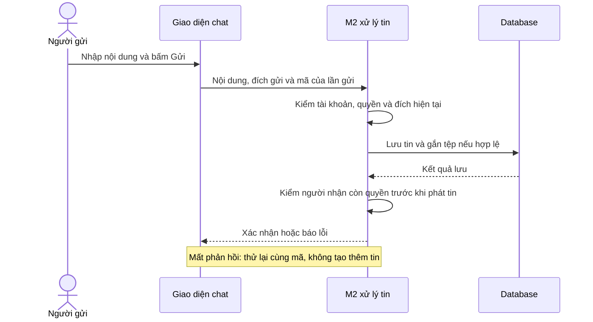

# M2 — Chat, tệp và xem lại bản ghi

**Status:** Draft để review · **Ngày:** 03/11/2026 · **Người phụ trách:** Minh Quân 15 · **Reviewer cần phối hợp:** M1, M4; M3/M5 review điểm giao · **Size đề xuất:** XL, chia thành nhiều task và kiểm lại sau phần tích hợp đầu tiên.

> **Tóm tắt** — Xây phần nhắn tin trong kênh TEXT, tin nhắn riêng 1–1, trả lời theo thread và chat trong cuộc họp. Người dùng có thể gửi văn bản, ảnh, tệp; đọc lại lịch sử; thử gửi lại khi lỗi mà không tạo hai tin giống nhau.
>
> M2 làm giao diện chat, lưu tin nhắn và quản lý tệp. M1 cung cấp tài khoản và quyền truy cập kênh; M4 xác định người dùng đang ở phòng nào và ai đang là host. M3 cung cấp khung cuộc gọi và chức năng ghi hình; M5 cung cấp phần giữ hình, vẽ và ảnh chụp bảng. M2 cũng làm phần lưu và xem lại video đúng quyền.
>
> Phạm vi có 11 yêu cầu chức năng chính. Task và ước lượng ở cuối dùng để team thảo luận, chưa phải lịch cam kết. Proposal này mô tả cách làm, chưa triển khai chức năng hoặc thay cấu trúc dữ liệu thực tế.

## 1. Context

CoLearnia có hai nhu cầu trao đổi khác nhau. Ngoài giờ học, thành viên nhắn tin và gửi tài liệu trong Workspace. Trong buổi học, họ cần nói chuyện bằng tin nhắn với phòng hiện tại hoặc hỏi riêng host. Hai phần có thể dùng chung cách lưu tin và tệp, nhưng không có cùng quyền đọc và thời gian lưu.

Ví dụ: rời cuộc gọi không làm mất lịch sử DM. Ngược lại, một người đã về MAIN không được tiếp tục mở chat của nhóm nhỏ chỉ vì vẫn nhớ đường dẫn cũ.

Theo [phân chia miền](../product/delivery-domains.md), M2 phụ trách chat, tệp và xem lại bản ghi. Yêu cầu nghiệm thu lấy từ [FR/AC](../product/functional-requirements.md), [messaging](../product/messaging.md), [chat họp và hỗ trợ](../product/groups-media-policy.md), [recording](../product/recording.md). Thiết kế dùng chung theo [kiến trúc](../architecture.md), [dữ liệu](../database/collection-design.md), [vòng đời dữ liệu](../database/lifecycle.md), [quy tắc nhất quán](../database/integrity-and-migrations.md) và [sức chứa](../capacity.md).

Source hiện có mới là bộ khung: web có màn trạng thái, server có các đường kiểm tra hoạt động, kết nối realtime chưa cho vào khi chưa có xác thực. Chưa có màn chat, xử lý tin nhắn, upload/download hoặc trang xem lại video. Các thiết kế trong tài liệu chưa chứng minh các chức năng này đã chạy.

## 2. Objective

Thành viên gửi được nội dung đến đúng người, tìm lại được cuộc trao đổi và biết tin đã gửi thành công hay chưa. Người không còn quyền phải bị chặn cả tin nhắn mới, lịch sử và tệp đang tải. Video đã ghi xong có thể xem lại trong đúng phiên/kênh, thay vì chia sẻ bằng một đường dẫn công khai.

## 3. Goals / Non-goals

| Goal | Kết quả                                                                                                 | FR chính / phối hợp                             |
| ---- | ------------------------------------------------------------------------------------------------------- | ----------------------------------------------- |
| G1   | Nhắn văn bản, ảnh, tệp trong TEXT; đọc lịch sử theo trang và đúng thứ tự                                | FR-04-01, FR-04-03; M1                          |
| G2   | Hiện đang gửi/thành công/lỗi; thử lại không nhân tin, không âm thầm đổi nội dung tin đã gửi             | FR-04-02                                        |
| G3   | Upload, gắn tệp vào tin và tải xuống đúng quyền; kiểm dung lượng, loại tệp và dọn tệp bỏ dở             | FR-04-04                                        |
| G4   | DM đúng hai người trong cùng Workspace; mất quyền thì chặn, gia nhập lại hợp lệ thì đọc lịch sử còn lưu | FR-12-01, FR-12-02; M1                          |
| G5   | Trả lời một cấp trong TEXT; có số trả lời, lịch sử riêng; không đẩy mọi câu trả lời vào dòng chat chính | FR-13-01, FR-13-02                              |
| G6   | Chat họp gửi đến Everyone của phòng hiện tại hoặc đúng host; không lộ tin giữa các nhóm                 | FR-09-01, FR-09-02; M3/M4                       |
| G7   | Cung cấp phần lưu ảnh giữ hình cho M5 và phần lưu/xem video cho M3; mỗi loại dùng đúng quyền của nó     | FR-15-03 và phần phối hợp FR-04-04; M1/M3/M4/M5 |

**Ngoài phần M2 tự triển khai:** đăng nhập/quản lý thành viên, điều hành nhóm, truyền mic/camera và công cụ vẽ. M2 vẫn phải nối các phần này để luồng người dùng chạy đầy đủ.

Bản đầu không thêm DM nhóm, DM xuyên Workspace, thread trong DM/chat họp, sửa/xóa tin, biểu cảm, trạng thái đang gõ hoặc thông báo đã đọc. Không biến ảnh bảng thành thư viện bài làm. Không làm lại bộ ghi hình của M3 và không tự thêm Redis hay nhiều server chạy song song.

## 4. Các điểm cần thống nhất

Các bên thống nhất phần giao tiếp trước khi code phụ thuộc. Trong thời gian chờ, M2 vẫn có thể làm giao diện hoặc thử các luồng chat/tệp độc lập. Những quy tắc sản phẩm đã chốt tiếp tục theo nguồn hiện hành.

| ID  | Nội dung cần thống nhất                                                                                                                        | Bên phối hợp                                                     | Cần chốt trước                |
| --- | ---------------------------------------------------------------------------------------------------------------------------------------------- | ---------------------------------------------------------------- | ----------------------------- |
| Q1  | M1 trả thông tin người dùng/quyền kênh thế nào; M2 tham gia tạo general cùng Workspace ra sao; cách báo khi người dùng bị gỡ quyền.            | Minh Quân 15 – Minh Quân 16                                      | T2–T4                         |
| Q2  | M4 cung cấp phòng hiện tại, nhóm, host, giờ kết thúc và thông báo chuyển phòng thế nào; khi đóng nhóm, M2 phải dọn xong những gì.              | Minh Quân 15 – Hoàng Quân                                        | T6                            |
| Q3  | Cho phép những loại tệp nào; dùng thư viện nào để nhận upload và kiểm nội dung ảnh/tệp; cách báo lỗi cho người dùng.                           | Minh Quân 15; Minh Quân 16 review phần quyền                     | T3                            |
| Q4  | Vị trí panel chat trong cuộc gọi; vị trí danh sách video; định dạng video và cách hỗ trợ phát/tua trên trình duyệt.                            | Minh Quân 15 – Việt                                              | T5/T6/T9                      |
| Q5  | Ai giữ thông tin bản ghi; dữ liệu M3 bàn giao cho M2; giới hạn dung lượng/thời lượng, thời gian lưu, quyền xóa và xử lý video dở dang khi lỗi. | Minh Quân 15 – Việt; Hoàng Quân và Minh Quân 16 review điểm giao | Trước lưu/xem video thật ở T9 |
| Q6  | M5 cấp yêu cầu giữ hình và xác nhận ảnh còn được dùng thế nào; khi trở lại hình trực tiếp hoặc đóng nhóm thì thông báo dọn ảnh ra sao.         | Minh Quân 15 – Minh                                              | T7                            |
| Q7  | Giới hạn lượt gửi/tải đang xử lý, thời gian chờ, dung lượng máy thử và cách từ chối khi quá tải.                                               | Minh Quân 15 cùng các miền                                       | Trước kiểm tải T11            |

**Điểm cần đồng bộ với mẫu M3 được cung cấp:** mẫu mô tả ghi hình tiếp tục qua đổi host, các đoạn video riêng sau mỗi lần Dừng/Record và hướng dùng GStreamer để tạo video ở server. File recording.md trong checkout này chưa ghi đầy đủ các cập nhật đó. M2 đưa các nội dung này vào phần phối hợp Q4/Q5; trước khi triển khai phần phụ thuộc cần thống nhất và cập nhật nguồn chung. Viết lại proposal không tự thay quyết định recording trong repo.

## 5. High-level design

Dùng một phần xử lý chat và một phần xử lý tệp chung cho cả ứng dụng. Khác biệt nằm ở việc người này có được đọc/gửi vào hội thoại đó ngay lúc này không.

MongoDB lưu tin nhắn và thông tin về tệp; nội dung ảnh/tệp/video nằm ở kho riêng trên máy chủ. Không đưa video vào database hoặc gửi tệp qua Socket.IO. Socket.IO dùng để gửi lệnh và nhận tin mới; HTTP dùng cho lịch sử và truyền tệp.

Giao diện dùng chung ô soạn tin, danh sách tin, phần đính kèm và thông báo lỗi. TEXT có thêm panel thread; DM có danh sách riêng; chat họp nằm trong khung cuộc gọi M3. M2 không dựng thêm một trang gọi khác.

**Các lựa chọn đã cân nhắc:** tách mỗi loại chat thành một hệ thống riêng sẽ lặp cách gửi lại và quản lý tệp; lưu chat họp chỉ trong bộ nhớ sẽ không khớp thiết kế lịch sử hiện có. Vì vậy dùng chung nền lưu tin, kiểm quyền riêng cho từng loại. Tệp đi qua đường tải có xác thực, thay vì đường dẫn công khai mà ai biết cũng mở được.

## 6. Detailed design

### 6.1. Dữ liệu và trách nhiệm

Một **hội thoại** là nơi chứa tin nhắn, chẳng hạn chat của một kênh, một cặp DM hoặc một nhóm trong cuộc họp. **Thread** là chuỗi trả lời gắn với một tin gốc. **Thông tin tệp** gồm người tải lên, dung lượng, loại tệp, tệp thuộc hội thoại nào và khi nào được dọn; không phải toàn bộ nội dung tệp.

| Nơi lưu          | Nội dung                                                             | Điều cần giữ đúng                                                                      |
| ---------------- | -------------------------------------------------------------------- | -------------------------------------------------------------------------------------- |
| `conversations`  | Hội thoại của kênh TEXT, cặp DM, MAIN, nhóm hoặc cặp người dùng–host | Mỗi nơi/cặp chỉ có một hội thoại tương ứng. Hai người ở hai Workspace có hai DM riêng. |
| `messages`       | Người gửi, nội dung, thời gian, tệp đính kèm, tin gốc nếu là trả lời | Người gửi lấy từ đăng nhập. Trả lời phải thuộc đúng tin gốc trong cùng kênh.           |
| `files`          | Thông tin tệp, nơi lưu nội bộ, trạng thái, quyền và lịch dọn         | Một tệp chỉ gắn một đích. Ảnh giữ hình không tự biến thành tệp đính kèm chat.          |
| Kho tệp riêng    | Nội dung ảnh, tài liệu và video                                      | Không mở công khai; mỗi lần tải đều kiểm quyền.                                        |
| Bộ nhớ đang chạy | Các lượt upload/download và kết nối nhận tin đang mở                 | Dùng để hủy khi mất quyền, không dùng thay dữ liệu thành viên/nhóm của M1/M4.          |

M1 tạo Workspace, owner, kênh general và hội thoại của kênh trong cùng một lần lưu: hoặc có đủ, hoặc không tạo phần nào. M2 cung cấp thao tác tạo hội thoại cho M1 dùng, không tạo general bằng một yêu cầu chạy sau.

Giữ cấu trúc và các ràng buộc đã có trong [thiết kế DB](../database/collection-design.md). Database cần ngăn trùng cặp DM, trùng hội thoại theo phòng/nhóm và trùng lần gửi. Lưu tin có tệp hoặc trả lời thread phải hoàn tất cùng việc gắn tệp/cập nhật số trả lời; lỗi giữa chừng không để lại tin thành công nhưng thiếu tệp.

Recording là phần dữ liệu mới cần M2–M3 thống nhất ở 6.5. Không coi 13 collection trước recording đã đủ cho video. Khi triển khai có thay cấu trúc dữ liệu phải kiểm dữ liệu hiện có và có kế hoạch chuyển đổi/khôi phục riêng; proposal này không chạy các thao tác đó.

### 6.2. Gửi tin, đọc lịch sử và thử lại

**Gửi tin:** người dùng bấm Gửi → giao diện hiện Đang gửi → server kiểm quyền và nội dung → lưu tin cùng tệp nếu có → xác nhận thành công và gửi tới người được đọc. Chỉ hiển thị thành công sau khi có kết quả lưu xác định.

**Thử lại:** mỗi lần gửi có một mã `clientMessageId`. Nếu mạng đứt sau khi server đã lưu nhưng trước lúc giao diện nhận được phản hồi, thử lại bằng cùng mã sẽ trả về tin đã có. Nếu cùng mã nhưng nội dung khác, server báo xung đột thay vì ghi đè tin cũ. Kiểm quyền cả khi trả lại tin đã lưu; mã cũ không giúp đọc nội dung sau khi bị gỡ quyền.

Về kỹ thuật, khóa chống trùng gồm hội thoại + người gửi + mã lần gửi. Khi có tệp hoặc tăng số trả lời, các bước lưu chạy trong cùng transaction, tức cùng thành công hoặc cùng hủy. Nếu chưa biết lần lưu đã thành công hay chưa, server tra lại theo mã trước khi kết luận; không tự tạo tin mới hoặc báo chắc chắn thất bại.

**Lịch sử và thread:** tải từng trang, tối đa 50 tin/trang theo cấu hình hiện tại; đề xuất mặc định 30. Mốc tải tiếp dựa trên thời gian và ID tin để các tin cùng thời điểm vẫn có thứ tự ổn định. Dòng chính của TEXT chỉ có tin gốc; trả lời nằm trong panel thread, có lịch sử riêng và số trả lời. Thử lại không tăng số trả lời hai lần. Không cho lấy tin của kênh khác hoặc một câu trả lời làm gốc mới.

**Kết nối lại:** kiểm quyền hiện tại rồi tải bù lịch sử, không phát lại toàn bộ tin riêng từ kết nối cũ. Tin nhận được qua cả phản hồi gửi và thông báo realtime chỉ hiện một lần. Không lưu nội dung private hay dữ liệu upload nhạy cảm vào localStorage trong bản đầu.

### 6.3. Upload, tải xuống và dọn tệp

Luồng upload có hai bước khác nhau: tải tệp lên máy chủ và gắn tệp đó vào tin nhắn. Upload xong chưa có nghĩa tệp đã thuộc một tin gửi thành công.

1. **Kiểm tra và giữ chỗ dung lượng:** xác thực người gửi, hội thoại đích, loại/kích thước được phép. Server ghi nhận quyền hiện tại và phần dung lượng dành cho lượt upload.
2. **Nhận tệp:** truyền từng phần vào kho riêng, kiểm kích thước trong lúc nhận. Kiểm loại tệp từ nội dung thực tế, không chỉ tin tên hoặc thông tin trình duyệt gửi lên. Ảnh phải kiểm đọc được và kích thước hợp lệ.
3. **Kiểm lại khi upload xong:** nếu quá hạn, người dùng mất quyền hoặc quyền đã thay đổi so với lần cấp upload thì hủy lượt cũ và yêu cầu tải lại. Không tự cấp quyền mới cho tệp đang chờ.
4. **Gắn vào tin:** khi bấm Gửi, kiểm đúng người upload/đúng hội thoại rồi lưu tin cùng việc gắn tệp. Hai tin tranh cùng một tệp thì chỉ một tin được dùng.
5. **Dọn khi lỗi hoặc bỏ dở:** hủy lượt ghi đang chạy, đánh dấu tệp cần xóa và dọn nội dung trước khi bỏ thông tin quản lý tệp.

Các trạng thái lưu trữ dùng theo thiết kế: `STAGED` là tệp tạm chưa gắn đích, `READY` là tệp đã gắn hợp lệ, `DELETE_PENDING` là chờ dọn. Trạng thái READY không tự cấp quyền đọc.

**Giới hạn khởi đầu:** 4.000 ký tự/tin, đếm thống nhất cả ký tự như emoji; tối đa 4 tệp/tin, 10 MiB/tệp, 500 MiB/Workspace và 2 lượt upload/người cùng lúc. Ảnh giữ hình tối đa 1920×1080, 2 MiB/ảnh; 20 MiB/phiên là cấu hình thử nhỏ. Video recording cần giới hạn riêng, không áp các mức này một cách máy móc.

**Tải xuống:** server kiểm quyền mỗi lần mở tệp, tải lại hoặc yêu cầu một đoạn video để tua. Tải đang mở được theo dõi để có thể dừng khi người dùng bị gỡ quyền, hết phiên đăng nhập hoặc nhóm đóng. Không giữ khóa xử lý chung trong suốt lượt tải. Nội dung không được phép chạy trực tiếp như mã trang web; cách kiểm loại tệp/thư viện cụ thể chốt ở Q3. Những byte đã gửi hoặc bản người dùng đã tải không thể thu hồi.

**Dung lượng và dọn tệp:** tính cả phần đang giữ chỗ và tệp chưa xóa xong; không trả dung lượng trong khi nội dung vẫn nằm trên disk. Sau sự cố phải đối chiếu database với kho tệp trước khi nhận upload mới ở phần chưa kiểm xong. Tác vụ dọn chạy lại không được trừ dung lượng thêm hoặc báo lỗi chỉ vì tệp đã xóa ở lần trước.

Theo [vòng đời hiện hành](../database/lifecycle.md), tác vụ dọn chạy khởi đầu mỗi 60 giây; upload bỏ dở quá 15 phút được dọn; ảnh giữ hình hết tham chiếu dọn sau khoảng chờ tối đa 5 phút. Chat riêng trong cuộc họp khóa ngay khi đóng và dọn sau 24 giờ. Tệp kênh/Workspace bị xóa dọn sau 7 ngày khi không còn được dùng. Đây là cấu hình khởi đầu, không tự áp cho recording. Khi dọn thread, dọn trả lời trước tin gốc và giữ đủ thông tin để tiếp tục nếu máy chủ dừng giữa chừng.

**Phối hợp M5:** M5 quyết định nhóm có được giữ ảnh đó không và ảnh còn đang dùng không; M2 quản lý việc lưu/tải/dọn ảnh. MAIN không có freeze nên không tạo ảnh giữ hình MAIN. Nếu muốn gửi ảnh bảng vào chat, tạo một tệp đính kèm riêng; không lấy tệp giữ hình đang dùng rồi đổi quyền. Người rời nhóm không làm ảnh của những người còn lại bị xóa.

### 6.4. Quyền chat và thay đổi phòng/nhóm

| Nơi trao đổi        | Ai được đọc/gửi/nhận tin và tải tệp?                                                                                                                  |
| ------------------- | ----------------------------------------------------------------------------------------------------------------------------------------------------- |
| TEXT                | Thành viên còn quyền kênh. PRIVATE cần được cấp quyền riêng; owner/admin ngoài danh sách không tự đọc được nội dung. Thread theo cùng quyền của kênh. |
| DM                  | Đúng hai người, cả hai còn là thành viên hợp lệ của Workspace. Admin không có quyền đọc thay.                                                         |
| Everyone tại MAIN   | Người hiện ở MAIN trong phiên còn hoạt động; không gửi sang mọi nhóm.                                                                                 |
| Everyone trong nhóm | Người thực sự đang ở đúng nhóm còn mở; có tên trong danh sách dự kiến chưa đủ quyền. Host chỉ đọc khi hỗ trợ đúng ACTIVITY.                           |
| Host riêng          | Người gửi và đúng host nhận ban đầu; phiên còn hoạt động và cả hai còn quyền kênh. Host mới không nhận lịch sử của cặp cũ.                            |

Chat họp chỉ có văn bản/ảnh, không có tệp bất kỳ hoặc thread. Khi đổi nhóm hay đổi host trong lúc người dùng đang soạn/upload, server báo đích cũ không còn hợp lệ để người dùng xác nhận lại. Không tự chuyển câu hỏi riêng thành Everyone hoặc gửi sang host mới. Host cũ vẫn đọc phần gửi cho mình theo quyền đã chốt khi phiên còn hoạt động, nhưng không nhận câu hỏi mới chỉ vì từng là host.

DISCUSSION tạo ngay khi hợp lệ, từng người chủ động bấm vào; chưa vào thì chưa được đọc chat nhóm. Nhóm chưa ai vào vẫn chờ. Khi người cuối cùng chủ động rời một DISCUSSION đã có người, nhóm đóng và chat/ảnh bị khóa; mất mạng không tự coi là chủ động rời. ACTIVITY không đóng theo số người còn lại. Host không vào hỗ trợ DISCUSSION, mà hỏi/trả lời qua chat riêng khi ở MAIN.

**Khi bị thu quyền:** M1/M4 xác định thay đổi → chặn truy cập cũ → M2 ngừng phát tin, hủy upload/download liên quan và bỏ đăng ký nhận tin → giao diện bỏ dữ liệu riêng cũ → chỉ mở nội dung mới sau khi kiểm quyền. Nếu dọn chưa xong hoặc lưu quyền lỗi, giữ phần đã thu ở trạng thái chặn và kiểm tra lại; không báo hoàn tất giả.

DM giữ cùng hội thoại sau khi một người rời rồi gia nhập lại Workspace, nhưng chỉ mở khi cả hai tư cách thành viên đều hợp lệ. Quyền PRIVATE cũ không tự phục hồi, owner/admin phải thêm lại. Rời cuộc gọi không đóng lịch sử DM.

Phần kỹ thuật dùng cùng thứ tự xử lý đã chốt: quyền tài khoản nếu cần → Workspace → kênh → phiên. Không tạo một khóa riêng của M2 chạy trái thứ tự M1/M4; không giữ hàng đợi xử lý phiên khi chờ upload hoặc người dùng. Kiểm quyền trước lưu và trước phát tin. Với ACTIVITY, nếu hết giờ trong lúc chờ database thì không phát tin/cấp lại quyền nhóm cũ, dù tin có thể đã được lưu; xử lý kết quả và dọn theo vòng đời đã thống nhất.

### 6.5. Lưu và xem lại recording

M3 tạo video từ nội dung MAIN; M2 nhận kết quả để lưu và cho xem lại. Người xem cần còn là thành viên Workspace và còn quyền kênh LIVE hiện tại, kể cả PRIVATE. Từng tham gia buổi học hoặc biết URL không đủ quyền.

**Đề xuất trách nhiệm:** M2 làm đầu mối thiết kế thông tin bản ghi và kho tệp; M3 điều khiển quá trình ghi/xử lý và bàn giao kết quả. M4 cung cấp phiên/host hiện hành; M1 cung cấp quyền kênh. Đây là phần cần các bên review ở Q5, không phải cấu trúc DB đã chốt.

| Thông tin cần quản lý                                  | Mục đích                                                                                                   |
| ------------------------------------------------------ | ---------------------------------------------------------------------------------------------------------- |
| Mã bản ghi, Workspace, kênh và phiên gốc               | Tìm đúng video và kiểm quyền xem. Một phiên có thể có nhiều đoạn theo hướng mô tả của M3.                  |
| Người bắt đầu và các mốc thời gian                     | Hiển thị bản ghi nào, bắt đầu/kết thúc lúc nào; người bắt đầu không trở thành người duy nhất có quyền xem. |
| Đang ghi / đang xử lý / sẵn sàng / lỗi                 | Không cho xem như video hoàn chỉnh khi còn đang ghi hoặc xử lý lỗi.                                        |
| Tệp video, định dạng, thời lượng và dung lượng đã kiểm | Phát và tua đúng; theo dõi dung lượng thực tế.                                                             |
| Mã lần yêu cầu/xử lý và thông tin dọn tệp              | M3 gửi lại cùng kết quả không sinh thêm video; theo dõi và dọn được phần bỏ dở.                            |

Mẫu M3 đề xuất tách thông tin quá trình ghi vào `recordings`, còn nội dung video do kho tệp chung quản lý. M2 cần cùng Việt review phương án này, tên trường và ràng buộc dữ liệu; không tự thêm collection hoặc đổi loại ATTACHMENT/FRAME chỉ từ tài liệu đề xuất.

Luồng xem: mở phiên/kênh → xem danh sách bản ghi được phép → chọn video đã sẵn sàng → server kiểm quyền rồi phát. Mỗi yêu cầu tua/tải thêm đều kiểm quyền; bị gỡ PRIVATE trong lúc xem thì dừng truyền và chặn lần tải sau. Không trả đường dẫn tệp thật hoặc link công khai.

Chỉ đánh dấu sẵn sàng sau khi M3 hoàn tất tệp và M2 xác nhận nội dung/thông tin lưu hợp lệ. Lỗi lưu không làm kết thúc cuộc gọi. Không giữ cả video dài trong RAM hoặc khóa phiên khi chờ xử lý. Video dở sau lỗi/restart chưa được coi là xem được; cách giữ, cứu hoặc xóa phải theo Q5, không tự xóa hay khôi phục quá trình ghi.

Giới hạn dung lượng, thời gian lưu, quyền xóa, số video xử lý cùng lúc và cách xử lý khi hết disk cần chốt trước lưu thật. Kiểm clip vài phút để chứng minh luồng chạy, không coi đó là giới hạn thời lượng sản phẩm.

### 6.6. API và thông báo giữa các phần

API là cách giao diện gọi server để gửi/lấy dữ liệu. Socket.IO giúp server báo tin mới ngay khi có thay đổi. Bảng dưới giữ tên đường dẫn cho team triển khai; người đọc sản phẩm chỉ cần xem cột chức năng và điều kiện.

Các đường dẫn dùng tiền tố `/api/v1`. Tên có trong plan tiếp tục được dùng; tên sự kiện và API recording bổ sung là đề xuất cần review, chưa có nghĩa đã tồn tại trong code.

| API / lệnh                                                                  | Chức năng                                            | Điều kiện chính                                                           |
| --------------------------------------------------------------------------- | ---------------------------------------------------- | ------------------------------------------------------------------------- |
| `GET /channels/:cid/messages`                                               | Lấy từng trang tin gốc của TEXT                      | Còn quyền kênh; không trộn trả lời thread vào dòng chính.                 |
| `POST /channels/:cid/messages`                                              | Gửi tin hoặc trả lời thread                          | Có mã lần gửi; tin gốc/tệp đúng hội thoại.                                |
| `POST /workspaces/:wid/direct-conversations`                                | Mở hoặc tìm lại DM với một người                     | Cả hai còn là thành viên hợp lệ; không tạo DM trùng.                      |
| `GET /workspaces/:wid/direct-conversations`                                 | Lấy danh sách DM của mình                            | Không trả thông tin cặp khác.                                             |
| `GET /conversations/:id/messages`                                           | Đọc lịch sử theo loại hội thoại                      | Quyền hiện tại; chat họp phải còn mở và đúng phòng/nhóm.                  |
| `POST /conversations/:id/messages`                                          | Gửi DM theo plan                                     | Cùng xử lý gửi tin, không mở cách đi vòng quyền chat họp.                 |
| `GET /channels/:cid/messages/:mid/replies`                                  | Lấy trả lời của một tin gốc                          | TEXT, cùng kênh, không thread lồng nhau.                                  |
| `POST /files`, `GET /files/:fid/content`                                    | Upload và tải tệp                                    | Kiểm người gửi/đích/dung lượng; tải kiểm quyền mỗi lần.                   |
| `POST /sessions/:sid/freeze-frames`, `GET /sessions/:sid/boards/:bid/frame` | Lưu/tải ảnh giữ hình của nhóm                        | M5 xác nhận yêu cầu và ảnh còn được dùng; không áp MAIN.                  |
| `message.send`                                                              | Gửi tin qua kết nối realtime                         | Dùng cùng xử lý với REST; chat họp phải kiểm phòng/host dự kiến còn đúng. |
| Đề xuất: `conversation.subscribe`, `conversation.unsubscribe`               | Đăng ký/ngừng nhận tin của hội thoại                 | Server kiểm quyền, không tin ID client tự gửi.                            |
| Đề xuất: `message.created`, `conversation.invalidated`                      | Báo tin mới hoặc yêu cầu bỏ nội dung không còn quyền | Chỉ gửi cho đúng người; dữ liệu từ phòng cũ không được mở lại.            |
| Đề xuất: `GET /sessions/:sid/recordings`, `GET /recordings/:rid/content`    | Liệt kê và phát video                                | Quyền kênh hiện tại; nội dung chỉ mở khi video sẵn sàng.                  |

Tin gửi gồm mã lần gửi, nội dung và ID tệp; thread có thêm tin gốc. Chat họp có thông tin phòng/host và phiên bản trạng thái dự kiến để server phát hiện đích đã đổi. Danh tính, vai trò và quyền luôn lấy từ server, không nhận theo lời khai của client.

Dữ liệu đầu vào được kiểm chặt bằng Zod trong `packages/contracts`. Các bên thống nhất dữ liệu gửi/nhận, lỗi và ví dụ thành công/sai quyền/trạng thái cũ trước khi làm phần phụ thuộc. Phản hồi theo cấu trúc chung của [contracts](../contracts/README.md), có mã yêu cầu để tra lỗi; không trả lỗi database thô. Phân biệt chưa đăng nhập, không đủ quyền, đích đã đổi, quá dung lượng và quá nhiều yêu cầu để giao diện báo rõ.

### 6.7. Triển khai từng phần và theo dõi

Làm lần lượt: TEXT + tệp → DM/thread → chat họp → ảnh giữ hình → xem lại video khi M3 sẵn sàng. Mỗi phần có cả giao diện, xử lý và kiểm thử để demo sớm. Không chờ đến cuối mới thêm thu quyền hoặc dọn tệp.

Giữ cấu hình khởi đầu 5 tin/giây/người, cho phép đợt ngắn tối đa 10 tin; upload 2 lượt/người. Tổng số yêu cầu chờ, lượt tải đang mở, thời gian chờ và kết nối DB phải có giới hạn được review trước kiểm tải. Không tạo một kết nối DB cho mỗi người. Khi quá tải phải còn xử lý được gỡ quyền/đóng nhóm, không để chúng mắc sau một hàng đợi chat vô hạn.

Theo dõi thời gian gửi/lưu tin, số lần thử lại, lượt bị từ chối quyền, thời gian chờ xử lý, dung lượng đã dùng/đang giữ, số upload/download đang mở, disk còn trống và tệp dọn chậm. Với recording, theo dõi thêm thời gian hoàn tất và lỗi lưu. Log dùng mã yêu cầu/tin/tệp, không ghi nội dung DM, ảnh, video hoặc thông tin đăng nhập.

Nếu cần quay lại bản cũ: ngừng nhận thao tác mới ở phần lỗi, dừng tài nguyên liên quan và giữ đủ dữ liệu để đối chiếu. Kiểm bản cũ có hiểu dữ liệu mới trước khi dùng lại; không xóa collection/tệp để xử lý nhanh. Thay đổi môi trường hoặc chuyển đổi dữ liệu cần ghi trong PR implementation, proposal hiện chưa đổi cấu hình chạy.

### 6.8. Test strategy và kiểm tích hợp

Mỗi task kiểm cả luồng đúng, luồng bị từ chối và lỗi. Bảng này là kế hoạch, chưa phải kết quả đã đạt.

| Nhóm kiểm                | Ca chính / kết quả bắt buộc                                                                                                                                                                                 | Goals        |
| ------------------------ | ----------------------------------------------------------------------------------------------------------------------------------------------------------------------------------------------------------- | ------------ |
| TEXT và lịch sử          | Tạo general đầy đủ cùng Workspace; gửi text/ảnh/file; tải nhiều trang đúng thứ tự, không lẫn trả lời vào dòng chính.                                                                                        | G1/G3        |
| Thử lại và lưu đồng thời | Mất phản hồi rồi thử lại chỉ có một tin; đổi nội dung cùng mã bị báo lỗi; hai tin dùng một tệp chỉ một thắng; lỗi lưu không để tin thiếu tệp.                                                               | G2/G3        |
| DM                       | Hai người mở cùng lúc vẫn một DM; người thứ ba/admin biết ID cũng không đọc; mất tư cách thành viên bị chặn, gia nhập lại hợp lệ mở lịch sử còn lưu.                                                        | G4           |
| Thread                   | Chỉ trả lời tin gốc cùng TEXT; không tạo thread trong DM/chat họp; thử lại không tăng số trả lời hai lần.                                                                                                   | G5           |
| Quyền kênh/tệp           | Owner/admin ngoài PRIVATE bị chặn; gỡ người đang gửi/tải thì dừng; thêm lại không cứu lượt upload cũ nhưng đọc được tệp lịch sử còn lưu theo quyền mới.                                                     | G1/G3/G5     |
| Chat họp                 | Everyone MAIN không sang nhóm; nhóm A không nhận nhóm B; host mới không thấy lịch sử cặp cũ; chuyển nhóm khi đang gửi không đổi đích tự động.                                                               | G6           |
| Nhóm và kết nối lại      | Danh sách dự kiến chưa vào nhóm không cấp quyền chat; host không vào chat DISCUSSION; người cuối chủ động rời đóng nhóm; hết giờ ACTIVITY hoặc kết nối lại không mở quyền cũ. Thử DB chậm đúng lúc hết giờ. | G6           |
| Upload và dọn tệp        | Loại tệp giả/quá hạn/quá dung lượng/disk đầy; máy chủ dừng giữa upload hoặc giữa lượt dọn; chạy dọn lại không mất tệp còn dùng hoặc tính sai dung lượng.                                                    | G3           |
| Ảnh giữ hình             | MAIN bị từ chối; nguồn đổi trước khi chốt ảnh bị báo lỗi; một người rời không xóa ảnh của nhóm; ảnh gửi chat là tệp riêng.                                                                                  | G7, M5       |
| Recording                | M3 ghi/dừng/xử lý → đúng một video xem/tua được; chưa xong không báo sẵn sàng; bị gỡ quyền đang xem thì dừng tải; lỗi/restart xử lý theo Q5.                                                                | G7, FR-15-03 |
| Tải kết hợp              | Chat, upload, giữ hình, dọn tệp và ghi hình cùng cuộc gọi; đo DB, thời gian chờ và disk; quá tải vẫn thu quyền được.                                                                                        | Tất cả       |

Demo M2: chat TEXT có ảnh/tệp → thử lại không trùng → trả lời thread → DM với ca người thứ ba bị chặn → chat Everyone/Host trong buổi học → chuyển nhóm/gỡ PRIVATE làm mất quyền nhận tin và tải tệp → xem clip MAIN thật khi nối được bộ ghi hình M3.

Giữ PoC 5 người, thử 25 rồi 50 nếu đạt điều kiện [capacity](../capacity.md). Dữ liệu mẫu hoặc video có sẵn chỉ giúp làm giao diện, không chứng minh luồng ghi/xem thật hay sức chứa đã đạt.

## 7. Impact on other services

Các miền cùng nằm trong một ứng dụng. Bảng ghi phần M2 cần nhận/cung cấp và người phối hợp; không có nghĩa các bên đã duyệt thiết kế.

| Miền / người phụ trách | Phần cần phối hợp với M2                                                                                                                                                       | Thứ tự và tình huống kiểm thử chung                                                                                         |
| ---------------------- | ------------------------------------------------------------------------------------------------------------------------------------------------------------------------------ | --------------------------------------------------------------------------------------------------------------------------- |
| **M1 — Minh Quân 16**  | Cung cấp người đang đăng nhập, quyền Workspace/kênh và thông báo mất quyền. M2 cung cấp tạo hội thoại general cùng lần tạo Workspace, giao diện chat/DM để ghép vào Workspace. | Q1 trước T2–T4. Kiểm tạo general lỗi không dở dang; gỡ PRIVATE khi đang gửi/tải; gia nhập lại không tự có quyền PRIVATE cũ. |
| **M2 — Minh Quân 15**  | Chủ trì chat, dữ liệu tin/tệp, upload/download, dọn tệp và xem lại video. Tổng hợp cách các miền gọi phần M2 và xử lý khi lỗi.                                                 | Chia task theo mục 9, kiểm từng phần trước khi ghép. Không triển khai lại phần quyền/nhóm của M1/M4.                        |
| **M3 — Việt**          | Cung cấp vị trí panel trong cuộc gọi và video từ phần ghi hình. M2 cung cấp component chat, lưu video, danh sách và trang xem lại có quyền.                                    | Q4/Q5 trước T6/T9. Kiểm mở chat không ngắt call; video chỉ sẵn sàng sau hoàn tất; phát/tua và thu quyền hoạt động thật.     |
| **M4 — Hoàng Quân**    | Cung cấp phòng/nhóm/host hiện tại, thời điểm hết lượt và thao tác chuyển/đóng nhóm. Gọi M2 tạo/khóa hội thoại và dừng nhận tin/tải tệp đúng lúc.                               | Q2 trước T6. Kiểm người chưa vào nhóm, đích gửi đã đổi, hết giờ khi đang lưu và kết nối lại sau đóng nhóm.                  |
| **M5 — Minh**          | Cung cấp yêu cầu giữ hình và xác nhận ảnh còn được dùng. M2 cung cấp upload/lưu/tải/dọn ảnh và gửi ảnh chụp bảng thành tệp chat riêng.                                         | Q6 trước T7. Kiểm yêu cầu cũ, nguồn đổi, trở lại hình trực tiếp và người rời nhóm; không xóa ảnh còn dùng.                  |

Phần cấu trúc dữ liệu trao đổi mới bổ sung vào `packages/contracts`; người cung cấp và người sử dụng cùng review. Nếu phải thay cấu trúc cũ, PR cần ghi rõ phần nào bị ảnh hưởng và thứ tự cập nhật. Không tự sửa mã các miền khác trong proposal này.

Mỗi điểm giao cần chốt: gửi dữ liệu gì, nhận kết quả gì, ai kiểm quyền, lúc nào hủy thao tác đang chờ và bên gọi hiển thị gì khi lỗi. Ít nhất có một ca dùng được và một ca bị từ chối để hai bên cùng kiểm trước khi coi đã ghép xong.

## 8. Design evaluation

### 8.1. Effort và tính khả thi

M2 là miền lớn vì cùng lúc có giao diện, dữ liệu, tệp và quyền thay đổi theo cuộc họp. Phần khó không chỉ là hiện tin nhắn, mà còn là gửi lại không trùng, không tải được nội dung sau mất quyền và dọn được tệp khi có sự cố.

Dùng React/Express/Socket.IO/MongoDB đã có trong dự án. Thư viện nhận upload/kiểm ảnh chọn sau Q3; không thêm hạ tầng chỉ để giảm thời gian viết code. Recording có nhiều điểm chờ M3 nên cần thử nối sớm, rồi ước lượng lại. AI hỗ trợ viết code không thay việc hiểu luồng, review và thử trên các tài khoản thật.

### 8.2. Risks

| Rủi ro                                                  | Mức ảnh hưởng        | Cách giảm rủi ro                                                                                      |
| ------------------------------------------------------- | -------------------- | ----------------------------------------------------------------------------------------------------- |
| Tin hoặc tệp riêng tới sai người                        | Cao, chặn nghiệm thu | Kiểm quyền tại server cho lịch sử/tin mới/tải tệp; thử khi đang chuyển nhóm hoặc bị gỡ quyền.         |
| Gửi lại tạo hai tin hoặc sai số trả lời                 | Cao                  | Mã lần gửi ổn định, ràng buộc chống trùng và lưu các phần liên quan cùng nhau; thử mất phản hồi.      |
| Upload/tải quá nhiều làm chậm cả gỡ quyền               | Cao                  | Giới hạn yêu cầu chờ, truyền tệp ngoài phần xử lý cần khóa; ưu tiên hoặc hủy tác vụ để thu quyền kịp. |
| Tệp bỏ dở làm đầy disk hoặc tính sai dung lượng         | Cao                  | Giữ chỗ trước upload, chỉ trả dung lượng sau dọn thật, đối chiếu sau restart.                         |
| Thay quyền kênh khiến upload đang làm phải tải lại      | Vừa                  | Báo rõ và cho thử lại bằng lượt mới; đo mức ảnh hưởng trước khi đề xuất tối ưu.                       |
| Các miền hiểu khác dữ liệu bàn giao                     | Cao                  | Review mục 7 trước code phụ thuộc, demo ghép sớm và kiểm lỗi cùng nhau.                               |
| Video phát sinh dung lượng lớn hoặc không phát/tua được | Cao                  | Chốt định dạng, giới hạn, thời gian lưu và cách bàn giao với Việt; PoC trước cam kết phần xem lại.    |

## 9. WBS

T là mã task trong proposal, không phải Issue đã tạo. Giờ dưới đây là phần chủ động của **Minh Quân 15**: thiết kế, code, kiểm thử gần thay đổi và review trong từng task. Các miền khác tự ước lượng phần của mình.

| ID  | Task và đầu ra kiểm được                                                                                 | Nơi làm chính             | Phụ thuộc                                       | Giờ M2  | Goals       |
| --- | -------------------------------------------------------------------------------------------------------- | ------------------------- | ----------------------------------------------- | ------- | ----------- |
| T1  | Review dữ liệu trao đổi, lỗi, quyền và cách các miền gọi chat/tệp/video; có ví dụ đúng/sai quyền/đích cũ | contracts/proposal        | Review M1/M3/M4/M5; phần video tiếp tục chốt Q5 | 12      | G1–G7       |
| T2  | Tạo phần lưu hội thoại/tin/tệp, chống trùng; nối tạo general cùng Workspace                              | server/database           | T1, nền tài khoản và DB M1                      | 16      | G1–G5       |
| T3  | Upload, kiểm tệp/dung lượng, gắn vào tin và tải có quyền; hủy khi mất quyền                              | server/files              | T1/T2, Q1/Q3                                    | 24      | G3          |
| T4  | Gửi/lấy lịch sử, thử lại không trùng, mở DM và cập nhật số trả lời                                       | server/messaging          | T1–T3                                           | 16      | G1/G2/G4/G5 |
| T5  | Giao diện chat, DM, thread, tải lịch sử, đính kèm và trạng thái gửi; ghép Workspace                      | web/chat                  | T1; tích hợp thật cần T3/T4                     | 24      | G1–G5       |
| T6  | Chat Everyone/Host trong khung cuộc gọi; chuyển nhóm/mất quyền/kết nối lại đúng nội dung                 | web + server              | T4/T5, Q2, khung M3 và trạng thái M4            | 20      | G6          |
| T7  | Nối ảnh giữ hình và ảnh chụp bảng với M5; kiểm yêu cầu cũ và dọn đúng ảnh                                | files + board integration | T3, Q6, quyền M4                                | 16      | G7 phần ảnh |
| T8  | Dọn tệp theo lịch, hủy lượt đang chạy, kiểm kho tệp sau restart và phối hợp đóng nhóm                    | server/lifecycle          | T3/T6/T7                                        | 12      | G3/G6/G7    |
| T9  | Lưu thông tin/video, danh sách và trang xem/tua đúng quyền; xử lý bàn giao lại và tệp lỗi                | server + web/video        | T3/T8, Q4/Q5, bộ ghi hình M3                    | 16      | FR-15-03    |
| T10 | Kiểm các luồng ghép còn lại với các miền; thử mất mạng, lỗi lưu, gỡ quyền và demo từ đầu tới cuối        | kiểm tích hợp             | T4–T9 và các phần thật của miền phối hợp        | 16      | G1–G7       |
| T11 | Đo tải cùng cuộc gọi/ghi hình, kiểm thời gian chờ/dung lượng/dọn tệp; ghi hướng dẫn thử và kết quả       | kiểm tải/tài liệu         | T8/T10, Q7 và môi trường thử sẵn sàng           | 16      | G1–G7       |
|     | **Tổng trước dự phòng**                                                                                  |                           |                                                 | **188** |             |

Không dồn kiểm thử, giới hạn và dọn tệp sang T10. Mỗi task tự có các ca cần thiết; T10 dành cho phần ghép và lỗi xuyên miền còn lại. Demo TEXT/DM/thread và chat họp ngay khi có luồng, không chờ xong video. T9 chỉ tính phần M2, cần kiểm lại nếu thiết kế lưu hoặc định dạng video thay đổi lớn.

## 10. Estimation

Ước lượng tính bằng giờ để tiện đối chiếu phần việc giữa các miền. Bảng gồm thời gian code, kiểm thử, review và dự phòng; chưa dựa trên số đo triển khai và chưa phải lịch cam kết.

| Kịch bản      | Code | Kiểm thử / tích hợp | Review / tài liệu | Dự phòng | Tổng giờ M2 |
| ------------- | ---- | ------------------- | ----------------- | -------- | ----------- |
| Thuận lợi     | 96   | 32                  | 8                 | 16       | **152**     |
| Dự kiến sơ bộ | 120  | 44                  | 24                | 36       | **224**     |
| Bất lợi       | 160  | 64                  | 32                | 64       | **320**     |

Mốc dự kiến trước dự phòng là 188 giờ, khớp WBS. Tổng 224 giờ tương đương 28 ngày công nếu làm 8 giờ/ngày. Nếu chỉ có 20 giờ/tuần thì khoảng 11,2 tuần chủ động, chưa tính chờ bên khác; vì vậy chưa thể khẳng định vừa khung 6–7 tuần khi chưa biết giờ thực tế.

Giả định quyền/tài khoản của M1, phòng/nhóm của M4 và phần M5 cần dùng được thống nhất sớm; giao diện không đổi lớn sau review. M3 bàn giao video theo cách hai bên đã chốt. Không cộng thời gian viết bộ ghi hình, truyền media hoặc quản lý phiên vào công sức M2.

Kiểm lại ước lượng sau T1, sau luồng TEXT/tệp đầu tiên và sau PoC recording. Nếu phần video còn dùng dữ liệu mẫu thì ghi rõ chưa hoàn thành FR-15-03. Khi không đủ giờ, đưa khối lượng và phụ thuộc ra để team thống nhất hỗ trợ/lịch; không tự bỏ chức năng hoặc giảm kiểm quyền.

## Appendix — Thuật ngữ và giới hạn xác minh

- **FR / AC:** yêu cầu chức năng và điều kiện dùng để kiểm chức năng đã làm đúng.
- **Thread:** chuỗi trả lời quanh một tin gốc trong TEXT.
- **API / contract:** cách các phần gọi nhau và thỏa thuận dữ liệu/lỗi giữa bên gửi, bên nhận.
- **Transaction:** nhóm thao tác lưu dữ liệu cùng thành công hoặc cùng hủy.
- **PoC:** thử nghiệm nhỏ để kiểm chứng cách làm trước khi triển khai đầy đủ.

Quyền và phạm vi theo nguồn product; dữ liệu theo [model DB](../database/model.md), chi tiết ở các nguồn đã dẫn. Phân biệt thiết kế đã chốt và phần chờ kiểm chứng theo [decision status](../decision-status.md). Mẫu M3 dùng để đối chiếu cách viết và điểm giao; không thay nguồn nghiệp vụ khi hai bên chưa đồng bộ.

Proposal chỉ sửa tài liệu M2 theo [hướng dẫn](README.md), không chứng minh chat/upload/recording đã chạy. Kết quả kiểm tài liệu ghi ở bàn giao/PR; không gán kết quả đó cho các ca sản phẩm ở mục 6.8.
