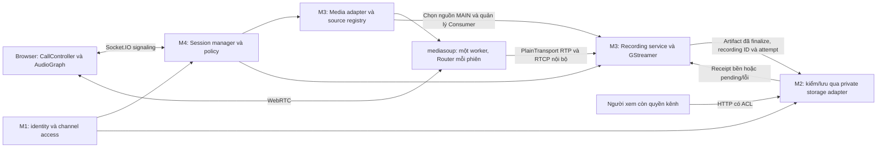
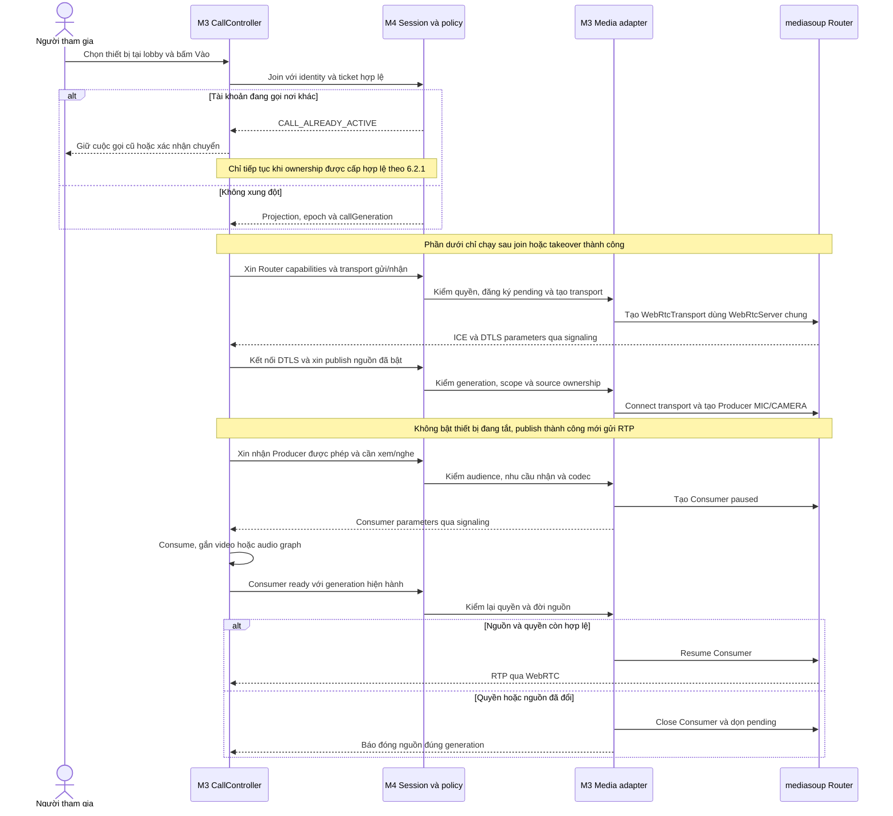
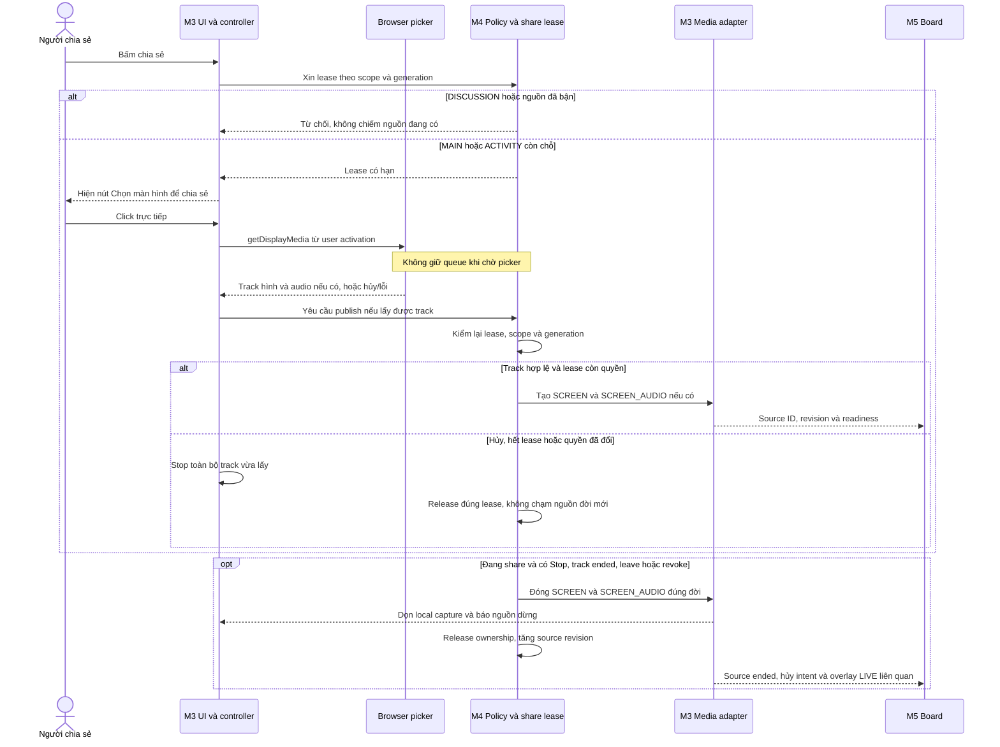
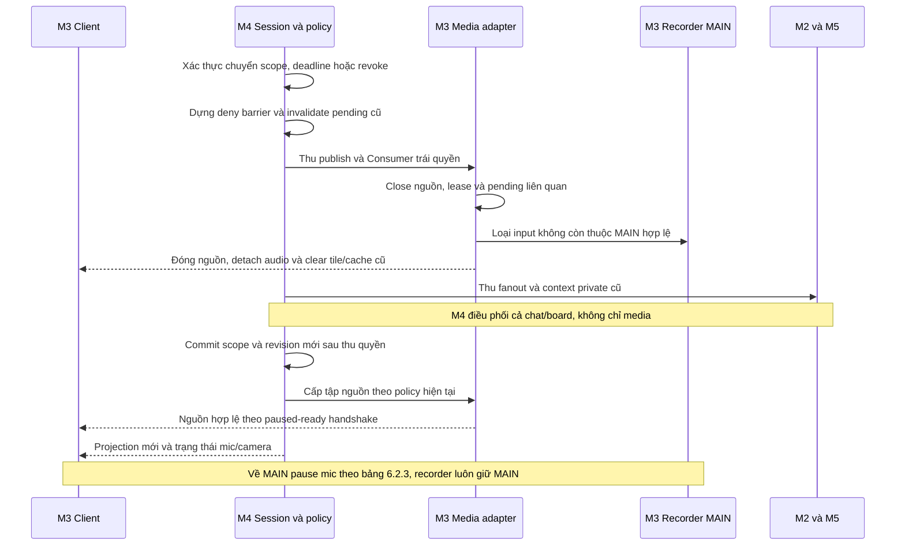
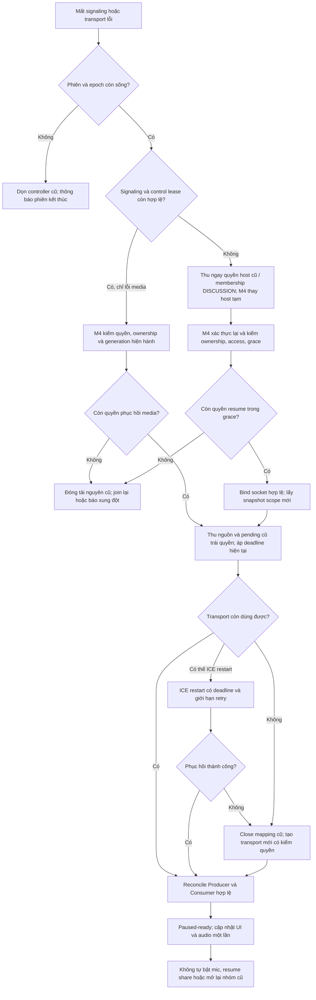
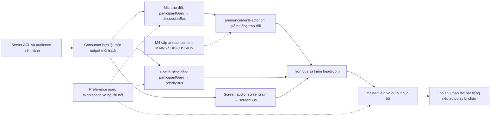
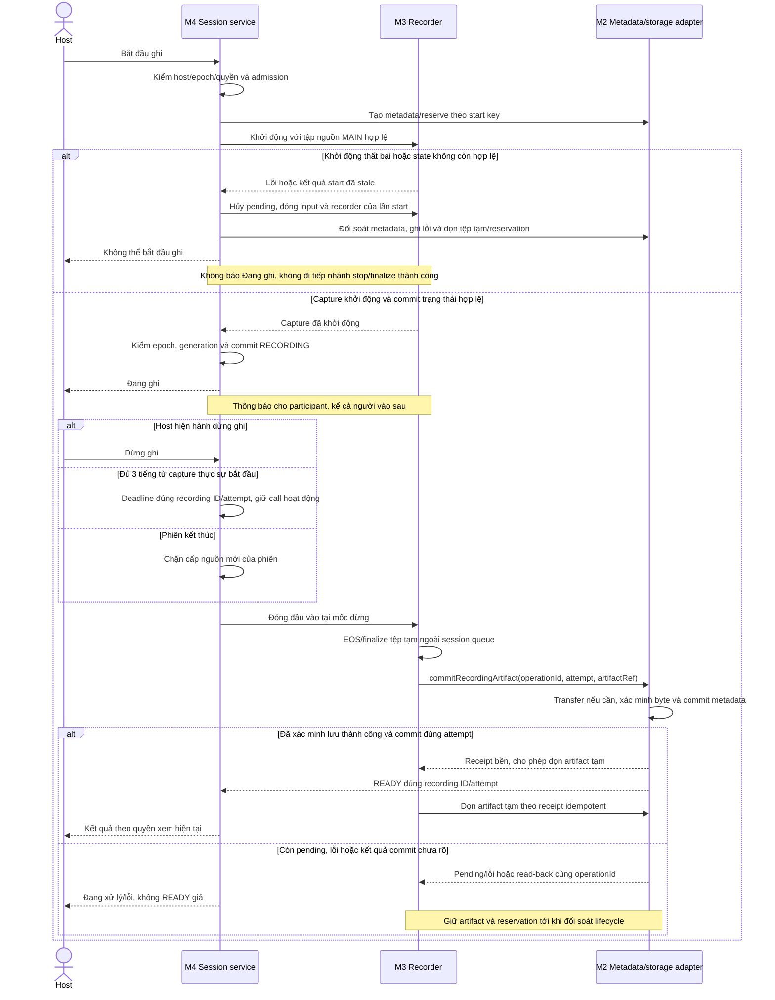

# M3 — Cuộc gọi, media, âm thanh và ghi hình MAIN

**API/backend dùng chung:** theo [quy ước](../contracts/api-conventions.md) và [mã lỗi](../contracts/error-codes.md). Bảng payload/result bên dưới mô tả dữ liệu nghiệp vụ nằm trong envelope chung; lỗi riêng của miền còn cần schema, status và consumer review trước implementation.

**Status:** Draft để review · **Cập nhật:** 05/11/2026 · **Người phụ trách:** Việt · **Reviewer cần phối hợp:** M4, M2; M1/M5 review điểm giao · **Size đề xuất:** XL, cần chia task và kiểm lại sau PoC.

> **TL;DR** — Xây một bộ xử lý media dùng chung cho MAIN, DISCUSSION và ACTIVITY bằng WebRTC, mediasoup và Socket.IO. M4 quyết định quyền/vòng đời phiên; M3 tạo, đóng và đồng bộ tài nguyên truyền/nhận theo quyết định đó. Call controller tiếp tục hoạt động khi người dùng xem Workspace hoặc mở panel.
>
> Recording gắn với phiên MAIN: host bấm Bắt đầu ghi, capture thực sự khởi động, rồi ghi tới khi host hiện hành bấm Dừng, đoạn đủ 3 tiếng hoặc phiên kết thúc. Đổi host/chuyển nhóm/người bắt đầu ghi đã bàn giao rồi rời không tự dừng bản ghi. Sau khi dừng, Record mới tạo đoạn/tệp mới. M2 cung cấp xem lại đúng quyền. Recorder do app server quản lý; pipeline mediasoup PlainTransport → GStreamer đã chọn, cần kiểm chứng qua PoC, không phụ thuộc mức âm lượng cá nhân của host.
>
> Phạm vi có 9 FR chính. WBS và khoảng effort ở cuối là ước lượng kỹ thuật ban đầu, chưa phải lịch cam kết. Proposal không triển khai code, không thay schema hoặc quyết định sản phẩm tại nguồn.

**Mốc đồng bộ:** theo yêu cầu cập nhật M3 với [PR #28 tại `b39deee`](https://github.com/Lightning1507/CoLearnia/pull/28/commits/b39deee550444574f89c20b1d65b4886d57c99a3), bản này áp dụng host/reconnect, nhóm và contract/profile kỹ thuật được mô tả tại đó, gồm chi tiết REST/Socket.IO bổ sung sau mốc `615f52b`. Nguồn product/contracts được PR #28 cập nhật trên nhánh riêng; khi tích hợp hai PR phải giữ các nguồn đó nhất quán, không lấy bản product cũ trong checkout để khôi phục quy tắc đã thay. Budget và profile recorder dưới đây vẫn là đề xuất cần review/PoC, chưa có bằng chứng chạy đạt.

**Phối hợp và lập kế hoạch:** xem [quy ước chung của 5 proposal](README.md#quy-ước-chung-trước-khi-lập-sprint). Phân biệt task của bên cung cấp, task tích hợp của bên dùng và ca kiểm chung; không cộng lại cùng một đầu ra hoặc coi estimate là lịch cam kết.

## 1. Context

Theo [chia miền](../product/delivery-domains.md), M3 phụ trách FR-05-01–05, FR-08-01–02 và FR-15-01–02. Nguồn nghiệm thu là [FR/AC](../product/functional-requirements.md), [live session](../product/live-session.md), [policy](../product/groups-media-policy.md), [group modes](../product/group-modes.md), [recording](../product/recording.md), [kiến trúc](../architecture.md) và [capacity](../capacity.md).

Kiểm source ở baseline `7ed43d9`: [media runtime](../../apps/server/src/live/media/runtime.ts) đã tạo worker/WebRtcServer và Router factory với Opus/VP8; [socket](../../apps/server/src/realtime/server.ts) vẫn từ chối handshake khi chưa có auth. Web có shell/status, chưa có lobby, call controller, transport/producer/consumer nghiệp vụ hoặc recorder. Manifests pin mediasoup 3.31.0 và mediasoup-client 3.25.3. Native smoke không chứng minh cuộc gọi/TURN/isolation chạy được.

Sau kickoff: DISCUSSION tạo ngay khi server kiểm hợp lệ, không host duyệt; người trong roster vẫn chủ động vào. Host chỉ vào hỗ trợ ACTIVITY. DISCUSSION thu membership ngay khi phát hiện disconnect/control lease hết hạn; nhóm từng có người mà rỗng thì đóng, reconnect về MAIN. Host bị phát hiện mất kết nối thì thu mọi quyền kết nối cũ và chọn host tạm ngay. Call ownership vẫn có reconnect grace tối đa 30 giây; không có empty grace. ACTIVITY được vào lại đúng nhóm đã phân còn mở; không có host điều chuyển, host chỉ vào bằng help. Recording là scope mới, không còn thuộc phần loại trừ. Thiết kế DB 13 collection trước recording cần delta riêng, không làm lại toàn bộ mô hình.

## 2. Objective

Người có quyền LIVE có thể chuẩn bị thiết bị, vào/rời cuộc gọi, nghe/xem/share đúng scope và điều chỉnh âm lượng; mọi chuyển nhóm/thu quyền đều tác động tài nguyên thật. Host có thể ghi/dừng MAIN và nhận kết quả hoàn tất hoặc lỗi rõ ràng; recorder lỗi không kết thúc cuộc gọi.

## 3. Goals / Non-goals

| Goal | Kết quả                                                                               | FR chính / phối hợp                                 |
| ---- | ------------------------------------------------------------------------------------- | --------------------------------------------------- |
| G1   | Lobby, thiết bị, vào phiên; từ chối thiết bị vẫn xem được                             | FR-05-01/03; M1/M4                                  |
| G2   | Mic/camera/share thật, một nguồn MAIN và một nguồn mỗi ACTIVITY; DISCUSSION cấm share | FR-05-03/04                                         |
| G3   | Controller giữ call qua điều hướng; rời/takeover/revoke/reconnect dọn đúng generation | FR-05-02/05; phối hợp FR-11-01–03                   |
| G4   | Volume cục bộ, tiếng giảng/nhóm và announcement không echo hoặc mở sai audience       | FR-08-01/02                                         |
| G5   | Tích hợp nguồn video và panel với board/chat/nhóm, không nhân phiên hoặc layout       | Phần tích hợp G1–G4; M2/M4/M5                       |
| G6   | Host ghi/dừng MAIN, người vào sau biết đang ghi; chỉ nguồn MAIN được ghi              | FR-15-01                                            |
| G7   | Stop/end hoàn tất và bàn giao video một lần, xử lý lỗi/cleanup                        | FR-15-02; phối hợp M2 FR-15-03                      |
| G8   | Có evidence PoC 5 người/hai mạng/forced TURN, recording và tải kết hợp                | [ADR-001](../adr/001-media-foundation.md), capacity |

**Non-goals của M3:** quản lý membership/host/roster/phase/deadline thay M1/M4; triển khai chat/file/board thay M2/M5; quay toàn bộ desktop của host, ghi nhóm riêng, rewind luồng live hoặc thêm pause recording. Không thêm Redis, nhiều app instance, media worker pool, HA hay cơ chế phục hồi cuộc họp qua restart. Các chức năng thuộc miền khác vẫn cần tích hợp, không bị cắt khỏi sản phẩm.

## 4. Quyết định và ghi chú triển khai

### 4.1. Contract M3–M4

M4 quyết định quyền và context; M3 quản lý Producer/Consumer/transport và pending resources. Dùng contract theo #28, trả rõ permissionRevoked, pendingInvalidated và cleanupPending. Chỉ xác nhận thu quyền sau khi đóng tài nguyên trái quyền và vô hiệu callback cũ; xóa byte/finalize có thể tiếp tục phía sau. T1/T4/T7 kiểm fixture revoke, timeout và completion muộn trước nối media thật; M1 cung cấp identity/access hiện hành.

### 4.2. Bố cục recording

Theo profile #28, có share thì share ở vùng lớn cùng các ô camera MAIN hợp lệ; không share dùng lưới camera, không hình dùng nền thông báo. Xếp ô ổn định theo participant, độc lập pin/viewport và người đang nói. PoC đầu chỉ kiểm nguồn media cố định, không ghép nét board MAIN. Quyền vẽ MAIN của sản phẩm giữ nguyên; việc đưa overlay vào video là quyết định phạm vi recording cần M3/M5 xác nhận tại T13.3 trước nghiệm thu sản phẩm. T13.3 ghi rõ kết quả, nguồn quyết định và AC; nếu cần ghép overlay thì thêm task/estimate triển khai sau review, không âm thầm bỏ hoặc coi đã nằm trong compositor hiện tại.

### 4.3. Metadata, storage và codec

M2 làm đầu mối metadata/repository/storage và adapter kho private; M3 điều khiển pipeline và yêu cầu chuyển trạng thái đúng attempt qua contract không phụ thuộc nhà cung cấp ở mục 6.3.1. M3 không gọi SDK lưu trữ, không giữ credential/bucket/object key của nhà cung cấp; M2 đã chọn R2 riêng tư cho kho lâu dài; việc cần artifact tạm seekable trên máy chủ vẫn phải qua PoC M2–M3. M3 tiếp tục dùng interface chung, không phụ thuộc SDK R2. Phương án dữ liệu là recordings tham chiếu tài nguyên files, có start key chống trùng và nhiều đoạn trong cùng session; schema/index được review ở T10 trước migration, chưa tạo collection thực. Profile thử H.264/AAC MP4, 720p/15 fps; kiểm plugin, faststart, playback/seek và writer/finalize với M2 trước READY. Python/PyGObject là ứng viên helper đầu tiên, không là kết quả PoC đã đạt.

### 4.4. Thời lượng và lưu trữ

Mỗi đoạn tối đa **3 tiếng**, tính từ capture thực sự bắt đầu. Đến hạn server tự dừng/finalize, call tiếp tục; báo trước host hiện hành, host chủ động Record đoạn mới khi admission cho phép. Không tự nối đoạn; đổi host/reconnect không reset deadline.

Video READY **giữ vô thời hạn**, không TTL hoặc tự xóa theo tuổi. Thiếu disk/quota thì từ chối ghi mới hoặc báo lỗi đúng lifecycle, không xóa READY cũ lấy chỗ. Tệp tạm/lỗi vẫn cleanup sau kiểm writer/ref/commit. Quota bytes/in-flight/disk được cấu hình theo máy và kiểm trước nhận recording sản phẩm, không lấy quota chat/frame áp vào video. Lượt này không thêm quyền xóa video thủ công hoặc tự purge video khi xóa parent; hai hành vi đó chưa được người dùng quyết định và không được suy từ retention. Nguồn nghiệp vụ tại recording.md.

### 4.5. Admission, lỗi và cleanup

PoC dùng **một slot recorder toàn process**, giữ slot trong STARTING/RECORDING/STOPPING/PROCESSING/finalize. Record mới khi bận trả trạng thái rõ, không tự queue/retry start bằng ID mới. Đây là cấu hình thử; mức đồng thời sản phẩm được xác nhận theo phép đo tài nguyên trước vận hành.

Hủy STARTING hoặc lỗi thì attempt không READY, hủy callback/pending và dọn đúng đời sau khi writer ngừng, refs và commit được đối soát. Không tự cứu clip dở, tự ghi lại hoặc phục hồi job sau crash. Retry cùng ý định không nhân video. T9/T10/T11 kiểm pipeline, storage và lifecycle; chưa có bằng chứng recorder chạy đạt hoặc ghi ổn định 3 tiếng.

**Recording đã chốt:** bản ghi gắn với phiên MAIN, tiếp tục khi đổi host hoặc chuyển nhóm; host hiện hành điều khiển. Người bắt đầu ghi đã bàn giao rồi rời không làm dừng bản ghi. Bấm Dừng, đoạn đủ 3 tiếng hoặc kết thúc phiên thì ngừng input và hoàn tất/bàn giao video; lần Record tiếp theo tạo tệp mới. Không ghi nguồn riêng của nhóm. Chi tiết và các ngoại lệ theo [vòng đời recording](../product/recording.md#vòng-đời-đã-chốt-ngày-03112026).

## 5. High-level design

Giữ topology baseline. Router chuyển tiếp RTP; Socket.IO trao đổi lệnh và thông số, không mang video Base64. Mỗi browser dùng transport gửi/nhận với nhiều track, không một transport cho từng camera. Media adapter quản lý objects, source registry, pending operations và stats; không giữ nguồn quyền thứ hai.

Frontend có một `CallController` đang sống ngoài vòng đời panel/trang room, quản lý Device, transport, track và audio nodes. Store chỉ giữ projection để render, không persist MediaStream/transport. `RoomShell` cung cấp stage và panel slot; M2 chat, M4 nhóm/host, M5 board ghép vào cùng shell.

**Thiết kế recording:** app server quản lý Recording service thuộc M3, điều phối bắt đầu/dừng và vòng đời tài nguyên theo quyền/state M4. Recorder có context chỉ đọc MAIN gắn session/epoch/recording generation; server cấp đúng các nguồn MAIN hợp lệ. Tập nguồn ghi độc lập với layout/pin/viewport và volume/mute nghe cục bộ của host. M3 ghép hình, trộn tiếng và bàn giao video cho storage M2; recorder tiếp tục khi đổi host, lỗi recorder không kết thúc cuộc gọi. Tiến trình capture/encode có giới hạn tài nguyên, do app server quản lý; giữ topology một app process/mediasoup worker, không thêm app replica hoặc worker pool. Kiến trúc và pipeline PlainTransport → GStreamer đã chọn; T9 kiểm đường ghi nguồn cố định và khả năng đóng gói; spike T11.1/T11.2 kiểm điều khiển nguồn động, rồi review cấu hình/ngân sách trước implementation.

**Pipeline chính: mediasoup PlainTransport → GStreamer.** Media adapter tạo Consumer chỉ cho các nguồn MAIN hợp lệ và xuất RTP/RTCP nội bộ sang recorder. GStreamer nhận và giải mã nguồn, dùng compositor ghép share với camera/ảnh đại diện, dùng audiomixer trộn mọi mic và screen audio MAIN, rồi encode/mux thành một tệp do M2 quản lý. Không dùng Chromium/Canvas/MediaRecorder hoặc tab host trong pipeline recording này; audio graph ở browser vẫn phục vụ playback cục bộ như 6.2.

M3 viết bộ điều khiển pipeline động qua API GStreamer: thêm/bớt input, đổi camera/ảnh đại diện, xử lý nguồn tạm không có dữ liệu và dừng có kiểm soát. Không coi một lệnh gst-launch cố định là đã xử lý được vòng đời nguồn. Ứng viên thử đầu tiên ở T9.1 là helper Python 3 + PyGObject (GObject Introspection, `gi.repository.Gst/GLib`) trên Linux để gọi API GStreamer và xử lý bus/state/EOS. Chọn hướng này để thử API pipeline động trực tiếp; chưa xác nhận khả năng đóng gói, plugin, đồng bộ hoặc tải trên máy đích. T9.1 phải kiểm runtime/binding, ghi phiên bản thực và trở ngại trước khi dùng cho bước ghi. Nếu không dùng được, ghi blocker và review ứng viên khác trong timebox, không tự đổi pipeline. Implementation sẽ pin phiên bản/plugin đã kiểm và đóng gói Linux; helper do app server quản lý, không là app replica/worker pool và không tự sở hữu quyền phiên.

**Điều khiển helper — hướng thử:** app Node khởi động helper bằng child process, truyền lệnh có recording ID/attempt qua stdin và nhận sự kiện ready/error/input-stopped/finalized qua stdout dạng JSON Lines; log vận hành đi stderr, không trộn với protocol và không chứa nội dung media/secret. App quản lý timeout, hủy pending và cleanup đúng đời; không mở cổng control công khai. Chỉ báo finalized sau EOS và xác minh tệp. Nếu quá hạn phải báo lỗi, đối soát tệp dở rồi mới cưỡng chế đóng đúng process theo lifecycle. Protocol, backpressure và packaging được kiểm trong PoC, chưa có helper chạy thật. Tham khảo [PyGObject](https://pygobject.gnome.org/) và [pipeline manipulation](https://gstreamer.freedesktop.org/documentation/application-development/advanced/pipeline-manipulation.html).

**Chọn input và readiness — hướng thử đồng bộ #28:** recorder nhận/giải mã các camera MAIN đang bật và được phép đưa vào các ô của profile thử; không lọc theo người đang nói hoặc viewport/pin của host. Screen MAIN và mọi MIC/SCREEN_AUDIO MAIN hợp lệ có đường input riêng. Số input thực phải được khai báo trong fixture và nằm trong admission CPU/RAM/disk được review; quá budget thì từ chối bắt đầu hoặc báo lỗi ghi đúng lifecycle, không âm thầm bỏ camera để công bố đạt. M3/M4 kiểm quyền trước tạo Consumer paused → helper chuẩn bị receiver/pipeline và xác nhận sẵn sàng đúng attempt → server kiểm lại quyền/generation rồi resume Consumer → chờ frame giải mã hợp lệ trước khi đưa vào hình ghép. Với nguồn chưa có keyframe hoặc tạm hết dữ liệu, thử nền/ảnh đại diện và nhánh audio im lặng để giữ output, đo thời gian chờ; không coi fallback hoặc đồng bộ đã được giải quyết. Khi revoke phải tháo input và xóa frame/cache cũ, không giữ hình mất quyền làm fallback. Thử thêm/bớt camera/đổi share và dữ liệu gián đoạn sau khi bước nguồn cố định đạt.

**Đồng bộ:** thiết kế RTP payload type/SSRC/clock-rate và RTCP tương ứng với Consumer thực của mediasoup, xử lý jitter/timestamp và ánh xạ vào clock chung của pipeline. rtpbin là hướng tích hợp RTP/RTCP để kiểm chứng; không coi thứ tự gói đến hoặc timestamp của các nguồn khác nhau là cùng gốc thời gian. Composition/mix cần decode rồi encode, không dùng stream copy để thay bước ghép hình/trộn tiếng. Cấu hình thử đồng bộ PR #28 là H.264/AAC trong MP4; phải xác minh plugin/encoder/muxer trên Linux và playback/seek với M2, không chọn chỉ bằng đổi đuôi tệp.

**Profile recording PoC theo #28:** thử output 1280×720, 15 fps, H.264 khoảng 2 Mbit/s, AAC 48 kHz/128 kbit/s và MP4. Có share thì share vùng lớn, các camera MAIN hợp lệ xếp ô; không share dùng bố cục camera, không có hình dùng nền thông báo. Trộn mọi mic MAIN/screen audio hợp lệ sau resample và kiểm headroom/clipping. Profile, codec và bố cục thử không là giới hạn sản phẩm hoặc capacity đã đạt; mỗi đoạn tối đa 3 tiếng và video READY giữ vô thời hạn theo mục 4.4. Quota cụ thể, quyền xóa thủ công và xử lý khi xóa kênh/Workspace vẫn cần thống nhất; thiếu disk/quota phải từ chối ghi mới hoặc báo lỗi đúng lifecycle, không xóa video cũ để lấy chỗ. Python/PyGObject vẫn chỉ là ứng viên helper của M3, #28 chưa xác nhận binding này.

**PoC sớm, chia hai bước:**

- **Bước 1 — T9, tập nguồn cố định:** dùng fixture mediasoup cô lập trên Linux dự kiến triển khai, nguồn audio/video kiểm soát được và source descriptor tối thiểu; không chờ hoàn tất T4/T5/T6, UI sản phẩm hoặc policy M4. Chốt tập nguồn trước chạy (một screen, một camera và một mic cố định); giữ hình/tiếng tham chiếu để kiểm tệp phát/seek được, stop/EOS/finalize và đoạn dữ liệu cuối. Không đưa thêm/bớt nguồn hoặc bố cục nhiều camera động vào điều kiện đạt bước này; bước cố định chưa đủ nghiệm thu toàn bộ profile #28. Đo start/stop/finalize, lệch tiếng–hình đầu/giữa/cuối, CPU/RAM/disk và resource sau cleanup; fixture không nằm trên route sản phẩm.
- **Bước 2 — spike T11.1/T11.2 sau T9:** thử thêm/bớt nguồn, đổi share/xếp ô camera, chưa có keyframe và nguồn mất dữ liệu; kiểm readiness/fallback, continuity và đồng bộ. Chưa cam kết cách xử lý thành công hoặc công triển khai trước kết quả bước 1. Sau các spike mới chốt task implementation T11 còn lại với M2/M4, rồi kiểm start/cancel/stop/end, revoke và lỗi theo 6.5.

T9 có ngân sách thử đầu tiên 16 giờ, chia task tối đa 8 giờ ở mục 9; đây là timebox để trả lời tính khả thi, không phải lời hứa pipeline sẽ chạy trong 16 giờ. Ghi binary/plugin versions, máy/Linux, cấu hình, số input, kết quả từng bước hoặc blocker kể cả chưa có clip. Mỗi task hết timebox phải dừng đánh giá và báo nhóm; nếu cần thử tiếp phải review ngân sách, phạm vi và estimate trước khi mở rộng. T9.4 tổng hợp quyết định tiếp tục/điều chỉnh/chưa đủ bằng chứng; không tự đổi pipeline hoặc cắt chức năng.

Ngưỡng chấp nhận được nhóm review trước phép đo, không chọn sau khi thấy kết quả. Clip fixture phát được chưa chứng minh MAIN selector, ACL/isolation, storage sản phẩm hay capacity. T11/T15 vẫn phải kiểm với auth/policy và M2 thật, tải kết hợp cuộc gọi/chat/board/TURN. Chưa có benchmark chứng minh nhẹ hơn headless hoặc đạt capacity.

**Chi tiết bố cục và storage:** profile recorder xếp ô theo thứ tự participant ổn định do server cung cấp, không dùng thứ tự viewport/pin hoặc đổi liên tục theo người nói. Overlay theo gate T13.3 ở mục 4.2; PoC nguồn cố định không chứng minh ghép overlay sản phẩm. Ảnh thay thế khi thiếu hình dùng nền/placeholder nội bộ; không phụ thuộc avatar tài khoản hoặc tự thêm feature avatar cho M1. M2 là writer duy nhất cho metadata/transition có CAS; M3 báo kết quả pipeline đúng attempt và yêu cầu chuyển state, không có repository metadata thứ hai. Thử MP4 faststart sau EOS để phục vụ phát/tua qua HTTP có ACL/Range; xác minh bằng browser thật trước READY. Đề xuất collection recordings và purpose/binding video cần review schema/index riêng, chưa thay MongoDB.

## 6. Detailed design

### 6.1. Database và ownership

M3 không persist transport/Producer/Consumer, track, audio graph hoặc mọi thay đổi camera tile vào MongoDB. Metadata phiên/participant do M4 triển khai theo [collection-design](../database/collection-design.md); quyền runtime không được phục hồi từ DB sau restart.

**Delta recording đề xuất để M2 review:** M2 làm đầu mối schema/repository và private storage; M3 sở hữu state machine/pipeline và gọi service metadata. Tách thông tin quá trình ghi với tài nguyên byte để không tạo hai kho video cạnh tranh.

| Nhóm metadata đề xuất | Dữ liệu / invariant                                                                                                            |
| --------------------- | ------------------------------------------------------------------------------------------------------------------------------ |
| Định danh và phạm vi  | Recording ID; Workspace, kênh LIVE, LiveSession, epoch; người bắt đầu; cùng scope do server xác lập                            |
| Vòng đời              | Trạng thái, revision; thời điểm yêu cầu/bắt đầu thực tế/dừng/hoàn tất; lý do dừng và mã lỗi vận hành không chứa nội dung riêng |
| Kết quả               | Tham chiếu tài nguyên video M2 quản lý, MIME/codec/duration/size đã kiểm; chỉ mở xem khi hoàn tất                              |
| Retry và cleanup      | Khóa bắt đầu ổn định, processing attempt/generation, lịch dọn và reservation quota; tên field/constraint chốt cùng M2          |

Phương án vật lý ưu tiên review: metadata quá trình trong collection `recordings`, byte resource tiếp tục do `files`/private storage quản lý với purpose/binding mới phù hợp recording. Đây là **đề xuất delta**, không tuyên bố đã thêm collection thứ 14 hoặc enum `RECORDING` vào baseline/executable schema. Nếu M2 chọn mở rộng file metadata, phải chứng minh biểu diễn đủ state/retry/queries và không có hai nguồn trạng thái song song.

**Bàn giao schema cho M2:** [đề xuất recordings và delta files](../database/recordings-schema.md) cụ thể hóa field/type/null, identity start/attempt, receipt/read-back, index, CAS/transaction READY, quota và ca kiểm. Phương án khuyến nghị là một recording tham chiếu một file, không nhúng byte hoặc lịch sử không giới hạn. File RECORDING có authorization service riêng, không dùng membership stamp của người upload để quyết định finalize sau đổi host/ENDED; download vẫn theo ACL hiện hành. Đây là proposal để M2 review, chưa sửa schema DB hoặc chạy migration.

Index dự kiến cần cụ thể hóa: tra nhiều đoạn theo channel/session + cursor; uniqueness cho start retry và tối đa một capture khởi động/ghi/dừng mỗi phiên, kết hợp slot PoC toàn process tại mục 4.5; tìm cleanup/processing dở dang. Không dùng unique session ID đơn thuần vì một phiên có thể có nhiều đoạn riêng. Trong profile PoC mục 4.5, PROCESSING/finalize vẫn giữ một slot recorder toàn process đến khi cleanup/writer hoàn tất; admission sản phẩm được review sau đo, không dùng unique sessionId để cấm nhiều đoạn lịch sử. Không tự tạo mọi unique bằng validator; chạy trên Mongo pin trong DB test. Không TTL metadata trước khi dọn byte. Không backfill giả bản ghi cho phiên cũ; preflight DB hiện có và migration/rollback thuộc task implementation được giao riêng.

Quota video không lấy giới hạn attachment/frame áp vào recording. Video READY giữ vô thời hạn: không TTL hoặc sweep theo tuổi. Quota bytes/in-flight/disk cụ thể cần review theo máy trước lưu thật; thiếu chỗ thì từ chối ghi mới, không tự xóa READY. Byte đã DELETE_PENDING nhưng chưa xóa vẫn tính quota; dọn tệp tạm/lỗi không áp retention vô thời hạn của READY. Quyền xóa thủ công và xử lý video khi xóa kênh/Workspace chưa chốt, không tự suy cấp quyền xóa hoặc purge. Byte video ở kho private, không nhúng MongoDB; không phục vụ qua public static URL. Quyền xem là membership + channel access hiện hành, không danh sách participant cũ; M2 phải thu stream/Range retry sau revoke theo [lifecycle](../database/lifecycle.md).

### 6.2. Contract và luồng thực thi

Các tên command/interface dưới đây là **đề xuất cho review**, chưa là schema export. Dùng [envelope/error](../contracts/README.md) chung, validate strict và giới hạn bytes/array/ID. Actor, source ownership và quyền scope do server tra. Schema media cần giữ cấu trúc RTP/DTLS mà thư viện pin cần, không dùng `unknown` không giới hạn làm contract hoàn thành.

| Nhóm giao tiếp                             | Input/output chính                                                                                 | Kiểm quyền, retry và lỗi                                                                                         |
| ------------------------------------------ | -------------------------------------------------------------------------------------------------- | ---------------------------------------------------------------------------------------------------------------- |
| M4 join/projection → M3                    | participant, session/epoch, callGeneration, revision, source descriptors và transport bootstrap    | Identity/access hợp lệ; `CALL_ALREADY_ACTIVE` cần xác nhận; không lập call registry khác                         |
| `media.transport.create/connect`           | Direction, transport ID, DTLS; trả ICE/DTLS parameters/candidates                                  | Transport đúng owner/generation; pending timeout/cancel phải close; không tin ID client                          |
| `media.producer.create/pause/resume/close` | Transport, source kind, RTP parameters; ack producer/source ID                                     | canPublish, đúng scope và lease SCREEN; một MIC/CAMERA/generation; client appData không cấp quyền                |
| `media.consumer.create/ready/close`        | Producer ID, receive capabilities; ack consumer parameters                                         | canConsume + codec tại create và ready, dedupe receiver/producer; revoke đóng Consumer                           |
| `screen.acquire/release`                   | Envelope M4; acquire có ScopeRef, trả leaseId/leaseGeneration/expiresAt; release đúng lease và đời | M4 kiểm scope hiện tại; giữ chỗ nguyên tử; `SHARE_BUSY`, stale/expiry; callback cũ không release nguồn mới       |
| Media adapter nội bộ                       | publish, closeProducer, reconcileAllowedSources, closeParticipant, getStats                        | M4 điều phối; adapter đăng ký pending, kiểm generation sau await và trả kết quả cleanup                          |
| M3 → M5                                    | Video handle, readiness, source scope/ID/revision; source changed/ended                            | Chỉ nguồn actor được xem; freeze frame/context do M5 giữ, không đồng nhất source đổi với xóa FROZEN hợp lệ       |
| `recording.start/stop`                     | Envelope M4; start payload rỗng, stop có recordingId/expectedRecordingRevision; ack theo §6.2.7    | M4 kiểm host hiện hành; start retry trả cùng intent; hủy STARTING/stop/end hội tụ; READY sau finalize/storage    |
| `recording.state`                          | ID, revision, trạng thái và mốc thời gian cần hiển thị                                             | Projection theo audience hợp lệ; không gửi storageKey/process token hoặc URL không có ACL                        |
| M3 ↔ M2 recording storage                  | Reserve, append/write, finalize, fail/cleanup; artifact descriptor đã kiểm                         | Writer chỉ đúng bản ghi/attempt; bounded backpressure; READY sau xác minh đủ tệp/metadata, không chỉ có stop ack |

Lỗi tái dùng khi phù hợp: `FORBIDDEN`, `CONFLICT`, `SOURCE_CHANGED`, `SHARE_BUSY`, `CALL_ALREADY_ACTIVE`, `QUOTA_EXCEEDED`, `SESSION_ENDED`, `MEDIA_UNAVAILABLE`. Lỗi recorder/storage cụ thể được M2–M3 bổ sung sau review; không trả raw process stderr/DB error cho client.

**Join và nhận nguồn:** M4 xác lập participant → client nạp Router capabilities → tạo transport gửi/nhận và DTLS → publish nguồn được phép. Consumer tạo paused ở server, client gắn track rồi báo ready; kiểm lại quyền/epoch/generation/deadline trước resume. `router.canConsume()` chỉ chứng minh codec, không thay ACL.

Scaffold hiện chỉ export Router factory, chưa export cách tạo WebRtcTransport dùng WebRtcServer chung. T4 cần bổ sung factory/adapter này và đường báo worker chết cho M4; log/readiness hiện có chưa đóng phiên hoặc dọn tài nguyên nghiệp vụ. Recorder dùng PlainTransport/Consumer nội bộ với context session/epoch/recording generation do server cấp, không đăng nhập bằng cookie host hoặc giả participant. M3–M4 kiểm nguồn tại create/resume và thu quyền, đóng Consumer/transport/pending khi context hết hiệu lực. Cổng RTP/RTCP và control helper chỉ dùng trong mạng nội bộ được cấu hình; không mở handshake anonymous hoặc expose các cổng này ra Internet.

**Share:** xin lease → hiện nút Chọn màn hình để chia sẻ → click trực tiếp gọi getDisplayMedia → kiểm lại lease/scope trước publish. Không giữ queue khi chờ picker; audio không có thì share hình vẫn hợp lệ. Dừng/hủy/browser Stop/mất quyền đóng SCREEN và SCREEN_AUDIO, trả đúng lease, tăng source revision và báo M5.

**Chuyển scope/revoke:** M4 dựng deny barrier → M3 đóng media/pending trái quyền → M4 commit state hợp lệ → M3 cấp nguồn mới → trả projection. Giữ nguồn còn hợp lệ, chẳng hạn bài giảng MAIN khi vào DISCUSSION; không dựng lại toàn bộ call chỉ vì đổi nhóm. Thao tác async hoàn tất muộn phải tự close nếu state đã cũ. Không lấy khóa Workspace/channel ngược từ session queue; không chờ picker/upload/client ack/encode trong queue. Lỗi giữ quyền đã thu ở trạng thái đóng và reconcile; không phát tiếng riêng để che lỗi chuyển tiếp.

**Audio:** một output path/track; video element muted khi audio được Web Audio phát; mic local không loop ra loa. Giữ master/participant/bus gain và announcement factor riêng. DISCUSSION nhận host hướng dẫn + screen audio MAIN + tiếng nhóm; ACTIVITY chỉ nhóm/host hỗ trợ. Khi announcement kết thúc/timeout chỉ bỏ factor, không ghi đè mute/volume người nghe. Có thao tác bật tiếng nếu autoplay bị chặn.

#### 6.2.1. Xung đột cuộc gọi và xác nhận chuyển

Registry toàn tài khoản, luồng xác nhận takeover/end và component xác nhận thuộc M4; M3 nhúng component, cung cấp trạng thái controller và thực thi cleanup media. M3 không viết hộp thoại hoặc policy takeover thứ hai. Mở kênh/tab hoặc vào lobby không tự chiếm cuộc gọi đang hoạt động. Khi join trả `CALL_ALREADY_ACTIVE`, UI cho chọn giữ cuộc gọi cũ hoặc xác nhận chuyển sang phiên đích; chỉ hiển thị metadata cuộc gọi mà actor còn được phép đọc.

Theo contract dự kiến §6.3 của #28, FE gọi `POST /api/v1/channels/:cid/live-session/join` với body `{ requestId }` qua cookie/CSRF/Origin của M1 để nhận `{ sessionId, epoch, ticket, expiresAt }` trong response `{ data, requestId }`. Ticket một lần hạn 60 giây; có ticket chưa là participant, chưa được nhận media/chat/board. Sau đó gọi `session.join` trên Socket.IO đã xác thực bằng `{ requestId, ticket, takeover? }`, không dùng envelope mutation vì chưa có ownership. Join thành công trả participantId, callGeneration và snapshot hoặc descriptor snapshot chia phần; không nhân participant khi retry cùng join intent.

`CALL_ALREADY_ACTIVE` không consume ticket. Khi người dùng xác nhận, gửi command có requestId mới với ticket còn hạn và takeover dự kiến `{ confirmed: true, expectedCallGeneration }`, lấy generation từ xung đột ownership đã được lọc quyền. Nếu ticket hết hạn thì lấy ticket hợp lệ mới; không tự xác nhận takeover. Payload takeover cuối cùng vẫn cần M3–M4 review trước schema/handler, không coi đây là API đã triển khai.

- Hủy/đóng hộp xác nhận: không gửi takeover, không thay call cũ; dọn preview/ticket/pending của lần join bị hủy theo lifecycle. Không đóng track thuộc controller đang gọi khi dọn preview lobby.
- Xác nhận: server kiểm lại auth, quyền kênh đích và ownership hiện hành; deny/đóng tài nguyên call cũ trước cấp generation mới. UI thể hiện đang chuyển, không bật song song hai cuộc gọi. Nếu đích thất bại sau khi call cũ đã đóng, báo lỗi và cho join lại hợp lệ; không tự hồi quyền cũ từ cache.
- Callback/ack/disconnect cũ chỉ tác động đúng session/epoch/generation. Hai tab cùng xác nhận phải qua registry M4 và đối soát generation; tab thua không tự retry takeover cuộc gọi mới. Mọi cleanup idempotent, compare-and-delete đúng đời.

#### 6.2.2. Reconnect control và media

Theo [control lease và vòng đời](../product/live-session.md#11-reconnect-và-vòng-đời-tài-nguyên), M4 sở hữu trạng thái RECONNECTING, ticket/ownership, grace và snapshot quyền; M3 báo tình trạng transport và reconcile media. UI phân biệt mất kết nối điều khiển với lỗi truyền media. Mất Socket.IO không chứng minh RTP đã ngừng; không chờ client tự mute để thu quyền.

| Tình huống                                                      | M4 điều phối                                                                                                                                         | M3 xử lý và đầu ra kiểm được                                                                                                                                                                                   |
| --------------------------------------------------------------- | ---------------------------------------------------------------------------------------------------------------------------------------------------- | -------------------------------------------------------------------------------------------------------------------------------------------------------------------------------------------------------------- |
| Signaling disconnect hoặc control lease hết hạn, RTP có thể còn | M4 giữ ownership tối đa 30 giây, vẫn xử lý revoke/deadline; thu mọi quyền kết nối host cũ và chọn host tạm ngay; thu membership DISCUSSION ngay      | M3 đóng ngay media/help/announcement/pending của host cũ và private scope DISCUSSION. MAIN/ACTIVITY thông thường reconcile theo quyền, phần còn lại đóng chậm nhất cuối grace; không phát tiếng hỗ trợ ra MAIN |
| Reconnect trong grace                                           | Auth/Origin/CSRF lại, kiểm ownership/access và dấu audience mới; DISCUSSION về MAIN, ACTIVITY kiểm phân công/deadline; hoàn quyền host theo đích gốc | Reconcile theo context hiện hành; không hồi membership DISCUSSION hoặc nguồn đã bị thu. Participant chủ động vào lại nhóm hợp lệ; host chỉ ACTIVITY qua help                                                   |
| ICE/transport failed khi phiên và quyền còn hợp lệ              | Cho phép thao tác phục hồi trong đúng generation                                                                                                     | Thử ICE restart có giới hạn khi transport còn dùng được; nếu không phục hồi thì close mapping cũ và tạo transport/nguồn thay thế có kiểm quyền. Chốt timeout/số lần thử qua T1/T14, không retry vô hạn         |
| Quá grace hoặc ownership đã sang thiết bị/tab khác              | Đóng participant cũ; join lại hoặc trả xung đột theo registry                                                                                        | Dọn tracks/transports/audio/pending đời cũ; không dùng resume/ticket cũ để giành call mới hoặc khôi phục mic/share                                                                                             |
| Nhóm/round đóng, đổi scope hoặc mất access trong lúc reconnect  | Snapshot hiện tại và deadline là nguồn quyết định                                                                                                    | Không mở lại nhóm, reset countdown hoặc resume share từ cache; về MAIN pause mic theo policy. Share cần thao tác và lease hợp lệ mới                                                                           |
| Worker/app restart hoặc session đã kết thúc                     | Invalidate epoch/runtime cũ, kết thúc phiên theo baseline                                                                                            | Dọn controller/resources cũ, báo phiên đã kết thúc; chỉ join phiên hợp lệ mới, không dùng ICE restart để giả phục hồi cuộc họp cũ                                                                              |

**Host nhiều sự cố và phiên rỗng theo #28:** M4 giữ một đích hoàn quyền gốc: A mất kết nối, B thay rồi C thay tiếp thì B quay lại chỉ là member khi C còn hợp lệ; A hợp lệ quay lại mới tự hoàn. Không có ứng viên connected thì chờ ownership trong các reconnect grace hiện có; hết mọi grace mà không còn người thì ENDING ngay, không thêm empty grace. Bàn giao chính thức thay đích gốc; auth/access bị thu xóa đích liên quan, cấp lại quyền chỉ là member. M3 thu nguồn/pending theo quyết định M4, không tự elect hoặc khôi phục host từ cache.

Đồng bộ pause/close giữa client và server bằng event/ack có generation; không giả việc gọi `close()` tại một phía tự cập nhật nghiệp vụ phía kia. Retry có deadline/backoff và hủy khi state đổi; mỗi thao tác async đăng ký pending trước await, kiểm lại quyền/generation khi hoàn tất. Kiểm riêng signaling rớt trong khi RTP vẫn chạy và network đổi làm ICE lỗi. Chưa coi mock reconnect là bằng chứng transport phục hồi thật.

#### 6.2.3. Chuyển phòng, host và trạng thái thiết bị

Bảng này diễn giải [policy](../product/groups-media-policy.md) để M3–M4 cùng triển khai, không tạo policy riêng. Trạng thái nút mic/camera cần phân biệt lựa chọn thiết bị với quyền phát hiện tại; server pause phải được thể hiện trên UI, không hiển thị đang phát khi Producer bị chặn.

| Chuyển trạng thái                                 | Mic/camera                                                                                                                                                     | Share, nguồn nhận và recording                                                                                                                                                  |
| ------------------------------------------------- | -------------------------------------------------------------------------------------------------------------------------------------------------------------- | ------------------------------------------------------------------------------------------------------------------------------------------------------------------------------- |
| MAIN → DISCUSSION sau join hợp lệ                 | Thu audience MAIN cũ trước cấp nguồn nhóm theo policy; không tự bật thiết bị đang tắt                                                                          | Nhận bài giảng MAIN và nguồn nhóm được phép; không share riêng. Đóng nguồn tự phát đã mất quyền scope, loại mic/camera người chuyển khỏi input ghi MAIN                         |
| MAIN/nhóm → ACTIVITY hợp lệ                       | Thu scope cũ rồi cấp nguồn đúng nhóm; không tự bật thiết bị                                                                                                    | Không nhận MAIN mặc định; chỉ share khi lease nhóm trống, một nguồn/ACTIVITY. Recorder giữ MAIN, không theo người chuyển                                                        |
| Thành viên tự về MAIN hoặc nhóm đóng/hết deadline | Pause mic tại server để người dùng tự bật lại; camera đang bật chuyển audience MAIN, UI thông báo rõ; người đã ở MAIN không bị reset                           | Thu media nhóm/share cũ trước cấp MAIN; không mang frame/chat/board riêng ra MAIN. Recorder chỉ nhận lại nguồn MAIN hợp lệ sau commit                                           |
| Host vào hỗ trợ ACTIVITY                          | Thu scope hướng dẫn trước cấp mic/camera vào đúng nhóm hỗ trợ; không đồng thời phát hỗ trợ ra MAIN/nhóm khác                                                   | Thu group hỗ trợ cũ nếu chuyển nhóm; không được vào hỗ trợ DISCUSSION. Recorder không ghi tiếng/camera hỗ trợ                                                                   |
| Host chủ động rời hỗ trợ về MAIN                  | Giữ trạng thái mic: bật thì phát theo MAIN/hướng dẫn sau chuyển hợp lệ, tắt vẫn tắt; không thêm xác nhận mic riêng                                             | Thu quyền nhóm trước cấp MAIN; recorder cập nhật theo nguồn MAIN hợp lệ                                                                                                         |
| Help bị dọn do lỗi/timeout/nhóm đóng              | Không tự phát tiếng hỗ trợ ra MAIN; pause theo cleanup policy                                                                                                  | Thu nguồn/quyền hỗ trợ cũ, snapshot scope mới trước cấp nguồn; không tự quay lại help                                                                                           |
| Bàn giao/hoàn quyền host                          | Thu scope nhóm cũ, host mới về MAIN; không tự bật thiết bị; mic đang bật ở scope cũ bị pause tới xác nhận scope điều hành. Thu help/announcement/quyền host cũ | MAIN share còn hợp lệ tiếp tục, không đóng chỉ vì đổi role; recording tiếp tục theo phiên, quyền điều khiển thuộc host hiện hành                                                |
| Rời LIVE hoặc mất quyền                           | Đóng tài nguyên cá nhân thật; host còn quyền chủ động rời dùng kết thúc phiên cho mọi người, khác rời help                                                     | Thu share/Consumer/pending; khi end tự dừng ghi theo 6.3. Đóng tab/crash đi qua disconnect; host/DISCUSSION thu ngay, ownership giữ grace; không tự coi là lệnh kết thúc hợp lệ |

Theo #28, thành viên chỉ chủ động vào lại đúng ACTIVITY đã phân còn mở, không có host điều chuyển và host không join như member. Host nhận/chuyển/hoàn quyền khi đang ở nhóm phải thu membership/help cũ, chuyển MAIN và pause mic tới xác nhận scope điều hành; không tự bật thiết bị. DISCUSSION disconnect và host nhiều sự cố áp dụng mục 6.2.2, không còn là điểm mở của proposal này.

#### 6.2.4. Camera theo viewport/pin và danh sách participant

Danh sách participant lấy projection M4, không suy từ số camera/Consumer đang nhận. Khi share, stage ưu tiên nội dung và camera ở sidebar. Theo [capacity](../capacity.md#2-media-theo-nhu-cầu-xem), thử tối đa 4 camera từ xa/client; gate 5 vẫn hiển thị đủ camera hợp lệ, không giới hạn số người được bật camera.

Client tính tập camera cần xem từ tile đang hiện/pin và gửi nhu cầu có giới hạn tới server; thứ tự ưu tiên khi vượt ngân sách chốt trong T16/UI review. Server giao nhu cầu này với ACL hiện tại rồi mới create/resume Consumer. Nguồn ngoài viewport được pause/close thật theo lifecycle; khi hiện lại phải kiểm quyền/generation và tái dùng hoặc tạo Consumer paused-ready hợp lệ. Debounce/batch và giới hạn pending để scroll/pin nhanh không làm queue tăng vô hạn; đo cả Consumer paused còn giữ tài nguyên.

Audio subscribe độc lập với camera: cuộn mất tile không làm mất tiếng hợp lệ; mất quyền scope phải đóng cả nguồn trái quyền dù camera đang pin. Không mặc định thêm simulcast/SVC trước khi có profile; nếu chọn layer phải kiểm capability/config thật. Recorder có tập input riêng theo mục 4.2, không sao chép viewport/pin hoặc giới hạn camera của một client.

#### 6.2.5. Preference âm lượng và announcement

Preference lưu cục bộ theo user/Workspace/người nói, không theo Producer ID tạm; đổi thiết bị, recreate Producer hoặc reconnect cùng người vẫn áp lại lựa chọn đó khi nguồn còn quyền. M3 quản lý cách lưu/version và xóa context khi đổi tài khoản, không ghi từng thay đổi volume vào MongoDB hoặc áp preference của người này cho người khác.

`effectiveGain = master × participantGain × busGain × announcementFactor`; mỗi track đi một bus/output. Announcement chỉ giảm discussionBus, không giảm chính host được ưu tiên hoặc screenBus. Kết thúc/timeout tối đa 30 giây/host mất kết nối/thu quyền phải bỏ factor; giữ nguyên mute/volume đã chỉnh, kể cả người nghe đổi volume trong khi announcement đang chạy. M4 quyết định audience MAIN/DISCUSSION, ACTIVITY không nhận và host phải rời help về MAIN trước.

Ramp gain để tránh tiếng bật đột ngột; nhiều nguồn cộng vẫn có thể clipping dù từng gain ≤1, cần thử headroom/limiter trong T8. Kiểm autoplay bị chặn có nút bật tiếng, volume 0 không thay ACL và không ảnh hưởng âm lượng bản ghi MAIN. Những preference này chỉ tác động playback cục bộ, không pause Producer/mic của người nói.

#### 6.2.6. Sơ đồ media thường

Các sơ đồ dưới mô tả luồng đích để review T1–T8/T14, chưa là evidence đã triển khai. M4 giữ quyền/state; M3 giữ tài nguyên media. Lệnh/ack đi qua signaling, âm thanh/video đi qua WebRTC với SFU.

**A. Vào cuộc gọi, phát mic/camera và nhận nguồn**

Mũi tên Router → client mang parameters là đường trả kết quả qua server/signaling, không có kênh điều khiển trực tiếp Router–browser. Trong mediasoup-client, callback connect/produce điều phối từng bước DTLS/Producer; sơ đồ gộp hai bước để đọc tổng thể. Một transport nhận có nhiều Consumer; không tạo transport mới cho mỗi tile.

**B. Share: giữ chỗ, browser picker, publish và dừng**

Hủy picker chỉ release lease, không gửi publish với track rỗng. Stop từ UI/browser phải báo server; revoke từ server phải báo client. Nếu socket mất, control lease/grace bảo đảm server cleanup; không phụ thuộc duy nhất vào callback browser. Frame nhóm đã FROZEN hợp lệ vẫn theo lifecycle M5, không xóa chỉ vì nguồn live dừng.

**C. Chuyển phòng hoặc thu quyền: đóng scope cũ trước cấp scope mới**

Giữ nguồn vẫn hợp lệ như bài giảng MAIN của DISCUSSION; không đóng toàn bộ transport vì đổi phòng. Thao tác thất bại giữ deny barrier cho quyền đã thu và reconcile, không tiếp tục phát private để chờ khôi phục. Không giữ queue khi chờ client ack hoặc I/O dài; hoàn tất muộn phải kiểm lại generation/revision.

**D. Reconnect: đối soát quyền trước phục hồi media**

Lỗi transport khi signaling/control lease vẫn hợp lệ đi thẳng qua kiểm quyền hiện hành để sửa media, không bắt buộc dùng resume ticket hoặc đi qua grace. Chỉ nhánh mất signaling/control lease đi qua xác thực lại, resume và bind socket theo 6.2.2. Trước khi chờ reconnect, M4/M3 thu ngay quyền host cũ và membership/private scope DISCUSSION; grace chỉ giữ ownership, không hồi các quyền đã thu. Cả hai nhánh đều kiểm scope/deadline hiện tại, không phục hồi bằng snapshot client cũ. Nếu quyền/generation đổi ở bất kỳ bước async nào, hủy bước đó và dọn tài nguyên vừa tạo; nếu signaling mất trong lúc sửa media, chuyển sang nhánh resume.

**E. Audio playback: policy cấp nguồn trước, volume xử lý sau**

Tên bus biểu diễn vai trò trộn tiếng, không tự cấp quyền: ACTIVITY chỉ có nguồn nhóm/host hỗ trợ, không nhận tiếng giảng MAIN. Mic local không nối vào loa. Recorder dùng graph MAIN độc lập, không nhận thay đổi volume/pin của người nghe; đổi Producer vẫn áp preference theo người nói.

#### 6.2.7. Contract media và budget tích hợp theo #28

Áp dụng Appendix B của PR #28 tại mốc đồng bộ đầu tài liệu; các số dưới đây là profile kỹ thuật khởi đầu để hai bên review trước handler/PoC, chưa là SLA hoặc capacity đạt. M4 sở hữu control budget và quyền; M3 tính riêng tài nguyên media/encoder, không coi budget control là admission cho mọi tải ghi hình.

**Contract client theo §6.3 của #28:** điều khiển phiên/nhóm/share/recording gọi `socket.emit(command, input, ack)` qua application service/policy M4; không dựng thêm REST mutation có policy riêng. Ngoài join/resync, input dùng envelope `{ requestId, sessionId, epoch, callGeneration, expectedPolicyRevision, payload }`; payload strict theo command, actor/role/current scope lấy từ server và mỗi command kiểm lại auth/access. Retry cùng ý định giữ requestId UUID và payload; đổi payload dùng ID mới. Revision không khớp trả `CONFLICT` để resync, không tự áp lệnh lên state mới.

- Kiểu ID: sessionId/participantId/targetParticipantId là ObjectId hex 24 ký tự; epoch/groupId/roundId/draftId/draftGroupId/transitionToken/snapshotId/announcementId/leaseId là UUID. callGeneration là số nguyên dương, expectedPolicyRevision là số nguyên không âm. Không dùng userId thay participantId hoặc ép groupId thành ObjectId.
- Ack thành công có `{ data: { status: 'accepted' / 'pending' / 'completed', operationId?, result? }, requestId }`; lỗi có `{ error: { code, message }, requestId }`. FE phân biệt tiếp nhận, đang xử lý và hoàn tất theo command; ack không tự chứng minh media/capture đã sẵn sàng. Lỗi recorder/adapter phải mapping vào error catalog được review, không trả raw process/DB error hoặc metadata ngoài quyền.
- Share dùng ScopeRef `{ type: 'MAIN' }` hoặc `{ type: 'GROUP', groupId }`; M4 suy DISCUSSION/ACTIVITY từ runtime. `screen.acquire` có payload `{ scope }`, trả `{ leaseId, leaseGeneration, expiresAt }`; `screen.release` có payload `{ leaseId, leaseGeneration }`. M3 giữ đúng đời lease qua picker/publish/stop, không dùng source revision thay leaseGeneration hoặc để callback cũ release lease mới.
- `recording.start` có payload `{}`, trả `{ recordingId, attemptId, generation, state }`; chỉ hiển thị RECORDING sau capture-ready. `recording.stop` có payload `{ recordingId, expectedRecordingRevision }`, kiểm host hiện hành và attempt đúng đời; hỗ trợ hủy STARTING. Kết quả trả trạng thái thực, chỉ có inputStoppedAt khi đã xác minh ngừng input; READY là kết quả finalize/storage riêng. Descriptor đồng bộ vẫn mang revision để FE dùng làm expectedRecordingRevision, không lấy expectedPolicyRevision thay thế.
- `session.resync` dùng `{ requestId, sessionId, epoch, callGeneration, payload: { lastProjectionSequence?, lastPolicyRevision? } }`, không yêu cầu expectedPolicyRevision cũ phải khớp. Snapshot chia phần có `{ snapshotId, partIndex, partCount }`, partIndex từ 0 và cùng một mốc snapshot/context/projectionSequence. FE chỉ áp state khi đủ bộ hợp lệ; thiếu phần, quá budget hoặc quyền/context đổi thì bỏ toàn bộ bộ đang ghép và resync, không gắn media theo snapshot từng phần.

- Cleanup request gồm operationId, sessionId, epoch, callGeneration nếu có, transitionToken, target và reason. M3 trả cùng identity/đời và kết quả permissionRevoked, pendingInvalidated, cleanupPending, errorCode/retryable nếu lỗi. Chỉ xác nhận permissionRevoked sau khi chặn grant mới, đóng media trái quyền và vô hiệu completion cũ; phát event hay timeout không là bằng chứng đã thu quyền. cleanupPending có thể còn refs, byte hoặc finalize sau đó; không chờ browser ack hoặc xóa vật lý để xác nhận thu quyền.
- Control adapter thử 2 giây/lần, tối đa hai retry sau lần đầu, backoff 250/750 ms có jitter; foreground transition budget 10 giây tính từ lúc nhận, không nhân theo số participant. I/O đã timeout nhưng chưa dừng vẫn chiếm slot; đối soát operation trước retry, không gọi chồng. Reconcile hậu cảnh tại các mốc 1/3/10 giây, hết budget giữ deny/degraded và báo vận hành. M3 không lấy ngược Workspace/channel gate khi M4/coordinator ngoài đang giữ.
- Admission control khởi đầu: queue 4/user, 64/session, 512/process, chờ tối đa 2 giây; control I/O 2/user, 8/session, 32/process. End/revoke/deadline dùng đường ưu tiên/coalescing của M4 khi queue đầy. Heartbeat thử 5 giây, control lease 30 giây; phát hiện disconnect thì host/DISCUSSION thu ngay, không chờ lease hay grace đếm lại. Mạng im lặng chưa phát hiện phải đo detection latency thật.
- FE/controller phối hợp context sessionId/epoch/callGeneration/audienceEpoch/scope; event M4 dùng projectionSequence riêng theo người nhận, không suy mất event chỉ vì policyRevision toàn phiên nhảy. Khi đổi audience/resync, hủy request/context cũ và kiểm lại dấu trước khi callback gắn track/audio, dù request đã abort. Chỉ join/resume hợp lệ thiết lập ownership mới; M3 không dựng session snapshot hoặc call registry thứ hai; snapshot nguồn media ở §6.3.4 chỉ là projection registry theo context M4. M3 báo source scope/ID/generation/revision và pending lifecycle riêng cho M4.
- M4 thử payload control 16 KiB gồm envelope trong cap transport 32 KiB; snapshot tối đa 64 phần/1 MiB/5 giây, buffer 64 event/256 KiB/5 giây; FE resync retry tối đa ba lần sau lần đầu với backoff 0,5/1/2 giây và jitter. Đây là budget projection/control M4, không dùng để truyền video hoặc tự đặt giới hạn số nhóm/camera sản phẩm. Media/board/chat có limiter và sequence riêng nhưng cùng dấu audience để loại dữ liệu stale.
- Recording descriptor gồm recordingId, attemptId, generation, revision, state và inputStoppedAt nếu có; M3 giữ process/attempt registry, không gửi process handle/storage path cho FE. Profile #28 thử capture-ready 15 giây, input-stopped 5 giây, finalize 60 giây cho clip PoC. Quá input-stop budget phải thu Consumer/transport/pending đúng đời và xác minh; helper có thể flush nhưng không nhận nguồn mới. Quá finalize budget không READY giả hoặc tự xóa byte. Các deadline này ngoài session queue; không dùng timeout control 2 giây cho encode/write/finalize.

Ca tích hợp phải có host A → B → C rồi reconnect A/B, thu auth/access rồi cấp lại, DISCUSSION mất người cuối do disconnect, ACTIVITY rejoin sai phân công, queue đầy/retry/completion muộn, đổi audience khi ảnh/track cũ trả về, và recorder timeout trong stop/end. Contract client cần kiểm ticket không bị consume khi CALL_ALREADY_ACTIVE, xác nhận takeover với ownership đã đổi, retry cùng intent không nhân participant/recorder, callback release sai leaseGeneration, stop khi STARTING hoặc sai expectedRecordingRevision, ack pending không hiển thị RECORDING/READY giả, và snapshot thiếu phần/đổi context không cấp media. Clip PoC dùng storage test với admission/disk budget ghi ở evidence; duration/retention theo mục 4.4 đã chốt; quota cụ thể, quyền xóa và lifecycle xóa kênh/Workspace còn mở không được suy từ timeout.

### 6.3. Recording: thời điểm, nguồn và trạng thái

**Bố cục bản ghi — profile PoC theo #28:** có share MAIN thì share ở vùng lớn, các camera MAIN hợp lệ xếp thành ô; không share thì bố cục camera, không có hình thì nền thông báo. Thử 720p/15 fps, H.264 khoảng 2 Mbit/s + AAC 48 kHz/128 kbit/s trong MP4 như mục 5; không chọn riêng camera người nói. Recorder độc lập viewport/pin/volume cục bộ và vẫn trộn mọi mic MAIN/screen audio hợp lệ. T9 thử một screen/camera/mic cố định trước; spike T11.1/T11.2 kiểm thêm/bớt camera, đổi share và zero-input trước tích hợp toàn bộ profile. Tỷ lệ/xếp ô/ảnh đại diện, codec/plugin và khả năng playback/seek cần review/đo; không coi profile đã đạt. Readiness, keyframe và fallback theo mục 5.

**Admission đề xuất mục 4.5:** PoC một slot recorder toàn process, gồm capture khởi động/ghi/dừng và PROCESSING/finalize; chỉ nhận Record mới sau khi attempt trước đã giải phóng tài nguyên/slot, còn bận thì trả trạng thái rõ và không xếp job start tự động. Đây là profile thử, không chốt concurrency sản phẩm hoặc giảm quyền camera. Retry cùng start key trả cùng intent sau kiểm quyền, không sinh job; Record chủ động sau dừng dùng ID mới khi admission cho phép. Host/revision vẫn kiểm hiện hành; recorder theo session MAIN và không tự dừng chỉ vì socket người bắt đầu mất. Kế vị host theo #28 tại 6.2.2.

**Giới hạn 3 tiếng và lưu lâu dài — đã chốt:** mỗi đoạn có deadline server bằng thời điểm capture thực sự bắt đầu + 10.800 giây, không tính từ click hoặc reset khi đổi host/reconnect. Báo trước cho host hiện hành; mốc cảnh báo cụ thể review trong T12. Đến hạn tự chốt/ngừng input và finalize đúng recording ID/attempt, không kết thúc call; host có thể chủ động Record đoạn mới sau khi admission cho phép, không tự nối đoạn. Stop/end/deadline trùng nhau hội tụ cùng operation; callback cũ không dừng đoạn mới. Cấu hình thử khoảng 2,128 Mbit/s tương đương 2,87 GB/3 giờ trước overhead, không phải bảo đảm kích thước hay quota đã cấp.

Video READY giữ vô thời hạn theo [nguồn recording](../product/recording.md#thời-lượng-và-lưu-trữ--chốt-ngày-04112026), vẫn kiểm ACL kênh hiện hành; không TTL/sweep theo tuổi và không tự xóa cũ để ghi mới. Tệp tạm/lỗi vẫn cleanup theo lifecycle đã review. Quota thực, quyền xóa thủ công và khi xóa parent phải chốt trước sản phẩm. Sau PoC ngắn cần soak ghi đủ 3 tiếng, đo sync, tăng trưởng tài nguyên, disk và finalize; deadline 60 giây ở 6.2.7 là profile clip ngắn, chưa xác nhận cho tệp 3 tiếng.

Trạng thái đề xuất: `STARTING → RECORDING → STOPPING → PROCESSING → READY`; PROCESSING gồm finalize, transfer/upload nếu cần và xác minh lưu/commit metadata; các mốc này có deadline/kết quả riêng, không thêm state machine cạnh tranh ở M4. Các bước có thể sang `FAILED` khi đã xác định thất bại. Chưa chốt enum thực thi. Đăng ký intent/revision ngắn trong queue, nhả queue cho capture/encode/storage, rồi kiểm lại trước commit trạng thái và phát event. Không ghi FAILED chỉ vì DB commit mất ack; read-back/reconcile trước xác lập kết quả.

- Nếu host hiện hành bấm Dừng khi trạng thái còn STARTING, server ghi nhận hủy lần start, chặn commit RECORDING và dọn pending/input/process/reservation đúng recording ID và generation. Callback start đến muộn phải tự đóng tài nguyên, không bật ghi hoặc phát trạng thái Đang ghi trở lại; retry Dừng không tạo job mới. Khi phiên kết thúc trong STARTING cũng hủy tương tự. Theo phương án mục 4.5, attempt bị hủy không được READY; byte đã thu vẫn là tạm, được đăng ký để cleanup có giới hạn sau khi writer ngừng và kiểm refs/commit. Không tự biến clip dở thành video thành công, không xóa byte khi commit chưa rõ hoặc vẫn còn writer/ref hợp lệ. Chính sách giữ vô thời hạn chỉ áp READY.
- UI phân biệt Đang bắt đầu, Đang ghi, Đang hoàn tất và Sẵn sàng/Lỗi. `startedAt` là lúc capture hoạt động, không giả ghi được thời gian từ click nếu khởi động mất thời gian; lỗi start không hiện đang ghi. Đánh giá độ trễ start trong PoC.
- Recording tiếp tục khi chuyển host hoặc người bắt đầu ghi đã bàn giao rồi rời; khi quay lại chỉ đồng bộ trạng thái hiện hành, không tạo đoạn mới. Host chưa bàn giao mà chủ động rời làm kết thúc phiên và dừng ghi theo baseline. Bấm Stop/kết thúc phiên mới chốt đoạn; Record sau đó tạo ID/tệp mới, retry cũ không sinh đoạn mới. M2 hiển thị các đoạn riêng theo phiên/thời điểm. Mất mạng tuân lifecycle M4, không dừng ghi chỉ vì socket người bắt đầu ghi mất.
- Host bấm Dừng ghi chỉ dừng recorder. Host kết thúc phiên cũng tự dừng, nhưng không phải đợi encode/video READY mới đóng cuộc gọi. Khi end, chốt đầu vào/flush phần đã nhận và dọn media theo thứ tự; finalize ngoài queue, có thời hạn và lỗi thật.
- Server lọc nguồn MAIN ở lúc đăng ký, sau await và khi membership/scope/host/help đổi. Không subscribe nhóm riêng rồi dựa volume=0 hoặc ẩn tile. Recorder không dùng quyền host để nghe mọi nhóm; nguồn của người chuyển khỏi MAIN bị loại khỏi đầu vào. Những byte đã ghi hợp lệ trước chuyển không bị coi là nội dung phải xóa hồi tố; dữ liệu đã buffer/độ trễ thu phải được đo, không hứa thu hồi byte đã ghi/gửi.
- Audio recording trộn tất cả MIC đang phát hợp lệ tại MAIN và SCREEN_AUDIO MAIN nếu có. A nói thu A, B nói thu B, hai người nói đồng thời thu cả hai; mic tắt/được pause không bị tự bật. Bố cục các ô camera không lọc tiếng theo camera đang hiện hoặc viewport/pin/volume cục bộ. Mọi nguồn thuộc nhóm riêng vẫn bị loại theo policy, kể cả khi người đó vừa là người nói được chọn trước khi chuyển nhóm.
- Khi nguồn mất quyền, đóng Consumer/transport liên quan, tháo input GStreamer đúng generation, clear frame/cache/tile và audio buffer liên quan; không giữ hình người đã rời hoặc nhận tiếng nhóm riêng. Giữ output timeline/caps ổn định khi nguồn thay đổi; không có share/camera/mic vẫn có nền/tiếng im lặng, không tự bật thiết bị. Thao tác thêm/bớt input theo cơ chế pipeline động, tránh chặn hoặc treo mixer khi một input mất dữ liệu.
- Mọi queue RTP/decode/compositor/mixer/encode/write có giới hạn bytes/time/in-flight và quan sát được. Khi disk chậm hoặc encoder quá tải, xử lý theo deadline, báo lỗi ghi và dọn tài nguyên; không tích video dài trong RAM. T9 đo drift với nguồn cố định; spike T11.1/T11.2 kiểm continuity và drift khi thêm/bớt nguồn, không mặc định GStreamer tự đồng bộ đúng mọi input.
- Bắt đầu/dừng/end/late callback cùng recording ID và generation chỉ hoàn tất một lần. Lưu chunks/byte có giới hạn, có sequence/offset nếu pipeline chọn cách chia chunk; ACK stop chưa có nghĩa tệp phát được. Không giữ cả video dài trong RAM hoặc tự retry vô hạn khi disk chậm.
- Khi Stop/deadline 3 tiếng/end, chốt mốc và ngừng nhận nguồn mới, phối hợp dừng input rồi gửi EOS để encoder/muxer hoàn tất dữ liệu cuối. Chờ hoàn tất có deadline ngoài session queue, bàn giao artifact qua 6.3.1, M2 xác minh byte đã lưu và metadata commit rồi mới READY; không kill process cùng Router trước khi hoàn tất mux. Hết deadline hoặc crash phải ghi nhận kết quả lỗi và cleanup/reconcile, không báo READY chỉ vì process thoát. Video đi qua writer/tệp tạm có giới hạn do M2–M3 chốt, không qua Socket.IO sản phẩm giới hạn 32 KiB.
- Đề xuất khi app/worker/recorder crash: cuộc họp theo baseline; bản ghi dở không READY. Bootstrap đối chiếu metadata và tệp tạm, đánh dấu kết quả xác minh được hoặc dọn theo policy đã review; không tự phục hồi job ghi hoặc mở nguồn epoch cũ. Phương án mục 4.5 chưa tự cứu clip dở hoặc phục hồi job sau crash; host nhiều sự cố theo #28 và không là policy riêng của recorder.

#### 6.3.1. Contract bàn giao video M3–M2 không phụ thuộc nhà cung cấp

**Luồng:** M3 ghi và finalize artifact tạm → M2 chuyển vào kho private qua adapter (nếu cần transfer/upload) → xác minh nội dung và metadata → commit READY đúng attempt → cấp receipt bền để dọn artifact tạm. Disk hoặc object storage có cùng contract; không chốt Cloudflare/R2/Stream trong M3. Thông tin provider, credential, bucket/key hoặc URL ký là chi tiết phía M2, không vào request công khai, helper protocol hoặc projection FE.

Các tên hàm là thiết kế interface nội bộ cùng process; M2/M3 review strict schemas trước implementation. Operation identity gồm operationId, recordingId, attemptId, generation và expectedRevision. Context do server cấp gắn Workspace/channel/session/epoch; quyền phục vụ video kiểm hiện hành, không phụ thuộc auth cookie của host đã bắt đầu ghi. ArtifactRef là handle nội bộ do M2 cấp cho writer tạm; không nhận đường dẫn client tùy ý.

| Thao tác                   | Input và kết quả                                                                                                                               | Bảo đảm                                                                                                                                    |
| -------------------------- | ---------------------------------------------------------------------------------------------------------------------------------------------- | ------------------------------------------------------------------------------------------------------------------------------------------ |
| reserveRecordingArtifact   | Context/attempt + byte reservation; trả artifactRef, writer lease, expiry/deadline                                                             | M2 giữ quota/disk temp hữu hạn trước ghi; ref chỉ đúng attempt, không mở quyền đọc                                                         |
| commitRecordingArtifact    | ArtifactRef đã đóng/finalize, operation identity, byteSize, MIME/codec/duration và kiểm integrity; trả pending, stored receipt hoặc lỗi đã lọc | Transfer streaming/bounded, không đưa video vào RAM hoặc Socket.IO; M2 kiểm artifact và ghi metadata/CAS, không tin thông số chỉ từ helper |
| getRecordingArtifactStatus | Cùng operation/attempt; trả tiến độ, revision, trạng thái commit và receipt nếu có                                                             | Timeout/mất ack phải read-back; cùng key/payload hội tụ, payload khác conflict; không tạo object/job mới mù                                |
| abortRecordingArtifact     | Operation/attempt + lý do; trả writerStopped, pendingInvalidated, cleanupPending                                                               | Hủy upload/writer đúng đời, đối soát object tạm; không xóa READY hoặc tài nguyên của attempt khác                                          |
| releaseTemporaryArtifact   | ArtifactRef + receipt đã commit; kết quả idempotent                                                                                            | Chỉ dọn tạm khi M2 xác nhận byte đã lưu và metadata commit, hoặc nhánh lỗi/hủy đã xác minh không còn refs/commit hợp lệ                    |

**READY:** helper finalized chỉ chứng minh tệp tạm đã hoàn tất. M2 chỉ cho READY khi byte đã tồn tại ở đích, size và integrity được xác minh theo storage API, media metadata/playback/seek đã được kiểm theo contract, và metadata tham chiếu đúng artifact/attempt đã commit. Không coi ETag là full-file checksum cho mọi provider. Unknown commit giữ pending và read-back; receipt đã commit vẫn có thể được lấy lại nếu ack mất. Scope/channel đã bị deny/xóa không được tự mở nội dung khi callback upload về; xử lý theo lifecycle, không suy quyền xóa READY từ callback stale. Recording generation tách khỏi đời call: finalize sau ENDED vẫn hợp lệ cho đúng attempt, không mở lại call.

**Retry và deadline:** control cleanup, encoder finalize, transfer/upload và verify/metadata commit có budget riêng, không giữ session queue/Workspace gate khi truyền byte hoặc chờ provider. Profile clip ngắn thử transfer tối đa 120 giây/attempt, không có tiến triển 30 giây thì đối soát/hủy I/O; retry tối đa hai lần sau lần đầu với backoff 1/3 giây và jitter, cùng operation/đích logic. I/O chưa dừng vẫn chiếm slot, không chạy chồng; hết budget không READY giả. Tệp tới 3 tiếng cần budget hữu hạn được cấu hình theo kích thước/băng thông và đo soak, không áp 120 giây của clip ngắn hoặc 60 giây encoder finalize làm SLA upload. Trước bật sản phẩm phải có các giá trị config đã review; proposal không tự cam kết tốc độ mạng.

**Byte tạm và lưu lâu dài:** finalize xong nhưng chưa có stored receipt thì vẫn giữ artifact trong quota tạm đã reserve; transfer lỗi không tự xóa tệp duy nhất còn hợp lệ. Khi hết retry, báo lỗi/đối soát và dọn theo lifecycle lỗi sau xác minh, không giữ backlog tạm vô hạn hoặc tự cứu clip/job. M2 theo dõi partial upload/object mồ côi và cleanup idempotent trước nhả reservation; cleanup temp/partial khác policy giữ READY vô thời hạn. PoC một slot toàn process vẫn gồm transfer/verify/metadata commit đến khi attempt giải phóng slot.

**Phục vụ nội dung:** M2 giữ kho private và cung cấp endpoint content/Range có auth + membership/channel ACL hiện tại, đăng ký stream để revoke/expiry hủy truyền và chặn Range/retry mới; không gửi public URL hoặc dựa URL ký còn hạn làm quyền vĩnh viễn. Không cache nội dung private qua audience bằng URL/ID. Adapter đổi provider không được đổi contract ACL hoặc biến biết link thành quyền. M2 đo proxy bandwidth, concurrent streams và revoke cùng media/recording trước công bố capacity. Byte đã gửi/buffer không thể thu hồi tuyệt đối.

#### 6.3.2. API REST đề xuất cho M3 và các miền phối hợp

Đây là thiết kế entrypoint để M2/M3/M4 review trước thêm strict schema/handler; chưa có API đã chạy. REST dùng prefix `/api/v1`, cookie xác thực M1; HTTP mutation kiểm CSRF/Origin theo contract chung. Actor lấy từ server, không nhận role/userId/host hoặc storage locator client tự khai. JSON thành công dùng `{ data, requestId }`, lỗi dùng `{ error: { code, message }, requestId }`; content video là byte stream, không bọc JSON/base64. Chi tiết catalog/status phải thống nhất với M1/M2 trước implementation.

| Method / path đề xuất                                         | Input                                                                                              | Output / owner / quyền                                                                                                                                                                                                                                                                                    |
| ------------------------------------------------------------- | -------------------------------------------------------------------------------------------------- | --------------------------------------------------------------------------------------------------------------------------------------------------------------------------------------------------------------------------------------------------------------------------------------------------------- |
| POST `/api/v1/channels/:cid/live-session/join`                | cid: ObjectId hex; body `{ requestId: UUID }`                                                      | M4 theo #28: 200 với data `{ sessionId, epoch, ticket, expiresAt }`; ticket một lần 60 giây sau kiểm membership/quyền kênh LIVE. Chưa là participant hoặc quyền media; tiếp tục session.join qua socket như §6.2.1                                                                                        |
| GET `/api/v1/live-sessions/:sessionId/media/bootstrap`        | sessionId: ObjectId hex; query `{ epoch: UUID, callGeneration: Int ≥1 }`; header X-Media-Context   | M3: 200 với data `{ sessionId, epoch, callGeneration, routerRtpCapabilities }` của Router hiện hành. Chỉ sau join/resume hợp lệ; kiểm authSession/user gắn ownership socket hiện hành qua M4, access và deny barrier; query không tự chứng minh ownership. Không tạo Router/participant/transport khi GET |
| POST `/api/v1/live-sessions/:sessionId/media/ice-credentials` | sessionId; body `{ requestId: UUID, epoch: UUID, callGeneration: Int ≥1 }`; header X-Media-Context | M3 phối hợp cấu hình TURN/M1/M4: 200 với data `{ sessionId, epoch, callGeneration, iceServers, expiresAt, serverTime }`; chỉ cấp cấu hình ICE và credentials TURN ngắn hạn cho ownership hiện hành. Kiểm CSRF/Origin/auth/access, rate limit và admission; không cấp shared secret TURN                   |
| GET `/api/v1/channels/:cid/recordings`                        | cid: ObjectId hex; query `{ cursor?, limit? }` strict                                              | M2: 200 với data `{ items, nextCursor }`, chỉ recording READY + file READY/binding đúng trong kênh actor còn quyền. Không yêu cầu từng dự call; không trả history lỗi/attempt nội bộ                                                                                                                      |
| GET `/api/v1/recordings/:recordingId`                         | recordingId: ObjectId hex                                                                          | M2: 200 với DTO READY được phép; lookup scope và kiểm auth/membership/channel access hiện hành. ID không là capability; state live/đang xử lý hiển thị qua projection M4                                                                                                                                  |
| GET `/api/v1/recordings/:recordingId/content`                 | recordingId; header Range tùy chọn                                                                 | M2: 200 toàn bộ byte hoặc 206 cho một byte range hợp lệ; MIME/Content-Length đúng dữ liệu đã verify, 206 có Content-Range, hỗ trợ tua. Cùng ACL như detail và đăng ký stream để revoke; không redirect tới public URL hoặc URL ký sống lâu                                                                |

**Bootstrap/ICE của M3:** FE join/resume M4 → cấp HTTP context proof qua socket ownership → lấy bootstrap → nạp mediasoup Device → lấy ICE credentials → tạo transport gửi/nhận qua signaling ở §6.3.3 và đồng bộ tập nguồn bằng media.sources.resync ở §6.3.4. Bootstrap chỉ trả capabilities; roster/scope vẫn do M4 quyết định, snapshot media chỉ là projection nguồn theo quyền đó, không thêm REST trả toàn bộ Producer của session. ICE credentials dùng khi tạo/cập nhật transport client; cấp mới credential không tự gọi ICE restart hoặc chuyển ownership. Client bỏ response nếu epoch/callGeneration/auth context đã đổi trong lúc HTTP đang chạy, kể cả request đã abort.

iceServers là danh sách có giới hạn theo cấu hình, mỗi phần tử có urls và username/credential khi dùng TURN; không nhận TURN URL/server do client tùy ý đưa vào endpoint. Response no-store, không log credential; thời hạn, refresh margin và quota cấp do cấu hình được review/PoC, chưa đặt một con số sản phẩm. Retry cùng requestId/body còn hiệu lực trả cùng kết quả trong replay budget hữu hạn; credential hết hạn dùng requestId mới sau kiểm ownership, không gia hạn bằng replay. FE chỉ refresh khi call còn hợp lệ, không chạy polling/retry vô hạn sau leave/revoke. Credentials đã cấp có thể còn hiệu lực ở TURN tới expiry; thu quyền media vẫn phải đóng Producer/Consumer/transport ở app/SFU, không coi HTTP revoke là đã hủy TURN allocation. Hai endpoint không trả RTP/RTCP recorder nội bộ, PID, DTLS private key hoặc quyền của nhóm khác.

**DTO đọc recording đề xuất:** `{ recordingId, channelId, sessionId, state: 'READY', revision, captureStartedAt, inputStoppedAt, readyAt, media: { mimeType, byteSize, durationMs, width, height } }`. Thông số media lấy từ files đã verify; sessionId chỉ là tham chiếu, không cấp quyền đọc mọi metadata phiên/participant. Không trả storageKey/provider, writer lease, artifactRef, receipt/operations, auth stamp, path hoặc raw helper/DB error. Bắt đầu recording/đang xử lý dùng descriptor audience-filtered của M4, tránh tạo hai nguồn trạng thái UI.

**List/cursor:** đề xuất budget kỹ thuật limit mặc định 20, tối đa 50; min 1, không là giới hạn số recording sản phẩm. Sắp readyAt giảm dần rồi _id giảm dần; cursor opaque encode cùng hai mốc và được kiểm kiểu/phạm vi kênh ở server, không dùng offset hoặc load toàn bộ history vào RAM. nextCursor null khi hết trang. Query luôn gồm workspaceId/channelId và state READY để dùng index đề xuất; mỗi trang kiểm lại ACL. Không dùng danh sách participant cũ làm filter quyền xem hoặc nhúng toàn bộ recordings trong liveSessions.

**Lỗi dự kiến:** 400 VALIDATION_ERROR cho ID/query/cursor sai; 401 AUTH_REQUIRED; 403 FORBIDDEN hoặc 404 NOT_FOUND theo policy che sự tồn tại của M1; 404 cho recording chưa READY/không được phép thấy; 429 RATE_LIMITED; 503 SERVER_BUSY khi admission playback đầy hoặc kho byte tạm không truy cập được. Nếu metadata READY nhưng byte mất, báo vận hành và lỗi có kiểm soát, không gửi nội dung rỗng hoặc tự đổi FAILED/xóa metadata. Range không hợp lệ/không đáp ứng theo contract trả 416 với Content-Range `bytes */<size>` sau ACL; bản đầu chỉ nhận một byte range, không tự thêm multipart response không giới hạn. Lỗi join bổ sung CSRF_INVALID, OPERATION_IN_PROGRESS khi ENDING và các mã theo #28.

**Phục vụ byte:** sau auth/ACL và kiểm binding/READY, mở stream qua storage adapter M2 với admission/concurrency/bytes-in-flight hữu hạn; nhả gate trước truyền. Revoke/expiry hủy stream hiện hành và chặn Range/retry mới. Dùng cache policy private/no-store cho response nhạy cảm, không public CDN cache hoặc dùng link còn hạn thay ACL; FE cũng clear nguồn/buffer thuộc context cũ khi mất quyền. Byte đã được client nhận không thể thu hồi tuyệt đối. Không đưa video vào Socket.IO, không giữ nguyên tệp trong RAM và không phụ thuộc provider-specific endpoint trong FE. Các deadline/bandwidth cần đo cùng recording/media theo capacity baseline.

**Ranh giới REST/socket:** không thêm REST recording.start/stop, host transfer hoặc group mutation. Các lệnh này đi Socket.IO ack/envelope qua application service M4 (§6.2.7); media.transport/producer/consumer signaling vẫn thuộc M3. reserve/commit/abort/releaseTemporary ở §6.3.1 là interface nội bộ, không HTTP endpoint công khai. Quyền xóa recording và xóa parent chưa chốt nên không đề xuất DELETE API. M2 có thể triển khai content qua file service chung bên trong, nhưng chỉ một luồng policy/revoke chuẩn, không thêm đường tải thứ hai để vượt ACL.

Semantics Range/206/416 đối chiếu [RFC 9110, Range Requests](https://www.rfc-editor.org/rfc/rfc9110.html#name-range-requests); giới hạn một range và budget list ở đây là đề xuất triển khai của CoLearnia, không là giới hạn sản phẩm hoặc yêu cầu bắt buộc của RFC.

Bootstrap/ICE còn trả 409 CONFLICT khi epoch/ownership đã đổi, 409 SESSION_ENDED khi phiên đã kết thúc, 503 MEDIA_UNAVAILABLE khi worker/Router không dùng được; không tự tạo phiên mới. ICE issuance có thêm 403 CSRF_INVALID. Catalog/status này là đề xuất cần thống nhất với M1/M4; không trả chi tiết đối tượng ngoài quyền chỉ để phân biệt lỗi.

Ca kiểm REST cần có: bootstrap/ICE trước join bị deny, giả generation/ownership tab khác, revoke khi response đang về, worker chết không tạo Router mới, credential expiry/refresh/rate limit/no-store/no-secret-log; list cursor không trùng/thiếu khi duyệt tập READY ổn định, ID/cursor sai, PRIVATE remove/re-add, người từng dự call mất quyền, người có quyền kênh chưa dự call vẫn xem được, recording/file chưa READY, sai binding, Range/seek/416, revoke giữa stream và Range retry, backend storage lỗi, admission đầy và payload/DTO không lộ locator nội bộ. Đây là danh sách kiểm dự kiến, chưa phải test đã chạy.

#### 6.3.3. Phủ toàn bộ thao tác M3: signaling, API trình duyệt và interface nội bộ

M3 phụ trách FR-05-01–05, FR-08-01–02, FR-15-01–02 và phần tích hợp reconnect. Không phải mỗi thao tác có một REST endpoint: signaling cần phản hồi hai chiều và theo context runtime; thiết bị/volume cục bộ dùng API trình duyệt. Bảng dưới là phần API còn lại FE/BE cần triển khai cùng REST ở §6.3.2. Tên command mới là đề xuất để review, không phải handler đã tồn tại.

**Quy ước signaling:** mutation dùng envelope/ack ở §6.2.7, payload strict và kiểm auth/access/ownership/scope/deadline trước và sau await. Transport/Producer/Consumer ID là ID opaque của mediasoup, không ép ObjectId/UUID; sourceKind chỉ MIC/CAMERA/SCREEN/SCREEN_AUDIO. RTP/DTLS/capabilities dùng cấu trúc có kiểu, giới hạn bytes/array theo thư viện pin và budget đã review, không nhận object Mixed tùy ý. Callback cũ phải tự close tài nguyên mới tạo nếu context đã đổi.

| Nhu cầu / FR                            | Entry point và input chính                                                                                                                                                          | Kết quả / trách nhiệm và kiểm tra                                                                                                                                                                                                            |
| --------------------------------------- | ----------------------------------------------------------------------------------------------------------------------------------------------------------------------------------- | -------------------------------------------------------------------------------------------------------------------------------------------------------------------------------------------------------------------------------------------- |
| Lobby/chọn thiết bị · FR-05-01/03       | FE `enumerateDevices`, `getUserMedia`, devicechange; chưa gọi publish                                                                                                               | Preview cục bộ, từ chối mic/camera vẫn vào xem; hủy lobby đóng preview riêng, không đóng track call đang hoạt động. Không persist deviceId vào DB hoặc gửi danh sách thiết bị lên server                                                     |
| Vào/chuyển/rời call · FR-05-01/02/05    | REST ticket + `session.join`, resync/resume/leave/end của M4 theo #28                                                                                                               | M3 giữ controller qua điều hướng, thực thi cleanup đúng đời và nhận ownership mới sau xác nhận takeover; không tự cấp participant/host hoặc thêm API active-call cạnh tranh                                                                  |
| Cấp proof cho REST media                | `media.httpContext.issue` payload `{}` qua socket ownership                                                                                                                         | Trả token opaque/expiry, kiểm binding và vô hiệu hóa theo §6.3.7; không dùng cookie hoặc callGeneration đơn lẻ làm proof tab                                                                                                                 |
| Tạo transport · FR-05-03                | `media.transport.create` payload `{ direction: 'SEND' / 'RECV' }`                                                                                                                   | M3 trả `{ transportId, iceGeneration: 0, iceParameters, iceCandidates, dtlsParameters }`, chỉ thuộc actor/đời call hiện hành. Dedupe intent, giới hạn số/in-flight/pending; không mở SCTP/DataChannel ngoài scope                            |
| Kết nối transport                       | `media.transport.connect` payload `{ transportId, dtlsParameters }`                                                                                                                 | M3 xác minh owner/direction/context rồi connect; trả trạng thái đã connect theo ack. Retry cùng intent hội tụ, connect khác tham số xung đột không sửa transport tùy ý                                                                       |
| Publish mic/camera/share · FR-05-03/04  | `media.producer.create` payload `{ transportId, sourceKind, rtpParameters, lease? }`; lease SCREEN/SCREEN_AUDIO gồm leaseId/leaseGeneration                                         | Trả producerId và descriptor nguồn do server cấp. Kiểm canPublish/codec/owner/current scope và lease; MIC/CAMERA theo giới hạn đúng generation, share đúng một slot từng MAIN/ACTIVITY, DISCUSSION deny                                      |
| Bật/tắt/dừng nguồn · FR-05-03/04        | `media.producer.pause`, `media.producer.resume`, `media.producer.close` payload `{ producerId }`                                                                                    | M3 thao tác Producer thật và cập nhật descriptor/event theo quyền; resume kiểm lại policy, không dùng gain=0 thay revoke. close idempotent theo đúng owner/đời; SCREEN kết thúc phải đóng SCREEN_AUDIO và release lease qua M4               |
| Đổi thiết bị đang dùng · FR-05-03       | MIC/CAMERA dùng prepare → replaceTrack → commit/abort theo §6.3.5; SCREEN đi lease/source mới                                                                                       | Không đổi sourceKind/scope/lease bằng replaceTrack; thu track cũ, giữ mic mute theo policy, rollback khi lấy thiết bị lỗi. Thay/dừng nguồn ảnh dùng thông báo source lifecycle M3–M5, source revision do server kiểm/điều phối               |
| Nhận nguồn · FR-05-03                   | `media.consumer.create/ready` với sourceId/sourceGeneration/expectedSourceRevision theo §6.3.6; create thêm transportId/producerId/rtpCapabilities, ready thêm consumerId           | Trả `{ consumerId, producerId, kind, rtpParameters }`; create paused, client attach rồi ready; canConsume và codec kiểm ở cả create/ready. Source descriptor từ audience hợp lệ, biết producerId không cấp quyền                             |
| Điều chỉnh luồng camera nhận · FR-05-03 | `media.consumer.pause/resume/close` payload `{ consumerId }`; khi PoC dùng simulcast có thêm `media.consumer.setPreferredLayers` với `{ consumerId, spatialLayer, temporalLayer? }` | M3 giới hạn và đổi Consumer thật theo viewport/pin; resume chỉ sau client-ready và ACL hiện hành. Layers phải có trong nguồn đã negotiate, không giả định mọi camera có simulcast. Không cắt audio hoặc quyền publish camera để đạt capacity |
| Phục hồi media · REC-01                 | `media.transport.restartIce` payload `{ transportId, expectedIceGeneration }`; single-flight và bỏ kết quả cũ theo §6.3.7                                                           | M3 gọi restartIce, trả `{ transportId, iceGeneration, iceParameters }`, FE áp đúng transport/operation/đời ICE. Deadline/retry hữu hạn theo §6.2.2; signaling mất phải qua resume M4, không dùng ICE restart vượt ownership/revoke           |
| Đóng transport/call                     | `media.transport.close` payload `{ transportId }`; M4 cleanup adapter khi leave/end/revoke                                                                                          | Đóng children/pending đúng đời, thông báo nguồn/Consumer đã dừng; close một transport không tự thay session.leave/end. Timeout không được báo cleanup hoàn tất khi tài nguyên trái quyền còn phát                                            |
| Share · FR-05-04                        | `screen.acquire/release` M4 + FE `getDisplayMedia` + Producer commands                                                                                                              | Trình tự lease → click picker → kiểm lại → publish ở §6.2; hủy picker/browser Stop/revoke dọn cả hình và audio. Picker là thao tác người dùng, không nằm trong queue hoặc API server                                                         |
| Volume/autoplay · FR-08-01              | FE AudioGraph, gain theo master/participant/bus, thao tác bật tiếng                                                                                                                 | Chỉ đổi playback cục bộ, một output/track, không loop mic local; không REST đổi volume người khác hoặc lưu từng slider trong Mongo. Tập Consumer được phép nhận do server kiểm độc lập với gain                                              |
| Announcement/duck-restore · FR-08-02    | `announcement.start/stop` qua M4 theo #28; M3 nhận announcement ID/deadline/audience                                                                                                | M3 route nguồn hợp lệ MAIN/DISCUSSION, không ACTIVITY; start chỉ khi host MAIN/hướng dẫn. Kết thúc/timeout/revoke bỏ đúng factor, giữ volume/mute người nghe; không phát tiếng hỗ trợ cũ ra MAIN                                             |
| Record/stop/trạng thái · FR-15-01/02    | `recording.start/stop` qua M4; `recording.state` theo audience, descriptor ở §6.2.7                                                                                                 | M3 quản lý capture-ready/input-stopped/finalize và deadline 3 tiếng, không tự elect host; ack pending không phải RECORDING/READY. M2 repository/storage là writer metadata duy nhất                                                          |
| Playback · FR-15-03 phối hợp M2         | REST list/detail/content ở §6.3.2                                                                                                                                                   | M2 sở hữu UI danh sách/trình phát và auth/ACL/Range/revoke/admission byte; M3 nhúng component trong shell, không viết lại trình phát hoặc lấy cookie host để truy cập video                                                                  |
| Board/source lifecycle · phối hợp M5    | Interface nội bộ M3 → M5: source handle/ID/scope/generation/revision/readiness/ended                                                                                                | Chỉ cung cấp nguồn actor được xem; đổi/dừng source thu overlay theo policy, FROZEN frame hợp lệ thuộc lifecycle M5. Không HTTP gửi track handle hoặc cấp quyền board từ quyền share                                                          |
| Recorder/storage/quan sát · M3–M2/M4    | Helper JSONL; adapter reserve/commit/status/abort/releaseTemporary; cleanup/getStats nội bộ                                                                                         | Các contract §5, §6.2.7, §6.3.1 và §6.4; không public API gọi GStreamer, PlainTransport recorder, raw getStats hoặc file writer. FE có thể dùng getStats cục bộ để báo lỗi theo budget, không gửi log/media tùy ý không giới hạn             |

**Event media:** snapshot, descriptor, sequence và payload từng event được đặc tả ở §6.3.4–6.3.6. Close/revoke phải thực thi ở server trước; event chỉ giúp FE dọn tile/audio/cache, không là cơ chế isolation. M4 giữ roster/scope/session snapshot; recording.state vẫn dùng contract M4, không mở kênh broadcast metadata nội bộ khác.

Các media command cần trả lỗi đã lọc theo catalog §6.2: VALIDATION_ERROR, AUTH_REQUIRED, FORBIDDEN, CONFLICT, SOURCE_CHANGED, SESSION_ENDED, MEDIA_UNAVAILABLE, SERVER_BUSY/RATE_LIMITED khi phù hợp. Retry create dedupe đúng intent; retry close hội tụ; resume/restart không hồi đối tượng đã đóng hoặc quyền cũ. Cùng requestId khác payload conflict theo catalog thống nhất. Ca kiểm phải bao phủ paused-ready, codec không tương thích, stale transport/Producer/Consumer, viewport pause/resume không mất audio, replaceTrack thất bại, ICE restart sau revoke và đóng nguồn khi event/ack mất.

Phân chia REST bootstrap và Socket.IO signaling là lựa chọn thiết kế của CoLearnia: [mediasoup không áp đặt signaling protocol](https://mediasoup.org/documentation/v3/communication-between-client-and-server/). API restart đối chiếu [WebRtcTransport.restartIce](https://mediasoup.org/documentation/v3/mediasoup/api/#webRtcTransport-restartIce). Không coi bảng này là feature hoàn thành hoặc mở thêm REST bản sao cho mỗi signaling command.

#### 6.3.4. Đồng bộ tập nguồn media sau join/resume và mất event

**Nguồn quyền duy nhất:** M4 cấp context hiện hành; M3 chỉ chiếu registry media theo canPublish/canConsume và context đó. Snapshot media không chứa roster/quyết định host/nhóm thứ hai, không hồi quyền từ DB hoặc cache. Người nhận có thể được xem MAIN và DISCUSSION theo policy, nên scope của từng nguồn khác scope hiện tại của người nhận là hợp lệ khi M4 cho phép; không tự coi mọi nguồn khác scope đều trái quyền.

**SourceDescriptor đề xuất:** `{ sourceId, sourceGeneration, sourceRevision, producerId, ownerParticipantId, sourceKind, scope, kind, publicationState }`.

- sourceId là ID opaque do registry M3 cấp; sourceGeneration là Int ≥1 cho đời nguồn, sourceRevision là Int ≥0 tăng khi state/track identity của đời đó đổi. Không nhận revision do client tự tăng; không dùng chúng thay policyRevision, leaseGeneration hoặc callGeneration. producerId là ID mediasoup, ownerParticipantId là ObjectId participant của phiên; sourceKind là MIC/CAMERA/SCREEN/SCREEN_AUDIO, kind là audio/video tương ứng.
- scope dùng ScopeRef; publicationState là PUBLISHING/PAUSED/SWITCHING theo trạng thái server đã xác minh. Descriptor không có deviceId, track handle, RTP/DTLS secrets, URL frame hoặc nguồn private khác. PUBLISHING là trạng thái publish, chưa chứng minh client đã nhận frame/keyframe; Consumer vẫn qua paused-ready.
- Một logical source có thể tái tạo Producer với đời nguồn mới; client key theo sourceId/generation và đối soát producerId. Close/create không giữ revision cũ để làm callback đời trước hợp lệ. M5/recorder dùng cùng identity này qua adapter nội bộ; không lấy lựa chọn pin/viewport làm identity capture.

| Entry point đề xuất      | Input / output                                                                                                                                                                                                                                                   | Quy tắc                                                                                                                                                                                                                                                |
| ------------------------ | ---------------------------------------------------------------------------------------------------------------------------------------------------------------------------------------------------------------------------------------------------------------- | ------------------------------------------------------------------------------------------------------------------------------------------------------------------------------------------------------------------------------------------------------ |
| `media.sources.resync`   | Input `{ requestId, sessionId, epoch, callGeneration, payload: { lastMediaStreamId?, lastMediaSequence? } }`; ack `{ data: { status: 'completed', result: { snapshotId, mediaStreamId, mediaSequence, audienceEpoch, policyRevision, partCount } }, requestId }` | Đường đọc không yêu cầu expectedPolicyRevision cũ khớp. Kiểm ownership/access và lấy context M4 mới nhất; không tạo participant/transport/Consumer. last* chỉ là mốc chẩn đoán, bản đầu luôn trả full projection hiện hành, không replay private cache |
| `media.sources.snapshot` | Event có snapshot envelope và phần payload `{ sources: SourceDescriptor[], ownTransports, ownProducers, ownConsumers }`                                                                                                                                          | Chỉ tài nguyên own của đúng actor/socket ownership; sources chỉ tập được phép thấy. Không đọc registry chưa lọc rồi đẩy tất cả cho client tự giấu                                                                                                      |

Snapshot envelope là `{ requestId, sessionId, epoch, callGeneration, audienceEpoch, policyRevision, snapshotId, mediaStreamId, mediaSequence, partIndex, partCount }`; partIndex từ 0. ownTransports có `{ transportId, direction, iceGeneration, restartPending }`; ownProducers có `{ source: SourceDescriptor, replacement }`, replacement là null hoặc `{ replacementId, sourceRevision, expiresAt }` của pending hiện hành thuộc actor. ownConsumers có `{ consumerId, producerId, sourceId, sourceGeneration, sourceRevision, ready, paused }`. Mỗi own Producer luôn có đầy đủ descriptor kể cả PAUSED/SWITCHING hoặc khi actor không subscribe nguồn của chính mình; FE không suy trạng thái nút từ việc đang nhận video. Không serialize native object hoặc secret; muốn tạo Consumer/transport mới phải qua command kiểm quyền bình thường.

Khi áp snapshot, FE khôi phục trạng thái publish và pending replacement từ ownProducers, đối soát track/operation local; thấy SWITCHING không tự commit hoặc resume track chưa xác định. Pending có token hợp lệ thì được read-back/abort theo intent; thiếu local track hoặc kết quả không rõ thì đóng/dọn đúng Producer hoặc chờ timeout hữu hạn, không tự bật mic/camera. ownConsumers phản ánh revision nguồn hiện hành của binding còn hợp lệ; binding pending đã stale phải đóng trước khi chụp snapshot. Snapshot có iceGeneration nhưng không có ICE password: pending restart chỉ retry cùng requestId trong replay budget theo §6.3.7; không tự tạo restart mới vì chưa thấy ack.

Mỗi part chứa các lát cắt rời nhau của bốn mảng payload; FE ghép theo partIndex và kiểm ID không trùng/mâu thuẫn trước áp state. Part không có mục thuộc mảng nào thì mảng đó rỗng; không lặp toàn bộ own resources trong từng part. Snapshot rỗng hợp lệ vẫn có một part với bốn mảng rỗng và context còn quyền, khác với auth/access bị deny.

**Thứ tự lấy snapshot và event:**

1. Sau join/resume/scope đổi, FE áp projection M4 hiện hành trước, vô hiệu pending context cũ rồi gọi media.sources.resync với requestId mới. Cùng ownership và cùng audienceEpoch, stream media giữ mediaStreamId; ownership/audience đổi thì server cấp mediaStreamId UUID mới và reset sequence về 0. Client không tự reset hoặc tăng audienceEpoch.
2. Trong đoạn điều phối ngắn theo lock order hiện có, M3 đọc registry đã commit nhất quán, chốt watermark mediaSequence = S và đăng ký đường event cho recipient. Snapshot là bản bất biến tại S; chia phần ngoài queue từ bản đã chụp, không đọc lại registry đang đổi cho từng phần. Không giữ queue khi serialize/gửi mạng.
3. Mọi event thuộc stream sau watermark có sequence >S. Ack và phần snapshot có thể tới khác thứ tự; FE buffer event đúng context trong lúc ghép, chỉ áp snapshot khi đủ partCount, đúng requestId/snapshotId/context và watermark thống nhất, rồi replay event liên tục từ S+1. Ack completed ở đây chỉ xác nhận projection đã chụp, không chứng minh media đang phát hoặc client đã nhận đủ phần.
4. Event ≤S hoặc sequence đã áp thì bỏ; gap, cùng sequence khác payload, snapshot trùng partIndex khác nội dung, timeout/overflow hoặc context đổi thì bỏ bộ đang ghép và resync. Không lấy policyRevision nhảy làm gap. Mỗi recipient có stream/sequence riêng; không dùng số chung toàn session vì event riêng của người khác sẽ tạo gap giả.
5. Trước gắn track/audio và trước commit mỗi kết quả Consumer, kiểm lại identity/sourceRevision/context. Snapshot không có nguồn/tài nguyên cũ thì dọn mapping/Consumer tương ứng, giữ nguồn còn hợp lệ để tránh nhân đôi tiếng. Reconnect không tự resume mic/share chỉ vì snapshot thấy Producer cũ; áp policy hiện hành và lựa chọn thiết bị như §6.2.2.

Profile PoC dùng chung ngân sách resync/control với §6.2.7: tối đa 64 phần/1 MiB/5 giây cho một lượt, buffer event 64 phần tử/256 KiB/5 giây, tối đa ba retry sau lần đầu với backoff 0,5/1/2 giây và jitter. M4 và M3 không mỗi bên tự giữ một quota không giới hạn; phối hợp cap tổng in-flight/process và một lượt media resync/recipient. Mỗi part/event vẫn dưới payload control 16 KiB kể cả envelope. Không cắt im sources để vừa cap; vượt budget trả SERVER_BUSY/đường degraded có kiểm soát và đo/review budget trước công bố capacity.

Auth/access thu hồi hoặc call đã ENDED thì deny resync, thu media và hủy stream; không gửi snapshot rỗng như bằng chứng còn quyền. Đổi audience trong lúc chia phần phải hủy phần chưa gửi; event context cũ bị FE bỏ. Đóng cả session dùng lifecycle M4; media resync không thay session.resync hoặc cấp ownership mới.

#### 6.3.5. Thay track cùng Producer: prepare, commit và timeout

Đề xuất giữ nguyên Producer chỉ cho đổi thiết bị MIC/CAMERA cùng kind/scope. Thay màn hình là đổi source context ảnh: bản đầu đi stop/release lease → acquire/picker → create nguồn mới, không âm thầm replace SCREEN để bỏ qua M4/M5. getUserMedia/replaceTrack là hành vi client, server không thể chứng minh danh tính thiết bị vật lý từ lời báo; command dưới đây đồng bộ lifecycle, không bảo đảm client trung thực về nội dung media.

| Command, payload trong envelope mutation                                                | Result                                                                     | Kiểm và side effect                                                                                                                                                                                                                                                                                                      |
| --------------------------------------------------------------------------------------- | -------------------------------------------------------------------------- | ------------------------------------------------------------------------------------------------------------------------------------------------------------------------------------------------------------------------------------------------------------------------------------------------------------------------ |
| `media.producer.replace.prepare` `{ producerId, expectedSourceRevision }`               | `{ replacementId, sourceId, sourceGeneration, sourceRevision, expiresAt }` | M3 kiểm own Producer, MIC/CAMERA, canPublish, current context, không có replacement khác; pause Producer thật trước ack, chuyển SWITCHING/tăng sourceRevision, cấp replacementId UUID. Recorder chuyển fallback/không nhận input mới từ nguồn đang đổi; M5 nhận invalidate source context nếu đang tham chiếu nguồn đó   |
| `media.producer.replace.commit` `{ producerId, replacementId, expectedSourceRevision }` | Descriptor mới và `{ resumed: boolean }`                                   | Chỉ sau client replaceTrack thành công; kiểm replacement/context/deadline/CAS revision của prepare. Commit tăng sourceRevision, xóa pending; resume chỉ nếu trạng thái mic/camera người dùng và policy hiện tại vẫn cho phép. Camera chờ keyframe/readiness trước dùng lại cho recorder; không hứa commit ack đã có hình |
| `media.producer.replace.abort` `{ producerId, replacementId }`                          | `{ closed: true }` hoặc trạng thái đã hội tụ                               | Khi client replace lỗi/hủy: đóng Producer/pending đúng đời, không tự resume track không xác minh. FE đóng track mới, dọn Producer local và chủ động tạo lại nguồn theo mute/policy nếu cần; không tự bật thiết bị từ cache                                                                                               |

FE lấy track mới cục bộ trước prepare để giảm thời gian ngắt; chưa replace hoặc phát track mới trước khi prepare đã pause nguồn tại server. Sau ack prepare mới gọi local replaceTrack, rồi commit đúng replacementId/revision trả về; chỉ dừng track cũ khi đã xác định kết quả hoặc đã đóng Producer. Người dùng tắt thiết bị trong lúc đổi thì cập nhật ý định mute/close; commit không được tự bật lại. Các lệnh pause/close/revoke mới phải thắng pending replacement, completion muộn tự dọn track.

Profile thử replacement deadline 5 giây từ lúc server prepare, một pending/Producer và bounded tổng theo admission M3; đây là budget PoC cần đo, không là giới hạn thiết bị sản phẩm. Quá hạn/ownership đổi/revoke/Producer đóng: invalidate replacement và close Producer, không tự rollback/resume media không chắc chắn. Close/abort lặp cùng intent hội tụ, callback sai token không đóng Producer đời mới. Commit đã thành công nhưng mất ack thì retry/read-back đúng operation trong replay budget §6.2.7; không prepare lần hai mù. Quá replay budget hoặc kết quả không rõ thì resync để đối soát, không giả commit thành công và tự phát.

M3 cập nhật sourceRevision một lần cho mỗi transition thật và báo M5/recorder qua adapter server trước khi công bố descriptor mới. Việc chờ frame/keyframe, fallback, EOS/đổi input recorder vẫn có deadline ngoài session queue. Không tự xóa FROZEN frame hợp lệ khi thay camera; lifecycle frame thuộc M5. Nếu replacement không tương thích RTP/codec đã negotiate, dùng close/create qua §6.3.3, không sửa rtpParameters của Producer cũ tùy ý.

#### 6.3.6. Event media: payload, sequence và bảo đảm xử lý

Mỗi event media delta mang envelope `{ sessionId, epoch, callGeneration, audienceEpoch, policyRevision, mediaStreamId, mediaSequence, payload }`. callGeneration là đời ownership **người nhận**, không phải đời socket của người phát nguồn; mediaSequence là Int tăng từng event thực sự gửi trong stream của recipient, watermark snapshot có thể là 0. M3 cấp sequence tại điểm chiếu event đã commit, dưới cùng đoạn điều phối ngắn dùng chụp snapshot. Không để hai producer callbacks tự tăng/gửi ngoài thứ tự; sender queue phải có giới hạn và overflow buộc resync, không âm thầm drop một event rồi tiếp tục như đủ lịch sử.

| Event                         | payload đề xuất                                                                                                                                        | Cách FE áp                                                                                                                                                                 |
| ----------------------------- | ------------------------------------------------------------------------------------------------------------------------------------------------------ | -------------------------------------------------------------------------------------------------------------------------------------------------------------------------- |
| `media.source.changed`        | `{ source: SourceDescriptor }`                                                                                                                         | Upsert đúng sourceId/generation/revision. Dùng cho nguồn mới, pause/resume và replacement; descriptor SWITCHING/PAUSED không cho suy rằng frame cũ còn là nguồn mới hợp lệ |
| `media.source.ended`          | `{ sourceId, sourceGeneration, sourceRevision, reason }`                                                                                               | Bỏ đúng đời nguồn, dọn Consumer/tile/audio/pending liên quan; nguồn đã đóng không được hồi bởi changed revision cũ                                                         |
| `media.producer.stateChanged` | `{ producerId, sourceId, sourceGeneration, sourceRevision, state: 'PUBLISHING' / 'PAUSED' / 'SWITCHING' / 'CLOSED' }`. `CLOSED` bắt buộc thêm `reason` | Chỉ gửi owner; cập nhật nút mic/camera/publish theo state server, không tự mở local thiết bị. Với người nghe dùng source.changed/ended đã lọc quyền                        |
| `media.consumer.closed`       | `{ consumerId, sourceId, sourceGeneration, reason }`                                                                                                   | Chỉ gửi recipient sở hữu Consumer; close/detach đúng mapping, không đóng Consumer mới chỉ vì cùng sourceId                                                                 |
| `media.transport.closed`      | `{ transportId, reason }`                                                                                                                              | Chỉ gửi owner; đóng children/local transport/pending tương ứng; không tự join/resume hoặc tạo lại sau ENDED/revoke                                                         |

reason là enum catalog đã lọc, đề xuất USER_STOP/SOURCE_ENDED/SOURCE_REPLACED/SCOPE_CHANGED/PERMISSION_REVOKED/TRANSPORT_FAILED/SESSION_ENDED/DEADLINE; chỉ cho các giá trị phù hợp từng event khi viết strict schema, không trả raw process error. Identity nguồn closed/ended chỉ gửi cho recipient đã được phép biết nguồn trong context đó; không tiết lộ groupId/participant/Producer của scope chưa từng có quyền. Revoke chuyển audience mới thì M4 context reset buộc dọn media cũ; không cần gửi private descriptor cũ dưới audience mới.

**Consumer binding chống callback cũ:** create/ready bổ sung sourceId/sourceGeneration/expectedSourceRevision vào payload cùng transportId/producerId hoặc consumerId tương ứng; result create trả source identity/revision đã dùng. Server kiểm nguồn tại create và ready; source đổi trước ready thì SOURCE_CHANGED và dọn Consumer pending cũ. Consumer đang hoạt động hợp lệ khi cùng Producer đổi track có thể giữ lại nhưng phải nhận lifecycle revision mới; recorder/board vẫn đợi readiness theo §6.3.5. Không coi recv codec match là quyền hoặc frame-ready.

Một transition có thể phát nhiều event cho cùng recipient: server commit state/thu tài nguyên trước, rồi xếp delta theo thứ tự mutation đã commit; source lifecycle và own producer state có sequence khác nhau. FE áp idempotent theo sequence và resource identity, không tạo track/audio lần nữa chỉ vì cả hai event cùng mô tả một thay đổi. Không yêu cầu thứ tự nhận ack so với event: ack pending/completed và event đều phải đối soát cùng context/identity; resync là đường khôi phục khi mất event hoặc replay quá budget.

recording.state tiếp tục dùng descriptor recording và projection/audience M4 ở §6.2.7; announcement/host/group dùng event M4. Chúng không tham gia mediaSequence trừ khi M3 tạo một media delta thực sự; không tự thêm bản sao các event đó vào stream media. Adapter nội bộ M3–M5/recorder cũng kiểm generation/revision nhưng không tái dùng mediaSequence per-recipient làm số thứ tự pipeline toàn server.

**Ma trận khép luồng API trước implementation:**

| Luồng                         | Các bước phải nối đủ / ca kiểm chính                                                                                                                                                          |
| ----------------------------- | --------------------------------------------------------------------------------------------------------------------------------------------------------------------------------------------- |
| Join/xem không thiết bị       | Ticket → join M4 → bootstrap/ICE → media resync → recv transport → Consumer paused-ready; không tự bật mic/camera hoặc lọt nguồn nhóm                                                         |
| Nguồn vào/ra, mute            | Producer create/pause/resume/close → source delta → reconcile Consumer/UI/recorder; duplicate/ack mất không nhân nguồn hoặc tiếng                                                             |
| Đổi thiết bị                  | local getUserMedia → prepare → replaceTrack → commit hoặc abort/timeout; revoke giữa mọi bước, callback muộn và mute trong lúc đổi không tự phát lại                                          |
| Share/board                   | Lease/picker/publish → source descriptors → board/recorder readiness; browser Stop dọn SCREEN_AUDIO, đổi màn hình không lách source revision/freeze context                                   |
| Chuyển nhóm/help/announcement | M4 deny/thu nguồn → commit context → media resync/nguồn được phép; source MAIN hợp lệ của DISCUSSION giữ đúng policy, ACTIVITY không nghe MAIN hoặc announcement                              |
| Reconnect/gap                 | M4 resume/resync trước khi khôi phục ownership → media snapshot watermark + buffer delta → đối soát transport/Consumer; thiếu phần, đảo thứ tự, duplicate và audience đổi đều có nhánh resync |
| Stop/end/recording            | M4 stop/end/deadline → input-stopped → finalize/storage/receipt; media/source cleanup không hủy finalize đúng attempt sau ENDED, không READY giả                                              |
| Failure/tải                   | worker/transport lỗi, queue/buffer đầy, expired replacement/ICE, stale IDs và retry; bounded budget, deny và reconcile, không thêm endpoint hoặc tự mở media để né lỗi                        |

Các mục §6.3.2–6.3.7 là danh mục contract đề xuất cho phạm vi M3 hiện tại, đủ nối các luồng trên ở mức thiết kế để review. Task T1/T4/T5/T7/T14 phải chuyển thành strict schemas và kiểm race/integration trước nghiệm thu; chưa có handler, evidence media hoặc cam kết mọi thông số PoC đã đạt.

#### 6.3.7. HTTP context proof và ICE restart đúng đời

**Gắn REST media với ownership socket:** cookie xác thực actor nhưng không phân biệt hai tab dùng cùng phiên đăng nhập; epoch/callGeneration là dấu đối soát, không là secret chứng minh tab. Thêm command đề xuất `media.httpContext.issue`, payload `{}` trong envelope mutation, chỉ chấp nhận từ socket đang sở hữu call hợp lệ theo M4. M3 trả `{ token, expiresAt }` qua ack riêng cho socket đó; FE gửi token trong header `X-Media-Context` khi gọi REST bootstrap/ice-credentials. Không đặt token trong URL, localStorage, log hoặc projection chung.

Token opaque dùng 32 byte ngẫu nhiên mật mã mã hóa base64url, registry server giữ SHA-256 digest và binding `{ userId, authSessionId, socketId, sessionId, epoch, callGeneration, audienceEpoch, expiresAt }`; token ở RAM FE không thay cookie/CSRF. REST phải kiểm digest/hạn và tất cả binding với ownership/access/deny hiện hành tại lúc xử lý, kiểm lại trước trả dữ liệu. Không tra “ownership hiện tại của user” rồi coi mọi HTTP request cùng cookie là đến từ socket đó. Không nhận socketId/userId do client khai để cấp proof.

Profile thử token 60 giây, một token đang hiệu lực/ownership; rotation thay token cũ, leave/disconnect/revoke/resume/takeover/đổi audience vô hiệu token ngay, không đợi TTL. Lấy lại proof phải qua socket ownership còn hợp lệ; retry cùng intent chỉ trả cùng proof nếu vẫn hiện hành/chưa hết hạn, không hồi token đã rotate từ replay cache. Registry/pending/issuance dùng cap user/session/process và rate limit hữu hạn của §6.2.7; cleanup expired binding, không thêm call registry thứ hai hoặc persist token vào MongoDB. Giá trị 60 giây là budget PoC, không phải quyền resume 60 giây hoặc thay grace M4.

Thiếu/hết hạn/sai proof trả FORBIDDEN sau auth theo policy che metadata M1; FE refresh proof một lượt qua socket hiện hành rồi retry HTTP có giới hạn. Nếu ownership/scope đổi thì dọn context và theo projection M4 trước, không refresh từ socket cũ. Issuance/proof không cho quyền tạo transport hoặc đọc nguồn nhóm; signaling và media snapshot vẫn kiểm socket/policy độc lập. Các field/token command này cần M1/M4 review tại T1.4 trước thêm schema; không sửa envelope join của #28 hoặc coi là API đã chạy.

**ICE generation tách khỏi callGeneration:** iceGeneration là Int không âm, mỗi transport mới có iceGeneration =0; mỗi restart server thành công tăng đúng một lần. `media.transport.restartIce` nhận `{ transportId, expectedIceGeneration }` trong envelope; trả `{ transportId, iceGeneration, iceParameters }` qua ack, không đưa ICE password vào snapshot/event chung. CAS đúng owner/transport/đời ICE; generation không khớp trả CONFLICT, transport đã đóng không restart.

- Một restart đang chạy/transport; requestId khác khi còn pending trả OPERATION_IN_PROGRESS, không queue restart chồng hoặc gọi mediasoup lần nữa. Retry cùng requestId/payload đối soát pending/kết quả cũ, không tăng generation lần hai. Pending I/O timeout nhưng chưa dừng vẫn chiếm slot, không giải phóng để gọi chồng.
- FE cũng serialize toàn chuỗi request → nhận parameters → áp local restartIce trên từng transport. Chỉ áp response đúng context, transport, requestId đang chờ và đời ICE dự kiến; response cũ/transport đã bị thay phải bỏ. Không để event connectionstatechange hoặc refresh TURN tự mở một vòng restart song song. UpdateIceServers cập nhật credentials local, không tự tăng server iceGeneration.
- Đã restart server nhưng mất ack: retry đúng intent để lấy lại parameters trong replay budget; không tự gửi ID mới với generation đoán. Nếu mất replay kết quả hoặc không xác định được local đã áp đời nào, resync metadata rồi close/create transport có kiểm quyền thay vì restart mù. ownTransports cung cấp iceGeneration/restartPending để đối soát, không đủ để tự phục dựng ICE password.
- Server kiểm lại context sau await trước công bố; transport/scope/ownership không còn hợp lệ thì dọn theo lifecycle và không trả kết quả để FE hồi media. Kết quả failure chỉ cho retry khi transport và quyền còn hợp lệ theo §6.2.2; server ICE disconnected không phục hồi được hoặc DTLS closed đi close/create, không lặp restart vô hạn.

Ca kiểm bổ sung: hai tab cùng cookie nhưng chỉ một proof hợp lệ, proof rotate/expiry/revoke giữa HTTP, ack issuance cũ không hồi token; hai requestId ICE cùng transport, retry cùng intent, ack ICE đảo thứ tự, timeout I/O còn chạy, đổi transport/context trước response và replay hết hạn. Các ca này cùng snapshot own Producer PAUSED/SWITCHING đi T4.4–T4.7/T5.4/T14.4; không lấy harness tài liệu làm bằng chứng đã kiểm hành vi.

### 6.4. Rollout, cấu hình và quan sát

PR này không đổi env. Implementation sẽ phải cập nhật schema cấu hình và `.env.example` khi thêm recorder enable/admission, capture/encode deadlines, video quota/temp path và codec/profile. Chưa tự đặt default sản phẩm hoặc số recorder đồng thời trước PoC. Có thể dùng feature gate cho PoC cô lập; gate không là lý do công bố M3 hoàn thành khi recording chưa chạy.

Staging cần TLS, public announced IP, media port/TURN credentials ngắn hạn và firewall đúng [plan 17](../technical-plan.md#17-triển-khai-và-vận-hành). Compose local loopback không thay staging. Không expose recorder control/RTP nội bộ hoặc capability token cho người dùng; log không ghi token, nội dung audio/video/chat.

Metrics: số transport/producer/consumer active/paused/pending; queue wait/hold/depth; ICE/DTLS failures; join/first-frame/revoke latency; worker/app/recorder CPU/RAM, network, disk/temp/reserved bytes; recording start/finalize/transfer/verify duration, retry/read-back, temp/reserved bytes và lỗi/cleanup lag. Dùng request/session/recording IDs và generation để đối soát. Recorder có admission/bounded queues; đầy disk/overload thì báo không thể ghi hoặc lỗi ghi, giữ call hoạt động và không bỏ ACL để cứu throughput.

Deploy drain cuộc gọi theo baseline; kiểm schema/index compatibility và storage readiness trước mở recording. Rollback phải tắt nhận bản ghi mới, drain/hoàn tất hoặc đánh dấu lỗi bản đang có và dọn theo policy, giữ metadata/byte đủ để đọc và reconcile. Không hứa rollback chỉ bằng tắt flag, không chạy bản cũ không hiểu dữ liệu mới; migration/restore cần kế hoạch riêng được review.

### 6.5. Test strategy và AC tích hợp

Mỗi task có test thành công/từ chối/lỗi của chính nó; bảng dưới là phạm vi tích hợp, chưa phải kết quả đã đạt.

| Nhóm kiểm                    | Ca chính / kết quả bắt buộc                                                                                                                                                                                                                                                                              | Goals        |
| ---------------------------- | -------------------------------------------------------------------------------------------------------------------------------------------------------------------------------------------------------------------------------------------------------------------------------------------------------- | ------------ |
| Unit/state/contract          | Scope/source policy, ownership/generation, lease/retry/stale; recorder transition và host cũ bị deny; payload limits                                                                                                                                                                                     | G1–G4, G6/G7 |
| Media integration            | Consumer paused-ready, revoke trong await, nguồn trùng, browser/app Stop, worker chết; objects về baseline                                                                                                                                                                                               | G2/G3        |
| Device/UI/browser            | Permission denied vẫn xem; đổi/rút thiết bị; StrictMode; điều hướng/panel không nhân call/audio; autoplay blocked                                                                                                                                                                                        | G1/G3/G5     |
| MAIN/nhóm/help               | DISCUSSION tạo rồi chủ động vào, không share riêng; host không vào hỗ trợ DISCUSSION; ACTIVITY hai nguồn độc lập; host help chỉ nhóm đích                                                                                                                                                                | G2/G4/G5     |
| Vòng đời                     | DISCUSSION thu membership ngay khi disconnect, từng có người mà rỗng thì đóng; reconnect MAIN, chưa ai vào vẫn chờ. ACTIVITY vào lại đúng phân công, không host điều chuyển; deadline không hồi scope.                                                                                                   | G3/G5        |
| Audio                        | Các bus nhận đúng nguồn theo scope, không loop mic local, mute/volume giữ sau announcement; host rời help chủ động khác cleanup sự cố                                                                                                                                                                    | G4           |
| Takeover/reconnect           | Hủy xác nhận giữ call cũ; hai tab tranh takeover; callback cũ; signaling rớt khi RTP còn; ICE restart/recreate có giới hạn; trong/quá grace; scope/access đổi khi resume                                                                                                                                 | G1/G3        |
| Camera subscription          | Scroll/pin đổi nhanh không nhân pending/Consumer; camera khuất được pause/close thật, tiếng vẫn đúng scope; revoke khi đang pin; participant list không thiếu người                                                                                                                                      | G2/G8        |
| Chuyển phòng và preference   | Từng hàng bảng 6.2.3; mic pause/camera audience đúng; volume giữ qua Producer đổi và chỉnh trong announcement; timeout khôi phục, nhiều nguồn không clipping                                                                                                                                             | G3/G4/G5     |
| PoC nguồn cố định T9         | Fixture cô lập: screen/camera/mic cố định → RTP/RTCP → helper → tệp có hình/tiếng phát và seek được; đo sync đầu/giữa/cuối, EOS/dữ liệu cuối và cleanup. Chưa kiểm ACL sản phẩm.                                                                                                                         | G6/G7/G8     |
| Spike nguồn động T11.1/T11.2 | Sau T9: thêm/bớt nguồn, xếp ô camera/đổi share, thiếu keyframe/mất dữ liệu; đo readiness/fallback/continuity và báo giới hạn/blocker. Không lấy kết quả fixture làm nghiệm thu quyền.                                                                                                                    | G6/G7/G8     |
| Recording storage adapter    | Finalize thành công nhưng transfer lỗi không READY; timeout sau object/DB commit read-back cùng key; retry không trùng, không xóa tạm trước receipt. Partial upload, stale attempt, hết disk/quota, ACL/Range revoke và callback sau ENDED. Chạy adapter fake cho contract, adapter thật cho nghiệm thu. | G6/G7/G8     |
| Recording duration/retention | Fake clock biên 10.800 giây, đổi host/reconnect không reset; báo trước host, tự stop/finalize đúng đoạn, call tiếp tục và không tự ghi đoạn mới. Soak thật 3 tiếng; không READY giả hoặc tự xóa READY cũ/TTL.                                                                                            | G6/G7/G8     |
| Recording admission/error    | PoC một slot kể cả PROCESSING; bận trả rõ, lỗi/hủy không READY, ngừng writer trước cleanup, không tự cứu clip/start lại; full disk không xóa READY.                                                                                                                                                      | G6/G7/G8     |
| Recording pipeline           | Không share/thiết bị tắt; nguồn thay đổi; start/stop/end/race retry; đổi host và người bắt đầu ghi bàn giao rồi rời vẫn ghi tiếp; reconnect không nhân job; Stop rồi Record tạo tệp mới; flush cuối, tệp có hình/camera/tiếng khớp và phát được                                                          | G6/G7        |
| Recording privacy            | Host hỗ trợ ACTIVITY hoặc participant vào nhóm bị loại input MAIN; recorder không nghe nhóm; người vào sau biết đang ghi                                                                                                                                                                                 | G6           |
| Recording audio MAIN         | A và B nói lần lượt đều có tiếng; nói chồng vẫn có cả hai; camera đang hiện A vẫn thu tiếng B. SCREEN_AUDIO MAIN có trong bản ghi khi nguồn có audio; mic tắt/pause không tự bật; pin/volume/mute nghe cục bộ không đổi tiếng bản ghi                                                                    | G6/G7        |
| Recording start/cancel       | Dừng hoặc end phiên trong STARTING: không commit RECORDING, không hiện Đang ghi, dọn tài nguyên đúng đời; callback start muộn không hồi sinh bản ghi, retry Dừng không nhân job. Nếu đã có byte, đối soát/dọn theo mục 4.5; không tự cứu clip dở hoặc READY giả                                          | G6/G7        |
| Recording RTP/GStreamer      | Kiểm RTP/RTCP mapping, source thêm/bớt và hết dữ liệu không treo output; đồng bộ đầu/giữa/cuối clip, không drift khi đổi nguồn; EOS nhận đủ dữ liệu cuối, timeout/crash không READY giả, queue hữu hạn khi disk chậm                                                                                     | G6/G7/G8     |
| Recording camera PoC         | Có share: share vùng lớn + các camera MAIN hợp lệ thành ô; không share: camera; không hình: nền. Thử bật/tắt/thêm/bớt camera, đổi share, zero-input; không lấy pin/viewport hoặc chỉ người nói làm bộ chọn recorder. Kiểm codec/profile/playback/seek theo #28.                                          | G6/G8        |
| Recording source revoke      | Người có camera trong bố cục chuyển nhóm hoặc host vào help: loại camera/mic khỏi input MAIN, xóa tile/cache cũ; nguồn hợp lệ tiếp tục. Host disconnect thu ngay nhưng recorder tiếp tục theo phiên. Về MAIN chỉ nhận lại nguồn còn quyền, mic pause không tự mở.                                        | G6/G7        |
| DB/file/ACL với M2           | Unknown commit, reserve/finalize lặp, disk/encode lỗi, restart, orphan; current channel/PRIVATE ACL và Range/stream sau revoke; dữ liệu không READY giả                                                                                                                                                  | G7/G8        |
| Network và tải               | Hai mạng, forced TURN có selected relay + bytes tăng; reconnect khi RTP còn; record cùng gọi/share/chat/board, queue/quota/cleanup hữu hạn                                                                                                                                                               | G8           |

Gate chức năng: 5 participant, 1 host + 2 nhóm ×2; thử DISCUSSION/ACTIVITY riêng, camera đủ theo quyền, 30 phút, Chrome/Edge desktop và hai mạng. M5 cùng kiểm freeze/audio tiếp tục/resume. Forced TURN phải xác nhận selected candidate pair dùng relay, không chỉ cấu hình URL. Clip recording vài phút kiểm đủ start → stop/end → finalize → xem đúng quyền; đây là fixture PoC, không giới hạn thời lượng sản phẩm.

Mục tiêu Q-01–08 của plan giữ nguyên và chưa là SLA: join p95 ≤8 giây; screen ≤1,5 giây; revoke p95 ≤1 giây và không Consumer trái quyền sau commit; reconnect p95 ≤10 giây sau mạng ổn định. Thu số mẫu theo plan, resource count sau 20 vòng join/leave, profile/config/máy/browser/mạng và lỗi. Recording chưa có threshold/capacity đạt; sau gate 5 mới thử 10 →25 và 50 nếu đạt. Không lấy max 4 camera từ xa của client làm cap camera recorder. Khai báo toàn bộ input MAIN hợp lệ của fixture theo profile #28 và admission đã review; chưa có benchmark đạt.

## 7. Impact on other domains

| Bên        | Thay đổi / contract cần review                                                                                 | Thứ tự và đầu mối                                                                                  |
| ---------- | -------------------------------------------------------------------------------------------------------------- | -------------------------------------------------------------------------------------------------- |
| M1         | Identity/access/expiry/revoke; controller slot trong Workspace; current channel ACL cho video                  | M1 cung cấp trước tích hợp thật; M3 có thể PoC fixture cô lập, không bypass auth sản phẩm          |
| M4         | Session projection/policy, generation/pending, share lease, nhóm/help/reconnect; recorder control/input/ending | M3–M4 review T1 trước code phụ thuộc; M4 giữ state/quyền, M3 giữ objects                           |
| M2         | Chat panel; storage writer/finalize/fail, metadata/index, video list/playback/ACL/quota/cleanup                | M3–M2 review T10 trước T11; M2 là đầu mối schema/repository; chi tiết interface cần hai bên review |
| M5         | Stage/video readiness/source revision, source-end; frame giữ sau FROZEN khác overlay LIVE                      | M3 nguồn, M5 context; kiểm tích hợp T13                                                            |
| Staging/CI | TLS/TURN/public IP, browser/encoder binary nếu chọn; resource/admission/metrics/rollback                       | Chọn đầu mối chung trước T15, không tự giao cả vận hành cho M3                                     |
| Contracts  | Payload/ack/event strict và typed IDs, bỏ semantics FREE/MODERATED cũ cùng M4                                  | Bên gửi/nhận review, build package trước consumer                                                  |

Chưa có tên reviewer/Issue cụ thể, không gán người hoặc tạo trạng thái công việc mới trong repo. Đề xuất interface/component thay đổi trên cùng nhánh implementation tương ứng; không merge payload khác nhau ở mỗi miền.

## 8. Design evaluation

### 8.1. Effort và tính khả thi

Đây là miền lớn: frontend + server media + network/audio + pipeline recording mới, phụ thuộc 4 miền. Mediasoup có sẵn truyền/nhận và stats, không cung cấp session ACL, nhóm, signaling hoặc compositor recording hoàn chỉnh. AI hỗ trợ code không thay thời gian thử thiết bị/mạng và review quyền.

Tách PoC rủi ro sớm nhưng giữ cả 9 FR trong phạm vi proposal. Không đợi cả DB hoặc M4 hoàn tất mới học/làm lobby/media fixture; nghiệm thu sản phẩm cần auth/policy và storage thật. Chốt lại effort sau T9/T15; nếu thiếu giờ, trình phương án hỗ trợ hoặc lịch với nhóm, không tự cắt camera/recording/nhóm.

### 8.2. Risks

| Rủi ro                                      | Mức ảnh hưởng        | Giảm rủi ro / cổng kiểm                                                                                  |
| ------------------------------------------- | -------------------- | -------------------------------------------------------------------------------------------------------- |
| Rò media nhóm qua Consumer hoặc recorder    | Cao, chặn nghiệm thu | Server MAIN selector, revoke/pending/generation, kiểm create/ready, negative tests và kiểm input bản ghi |
| Capture/composition/encode quá tải cùng SFU | Cao                  | T9 kiểm pipeline GStreamer, T15/T16 đo tải kết hợp; admission hữu hạn, không cam kết 25/50               |
| Tab/host/network gián đoạn làm mất bản ghi  | Cao                  | Recorder do server quản lý, flush/finalize tách call, xử lý dở theo mục 4.5; không giả READY             |
| Schema/byte lifecycle M2–M3 lệch            | Cao                  | Một owner metadata, handoff có generation/idempotency, reserve/cleanup/existing-data preflight           |
| M3/M4 tạo hai nguồn quyền hoặc deadlock     | Cao                  | Contract T1, lock order baseline, queue không chờ I/O dài; một controller và một call registry           |
| Echo, autoplay hoặc thiết bị không hỗ trợ   | Vừa                  | Một output/track, device matrix, nút bật tiếng, browser test thật                                        |
| Scope/khối lượng tăng do recording          | Cao                  | Estimate theo giả định, review chéo, PoC sớm và không lấy 7 FR cũ làm effort hiện tại                    |

## 9. WBS

T là mã task **trong proposal**, không Issue thật. Giờ là giờ chủ động của M3, gồm thiết kế cục bộ, code và test gần thay đổi. Người phối hợp tự estimate phần họ sở hữu; không cộng lại toàn bộ auth/session/chat/file/board vào M3.

| ID  | Task và đầu ra kiểm được                                                                                | Layer / nơi dự kiến                  | Depends on                                                                        | Giờ M3 | Serves   |
| --- | ------------------------------------------------------------------------------------------------------- | ------------------------------------ | --------------------------------------------------------------------------------- | ------ | -------- |
| T1  | Review contract join/source/revoke, snapshot/event, HTTP proof và ICE generation với M1/M4              | contracts/proposal                   | —                                                                                 | 12–20  | G1–G7    |
| T2  | Lobby, permission/device errors, preview và hủy dọn thiết bị                                            | web live/devices                     | —; tích hợp cần T1                                                                | 6–10   | G1       |
| T3  | CallController/RoomShell dùng chung; panel/Workspace không ngắt call, StrictMode cleanup                | web live/controller                  | T1                                                                                | 8–12   | G1/G3/G5 |
| T4  | Transport/signaling/pending; REST bootstrap/ICE/proof, restart đúng đời, media snapshot và event stream | server media + contracts + web media | T1/T3; interface M4                                                               | 33–55  | G1/G2/G3 |
| T5  | Mic/camera toggle, đổi/rút thiết bị, prepare/commit/abort replacement, tiles và cleanup                 | web + media adapter                  | T2/T4                                                                             | 13–21  | G1/G2    |
| T6  | Share lease/picker/Stop/audio; MAIN và ACTIVITY riêng, DISCUSSION deny                                  | web + server media                   | T1/T4; M4 lease                                                                   | 10–16  | G2/G3    |
| T7  | Reconcile nguồn/snapshot theo scope/revoke/help/deadline với M4; kiểm late callback                     | adapter + integration                | T4/T6; M4 lifecycle                                                               | 16–28  | G2/G3/G5 |
| T8  | AudioGraph/volume/autoplay/announcement duck-restore                                                    | web audio                            | T4/T7; M4 action                                                                  | 10–16  | G4       |
| T9  | PoC sớm: helper + fixture cố định, RTP/RTCP, hình/tiếng, stop/EOS/finalize và báo cáo                   | PoC recorder Linux                   | Môi trường Linux + fixture/source descriptor tối thiểu; độc lập hoàn tất T4/T5/T6 | 12–20  | G6/G7/G8 |
| T10 | Review schema recordings/files, storage handoff/receipt, REST playback/ACL/quota với M2                 | contracts/data design                | T1/T9                                                                             | 9–15   | G6/G7    |
| T11 | Pipeline GStreamer nguồn MAIN động; storage handoff/faults; stop/end/3 tiếng/error/cleanup sau PoC      | server recording + adapter M2        | T7/T9/T10; M2 storage                                                             | 28–48  | G6/G7    |
| T12 | UI recording host/status/người vào sau, cảnh báo deadline 3 tiếng và nối xem lại M2                     | web live + events                    | T3/T11; M4 projection                                                             | 8–12   | G6/G7    |
| T13 | Ghép chat/host/board; source lifecycle và gate quyết định overlay recording với M5                      | web integration                      | T3/T6/T7; M2/M4/M5                                                                | 9–15   | G5       |
| T14 | Takeover/reconnect/worker failure; race HTTP proof, ICE, snapshot, replacement và recorder ending       | web/server integration               | T4/T7; T11 cho recording                                                          | 16–28  | G3/G7    |
| T15 | Gate 5 người/hai mạng/TURN, recording, soak 3 tiếng và playback/Range/ACL UI với adapter thật           | staging/test evidence                | T5–T8/T11–T14, staging sẵn sàng                                                   | 18–30  | G8       |
| T16 | Camera viewport/pin, metrics và budgets; profile tăng dần/tải kết hợp cùng các miền                     | web/media/observability              | T7; profile lớn sau T15                                                           | 8–14   | G2/G8    |

Thử Internet/TURN ngay sau khi T4/T6 có luồng, không đợi T15. T9 được chạy sớm bằng fixture cô lập, không phụ thuộc hoàn tất T4/T5/T6; fixture chỉ mô phỏng tập nguồn, không cấp quyền sản phẩm. Chỉ T11/T15 với policy/storage thật mới nghiệm thu privacy. Cleanup/limits nằm trong từng task; T14 kiểm xuyên miền, không bắt đầu cleanup ở cuối.

### 9.1. Task con và ngân sách dự kiến

M3 cung cấp stage ở T3.2, source/readiness ở T4.2/T6.2 và snapshot nguồn ở T4.6 theo contract T1.3 để M5 dùng trước. T13.2 chỉ ghép overlay của M5 và kiểm chung; không bắt M5 chờ T13.2 mới có nguồn. Audio MAIN T8.1 cũng không chờ chuyển nhóm T7.

T1–T16 ở trên là nhóm công việc, không là task thực thi một lần. Bảng dưới gồm 288 giờ chức năng T1–T16 và 24 giờ T17 cho staging/runbook/review đã được dự trù, tổng 312 giờ task con 2–8 giờ. Giờ là đề xuất để review theo nguồn lực, không là lịch hoặc Issue mới. Mỗi task có dependency, đầu ra và cách kiểm; thiếu dependency thì báo blocked.

T9 và T11.1/T11.2 là timebox nghiên cứu: hết giờ báo kết quả hoặc blocker, không tự kéo dài tới khi thành công. T11.3–T11.6 chỉ giữ ngân sách tạm; sau PoC phải kiểm lại phạm vi, tách/chốt task triển khai tối đa 8 giờ trước khi bắt đầu, không coi bảng là bằng chứng đã biết cách làm. T16.3 là ngân sách một lượt profile/báo cáo; chưa bao gồm cam kết xử lý mọi nút thắt hoặc đạt 25/50.

| Task  | Giờ dự kiến / timebox | Đầu ra                                                                   | Phụ thuộc                                                                                                                 | Cách kiểm / điều kiện dừng                                                                                                                          |
| ----- | --------------------- | ------------------------------------------------------------------------ | ------------------------------------------------------------------------------------------------------------------------- | --------------------------------------------------------------------------------------------------------------------------------------------------- |
| T1.1  | 4                     | Ví dụ join/source/envelope và quyền M3–M4                                | —                                                                                                                         | Review ví dụ đúng/sai quyền và stale                                                                                                                |
| T1.2  | 4                     | Contract revoke/pending/cleanup và ack                                   | T1.1; M1/M4 review                                                                                                        | Cleanup result/context theo #28, budget, timeout và ca late callback                                                                                |
| T1.3  | 4                     | Contract SourceDescriptor/snapshot/event/revision                        | T1.1; M4/M5 review                                                                                                        | Ví dụ watermark, gap, own Producer PAUSED/SWITCHING và scope đổi                                                                                    |
| T1.4  | 4                     | Review REST proof, ICE fencing và strict API schemas                     | T1.2/T1.3; M1/M4                                                                                                          | Same-cookie hai tab; proof không thay auth; catalog và budget rõ                                                                                    |
| T2.1  | 4                     | Lobby chọn thiết bị và preview                                           | —                                                                                                                         | Cho phép/từ chối thiết bị vẫn có trạng thái rõ                                                                                                      |
| T2.2  | 4                     | Hủy lobby và lỗi thiết bị                                                | T2.1                                                                                                                      | Đóng preview, không đóng call đang có                                                                                                               |
| T3.1  | 4                     | CallController ngoài vòng đời panel                                      | T1.1                                                                                                                      | Chuyển panel không nhân controller                                                                                                                  |
| T3.2  | 6                     | RoomShell và StrictMode cleanup                                          | T3.1                                                                                                                      | Unmount/remount không rò track/audio                                                                                                                |
| T4.1  | 6                     | Transport factory, signaling create/connect                              | T1; T3.1; M4 tối thiểu                                                                                                    | Hai browser kết nối; lỗi đóng pending                                                                                                               |
| T4.2  | 6                     | Producer/Consumer paused-ready                                           | T4.1                                                                                                                      | Có hình/tiếng; kiểm quyền trước resume                                                                                                              |
| T4.3  | 4                     | Pending registry và callback stale                                       | T4.2                                                                                                                      | Revoke lúc await đóng object, số resource về nền                                                                                                    |
| T4.4  | 8                     | REST bootstrap/ICE và HTTP context proof FE/BE                           | T4.1; T1.4; config TURN                                                                                                   | Before-join/old-tab deny; token rotate/revoke; credentials expiry                                                                                   |
| T4.5  | 6                     | ICE single-flight/generation và replay kết quả                           | T4.3/T4.4                                                                                                                 | Ack đảo thứ tự/timeout không áp parameters cũ hoặc gọi restart chồng                                                                                |
| T4.6  | 8                     | Snapshot nguồn/own resources và FE reconcile                             | T4.2; T1.3; M4 projection                                                                                                 | Snapshot nhất quán; own state đầy đủ, không nhân track/audio                                                                                        |
| T4.7  | 6                     | Media delta stream, sequence và bounded buffer                           | T4.6                                                                                                                      | Gap/duplicate/overflow/context đổi đều resync và giữ ACL                                                                                            |
| T5.1  | 4                     | Toggle mic/camera                                                        | T2; T4                                                                                                                    | Không tự bật thiết bị đang tắt                                                                                                                      |
| T5.2  | 4                     | Đổi/rút thiết bị                                                         | T5.1                                                                                                                      | Không nhân Producer và hiện lỗi đúng                                                                                                                |
| T5.3  | 3                     | Camera tiles và trạng thái server pause                                  | T5.1                                                                                                                      | UI không báo đang phát khi server chặn                                                                                                              |
| T5.4  | 6                     | Replacement prepare/commit/abort FE/BE                                   | T5.2; T4.7                                                                                                                | Lỗi/mute/revoke/timeout giữa đổi track không tự phát lại                                                                                            |
| T6.1  | 4                     | Acquire lease và picker/hủy                                              | T1; T4; M4 lease                                                                                                          | Hủy/hết hạn dừng track, release đúng đời                                                                                                            |
| T6.2  | 5                     | Publish/Stop SCREEN + SCREEN_AUDIO                                       | T6.1                                                                                                                      | Browser Stop thu cả hai nguồn                                                                                                                       |
| T6.3  | 4                     | MAIN/ACTIVITY exclusivity, DISCUSSION deny                               | T6.2; M4 scope                                                                                                            | Tranh nguồn chỉ một thắng; hai ACTIVITY độc lập                                                                                                     |
| T7.1  | 6                     | Chuyển scope và giữ nguồn còn hợp lệ                                     | T4; T6; M4 lifecycle                                                                                                      | Thu nguồn cũ trước grant mới                                                                                                                        |
| T7.2  | 6                     | Help/deadline/revoke                                                     | T7.1                                                                                                                      | Không nghe xuyên nhóm; hết hạn thu thật                                                                                                             |
| T7.3  | 4                     | Late callback và lỗi adapter                                             | T7.2                                                                                                                      | Giữ deny, cleanup retry đúng token                                                                                                                  |
| T7.4  | 6                     | Ghép M4 context với media resync/event lifecycle                         | T7.1–T7.3; T4.7                                                                                                           | Audience đổi lúc snapshot/callback; giữ nguồn còn quyền                                                                                             |
| T8.1  | 5                     | AudioGraph MAIN một output/track; chống nhân tiếng và xử lý autoplay     | T4.2/T4.3; controller T3.1/T3.2; context/cleanup MAIN M4; không chờ T7                                                    | MAIN nghe được mic/share audio; không loop/nhân tiếng; autoplay bị chặn có thao tác khôi phục; leave/revoke dọn output. Chuyển nhóm kiểm ở T7/T8.3. |
| T8.2  | 4                     | Volume preference theo người nói                                         | T8.1                                                                                                                      | Đổi Producer giữ lựa chọn đúng user                                                                                                                 |
| T8.3  | 4                     | Announcement duck/restore                                                | T8.1; M4 action                                                                                                           | Timeout/revoke bỏ factor, giữ volume                                                                                                                |
| T9.1  | 4                     | Spike Python/PyGObject/helper trên Linux                                 | Môi trường Linux                                                                                                          | Ghi versions/plugin, ready/EOS/error hoặc blocker                                                                                                   |
| T9.2  | 4                     | Fixture mediasoup RTP/RTCP nguồn cố định                                 | T9.1                                                                                                                      | Descriptor/ports và nguồn tham chiếu tái lập; không route sản phẩm                                                                                  |
| T9.3  | 6                     | Spike ghi cố định và stop/finalize                                       | T9.2                                                                                                                      | Tệp có hình/tiếng phát/seek, dữ liệu cuối; số đo hoặc blocker                                                                                       |
| T9.4  | 2                     | Báo cáo PoC và quyết định bước sau                                       | T9.1–T9.3, kể cả thất bại                                                                                                 | Kết quả/config, sync/resource, rủi ro và re-estimate                                                                                                |
| T10.1 | 4                     | Review metadata/writer/admission với M2                                  | T1; T9.4                                                                                                                  | Storage contract 6.3.1, receipt/read-back và transfer deadline riêng                                                                                |
| T10.2 | 4                     | Review finalize/playback/mục 4.2–4.5                                     | T10.1; M2/M4/M5                                                                                                           | Điều kiện READY, lỗi/cleanup và phần còn mở rõ                                                                                                      |
| T10.3 | 4                     | Review schema delta/receipt và DTO REST cùng M2                          | T10.1/T10.2; M2 repository                                                                                                | Một writer, READY hai document, no-TTL, ACL và temp cleanup rõ                                                                                      |
| T11.1 | 6                     | Spike input động/bố cục camera — dự kiến                                 | T9 đạt; review mục 4.2                                                                                                    | Thử camera vào/ra, đổi share, continuity hoặc báo blocker                                                                                           |
| T11.2 | 6                     | Spike readiness/keyframe/mất dữ liệu — dự kiến                           | T11.1                                                                                                                     | Đo chờ/fallback/sync; review trước implementation                                                                                                   |
| T11.3 | 8                     | Tích hợp quyền nguồn và writer — ngân sách dự kiến                       | T7; T10; hai spike đạt; M2 thật                                                                                           | MAIN selector, adapter bàn giao/transfer/verify, retry/receipt; chốt lại sau PoC                                                                    |
| T11.4 | 8                     | Stop/end/cancel/error lifecycle — ngân sách dự kiến                      | T11.3; M4                                                                                                                 | EOS/finalize/retry/cleanup; phải chốt lại task sau PoC                                                                                              |
| T11.5 | 6                     | Fault injection handoff storage — ngân sách dự kiến                      | T11.3/T11.4; adapter M2                                                                                                   | Partial upload/mất ack/unknown commit không xóa nhầm hoặc READY giả                                                                                 |
| T11.6 | 4                     | Deadline 3 tiếng/admission recording — dự kiến                           | T11.4; M4 timer                                                                                                           | Fake clock, đổi host/reconnect và stop/end/deadline hội tụ                                                                                          |
| T12.1 | 4                     | UI start/stop và quyền host                                              | T3; T11; M4 projection                                                                                                    | Non-host/stale-host deny, không báo ghi giả                                                                                                         |
| T12.2 | 4                     | Recording status và người vào sau                                        | T12.1; M2                                                                                                                 | Phân biệt processing/READY/error, nối xem lại                                                                                                       |
| T12.3 | 2                     | UI cảnh báo/thời lượng đoạn ghi                                          | T12.1/T12.2; deadline server                                                                                              | Cảnh báo host hiện hành; không reset hoặc tự Record tiếp                                                                                            |
| T13.1 | 5                     | Ghép panel chat/host                                                     | T3; M2/M4                                                                                                                 | Mở/đóng panel không ngắt call                                                                                                                       |
| T13.2 | 5                     | Ghép stage/source với board                                              | T3.2, T4.2/T4.6, T6.2; M5 overlay; T7 khi kiểm nhóm                                                                       | M3 đã cung cấp stage/source/readiness trước; ghép overlay và kiểm đổi/dừng nguồn, không nhân audio; đây không phải task cấp nguồn ban đầu.          |
| T13.3 | 2                     | Gate quyết định overlay recording và AC với M5                           | T13.2; M3/M5/product review                                                                                               | Ghi quyết định/phụ thuộc; nếu cần overlay thì estimate task triển khai riêng                                                                        |
| T14.1 | 6                     | Takeover/leave/generation                                                | T4; T7; M4                                                                                                                | Hai tab/late disconnect không đóng call mới                                                                                                         |
| T14.2 | 6                     | Reconnect control và lỗi media                                           | T14.1                                                                                                                     | Host/DISCUSSION thu ngay; ACTIVITY rejoin đúng phân công; không empty grace                                                                         |
| T14.3 | 4                     | Worker failure và recorder ending                                        | T11; T14.2                                                                                                                | Thu phiên đúng đời, finalize không hồi call                                                                                                         |
| T14.4 | 6                     | Race integration HTTP/ICE/snapshot/replacement                           | T4.4–T4.7; T5.4/T7.4; M4                                                                                                  | Hai tab, stale completion, lost ack và generation/context đổi                                                                                       |
| T15.1 | 6                     | Gate MAIN sớm 5 người/hai mạng/TURN                                      | Phần MAIN của T4/T5/T6, T8.1; auth/context/cleanup MAIN M1/M4 thật; staging; không chờ recording T12 hoặc toàn bộ T13/T14 | Relay bytes, camera/audio/share và mẫu đo; chưa thay gate nhóm/recording                                                                            |
| T15.2 | 6                     | Gate DISCUSSION/ACTIVITY và recording                                    | T11; T13; T15.1; adapter thật                                                                                             | Deny nguồn thật, clip đúng MAIN, không rò nhóm                                                                                                      |
| T15.3 | 4                     | Tổng hợp resource/lỗi/evidence gate                                      | T15.1/T15.2                                                                                                               | 20 vòng join/leave; ghi ca đạt/chưa đạt                                                                                                             |
| T15.4 | 4                     | Một lượt soak ghi thật đủ 3 tiếng và phân tích                           | T11.5/T11.6; T15.2; storage thật                                                                                          | Sync/resource/disk/finalize; ghi cả failed/blocker, không tự lặp vô hạn                                                                             |
| T15.5 | 4                     | Kiểm trình phát M2 trong shell M3, seek/Range và revoke                  | T12; T15.2; REST/content M2                                                                                               | Seek, Range retry, revoke giữa stream và lỗi storage đúng UI                                                                                        |
| T16.1 | 4                     | Camera demand viewport/pin có giới hạn                                   | T7                                                                                                                        | Pause/close Consumer, audio giữ đúng scope                                                                                                          |
| T16.2 | 4                     | Metrics/admission/overload                                               | T7; có budget trước handler                                                                                               | Queue đầy vẫn thu quyền; resource quan sát được                                                                                                     |
| T16.3 | 3                     | Profile tải kết hợp và bàn giao kết quả                                  | Gate T15 đạt; các miền/môi trường sẵn sàng                                                                                | Ngân sách một lượt đo/báo cáo; chưa hứa C25/C50 đạt                                                                                                 |
| T17.1 | 4                     | Rà cấu hình staging từ Docker/nginx hiện có và chốt checklist môi trường | Hạ tầng được cấp; M1 hỗ trợ app/DB; không chờ media hoàn chỉnh                                                            | Diff cấu hình cho origin/TLS/media address/ports/DB có reviewer M4; liệt kê biến và quyền cần cấp, không ghi secret.                                |
| T17.2 | 4                     | Chuẩn bị và thử triển khai app/Mongo trên staging được cấp               | T17.1; bản app tối thiểu; quyền triển khai đã được cấp                                                                    | Web/API qua TLS, readiness và transaction DB test đạt; DB không public. Không dùng nguyên compose local chưa auth cho staging.                      |
| T17.3 | 4                     | Cấu hình TURN và kiểm credential/relay trên staging                      | T17.1; public IP/hostname/TLS và quyền hạ tầng được cấp                                                                   | Relay có xác thực, credential hết hạn bị từ chối; ghi candidate relay/network. Chưa có audio thật thì không ghi gate media đạt.                     |
| T17.4 | 4                     | Kiểm đường mạng hai mạng và diễn tập rollback app staging                | T17.2/T17.3; client media MAIN tối thiểu cho phần mạng                                                                    | Ghi kết quả kết nối/relay và rollback về bản app trước; không reset/rollback dữ liệu. T15.1 nghiệm thu media 5 người riêng.                         |
| T17.5 | 4                     | Viết runbook media/recording để người khác chạy thử lại                  | Soạn từ T9/T17.1; hoàn thiện sau T15; M4 reviewer                                                                         | Có start/stop, lỗi helper/TURN, đọc metric, giới hạn thật và evidence; không tính lại công thu số đo ở T15/T16.                                     |
| T17.6 | 4                     | Review tích hợp M3 với owner liên quan và xử lý quyết định bàn giao      | T15/T16; reviewer M4, M2/M5 theo interface                                                                                | Ghi phần đạt/chưa đạt và hành động/owner; chỉ tính công M3 review tích hợp cuối, không viết lại tests/sửa thường đã tính trong task.                |

**Đối soát:** T1 = 16h; T2 = 8h; T3 = 10h; T4 = 44h; T5 = 17h; T6 = 13h; T7 = 22h; T8 = 13h; T9 = 16h; T10 = 12h; T11 = 38h; T12 = 10h; T13 = 12h; T14 = 22h; T15 = 24h; T16 = 11h. T17 = 24h. Tổng **66 task con = 312 giờ**; mỗi task 2–8 giờ. Task bị blocked, PoC chưa đạt hoặc nguy cơ vượt ngân sách phải báo ngay để review dependency/phạm vi/giờ còn lại.

**Đối chiếu phần chức năng T1–T16:** thêm 80 giờ từ mốc 208 giờ: contract T1 +8h; REST/proof/ICE/snapshot/event T4 +28h; replacement T5 +6h; resync theo scope T7 +6h; schema/DTO review T10 +4h; lỗi handoff và deadline recording T11 +10h; UI cảnh báo T12 +2h; gate overlay T13 +2h; race integration T14 +6h; soak/playback T15 +8h. Ngoài T1–T16, T17 chuyển 24 giờ bổ sung đã dự trù thành task cụ thể; tổng dự kiến không tăng. Task cũ giữ phần nền đã nêu; các task mới chỉ tính phần mở rộng/kiểm xuyên miền, không cộng lại toàn bộ implementation của M1/M2/M4/M5.

## 10. Estimation

Ước lượng cập nhật **05/11/2026**, thay mốc cũ 272 giờ. Đây là effort M3 tương lai cho phần việc chưa triển khai, không phải số giờ đã làm hoặc lịch cam kết. Giờ task gồm code và kiểm gần thay đổi. 24 giờ review/runbook/rollout trước đây đã chuyển vào T17.1–T17.6 với đầu ra riêng; không cộng thêm lần nữa. T17.1–T17.4 có 16 giờ staging dự kiến, tận dụng Docker/nginx/TURN hướng dẫn hiện có; chưa thực hiện triển khai từ proposal. Buffer dành cho sai số/học/lỗi chưa biết, không tự cộng hai lần cùng đầu việc.

| Kịch bản      | WBS gồm code/test gần thay đổi và gate | Review, runbook và rollout bổ sung | Buffer học/tích hợp/lỗi chưa biết | Tổng giờ M3 |
| ------------- | -------------------------------------- | ---------------------------------- | --------------------------------- | ----------- |
| Thuận lợi     | 234                                    | 0                                  | 54                                | 288         |
| Dự kiến sơ bộ | 312                                    | 0                                  | 72                                | 384         |
| Bất lợi       | 390                                    | 0                                  | 90                                | 480         |

Mốc dự kiến là **312 + 72 = 384 giờ**, giữ nguyên tổng dự kiến. 288 giờ T1–T16 và 24 giờ T17 đã có task con; không cộng thêm 24 giờ ngoài WBS. Hai kịch bản biên vẫn là khoảng nhạy cảm, không phải cam kết tối đa. T17 giả định hạ tầng/quyền đã được cấp; thiếu môi trường hoặc hết timebox thì báo blocker và ước lượng lại, không tự chuyển budget thành việc đã đạt.

**PoC và điều kiện đổi estimate:** T9 vẫn timebox 16 giờ; T11.1/T11.2 vẫn 6 giờ/spike. T11.3–T11.6 giữ ngân sách triển khai/kiểm tạm để review sau kết quả pipeline, không hứa helper/nguồn động/transfer sẽ đạt trong từng timebox. Sau T9.4 và các spike, ghi kết quả thực chạy/chưa chạy, blockers, rủi ro, giờ đã dùng và effort còn lại; chốt lại task tối đa 8 giờ cùng tổng trước code phụ thuộc. Buffer không là quyền tự kéo dài PoC hoặc tự đổi pipeline/cắt camera.

**Giới hạn của mốc mới:** có một lượt soak 3 tiếng (T15.4: 4 giờ gồm chuẩn bị/quan sát/phân tích), không bao gồm mọi lượt soak lại sau lỗi hoặc mọi vòng tối ưu để đạt 25/50. Thời gian chạy máy có thể dài hơn giờ chủ động khi chờ finalize/transfer. T13.3 chỉ tính review/quyết định overlay và AC; nếu sản phẩm yêu cầu ghép overlay MAIN vào video thì bổ sung task/estimate triển khai trước khi cam kết nghiệm thu. M2 tự estimate repository/schema/storage adapter/REST byte; M4 tự estimate quyền/runtime, M1 auth và M5 board. Quota cụ thể, quyền xóa video/parent deletion và số slot recording sản phẩm vẫn cần review; không giả định đã giải quyết nhờ tăng giờ.

**Nguồn lực và lịch:** 384 giờ tương đương 48 ngày công 8 giờ; với 20 giờ tập trung/tuần là 19,2 tuần, với 32 giờ/tuần là 12 tuần, chưa tính chờ phụ thuộc/môi trường. Khoảng 288–480 giờ tương ứng 36–60 ngày công, hoặc 14,4–24 tuần ở 20 giờ/tuần. Đây là quy đổi để nhóm đối chiếu nguồn lực, không gán giờ sẵn có hoặc ngày giao cho Việt. Khi lịch không đủ, đề xuất hỗ trợ/chia phần việc/lùi mốc với nhóm; không giảm estimate hoặc cắt chức năng để vừa lịch.

## Appendix — Nguồn kỹ thuật và giới hạn xác minh

- [mediasoup signaling và luồng Producer/Consumer](https://mediasoup.org/documentation/v3/communication-between-client-and-server/), gồm hướng dẫn xuất RTP tới FFmpeg/GStreamer.
- [mediasoup server API](https://mediasoup.org/documentation/v3/mediasoup/api/), [client API](https://mediasoup.org/documentation/v3/mediasoup-client/api/), [scalability](https://mediasoup.org/documentation/v3/scalability/).
- [getDisplayMedia](https://developer.mozilla.org/en-US/docs/Web/API/MediaDevices/getDisplayMedia), [audio destination](https://developer.mozilla.org/en-US/docs/Web/API/AudioContext/createMediaStreamDestination), [track ended](https://developer.mozilla.org/en-US/docs/Web/API/MediaStreamTrack/ended_event): dùng cho capture/playback client.
- GStreamer: [rtpbin](https://gstreamer.freedesktop.org/documentation/rtpmanager/rtpbin.html), [compositor](https://gstreamer.freedesktop.org/documentation/compositor/index.html), [audiomixer](https://gstreamer.freedesktop.org/documentation/audiomixer/audiomixer.html), [pipeline động](https://gstreamer.freedesktop.org/documentation/application-development/advanced/pipeline-manipulation.html).
- [TURN](https://webrtc.org/getting-started/turn-server), [selected ICE pair stats](https://developer.mozilla.org/en-US/docs/Web/API/RTCIceCandidatePairStats), [React effect cleanup](https://react.dev/reference/react/useEffect).

Tài liệu chính thức giải thích cơ chế thư viện; policy/field/estimate trong proposal là thiết kế CoLearnia để review. API web phải đối chiếu bản pin khi triển khai. Chưa có PoC browser/TURN/recording, schema/index/migration hoặc benchmark đạt từ proposal này; kiểm Markdown/harness không thay các bằng chứng đó. Kết quả lệnh kiểm tài liệu thực chạy được ghi trong bàn giao/PR, không gán pass cho các ca sản phẩm ở trên.
