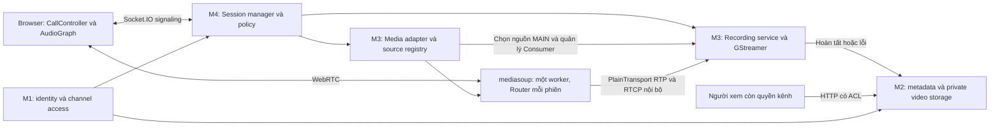
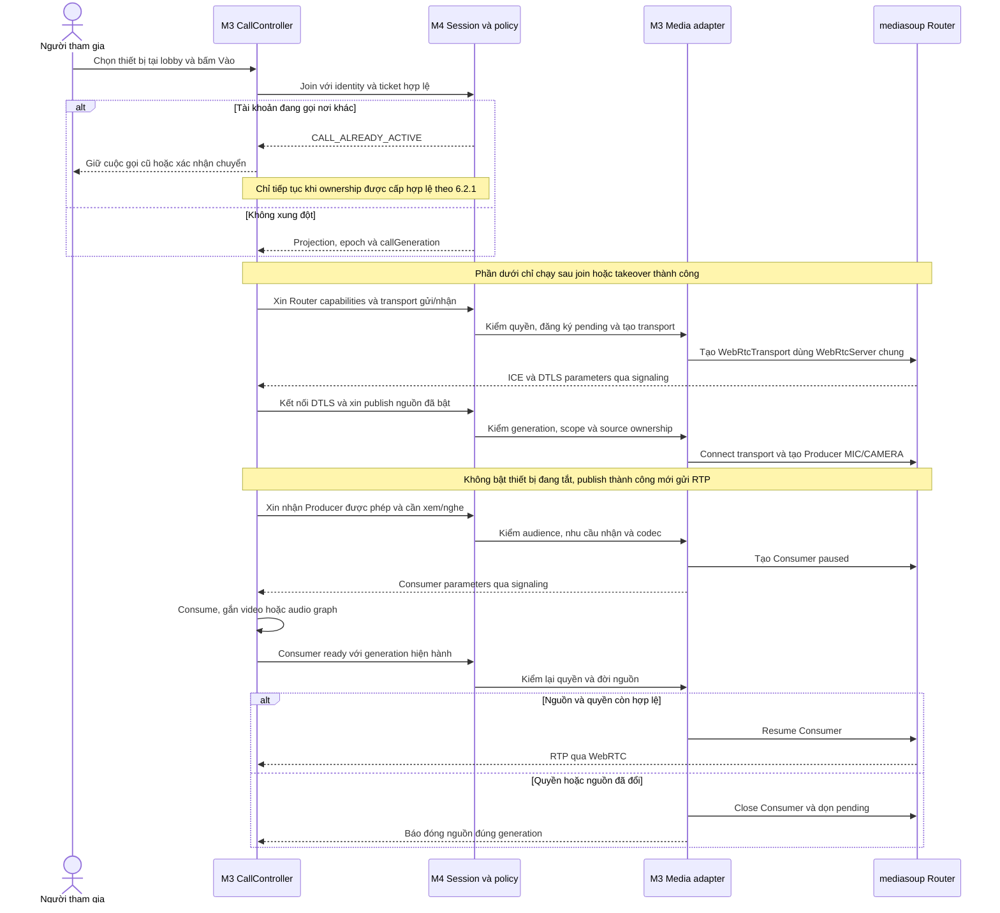
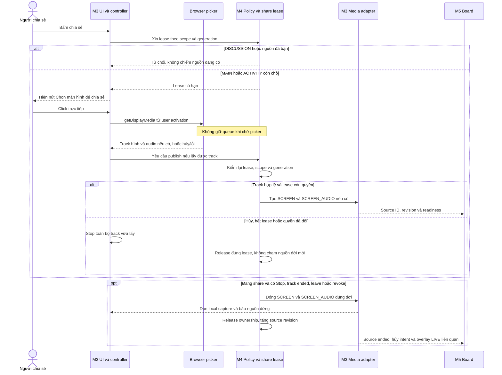
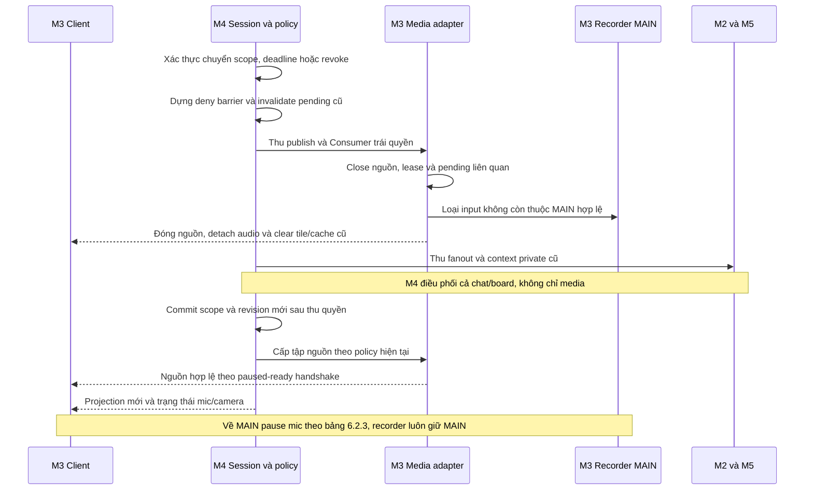
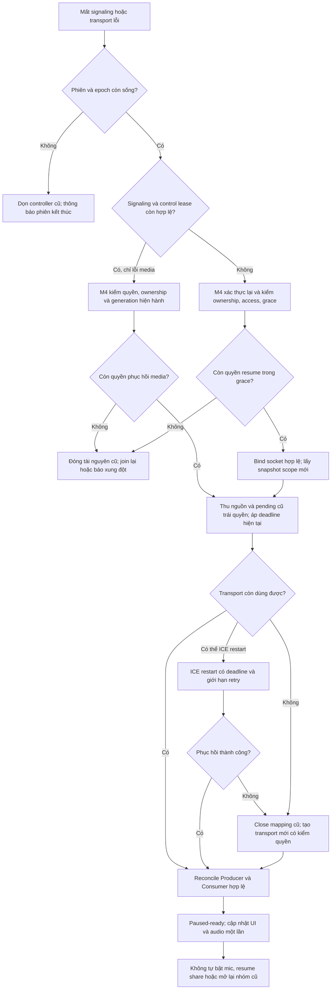
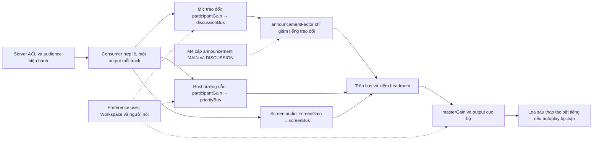
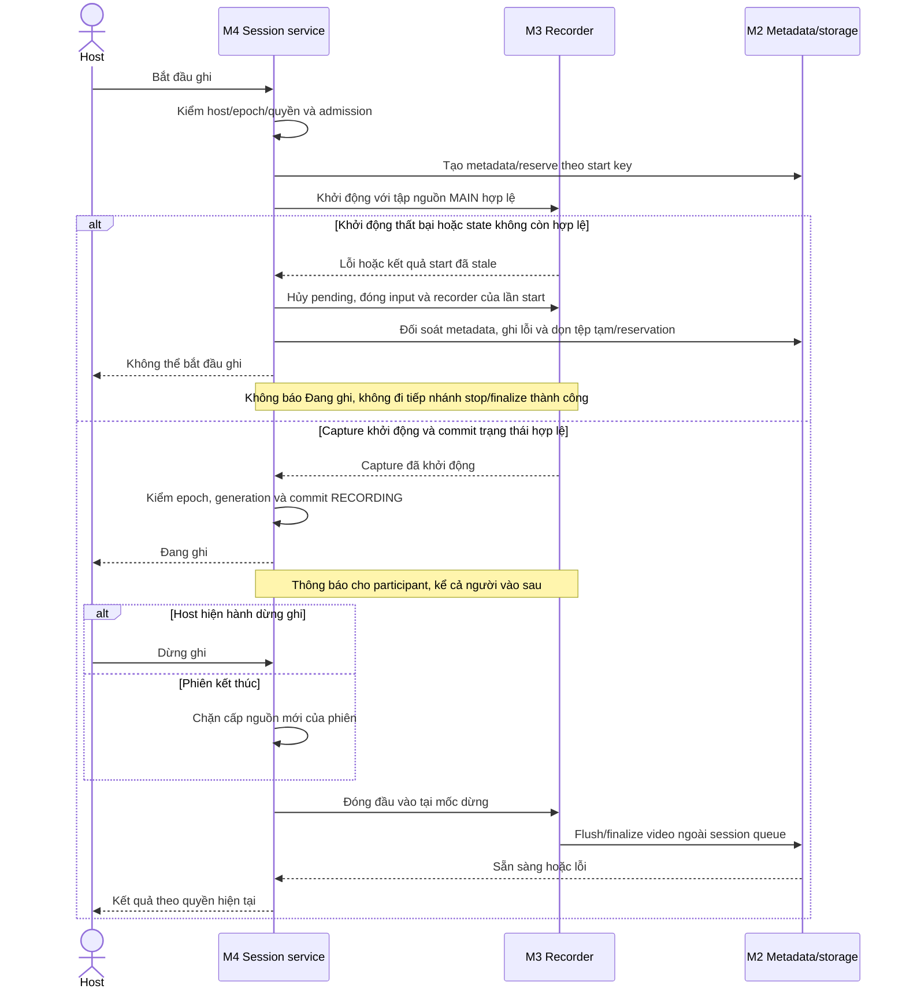

# M3 — Cuộc gọi, media, âm thanh và ghi hình MAIN

**Status:** Draft để review · **Ngày:** 03/11/2026 · **Người phụ trách:** Việt · **Reviewer cần phối hợp:** M4, M2; M1/M5 review điểm giao · **Size đề xuất:** XL, cần chia task và kiểm lại sau PoC.

> **TL;DR** — Xây một bộ xử lý media dùng chung cho MAIN, DISCUSSION và ACTIVITY bằng WebRTC, mediasoup và Socket.IO. M4 quyết định quyền/vòng đời phiên; M3 tạo, đóng và đồng bộ tài nguyên truyền/nhận theo quyết định đó. Call controller tiếp tục hoạt động khi người dùng xem Workspace hoặc mở panel.
>
> Recording gắn với phiên MAIN: host bấm Bắt đầu ghi, capture thực sự khởi động, rồi ghi tới khi host hiện hành bấm Dừng hoặc phiên kết thúc. Đổi host/chuyển nhóm/người bắt đầu ghi đã bàn giao rồi rời không tự dừng bản ghi. Sau khi dừng, Record mới tạo đoạn/tệp mới. M2 cung cấp xem lại đúng quyền. Recorder do app server quản lý; pipeline mediasoup PlainTransport → GStreamer đã chọn, cần kiểm chứng qua PoC, không phụ thuộc mức âm lượng cá nhân của host.
>
> Phạm vi có 9 FR chính. WBS và khoảng effort ở cuối là ước lượng kỹ thuật ban đầu, chưa phải lịch cam kết. Proposal không triển khai code, không thay schema hoặc quyết định sản phẩm tại nguồn.

## 1. Context

Theo [chia miền](../product/delivery-domains.md), M3 phụ trách FR-05-01–05, FR-08-01–02 và FR-15-01–02. Nguồn nghiệm thu là [FR/AC](../product/functional-requirements.md), [live session](../product/live-session.md), [policy](../product/groups-media-policy.md), [group modes](../product/group-modes.md), [recording](../product/recording.md), [kiến trúc](../architecture.md) và [capacity](../capacity.md).

Kiểm source ở baseline `7ed43d9`: [media runtime](../../apps/server/src/live/media/runtime.ts) đã tạo worker/WebRtcServer và Router factory với Opus/VP8; [socket](../../apps/server/src/realtime/server.ts) vẫn từ chối handshake khi chưa có auth. Web có shell/status, chưa có lobby, call controller, transport/producer/consumer nghiệp vụ hoặc recorder. Manifests pin mediasoup 3.31.0 và mediasoup-client 3.25.3. Native smoke không chứng minh cuộc gọi/TURN/isolation chạy được.

Sau kickoff: DISCUSSION tạo ngay khi server kiểm hợp lệ, không host duyệt; người trong roster vẫn chủ động vào. Host chỉ vào hỗ trợ ACTIVITY. DISCUSSION đã có người tự đóng khi người cuối cùng chủ động rời; mất mạng đi qua grace. Recording là scope mới, không còn thuộc phần loại trừ. Thiết kế DB 13 collection trước recording cần delta riêng, không làm lại toàn bộ mô hình.

## 2. Objective

Người có quyền LIVE có thể chuẩn bị thiết bị, vào/rời cuộc gọi, nghe/xem/share đúng scope và điều chỉnh âm lượng; mọi chuyển nhóm/thu quyền đều tác động tài nguyên thật. Host có thể ghi/dừng MAIN và nhận kết quả hoàn tất hoặc lỗi rõ ràng; recorder lỗi không kết thúc cuộc gọi.

## 3. Goals / Non-goals

| Goal | Kết quả                                                                               | FR chính / phối hợp                                 |
| ---- | ------------------------------------------------------------------------------------- | --------------------------------------------------- |
| G1   | Lobby, thiết bị, vào phiên; từ chối thiết bị vẫn xem được                             | FR-05-01/03; M1/M4                                  |
| G2   | Mic/camera/share thật, một nguồn MAIN và một nguồn mỗi ACTIVITY; DISCUSSION cấm share | FR-05-03/04                                         |
| G3   | Controller giữ call qua điều hướng; rời/takeover/revoke/reconnect dọn đúng generation | FR-05-02/05; phối hợp FR-11-01–03                   |
| G4   | Volume cục bộ, tiếng giảng/nhóm và announcement không echo hoặc mở sai audience       | FR-08-01/02                                         |
| G5   | Tích hợp nguồn video và panel với board/chat/nhóm, không nhân phiên hoặc layout       | Phần tích hợp G1–G4; M2/M4/M5                       |
| G6   | Host ghi/dừng MAIN, người vào sau biết đang ghi; chỉ nguồn MAIN được ghi              | FR-15-01                                            |
| G7   | Stop/end hoàn tất và bàn giao video một lần, xử lý lỗi/cleanup                        | FR-15-02; phối hợp M2 FR-15-03                      |
| G8   | Có evidence PoC 5 người/hai mạng/forced TURN, recording và tải kết hợp                | [ADR-001](../adr/001-media-foundation.md), capacity |

**Non-goals của M3:** quản lý membership/host/roster/phase/deadline thay M1/M4; triển khai chat/file/board thay M2/M5; quay toàn bộ desktop của host, ghi nhóm riêng, rewind luồng live hoặc thêm pause recording. Không thêm Redis, nhiều app instance, media worker pool, HA hay cơ chế phục hồi cuộc họp qua restart. Các chức năng thuộc miền khác vẫn cần tích hợp, không bị cắt khỏi sản phẩm.

## 4. Các điểm cần thống nhất

Các câu hỏi dưới đây cần được M3 và các bên liên quan thống nhất trước phần triển khai phụ thuộc. Trong thời gian đó, M3 vẫn có thể thử nghiệm các luồng media độc lập. Quy tắc nghiệp vụ đã chốt áp dụng theo tài liệu nguồn.

| ID  | Nội dung cần thống nhất                                                                                                                                                                   | Bên phối hợp                      | Cần chốt trước           |
| --- | ----------------------------------------------------------------------------------------------------------------------------------------------------------------------------------------- | --------------------------------- | ------------------------ |
| Q1  | Dữ liệu và sự kiện khi vào cuộc gọi, phát/nhận media; cách M4 cấp/thu quyền và M3 dọn tài nguyên đang tạo khi trạng thái thay đổi.                                                        | M3–M4; M1 review quyền truy cập   | T4/T7                    |
| Q2  | Bố cục share chính + camera/ảnh đại diện bên cạnh đã chốt; còn cách chọn/chuyển người nói, tỷ lệ/kích thước, hiển thị khi không share/không ai nói và có đưa nét vẽ MAIN vào video không. | M3–M5 và nhóm review kết quả      | Phần ghép hình trong T11 |
| Q3  | Xác nhận M2 làm đầu mối metadata và lưu tệp theo đề xuất 6.1; thống nhất dữ liệu bàn giao, định dạng/codec và điều kiện video sẵn sàng xem, tua.                                          | M2–M3; M1 review quyền xem        | T10/T11                  |
| Q4  | Giới hạn thời lượng/dung lượng video và số bản ghi đồng thời; thời gian lưu, quyền xóa và xử lý video khi kênh/Workspace bị xóa.                                                          | M2–M3–M1 và nhóm                  | Lưu/xem thật và kiểm tải |
| Q5  | Xử lý lỗi ghi/lưu và phần dữ liệu đã thu khi hủy khởi động; có cho bắt đầu bản ghi mới khi bản trước còn xử lý không và giới hạn xử lý đồng thời.                                         | M3–M2; M4 phối hợp vòng đời phiên | T10/T11                  |

**Recording đã chốt:** bản ghi gắn với phiên MAIN, tiếp tục khi đổi host hoặc chuyển nhóm; host hiện hành điều khiển. Người bắt đầu ghi đã bàn giao rồi rời không làm dừng bản ghi. Bấm Dừng hoặc kết thúc phiên thì hoàn tất video; lần Record tiếp theo tạo tệp mới. Không ghi nguồn riêng của nhóm. Chi tiết và các ngoại lệ theo [vòng đời recording](../product/recording.md#vòng-đời-đã-chốt-ngày-03112026).

## 5. High-level design

Giữ topology baseline. Router chuyển tiếp RTP; Socket.IO trao đổi lệnh và thông số, không mang video Base64. Mỗi browser dùng transport gửi/nhận với nhiều track, không một transport cho từng camera. Media adapter quản lý objects, source registry, pending operations và stats; không giữ nguồn quyền thứ hai.

Frontend có một `CallController` đang sống ngoài vòng đời panel/trang room, quản lý Device, transport, track và audio nodes. Store chỉ giữ projection để render, không persist MediaStream/transport. `RoomShell` cung cấp stage và panel slot; M2 chat, M4 nhóm/host, M5 board ghép vào cùng shell.

**Thiết kế recording:** app server quản lý Recording service thuộc M3, điều phối bắt đầu/dừng và vòng đời tài nguyên theo quyền/state M4. Recorder có context chỉ đọc MAIN gắn session/epoch/recording generation; server cấp đúng các nguồn MAIN hợp lệ. Tập nguồn ghi độc lập với layout/pin/viewport và volume/mute nghe cục bộ của host. M3 ghép hình, trộn tiếng và bàn giao video cho storage M2; recorder tiếp tục khi đổi host, lỗi recorder không kết thúc cuộc gọi. Tiến trình capture/encode có giới hạn tài nguyên, do app server quản lý; giữ topology một app process/mediasoup worker, không thêm app replica hoặc worker pool. Kiến trúc và pipeline PlainTransport → GStreamer đã chọn; T9 kiểm đường ghi nguồn cố định và khả năng đóng gói; spike T11.1/T11.2 kiểm điều khiển nguồn động, rồi review cấu hình/ngân sách trước implementation.

**Pipeline chính: mediasoup PlainTransport → GStreamer.** Media adapter tạo Consumer chỉ cho các nguồn MAIN hợp lệ và xuất RTP/RTCP nội bộ sang recorder. GStreamer nhận và giải mã nguồn, dùng compositor ghép share với camera/ảnh đại diện, dùng audiomixer trộn mọi mic và screen audio MAIN, rồi encode/mux thành một tệp do M2 quản lý. Không dùng Chromium/Canvas/MediaRecorder hoặc tab host trong pipeline recording này; audio graph ở browser vẫn phục vụ playback cục bộ như 6.2.

M3 viết bộ điều khiển pipeline động qua API GStreamer: thêm/bớt input, đổi camera/ảnh đại diện, xử lý nguồn tạm không có dữ liệu và dừng có kiểm soát. Không coi một lệnh gst-launch cố định là đã xử lý được vòng đời nguồn. Ứng viên thử đầu tiên ở T9.1 là helper Python 3 + PyGObject (GObject Introspection, `gi.repository.Gst/GLib`) trên Linux để gọi API GStreamer và xử lý bus/state/EOS. Chọn hướng này để thử API pipeline động trực tiếp; chưa xác nhận khả năng đóng gói, plugin, đồng bộ hoặc tải trên máy đích. T9.1 phải kiểm runtime/binding, ghi phiên bản thực và trở ngại trước khi dùng cho bước ghi. Nếu không dùng được, ghi blocker và review ứng viên khác trong timebox, không tự đổi pipeline. Implementation sẽ pin phiên bản/plugin đã kiểm và đóng gói Linux; helper do app server quản lý, không là app replica/worker pool và không tự sở hữu quyền phiên.

**Điều khiển helper — hướng thử:** app Node khởi động helper bằng child process, truyền lệnh có recording ID/attempt qua stdin và nhận sự kiện ready/error/input-stopped/finalized qua stdout dạng JSON Lines; log vận hành đi stderr, không trộn với protocol và không chứa nội dung media/secret. App quản lý timeout, hủy pending và cleanup đúng đời; không mở cổng control công khai. Chỉ báo finalized sau EOS và xác minh tệp. Nếu quá hạn phải báo lỗi, đối soát tệp dở rồi mới cưỡng chế đóng đúng process theo lifecycle. Protocol, backpressure và packaging được kiểm trong PoC, chưa có helper chạy thật. Tham khảo [PyGObject](https://pygobject.gnome.org/) và [pipeline manipulation](https://gstreamer.freedesktop.org/documentation/application-development/advanced/pipeline-manipulation.html).

**Chọn input và readiness — hướng thử:** ngoài screen MAIN, recorder chỉ nhận/giải mã camera MAIN được chọn để ghép hình; không mặc định giải mã mọi camera. Audio vẫn nhận mọi MIC và SCREEN_AUDIO MAIN hợp lệ, độc lập camera đang chọn. M3/M4 kiểm quyền trước tạo Consumer paused → helper chuẩn bị receiver/pipeline và xác nhận sẵn sàng đúng attempt → server kiểm lại quyền/generation rồi resume Consumer → chờ frame giải mã hợp lệ trước khi đưa vào hình ghép. Với nguồn chưa có keyframe hoặc tạm hết dữ liệu, thử nền/ảnh đại diện và nhánh audio im lặng để giữ output, đo thời gian chờ; không coi fallback hoặc đồng bộ đã được giải quyết. Khi revoke phải tháo input và xóa frame/cache cũ, không giữ hình mất quyền làm fallback. Thử chuyển camera và dữ liệu gián đoạn sau khi bước nguồn cố định đạt.

**Đồng bộ:** thiết kế RTP payload type/SSRC/clock-rate và RTCP tương ứng với Consumer thực của mediasoup, xử lý jitter/timestamp và ánh xạ vào clock chung của pipeline. rtpbin là hướng tích hợp RTP/RTCP để kiểm chứng; không coi thứ tự gói đến hoặc timestamp của các nguồn khác nhau là cùng gốc thời gian. Composition/mix cần decode rồi encode, không dùng stream copy để thay bước ghép hình/trộn tiếng. Codec/container, độ phân giải/fps/bitrate và khả năng playback/seek chốt với M2 sau PoC, không chọn chỉ bằng đổi đuôi tệp.

**PoC sớm, chia hai bước:**

- **Bước 1 — T9, tập nguồn cố định:** dùng fixture mediasoup cô lập trên Linux dự kiến triển khai, nguồn audio/video kiểm soát được và source descriptor tối thiểu; không chờ hoàn tất T4/T5/T6, UI sản phẩm hoặc policy M4. Chốt tập nguồn trước chạy (một screen, một camera và một mic cố định); giữ hình/tiếng tham chiếu để kiểm tệp phát/seek được, stop/EOS/finalize và đoạn dữ liệu cuối. Không đưa thêm/bớt nguồn hoặc tự chọn người nói vào điều kiện đạt bước này. Đo start/stop/finalize, lệch tiếng–hình đầu/giữa/cuối, CPU/RAM/disk và resource sau cleanup; fixture không nằm trên route sản phẩm.
- **Bước 2 — spike T11.1/T11.2 sau T9:** thử thêm/bớt nguồn, chuyển camera, chưa có keyframe và nguồn mất dữ liệu; kiểm readiness/fallback, continuity và đồng bộ. Chưa cam kết cách xử lý thành công hoặc công triển khai trước kết quả bước 1. Sau các spike mới chốt task implementation T11 còn lại với M2/M4, rồi kiểm start/cancel/stop/end, revoke và lỗi theo 6.5.

T9 có ngân sách thử đầu tiên 16 giờ, chia task tối đa 8 giờ ở mục 9; đây là timebox để trả lời tính khả thi, không phải lời hứa pipeline sẽ chạy trong 16 giờ. Ghi binary/plugin versions, máy/Linux, cấu hình, số input, kết quả từng bước hoặc blocker kể cả chưa có clip. Mỗi task hết timebox phải dừng đánh giá và báo nhóm; nếu cần thử tiếp phải review ngân sách, phạm vi và estimate trước khi mở rộng. T9.4 tổng hợp quyết định tiếp tục/điều chỉnh/chưa đủ bằng chứng; không tự đổi pipeline hoặc cắt chức năng.

Ngưỡng chấp nhận được nhóm review trước phép đo, không chọn sau khi thấy kết quả. Clip fixture phát được chưa chứng minh MAIN selector, ACL/isolation, storage sản phẩm hay capacity. T11/T15 vẫn phải kiểm với auth/policy và M2 thật, tải kết hợp cuộc gọi/chat/board/TURN. Chưa có benchmark chứng minh nhẹ hơn headless hoặc đạt capacity.

## 6. Detailed design

### 6.1. Database và ownership

M3 không persist transport/Producer/Consumer, track, audio graph hoặc mọi thay đổi camera tile vào MongoDB. Metadata phiên/participant do M4 triển khai theo [collection-design](../database/collection-design.md); quyền runtime không được phục hồi từ DB sau restart.

**Delta recording đề xuất để M2 review:** M2 làm đầu mối schema/repository và private storage; M3 sở hữu state machine/pipeline và gọi service metadata. Tách thông tin quá trình ghi với tài nguyên byte để không tạo hai kho video cạnh tranh.

| Nhóm metadata đề xuất | Dữ liệu / invariant                                                                                                            |
| --------------------- | ------------------------------------------------------------------------------------------------------------------------------ |
| Định danh và phạm vi  | Recording ID; Workspace, kênh LIVE, LiveSession, epoch; người bắt đầu; cùng scope do server xác lập                            |
| Vòng đời              | Trạng thái, revision; thời điểm yêu cầu/bắt đầu thực tế/dừng/hoàn tất; lý do dừng và mã lỗi vận hành không chứa nội dung riêng |
| Kết quả               | Tham chiếu tài nguyên video M2 quản lý, MIME/codec/duration/size đã kiểm; chỉ mở xem khi hoàn tất                              |
| Retry và cleanup      | Khóa bắt đầu ổn định, processing attempt/generation, lịch dọn và reservation quota; tên field/constraint chốt cùng M2          |

Phương án vật lý ưu tiên review: metadata quá trình trong collection `recordings`, byte resource tiếp tục do `files`/private storage quản lý với purpose/binding mới phù hợp recording. Đây là **đề xuất delta**, không tuyên bố đã thêm collection thứ 14 hoặc enum `RECORDING` vào baseline/executable schema. Nếu M2 chọn mở rộng file metadata, phải chứng minh biểu diễn đủ state/retry/queries và không có hai nguồn trạng thái song song.

Index dự kiến cần cụ thể hóa: tra nhiều đoạn theo channel/session + cursor; uniqueness cho start retry và tối đa một capture khởi động/ghi/dừng mỗi phiên nếu phương án Q5 được chấp thuận; tìm cleanup/processing dở dang. Không dùng unique session ID đơn thuần vì một phiên có thể có nhiều đoạn riêng. PROCESSING có nằm trong constraint admission hay không phải khớp quyết định Q5. Không tự tạo mọi unique bằng validator; chạy trên Mongo pin trong DB test. Không TTL metadata trước khi dọn byte. Không backfill giả bản ghi cho phiên cũ; preflight DB hiện có và migration/rollback thuộc task implementation được giao riêng.

Quota video không tự lấy 10 MiB attachment hoặc 20 MiB frame/session áp vào recording; không giữ video vô hạn. Chốt giới hạn bytes/in-flight/disk và retention trước lưu/xem thật. Byte video ở kho private, không nhúng MongoDB; không phục vụ qua public static URL. Quyền xem là membership + channel access hiện hành, không danh sách participant cũ; M2 phải thu stream/Range retry sau revoke theo [lifecycle](../database/lifecycle.md).

### 6.2. Contract và luồng thực thi

Các tên command/interface dưới đây là **đề xuất cho review**, chưa là schema export. Dùng [envelope/error](../contracts/README.md) chung, validate strict và giới hạn bytes/array/ID. Actor, source ownership và quyền scope do server tra. Schema media cần giữ cấu trúc RTP/DTLS mà thư viện pin cần, không dùng `unknown` không giới hạn làm contract hoàn thành.

| Nhóm giao tiếp                             | Input/output chính                                                                              | Kiểm quyền, retry và lỗi                                                                                         |
| ------------------------------------------ | ----------------------------------------------------------------------------------------------- | ---------------------------------------------------------------------------------------------------------------- |
| M4 join/projection → M3                    | participant, session/epoch, callGeneration, revision, source descriptors và transport bootstrap | Identity/access hợp lệ; `CALL_ALREADY_ACTIVE` cần xác nhận; không lập call registry khác                         |
| `media.transport.create/connect`           | Direction, transport ID, DTLS; trả ICE/DTLS parameters/candidates                               | Transport đúng owner/generation; pending timeout/cancel phải close; không tin ID client                          |
| `media.producer.create/pause/resume/close` | Transport, source kind, RTP parameters; ack producer/source ID                                  | canPublish, đúng scope và lease SCREEN; một MIC/CAMERA/generation; client appData không cấp quyền                |
| `media.consumer.create/ready/close`        | Producer ID, receive capabilities; ack consumer parameters                                      | canConsume + codec tại create và ready, dedupe receiver/producer; revoke đóng Consumer                           |
| `screen.acquire/release`                   | Scope dự kiến, request ID; lease/source revision và expiry                                      | M4 kiểm scope hiện tại; giữ chỗ nguyên tử; `SHARE_BUSY`, stale/expiry; callback cũ không release nguồn mới       |
| Media adapter nội bộ                       | publish, closeProducer, reconcileAllowedSources, closeParticipant, getStats                     | M4 điều phối; adapter đăng ký pending, kiểm generation sau await và trả kết quả cleanup                          |
| M3 → M5                                    | Video handle, readiness, source scope/ID/revision; source changed/ended                         | Chỉ nguồn actor được xem; freeze frame/context do M5 giữ, không đồng nhất source đổi với xóa FROZEN hợp lệ       |
| `recording.start/stop`                     | Session envelope; stop có recording ID/revision; ack trạng thái hiện hành                       | M4 kiểm host hiện hành; start retry trả cùng intent; stop/end hội tụ, lỗi không ảnh hưởng call                   |
| `recording.state`                          | ID, revision, trạng thái và mốc thời gian cần hiển thị                                          | Projection theo audience hợp lệ; không gửi storageKey/process token hoặc URL không có ACL                        |
| M3 ↔ M2 recording storage                  | Reserve, append/write, finalize, fail/cleanup; artifact descriptor đã kiểm                      | Writer chỉ đúng bản ghi/attempt; bounded backpressure; READY sau xác minh đủ tệp/metadata, không chỉ có stop ack |

Lỗi tái dùng khi phù hợp: `FORBIDDEN`, `STALE_STATE`, `SOURCE_CHANGED`, `SHARE_BUSY`, `CALL_ALREADY_ACTIVE`, `QUOTA_EXCEEDED`, `SESSION_ENDED`, `MEDIA_UNAVAILABLE`. Lỗi recorder/storage cụ thể được M2–M3 bổ sung sau review; không trả raw process stderr/DB error cho client.

**Join và nhận nguồn:** M4 xác lập participant → client nạp Router capabilities → tạo transport gửi/nhận và DTLS → publish nguồn được phép. Consumer tạo paused ở server, client gắn track rồi báo ready; kiểm lại quyền/epoch/generation/deadline trước resume. `router.canConsume()` chỉ chứng minh codec, không thay ACL.

Scaffold hiện chỉ export Router factory, chưa export cách tạo WebRtcTransport dùng WebRtcServer chung. T4 cần bổ sung factory/adapter này và đường báo worker chết cho M4; log/readiness hiện có chưa đóng phiên hoặc dọn tài nguyên nghiệp vụ. Recorder dùng PlainTransport/Consumer nội bộ với context session/epoch/recording generation do server cấp, không đăng nhập bằng cookie host hoặc giả participant. M3–M4 kiểm nguồn tại create/resume và thu quyền, đóng Consumer/transport/pending khi context hết hiệu lực. Cổng RTP/RTCP và control helper chỉ dùng trong mạng nội bộ được cấu hình; không mở handshake anonymous hoặc expose các cổng này ra Internet.

**Share:** xin lease → hiện nút Chọn màn hình để chia sẻ → click trực tiếp gọi getDisplayMedia → kiểm lại lease/scope trước publish. Không giữ queue khi chờ picker; audio không có thì share hình vẫn hợp lệ. Dừng/hủy/browser Stop/mất quyền đóng SCREEN và SCREEN_AUDIO, trả đúng lease, tăng source revision và báo M5.

**Chuyển scope/revoke:** M4 dựng deny barrier → M3 đóng media/pending trái quyền → M4 commit state hợp lệ → M3 cấp nguồn mới → trả projection. Giữ nguồn còn hợp lệ, chẳng hạn bài giảng MAIN khi vào DISCUSSION; không dựng lại toàn bộ call chỉ vì đổi nhóm. Thao tác async hoàn tất muộn phải tự close nếu state đã cũ. Không lấy khóa Workspace/channel ngược từ session queue; không chờ picker/upload/client ack/encode trong queue. Lỗi giữ quyền đã thu ở trạng thái đóng và reconcile; không phát tiếng riêng để che lỗi chuyển tiếp.

**Audio:** một output path/track; video element muted khi audio được Web Audio phát; mic local không loop ra loa. Giữ master/participant/bus gain và announcement factor riêng. DISCUSSION nhận host hướng dẫn + screen audio MAIN + tiếng nhóm; ACTIVITY chỉ nhóm/host hỗ trợ. Khi announcement kết thúc/timeout chỉ bỏ factor, không ghi đè mute/volume người nghe. Có thao tác bật tiếng nếu autoplay bị chặn.

#### 6.2.1. Xung đột cuộc gọi và xác nhận chuyển

Registry toàn tài khoản và quyết định takeover thuộc M4; M3 hiển thị và thực thi cleanup. Mở kênh/tab hoặc vào lobby không tự chiếm cuộc gọi đang hoạt động. Khi join trả `CALL_ALREADY_ACTIVE`, UI cho chọn giữ cuộc gọi cũ hoặc xác nhận chuyển sang phiên đích; chỉ hiển thị metadata cuộc gọi mà actor còn được phép đọc.

- Hủy/đóng hộp xác nhận: không gửi takeover, không thay call cũ; dọn preview/ticket/pending của lần join bị hủy theo lifecycle. Không đóng track thuộc controller đang gọi khi dọn preview lobby.
- Xác nhận: server kiểm lại auth, quyền kênh đích và ownership hiện hành; deny/đóng tài nguyên call cũ trước cấp generation mới. UI thể hiện đang chuyển, không bật song song hai cuộc gọi. Nếu đích thất bại sau khi call cũ đã đóng, báo lỗi và cho join lại hợp lệ; không tự hồi quyền cũ từ cache.
- Callback/ack/disconnect cũ chỉ tác động đúng session/epoch/generation. Hai tab cùng xác nhận phải qua registry M4 và đối soát generation; tab thua không tự retry takeover cuộc gọi mới. Mọi cleanup idempotent, compare-and-delete đúng đời.

#### 6.2.2. Reconnect control và media

Theo [control lease và vòng đời](../product/live-session.md#11-reconnect-và-vòng-đời-tài-nguyên), M4 sở hữu trạng thái RECONNECTING, ticket/ownership, grace và snapshot quyền; M3 báo tình trạng transport và reconcile media. UI phân biệt mất kết nối điều khiển với lỗi truyền media. Mất Socket.IO không chứng minh RTP đã ngừng; không chờ client tự mute để thu quyền.

| Tình huống                                                      | M4 điều phối                                                                                                               | M3 xử lý và đầu ra kiểm được                                                                                                                                                                           |
| --------------------------------------------------------------- | -------------------------------------------------------------------------------------------------------------------------- | ------------------------------------------------------------------------------------------------------------------------------------------------------------------------------------------------------ |
| Signaling disconnect hoặc control lease hết hạn, RTP có thể còn | Chặn mutation mới, kết thúc announcement; grace tối đa 30 giây theo nguồn hiện hành, vẫn áp dụng kick/move/revoke/deadline | Reconcile Consumer theo scope hiện tại, không đưa mic hỗ trợ thành tiếng MAIN; nguồn còn giữ phải tuân lease/policy và đóng chậm nhất cuối grace                                                       |
| Reconnect trong grace                                           | Auth/Origin/CSRF lại; kiểm ownership/current access; dùng resume ticket một lần và projection mới                          | Đối soát resources còn hợp lệ với snapshot, bỏ event/cache scope cũ; giữ hoặc tạo lại transport theo tình trạng thật, không nhân Producer/Consumer/audio node                                          |
| ICE/transport failed khi phiên và quyền còn hợp lệ              | Cho phép thao tác phục hồi trong đúng generation                                                                           | Thử ICE restart có giới hạn khi transport còn dùng được; nếu không phục hồi thì close mapping cũ và tạo transport/nguồn thay thế có kiểm quyền. Chốt timeout/số lần thử qua T1/T14, không retry vô hạn |
| Quá grace hoặc ownership đã sang thiết bị/tab khác              | Đóng participant cũ; join lại hoặc trả xung đột theo registry                                                              | Dọn tracks/transports/audio/pending đời cũ; không dùng resume/ticket cũ để giành call mới hoặc khôi phục mic/share                                                                                     |
| Nhóm/round đóng, đổi scope hoặc mất access trong lúc reconnect  | Snapshot hiện tại và deadline là nguồn quyết định                                                                          | Không mở lại nhóm, reset countdown hoặc resume share từ cache; về MAIN pause mic theo policy. Share cần thao tác và lease hợp lệ mới                                                                   |
| Worker/app restart hoặc session đã kết thúc                     | Invalidate epoch/runtime cũ, kết thúc phiên theo baseline                                                                  | Dọn controller/resources cũ, báo phiên đã kết thúc; chỉ join phiên hợp lệ mới, không dùng ICE restart để giả phục hồi cuộc họp cũ                                                                      |

Đồng bộ pause/close giữa client và server bằng event/ack có generation; không giả việc gọi `close()` tại một phía tự cập nhật nghiệp vụ phía kia. Retry có deadline/backoff và hủy khi state đổi; mỗi thao tác async đăng ký pending trước await, kiểm lại quyền/generation khi hoàn tất. Kiểm riêng signaling rớt trong khi RTP vẫn chạy và network đổi làm ICE lỗi. Chưa coi mock reconnect là bằng chứng transport phục hồi thật.

#### 6.2.3. Chuyển phòng, host và trạng thái thiết bị

Bảng này diễn giải [policy](../product/groups-media-policy.md) để M3–M4 cùng triển khai, không tạo policy riêng. Trạng thái nút mic/camera cần phân biệt lựa chọn thiết bị với quyền phát hiện tại; server pause phải được thể hiện trên UI, không hiển thị đang phát khi Producer bị chặn.

| Chuyển trạng thái                                 | Mic/camera                                                                                                                           | Share, nguồn nhận và recording                                                                                                                          |
| ------------------------------------------------- | ------------------------------------------------------------------------------------------------------------------------------------ | ------------------------------------------------------------------------------------------------------------------------------------------------------- |
| MAIN → DISCUSSION sau join hợp lệ                 | Thu audience MAIN cũ trước cấp nguồn nhóm theo policy; không tự bật thiết bị đang tắt                                                | Nhận bài giảng MAIN và nguồn nhóm được phép; không share riêng. Đóng nguồn tự phát đã mất quyền scope, loại mic/camera người chuyển khỏi input ghi MAIN |
| MAIN/nhóm → ACTIVITY hợp lệ                       | Thu scope cũ rồi cấp nguồn đúng nhóm; không tự bật thiết bị                                                                          | Không nhận MAIN mặc định; chỉ share khi lease nhóm trống, một nguồn/ACTIVITY. Recorder giữ MAIN, không theo người chuyển                                |
| Thành viên tự về MAIN hoặc nhóm đóng/hết deadline | Pause mic tại server để người dùng tự bật lại; camera đang bật chuyển audience MAIN, UI thông báo rõ; người đã ở MAIN không bị reset | Thu media nhóm/share cũ trước cấp MAIN; không mang frame/chat/board riêng ra MAIN. Recorder chỉ nhận lại nguồn MAIN hợp lệ sau commit                   |
| Host vào hỗ trợ ACTIVITY                          | Thu scope hướng dẫn trước cấp mic/camera vào đúng nhóm hỗ trợ; không đồng thời phát hỗ trợ ra MAIN/nhóm khác                         | Thu group hỗ trợ cũ nếu chuyển nhóm; không được vào hỗ trợ DISCUSSION. Recorder không ghi tiếng/camera hỗ trợ                                           |
| Host chủ động rời hỗ trợ về MAIN                  | Giữ trạng thái mic: bật thì phát theo MAIN/hướng dẫn sau chuyển hợp lệ, tắt vẫn tắt; không thêm xác nhận mic riêng                   | Thu quyền nhóm trước cấp MAIN; recorder cập nhật theo nguồn MAIN hợp lệ                                                                                 |
| Help bị dọn do lỗi/timeout/nhóm đóng              | Không tự phát tiếng hỗ trợ ra MAIN; pause theo cleanup policy                                                                        | Thu nguồn/quyền hỗ trợ cũ, snapshot scope mới trước cấp nguồn; không tự quay lại help                                                                   |
| Bàn giao/hoàn quyền host                          | Host mới không tự bật thiết bị; mic đang bật ở scope cũ bị pause tới xác nhận scope điều hành. Thu help/announcement/quyền host cũ   | MAIN share còn hợp lệ tiếp tục, không đóng chỉ vì đổi role; recording tiếp tục theo phiên, quyền điều khiển thuộc host hiện hành                        |
| Rời LIVE hoặc mất quyền                           | Đóng tài nguyên cá nhân thật; host còn quyền chủ động rời dùng kết thúc phiên cho mọi người, khác rời help                           | Thu share/Consumer/pending; khi end tự dừng ghi theo 6.3. Đóng tab/crash đi qua disconnect/grace, không tự coi là lệnh kết thúc hợp lệ                  |

Các nhánh host không có ứng viên/host tạm tiếp tục mất mạng và DISCUSSION rỗng sau sự cố vẫn là điểm mở tại nguồn; bảng không tự chốt fallback.

#### 6.2.4. Camera theo viewport/pin và danh sách participant

Danh sách participant lấy projection M4, không suy từ số camera/Consumer đang nhận. Khi share, stage ưu tiên nội dung và camera ở sidebar. Theo [capacity](../capacity.md#2-media-theo-nhu-cầu-xem), thử tối đa 4 camera từ xa/client; gate 5 vẫn hiển thị đủ camera hợp lệ, không giới hạn số người được bật camera.

Client tính tập camera cần xem từ tile đang hiện/pin và gửi nhu cầu có giới hạn tới server; thứ tự ưu tiên khi vượt ngân sách chốt trong T16/UI review. Server giao nhu cầu này với ACL hiện tại rồi mới create/resume Consumer. Nguồn ngoài viewport được pause/close thật theo lifecycle; khi hiện lại phải kiểm quyền/generation và tái dùng hoặc tạo Consumer paused-ready hợp lệ. Debounce/batch và giới hạn pending để scroll/pin nhanh không làm queue tăng vô hạn; đo cả Consumer paused còn giữ tài nguyên.

Audio subscribe độc lập với camera: cuộn mất tile không làm mất tiếng hợp lệ; mất quyền scope phải đóng cả nguồn trái quyền dù camera đang pin. Không mặc định thêm simulcast/SVC trước khi có profile; nếu chọn layer phải kiểm capability/config thật. Recorder có tập input riêng theo Q2, không sao chép viewport/pin hoặc giới hạn camera của một client.

#### 6.2.5. Preference âm lượng và announcement

Preference lưu cục bộ theo user/Workspace/người nói, không theo Producer ID tạm; đổi thiết bị, recreate Producer hoặc reconnect cùng người vẫn áp lại lựa chọn đó khi nguồn còn quyền. M3 quản lý cách lưu/version và xóa context khi đổi tài khoản, không ghi từng thay đổi volume vào MongoDB hoặc áp preference của người này cho người khác.

`effectiveGain = master × participantGain × busGain × announcementFactor`; mỗi track đi một bus/output. Announcement chỉ giảm discussionBus, không giảm chính host được ưu tiên hoặc screenBus. Kết thúc/timeout tối đa 30 giây/host mất kết nối/thu quyền phải bỏ factor; giữ nguyên mute/volume đã chỉnh, kể cả người nghe đổi volume trong khi announcement đang chạy. M4 quyết định audience MAIN/DISCUSSION, ACTIVITY không nhận và host phải rời help về MAIN trước.

Ramp gain để tránh tiếng bật đột ngột; nhiều nguồn cộng vẫn có thể clipping dù từng gain ≤1, cần thử headroom/limiter trong T8. Kiểm autoplay bị chặn có nút bật tiếng, volume 0 không thay ACL và không ảnh hưởng âm lượng bản ghi MAIN. Những preference này chỉ tác động playback cục bộ, không pause Producer/mic của người nói.

#### 6.2.6. Sơ đồ media thường

Các sơ đồ dưới mô tả luồng đích để review T1–T8/T14, chưa là evidence đã triển khai. M4 giữ quyền/state; M3 giữ tài nguyên media. Lệnh/ack đi qua signaling, âm thanh/video đi qua WebRTC với SFU.

**A. Vào cuộc gọi, phát mic/camera và nhận nguồn**

Mũi tên Router → client mang parameters là đường trả kết quả qua server/signaling, không có kênh điều khiển trực tiếp Router–browser. Trong mediasoup-client, callback connect/produce điều phối từng bước DTLS/Producer; sơ đồ gộp hai bước để đọc tổng thể. Một transport nhận có nhiều Consumer; không tạo transport mới cho mỗi tile.

**B. Share: giữ chỗ, browser picker, publish và dừng**

Hủy picker chỉ release lease, không gửi publish với track rỗng. Stop từ UI/browser phải báo server; revoke từ server phải báo client. Nếu socket mất, control lease/grace bảo đảm server cleanup; không phụ thuộc duy nhất vào callback browser. Frame nhóm đã FROZEN hợp lệ vẫn theo lifecycle M5, không xóa chỉ vì nguồn live dừng.

**C. Chuyển phòng hoặc thu quyền: đóng scope cũ trước cấp scope mới**

Giữ nguồn vẫn hợp lệ như bài giảng MAIN của DISCUSSION; không đóng toàn bộ transport vì đổi phòng. Thao tác thất bại giữ deny barrier cho quyền đã thu và reconcile, không tiếp tục phát private để chờ khôi phục. Không giữ queue khi chờ client ack hoặc I/O dài; hoàn tất muộn phải kiểm lại generation/revision.

**D. Reconnect: đối soát quyền trước phục hồi media**

Lỗi transport khi signaling/control lease vẫn hợp lệ đi thẳng qua kiểm quyền hiện hành để sửa media, không bắt buộc dùng resume ticket hoặc đi qua grace. Chỉ nhánh mất signaling/control lease đi qua xác thực lại, resume và bind socket theo 6.2.2; grace vẫn được server áp dụng khi client chưa kết nối lại. Cả hai nhánh đều kiểm scope/deadline hiện tại, không phục hồi bằng snapshot client cũ. Nếu quyền/generation đổi ở bất kỳ bước async nào, hủy bước đó và dọn tài nguyên vừa tạo; nếu signaling mất trong lúc sửa media, chuyển sang nhánh resume.

**E. Audio playback: policy cấp nguồn trước, volume xử lý sau**

Tên bus biểu diễn vai trò trộn tiếng, không tự cấp quyền: ACTIVITY chỉ có nguồn nhóm/host hỗ trợ, không nhận tiếng giảng MAIN. Mic local không nối vào loa. Recorder dùng graph MAIN độc lập, không nhận thay đổi volume/pin của người nghe; đổi Producer vẫn áp preference theo người nói.

### 6.3. Recording: thời điểm, nguồn và trạng thái

**Bố cục bản ghi:** khi có share MAIN, nội dung share nằm ở vùng hình chính; bên cạnh là ô camera người đang nói tại MAIN, hoặc ảnh đại diện nếu người đó tắt camera. Hai vùng được ghép thành một video xem lại, độc lập với layout/pin trên máy host. Âm thanh vẫn trộn tất cả mic đang phát hợp lệ và screen audio MAIN, không chỉ tiếng người đang hiện camera. Hướng thử chỉ nhận/giải mã camera được chọn; screen và toàn bộ audio MAIN hợp lệ có đường input riêng. T9 kiểm nguồn cố định trước; cách chọn/chuyển người nói, tỷ lệ/kích thước và trường hợp không share/không ai nói được review Q2 và kiểm tiếp ở spike T11.1/T11.2. Readiness, chờ keyframe và fallback theo mục 5 là hướng thử, chưa có kết quả xác nhận.

Đề xuất giới hạn thực thi để review Q5: mỗi phiên tối đa một capture đang khởi động/ghi/dừng. Việc cho phép capture mới trong khi tệp trước còn PROCESSING phụ thuộc admission/quota đã thống nhất với M2. Retry cùng start key trả bản ghi cũ, không tạo job mới; sau khi dừng, Record mới dùng ý định và ID mới. Lệnh điều khiển kiểm host/revision hiện hành; kết thúc theo lifecycle M4, không có trigger stop riêng cho disconnect người bắt đầu ghi. Các nhánh không có ứng viên host/host tạm tiếp tục mất mạng vẫn theo điểm mở live-session.

Trạng thái đề xuất: `STARTING → RECORDING → STOPPING → PROCESSING → READY`; các bước có thể sang `FAILED` khi đã xác định thất bại. Chưa chốt enum thực thi. Đăng ký intent/revision ngắn trong queue, nhả queue cho capture/encode/storage, rồi kiểm lại trước commit trạng thái và phát event. Không ghi FAILED chỉ vì DB commit mất ack; read-back/reconcile trước xác lập kết quả.

- Nếu host hiện hành bấm Dừng khi trạng thái còn STARTING, server ghi nhận hủy lần start, chặn commit RECORDING và dọn pending/input/process/reservation đúng recording ID và generation. Callback start đến muộn phải tự đóng tài nguyên, không bật ghi hoặc phát trạng thái Đang ghi trở lại; retry Dừng không tạo job mới. Khi phiên kết thúc trong STARTING cũng hủy tương tự. Nếu đã thu được byte trước khi xác nhận hủy, việc giữ hay bỏ phần đó cần thống nhất tại Q5; chưa được báo READY hoặc xóa phần dữ liệu này như một policy đã chốt. Dữ liệu tạm phải được theo dõi trong lifecycle cleanup hữu hạn.
- UI phân biệt Đang bắt đầu, Đang ghi, Đang hoàn tất và Sẵn sàng/Lỗi. `startedAt` là lúc capture hoạt động, không giả ghi được thời gian từ click nếu khởi động mất thời gian; lỗi start không hiện đang ghi. Đánh giá độ trễ start trong PoC.
- Recording tiếp tục khi chuyển host hoặc người bắt đầu ghi đã bàn giao rồi rời; khi quay lại chỉ đồng bộ trạng thái hiện hành, không tạo đoạn mới. Host chưa bàn giao mà chủ động rời làm kết thúc phiên và dừng ghi theo baseline. Bấm Stop/kết thúc phiên mới chốt đoạn; Record sau đó tạo ID/tệp mới, retry cũ không sinh đoạn mới. M2 hiển thị các đoạn riêng theo phiên/thời điểm. Mất mạng tuân lifecycle M4, không dừng ghi chỉ vì socket người bắt đầu ghi mất.
- Host bấm Dừng ghi chỉ dừng recorder. Host kết thúc phiên cũng tự dừng, nhưng không phải đợi encode/video READY mới đóng cuộc gọi. Khi end, chốt đầu vào/flush phần đã nhận và dọn media theo thứ tự; finalize ngoài queue, có thời hạn và lỗi thật.
- Server lọc nguồn MAIN ở lúc đăng ký, sau await và khi membership/scope/host/help đổi. Không subscribe nhóm riêng rồi dựa volume=0 hoặc ẩn tile. Recorder không dùng quyền host để nghe mọi nhóm; nguồn của người chuyển khỏi MAIN bị loại khỏi đầu vào. Những byte đã ghi hợp lệ trước chuyển không bị coi là nội dung phải xóa hồi tố; dữ liệu đã buffer/độ trễ thu phải được đo, không hứa thu hồi byte đã ghi/gửi.
- Audio recording trộn tất cả MIC đang phát hợp lệ tại MAIN và SCREEN_AUDIO MAIN nếu có. A nói thu A, B nói thu B, hai người nói đồng thời thu cả hai; mic tắt/được pause không bị tự bật. Chọn camera người đang nói chỉ quyết định phần hình, không lọc tiếng theo camera đang hiện hoặc viewport/pin/volume cục bộ. Mọi nguồn thuộc nhóm riêng vẫn bị loại theo policy, kể cả khi người đó vừa là người nói được chọn trước khi chuyển nhóm.
- Khi nguồn mất quyền, đóng Consumer/transport liên quan, tháo input GStreamer đúng generation, clear frame/cache/tile và audio buffer liên quan; không giữ hình người đã rời hoặc nhận tiếng nhóm riêng. Giữ output timeline/caps ổn định khi nguồn thay đổi; không có share/camera/mic vẫn có nền/tiếng im lặng, không tự bật thiết bị. Thao tác thêm/bớt input theo cơ chế pipeline động, tránh chặn hoặc treo mixer khi một input mất dữ liệu.
- Mọi queue RTP/decode/compositor/mixer/encode/write có giới hạn bytes/time/in-flight và quan sát được. Khi disk chậm hoặc encoder quá tải, xử lý theo deadline, báo lỗi ghi và dọn tài nguyên; không tích video dài trong RAM. T9 đo drift với nguồn cố định; spike T11.1/T11.2 kiểm continuity và drift khi thêm/bớt nguồn, không mặc định GStreamer tự đồng bộ đúng mọi input.
- Bắt đầu/dừng/end/late callback cùng recording ID và generation chỉ hoàn tất một lần. Lưu chunks/byte có giới hạn, có sequence/offset nếu pipeline chọn cách chia chunk; ACK stop chưa có nghĩa tệp phát được. Không giữ cả video dài trong RAM hoặc tự retry vô hạn khi disk chậm.
- Khi Stop/end, chốt mốc và ngừng nhận nguồn mới, phối hợp dừng input rồi gửi EOS để encoder/muxer hoàn tất dữ liệu cuối. Chờ hoàn tất có deadline ngoài session queue, xác minh tệp/metadata với M2 rồi mới READY; không kill process cùng Router trước khi hoàn tất mux. Hết deadline hoặc crash phải ghi nhận kết quả lỗi và cleanup/reconcile, không báo READY chỉ vì process thoát. Video đi qua writer/tệp tạm có giới hạn do M2–M3 chốt, không qua Socket.IO sản phẩm giới hạn 32 KiB.
- Đề xuất khi app/worker/recorder crash: cuộc họp theo baseline; bản ghi dở không READY. Bootstrap đối chiếu metadata và tệp tạm, đánh dấu kết quả xác minh được hoặc dọn theo policy đã review; không tự phục hồi job ghi hoặc mở nguồn epoch cũ. Chính sách cứu clip dở và các nhánh host nhiều sự cố vẫn cần Q4/Q5.

### 6.4. Rollout, cấu hình và quan sát

PR này không đổi env. Implementation sẽ phải cập nhật schema cấu hình và `.env.example` khi thêm recorder enable/admission, capture/encode deadlines, video quota/temp path và codec/profile. Chưa tự đặt default sản phẩm hoặc số recorder đồng thời trước PoC. Có thể dùng feature gate cho PoC cô lập; gate không là lý do công bố M3 hoàn thành khi recording chưa chạy.

Staging cần TLS, public announced IP, media port/TURN credentials ngắn hạn và firewall đúng [plan 17](../technical-plan.md#17-triển-khai-và-vận-hành). Compose local loopback không thay staging. Không expose recorder control/RTP nội bộ hoặc capability token cho người dùng; log không ghi token, nội dung audio/video/chat.

Metrics: số transport/producer/consumer active/paused/pending; queue wait/hold/depth; ICE/DTLS failures; join/first-frame/revoke latency; worker/app/recorder CPU/RAM, network, disk/temp/reserved bytes; recording start/finalize duration và lỗi/cleanup lag. Dùng request/session/recording IDs và generation để đối soát. Recorder có admission/bounded queues; đầy disk/overload thì báo không thể ghi hoặc lỗi ghi, giữ call hoạt động và không bỏ ACL để cứu throughput.

Deploy drain cuộc gọi theo baseline; kiểm schema/index compatibility và storage readiness trước mở recording. Rollback phải tắt nhận bản ghi mới, drain/hoàn tất hoặc đánh dấu lỗi bản đang có và dọn theo policy, giữ metadata/byte đủ để đọc và reconcile. Không hứa rollback chỉ bằng tắt flag, không chạy bản cũ không hiểu dữ liệu mới; migration/restore cần kế hoạch riêng được review.

### 6.5. Test strategy và AC tích hợp

Mỗi task có test thành công/từ chối/lỗi của chính nó; bảng dưới là phạm vi tích hợp, chưa phải kết quả đã đạt.

| Nhóm kiểm                    | Ca chính / kết quả bắt buộc                                                                                                                                                                                                                                         | Goals        |
| ---------------------------- | ------------------------------------------------------------------------------------------------------------------------------------------------------------------------------------------------------------------------------------------------------------------- | ------------ |
| Unit/state/contract          | Scope/source policy, ownership/generation, lease/retry/stale; recorder transition và host cũ bị deny; payload limits                                                                                                                                                | G1–G4, G6/G7 |
| Media integration            | Consumer paused-ready, revoke trong await, nguồn trùng, browser/app Stop, worker chết; objects về baseline                                                                                                                                                          | G2/G3        |
| Device/UI/browser            | Permission denied vẫn xem; đổi/rút thiết bị; StrictMode; điều hướng/panel không nhân call/audio; autoplay blocked                                                                                                                                                   | G1/G3/G5     |
| MAIN/nhóm/help               | DISCUSSION tạo rồi chủ động vào, không share riêng; host không vào hỗ trợ DISCUSSION; ACTIVITY hai nguồn độc lập; host help chỉ nhóm đích                                                                                                                           | G2/G4/G5     |
| Vòng đời                     | Người cuối chủ động rời DISCUSSION tự đóng và dọn media; nhóm chưa ai vào vẫn chờ; disconnect không giả leave; ACTIVITY deadline không mở lại nguồn cũ                                                                                                              | G3/G5        |
| Audio                        | Các bus nhận đúng nguồn theo scope, không loop mic local, mute/volume giữ sau announcement; host rời help chủ động khác cleanup sự cố                                                                                                                               | G4           |
| Takeover/reconnect           | Hủy xác nhận giữ call cũ; hai tab tranh takeover; callback cũ; signaling rớt khi RTP còn; ICE restart/recreate có giới hạn; trong/quá grace; scope/access đổi khi resume                                                                                            | G1/G3        |
| Camera subscription          | Scroll/pin đổi nhanh không nhân pending/Consumer; camera khuất được pause/close thật, tiếng vẫn đúng scope; revoke khi đang pin; participant list không thiếu người                                                                                                 | G2/G8        |
| Chuyển phòng và preference   | Từng hàng bảng 6.2.3; mic pause/camera audience đúng; volume giữ qua Producer đổi và chỉnh trong announcement; timeout khôi phục, nhiều nguồn không clipping                                                                                                        | G3/G4/G5     |
| PoC nguồn cố định T9         | Fixture cô lập: screen/camera/mic cố định → RTP/RTCP → helper → tệp có hình/tiếng phát và seek được; đo sync đầu/giữa/cuối, EOS/dữ liệu cuối và cleanup. Chưa kiểm ACL sản phẩm.                                                                                    | G6/G7/G8     |
| Spike nguồn động T11.1/T11.2 | Sau T9: thêm/bớt nguồn, chuyển camera, thiếu keyframe/mất dữ liệu; đo readiness/fallback/continuity và báo giới hạn/blocker. Không lấy kết quả fixture làm nghiệm thu quyền.                                                                                        | G6/G7/G8     |
| Recording pipeline           | Không share/thiết bị tắt; nguồn thay đổi; start/stop/end/race retry; đổi host và người bắt đầu ghi bàn giao rồi rời vẫn ghi tiếp; reconnect không nhân job; Stop rồi Record tạo tệp mới; flush cuối, tệp có hình/camera/tiếng khớp và phát được                     | G6/G7        |
| Recording privacy            | Host hỗ trợ ACTIVITY hoặc participant vào nhóm bị loại input MAIN; recorder không nghe nhóm; người vào sau biết đang ghi                                                                                                                                            | G6           |
| Recording audio MAIN         | A và B nói lần lượt đều có tiếng; nói chồng vẫn có cả hai; camera đang hiện A vẫn thu tiếng B. SCREEN_AUDIO MAIN có trong bản ghi khi nguồn có audio; mic tắt/pause không tự bật; pin/volume/mute nghe cục bộ không đổi tiếng bản ghi                               | G6/G7        |
| Recording start/cancel       | Dừng hoặc end phiên trong STARTING: không commit RECORDING, không hiện Đang ghi, dọn tài nguyên đúng đời; callback start muộn không hồi sinh bản ghi, retry Dừng không nhân job. Nếu đã có byte, đối chiếu policy Q5 sau khi được chốt                              | G6/G7        |
| Recording RTP/GStreamer      | Kiểm RTP/RTCP mapping, source thêm/bớt và hết dữ liệu không treo output; đồng bộ đầu/giữa/cuối clip, không drift khi đổi nguồn; EOS nhận đủ dữ liệu cuối, timeout/crash không READY giả, queue hữu hạn khi disk chậm                                                | G6/G7/G8     |
| Recording camera PoC         | Có share: vùng chính là share, ô bên cạnh hiện người nói; tắt camera phải hiện ảnh đại diện. A nói rồi B nói kiểm chuyển camera, audio MAIN liên tục. Hai người nói, im lặng hoặc không share: ghi nhận hành vi/độ ổn định để review Q2, chưa tự chốt ngưỡng chuyển | G6/G8        |
| Recording source revoke      | Người đang được chọn camera chuyển DISCUSSION/ACTIVITY hoặc host vào help: loại camera/mic khỏi input MAIN, không giữ tile hoặc nhận tiếng riêng; nguồn MAIN còn hợp lệ tiếp tục được ghi. Về MAIN chỉ nhận lại nguồn hợp lệ, mic pause không tự mở                 | G6/G7        |
| DB/file/ACL với M2           | Unknown commit, reserve/finalize lặp, disk/encode lỗi, restart, orphan; current channel/PRIVATE ACL và Range/stream sau revoke; dữ liệu không READY giả                                                                                                             | G7/G8        |
| Network và tải               | Hai mạng, forced TURN có selected relay + bytes tăng; reconnect khi RTP còn; record cùng gọi/share/chat/board, queue/quota/cleanup hữu hạn                                                                                                                          | G8           |

Gate chức năng: 5 participant, 1 host + 2 nhóm ×2; thử DISCUSSION/ACTIVITY riêng, camera đủ theo quyền, 30 phút, Chrome/Edge desktop và hai mạng. M5 cùng kiểm freeze/audio tiếp tục/resume. Forced TURN phải xác nhận selected candidate pair dùng relay, không chỉ cấu hình URL. Clip recording vài phút kiểm đủ start → stop/end → finalize → xem đúng quyền; đây là fixture PoC, không giới hạn thời lượng sản phẩm.

Mục tiêu Q-01–08 của plan giữ nguyên và chưa là SLA: join p95 ≤8 giây; screen ≤1,5 giây; revoke p95 ≤1 giây và không Consumer trái quyền sau commit; reconnect p95 ≤10 giây sau mạng ổn định. Thu số mẫu theo plan, resource count sau 20 vòng join/leave, profile/config/máy/browser/mạng và lỗi. Recording chưa có threshold/capacity đạt; sau gate 5 mới thử 10 →25 và 50 nếu đạt. Không lấy max 4 camera từ xa của client làm số camera recorder được ghi khi Q2 chưa chốt.

## 7. Impact on other domains

| Bên        | Thay đổi / contract cần review                                                                                 | Thứ tự và đầu mối                                                                         |
| ---------- | -------------------------------------------------------------------------------------------------------------- | ----------------------------------------------------------------------------------------- |
| M1         | Identity/access/expiry/revoke; controller slot trong Workspace; current channel ACL cho video                  | M1 cung cấp trước tích hợp thật; M3 có thể PoC fixture cô lập, không bypass auth sản phẩm |
| M4         | Session projection/policy, generation/pending, share lease, nhóm/help/reconnect; recorder control/input/ending | M3–M4 review T1 trước code phụ thuộc; M4 giữ state/quyền, M3 giữ objects                  |
| M2         | Chat panel; storage writer/finalize/fail, metadata/index, video list/playback/ACL/quota/cleanup                | M3–M2 review T10 trước T11; đề xuất M2 đầu mối schema cần được xác nhận                   |
| M5         | Stage/video readiness/source revision, source-end; frame giữ sau FROZEN khác overlay LIVE                      | M3 nguồn, M5 context; kiểm tích hợp T13                                                   |
| Staging/CI | TLS/TURN/public IP, browser/encoder binary nếu chọn; resource/admission/metrics/rollback                       | Chọn đầu mối chung trước T15, không tự giao cả vận hành cho M3                            |
| Contracts  | Payload/ack/event strict và typed IDs, bỏ semantics FREE/MODERATED cũ cùng M4                                  | Bên gửi/nhận review, build package trước consumer                                         |

Chưa có tên reviewer/Issue cụ thể, không gán người hoặc tạo trạng thái công việc mới trong repo. Đề xuất interface/component thay đổi trên cùng nhánh implementation tương ứng; không merge payload khác nhau ở mỗi miền.

## 8. Design evaluation

### 8.1. Effort và tính khả thi

Đây là miền lớn: frontend + server media + network/audio + pipeline recording mới, phụ thuộc 4 miền. Mediasoup có sẵn truyền/nhận và stats, không cung cấp session ACL, nhóm, signaling hoặc compositor recording hoàn chỉnh. AI hỗ trợ code không thay thời gian thử thiết bị/mạng và review quyền.

Tách PoC rủi ro sớm nhưng giữ cả 9 FR trong phạm vi proposal. Không đợi cả DB hoặc M4 hoàn tất mới học/làm lobby/media fixture; nghiệm thu sản phẩm cần auth/policy và storage thật. Chốt lại effort sau T9/T15; nếu thiếu giờ, trình phương án hỗ trợ hoặc lịch với nhóm, không tự cắt camera/recording/nhóm.

### 8.2. Risks

| Rủi ro                                      | Mức ảnh hưởng        | Giảm rủi ro / cổng kiểm                                                                                  |
| ------------------------------------------- | -------------------- | -------------------------------------------------------------------------------------------------------- |
| Rò media nhóm qua Consumer hoặc recorder    | Cao, chặn nghiệm thu | Server MAIN selector, revoke/pending/generation, kiểm create/ready, negative tests và kiểm input bản ghi |
| Capture/composition/encode quá tải cùng SFU | Cao                  | T9 kiểm pipeline GStreamer, T15/T16 đo tải kết hợp; admission hữu hạn, không cam kết 25/50               |
| Tab/host/network gián đoạn làm mất bản ghi  | Cao                  | Recorder do server quản lý, flush/finalize tách call, xử lý dở theo Q5; không giả READY                  |
| Schema/byte lifecycle M2–M3 lệch            | Cao                  | Một owner metadata, handoff có generation/idempotency, reserve/cleanup/existing-data preflight           |
| M3/M4 tạo hai nguồn quyền hoặc deadlock     | Cao                  | Contract T1, lock order baseline, queue không chờ I/O dài; một controller và một call registry           |
| Echo, autoplay hoặc thiết bị không hỗ trợ   | Vừa                  | Một output/track, device matrix, nút bật tiếng, browser test thật                                        |
| Scope/khối lượng tăng do recording          | Cao                  | Estimate theo giả định, review chéo, PoC sớm và không lấy 7 FR cũ làm effort hiện tại                    |

## 9. WBS

T là mã task **trong proposal**, không Issue thật. Giờ là giờ chủ động của M3, gồm thiết kế cục bộ, code và test gần thay đổi. Người phối hợp tự estimate phần họ sở hữu; không cộng lại toàn bộ auth/session/chat/file/board vào M3.

| ID  | Task và đầu ra kiểm được                                                                                                                                                | Layer / nơi dự kiến                  | Depends on                                                                        | Giờ M3 | Serves   |
| --- | ----------------------------------------------------------------------------------------------------------------------------------------------------------------------- | ------------------------------------ | --------------------------------------------------------------------------------- | ------ | -------- |
| T1  | Review contract join/source/revoke và sơ đồ M3–M4; M1 review access                                                                                                     | contracts/proposal                   | —                                                                                 | 6–10   | G1–G7    |
| T2  | Lobby, permission/device errors, preview và hủy dọn thiết bị                                                                                                            | web live/devices                     | —; tích hợp cần T1                                                                | 6–10   | G1       |
| T3  | CallController/RoomShell dùng chung; panel/Workspace không ngắt call, StrictMode cleanup                                                                                | web live/controller                  | T1                                                                                | 8–12   | G1/G3/G5 |
| T4  | Transport/signaling/Producer/Consumer và pending registry; hai browser truyền thật                                                                                      | server media + contracts + web media | T1/T3; interface M4                                                               | 12–20  | G1/G2/G3 |
| T5  | Mic/camera toggle, đổi thiết bị, tiles và lỗi/cleanup                                                                                                                   | web + media adapter                  | T2/T4                                                                             | 8–14   | G1/G2    |
| T6  | Share lease/picker/Stop/audio; MAIN và ACTIVITY riêng, DISCUSSION deny                                                                                                  | web + server media                   | T1/T4; M4 lease                                                                   | 10–16  | G2/G3    |
| T7  | Reconcile nguồn theo scope/revoke/help/deadline với M4, kiểm late callback                                                                                              | adapter + integration                | T4/T6; M4 lifecycle                                                               | 12–20  | G2/G3/G5 |
| T8  | AudioGraph/volume/autoplay/announcement duck-restore                                                                                                                    | web audio                            | T4/T7; M4 action                                                                  | 10–16  | G4       |
| T9  | PoC sớm: helper + fixture cố định, RTP/RTCP, hình/tiếng, stop/EOS/finalize và báo cáo                                                                                   | PoC recorder Linux                   | Môi trường Linux + fixture/source descriptor tối thiểu; độc lập hoàn tất T4/T5/T6 | 12–20  | G6/G7/G8 |
| T10 | Review metadata/storage writer/finalize/ACL/quota với M2; chốt Q2–Q5 trước phần phụ thuộc                                                                               | contracts/data design                | T1/T9                                                                             | 6–10   | G6/G7    |
| T11 | Pipeline GStreamer theo PoC/Q2: compositor và audio mixer riêng, nguồn MAIN động/thu quyền, bounded queues, EOS/finalize và stop/end/error/restart cleanup; kiểm ca 6.5 | server recording + adapter M2        | T7/T9/T10; M2 storage                                                             | 20–36  | G6/G7    |
| T12 | UI recording host/current status, người vào sau; kết quả xử lý và điểm nối xem lại M2                                                                                   | web live + events                    | T3/T11; M4 projection                                                             | 6–10   | G6/G7    |
| T13 | Ghép chat/host panels và nguồn/stage board; kiểm không duplicate audio/call                                                                                             | web integration                      | T3/T6/T7; M2/M4/M5                                                                | 8–12   | G5       |
| T14 | Takeover/leave/reconnect/worker failure; kiểm generation, resources và recorder ending xuyên miền                                                                       | web/server integration               | T4/T7; T11 cho recording                                                          | 12–20  | G3/G7    |
| T15 | Gate 5 người, hai mạng/forced TURN và clip recording; evidence success/deny/failure                                                                                     | staging/test evidence                | T5–T8/T11–T14, staging sẵn sàng                                                   | 12–20  | G8       |
| T16 | Camera viewport/pin, metrics và budgets; profile tăng dần/tải kết hợp cùng các miền                                                                                     | web/media/observability              | T7; profile lớn sau T15                                                           | 8–14   | G2/G8    |

Thử Internet/TURN ngay sau khi T4/T6 có luồng, không đợi T15. T9 được chạy sớm bằng fixture cô lập, không phụ thuộc hoàn tất T4/T5/T6; fixture chỉ mô phỏng tập nguồn, không cấp quyền sản phẩm. Chỉ T11/T15 với policy/storage thật mới nghiệm thu privacy. Cleanup/limits nằm trong từng task; T14 kiểm xuyên miền, không bắt đầu cleanup ở cuối.

### 9.1. Task con và ngân sách dự kiến

T1–T16 ở trên là nhóm công việc, không là task thực thi một lần. Bảng dưới phân bổ mốc giữa 208 giờ thành các task con 2–8 giờ, gồm cách kiểm gần thay đổi. Giờ là đề xuất để review theo nguồn lực, không là lịch hoặc Issue mới. Mỗi task có dependency, đầu ra và cách kiểm; thiếu dependency thì báo blocked.

T9 và T11.1/T11.2 là timebox nghiên cứu: hết giờ báo kết quả hoặc blocker, không tự kéo dài tới khi thành công. T11.3/T11.4 chỉ giữ ngân sách tạm; sau PoC phải kiểm lại phạm vi, tách/chốt task triển khai tối đa 8 giờ trước khi bắt đầu, không coi bảng là bằng chứng đã biết cách làm. T16.3 là ngân sách một lượt profile/báo cáo; chưa bao gồm cam kết xử lý mọi nút thắt hoặc đạt 25/50.

| Task  | Giờ dự kiến / timebox | Đầu ra                                              | Phụ thuộc                                  | Cách kiểm / điều kiện dừng                                         |
| ----- | --------------------- | --------------------------------------------------- | ------------------------------------------ | ------------------------------------------------------------------ |
| T1.1  | 4                     | Ví dụ join/source/envelope và quyền M3–M4           | —                                          | Review ví dụ đúng/sai quyền và stale                               |
| T1.2  | 4                     | Contract revoke/pending/cleanup và ack              | T1.1; M1/M4 review                         | Có input/output, timeout, owner và ca late callback                |
| T2.1  | 4                     | Lobby chọn thiết bị và preview                      | —                                          | Cho phép/từ chối thiết bị vẫn có trạng thái rõ                     |
| T2.2  | 4                     | Hủy lobby và lỗi thiết bị                           | T2.1                                       | Đóng preview, không đóng call đang có                              |
| T3.1  | 4                     | CallController ngoài vòng đời panel                 | T1.1                                       | Chuyển panel không nhân controller                                 |
| T3.2  | 6                     | RoomShell và StrictMode cleanup                     | T3.1                                       | Unmount/remount không rò track/audio                               |
| T4.1  | 6                     | Transport factory, signaling create/connect         | T1; T3.1; M4 tối thiểu                     | Hai browser kết nối; lỗi đóng pending                              |
| T4.2  | 6                     | Producer/Consumer paused-ready                      | T4.1                                       | Có hình/tiếng; kiểm quyền trước resume                             |
| T4.3  | 4                     | Pending registry và callback stale                  | T4.2                                       | Revoke lúc await đóng object, số resource về nền                   |
| T5.1  | 4                     | Toggle mic/camera                                   | T2; T4                                     | Không tự bật thiết bị đang tắt                                     |
| T5.2  | 4                     | Đổi/rút thiết bị                                    | T5.1                                       | Không nhân Producer và hiện lỗi đúng                               |
| T5.3  | 3                     | Camera tiles và trạng thái server pause             | T5.1                                       | UI không báo đang phát khi server chặn                             |
| T6.1  | 4                     | Acquire lease và picker/hủy                         | T1; T4; M4 lease                           | Hủy/hết hạn dừng track, release đúng đời                           |
| T6.2  | 5                     | Publish/Stop SCREEN + SCREEN_AUDIO                  | T6.1                                       | Browser Stop thu cả hai nguồn                                      |
| T6.3  | 4                     | MAIN/ACTIVITY exclusivity, DISCUSSION deny          | T6.2; M4 scope                             | Tranh nguồn chỉ một thắng; hai ACTIVITY độc lập                    |
| T7.1  | 6                     | Chuyển scope và giữ nguồn còn hợp lệ                | T4; T6; M4 lifecycle                       | Thu nguồn cũ trước grant mới                                       |
| T7.2  | 6                     | Help/deadline/revoke                                | T7.1                                       | Không nghe xuyên nhóm; hết hạn thu thật                            |
| T7.3  | 4                     | Late callback và lỗi adapter                        | T7.2                                       | Giữ deny, cleanup retry đúng token                                 |
| T8.1  | 5                     | AudioGraph một output/track                         | T4; T7                                     | Không loop mic/nhân tiếng; xử lý autoplay                          |
| T8.2  | 4                     | Volume preference theo người nói                    | T8.1                                       | Đổi Producer giữ lựa chọn đúng user                                |
| T8.3  | 4                     | Announcement duck/restore                           | T8.1; M4 action                            | Timeout/revoke bỏ factor, giữ volume                               |
| T9.1  | 4                     | Spike Python/PyGObject/helper trên Linux            | Môi trường Linux                           | Ghi versions/plugin, ready/EOS/error hoặc blocker                  |
| T9.2  | 4                     | Fixture mediasoup RTP/RTCP nguồn cố định            | T9.1                                       | Descriptor/ports và nguồn tham chiếu tái lập; không route sản phẩm |
| T9.3  | 6                     | Spike ghi cố định và stop/finalize                  | T9.2                                       | Tệp có hình/tiếng phát/seek, dữ liệu cuối; số đo hoặc blocker      |
| T9.4  | 2                     | Báo cáo PoC và quyết định bước sau                  | T9.1–T9.3, kể cả thất bại                  | Kết quả/config, sync/resource, rủi ro và re-estimate               |
| T10.1 | 4                     | Review metadata/writer/admission với M2             | T1; T9.4                                   | Một owner, reserve/write/fail có ID/attempt                        |
| T10.2 | 4                     | Review finalize/playback/Q2–Q5                      | T10.1; M2/M4/M5                            | Điều kiện READY, lỗi/cleanup và phần còn mở rõ                     |
| T11.1 | 6                     | Spike input động/chuyển camera — dự kiến            | T9 đạt; review Q2                          | Thử thêm/bớt nguồn, continuity hoặc báo blocker                    |
| T11.2 | 6                     | Spike readiness/keyframe/mất dữ liệu — dự kiến      | T11.1                                      | Đo chờ/fallback/sync; review trước implementation                  |
| T11.3 | 8                     | Tích hợp quyền nguồn và writer — ngân sách dự kiến  | T7; T10; hai spike đạt; M2 thật            | Revoke/MAIN selector, bounded write; phải chốt lại task sau PoC    |
| T11.4 | 8                     | Stop/end/cancel/error lifecycle — ngân sách dự kiến | T11.3; M4                                  | EOS/finalize/retry/cleanup; phải chốt lại task sau PoC             |
| T12.1 | 4                     | UI start/stop và quyền host                         | T3; T11; M4 projection                     | Non-host/stale-host deny, không báo ghi giả                        |
| T12.2 | 4                     | Recording status và người vào sau                   | T12.1; M2                                  | Phân biệt processing/READY/error, nối xem lại                      |
| T13.1 | 5                     | Ghép panel chat/host                                | T3; M2/M4                                  | Mở/đóng panel không ngắt call                                      |
| T13.2 | 5                     | Ghép stage/source với board                         | T6; T7; M5                                 | Source đổi/dừng đúng board, không nhân audio                       |
| T14.1 | 6                     | Takeover/leave/generation                           | T4; T7; M4                                 | Hai tab/late disconnect không đóng call mới                        |
| T14.2 | 6                     | Reconnect control và lỗi media                      | T14.1                                      | Trong/quá grace, quyền đổi không hồi scope                         |
| T14.3 | 4                     | Worker failure và recorder ending                   | T11; T14.2                                 | Thu phiên đúng đời, finalize không hồi call                        |
| T15.1 | 6                     | Gate MAIN 5 người/hai mạng/TURN                     | T5–T8; T12–T14; staging                    | Relay bytes, camera/audio/share và mẫu đo                          |
| T15.2 | 6                     | Gate DISCUSSION/ACTIVITY và recording               | T11; T13; T15.1; adapter thật              | Deny nguồn thật, clip đúng MAIN, không rò nhóm                     |
| T15.3 | 4                     | Tổng hợp resource/lỗi/evidence gate                 | T15.1/T15.2                                | 20 vòng join/leave; ghi ca đạt/chưa đạt                            |
| T16.1 | 4                     | Camera demand viewport/pin có giới hạn              | T7                                         | Pause/close Consumer, audio giữ đúng scope                         |
| T16.2 | 4                     | Metrics/admission/overload                          | T7; có budget trước handler                | Queue đầy vẫn thu quyền; resource quan sát được                    |
| T16.3 | 3                     | Profile tải kết hợp và bàn giao kết quả             | Gate T15 đạt; các miền/môi trường sẵn sàng | Ngân sách một lượt đo/báo cáo; chưa hứa C25/C50 đạt                |

**Đối soát:** T1 = 8h; T2 = 8h; T3 = 10h; T4 = 16h; T5 = 11h; T6 = 13h; T7 = 16h; T8 = 13h; T9 = 16h; T10 = 8h; T11 = 28h; T12 = 8h; T13 = 10h; T14 = 16h; T15 = 16h; T16 = 11h. Tổng task con = **208 giờ**, tương ứng mốc dự kiến của bảng estimate. Chia nhỏ không làm giảm effort; task bị blocked, PoC chưa đạt hoặc nguy cơ vượt ngân sách phải được báo ngay để nhóm review dependency/phạm vi/giờ còn lại.

## 10. Estimation

| Kịch bản      | WBS gồm code/test gần thay đổi và gate | Review, runbook và rollout bổ sung | Buffer học/tích hợp/lỗi chưa biết | Tổng giờ M3 |
| ------------- | -------------------------------------- | ---------------------------------- | --------------------------------- | ----------- |
| Thuận lợi     | 156                                    | 12                                 | 36                                | 204         |
| Dự kiến sơ bộ | 208                                    | 16                                 | 48                                | 272         |
| Bất lợi       | 260                                    | 20                                 | 60                                | 340         |

**Cách cập nhật sau PoC:** giữ khoảng 204–340 giờ và mốc dự kiến 272 giờ làm baseline ước lượng trước thử, chưa giảm vì tách task. Trong đó 208 giờ task con + 16 giờ review/runbook/rollout bổ sung + 48 giờ buffer = 272 giờ. Buffer không là quyền tự kéo dài timebox. Sau T9.4 và các spike nguồn động, ghi kết quả thực chạy/chưa chạy, blockers, rủi ro, giờ đã dùng và effort còn lại; cập nhật T11 cùng tổng estimate trước code phụ thuộc. Không coi ngân sách 16 giờ T9 hoặc 28 giờ T11 là bằng chứng recorder sẽ hoàn thành trong thời gian đó.

**Nguồn lực và lịch:** 272 giờ tương đương 34 ngày công 8 giờ; ví dụ 20 giờ tập trung/tuần là 13,6 tuần, 32 giờ/tuần là 8,5 tuần, chưa tính chờ phụ thuộc. Đây là quy đổi tham khảo, không gán số giờ thực có hoặc ngày giao cho thành viên. Nhóm xác nhận giờ mỗi tuần và phần hỗ trợ rồi đề xuất lịch theo dependency; không giảm estimate chỉ để vừa lịch hoặc tự cắt scope. Khi blocked/nguy cơ vượt estimate, báo nhóm ở checkpoint task và chốt bước tiếp thay vì âm thầm dùng hết buffer.

## Appendix — Nguồn kỹ thuật và giới hạn xác minh

- [mediasoup signaling và luồng Producer/Consumer](https://mediasoup.org/documentation/v3/communication-between-client-and-server/), gồm hướng dẫn xuất RTP tới FFmpeg/GStreamer.
- [mediasoup server API](https://mediasoup.org/documentation/v3/mediasoup/api/), [client API](https://mediasoup.org/documentation/v3/mediasoup-client/api/), [scalability](https://mediasoup.org/documentation/v3/scalability/).
- [getDisplayMedia](https://developer.mozilla.org/en-US/docs/Web/API/MediaDevices/getDisplayMedia), [audio destination](https://developer.mozilla.org/en-US/docs/Web/API/AudioContext/createMediaStreamDestination), [track ended](https://developer.mozilla.org/en-US/docs/Web/API/MediaStreamTrack/ended_event): dùng cho capture/playback client.
- GStreamer: [rtpbin](https://gstreamer.freedesktop.org/documentation/rtpmanager/rtpbin.html), [compositor](https://gstreamer.freedesktop.org/documentation/compositor/index.html), [audiomixer](https://gstreamer.freedesktop.org/documentation/audiomixer/audiomixer.html), [pipeline động](https://gstreamer.freedesktop.org/documentation/application-development/advanced/pipeline-manipulation.html).
- [TURN](https://webrtc.org/getting-started/turn-server), [selected ICE pair stats](https://developer.mozilla.org/en-US/docs/Web/API/RTCIceCandidatePairStats), [React effect cleanup](https://react.dev/reference/react/useEffect).

Tài liệu chính thức giải thích cơ chế thư viện; policy/field/estimate trong proposal là thiết kế CoLearnia để review. API web phải đối chiếu bản pin khi triển khai. Chưa có PoC browser/TURN/recording, schema/index/migration hoặc benchmark đạt từ proposal này; kiểm Markdown/harness không thay các bằng chứng đó. Kết quả lệnh kiểm tài liệu thực chạy được ghi trong bàn giao/PR, không gán pass cho các ca sản phẩm ở trên.
