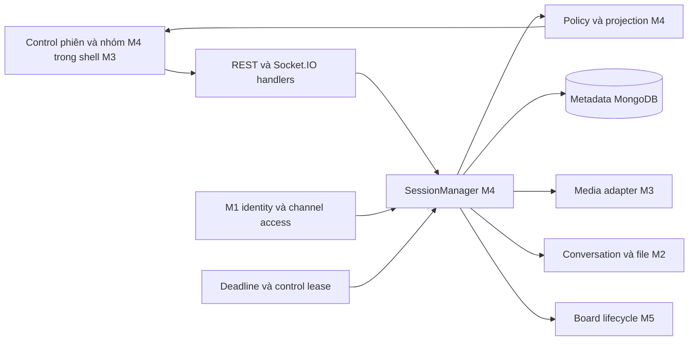
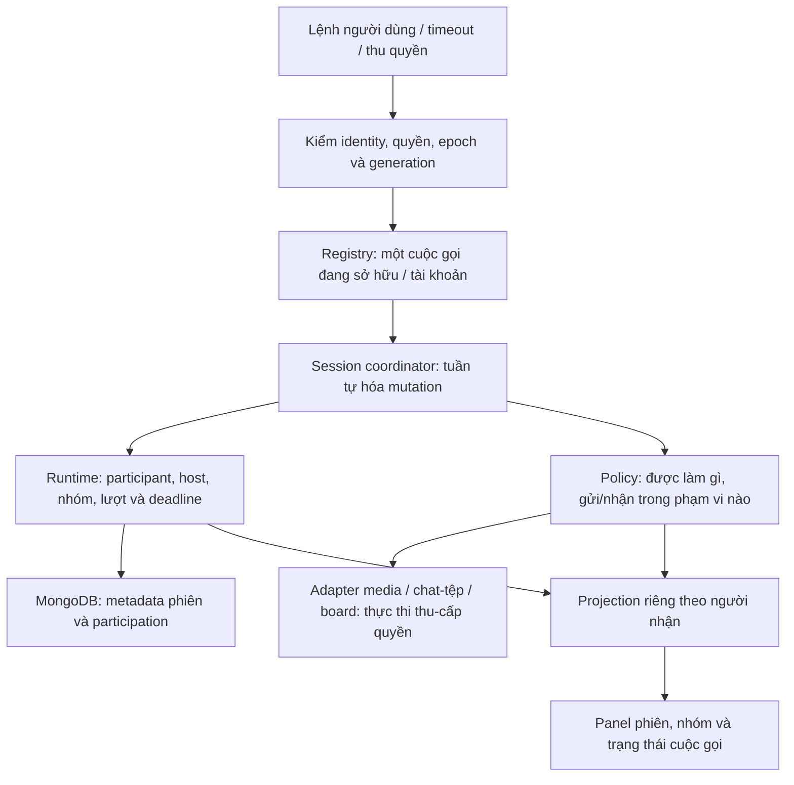
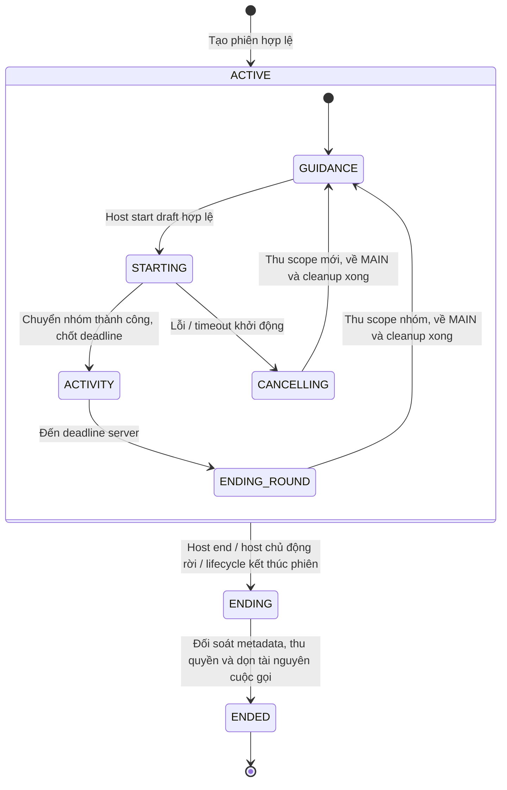
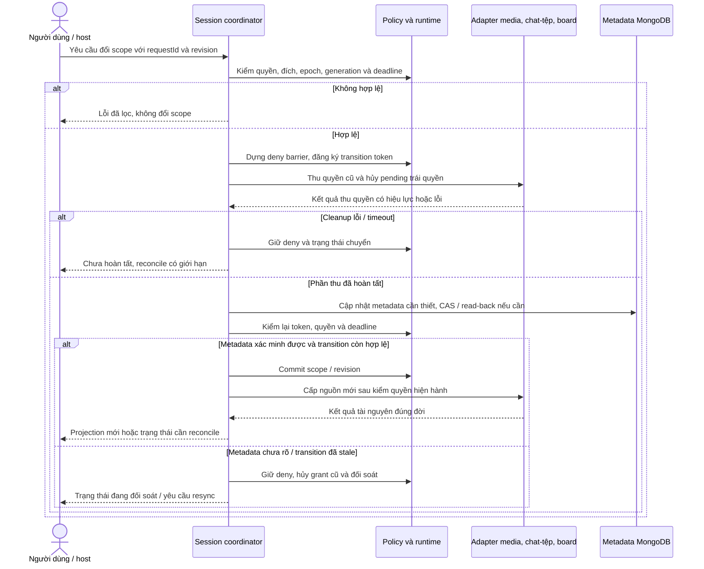
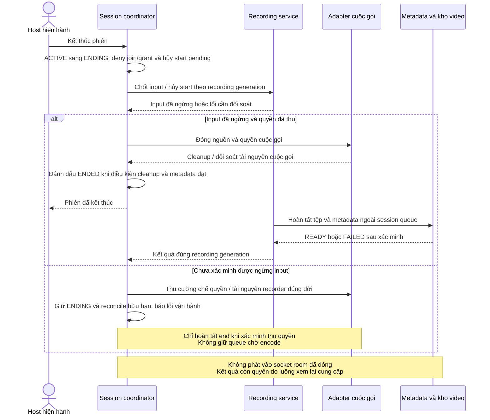
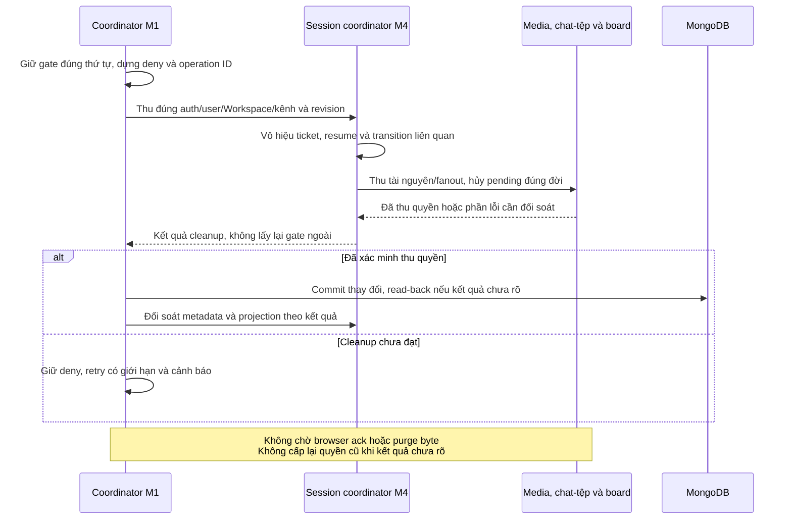

# M4 — Vòng đời phiên họp, host và nhóm

**Trạng thái:** Đề xuất triển khai · **Phụ trách:** Lightning1507 · **Quy mô:** XL · **Ngày cập nhật:** 04/11/2026

Tài liệu trình bày chức năng, thiết kế, đầu việc và tiêu chí nghiệm thu của [miền M4](../product/delivery-domains.md), theo [cấu trúc proposal chung](../templates/feature-proposal-sample.md). Các tên API, interface và trạng thái là thiết kế dự kiến; các điểm cần thống nhất được liệt kê tại mục 4. Phần kiểm thử mô tả tiêu chí triển khai, kết quả thực hiện được cập nhật trong từng PR.

Các điểm tích hợp với auth, chat/tệp, media và board cần được hai bên review trước code phụ thuộc. Phương án trong proposal của một miền chưa tự trở thành quyết định chung; nguồn nghiệp vụ hiện hành vẫn có hiệu lực khi chưa có quyết định thay thế.

> **Tóm tắt** — M4 quản lý vòng đời cuộc gọi, người chủ trì, thành viên, nhóm và thời hạn hoạt động. SessionManager và Policy là nguồn quyết định trạng thái/quyền dùng chung cho REST và Socket.IO. Giao diện M4 gồm các điều khiển phiên và nhóm trong màn hình cuộc gọi chung.
>
> Dữ liệu phiên dài hạn lưu trong MongoDB; quyền và nhóm đang hoạt động được quản lý trong bộ nhớ server. Triển khai từ luồng MAIN, sau đó tích hợp nhóm, deadline và phục hồi kết nối. Ước lượng sơ bộ: **29 ngày công**, khoảng **20–42**, gồm phát triển, kiểm thử, review và dự phòng; phân tích mốc 4 tuần tại mục 10.

## 1. Context

CoLearnia có Workspace/kênh lâu dài và LiveSession có thời điểm bắt đầu/kết thúc. Trong phiên, MAIN là phòng chung; DISCUSSION kế thừa bài giảng nhưng trao đổi riêng; ACTIVITY là các nhóm độc lập trong một lượt có deadline chung. Thay đổi nhóm/host/quyền có thể xảy ra khi upload, tạo Consumer hoặc reconnect vẫn đang chờ.

Tại baseline `a84bbd6`, repo có entry point server, connector MongoDB, media runtime và schema giao tiếp ban đầu. `apps/server/src/realtime/server.ts` trả `AUTH_REQUIRED` khi handshake; SessionManager, policy nhóm và các điều khiển nghiệp vụ cần được triển khai. `packages/contracts/src/session.ts` còn kiểu FREE/MODERATED và ID dạng chuỗi rộng; các schema này cần cập nhật theo nghiệp vụ hiện hành trước khi tích hợp tính năng.

**Tài liệu liên quan:** [FR/AC](../product/functional-requirements.md), [group modes](../product/group-modes.md), [live session](../product/live-session.md), [policy](../product/groups-media-policy.md), [board](../product/board-collaboration.md), [recording](../product/recording.md), [architecture](../architecture.md), [contracts](../contracts/README.md), [collection design](../database/collection-design.md), [integrity](../database/integrity-and-migrations.md), [lifecycle](../database/lifecycle.md) và [decision status](../decision-status.md).

### Thuật ngữ dùng trong tài liệu

| Thuật ngữ                | Ý nghĩa trong M4                                                                                             |
| ------------------------ | ------------------------------------------------------------------------------------------------------------ |
| Host / participant       | Người chủ trì / người đang tham gia cuộc gọi; quyền host độc lập vai trò quản trị Workspace                  |
| Scope / audience         | Phạm vi đang tham gia / tập người được phép nhận một nguồn hoặc nội dung                                     |
| Roster / membership nhóm | Danh sách được phép tham gia / trạng thái đã thực sự vào nhóm                                                |
| Runtime / metadata       | Trạng thái đang sống trong bộ nhớ server / dữ liệu mô tả được lưu trong MongoDB                              |
| Projection               | Bản trạng thái server đã lọc theo quyền của người nhận để giao diện hiển thị                                 |
| Adapter                  | Giao diện kết nối M4 với phần media, chat/tệp hoặc board do miền khác quản lý                                |
| Deny barrier / reconcile | Chốt chặn cấp quyền trong lúc chuyển trạng thái / đối soát trạng thái và tài nguyên sau lỗi hoặc kết nối lại |
| Idempotency              | Gửi lại cùng một yêu cầu không tạo thêm tác động nghiệp vụ                                                   |

## 2. Objective

Người dùng vào đúng một cuộc gọi có quyền, tạo/vào/rời nhóm đúng phase, thấy trạng thái host/nhóm hiện hành và trở về MAIN đúng lúc. Khi chuyển phạm vi hoặc mất quyền, nguồn riêng, chat, tệp và board cũ phải ngừng được cấp trước khi mở phạm vi mới. Reconnect, deadline, retry hoặc callback muộn không được phục hồi quyền đã thu.

## 3. Goals / Non-goals

### Goals

| Goal | Đầu ra M4 và AC quan trọng                                                                                                                                 | FR chính              |
| ---- | ---------------------------------------------------------------------------------------------------------------------------------------------------------- | --------------------- |
| G1   | Host chuyển trực tiếp cho participant hợp lệ; một host có quyền; host chủ động rời khi còn giữ quyền kết thúc toàn phiên                                   | FR-07-01/02           |
| G2   | Tạo DISCUSSION ngay sau kiểm hợp lệ, retry không nhân nhóm; chỉ roster hợp lệ chủ động join mới nhận private                                               | FR-07-03/04           |
| G3   | Host chuẩn bị ACTIVITY thủ công/random cân số lượng, xem/chỉnh preview; start đóng DISCUSSION trước và xử lý lỗi một phần bằng hủy lượt/về MAIN            | FR-07-05/06           |
| G4   | Điều chuyển người/đóng DISCUSSION/đưa người về MAIN dùng cùng cơ chế thu scope; người cuối chủ động rời DISCUSSION đã có người làm nhóm tự đóng            | FR-07-07/08, FR-10-01 |
| G5   | Mất mạng quá grace chọn host tạm ngẫu nhiên từ người hợp lệ; host cũ quay lại hợp lệ được hoàn quyền, bàn giao chính thức thay đích hoàn quyền cũ          | FR-07-09              |
| G6   | Host chỉ vào hỗ trợ ACTIVITY có thông báo; chuyển A → B thu A trước; rời help chủ động giữ trạng thái mic, cleanup tự động không phát tiếng hỗ trợ ra MAIN | FR-09-03              |
| G7   | Reconnect/resync theo quyền hiện tại; phối hợp đối soát thao tác pending; restart kết thúc phiên cũ thay vì dựng lại quyền từ metadata                     | FR-11-01/02/03        |
| G8   | Duration chung nguyên 1–120 phút; server tự kết thúc đúng round khi hết hạn, không chờ host; callback muộn/lặp không đóng lượt mới                         | FR-14-01/02           |

M4 sở hữu **16 FR chính**. Với G7, M4 điều phối phục hồi quyền và trạng thái; từng miền đối soát tin nhắn, board và tài nguyên media của mình. M4 cũng cung cấp đầu vào tích hợp cho FR-05 (vào/rời call), FR-08-02 (thông báo bằng tiếng), FR-09-01/02 (chat) và FR-15 (ghi hình).

### Non-goals

- Auth/quyền kênh thuộc M1; chat và lưu tệp thuộc M2; truyền media, trộn tiếng và recorder thuộc M3; canvas/frame thuộc M5. M4 tích hợp qua adapter và contract dùng chung.
- Cuộc gọi có một host hiện hành, chuyển quyền trực tiếp. Phạm vi hiện tại không có co-host, tự nhận host hoặc chế độ FREE/MODERATED.
- DISCUSSION tạo sau kiểm tra hợp lệ, không cần host duyệt; nhóm không share riêng và host không vào hỗ trợ nhóm này.
- Board nhóm chỉ dùng trong phạm vi nhóm. ACTIVITY kết thúc theo deadline, lỗi khởi động hoặc kết thúc phiên; thời lượng không có thao tác pause/gia hạn/kết thúc riêng thủ công.
- Bản đầu dùng một app process, một worker mediasoup và một Router/LiveSession. Mức tải được xác nhận qua các cổng kiểm tại [capacity](../capacity.md).
- Nhóm, lượt hoạt động, timer và quyền runtime không có collection bền riêng. M4 triển khai metadata/index phiên và participant theo cơ chế migration chung; metadata ghi hình do miền phụ trách recording/tệp thiết kế.

## 4. Open questions & assumptions

| ID  | Nội dung cần thống nhất                                                                                                                   | Bên phối hợp                           | Thời điểm cần kết quả                                  |
| --- | ----------------------------------------------------------------------------------------------------------------------------------------- | -------------------------------------- | ------------------------------------------------------ |
| Q1  | Hành vi khi không còn ứng viên host hợp lệ, host tạm tiếp tục mất mạng hoặc host bị thu auth/quyền kênh; điều kiện hủy đích hoàn quyền cũ | M4, lead, M1 và miền media             | Trước triển khai nhánh host tương ứng trong T7/T9      |
| Q2  | Giữ hay đóng DISCUSSION khi nhóm rỗng do mọi người hết grace; phân biệt với người cuối chủ động rời                                       | M4 và lead                             | Trước nghiệm thu T4/T9                                 |
| Q3  | Identity gắn authSessionId, dấu membership/channel, phạm vi revoke và phối hợp Workspace gate không deadlock                              | M1–M4                                  | Trước tích hợp join/revoke trong T2/T3                 |
| Q4  | Kết quả cleanup của từng adapter, thời điểm quyền đã thu có hiệu lực, timeout và lỗi được retry                                           | M2/M3/M5–M4                            | Trước tích hợp chuyển scope trong T3                   |
| Q5  | Queue/in-flight budget, thời hạn I/O, heartbeat/control lease, bộ nhớ và thời hạn lưu kết quả retry                                       | M4, M1, miền media và đầu mối vận hành | Trước bật handler và chạy PoC                          |
| Q6  | Đích điều chuyển được phép, quyền quay lại ACTIVITY sau khi tự về MAIN và vị trí host khi tham gia ACTIVITY ngoài luồng hỗ trợ            | M4, miền media và lead                 | Trước triển khai nhánh move/join liên quan trong T5/T7 |
| Q7  | Pipeline và vòng đời ghi hình chưa chốt: đổi host, dừng/ghi lại, hủy start, input-stop, admission, metadata và tìm video theo kênh        | M4, miền media và miền tệp             | Trước T8 và kiểm thử ghi hình                          |
| Q8  | Reviewer, số giờ M4 mỗi tuần, đầu mối staging và phần hỗ trợ cần thiết cho mốc 4 tuần                                                     | Phụ trách M4 và lead                   | Trước xác nhận lịch triển khai                         |

Q1/Q2/Q6 và phần vòng đời ghi hình tại Q7 là các quyết định nghiệp vụ còn mở. Q3/Q4/Q5 và phần kỹ thuật tại Q7 cần thống nhất contract/PoC; Q8 xác nhận nguồn lực. Thiết kế giả định một process Node giữ trạng thái quyền, một worker mediasoup, một Router/LiveSession và các miền cung cấp adapter tối thiểu từ sớm.

Các mốc thời gian đã có trong [live session](../product/live-session.md) và [group modes](../product/group-modes.md):

| Cơ chế                   | Mốc hiện hành        | Phạm vi áp dụng                                                        |
| ------------------------ | -------------------- | ---------------------------------------------------------------------- |
| Join ticket              | 60 giây, một lần     | Ý định vào phiên gắn authSessionId/user/channel/session epoch          |
| Giữ chỗ share chờ picker | Ban đầu 30 giây      | Hết hiệu lực khi đã publish và chuyển thành ownership                  |
| Reconnect grace          | Tối đa 30 giây       | Từ disconnect/control lease hết hạn, không được gia hạn bởi request cũ |
| Empty grace              | 60 giây              | Kết thúc phiên rỗng, có kiểm race với join                             |
| Announcement             | Tối đa 30 giây       | Phát biểu hướng dẫn MAIN/DISCUSSION                                    |
| Thời lượng ACTIVITY      | Số nguyên 1–120 phút | Một deadline chung, đặt trước khi bắt đầu lượt                         |

Thời hạn resume ticket, chu kỳ heartbeat, deadline I/O, giới hạn queue và replay cache là phần cấu hình cần thống nhất tại Q3/Q5.

## 5. High-level design

- **Entrypoint:** REST mở phiên/lấy ticket, Socket.IO cho mutation/resync theo phiên, callback nội bộ cho timeout/revoke. Tất cả đi qua cùng application service và policy, không có hai cách cấp quyền độc lập.
- **State owner:** SessionManager sở hữu participant/scope/host/group/round/epoch/generation và mutation queue. Registry mediasoup/track không nằm trong state M4; M3 sở hữu và thực thi quyết định quyền từ M4.
- **Quyền và tài nguyên:** M4 giữ quyền chiếm nguồn share theo scope và quyết định cấp/thu; miền media giữ nguồn thực tế, Producer/Consumer và source revision. Quyền đã cấp không chứng minh tài nguyên đã tạo thành công. Mọi callback hoàn tất phải kiểm lại đúng đời và quyền hiện hành.
- **Điểm tích hợp đầu tiên:** M1 cấp auth/access tối thiểu, M4 tạo/join MAIN và projection, M3 nối mic/camera/share thật. Không đợi mọi nhóm/board hoặc toàn bộ package contracts hoàn thiện.
- **Phương án không chọn:** mỗi domain giữ một bản group membership, dựa frontend để lọc quyền, queue chung cho mọi pointer, Router/group hoặc phục hồi authority qua `lastScope`. Những cách này làm lệch scope, chặn control hoặc đổi kiến trúc baseline.

Đường dẫn dự kiến: session registry/coordinator ở `apps/server/src/live/session/`, policy thuần ở `apps/server/src/live/policy/`, command schema tại `packages/contracts/src/session.ts` hoặc file con theo miền; control FE ở `apps/web/src/features/live/`. Component và interface dùng chung được thống nhất với các miền tích hợp trước khi triển khai.

### 5.1 Bản đồ trách nhiệm của M4

Registry xử lý ownership toàn tài khoản; session coordinator chỉ xử lý một phiên. Policy tính quyết định, không trực tiếp gọi DB hoặc mediasoup. Adapter quản lý tài nguyên thật; projection chỉ là dữ liệu đã lọc để hiển thị, không là nguồn cấp quyền. MongoDB không lưu lại các quyền nhóm để phục hồi sau restart.

### 5.2 Vòng đời phiên và lượt hoạt động

MAIN luôn tồn tại trong phiên ACTIVE, kể cả khi đang có lượt ACTIVITY. GUIDANCE cho phép tạo/vào DISCUSSION; draft chỉ là bản chuẩn bị, chưa đổi phase. STARTING chặn create/join DISCUSSION và đóng các nhóm này trước khi cấp ACTIVITY. ENDING của **phiên** khác ENDING_ROUND của **lượt**: hết giờ chỉ kết thúc lượt, còn kết thúc phiên đóng toàn bộ MAIN/nhóm. Finalize video có thể tiếp tục sau ENDED theo phần ghi hình bên dưới.

Sơ đồ mô tả vòng đời khi server còn hoạt động. Với app crash, bước bootstrap đối soát metadata phiên cũ trước readiness; tài nguyên dở dang được xử lý theo cơ chế cleanup của từng miền.

## 6. Detailed design

Thiết kế chia thành dữ liệu, điều phối trạng thái, giao tiếp, giao diện, vận hành và kiểm thử.

### 6.1 Database và runtime

| Nơi lưu                   | M4 sở hữu / phối hợp                                    | Cách dùng và giới hạn                                                                                                                                                                                |
| ------------------------- | ------------------------------------------------------- | ---------------------------------------------------------------------------------------------------------------------------------------------------------------------------------------------------- |
| `liveSessions`            | M4 schema/query metadata, M1 hỗ trợ nền Mongo/migration | Theo collection design 3.11: Workspace/kênh, epoch, hostUserId, ACTIVE/ENDING/ENDED, revision và timestamps. Partial unique phiên mở theo kênh. hostUserId là metadata, không tự cấp quyền từ DB     |
| `sessionParticipants`     | M4                                                      | Theo 3.12: unique session/user, joinedAt/leftAt, lastScope/lastScopeAt; participant ID ổn định khác callGeneration. Không lấy lastScope để tự cho vào lại nhóm                                       |
| `auditEvents`             | M4 gọi nền audit dùng chung                             | Chỉ sự kiện quyền/vòng đời phù hợp baseline, không ghi nội dung chat, mục đích nhóm, frame hoặc token; không audit mỗi heartbeat                                                                     |
| Conversation/message/file | M2 sở hữu; M4 yêu cầu mở/khóa scope                     | M4 không viết repository hội thoại thứ hai. Đóng scope chặn đọc/event/download trước purge; byte/retention theo lifecycle M2                                                                         |
| SessionRuntime            | M4                                                      | Host/host tạm/đích hoàn quyền, policyRevision, participant connection/scope, roster/nhóm, draft ACTIVITY/round/deadline, pending transition, ticket/dedupe/control lease và quyền sở hữu share lease |
| Media / board / byte      | M3 / M5 / M2                                            | M4 chỉ giữ handle/ID và contract cleanup; không lưu object mediasoup hoặc nét/byte vào Mongo                                                                                                         |

Dữ liệu M4 dùng `liveSessions`, `sessionParticipants` và nền audit trong mô hình 13 collection trước recording. Group, round, timer và join ticket nằm trong runtime. ID dữ liệu bền dùng BSON ObjectId, biểu diễn chuỗi hex tại API; epoch/group/round dùng UUID. Validator cần phân biệt đúng hai loại ID.

| Dấu phiên bản            | Phạm vi và công dụng                                                                                    |
| ------------------------ | ------------------------------------------------------------------------------------------------------- |
| `epoch`                  | Đời của phiên; chặn yêu cầu từ runtime trước restart hoặc phiên cũ                                      |
| `callGeneration`         | Đời ownership cuộc gọi của tài khoản; chặn socket/callback thuộc kết nối đã bị thay                     |
| `policyRevision`         | Phiên bản trạng thái quyền runtime của phiên                                                            |
| `draftRevision`          | Phiên bản bản phân nhóm trước start                                                                     |
| `transitionToken`        | Định danh thao tác chuyển đang chờ, kiểm callback async                                                 |
| `revision` trong MongoDB | CAS metadata host/lifecycle; độc lập với revision quyền runtime                                         |
| Dấu truy cập từ M1       | authSessionId/expiry, membershipId/incarnation/revision và channel revision; phát hiện quyền nền đã đổi |

Source ID/generation/revision thuộc miền media và gắn đúng source scope; boardVersion thuộc miền board. M4 chuyển các tham chiếu cần thiết qua adapter, không dùng policyRevision toàn phiên thay revision của từng nguồn.

Join ticket gắn join intent, `userId`, `authSessionId`, kênh, session/epoch và dấu truy cập M1; khi consume chỉ tạo một kết quả ownership hợp lệ. Participant và pending operation sau join gắn thêm callGeneration; resume ticket gắn đúng đời ownership được phép nối lại. Dấu revision là điều kiện kiểm lại, không là quyền tồn tại vĩnh viễn. Gia nhập lại Workspace hoặc được cấp lại PRIVATE không phục hồi resume ticket, nhóm hay tài nguyên của lần truy cập trước. Không đưa cookie/token xác thực vào projection hoặc metadata participant.

Trạng thái dự kiến cần biểu diễn riêng:

- Phiên: ACTIVE → ENDING → ENDED; không nhận join mới vào ENDING, không tạo chồng phiên mới cho kênh còn đang ending.
- Participant: CONNECTED / RECONNECTING / TRANSITIONING / LEFT theo vòng đời và deny barrier. TRANSITIONING không có quyền vào đồng thời hai audience.
- DISCUSSION: OPEN/CLOSING/CLOSED cùng roster và dấu `hasHadMember` đề xuất. Nhóm mới rỗng vẫn OPEN; sau khi từng có người, người cuối chủ động rời làm đóng nhóm. Dấu này không biến roster thành membership.
- ACTIVITY draft tách khỏi round: preview chưa cấp quyền. Round có STARTING/ACTIVE/ENDING/ENDED/CANCELLED dự kiến; phase hiệu lực khóa create/join DISCUSSION ngay từ lúc start đang chuyển, chỉ về GUIDANCE sau cleanup.
- Tập nguồn share và source revisions do M3 cung cấp theo scope; bản freeze/nét do M5 sở hữu. M4 không tăng source revision của mọi nhóm khi chỉ một nguồn đổi.

**Transaction/CAS:** tạo phiên và host metadata, unique phiên mở, upsert participation và cập nhật host/ending theo thiết kế integrity. ID ổn định trước callback transaction retry; không tạo media hoặc phát event bên trong callback có thể chạy lại. Router/ticket tạm chưa được công bố trước điều kiện DB hợp lệ; lỗi phải close pending resource. Commit chưa rõ thì read-back/reconcile, không ghi FAILED trái với SUCCEEDED có thể đã commit.

**Restart/migration:** schema/index nghiệp vụ hiện chưa có. Triển khai trên DB test cô lập theo migration runner chung của M1; preflight, backup/restore và rollback theo integrity, không chạy tự động lên DB của thành viên. Trước readiness, đánh dấu phiên runtime đời cũ ENDED/thu participation, phối hợp M2 khóa private conversations và M5 dọn frame cũ. Không backfill host/group grants từ metadata. Retention metadata còn mở không tự thêm TTL.

Metadata recording là phần mở rộng do miền recording/tệp phụ trách. Bootstrap cung cấp các phiên/epoch cũ đã kết thúc để đối chiếu intent, process và tệp dở. Video chỉ READY sau khi miền phụ trách xác minh tệp và metadata hoàn tất.

### 6.2 Luồng điều phối và thứ tự mutation

Các điều kiện phải giữ trong mọi luồng:

- Một tài khoản chỉ sở hữu một cuộc gọi đang hoạt động; một kênh chỉ có một phiên ACTIVE/ENDING.
- Tại một thời điểm chỉ có tối đa một người giữ quyền host trong phiên. Quyền host không cấp quyền thường trực vào nội dung của mọi nhóm.
- Chuyển scope phải thu quyền cũ trước khi cấp quyền mới; trong lúc chuyển, chỉ các quyền bị ảnh hưởng bị chặn, các nguồn còn hợp lệ được giữ.
- Phiên ENDING và nhóm/lượt đã đóng không nhận grant mới. Deadline được kiểm theo trạng thái server, kể cả sau I/O.
- Callback và cleanup chỉ tác động đúng epoch/generation/token; kết quả retry không tạo lại tác động đã hoàn tất.

**Thứ tự khóa:** user call ownership → Workspace gate khi cần → channel lifecycle → session mutation. Chỉ lấy khóa cần dùng; không gọi ngược Workspace gate từ callback đang giữ session queue, không giữ hai queue phiên khi takeover. Handlers cần DB/file đi vào từ cổng ngoài; timer/reaper tách bước reconcile hoặc chạy lại từ cổng đúng thứ tự.

Nếu M1 đã giữ Workspace/channel gate và gọi thu quyền, M4 dùng context điều phối nội bộ của thao tác đó, không lấy lại khóa ngoài. Cleanup mà M1 đang chờ không được gọi ngược M1 hoặc chờ công việc cần chính gate đang bị giữ. Phần cần DB/revalidation tiếp theo được trả về coordinator ngoài; không truyền quyền bỏ qua khóa từ payload client.

**Chuyển scope dùng chung:**

1. Kiểm identity/access, epoch/generation, role/revision/phase/deadline và đích còn hợp lệ. Dựng deny barrier, ghi transition token để chặn grant/callback cũ.
2. Tính state đích và kế hoạch thu quyền. Gọi M3 đóng nguồn/Consumer không còn quyền, M2 khóa subscription/file stream liên quan và M5 thu quyền/intent người rời.
3. Nếu chỉ một người rời, giữ frame/nét chung còn được nhóm dùng. Nếu nhóm đóng, kết thúc context và dọn refs theo lifecycle; không sao chép ra MAIN.
4. Xác nhận phần thu đã có hiệu lực, cập nhật metadata cần thiết và commit state runtime/revision. Cấp nguồn mới qua M3 sau revalidation; phát projection đã lọc đúng người.
5. Timeout/lỗi: giữ deny, thể hiện đang chuyển/đang kết thúc; retry cleanup có giới hạn và reconcile idempotent. Chỉ báo hoàn tất khi phần thu quyền đã có hiệu lực. Đối soát riêng metadata và runtime vì hai phần này không cùng một transaction nguyên tử.

M3/M2/M5 đăng ký pending resource theo transition/generation và kiểm lại khi tạo xong; callback cũ phải close object vừa tạo thay vì gắn vào state mới. Cleanup promise không được phụ thuộc browser ack; I/O có deadline, queue có admission hữu hạn. Không giữ queue khi chờ picker, upload, encode hoặc người dùng.

**Điều kiện xác nhận thu quyền:** adapter đã chặn tạo/gửi mới, ngừng fanout/stream hoặc đóng media trái quyền và vô hiệu pending thuộc thao tác. Xóa byte vật lý, finalize video và giao diện người nhận xác nhận không phải điều kiện chờ của bước này. Adapter trả operation ID, phạm vi/đời đã xử lý và phần còn lỗi để reconcile; chỉ phát event yêu cầu cleanup chưa đủ để báo đã thu quyền.

Commit scope hợp lệ và thiết bị sẵn sàng là hai kết quả riêng. Người dùng từ chối quyền mic/camera vẫn có thể vào phiên với thiết bị tắt; không giữ participant ở TRANSITIONING chỉ vì chưa publish. M3 báo lỗi thiết bị và chỉ tạo nguồn khi có quyền hiện hành.

Mutation mới xung đột với transition đang chạy trả `OPERATION_IN_PROGRESS` hoặc trạng thái hiện hành của cùng request. End/revoke/deadline phải vô hiệu hóa transition cũ và được đối soát cả khi queue người dùng đã đầy; chỉ từ chối mutation người dùng mới khi quá tải. Adapter được gọi lại an toàn với cùng operation ID. Sau khi hết số lần retry cleanup, giữ trạng thái an toàn và phát cảnh báo vận hành; lượt đối soát hoặc can thiệp vận hành mới tiếp tục xử lý.

**DISCUSSION:** kiểm tên ≤80, mục đích ≤500 và roster hợp lệ cùng phiên, dedupe create rồi tạo ngay; không approve/reject. `group.join` kiểm lại phase, roster, quyền và OPEN; tạo nhóm chưa cấp nội dung riêng. `group.leave` chỉ chuyển actor về MAIN/pause mic. Serialize join/leave/close để xử lý người cuối chủ động rời; khi đóng, xóa khả năng join của cả roster. Mất signaling đi qua grace, không gọi nhầm nhánh leave chủ động. Xử lý sau grace của nhóm rỗng theo Q2.

**Chuẩn bị/start ACTIVITY:** host chọn tập người/số nhóm; dùng Fisher–Yates để xáo trộn rồi phân cân bằng, số người chênh tối đa một trước chỉnh. Mỗi participant xuất hiện đúng một lần trong tập được phân. Preview trả `draftRevision` riêng; host chỉnh rồi start với revision dự kiến. Nếu roster đã thay đổi, trả lỗi stale để host xem lại; quy tắc số nhóm/draft payload được thống nhất trước triển khai.

Khi start: chặn create/join DISCUSSION → đóng DISCUSSION → mở các scope ACTIVITY/chuyển người → xác lập round/deadline chung khi start hoàn tất. Người chưa phân ở MAIN. Nếu lỗi một phần: hủy toàn lượt chưa hoàn tất, thu nguồn/quyền mới và timer của lượt, đưa người còn quyền về MAIN/pause mic; không khôi phục DISCUSSION đã đóng. STARTING có timeout vận hành cần chốt Q5; không treo vô hạn hoặc tự retry tạo thêm round.

**Deadline:** dùng thời gian server, một roundId/deadline cho mọi nhóm. Callback yêu cầu reconcile; mỗi command/read/grant/fanout vẫn kiểm hạn, kể cả sau await. Khi hết hạn, chặn quyền ACTIVITY và điều phối kết thúc lượt trước khi cấp tiếp. Callback mang `{sessionId, epoch, roundId, deadline}` để lặp/trễ không đóng lượt mới. Cleanup chạy cả khi host mất mạng; xong cleanup mới mở lại GUIDANCE/DISCUSSION. Countdown client dùng mốc giờ server để hiển thị. Kiểm thử dùng fake clock; vận hành theo dõi clock jump và event-loop lag để phát hiện timer xử lý muộn.

**Host:** chuyển trực tiếp kiểm target connected/còn quyền trong phiên; thu help/announcement và quyền vẽ host cũ trước, cập nhật host metadata/runtime theo CAS và phát projection mới. MAIN share còn hợp lệ tiếp tục hoạt động. Nếu host mới đang bật mic ở scope cũ, server pause mic tới khi xác nhận phạm vi điều hành theo policy; thiết bị đang tắt được giữ tắt. Mất mạng trong grace giữ vai trò và scope an toàn; quá grace chọn ngẫu nhiên ứng viên hợp lệ trong queue, giữ danh tính cần hoàn quyền. Host cũ quay lại được kiểm danh tính/phiên/quyền trước khi hoàn quyền; bàn giao chính thức thay đích hoàn quyền cũ. Nhánh không có ứng viên hoặc host tạm tiếp tục mất mạng thuộc Q1.

**Phiên rỗng và reaper:** xử lý leave/hết grace rồi đánh giá trạng thái participant. Phiên rỗng áp dụng empty grace 60 giây theo lifecycle; callback mang session/epoch và token phiên rỗng. Join hợp lệ trước khi reaper chuyển ENDING vô hiệu hóa token này. Nếu reaper đã bắt đầu kết thúc thì từ chối join vào phiên đó, cleanup xong mới tạo phiên mới. Host chủ động rời khi còn giữ quyền dùng luồng end ngay. Các nhánh host mất mạng còn mở vẫn được xử lý theo Q1.

**Help/announcement:** host.help.enter chỉ ACTIVITY mở/còn hạn; ghi nhận/hiển thị thông báo host vào rồi mới mở private scope, sang B thu A trước. Cơ chế thứ tự event và UI nhãn scope được review với M2/M3, không chờ ack tất cả browser để cấp quyền. Host chủ động help.leave về MAIN giữ mic bật/tắt và đổi audience; automatic close/disconnect không dùng đường này để bật tiếng chung. Announcement chỉ MAIN/DISCUSSION khi host ở MAIN/hướng dẫn; timeout 30s theo nguồn, M3 xử lý gain/ramp/restore preferences, M4 xử lý quyền và lifecycle.

#### 6.2.1 Chuyển nhóm: thu quyền cũ trước khi cấp quyền mới

Sơ đồ mô tả thứ tự logic; không giữ mutex xuyên toàn bộ I/O. Trong queue chỉ nhận lệnh/đặt barrier và token, sau đó nhả queue cho adapter thực hiện I/O có deadline; khi quay lại phải lấy đúng cổng/khóa và kiểm token trước commit. Barrier chặn grant trái quyền dù tác vụ đang chạy ngoài queue. Nếu kết thúc phiên hoặc hết lượt trong lúc chờ, transition cũ mất hiệu lực; tài nguyên vừa tạo phải bị đóng, không cấp quyền theo đích đã hết hạn. Participant về MAIN có mic bị pause; camera đang bật đổi audience với thông báo, không tự bật thiết bị đã tắt.

Đối với media đang truyền, barrier phải đi kèm đóng Producer/Consumer trái quyền trên server. Quyền đã thu được xác nhận từ tài nguyên thực tế; gain hoặc tile giao diện không thay bước này. Đo độ trễ từ deadline/revoke đến khi đóng tài nguyên; âm thanh đã gửi hoặc nằm trong buffer phía người nhận không thể thu hồi.

#### 6.2.2 Share lease và điểm kiểm quyền media

Mỗi MAIN hoặc ACTIVITY có một slot share độc lập; DISCUSSION không có slot publish. Slot runtime do M4 giữ gồm scope, chủ sở hữu, lease ID/generation, thời hạn giữ chỗ và trạng thái giữ chỗ/đã publish. Media adapter giữ mapping nguồn thực tế. Lease chờ picker ban đầu **30 giây** theo [live session](../product/live-session.md). Publish thành công chuyển lease thành ownership gắn participant/generation, được giám sát theo signaling lease; thời hạn chờ picker không tiếp tục đếm để đóng một share đã publish.

1. Acquire kiểm membership/scope/phase/deadline và slot trống rồi giữ chỗ nguyên tử. Nguồn bận trả `SHARE_BUSY`, không chiếm nguồn của người khác.
2. Browser mở picker ngoài queue. Publish phải kiểm lại lease, scope và generation sau các bước async; acquire thành công không bảo đảm publish thành công.
3. Hủy picker/hết hạn giữ chỗ thu lease pending. Leave/revoke/track ended thu ownership và nguồn liên quan. Callback release cũ không được giải phóng slot đã cấp cho nguồn mới.
4. Source revision do media adapter quản lý cho đúng nguồn; đổi host không làm tăng revision hay đóng share MAIN còn hợp lệ. Đóng nguồn live báo board để dọn overlay/intent liên quan; frame nhóm đã giữ hợp lệ tiếp tục theo lifecycle board.

Join ticket, lease share và control lease là các cơ chế riêng; các budget admission/control lease cần thống nhất tại Q5. Với mọi Producer/Consumer, policy được kiểm tại create, sau await và trước resume/ready, kể cả khi `canConsume` về codec trả true. Nhu cầu camera theo viewport/pin chỉ giới hạn tập nhận **trong** quyền được cấp; danh sách participant và quyền nghe tiếng vẫn theo policy phiên.

#### 6.2.3 Quyền ghi hình và kết thúc phiên

**Yêu cầu hiện hành:** theo [recording](../product/recording.md), chỉ host hiện hành điều khiển ghi/dừng MAIN; nội dung nhóm riêng không thuộc bản ghi. Mất quyền MAIN phải thu đầu vào tương ứng trước khi cấp private scope, kể cả lúc host vào hỗ trợ. Thiết bị tắt không được tự bật. Đang ghi và video sẵn sàng là hai trạng thái khác nhau; lỗi ghi/lưu không làm kết thúc cuộc gọi.

**Nhóm chưa chốt pipeline và vòng đời recording.** Bảng và sơ đồ dưới đây là phương án điều phối M4 để review tại Q7. Đề xuất gắn bản ghi với session/epoch và recording generation riêng, độc lập cookie/đời kết nối của người bắt đầu; giữ bản ghi qua đổi host, cho ghi đoạn mới sau khi dừng và tách finalize khỏi kết thúc call. Các lựa chọn này chưa phải tiêu chí nghiệm thu đã được nhóm thông qua. Cơ chế capture/composition/encode thuộc miền media và cần PoC; M4 không chọn công cụ hoặc topology recorder thay miền đó.

| Sự kiện                                   | Phương án điều phối đề xuất                                                                                            | Điều kiện hoàn tất và giới hạn của phương án                                                                                       |
| ----------------------------------------- | ---------------------------------------------------------------------------------------------------------------------- | ---------------------------------------------------------------------------------------------------------------------------------- |
| Bắt đầu ghi                               | Kiểm host hiện hành, phiên ACTIVE, revision và admission; đăng ký start intent ổn định trước khi khởi động ngoài queue | Callback kiểm session/epoch, recording generation và intent còn hiệu lực. Chỉ báo Đang ghi sau xác nhận capture thực sự hoạt động  |
| Đổi / hoàn quyền host                     | Chuyển quyền điều khiển nguyên tử theo host state; host cũ bị từ chối lệnh mới                                         | Giữ bản ghi hiện có, không stop/start lại theo người. Race với start/stop phải có kết quả rõ theo thứ tự mutation                  |
| Participant chuyển nhóm / host vào hỗ trợ | Thu eligibility MAIN cũ và yêu cầu gỡ input trước cấp scope private                                                    | Không chuyển recorder theo người; không ghi mic/camera nhóm hoặc giữ tile riêng trái quyền. Về MAIN chỉ cấp lại nguồn hợp lệ       |
| Hết lượt ACTIVITY                         | Đóng nhóm và đưa người về MAIN theo quy trình deadline                                                                 | Không dừng bản ghi. Mic đang bị pause không được tự mở để đưa vào recording                                                        |
| Dừng khi còn khởi động                    | Hủy start intent, chặn callback commit Đang ghi; yêu cầu dọn đúng recording generation                                 | Callback muộn bị từ chối và dọn tài nguyên; chính sách xử lý byte đã thu cần thống nhất tại Q7                                     |
| Dừng khi đang ghi                         | Ghi nhận stop intent, chốt mốc ngừng input; retry hội tụ cùng bản ghi                                                  | Stop ack chỉ xác nhận yêu cầu/trạng thái, chưa có nghĩa video sẵn sàng. Record sau khi dừng là intent/ID mới, admission còn cần Q7 |
| Kết thúc phiên                            | Chặn join/grant mới, chốt input recorder, phối hợp ngừng input và dọn tài nguyên cuộc gọi                              | Không đợi encode/video READY mới kết thúc call; không hủy process mux tùy tiện trước khi nhận phần dữ liệu cuối                    |
| Recorder lỗi                              | Nhận lỗi để cập nhật projection theo audience; phối hợp cleanup đúng đời                                               | Không kết thúc call hoặc mở recorder thay thế tự động; không tạo nguồn MAIN/private mới để cứu job                                 |

M4 chỉ giữ handle/intent cần điều phối và projection trạng thái; state machine recorder, metadata bền và byte có owner riêng. Không tạo hai state machine recording có thể tự chuyển trạng thái trái nhau. Interface cần trả rõ đã tiếp nhận lệnh, đã ngừng input hay đã finalize, kèm ID/generation/revision; không dùng một `success` chung cho cả ba mốc.

Trong phương án này, finalize có thể chạy song song cleanup sau khi input đã được chốt. Media adapter thu quyền nhận nguồn mới độc lập phần hoàn tất dữ liệu đã nhận; loại tài nguyên cụ thể phụ thuộc pipeline được chọn. Timeout ngừng input giữ trạng thái bị thu quyền và kích hoạt reconcile. Sau ENDED, callback finalize chỉ cập nhật đúng recording attempt, không mở lại call; kết quả chỉ tới người còn quyền xem video. App crash cần đối chiếu bản ghi dở với miền media/tệp.

#### 6.2.4 Thu quyền xác thực, Workspace và kênh

M1 cung cấp danh tính và quyền nền; M4 áp dụng thay đổi lên ticket, ownership, participant, nhóm, share/help/announcement và các adapter. Phạm vi thu quyền phải cụ thể:

| Nguyên nhân                                        | Phạm vi xử lý trong M4                                                                                                       |
| -------------------------------------------------- | ---------------------------------------------------------------------------------------------------------------------------- |
| Logout hoặc authSession hết hạn/bị thu             | Chỉ ticket/ownership/tài nguyên gắn authSession đó; không đóng cuộc gọi hợp lệ của phiên đăng nhập khác do callback cũ       |
| Đổi mật khẩu theo luồng M1 thu mọi phiên đăng nhập | Mọi authSession bị thu của user; từng ownership vẫn compare-and-delete theo generation                                       |
| Loại thành viên Workspace                          | Mọi ticket/participant của user trong Workspace và incarnation bị thu; quyền ở Workspace khác không bị mở rộng phạm vi xử lý |
| Gỡ PRIVATE hoặc xóa kênh                           | Các ý định/tài nguyên thuộc kênh bị ảnh hưởng; không thu DM hoặc kênh khác chỉ vì cùng user                                  |
| Xóa Workspace                                      | Chặn grant mới của Workspace, kết thúc các phiên liên quan và thu toàn bộ private scope trước khi xác nhận cleanup           |

Đây là thu quyền bắt buộc, không phải mất mạng để chờ grace. M4 hủy resume/ticket và transition bị ảnh hưởng ngay; reconnect bằng auth cũ bị từ chối. M1 giữ deny barrier, chờ xác nhận thu quyền rồi xử lý commit/read-back theo coordinator chung; purge vật lý chạy sau. Nếu commit chưa rõ hoặc cleanup lỗi, không tự mở lại quyền theo DB cũ.

Host bị thu auth/quyền không được xử lý như lệnh host chủ động leave, cũng không được giữ quyền trong grace. M4 thu help/announcement/quyền vẽ và mọi đầu vào trái quyền ngay. Cách tiếp tục hoặc kết thúc phiên, chọn người thay và xử lý đích hoàn quyền thuộc Q1; chỉ hoàn quyền khi danh tính và quyền hiện tại còn hợp lệ, không dựa vào userId cũ đơn lẻ.

#### 6.2.5 Context chat/tệp và board

M4 cung cấp context hiện hành để M2/M5 kiểm quyền, không xử lý từng tin nhắn, nét vẽ hoặc cursor qua mutation queue của phiên. Context gồm session/epoch, participant/generation, scope/round/deadline, host hiện hành và dấu quyền cần kiểm lại. Roster chỉ cho biết ai được phép vào; M2/M5 cần membership thực tế hoặc quyền hỗ trợ hợp lệ.

- **Chat riêng với host:** đổi host hoặc scope làm đích soạn tin/upload cũ hết hiệu lực. M2 yêu cầu xác nhận đích mới; không tự gửi sang Everyone hoặc host mới. Lịch sử cặp cũ theo ACL/lifecycle M2, không chuyển cho người nhận quyền host. Ảnh gửi riêng không cấp quyền đọc board nhóm.
- **Board đang trực tiếp:** MAIN chỉ host hiện hành đang ở MAIN/hướng dẫn được vẽ/clear; host role không cấp quyền trong lúc hỗ trợ ACTIVITY. DISCUSSION không cho host vào hỗ trợ. Chuyển help A → B thu quyền A trước khi mở B.
- **Freeze đang chờ:** M5 hủy intent khi nguồn đổi/dừng trước commit, actor mất quyền, nhóm/round đóng, resume hoặc board bị vô hiệu. Sau khi M2 bind ảnh xong vẫn phải kiểm lại context/source/version trước commit FROZEN. Kết quả muộn bị từ chối và trả ref/byte cho cơ chế cleanup M2; không giữ queue phiên khi upload/bind.
- **Frame đã FROZEN:** đổi/dừng nguồn trực tiếp không xóa ảnh đã giữ hợp lệ. Resume bỏ tham chiếu ảnh/nét cũ theo lifecycle và dùng nguồn trực tiếp hiện tại được phép xem; âm thanh vẫn theo policy media, không bị freeze cùng ảnh. Không có nguồn hợp lệ thì hiển thị đang chờ nguồn.
- **Một người rời và cả nhóm đóng:** rời chỉ thu quyền/pending của người đó, giữ frame/nét chung. Đóng context thu mọi quyền, khóa tải frame và dọn refs; tắt board cũng phải vô hiệu pending và giải phóng refs không còn dùng. M5 trả kết quả cleanup cho M4, M2 xác nhận việc bỏ liên kết/dọn byte theo owner tương ứng.

### 6.3 API, socket và contract dự kiến

**Envelope:** giữ `requestId`, `sessionId`, `epoch`, `callGeneration`, `expectedPolicyRevision`, payload strict theo command; actor lấy từ auth. IDs có kiểu đúng miền. Draft edit/start thêm `expectedDraftRevision`; đọc snapshot không bị yêu cầu khớp policyRevision cũ vì dùng để resync. Join ban đầu dùng ticket trước khi có participant envelope. Các field chi tiết phải được bên dùng review trước khi thêm schema.

REST dùng tiền tố `/api/v1`; đường dẫn trong bảng được ghi tương đối dưới tiền tố này. Mutation HTTP theo contract cookie/CSRF của M1; handshake và lệnh socket kiểm danh tính/Origin theo cơ chế chung. Payload, ack và event đều dùng schema strict; hợp schema vẫn phải qua policy server.

| Entrypoint đề xuất                         | Input chính                                                                             | Output / kiểm quan trọng                                                                                                  |
| ------------------------------------------ | --------------------------------------------------------------------------------------- | ------------------------------------------------------------------------------------------------------------------------- |
| `POST /channels/:cid/live-session/join`    | Request ID; không nhận host/role client tự gán                                          | Session ID/epoch, ticket một lần hạn 60s; auth/channel access, unique phiên mở và rollback pending khi lỗi                |
| `session.join`                             | Ticket; xác nhận takeover nếu cần theo contract M3/M4                                   | Participant/callGeneration + projection; ticket gắn user/auth/session/channel và kiểm lại quyền                           |
| `session.resync`                           | Envelope danh tính đời kết nối hiện tại, revision đã thấy                               | Snapshot lọc quyền, server time và trạng thái transition/round; không mở lại scope từ cache                               |
| `session.leave`, `session.end`             | Envelope                                                                                | Kết quả rời của actor hoặc kết thúc phiên theo host hiện hành; host chủ động leave khi còn quyền cũng end                 |
| `host.transfer`                            | Target participant, expected revision                                                   | Host mới và revision; không invite/accept, không trả private nhóm                                                         |
| `group.createDiscussion`                   | Name, purpose, roster participant IDs                                                   | Group ID/roster hợp lệ, nút join theo projection; không membership tự động                                                |
| `group.join`, `group.leave`                | Group ID khi join; leave actor hiện tại                                                 | Scope mới/revision; không sửa actor hoặc đi vào nhóm bằng ID ngoài roster                                                 |
| `discussion.close`                         | Một group ID hoặc selector tất cả DISCUSSION                                            | Transition/kết quả đóng đúng nhóm; không nhận ACTIVITY làm đích                                                           |
| `activity.prepare`, `activity.updateDraft` | MANUAL/RANDOM, selected participants, group count/assignments, duration, draft revision | Preview cùng draft revision; chưa chuyển người. Random chỉ trước start                                                    |
| `activity.start`                           | Draft ID/revision + envelope                                                            | Round ID/deadline sau thành công, hoặc trạng thái đang hủy/hủy do lỗi; không nhận thời gian hết hạn từ client             |
| `participant.move`                         | Participant đích, scope đích, revision                                                  | Host-only, kiểm mode/phase/đích; thu nguồn cũ trước. Các đích chưa rõ theo Q6 chưa được mở                                |
| `host.help.enter`, `host.help.leave`       | Group ACTIVITY đích khi enter                                                           | Scope hỗ trợ/MAIN và revision; leave giữ mic state qua adapter M3                                                         |
| `announcement.start`, `announcement.stop`  | Envelope; không audience tùy ý                                                          | Quyền hướng dẫn MAIN/DISCUSSION, announcement ID/deadline và trạng thái; phối hợp M3                                      |
| `screen.acquire`, `screen.release`         | Scope dự kiến, request ID; release kèm lease ID/generation                              | Giữ chỗ nguyên tử theo policy, không xin host; không cho release lease đời mới hoặc publish sau hết hạn                   |
| `recording.start`, `recording.stop`        | Envelope; stop kèm recording ID/revision                                                | Host hiện hành; start intent và recording generation; stop ack xác nhận trạng thái tiếp nhận, READY theo kết quả finalize |

Event dự kiến: `session.snapshot`, `session.changed`, `host.changed`, `group.changed`, `activity.changed`, `participant.scopeChanged`, `session.ended`. Không broadcast cùng snapshot cho toàn session rồi để FE tự giấu. Projection có thể cho xem metadata roster/count đúng policy nhưng không chứa URL frame, producer/chat ID hoặc nội dung private trái quyền. M2 phát message/file event, M3 signaling media, M5 board events; M4 không gửi bản sao các luồng đó.

Giới hạn bytes cho command/ack/event, số phần tử roster/draft và ngân sách snapshot phải chốt tại Q5 trước khi bật handler. Snapshot chỉ chứa metadata và tham chiếu được phép; nét vẽ/ảnh/media không nằm trong snapshot M4. Payload lớn dùng phân trang hoặc chia phần có cùng snapshot revision và kiểm lại quyền khi trả, không bỏ giới hạn socket để chứa toàn bộ trạng thái. Giới hạn truyền tải không tự trở thành giới hạn số nhóm của sản phẩm.

**Nhóm lỗi dự kiến:** AUTH_REQUIRED / FORBIDDEN / SESSION_ENDED / CALL_ALREADY_ACTIVE / STALE_STATE / GROUP_CLOSED / INVALID_PHASE / INVALID_INPUT / TARGET_UNAVAILABLE / SHARE_BUSY / SERVER_BUSY / OPERATION_IN_PROGRESS. Mã lỗi được thống nhất trong package contracts trước khi tích hợp. REST trả `{ error: { code, message }, requestId }`; socket ack dùng mã tương ứng. Nội dung lỗi được lọc theo quyền, không trả stack hoặc raw database error.

`FORBIDDEN` biểu diễn thiếu quyền; `SHARE_BUSY` biểu diễn slot hợp lệ nhưng đang có chủ sở hữu. Chỉ trả thông tin chủ nguồn khi actor có quyền xem scope. Với lệnh có I/O dài, ack phân biệt `accepted/pending` và `completed`, kèm operation/intent ID để resync. Việc gửi ack thành công chưa xác nhận tài nguyên hoặc video đã sẵn sàng.

**Idempotency và ordering:**

- Khóa kết quả mutation trong runtime gồm actor đã xác thực + session/epoch + command + requestId; lưu dấu payload chuẩn hóa và generation/transition gốc. Generation kiểm ownership tại mỗi lần gọi, không được dùng để biến retry sau reconnect thành một ý định mới.
- Cùng khóa/payload trả trạng thái operation đã biết sau khi kiểm lại quyền hiện tại. Cùng khóa nhưng khác payload trả `INVALID_INPUT`; client phải tạo request mới khi thay ý định. Snapshot/ack được lọc lại, không phát nguyên kết quả chứa dữ liệu private đã mất quyền.
- Mutation mới kiểm expected revision và tăng revision khi có hiệu lực. Khi hết thời hạn lưu kết quả, yêu cầu với revision cũ trả `STALE_STATE` và hướng dẫn resync, không chạy lại như lệnh mới. Kết quả chưa rõ do mất DB ack đi qua read-back/reconcile trước quyết định retry.
- Join/resume ticket dùng một lần. Retry cùng join intent trả trạng thái đã biết hoặc lỗi stale; không sinh các ticket dùng song song. Leave/end/close cleanup lặp an toàn; activity.start không nhân lượt, create không nhân nhóm.
- Recording start có khóa ý định ổn định và đối soát metadata với miền recording/tệp; retry cũ không tạo đoạn video mới. Tin nhắn dùng cơ chế dedupe bền riêng của M2.
- Thời hạn/budget bộ nhớ của replay cache thuộc Q5. Reconnect dùng snapshot hiện hành, không tự phát lại private packets qua Socket.IO recovery.

#### 6.3.1 Interface nội bộ cần bàn giao

Tên hàm dưới đây là đề xuất giao tiếp trong cùng process; không phải thêm endpoint công khai. Mỗi adapter đăng ký tại composition root, dùng cùng context điều phối và trả lỗi/timeout có cấu trúc.

| Bên cung cấp → bên dùng                        | Input / kết quả cần có                                                                                              | Điều kiện tích hợp                                                                                               |
| ---------------------------------------------- | ------------------------------------------------------------------------------------------------------------------- | ---------------------------------------------------------------------------------------------------------------- |
| M1 → M4: `requireAuth`, `resolveChannelAccess` | userId/authSessionId/expiry; membership/incarnation/revision, kênh LIVE và quyền nội dung hiện hành                 | Quyền quản trị kênh tách khỏi quyền vào nội dung; kiểm lại sau await và lúc dùng ticket                          |
| M1 → M4: `revokeAccess`                        | kind, operationId, revision và đúng tập auth/user/Workspace/kênh cần thu; kết quả cleanup                           | Không suy ra phạm vi từ field tùy ý của client; không tái lấy gate ngoài hoặc chờ callback cần gate đang giữ     |
| M4 → M2/M3/M5: `resolveLiveContext` / policy   | Context đúng actor/đời, scope/role/deadline và revision                                                             | Kết quả hết giá trị khi quyền/đời đổi; create/ready/bind/fanout kiểm lại, không dùng như token quyền vĩnh viễn   |
| M3 → M4: cleanup và source lifecycle           | Operation/token/epoch/callGeneration; source scope/ID/generation/revision, phần đã đóng/còn lỗi                     | Producer/Consumer/pending registry thuộc M3; stale completion tự close, không ghi đè ownership hoặc nguồn mới    |
| M2/M5 → M4: revoke/close/cancel result         | Participant hoặc context đã thu, pending đã hủy và refs đang dọn                                                    | Phân biệt thu quyền có hiệu lực với purge vật lý; phần lỗi giữ deny và reconcile đúng operation                  |
| M4 → M2: truy vấn metadata phiên               | Tra theo session IDs trong một kênh, có giới hạn/phân trang; sessionId/channelId, mốc bắt đầu/kết thúc và lifecycle | M2 làm đầu mối danh sách/phát recording theo kênh; M1 kiểm quyền kênh hiện tại, không yêu cầu runtime còn ACTIVE |

Danh sách video sau buổi học phải tìm được từ kênh, không buộc người dùng biết sessionId cũ. M2 sở hữu API/UI tìm bản ghi và query metadata recording; M4 chỉ cung cấp thông tin phiên cần ghép, không mở màn lịch sử phiên hoặc kho recording thứ hai. Không trả roster, nhóm, host-private hay runtime grants chỉ vì người dùng được xem video. Contract danh sách và owner metadata cần chốt cùng Q7.

### 6.4 Frontend và resync

M4 cung cấp component/panel host/nhóm trong màn hình cuộc gọi chung: tạo DISCUSSION, Vào nhóm, roster/count hiện diện, danh sách ACTIVITY/preview random, duration/countdown, chuyển host, hỗ trợ, Về phòng chung và kết thúc phiên. Mỗi action hiển thị trạng thái đang xử lý hoặc lỗi; giao diện chỉ đổi scope sau projection xác nhận từ server.

Session projection giữ trong state render; track/transport/audio và CallController thuộc M3, không bị unmount khi mở panel M4/M2 hoặc đổi trang Workspace/kênh. M4 không tự tạo socket/transport hay sở hữu track trong từng panel. Countdown hiển thị từ deadline + mốc giờ server, không gửi lệnh close theo bộ đếm của từng client. M3 hiển thị thiết bị/audience theo state đã xác nhận; người về MAIN được pause mic, camera đang bật đổi audience với thông báo, người vốn ở MAIN không bị reset. Đích chat/upload cũ bị vô hiệu khi scope/host đổi; chỉ mở đích mới theo context đã xác nhận.

Khi reconnect: M1 xác thực lại → M4 kiểm call registry/epoch/grace/deadline, trả projection → M3/M2/M5 reconcile tài nguyên theo quyền mới. M4 trả dấu hiệu thao tác/transition hiện hành, từng miền đối soát pending của mình; không retry mù publish/freeze/message cũ. Sau restart/worker chết báo phiên cũ kết thúc, chỉ join mới theo quyền; không tự restore nhóm/board từ Mongo hoặc localStorage.

#### 6.4.1 Phân biệt takeover, mất điều khiển và lỗi media

| Tình huống                                  | Trách nhiệm M4                                                                                           | Điều không được suy ra                                                                                      |
| ------------------------------------------- | -------------------------------------------------------------------------------------------------------- | ----------------------------------------------------------------------------------------------------------- |
| Mở kênh hoặc vào lobby khi đang gọi         | Chưa chuyển ownership; chỉ cấp dữ liệu mà actor có quyền xem                                             | Không ngắt call cũ chỉ vì người dùng mở trang khác                                                          |
| Join gặp `CALL_ALREADY_ACTIVE`              | Trả xung đột và thông tin call cũ được phép đọc; cần xác nhận takeover riêng                             | Hủy hộp thoại chỉ dọn preview/ticket/intent mới, không gọi leave/end call đang hoạt động                    |
| Xác nhận takeover                           | Kiểm lại quyền đích/ownership; deny và dọn generation cũ trước cấp đời mới, không giữ hai queue phiên    | Đích lỗi sau thu call cũ thì báo lỗi/join lại hợp lệ; không tự khôi phục quyền cũ hoặc retry chiếm call mới |
| Signaling mất / control lease hết hạn       | Chặn mutation mới, kết thúc announcement, vào grace tối đa 30s; vẫn xử lý revoke/move/deadline           | Socket mất không có nghĩa RTP đã dừng; không đợi client mute để thu quyền                                   |
| Reconnect trong grace                       | Xác thực lại theo cơ chế chung, kiểm quyền/ownership; resume ticket một lần, bind socket và snapshot mới | Không phát lại packet private cũ, kéo dài grace vô hạn hoặc khôi phục scope đã đóng                         |
| Chỉ ICE/transport lỗi, signaling còn hợp lệ | Xác nhận session/generation/quyền còn hiệu lực để adapter sửa media có giới hạn                          | Không tự biến thành participant leave, takeover hoặc host mất mạng                                          |
| Hết grace / generation đã bị thay           | Thu tài nguyên đúng đời; join mới hoặc trả xung đột theo ownership hiện hành                             | Callback disconnect/resume cũ không được xóa registry hoặc đóng resources của đời mới                       |
| Auth hết hạn/logout hoặc mất quyền nền      | Thu ngay phạm vi tương ứng, hủy resume và pending; host theo nhánh Q1                                    | Không áp grace mất mạng, không gọi nhầm host voluntary leave hoặc phục hồi quyền khi re-add                 |

Call ownership toàn tài khoản phải compare-and-delete theo đời kết nối. Hai tab cùng takeover được serialize tại registry; bên thua không tự retry chiếm lại call của bên thắng. Ticket join, resume ticket và control lease có mục đích khác nhau; không dùng chung một token cho ba quyền. Chi tiết token binding, heartbeat interval và budget retry phải chốt trong Q3/Q5 trước triển khai.

Danh sách participant/roster/count đến từ projection phiên theo policy, độc lập số camera đang nhận. Snapshot chứa mốc thời gian server/deadline, host hiện hành, scope/quyền actor, thao tác đang chuyển và trạng thái recording được phép xem. Dữ liệu nhạy cảm chỉ qua projection đúng audience; người ở ACTIVITY không nhận mô tả nguồn MAIN chỉ để UI ẩn đi. Volume cá nhân là preference playback, không thay projection quyền hoặc ảnh hưởng bản ghi.

### 6.5 Rollout, observability và rollback

- Tích hợp theo lát cắt: MAIN/join → DISCUSSION → ACTIVITY/deadline → host/help/reconnect và revoke xuyên miền. Các nhánh lỗi và cleanup phát triển cùng lát cắt, không để cuối dự án mới bổ sung.
- Mediasoup worker chết ảnh hưởng mọi Router trên worker đó: adapter báo lỗi cho registry phiên để thu quyền và kết thúc các phiên liên quan. Với app restart, bootstrap đối soát metadata trước readiness; hai trường hợp đều yêu cầu vào phiên hợp lệ mới.
- Readiness chỉ mở sau bootstrap metadata/runtime cũ và các dependency cần thiết hợp lệ. Auth handshake tiếp tục fail closed tới khi M1 được tích hợp; fixture PoC phải tách khỏi route sản phẩm.
- Metrics: queue depth/wait/hold, pending transition age, deadline lag, deny/stale/retry counts, participant/resource counts, cleanup failures và thời gian reconcile. Log request/transition/session/epoch và loại thao tác; nội dung chat, mục đích nhóm, ảnh và token được loại khỏi log. Ngưỡng cảnh báo được xác lập theo budget Q5 và số đo PoC.
- Deploy/rollback: ngừng nhận phiên mới và drain hoặc kết thúc phiên trước restart. Kiểm compatibility schema/index với bản rollback; thay đổi không tương thích cần maintenance, backup/restore có kiểm chứng. Recording đang finalize được drain hoặc đối soát kết quả theo contract, độc lập việc đóng call.
- Cấu hình queue/heartbeat/admission được thống nhất trong T1. Khi triển khai, bổ sung schema cấu hình, `.env.example` và runbook với tên, mục đích và giá trị mặc định; thông tin bí mật được quản lý riêng.
- Trước bật từng handler, có giới hạn queue/in-flight, thời hạn I/O và payload; revoke/deadline có đường xử lý khi quá tải. Cổng capacity đo cùng chat/upload/board/recording, gồm pending và byte chờ dọn; mock riêng từng miền không chứng minh tải kết hợp.

### 6.6 Test strategy và nghiệm thu

Các ca dưới đây là tiêu chí nghiệm thu M4. Kết quả thực chạy cần gắn PR, môi trường và bằng chứng tương ứng.

| Nhóm kiểm                   | Tình huống và kết quả bắt buộc                                                                                                                                              | Goal                     |
| --------------------------- | --------------------------------------------------------------------------------------------------------------------------------------------------------------------------- | ------------------------ |
| Policy unit                 | Non-host transfer/end/move bị deny; DISCUSSION cấm share/help; ACTIVITY không nhận MAIN; admin không vượt private; projection không lộ metadata                             | G1–G6                    |
| Registry/join integration   | Hai join tạo một session/host; unique open metadata; ticket dùng một lần; takeover có xác nhận, callback cũ không đóng call mới                                             | Nền G1/G7 với M1/M3      |
| Takeover hai tab            | Hủy giữ call cũ; hai tab xác nhận cùng lúc chỉ một ownership thắng; đích lỗi sau thu call cũ không hồi quyền, callback cũ không xóa generation mới                          | G7 với miền media        |
| DISCUSSION                  | Tên/mục đích biên 80/81 và 500/501, roster sai/trùng; retry create; chưa join/ngoài roster không private; nhóm rỗng mới chờ, người cuối chủ động leave đóng                 | G2/G4                    |
| Phase race                  | Create/join cạnh start; start chặn DISCUSSION và thu toàn scope cũ; người chưa phân ở MAIN                                                                                  | G2/G3                    |
| Random/draft                | Không thiếu/trùng người; cân chênh ≤1 trước chỉnh; preview chưa cấp scope; stale revision báo xem lại, không tự thay roster                                                 | G3                       |
| Partial start               | Inject lỗi sau đóng DISCUSSION/chuyển một phần; hủy round, thu quyền mới/về MAIN, không phục hồi DISCUSSION; chưa cleanup không báo thành công                              | G3/G4                    |
| Deadline fake clock         | Cùng deadline, biên 1/120 và giá trị lỗi; callback trễ/lặp; host rớt; reconnect/DB await qua hạn không cấp lại quyền cũ; đo trễ thu media, callback cũ không đóng round mới | G8/G7                    |
| Host                        | Transfer target stale; chuyển/hoàn quyền đồng thời; host tạm ngẫu nhiên chỉ trong tập hợp lệ; bàn giao chính thức đổi đích hoàn quyền; host leave end phiên                 | G1/G5                    |
| Help/audio integration      | Chỉ hỗ trợ ACTIVITY; A → B thu A; notification đúng thứ tự; leave chủ động giữ mic, automatic cleanup không phát tiếng hỗ trợ chung; announcement không tới ACTIVITY        | G6, FR-08-02 phối hợp M3 |
| Revoke/I/O                  | Kick/logout/PRIVATE revoke khi join/Consumer/frame/upload đang chờ; deny barrier, close pending, stream/file mới bị chặn                                                    | G4/G7 với M1/M2/M3/M5    |
| Phạm vi auth/access         | Logout một authSession không đóng generation hợp lệ khác; đổi mật khẩu thu đúng mọi phiên; kick/rejoin đổi incarnation, PRIVATE re-add không hồi nhóm/resume cũ             | G7 với M1                |
| Cleanup và lock order       | M1 giữ Workspace gate gọi revoke không deadlock; adapter báo lỗi/timeout hoặc trả muộn; chưa xác minh thu quyền không báo hoàn tất, purge chậm không giữ gate               | G4/G7 với các adapter    |
| Context chat/board          | Đổi host không chuyển lịch sử cặp cũ hoặc tự gửi tin/upload sang đích mới; host ở help không vẽ MAIN; roster chưa join không đọc/vẽ nhóm                                    | G1/G4/G6 với M2/M5       |
| Freeze đang chờ/đã chốt     | Mất quyền/đóng nhóm/đến hạn trong lúc bind ảnh chặn commit muộn; đổi nguồn giữ FROZEN hợp lệ; rời một người giữ frame chung, đóng context thu refs và quyền tải             | G4/G7 với M2/M3/M5       |
| Share lease / media gate    | Cạnh tranh slot MAIN và từng ACTIVITY độc lập; picker hủy/trả muộn, release lease cũ; quyền đổi giữa create và ready; nguồn bận không bị giành                              | G2–G4 phối hợp media     |
| Lease boundary              | Lease picker hết hạn tại mốc 30 giây; publish hợp lệ chuyển thành ownership và không bị timer picker cũ đóng; chặn publish callback stale                                   | G4/G7 phối hợp media     |
| Control và media failure    | Socket rớt nhưng RTP còn; announcement kết thúc, grace không reset; ICE lỗi đơn lẻ không chuyển participant sang leave/host timeout; revoke/deadline vẫn hiệu lực           | G5/G7                    |
| Retry/resync                | Mất ack sau commit, cùng requestId khác payload, retry sau cache expiry, generation cũ và message/board đối soát theo owner; không nhân tác dụng                            | G7                       |
| Retry qua reconnect         | Đời kết nối mới retry cùng intent chỉ nhận kết quả sau kiểm quyền; không tạo nhóm/lượt/đoạn ghi lần hai, ack không chứa dữ liệu scope đã bị thu                             | G7                       |
| Restart/end                 | App/worker restart kết thúc runtime; khóa history/frame cũ trước readiness; reaper/leave/end lặp không phá phiên mới                                                        | G1/G7                    |
| Empty grace / overload      | Join tranh reaper tại mốc 60 giây, timer cũ không end phiên đã có người; queue đầy vẫn thu quyền/hết hạn và hủy transition đang chờ                                         | G1/G7/G8                 |
| Recording quyền/scope       | Non-host/host cũ bị deny; vào nhóm/help thu input MAIN trước cấp private; không tự bật thiết bị; retry không nhân tác động; video chỉ xem theo quyền kênh hiện tại          | G1/G4/G7, FR-15 phối hợp |
| Recording lifecycle đề xuất | Sau khi chốt Q7: kiểm đổi host, dừng/ghi lại, hủy STARTING, mốc input-stop và finalize sau ENDED theo phương án được chọn; callback không mở lại call                       | G1/G7, FR-15 phối hợp    |
| Recording failure           | Admission từ chối/start lỗi/stop timeout hiển thị đúng trạng thái; READY chỉ sau xác minh tệp/metadata; recorder lỗi không end call; crash đối soát đúng attempt và tệp dở  | G7, FR-15 phối hợp       |
| DB behavior                 | Schema/index open session + participation unique; CAS host/ending, unknown commit và audit đúng; DB-02/09/10/11 theo integrity, không dùng Mongo local chung làm fixture    | G1/G7                    |
| FE manual/E2E               | Pending/error/resync, đổi panel giữ call, nhãn scope, tự về MAIN/pause mic, countdown đồng bộ; không nút host duyệt DISCUSSION/đóng ACTIVITY                                | G1–G8                    |
| Thiết bị và xem lại         | Từ chối mic/camera vẫn join hợp lệ, không treo TRANSITIONING; đổi trang giữ CallController; video tìm từ kênh sau ENDED, người mất quyền không đọc metadata/phát video      | G7 với M1/M2/M3          |
| Giới hạn truyền tải         | Schema strict, payload/snapshot đúng budget; roster lớn được chia có revision nhất quán và ACL từng phần; queue đầy vẫn xử lý revoke/deadline                               | G3/G7/G8                 |
| Media/capacity              | PoC 5 người qua hai mạng/forced TURN cùng M3, riêng từng mode, deny Consumer thật, frame/chat theo scope; sau đó thử 10→25/50 theo capacity, có profile và cleanup          | Tích hợp G1–G8           |

Expected result cho Q1/Q2/Q6 và dòng recording lifecycle được hoàn thiện sau quyết định nghiệp vụ. Q7 còn phải chốt pipeline, admission, byte thu khi hủy start, metadata và deadline cleanup. M4 kiểm quyền, thứ tự và trạng thái; codec, đồng bộ tiếng–hình, hoàn tất tệp và playback do miền media/tệp kiểm, sau đó nghiệm thu cùng policy thật. Các mục tiêu chất lượng và mức tải lấy tại [plan](../technical-plan.md) và [capacity](../capacity.md).

## 7. Impact on other services

M4 tích hợp với các miền trong cùng ứng dụng qua những đầu vào và đầu ra sau:

| Miền / consumer        | Cung cấp ↔ nhận; quyền và lỗi cần review                                                                                  | Thay đổi / thứ tự / ca tích hợp                                                                                                                                        |
| ---------------------- | ------------------------------------------------------------------------------------------------------------------------- | ---------------------------------------------------------------------------------------------------------------------------------------------------------------------- |
| M1 — auth/access       | Identity gắn authSessionId, membership incarnation/quyền kênh; gate/revoke đúng phạm vi; M4 trả kết quả cleanup           | Có trước join sản phẩm. Thu quyền bắt buộc không chờ grace; cleanup không tái lấy gate bên gọi đang giữ. Kiểm logout một phiên, kick/rejoin và PRIVATE re-add          |
| M2 — conversation/file | M4 cấp context/deadline và yêu cầu open/close; M2 cấp idempotent lifecycle, chặn fanout/stream/upload và trả cleanup      | M2 sở hữu schema/query/byte. Kiểm sau bind, host/scope đổi làm đích gửi cũ hết hiệu lực; lịch sử HOST_PRIVATE không chuyển host mới; DM độc lập cuộc gọi               |
| M3 — media/shell/audio | M4 cấp audience/role/generation/transition và pending cancellation; M3 cấp close/reconcileAllowedSources/stats và slot UI | Cùng chốt join/leave/share/help trước code phụ thuộc. Kiểm Consumer đóng thật trước scope mới; media async trễ bị close. M4 không sở hữu track/source registry lần hai |
| M5 — board             | M4 cấp context/quyền và lifecycle token; M5 trả revoke participant/close context/cancel intent có kết quả cleanup         | Host phải đúng role lẫn scope; freeze kiểm lại sau bind; rời một người giữ frame chung, đóng context thu refs; source đổi không xóa FROZEN hợp lệ                      |
| M3 + M2 — recording    | M4 cấp host/scope/MAIN eligibility, intent/ending signal và metadata phiên; recorder trả các mốc trạng thái đúng đời      | Q7 chưa chốt pipeline/vòng đời. M2 sở hữu danh sách/phát video theo kênh, không cần runtime còn sống; không await encode/lưu byte trong queue M4                       |
| Contracts / FE chung   | Schema đề xuất, typed IDs, error/ack, snapshot đã lọc, UI action callbacks                                                | M4 soạn phần session; bên gửi/nhận cùng review. Loại FREE/MODERATED trước consumer mới, fixture ghi mock; không bắt cả team chờ một người viết hết contracts           |

Mỗi contract cần xác định input/output, điều kiện version/quyền, lỗi/timeout, bên hủy pending/cleanup và ít nhất một ca thành công, từ chối hoặc race. Bên cung cấp và bên sử dụng cùng review trước khi tích hợp; quy tắc này áp dụng cả interface nội bộ và component giao diện.

## 8. Design evaluation

### 8.1 Effort và lựa chọn

Effort M4 tập trung ở state machine, chuyển scope, lỗi một phần, timeout, reconnect và kiểm thử tích hợp. Một coordinator, policy thuần và adapter từng miền cho phép kiểm logic bằng fake clock/fake adapter trước khi kết nối tài nguyên thật. Công cụ E2E và thư viện kiểm thử được chọn cùng nền kiểm thử chung.

T1–T3 cung cấp interface và luồng MAIN để các miền tích hợp sớm. DISCUSSION, ACTIVITY, host và help được phát triển theo dependency. Có thể triển khai đường chính độc lập trong lúc chờ Q1/Q2/Q6; nhánh liên quan được nghiệm thu sau khi có quyết định. Phần recording phụ thuộc quyết định Q7, không dùng phương án đề xuất làm yêu cầu đã chốt. M4 phụ trách điều phối quyền/vòng đời, encode/storage thuộc miền tương ứng. Khi cần tăng nguồn lực, tách đầu ra FE/adapter/test cho người hỗ trợ và giữ một đầu mối quản lý SessionRuntime.

### 8.2 Risk

| Rủi ro                                                          | Khả năng | Tác động | Mức | Giảm thiểu                                                                     |
| --------------------------------------------------------------- | -------- | -------- | --- | ------------------------------------------------------------------------------ |
| Policy hoặc group state bị nhân bản giữa M3/M4                  | Vừa      | Cao      | Cao | Contract authority rõ; kiểm server trước consume/resume; review M3–M4          |
| Deadlock do gọi ngược Workspace gate từ session callback        | Vừa      | Cao      | Cao | Lock order, two-phase reconcile, timeout/admission và ca race                  |
| Deadline đến trong lúc await DB nhưng vẫn grant/fanout scope cũ | Vừa      | Cao      | Cao | Recheck sau await, deny độc lập callback timer, DB-09/10                       |
| Start một phần, callback cũ mở lại nhóm đã đóng                 | Vừa      | Cao      | Cao | Transition token/epoch/round, cancel toàn lượt và cleanup idempotent           |
| Không có host thay/nhiều lần mất mạng chưa chốt                 | Vừa      | Cao      | Cao | Giải quyết Q1 và xác định expected result trước triển khai nhánh liên quan     |
| Proposal các miền có payload/cleanup không tương thích          | Cao      | Cao      | Cao | Review interface nhỏ sớm, fixture và tích hợp liên tục                         |
| Ghi hình và tích hợp làm tăng effort ngoài dự kiến              | Cao      | Cao      | Cao | Chốt Q7/Q8; kiểm lại T3/T8/T9 sau fixture và PoC, cập nhật effort và nguồn lực |
| Giao diện đã đổi scope nhưng tài nguyên private chưa được thu   | Vừa      | Cao      | Cao | Kiểm Consumer/event/file thực tế, hai mạng/TURN và các ca từ chối theo quyền   |
| Queue/gate chậm khi tăng tải                                    | Vừa      | Cao      | Cao | Budget hữu hạn Q5, metrics/overload+revoke; chỉ công bố profile đã đo          |

## 9. WBS

T1–T12 là các mã đầu việc trong tài liệu, dùng để thể hiện phạm vi và dependency. Ước lượng pd gồm phát triển, kiểm thử gần thay đổi và review của M4, chưa có dự phòng; phần triển khai chính của miền khác được ước lượng riêng. Khi tách thành task triển khai, mỗi task cần owner và tiêu chí nghiệm thu cụ thể.

| ID  | Đầu ra / phạm vi M4                                                                                                                         | Layer / file dự kiến      | Depends on                                                | Est. (pd) | Serves                   |
| --- | ------------------------------------------------------------------------------------------------------------------------------------------- | ------------------------- | --------------------------------------------------------- | --------- | ------------------------ |
| T1  | Thống nhất typed IDs/envelope/errors, giới hạn control và interface với các miền; xử lý Q1–Q8 theo phần phụ thuộc                           | contracts/proposal        | Review M1–M5                                              | 1.5       | G1–G8                    |
| T2  | Metadata/index phiên/participant; ownership/ticket/takeover gắn authSessionId và access stamps; bootstrap; query metadata phiên có giới hạn | DB/session                | T1, auth/gate/migration nền M1, media lifecycle M3        | 3         | Nền G1/G7                |
| T3  | Policy/projection/context; deny/pending và cleanup result; share lease/media gate; admission/payload; fixture lock order không deadlock     | policy/session            | T1; nối T2 và adapter M2/M3/M5                            | 2         | G1–G8                    |
| T4  | DISCUSSION create/join/leave/close, roster/hasHadMember, retry và last voluntary leave                                                      | service/contract/control  | T2/T3, conversation/board/media adapter                   | 2         | G2/G4                    |
| T5  | ACTIVITY draft/manual/random/preview, start và cancel partial start, điều chuyển theo policy                                                | service/contract/control  | T3/T4; Q6, cấu hình T6 cùng review                        | 3         | G3/G4                    |
| T6  | Duration/deadline, countdown snapshot, automatic ending và callback stale/DB chậm                                                           | scheduler/session/control | T3; interface start T5 và cleanup adapters                | 2         | G8/G4                    |
| T7  | Transfer/end, host tạm/hoàn quyền, host leave; nhánh Q1 sau chốt                                                                            | session/policy/control    | T2/T3, Q1; M3 xử lý mic/consumer                          | 2.5       | G1/G5                    |
| T8  | Help/announcement; quyền start-stop recording và phối hợp lifecycle theo quyết định Q7, phân biệt accepted/input-stop/finalize              | session/control/adapters  | T3/T5/T6/T7; Q7, audio/recorder adapter                   | 1.5       | G6; FR-08-02/15 phối hợp |
| T9  | Reconnect/resync/unknown outcome; revoke đúng auth/Workspace/kênh; reaper/end/restart; đối soát chat target và board intent/refs            | session/adapters          | T2–T8, auth revoke M1; Q1/Q2                              | 2.5       | G7                       |
| T10 | Hoàn thiện panel/state UI M4 trong shell, pending/error/confirmation và manual flow                                                         | web features/live         | Component contract M3; T4–T9 theo từng lát cắt            | 2         | G1–G8                    |
| T11 | Kiểm tích hợp M4 allow/deny/race/DB, PoC 5 người và profile/recording phối hợp                                                              | test/evidence             | T2–T10 theo lát cắt; môi trường M1/M3 và các adapter thật | 2         | G1–G8                    |
| T12 | Runbook/metrics/review, hướng dẫn demo, drain/rollback và tổng hợp kết quả kiểm thử, giới hạn vận hành                                      | docs/ops                  | T11 và đầu mối CI/staging                                 | 1         | G1–G8                    |
|     | **Tổng trước buffer**                                                                                                                       |                           |                                                           | **25**    |                          |

Các task có thể phát triển fixture/UI độc lập khi đã có interface tối thiểu. T5/T6 cùng thiết kế start/deadline từ đầu; T10/T11 tích hợp tăng dần trong từng PR. Lead và phụ trách M4 thống nhất người hỗ trợ theo đầu ra cụ thể.

Tổng sơ bộ là 25 pd trước dự phòng. T3/T8/T9 có rủi ro tích hợp cao và cần cập nhật estimate sau fixture chuyển scope, reconnect và start-stop-end recording. Effort pipeline encode/storage được tính trong miền phụ trách tương ứng.

## 10. Estimation

Một ngày công (pd) = **8 giờ làm việc tập trung**. Ước lượng bao gồm thiết kế, phát triển, hiểu và review code, kiểm thử, tích hợp và vận hành. Các số sẽ được cập nhật sau luồng MAIN và PoC đầu tiên.

| Kịch bản | Dev / thiết kế | Test / tích hợp M4 | Review / rollout | Buffer | Total     |
| -------- | -------------- | ------------------ | ---------------- | ------ | --------- |
| Tốt nhất | 12             | 4                  | 2                | 2      | **20 pd** |
| Dự kiến  | 16             | 6                  | 3                | 4      | **29 pd** |
| Xấu nhất | 22             | 9                  | 4                | 7      | **42 pd** |

WBS dự kiến 25 pd = 16 phát triển + 6 kiểm thử + 3 review/rollout; thêm 4 pd dự phòng thành 29. Dự phòng dành cho lỗi tích hợp, xử lý đồng thời và điều chỉnh sau PoC. Effort encoder/storage được ước lượng riêng tại miền phụ trách.

### Đối chiếu mục tiêu 4 tuần

| Nguồn lực M4 trong 4 tuần | Số giờ | Đối chiếu mức dự kiến 232 giờ |
| ------------------------- | ------ | ----------------------------- |
| Một người, 30 giờ/tuần    | 120    | Chênh 112 giờ                 |
| Một người, 40 giờ/tuần    | 160    | Chênh 72 giờ                  |

Ở mức dự kiến, effort tương đương khoảng 7,7 tuần với 30 giờ/tuần hoặc 5,8 tuần với 40 giờ/tuần. Mức thuận lợi 20 pd tương đương 160 giờ, vừa đủ 4 tuần toàn thời gian trước khi tính thời gian chờ bên ngoài. Để giữ mốc 4 tuần, cần xác nhận Q8, kiểm lại estimate sau PoC và phân bổ hỗ trợ cho FE/adapter/test khi cần. Số giờ hỗ trợ là effort bổ sung của nhóm; khả năng rút ngắn lịch còn phụ thuộc dependency và thời gian tích hợp.

Các giả định chính: auth/access và adapter tối thiểu có sớm; Q1/Q2/Q6/Q7 được giải quyết trước nhánh phụ thuộc; giữ topology một process; không phát sinh yêu cầu phục hồi phiên qua crash hoặc đồng bộ nhiều instance. Các yêu cầu auth binding, cleanup, context chat/board và query metadata nằm trong T2/T3/T8/T9/T11, không là miền tính năng mới. Mức 29 pd vẫn là ước lượng sơ bộ, cần kiểm lại sau fixture; chưa phải cam kết hoàn thành trong 4 tuần. Lead tổng hợp lịch từ effort đã review, nguồn lực thực tế và mốc bàn giao của các miền.

## Appendix

### A. Nội dung cần chốt trong buổi review

1. Lead/team: quyết định Q1/Q2/Q6 và vòng đời recording tại Q7; reviewer, giờ làm việc và phần hỗ trợ cho mục tiêu 4 tuần theo Q8.
2. M1–M4: authSessionId/access stamps, revoke đúng phạm vi, cleanup không deadlock, metadata migration và typed IDs.
3. M3–M4: join/takeover, scope/audio/host, pending resources, help, signaling lease; Q7 chưa chốt pipeline/vòng đời ghi hình.
4. M2/M5–M4: đích chat khi đổi host/scope, thu stream/event, freeze sau bind, cleanup người rời so với đóng context; M2 làm đầu mối tìm video theo kênh.
5. Mỗi bên xác nhận input/output, quyền, timeout, cleanup và ca kiểm tích hợp cho contract mình cung cấp hoặc sử dụng; cập nhật quyết định trước task phụ thuộc.
