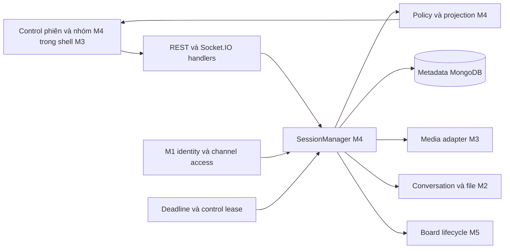
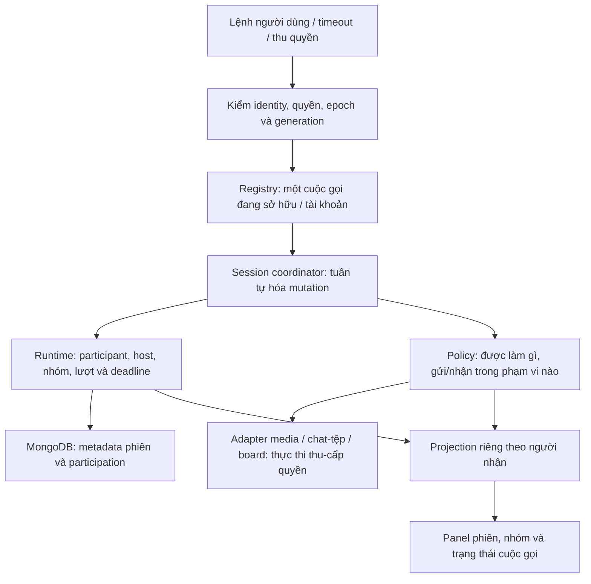
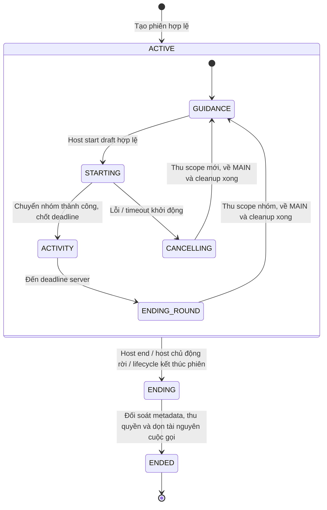
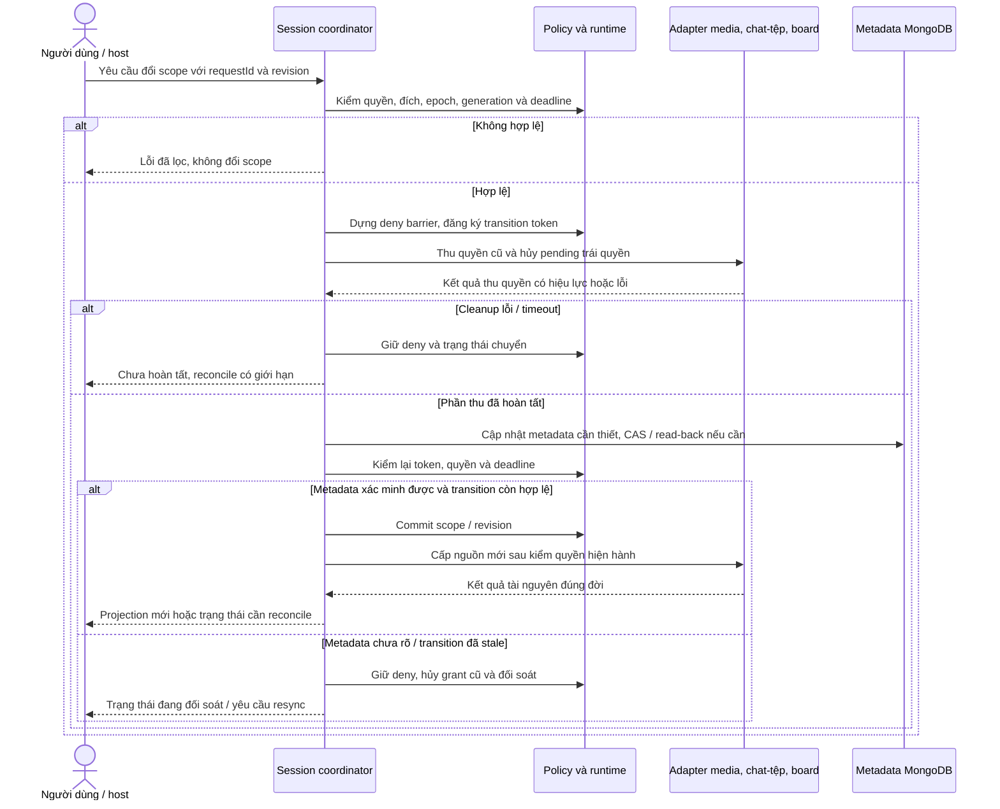
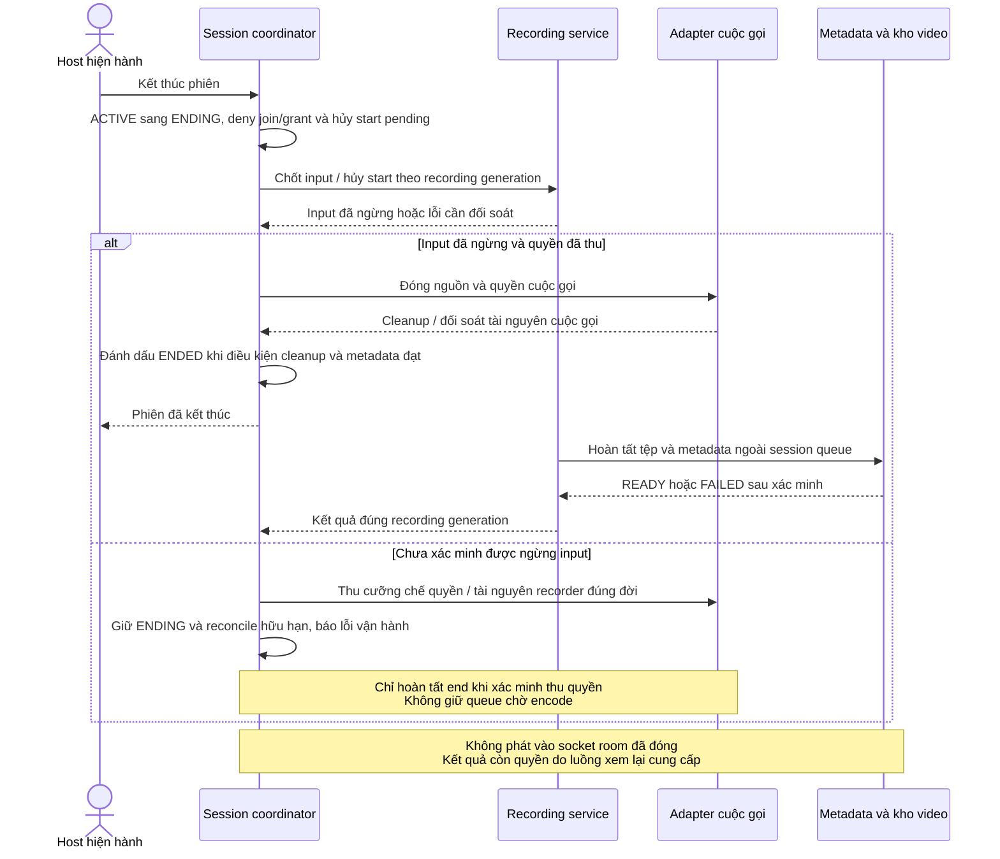
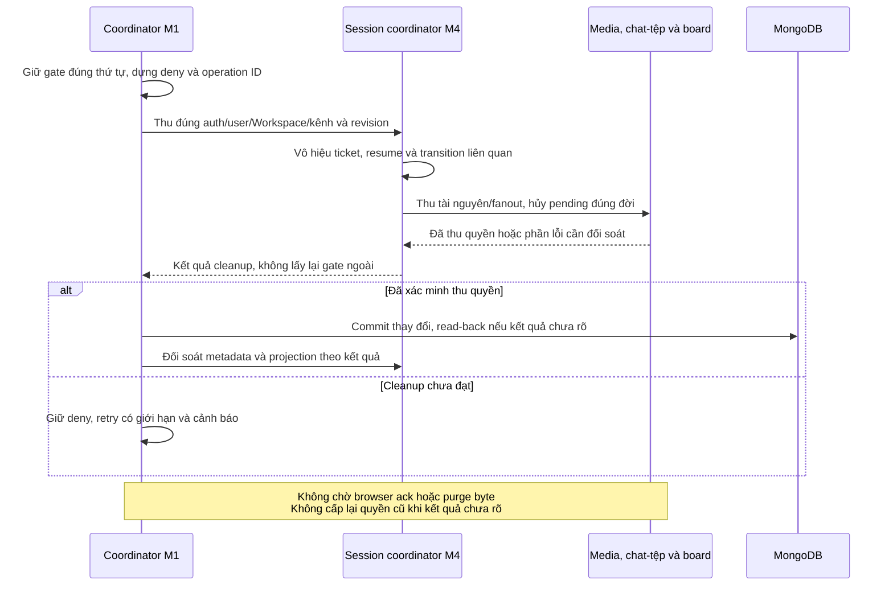

# M4 — Vòng đời phiên họp, host và nhóm

**API/backend dùng chung:** theo [quy ước](../contracts/api-conventions.md) và [mã lỗi](../contracts/error-codes.md). Bảng payload/result bên dưới mô tả dữ liệu nghiệp vụ nằm trong envelope chung; lỗi riêng của miền còn cần schema, status và consumer review trước implementation.

**Trạng thái:** Đề xuất triển khai · **Phụ trách:** Lightning1507 · **Quy mô:** XL · **Ngày cập nhật:** 04/11/2026

Tài liệu trình bày chức năng, thiết kế, đầu việc và tiêu chí nghiệm thu của [miền M4](../product/delivery-domains.md), theo [cấu trúc proposal chung](../templates/feature-proposal-sample.md). Các tên API, interface và trạng thái là thiết kế dự kiến; các điểm cần thống nhất được liệt kê tại mục 4. Phần kiểm thử mô tả tiêu chí triển khai, kết quả thực hiện được cập nhật trong từng PR.

Các điểm tích hợp với auth, chat/tệp, media và board cần được hai bên review trước code phụ thuộc. Phương án trong proposal của một miền chưa tự trở thành quyết định chung; nguồn nghiệp vụ hiện hành vẫn có hiệu lực khi chưa có quyết định thay thế.

> **Tóm tắt** — M4 quản lý vòng đời cuộc gọi, người chủ trì, thành viên, nhóm và thời hạn hoạt động. SessionManager và Policy là nguồn quyết định trạng thái/quyền dùng chung cho REST và Socket.IO. Giao diện M4 gồm các điều khiển phiên và nhóm trong màn hình cuộc gọi chung.
>
> Dữ liệu phiên dài hạn lưu trong MongoDB; quyền và nhóm đang hoạt động được quản lý trong bộ nhớ server. Triển khai từ luồng MAIN, sau đó tích hợp nhóm, deadline và phục hồi kết nối. Ước lượng sơ bộ: **29 ngày công**, khoảng **20–42**, gồm phát triển, kiểm thử, review và dự phòng; phân tích mốc 4 tuần tại mục 10.

**Phối hợp và lập kế hoạch:** xem [quy ước chung của 5 proposal](README.md#quy-ước-chung-trước-khi-lập-sprint). Phân biệt task của bên cung cấp, task tích hợp của bên dùng và ca kiểm chung; không cộng lại cùng một đầu ra hoặc coi estimate là lịch cam kết.

## 1. Context

CoLearnia có Workspace/kênh lâu dài và LiveSession có thời điểm bắt đầu/kết thúc. Trong phiên, MAIN là phòng chung; DISCUSSION kế thừa bài giảng nhưng trao đổi riêng; ACTIVITY là các nhóm độc lập trong một lượt có deadline chung. Thay đổi nhóm/host/quyền có thể xảy ra khi upload, tạo Consumer hoặc reconnect vẫn đang chờ.

Tại baseline `a84bbd6`, repo có entry point server, connector MongoDB, media runtime và schema giao tiếp ban đầu. `apps/server/src/realtime/server.ts` trả `AUTH_REQUIRED` khi handshake; SessionManager, policy nhóm và các điều khiển nghiệp vụ cần được triển khai. `packages/contracts/src/session.ts` còn kiểu FREE/MODERATED và ID dạng chuỗi rộng; các schema này cần cập nhật theo nghiệp vụ hiện hành trước khi tích hợp tính năng.

**Tài liệu liên quan:** [FR/AC](../product/functional-requirements.md), [group modes](../product/group-modes.md), [live session](../product/live-session.md), [policy](../product/groups-media-policy.md), [board](../product/board-collaboration.md), [recording](../product/recording.md), [architecture](../architecture.md), [contracts](../contracts/README.md), [collection design](../database/collection-design.md), [integrity](../database/integrity-and-migrations.md), [lifecycle](../database/lifecycle.md) và [decision status](../decision-status.md).

### Thuật ngữ dùng trong tài liệu

| Thuật ngữ                | Ý nghĩa trong M4                                                                                             |
| ------------------------ | ------------------------------------------------------------------------------------------------------------ |
| Host / participant       | Người chủ trì / người đang tham gia cuộc gọi; quyền host độc lập vai trò quản trị Workspace                  |
| Scope / audience         | Phạm vi đang tham gia / tập người được phép nhận một nguồn hoặc nội dung                                     |
| Roster / membership nhóm | Danh sách được phép tham gia / trạng thái đã thực sự vào nhóm                                                |
| Runtime / metadata       | Trạng thái đang sống trong bộ nhớ server / dữ liệu mô tả được lưu trong MongoDB                              |
| Projection               | Bản trạng thái server đã lọc theo quyền của người nhận để giao diện hiển thị                                 |
| Adapter                  | Giao diện kết nối M4 với phần media, chat/tệp hoặc board do miền khác quản lý                                |
| Deny barrier / reconcile | Chốt chặn cấp quyền trong lúc chuyển trạng thái / đối soát trạng thái và tài nguyên sau lỗi hoặc kết nối lại |
| Idempotency              | Gửi lại cùng một yêu cầu không tạo thêm tác động nghiệp vụ                                                   |

## 2. Objective

Người dùng vào đúng một cuộc gọi có quyền, tạo/vào/rời nhóm đúng phase, thấy trạng thái host/nhóm hiện hành và trở về MAIN đúng lúc. Khi chuyển phạm vi hoặc mất quyền, nguồn riêng, chat, tệp và board cũ phải ngừng được cấp trước khi mở phạm vi mới. Reconnect, deadline, retry hoặc callback muộn không được phục hồi quyền đã thu.

## 3. Goals / Non-goals

### Goals

| Goal | Đầu ra M4 và AC quan trọng                                                                                                                                          | FR chính           |
| ---- | ------------------------------------------------------------------------------------------------------------------------------------------------------------------- | ------------------ |
| G1   | Host chuyển trực tiếp cho participant hợp lệ; một host có quyền; host chủ động rời khi còn giữ quyền kết thúc toàn phiên                                            | FR-07-01/02        |
| G2   | Tạo DISCUSSION ngay sau kiểm hợp lệ, retry không nhân nhóm; chỉ roster hợp lệ chủ động join mới nhận private                                                        | FR-07-03/04        |
| G3   | Host chuẩn bị ACTIVITY thủ công/random cân số lượng, xem/chỉnh preview; start đóng DISCUSSION trước và xử lý lỗi một phần bằng hủy lượt/về MAIN                     | FR-07-05/06        |
| G4   | Đóng DISCUSSION/đưa người về MAIN dùng cùng cơ chế thu scope; DISCUSSION từng có người tự đóng khi không còn ai, kể cả mất kết nối                                  | FR-07-08, FR-10-01 |
| G5   | Phát hiện host mất kết nối thu quyền cũ và chọn host tạm ngay từ người hợp lệ; host cũ quay lại hợp lệ được hoàn quyền, bàn giao chính thức thay đích hoàn quyền cũ | FR-07-09           |
| G6   | Host chỉ vào hỗ trợ ACTIVITY có thông báo; chuyển A → B thu A trước; rời help chủ động giữ trạng thái mic, cleanup tự động không phát tiếng hỗ trợ ra MAIN          | FR-09-03           |
| G7   | Reconnect/resync theo quyền hiện tại; phối hợp đối soát thao tác pending; restart kết thúc phiên cũ thay vì dựng lại quyền từ metadata                              | FR-11-01/02/03     |
| G8   | Duration chung nguyên 1–120 phút; server tự kết thúc đúng round khi hết hạn, không chờ host; callback muộn/lặp không đóng lượt mới                                  | FR-14-01/02        |

M4 sở hữu **15 FR chính**; FR-07-07 điều chuyển thành viên ngừng áp dụng từ 04/11/2026, không tái dùng mã. Với G7, M4 điều phối phục hồi quyền và trạng thái; từng miền đối soát tin nhắn, board và tài nguyên media của mình. M4 cũng cung cấp đầu vào tích hợp cho FR-05 (vào/rời call), FR-08-02 (thông báo bằng tiếng), FR-09-01/02 (chat) và FR-15 (ghi hình).

### Non-goals

- Auth/quyền kênh thuộc M1; chat và lưu tệp thuộc M2; truyền media, trộn tiếng và recorder thuộc M3; canvas/frame thuộc M5. M4 tích hợp qua adapter và contract dùng chung.
- Cuộc gọi có một host hiện hành, chuyển quyền trực tiếp. Phạm vi hiện tại không có co-host, tự nhận host hoặc chế độ FREE/MODERATED.
- DISCUSSION tạo sau kiểm tra hợp lệ, không cần host duyệt; nhóm không share riêng và host không vào hỗ trợ nhóm này.
- Board nhóm chỉ dùng trong phạm vi nhóm. ACTIVITY kết thúc theo deadline, lỗi khởi động hoặc kết thúc phiên; thời lượng không có thao tác pause/gia hạn/kết thúc riêng thủ công.
- Bản đầu dùng một app process, một worker mediasoup và một Router/LiveSession. Mức tải được xác nhận qua các cổng kiểm tại [capacity](../capacity.md).
- Nhóm, lượt hoạt động, timer và quyền runtime không có collection bền riêng. M4 triển khai metadata/index phiên và participant theo cơ chế migration chung; metadata ghi hình do miền phụ trách recording/tệp thiết kế.

## 4. Quyết định và điểm tích hợp

| ID  | Nội dung cần thống nhất                                                                                                                                                                                        | Bên phối hợp          | Thời điểm cần kết quả                       |
| --- | -------------------------------------------------------------------------------------------------------------------------------------------------------------------------------------------------------------- | --------------------- | ------------------------------------------- |
| Q1  | Đã chốt: thu quyền/thay tạm ngay; giữ một đích hoàn quyền gốc qua nhiều host tạm. Không có ứng viên thì chờ các reconnect grace hiện có, hết người end ngay. Bị thu auth/quyền kênh được cấp lại chỉ là member | M4, M1/M3             | Áp dụng host/reconnect và ca race           |
| Q2  | Đã chốt: DISCUSSION không giữ membership khi disconnect, nhóm từng có người rỗng thì đóng, reconnect về MAIN. Cuộc gọi vẫn giữ reconnect grace, bỏ empty grace                                                 | M4, M2/M3/M5          | Áp dụng T4/T9 và ca kiểm                    |
| Q3  | Đề xuất contract identity/access/revoke, scope binding và context gate tại Appendix B.1; các bên review trước schema/handler                                                                                   | M1–M4                 | T1.2/T2/T3                                  |
| Q4  | Đề xuất cleanup result, cancel/late completion và deadline/retry tại B.2; không giữ gate/queue khi chờ I/O                                                                                                     | M2/M3/M5–M4           | T1.2/T3 và fixture                          |
| Q5  | Có profile queue/in-flight/heartbeat/payload/cache hữu hạn tại B.3, dùng PoC để điều chỉnh; chưa là capacity/SLA đạt                                                                                           | M4, các miền tích hợp | Trước bật handler/PoC                       |
| Q6  | Đã chốt: tự vào lại đúng ACTIVITY đã phân còn mở; không vào nhóm khác, không host điều chuyển; host chỉ vào bằng help, không join như thành viên                                                               | M4, M3/M2/M5          | Áp dụng draft/join/help và ca deny          |
| Q7  | Vòng đời đã chốt; đề xuất server recorder mediasoup/GStreamer và profile PoC theo nguồn recording. Đã chốt 3 tiếng/đoạn, READY giữ vô thời hạn; quota, quyền xóa và xử lý khi xóa cha còn mở                   | M3/M2/M4              | T8/PoC; chính sách trước bật video sản phẩm |

Q1/Q2/Q6 và vòng đời recording tại Q7 đã xác nhận. Q3/Q4/Q5 và kỹ thuật Q7 là đề xuất triển khai có cấu hình khởi đầu tại Appendix B, cần các bên dùng review và PoC; phần sản phẩm còn mở là quota, quyền xóa và xử lý video khi xóa kênh/Workspace. Thiết kế giữ một process Node, một worker mediasoup và một Router/LiveSession.

Các mốc thời gian đã có trong [live session](../product/live-session.md) và [group modes](../product/group-modes.md):

| Cơ chế                   | Mốc hiện hành        | Phạm vi áp dụng                                                                                  |
| ------------------------ | -------------------- | ------------------------------------------------------------------------------------------------ |
| Join ticket              | 60 giây, một lần     | Ý định vào phiên gắn authSessionId/user/channel/session epoch                                    |
| Giữ chỗ share chờ picker | Ban đầu 30 giây      | Hết hiệu lực khi đã publish và chuyển thành ownership                                            |
| Reconnect grace          | Tối đa 30 giây       | Giữ ownership theo quyền hiện tại; DISCUSSION thu membership ngay, host thu quyền/thay tạm ngay  |
| Phiên rỗng               | Không có grace riêng | End khi không còn participant connected hoặc ownership trong reconnect grace, serialize với join |
| Announcement             | Tối đa 30 giây       | Phát biểu hướng dẫn MAIN/DISCUSSION                                                              |
| Thời lượng ACTIVITY      | Số nguyên 1–120 phút | Một deadline chung, đặt trước khi bắt đầu lượt                                                   |

Thời hạn resume ticket, chu kỳ heartbeat, deadline I/O, giới hạn queue và replay cache là phần cấu hình cần thống nhất tại Q3/Q5.

## 5. High-level design



- **Entrypoint:** REST mở phiên/lấy ticket, Socket.IO cho mutation/resync theo phiên, callback nội bộ cho timeout/revoke. Tất cả đi qua cùng application service và policy, không có hai cách cấp quyền độc lập.
- **State owner:** SessionManager sở hữu participant/scope/host/group/round/epoch/generation và mutation queue. Registry mediasoup/track không nằm trong state M4; M3 sở hữu và thực thi quyết định quyền từ M4.
- **Quyền và tài nguyên:** M4 giữ quyền chiếm nguồn share theo scope và quyết định cấp/thu; miền media giữ nguồn thực tế, Producer/Consumer và source revision. Quyền đã cấp không chứng minh tài nguyên đã tạo thành công. Mọi callback hoàn tất phải kiểm lại đúng đời và quyền hiện hành.
- **Điểm tích hợp đầu tiên:** M1 cấp auth/access tối thiểu, M4 tạo/join MAIN và projection, M3 nối mic/camera/share thật. Không đợi mọi nhóm/board hoặc toàn bộ package contracts hoàn thiện.
- **Phương án không chọn:** mỗi domain giữ một bản group membership, dựa frontend để lọc quyền, queue chung cho mọi pointer, Router/group hoặc phục hồi authority qua `lastScope`. Những cách này làm lệch scope, chặn control hoặc đổi kiến trúc baseline.

Đường dẫn dự kiến: session registry/coordinator ở `apps/server/src/live/session/`, policy thuần ở `apps/server/src/live/policy/`, command schema tại `packages/contracts/src/session.ts` hoặc file con theo miền; control FE ở `apps/web/src/features/live/`. Component và interface dùng chung được thống nhất với các miền tích hợp trước khi triển khai.

### 5.1 Bản đồ trách nhiệm của M4



Registry xử lý ownership toàn tài khoản; session coordinator chỉ xử lý một phiên. Policy tính quyết định, không trực tiếp gọi DB hoặc mediasoup. Adapter quản lý tài nguyên thật; projection chỉ là dữ liệu đã lọc để hiển thị, không là nguồn cấp quyền. MongoDB không lưu lại các quyền nhóm để phục hồi sau restart.

### 5.2 Vòng đời phiên và lượt hoạt động



MAIN luôn tồn tại trong phiên ACTIVE, kể cả khi đang có lượt ACTIVITY. GUIDANCE cho phép tạo/vào DISCUSSION; draft chỉ là bản chuẩn bị, chưa đổi phase. STARTING chặn create/join DISCUSSION và đóng các nhóm này trước khi cấp ACTIVITY. ENDING của **phiên** khác ENDING_ROUND của **lượt**: hết giờ chỉ kết thúc lượt, còn kết thúc phiên đóng toàn bộ MAIN/nhóm. Finalize video có thể tiếp tục sau ENDED theo phần ghi hình bên dưới.

Sơ đồ mô tả vòng đời khi server còn hoạt động. Với app crash, bước bootstrap đối soát metadata phiên cũ trước readiness; tài nguyên dở dang được xử lý theo cơ chế cleanup của từng miền.

## 6. Detailed design

Thiết kế chia thành dữ liệu, điều phối trạng thái, giao tiếp, giao diện, vận hành và kiểm thử.

### 6.1 Database và runtime

| Nơi lưu                   | M4 sở hữu / phối hợp                                    | Cách dùng và giới hạn                                                                                                                                                                                           |
| ------------------------- | ------------------------------------------------------- | --------------------------------------------------------------------------------------------------------------------------------------------------------------------------------------------------------------- |
| `liveSessions`            | M4 schema/query metadata, M1 hỗ trợ nền Mongo/migration | Theo collection design 3.11: Workspace/kênh, epoch, hostUserId, ACTIVE/ENDING/ENDED, revision và timestamps. Partial unique phiên mở theo kênh. hostUserId là metadata, không tự cấp quyền từ DB                |
| `sessionParticipants`     | M4                                                      | Theo 3.12: unique session/user, joinedAt/leftAt, lastScope/lastScopeAt; participant ID ổn định khác callGeneration. Không lấy lastScope để tự cho vào lại nhóm                                                  |
| `auditEvents`             | M4 gọi nền audit dùng chung                             | Chỉ sự kiện quyền/vòng đời phù hợp baseline, không ghi nội dung chat, mục đích nhóm, frame hoặc token; không audit mỗi heartbeat                                                                                |
| Conversation/message/file | M2 sở hữu; M4 yêu cầu mở/khóa scope                     | M4 không viết repository hội thoại thứ hai. Đóng scope chặn đọc/event/download trước purge; byte/retention theo lifecycle M2                                                                                    |
| SessionRuntime            | M4                                                      | Host/host tạm/đích hoàn quyền, policyRevision; participant connection/scope/audienceEpoch/projectionSequence; roster/nhóm, draft/round/deadline, pending transition, ticket/dedupe/control lease và share lease |
| Media / board / byte      | M3 / M5 / M2                                            | M4 chỉ giữ handle/ID và contract cleanup; không lưu object mediasoup hoặc nét/byte vào Mongo                                                                                                                    |

Dữ liệu M4 dùng `liveSessions`, `sessionParticipants` và nền audit trong mô hình 13 collection trước recording. Group, round, timer và join ticket nằm trong runtime. ID dữ liệu bền dùng BSON ObjectId, biểu diễn chuỗi hex tại API; epoch/group/round dùng UUID. Validator cần phân biệt đúng hai loại ID.

| Dấu phiên bản            | Phạm vi và công dụng                                                                                           |
| ------------------------ | -------------------------------------------------------------------------------------------------------------- |
| `epoch`                  | Đời của phiên; chặn yêu cầu từ runtime trước restart hoặc phiên cũ                                             |
| `callGeneration`         | Đời ownership cuộc gọi của tài khoản; chặn socket/callback thuộc kết nối đã bị thay                            |
| `policyRevision`         | Phiên bản trạng thái quyền runtime của phiên                                                                   |
| `audienceEpoch`          | Đời quyền nhận nội dung của từng participant trong callGeneration; tăng khi scope hoặc tập quyền nhận thay đổi |
| `projectionSequence`     | Số thứ tự liên tục của event điều khiển M4 gửi cho từng participant/callGeneration; dùng phát hiện thiếu event |
| `draftRevision`          | Phiên bản bản phân nhóm trước start                                                                            |
| `transitionToken`        | Định danh thao tác chuyển đang chờ, kiểm callback async                                                        |
| `revision` trong MongoDB | CAS metadata host/lifecycle; độc lập với revision quyền runtime                                                |
| Dấu truy cập từ M1       | authSessionId/expiry, membershipId/incarnation/revision và channel revision; phát hiện quyền nền đã đổi        |

Source ID/generation/revision thuộc miền media và gắn đúng source scope; boardVersion thuộc miền board. M4 chuyển các tham chiếu cần thiết qua adapter, không dùng policyRevision toàn phiên thay revision của từng nguồn.

Join ticket gắn join intent, `userId`, `authSessionId`, kênh, session/epoch và dấu truy cập M1; khi consume chỉ tạo một kết quả ownership hợp lệ. Participant và pending operation sau join gắn thêm callGeneration; resume ticket gắn đúng đời ownership được phép nối lại. Dấu revision là điều kiện kiểm lại, không là quyền tồn tại vĩnh viễn. Gia nhập lại Workspace hoặc được cấp lại PRIVATE không phục hồi resume ticket, nhóm hay tài nguyên của lần truy cập trước. Không đưa cookie/token xác thực vào projection hoặc metadata participant.

Trạng thái dự kiến cần biểu diễn riêng:

- Phiên: ACTIVE → ENDING → ENDED; không nhận join mới vào ENDING, không tạo chồng phiên mới cho kênh còn đang ending.
- Participant: CONNECTED / RECONNECTING / TRANSITIONING / LEFT theo vòng đời và deny barrier. TRANSITIONING không có quyền vào đồng thời hai audience.
- DISCUSSION: OPEN/CLOSING/CLOSED cùng roster và dấu `hasHadMember` đề xuất. Nhóm mới rỗng vẫn OPEN; sau khi từng có người, người cuối rời hoặc bị phát hiện mất kết nối làm đóng nhóm. Dấu này không biến roster thành membership.
- ACTIVITY draft tách khỏi round: preview chưa cấp quyền. Round có STARTING/ACTIVE/ENDING/ENDED/CANCELLED dự kiến; phase hiệu lực khóa create/join DISCUSSION ngay từ lúc start đang chuyển, chỉ về GUIDANCE sau cleanup.
- Tập nguồn share và source revisions do M3 cung cấp theo scope; bản freeze/nét do M5 sở hữu. M4 không tăng source revision của mọi nhóm khi chỉ một nguồn đổi.

**Transaction/CAS:** tạo phiên và host metadata, unique phiên mở, upsert participation và cập nhật host/ending theo thiết kế integrity. ID ổn định trước callback transaction retry; không tạo media hoặc phát event bên trong callback có thể chạy lại. Router/ticket tạm chưa được công bố trước điều kiện DB hợp lệ; lỗi phải close pending resource. Commit chưa rõ thì read-back/reconcile, không ghi FAILED trái với SUCCEEDED có thể đã commit.

**Restart/migration:** schema/index nghiệp vụ hiện chưa có. Triển khai trên DB test cô lập theo migration runner chung của M1; preflight, backup/restore và rollback theo integrity, không chạy tự động lên DB của thành viên. Trước readiness, đánh dấu phiên runtime đời cũ ENDED/thu participation, phối hợp M2 khóa private conversations và M5 dọn frame cũ. Không backfill host/group grants từ metadata. Retention metadata còn mở không tự thêm TTL.

Metadata recording là phần mở rộng do miền recording/tệp phụ trách. Bootstrap cung cấp các phiên/epoch cũ đã kết thúc để đối chiếu intent, process và tệp dở. Video chỉ READY sau khi miền phụ trách xác minh tệp và metadata hoàn tất.

### 6.2 Luồng điều phối và thứ tự mutation

Các điều kiện phải giữ trong mọi luồng:

- Một tài khoản chỉ sở hữu một cuộc gọi đang hoạt động; một kênh chỉ có một phiên ACTIVE/ENDING.
- Tại một thời điểm chỉ có tối đa một người giữ quyền host trong phiên. Quyền host không cấp quyền thường trực vào nội dung của mọi nhóm.
- Chuyển scope phải thu quyền cũ trước khi cấp quyền mới; trong lúc chuyển, chỉ các quyền bị ảnh hưởng bị chặn, các nguồn còn hợp lệ được giữ.
- Phiên ENDING và nhóm/lượt đã đóng không nhận grant mới. Deadline được kiểm theo trạng thái server, kể cả sau I/O.
- Callback và cleanup chỉ tác động đúng epoch/generation/token; kết quả retry không tạo lại tác động đã hoàn tất.

**Thứ tự khóa:** user call ownership → Workspace gate khi cần → channel lifecycle → session mutation. Chỉ lấy khóa cần dùng; không gọi ngược Workspace gate từ callback đang giữ session queue, không giữ hai queue phiên khi takeover. Handlers cần DB/file đi vào từ cổng ngoài; timer/tác vụ kết thúc tách bước reconcile hoặc chạy lại từ cổng đúng thứ tự.

Nếu M1 đã giữ Workspace/channel gate và gọi thu quyền, M4 dùng context điều phối nội bộ của thao tác đó, không lấy lại khóa ngoài. Cleanup mà M1 đang chờ không được gọi ngược M1 hoặc chờ công việc cần chính gate đang bị giữ. Phần cần DB/revalidation tiếp theo được trả về coordinator ngoài; không truyền quyền bỏ qua khóa từ payload client.

**Chuyển scope dùng chung:**

1. Kiểm identity/access, epoch/generation, role/revision/phase/deadline và đích còn hợp lệ. Dựng deny barrier, ghi transition token để chặn grant/callback cũ.
2. Tính state đích và kế hoạch thu quyền. Gọi M3 đóng nguồn/Consumer không còn quyền, M2 khóa subscription/file stream liên quan và M5 thu quyền/intent người rời.
3. Nếu chỉ một người rời, giữ frame/nét chung còn được nhóm dùng. Nếu nhóm đóng, kết thúc context và dọn refs theo lifecycle; không sao chép ra MAIN.
4. Xác nhận phần thu đã có hiệu lực, cập nhật metadata cần thiết và commit state runtime/revision. Cấp nguồn mới qua M3 sau revalidation; phát projection đã lọc đúng người.
5. Timeout/lỗi: giữ deny, thể hiện đang chuyển/đang kết thúc; retry cleanup có giới hạn và reconcile idempotent. Chỉ báo hoàn tất khi phần thu quyền đã có hiệu lực. Đối soát riêng metadata và runtime vì hai phần này không cùng một transaction nguyên tử.

M3/M2/M5 đăng ký pending resource theo transition/generation và kiểm lại khi tạo xong; callback cũ phải close object vừa tạo thay vì gắn vào state mới. Cleanup promise không được phụ thuộc browser ack; I/O có deadline, queue có admission hữu hạn. Không giữ queue khi chờ picker, upload, encode hoặc người dùng.

**Điều kiện xác nhận thu quyền:** adapter đã chặn tạo/gửi mới, ngừng fanout/stream hoặc đóng media trái quyền và vô hiệu pending thuộc thao tác. Xóa byte vật lý, finalize video và giao diện người nhận xác nhận không phải điều kiện chờ của bước này. Adapter trả operation ID, phạm vi/đời đã xử lý và phần còn lỗi để reconcile; chỉ phát event yêu cầu cleanup chưa đủ để báo đã thu quyền.

Commit scope hợp lệ và thiết bị sẵn sàng là hai kết quả riêng. Người dùng từ chối quyền mic/camera vẫn có thể vào phiên với thiết bị tắt; không giữ participant ở TRANSITIONING chỉ vì chưa publish. M3 báo lỗi thiết bị và chỉ tạo nguồn khi có quyền hiện hành.

Mutation mới xung đột với transition đang chạy trả `OPERATION_IN_PROGRESS` hoặc trạng thái hiện hành của cùng request. End/revoke/deadline phải vô hiệu hóa transition cũ và được đối soát cả khi queue người dùng đã đầy; chỉ từ chối mutation người dùng mới khi quá tải. Adapter được gọi lại an toàn với cùng operation ID. Sau khi hết số lần retry cleanup, giữ trạng thái an toàn và phát cảnh báo vận hành; lượt đối soát hoặc can thiệp vận hành mới tiếp tục xử lý.

**DISCUSSION:** kiểm tên ≤80, mục đích ≤500 và roster hợp lệ cùng phiên, dedupe create rồi tạo ngay; không approve/reject. `group.join` DISCUSSION kiểm lại phase, roster, quyền và OPEN; tạo nhóm chưa cấp nội dung riêng. `group.leave` chỉ chuyển actor về MAIN/pause mic. Serialize join/leave/close để xử lý người cuối chủ động rời; khi đóng, xóa khả năng join của cả roster. Disconnect/control lease hết hạn thu membership DISCUSSION ngay; nhóm từng có người mà rỗng thì đóng, chưa ai từng vào thì vẫn chờ. Reconnect về MAIN; nếu nhóm còn mở/còn người thì actor thuộc roster được chủ động vào lại.

**Chuẩn bị/start ACTIVITY:** host chọn tập người/số nhóm; dùng Fisher–Yates để xáo trộn rồi phân cân bằng, số người chênh tối đa một trước chỉnh. Mỗi participant xuất hiện đúng một lần trong tập được phân. Preview trả `draftRevision` riêng; host chỉnh rồi start với revision dự kiến. Nếu roster đã thay đổi, trả lỗi stale để host xem lại; quy tắc số nhóm/draft payload được thống nhất trước triển khai.

Khi start: chặn create/join DISCUSSION → đóng DISCUSSION → mở các scope ACTIVITY/chuyển người → xác lập round/deadline chung khi start hoàn tất. Người chưa phân ở MAIN. Nếu lỗi một phần: hủy toàn lượt chưa hoàn tất, thu nguồn/quyền mới và timer của lượt, đưa người còn quyền về MAIN/pause mic; không khôi phục DISCUSSION đã đóng. STARTING dùng foreground deadline thử 10 giây theo profile Q5/Appendix B.2; không treo vô hạn hoặc tự retry tạo thêm round.

**Deadline:** dùng thời gian server, một roundId/deadline cho mọi nhóm. Callback yêu cầu reconcile; mỗi command/read/grant/fanout vẫn kiểm hạn, kể cả sau await. Khi hết hạn, chặn quyền ACTIVITY và điều phối kết thúc lượt trước khi cấp tiếp. Callback mang `{sessionId, epoch, roundId, deadline}` để lặp/trễ không đóng lượt mới. Cleanup chạy cả khi host mất mạng; xong cleanup mới mở lại GUIDANCE/DISCUSSION. Countdown client dùng mốc giờ server để hiển thị. Kiểm thử dùng fake clock; vận hành theo dõi clock jump và event-loop lag để phát hiện timer xử lý muộn.

**Host:** chuyển trực tiếp kiểm target connected/còn quyền trong phiên; thu help/announcement và quyền vẽ host cũ trước, cập nhật host metadata/runtime theo CAS và phát projection mới. MAIN share còn hợp lệ tiếp tục hoạt động. Host mới đang ở nhóm được thu membership/help cũ và chuyển MAIN theo lifecycle để chỉ vào ACTIVITY qua help. Nếu host mới đang bật mic ở scope cũ, server pause mic tới khi xác nhận phạm vi điều hành theo policy; thiết bị đang tắt được giữ tắt. Khi server phát hiện host mất kết nối, thu ngay mọi quyền media/chat/board/help/announcement/điều hành của kết nối cũ, chọn host tạm ngẫu nhiên từ ứng viên connected/hợp lệ ngay. Giữ riêng danh tính cần hoàn quyền và ownership được phép reconnect. Host cũ quay lại được kiểm danh tính/phiên/quyền trước khi hoàn quyền; bàn giao chính thức thay đích hoàn quyền cũ. Giữ một returnHostUserId gốc qua các host tạm; B quay lại không giành từ C nếu đích vẫn là A. Không còn host connected thì chờ grace hiện có và elect người quay lại hợp lệ; hết ownership cuối thì end. Auth/access bị thu xóa đích liên quan, cấp lại chỉ là member. Bàn giao chính thức thay đích gốc.

**Phiên rỗng:** sau leave/hết reconnect grace, không còn participant connected hoặc ownership hợp lệ trong grace thì ENDING ngay; không chờ empty grace. Join và quyết định end serialize: join thắng thì tiếp tục; ENDING thắng thì từ chối join tới cleanup xong. Callback kiểm session/epoch/token, không đóng phiên mới hoặc phiên đã có người. Host chủ động rời khi còn quyền end ngay. Không có ứng viên nhưng ownership còn grace thì chờ deadline grace hiện hành; người quay lại được kiểm quyền/elect theo Q1 đã chốt, không thêm thời gian chờ.

**Help/announcement:** host.help.enter chỉ ACTIVITY mở/còn hạn; ghi nhận/hiển thị thông báo host vào rồi mới mở private scope, sang B thu A trước. Cơ chế thứ tự event và UI nhãn scope được review với M2/M3, không chờ ack tất cả browser để cấp quyền. Host chủ động help.leave về MAIN giữ mic bật/tắt và đổi audience; automatic close/disconnect không dùng đường này để bật tiếng chung. Announcement chỉ MAIN/DISCUSSION khi host ở MAIN/hướng dẫn; timeout 30s theo nguồn, M3 xử lý gain/ramp/restore preferences, M4 xử lý quyền và lifecycle.

#### 6.2.1 Chuyển nhóm: thu quyền cũ trước khi cấp quyền mới



Sơ đồ mô tả thứ tự logic; không giữ mutex xuyên toàn bộ I/O. Trong queue chỉ nhận lệnh/đặt barrier và token, sau đó nhả queue cho adapter thực hiện I/O có deadline; khi quay lại phải lấy đúng cổng/khóa và kiểm token trước commit. Barrier chặn grant trái quyền dù tác vụ đang chạy ngoài queue. Nếu kết thúc phiên hoặc hết lượt trong lúc chờ, transition cũ mất hiệu lực; tài nguyên vừa tạo phải bị đóng, không cấp quyền theo đích đã hết hạn. Participant về MAIN có mic bị pause; camera đang bật đổi audience với thông báo, không tự bật thiết bị đã tắt.

Đối với media đang truyền, barrier phải đi kèm đóng Producer/Consumer trái quyền trên server. Quyền đã thu được xác nhận từ tài nguyên thực tế; gain hoặc tile giao diện không thay bước này. Đo độ trễ từ deadline/revoke đến khi đóng tài nguyên; âm thanh đã gửi hoặc nằm trong buffer phía người nhận không thể thu hồi.

#### 6.2.2 Share lease và điểm kiểm quyền media

Mỗi MAIN hoặc ACTIVITY có một slot share độc lập; DISCUSSION không có slot publish. Slot runtime do M4 giữ gồm scope, chủ sở hữu, lease ID/generation, thời hạn giữ chỗ và trạng thái giữ chỗ/đã publish. Media adapter giữ mapping nguồn thực tế. Lease chờ picker ban đầu **30 giây** theo [live session](../product/live-session.md). Publish thành công chuyển lease thành ownership gắn participant/generation, được giám sát theo signaling lease; thời hạn chờ picker không tiếp tục đếm để đóng một share đã publish.

1. Acquire kiểm membership/scope/phase/deadline và slot trống rồi giữ chỗ nguyên tử. Nguồn bận trả `SHARE_BUSY`, không chiếm nguồn của người khác.
2. Browser mở picker ngoài queue. Publish phải kiểm lại lease, scope và generation sau các bước async; acquire thành công không bảo đảm publish thành công.
3. Hủy picker/hết hạn giữ chỗ thu lease pending. Leave/revoke/track ended thu ownership và nguồn liên quan. Callback release cũ không được giải phóng slot đã cấp cho nguồn mới.
4. Source revision do media adapter quản lý cho đúng nguồn; đổi host không làm tăng revision hay đóng share MAIN còn hợp lệ. Đóng nguồn live báo board để dọn overlay/intent liên quan; frame nhóm đã giữ hợp lệ tiếp tục theo lifecycle board.

Join ticket, lease share và control lease là các cơ chế riêng; các budget admission/control lease cần thống nhất tại Q5. Với mọi Producer/Consumer, policy được kiểm tại create, sau await và trước resume/ready, kể cả khi `canConsume` về codec trả true. Nhu cầu camera theo viewport/pin chỉ giới hạn tập nhận **trong** quyền được cấp; danh sách participant và quyền nghe tiếng vẫn theo policy phiên.

#### 6.2.3 Quyền ghi hình và kết thúc phiên

**Yêu cầu hiện hành:** theo [recording](../product/recording.md), chỉ host hiện hành điều khiển ghi/dừng MAIN; nội dung nhóm riêng không thuộc bản ghi. Mất quyền MAIN phải thu đầu vào tương ứng trước khi cấp private scope, kể cả lúc host vào hỗ trợ. Thiết bị tắt không được tự bật. Đang ghi và video sẵn sàng là hai trạng thái khác nhau; lỗi ghi/lưu không làm kết thúc cuộc gọi.

**Vòng đời và hướng pipeline được xác nhận ngày 04/11/2026:** bản ghi gắn session/epoch và recording generation, độc lập cookie/kết nối người bắt đầu; tiếp tục qua đổi host, dừng/ghi lại tạo đoạn mới, hủy STARTING, end ngừng input rồi finalize độc lập. Pipeline nhận nguồn MAIN → ghép/trộn → encode → lưu → phục vụ có ACL. Công cụ/codec/bố cục, admission, metadata và cleanup byte cần contract/PoC Q7; không tự chọn công cụ thay miền media.

| Sự kiện                                   | Điều phối vòng đời đã thống nhất                                                                                       | Điều kiện hoàn tất và chi tiết cần review                                                                                          |
| ----------------------------------------- | ---------------------------------------------------------------------------------------------------------------------- | ---------------------------------------------------------------------------------------------------------------------------------- |
| Bắt đầu ghi                               | Kiểm host hiện hành, phiên ACTIVE, revision và admission; đăng ký start intent ổn định trước khi khởi động ngoài queue | Callback kiểm session/epoch, recording generation và intent còn hiệu lực. Chỉ báo Đang ghi sau xác nhận capture thực sự hoạt động  |
| Đổi / hoàn quyền host                     | Chuyển quyền điều khiển nguyên tử theo host state; host cũ bị từ chối lệnh mới                                         | Giữ bản ghi hiện có, không stop/start lại theo người. Race với start/stop phải có kết quả rõ theo thứ tự mutation                  |
| Participant chuyển nhóm / host vào hỗ trợ | Thu eligibility MAIN cũ và yêu cầu gỡ input trước cấp scope private                                                    | Không chuyển recorder theo người; không ghi mic/camera nhóm hoặc giữ tile riêng trái quyền. Về MAIN chỉ cấp lại nguồn hợp lệ       |
| Hết lượt ACTIVITY                         | Đóng nhóm và đưa người về MAIN theo quy trình deadline                                                                 | Không dừng bản ghi. Mic đang bị pause không được tự mở để đưa vào recording                                                        |
| Dừng khi còn khởi động                    | Hủy start intent, chặn callback commit Đang ghi; yêu cầu dọn đúng recording generation                                 | Callback muộn bị từ chối và dọn tài nguyên; chính sách xử lý byte đã thu cần thống nhất tại Q7                                     |
| Dừng khi đang ghi                         | Ghi nhận stop intent, chốt mốc ngừng input; retry hội tụ cùng bản ghi                                                  | Stop ack chỉ xác nhận yêu cầu/trạng thái, chưa có nghĩa video sẵn sàng. Record sau khi dừng là intent/ID mới, admission còn cần Q7 |
| Kết thúc phiên                            | Chặn join/grant mới, chốt input recorder, phối hợp ngừng input và dọn tài nguyên cuộc gọi                              | Không đợi encode/video READY mới kết thúc call; không hủy process mux tùy tiện trước khi nhận phần dữ liệu cuối                    |
| Recorder lỗi                              | Nhận lỗi để cập nhật projection theo audience; phối hợp cleanup đúng đời                                               | Không kết thúc call hoặc mở recorder thay thế tự động; không tạo nguồn MAIN/private mới để cứu job                                 |

M4 chỉ giữ handle/intent cần điều phối và projection trạng thái; state machine recorder, metadata bền và byte có owner riêng. Không tạo hai state machine recording có thể tự chuyển trạng thái trái nhau. Interface cần trả rõ đã tiếp nhận lệnh, đã ngừng input hay đã finalize, kèm ID/generation/revision; không dùng một `success` chung cho cả ba mốc.



Finalize có thể chạy song song cleanup sau khi input đã được chốt. Media adapter thu quyền nhận nguồn mới độc lập phần hoàn tất dữ liệu đã nhận; loại tài nguyên cụ thể phụ thuộc pipeline được chọn. Timeout ngừng input giữ trạng thái bị thu quyền và kích hoạt reconcile. Sau ENDED, callback finalize chỉ cập nhật đúng recording attempt, không mở lại call; kết quả chỉ tới người còn quyền xem video. App crash cần đối chiếu bản ghi dở với miền media/tệp.

#### 6.2.4 Thu quyền xác thực, Workspace và kênh

M1 cung cấp danh tính và quyền nền; M4 áp dụng thay đổi lên ticket, ownership, participant, nhóm, share/help/announcement và các adapter. Phạm vi thu quyền phải cụ thể:

| Nguyên nhân                                        | Phạm vi xử lý trong M4                                                                                                       |
| -------------------------------------------------- | ---------------------------------------------------------------------------------------------------------------------------- |
| Logout hoặc authSession hết hạn/bị thu             | Chỉ ticket/ownership/tài nguyên gắn authSession đó; không đóng cuộc gọi hợp lệ của phiên đăng nhập khác do callback cũ       |
| Đổi mật khẩu theo luồng M1 thu mọi phiên đăng nhập | Mọi authSession bị thu của user; từng ownership vẫn compare-and-delete theo generation                                       |
| Loại thành viên Workspace                          | Mọi ticket/participant của user trong Workspace và incarnation bị thu; quyền ở Workspace khác không bị mở rộng phạm vi xử lý |
| Gỡ PRIVATE hoặc xóa kênh                           | Các ý định/tài nguyên thuộc kênh bị ảnh hưởng; không thu DM hoặc kênh khác chỉ vì cùng user                                  |
| Xóa Workspace                                      | Chặn grant mới của Workspace, kết thúc các phiên liên quan và thu toàn bộ private scope trước khi xác nhận cleanup           |

Đây là thu quyền bắt buộc, không phải mất mạng để chờ grace. M4 hủy resume/ticket và transition bị ảnh hưởng ngay; reconnect bằng auth cũ bị từ chối. M1 giữ deny barrier, chờ xác nhận thu quyền rồi xử lý commit/read-back theo coordinator chung; purge vật lý chạy sau. Nếu commit chưa rõ hoặc cleanup lỗi, không tự mở lại quyền theo DB cũ.

Host bị thu auth/quyền không được xử lý như lệnh host chủ động leave, cũng không được giữ quyền trong grace. M4 thu help/announcement/quyền vẽ và mọi đầu vào trái quyền ngay. Nếu người bị thu là đích hoàn quyền thì xóa đích đó và chọn participant connected/hợp lệ; được cấp lại auth/access rồi vào phiên chỉ là member. Đích gốc khác còn hợp lệ được giữ. Không biến revoke bắt buộc thành host voluntary leave hoặc dùng userId cũ tự phục hồi host.



#### 6.2.5 Context chat/tệp và board

M4 cung cấp context hiện hành để M2/M5 kiểm quyền, không xử lý từng tin nhắn, nét vẽ hoặc cursor qua mutation queue của phiên. Context gồm session/epoch, participant/generation, scope/round/deadline, host hiện hành và dấu quyền cần kiểm lại. Roster chỉ cho biết ai được phép vào; M2/M5 cần membership thực tế hoặc quyền hỗ trợ hợp lệ.

- **Chat riêng với host:** đổi host hoặc scope làm đích soạn tin/upload cũ hết hiệu lực. M2 yêu cầu xác nhận đích mới; không tự gửi sang Everyone hoặc host mới. Lịch sử cặp cũ theo ACL/lifecycle M2, không chuyển cho người nhận quyền host. Ảnh gửi riêng không cấp quyền đọc board nhóm.
- **Board đang trực tiếp:** MAIN chỉ host hiện hành đang ở MAIN/hướng dẫn được vẽ/clear; host role không cấp quyền trong lúc hỗ trợ ACTIVITY. DISCUSSION không cho host vào hỗ trợ. Chuyển help A → B thu quyền A trước khi mở B.
- **Freeze đang chờ:** M5 hủy intent khi nguồn đổi/dừng trước commit, actor mất quyền, nhóm/round đóng, resume hoặc board bị vô hiệu. Sau khi M2 bind ảnh xong vẫn phải kiểm lại context/source/version trước commit FROZEN. Kết quả muộn bị từ chối và trả ref/byte cho cơ chế cleanup M2; không giữ queue phiên khi upload/bind.
- **Frame đã FROZEN:** đổi/dừng nguồn trực tiếp không xóa ảnh đã giữ hợp lệ. Resume bỏ tham chiếu ảnh/nét cũ theo lifecycle và dùng nguồn trực tiếp hiện tại được phép xem; âm thanh vẫn theo policy media, không bị freeze cùng ảnh. Không có nguồn hợp lệ thì hiển thị đang chờ nguồn.
- **Một người rời và cả nhóm đóng:** rời chỉ thu quyền/pending của người đó, giữ frame/nét chung. Đóng context thu mọi quyền, khóa tải frame và dọn refs; tắt board cũng phải vô hiệu pending và giải phóng refs không còn dùng. M5 trả kết quả cleanup cho M4, M2 xác nhận việc bỏ liên kết/dọn byte theo owner tương ứng.

### 6.3 API, socket và contract dự kiến

Contract dưới đây là thiết kế để frontend/backend review trước khi thêm Zod schema và handler; chưa phải chức năng đã chạy. Giữ một application service/policy cho mọi entrypoint. Mỗi bảng nêu rõ cách gọi, dữ liệu, kết quả, quyền và lỗi cần xử lý.

#### 6.3.1 REST — chuẩn bị tham gia cuộc gọi

Prefix chung là `/api/v1`; đường dẫn dưới đây ghi đầy đủ để client gọi. Request/response strict, actor lấy từ cookie xác thực M1. Mutation HTTP kiểm CSRF/Origin theo contract chung. Thành công trả `{ data, requestId }`, lỗi trả `{ error: { code, message }, requestId }`; không trả token xác thực, đường dẫn storage hoặc raw DB error.

| Method / path                                  | Request                                    | Response thành công / điều kiện quyền                                                                                                                                                                                                                      | Lỗi chính                                                                                                                                                                                       |
| ---------------------------------------------- | ------------------------------------------ | ---------------------------------------------------------------------------------------------------------------------------------------------------------------------------------------------------------------------------------------------------------- | ----------------------------------------------------------------------------------------------------------------------------------------------------------------------------------------------- |
| POST `/api/v1/channels/:cid/live-session/join` | Path `cid`: ObjectId; body `{ requestId }` | 200: `{ sessionId, epoch, ticket, expiresAt }`; ticket một lần, hạn 60 giây, gắn user/authSession/kênh/đời phiên. M1 kiểm membership và quyền đọc nội dung kênh LIVE. M4 tìm/tạo đúng một phiên mở, Router/metadata pending phải rollback/đối soát nếu lỗi | 400 VALIDATION_ERROR; 401 AUTH_REQUIRED; 403 FORBIDDEN/CSRF_INVALID; 404 NOT_FOUND khi không được biết kênh; 409 OPERATION_IN_PROGRESS khi phiên đang ENDING; 429 RATE_LIMITED; 503 SERVER_BUSY |

Nhận ticket chưa là participant và chưa được nhận media/chat/board. Frontend dùng ticket gọi `session.join` trên socket đã xác thực; không gửi host/role/userId để tự cấp quyền. Mở lobby hoặc lấy ticket không tự ngắt cuộc gọi đang sở hữu. Các điều khiển phiên/nhóm phía dưới dùng Socket.IO ack; không đặt thêm một bộ REST mutation có policy riêng.

#### 6.3.2 Kiểu ID, envelope và ack dùng chung

| Trường / kiểu                                                                                                                | Cách dùng                                                                                                                                                                               |
| ---------------------------------------------------------------------------------------------------------------------------- | --------------------------------------------------------------------------------------------------------------------------------------------------------------------------------------- |
| `requestId`: UUID                                                                                                            | Nhận diện ý định command; retry cùng ý định giữ nguyên, thay payload phải dùng ID mới. Resync có requestId riêng cho từng lượt                                                          |
| `sessionId`, `participantId`, `targetParticipantId`: ObjectId hex 24 ký tự                                                   | ID metadata phiên/participation được server cấp; không dùng userId thay participantId                                                                                                   |
| `epoch`, `groupId`, `roundId`, `draftId`, `draftGroupId`, `transitionToken`, `snapshotId`, `announcementId`, `leaseId`: UUID | ID đời runtime, nhóm/lượt/bản chuẩn bị/thao tác; không ép groupId thành ObjectId                                                                                                        |
| `callGeneration`: số nguyên dương                                                                                            | Đời ownership socket đang được phép dùng                                                                                                                                                |
| `expectedPolicyRevision`: số nguyên không âm                                                                                 | Mốc state/quyền client dựa vào khi mutation; mismatch trả CONFLICT để resync                                                                                                            |
| `ScopeRef`                                                                                                                   | `{ type: 'MAIN' }` hoặc `{ type: 'GROUP', groupId }`; server suy mode DISCUSSION/ACTIVITY từ runtime, client không tự khai mode để lấy quyền                                            |
| `E` — envelope mutation                                                                                                      | `{ requestId, sessionId, epoch, callGeneration, expectedPolicyRevision, payload }`; payload strict theo tên command                                                                     |
| Envelope resync                                                                                                              | `{ requestId, sessionId, epoch, callGeneration, payload: { lastProjectionSequence?, lastPolicyRevision? } }`; không buộc khớp expected revision cũ vì đây là đường lấy state mới        |
| Ack thành công                                                                                                               | `{ data: { status: 'accepted' / 'pending' / 'completed', operationId?, result? }, requestId }`; trường thuộc từng command, không một success chung cho nhận lệnh và tài nguyên sẵn sàng |
| Ack lỗi                                                                                                                      | `{ error: { code, message }, requestId }`; lọc metadata theo quyền hiện hành, không tự replay kết quả private cũ                                                                        |

Join lần đầu là ngoại lệ chưa có participant envelope: `{ requestId, ticket, takeover? }`. Đề xuất takeover có `{ confirmed: true, expectedCallGeneration }`, lấy từ xung đột ownership hiện hành đã được lọc theo quyền. `CALL_ALREADY_ACTIVE` không consume ticket; xác nhận là command requestId mới với ticket còn hạn và ownership dự kiến. Server kiểm lại auth/access/ticket/ownership rồi thu đời cũ trước cấp đời mới. Hủy giữ cuộc gọi cũ, hết ticket lấy lại ticket hợp lệ; payload takeover cuối cùng cần M3–M4 cùng review.

#### 6.3.3 Socket.IO — tham gia, host và nhóm

Client gọi `socket.emit(command, input, ack)`. Ngoài join/resync, Input trong bảng là **payload nằm trong E**, không phải body HTTP. Đầu ra là result khi completed hoặc operationId/trạng thái khi còn pending. Actor/role/current scope/deadline luôn lấy từ server. Handshake kiểm Origin/xác thực theo M1; mọi command đều kiểm lại auth/access và có thể trả AUTH_REQUIRED/FORBIDDEN dù bảng chỉ nêu lỗi đặc thù.

| Command                  | Payload / input                                                                                    | Result / quyền                                                                                                                                                                             | Lỗi đặc thù cần FE xử lý                                                                                                          |
| ------------------------ | -------------------------------------------------------------------------------------------------- | ------------------------------------------------------------------------------------------------------------------------------------------------------------------------------------------ | --------------------------------------------------------------------------------------------------------------------------------- |
| `session.join`           | `{ requestId, ticket, takeover? }`, không dùng E                                                   | `{ participantId, callGeneration, snapshot }` hoặc descriptor snapshot chia phần; ticket chỉ consume khi join ownership hợp lệ, một join intent không nhân participant                     | AUTH_REQUIRED, FORBIDDEN, VALIDATION_ERROR cho ticket hết hạn/đã dùng sai intent, CALL_ALREADY_ACTIVE, SESSION_ENDED, SERVER_BUSY |
| `session.resync`         | Envelope resync ở bảng trên                                                                        | `{ snapshot }` hoặc `{ snapshotId, partCount }` có mốc nhất quán; chỉ trả quyền hiện hành đúng socket/ownership                                                                            | AUTH_REQUIRED, FORBIDDEN, CONFLICT, SESSION_ENDED                                                                                 |
| `session.leave`          | `{}`                                                                                               | Member rời call, thu đúng đời và trả `{ left: true }`; actor còn giữ host thì dùng luồng end cho mọi người                                                                                 | CONFLICT, OPERATION_IN_PROGRESS                                                                                                   |
| `session.end`            | `{}`                                                                                               | Host hiện hành; trả operation ENDING rồi `{ sessionState: 'ENDED' }` sau thu quyền/metadata đạt                                                                                            | FORBIDDEN, CONFLICT, OPERATION_IN_PROGRESS                                                                                        |
| `host.transfer`          | `{ targetParticipantId }`                                                                          | Host-only; target connected/còn quyền cùng phiên. Trả `{ hostParticipantId, policyRevision }`; direct transfer, không invite/accept                                                        | FORBIDDEN, TARGET_UNAVAILABLE, CONFLICT                                                                                           |
| `group.createDiscussion` | `{ name, purpose, rosterParticipantIds }`                                                          | Participant ở GUIDANCE; name ≤80, purpose ≤500, roster không trùng và hợp lệ. Trả `{ groupId, rosterParticipantIds }`; tạo không tự cấp membership                                         | VALIDATION_ERROR, INVALID_PHASE, TARGET_UNAVAILABLE, CONFLICT                                                                     |
| `group.join`             | `{ groupId }`                                                                                      | Member; DISCUSSION: roster hợp lệ/GUIDANCE/OPEN; ACTIVITY: đúng nhóm đã phân trong round còn mở/còn hạn. Trả `{ scope, audienceEpoch, policyRevision }`                                    | FORBIDDEN, GROUP_CLOSED, INVALID_PHASE, CONFLICT                                                                                  |
| `group.leave`            | `{}`                                                                                               | Chỉ member hiện thuộc nhóm, đưa về MAIN/pause mic; trả scope/audienceEpoch/revision. Không đổi phân công ACTIVITY, không kéo cả nhóm theo                                                  | INVALID_PHASE, CONFLICT, OPERATION_IN_PROGRESS                                                                                    |
| `discussion.close`       | `{ target: { kind: 'ONE', groupId } }` hoặc `{ target: { kind: 'ALL' } }`                          | Host ở GUIDANCE; đóng đúng DISCUSSION, trả `{ closedGroupIds }` khi cleanup hoàn tất; không nhận ACTIVITY                                                                                  | FORBIDDEN, GROUP_CLOSED, INVALID_PHASE, CONFLICT                                                                                  |
| `activity.prepare`       | `{ mode: 'MANUAL' / 'RANDOM', selectedParticipantIds, groupCount, durationMinutes, assignments? }` | Host ở GUIDANCE; duration nguyên 1–120. RANDOM server phân cân; MANUAL cần assignments đúng tập đã chọn. Trả `{ draftId, draftRevision, assignments, durationMinutes }`, chưa chuyển người | FORBIDDEN, VALIDATION_ERROR, INVALID_PHASE, TARGET_UNAVAILABLE                                                                    |
| `activity.updateDraft`   | `{ draftId, expectedDraftRevision, assignments, durationMinutes }`                                 | Host chỉnh draft trước start; mỗi người xuất hiện đúng một lần trong tập phân, không phân host hiện hành như member. Trả preview/draftRevision mới                                         | FORBIDDEN, VALIDATION_ERROR, CONFLICT, INVALID_PHASE                                                                              |
| `activity.start`         | `{ draftId, expectedDraftRevision }`                                                               | Host; đóng DISCUSSION trước, chuyển scope, trả `{ roundId, deadline, serverTime }` sau thành công. Lỗi một phần trả trạng thái đang hủy/đã hủy, không giữ lượt chạy dở                     | FORBIDDEN, CONFLICT, INVALID_PHASE, TARGET_UNAVAILABLE, OPERATION_IN_PROGRESS                                                     |
| `host.help.enter`        | `{ groupId }`                                                                                      | Host; đúng ACTIVITY còn mở/còn hạn. Trả scope hỗ trợ/audienceEpoch/revision, thông báo vào nhóm; sang B thu A trước                                                                        | FORBIDDEN, GROUP_CLOSED, INVALID_PHASE, CONFLICT                                                                                  |
| `host.help.leave`        | `{}`                                                                                               | Host đang hỗ trợ chủ động về MAIN, giữ mic bật/tắt theo policy; trả scope MAIN/audienceEpoch/revision                                                                                      | FORBIDDEN, INVALID_PHASE, CONFLICT                                                                                                |
| `announcement.start`     | `{}`                                                                                               | Host ở MAIN/hướng dẫn; trả `{ announcementId, deadline }`, tối đa 30 giây; audience MAIN/DISCUSSION, không ACTIVITY                                                                        | FORBIDDEN, INVALID_PHASE, OPERATION_IN_PROGRESS                                                                                   |
| `announcement.stop`      | `{ announcementId }`                                                                               | Host hiện hành; stop đúng announcement, trả `{ stopped: true }`, lặp cùng operation hội tụ                                                                                                 | FORBIDDEN, CONFLICT                                                                                                               |
| `screen.acquire`         | `{ scope: ScopeRef }`                                                                              | Actor đúng MAIN/ACTIVITY, slot trống; trả `{ leaseId, leaseGeneration, expiresAt }`. DISCUSSION bị deny, không giành nguồn                                                                 | FORBIDDEN, INVALID_PHASE, SHARE_BUSY, CONFLICT                                                                                    |
| `screen.release`         | `{ leaseId, leaseGeneration }`                                                                     | Chỉ lease/ownership đúng actor và đời; trả `{ released: true }`; callback cũ không release lease mới                                                                                       | FORBIDDEN, CONFLICT                                                                                                               |
| `recording.start`        | `{}`                                                                                               | Host hiện hành, phiên ACTIVE và recorder/storage admission hợp lệ; trả `{ recordingId, attemptId, generation, state }`, chỉ báo RECORDING sau capture-ready                                | FORBIDDEN, CONFLICT, OPERATION_IN_PROGRESS, SERVER_BUSY; lỗi storage theo contract M2/M3                                          |
| `recording.stop`         | `{ recordingId, expectedRecordingRevision }`                                                       | Host hiện hành; hủy STARTING hoặc chốt stop của attempt đúng đời. Trả trạng thái thực, inputStoppedAt khi đã xác minh; READY sau finalize riêng                                            | FORBIDDEN, CONFLICT, OPERATION_IN_PROGRESS; lỗi recorder theo contract M3                                                         |

`assignments` là danh sách `{ draftGroupId, participantIds }`; draftGroupId chỉ tham chiếu nhóm trong draft, không cấp runtime grant. Start trả round/group IDs hiệu lực qua snapshot/projection. Không có `participant.move`, host join ACTIVITY như member, host đóng ACTIVITY thủ công hoặc pause/extend duration. Publish track/Consumer-ready thuộc signaling M3 và dùng lease/policy M4; upload/chat/board có API riêng của M2/M5.

#### 6.3.4 Ví dụ gọi và kết quả

Ví dụ command Vào nhóm sau khi đã tham gia call; các ID là dữ liệu minh họa hợp kiểu:

```json
{
  "requestId": "7d6a6f24-9b68-4f90-b752-46b91f40ab11",
  "sessionId": "690a00000000000000000001",
  "epoch": "7d6a6f24-9b68-4f90-b752-46b91f40ab12",
  "callGeneration": 3,
  "expectedPolicyRevision": 12,
  "payload": {
    "groupId": "7d6a6f24-9b68-4f90-b752-46b91f40ab13"
  }
}
```

Ack completed chỉ sau khi phần thu quyền cũ đã có hiệu lực và scope mới commit hợp lệ:

```json
{
  "data": {
    "status": "completed",
    "result": {
      "scope": {
        "type": "GROUP",
        "groupId": "7d6a6f24-9b68-4f90-b752-46b91f40ab13"
      },
      "audienceEpoch": 5,
      "policyRevision": 13
    }
  },
  "requestId": "7d6a6f24-9b68-4f90-b752-46b91f40ab11"
}
```

Lệnh dựa revision cũ trả lỗi để FE resync; không tự áp payload lên state mới:

```json
{
  "error": {
    "code": "CONFLICT",
    "message": "Trạng thái đã thay đổi. Đồng bộ lại trước khi thực hiện."
  },
  "requestId": "7d6a6f24-9b68-4f90-b752-46b91f40ab11"
}
```

REST dùng HTTP status, Socket.IO dùng ack code; thống nhất cùng semantic error catalog trước thêm schema. Mã CSRF_INVALID/NOT_FOUND/RATE_LIMITED của tầng HTTP theo M1; không lộ đối tượng ngoài quyền chỉ để trả lỗi chi tiết. Các lỗi adapter/recording phải mapping vào catalog có review, không trả string tùy ý từ process hoặc DB.

Event dự kiến: `session.snapshot`, `session.changed`, `host.changed`, `group.changed`, `activity.changed`, `participant.scopeChanged`, `session.ended`. Không broadcast cùng snapshot cho toàn session rồi để FE tự giấu. Projection có thể cho xem metadata roster/count đúng policy nhưng không chứa URL frame, producer/chat ID hoặc nội dung private trái quyền. M2 phát message/file event, M3 signaling media, M5 board events; M4 không gửi bản sao các luồng đó.

Snapshot/event M4 mang `{ sessionId, epoch, callGeneration, audienceEpoch, projectionSequence, policyRevision }`; snapshot trả thêm requestId của lần join/resync. Khi chia phần, mỗi phần có thêm `{ snapshotId, partIndex, partCount }`, partIndex bắt đầu từ 0. Tất cả phần thuộc cùng một snapshot nhất quán, không đọc lại state đang đổi cho từng phần. FE chỉ thay state sau khi nhận đủ và kiểm đúng snapshot/context; thiếu phần, quá budget hoặc quyền đổi thì bỏ cả bộ và resync. Server tạo snapshot nhất quán tại một mốc projectionSequence. Mỗi event điều khiển thực sự gửi cho người đó tăng sequence; global policyRevision có thể nhảy vì thay đổi không liên quan tới họ, nên không dùng khoảng nhảy policyRevision để kết luận mất event. M2/M5 giữ sequence/dedupe riêng cho nội dung của mình, nhưng phải phối hợp dấu audience để FE loại dữ liệu trái context.

Giới hạn bytes cho command/ack/event, số phần tử roster/draft và ngân sách snapshot phải chốt tại Q5 trước khi bật handler. Snapshot chỉ chứa metadata và tham chiếu được phép; nét vẽ/ảnh/media không nằm trong snapshot M4. Payload lớn dùng phân trang hoặc chia phần có cùng snapshot revision và kiểm lại quyền khi trả, không bỏ giới hạn socket để chứa toàn bộ trạng thái. Giới hạn truyền tải không tự trở thành giới hạn số nhóm của sản phẩm.

**Nhóm lỗi dự kiến:** AUTH_REQUIRED / FORBIDDEN / SESSION_ENDED / CALL_ALREADY_ACTIVE / CONFLICT / GROUP_CLOSED / INVALID_PHASE / VALIDATION_ERROR / TARGET_UNAVAILABLE / SHARE_BUSY / SERVER_BUSY / OPERATION_IN_PROGRESS. Mã lỗi được thống nhất trong package contracts trước khi tích hợp. REST trả `{ error: { code, message }, requestId }`; socket ack dùng mã tương ứng. Nội dung lỗi được lọc theo quyền, không trả stack hoặc raw database error.

`FORBIDDEN` biểu diễn thiếu quyền; `SHARE_BUSY` biểu diễn slot hợp lệ nhưng đang có chủ sở hữu. Chỉ trả thông tin chủ nguồn khi actor có quyền xem scope. Với lệnh có I/O dài, ack phân biệt `accepted/pending` và `completed`, kèm operation/intent ID để resync. Việc gửi ack thành công chưa xác nhận tài nguyên hoặc video đã sẵn sàng.

**Idempotency và ordering:**

- Khóa kết quả mutation trong runtime gồm actor đã xác thực + session/epoch + command + requestId; lưu dấu payload chuẩn hóa và generation/transition gốc. Generation kiểm ownership tại mỗi lần gọi, không được dùng để biến retry sau reconnect thành một ý định mới.
- Cùng khóa/payload trả trạng thái operation đã biết sau khi kiểm lại quyền hiện tại. Cùng khóa nhưng khác payload trả `VALIDATION_ERROR`; client phải tạo request mới khi thay ý định. Snapshot/ack được lọc lại, không phát nguyên kết quả chứa dữ liệu private đã mất quyền.
- Mutation mới kiểm expected revision và tăng revision khi có hiệu lực. Khi hết thời hạn lưu kết quả, yêu cầu với revision cũ trả `CONFLICT` và hướng dẫn resync, không chạy lại như lệnh mới. Kết quả chưa rõ do mất DB ack đi qua read-back/reconcile trước quyết định retry.
- Join/resume ticket dùng một lần. Retry cùng join intent trả trạng thái đã biết hoặc lỗi stale; không sinh các ticket dùng song song. Leave/end/close cleanup lặp an toàn; activity.start không nhân lượt, create không nhân nhóm.
- Recording start có khóa ý định ổn định và đối soát metadata với miền recording/tệp; retry cũ không tạo đoạn video mới. Tin nhắn dùng cơ chế dedupe bền riêng của M2.
- Thời hạn/budget bộ nhớ của replay cache thuộc Q5. Reconnect dùng snapshot hiện hành, không tự phát lại private packets qua Socket.IO recovery.

#### 6.3.5 Interface nội bộ cần bàn giao

Tên hàm dưới đây là đề xuất giao tiếp trong cùng process; không phải thêm endpoint công khai. Mỗi adapter đăng ký tại composition root, dùng cùng context điều phối và trả lỗi/timeout có cấu trúc.

| Bên cung cấp → bên dùng                        | Input / kết quả cần có                                                                                              | Điều kiện tích hợp                                                                                               |
| ---------------------------------------------- | ------------------------------------------------------------------------------------------------------------------- | ---------------------------------------------------------------------------------------------------------------- |
| M1 → M4: `requireAuth`, `resolveChannelAccess` | userId/authSessionId/expiry; membership/incarnation/revision, kênh LIVE và quyền nội dung hiện hành                 | Quyền quản trị kênh tách khỏi quyền vào nội dung; kiểm lại sau await và lúc dùng ticket                          |
| M1 → M4: `revokeAccess`                        | kind, operationId, revision và đúng tập auth/user/Workspace/kênh cần thu; kết quả cleanup                           | Không suy ra phạm vi từ field tùy ý của client; không tái lấy gate ngoài hoặc chờ callback cần gate đang giữ     |
| M4 → M2/M3/M5: `resolveLiveContext` / policy   | Context đúng actor/đời, scope/role/deadline, audienceEpoch và policyRevision                                        | Kết quả hết giá trị khi quyền/đời đổi; create/ready/bind/fanout kiểm lại, không dùng như token quyền vĩnh viễn   |
| M3 → M4: cleanup và source lifecycle           | Operation/token/epoch/callGeneration; source scope/ID/generation/revision, phần đã đóng/còn lỗi                     | Producer/Consumer/pending registry thuộc M3; stale completion tự close, không ghi đè ownership hoặc nguồn mới    |
| M2/M5 → M4: revoke/close/cancel result         | Participant hoặc context đã thu, pending đã hủy và refs đang dọn                                                    | Phân biệt thu quyền có hiệu lực với purge vật lý; phần lỗi giữ deny và reconcile đúng operation                  |
| M4 → M2: truy vấn metadata phiên               | Tra theo session IDs trong một kênh, có giới hạn/phân trang; sessionId/channelId, mốc bắt đầu/kết thúc và lifecycle | M2 làm đầu mối danh sách/phát recording theo kênh; M1 kiểm quyền kênh hiện tại, không yêu cầu runtime còn ACTIVE |

Danh sách video sau buổi học phải tìm được từ kênh, không buộc người dùng biết sessionId cũ. M2 sở hữu API/UI tìm bản ghi và query metadata recording; M4 chỉ cung cấp thông tin phiên cần ghép, không mở màn lịch sử phiên hoặc kho recording thứ hai. Không trả roster, nhóm, host-private hay runtime grants chỉ vì người dùng được xem video. Contract danh sách và owner metadata cần chốt cùng Q7.

### 6.4 Frontend và resync

M4 sở hữu luồng và component xác nhận takeover/end; M3 nhúng vào shell và nối trạng thái/cleanup controller. Task M4 T10.3 làm hộp thoại và hành vi xác nhận; M3 T14.1 kiểm/thực thi phần media, không viết lại UI đó.

M4 cung cấp component/panel host/nhóm trong màn hình cuộc gọi chung: tạo DISCUSSION, Vào nhóm, roster/count hiện diện, danh sách ACTIVITY/preview random, duration/countdown, chuyển host, hỗ trợ, Về phòng chung và kết thúc phiên. Mỗi action hiển thị trạng thái đang xử lý hoặc lỗi; giao diện chỉ đổi scope sau projection xác nhận từ server.

Session projection giữ trong state render; track/transport/audio và CallController thuộc M3, không bị unmount khi mở panel M4/M2 hoặc đổi trang Workspace/kênh. M4 không tự tạo socket/transport hay sở hữu track trong từng panel. Countdown hiển thị từ deadline + mốc giờ server, không gửi lệnh close theo bộ đếm của từng client. M3 hiển thị thiết bị/audience theo state đã xác nhận; người về MAIN được pause mic, camera đang bật đổi audience với thông báo, người vốn ở MAIN không bị reset. Đích chat/upload cũ bị vô hiệu khi scope/host đổi; chỉ mở đích mới theo context đã xác nhận.

Khi reconnect: M1 xác thực lại → M4 kiểm call registry/epoch/grace/deadline, trả projection → M3/M2/M5 reconcile tài nguyên theo quyền mới. M4 trả dấu hiệu thao tác/transition hiện hành, từng miền đối soát pending của mình; không retry mù publish/freeze/message cũ. Sau restart/worker chết báo phiên cũ kết thúc, chỉ join mới theo quyền; không tự restore nhóm/board từ Mongo hoặc localStorage.

#### 6.4.1 Ghép snapshot và event khi đổi scope hoặc reconnect

`audienceEpoch` lấy từ server theo [policy](../product/groups-media-policy.md#54-snapshot-và-dữ-liệu-lịch-sử), độc lập với epoch của phiên. Trong một callGeneration, dấu này chỉ tăng khi quyền nhận thay đổi, kể cả A → MAIN → A. Nó cùng scope xác định context được hiển thị; policyRevision ghi phiên bản quyền toàn phiên, projectionSequence xác định thứ tự cập nhật riêng cho người nhận. Hai loại dấu không thay nhau.

FE có trạng thái đang đồng bộ/chưa đồng bộ; chỉ state đã đồng bộ mới cho thao tác private theo quyền đã xác nhận. Quy trình dự kiến:

1. Đăng ký listener trước join/resync. Chỉ kết quả join/resume hợp lệ được thiết lập session/epoch/callGeneration mới; event đơn lẻ không đổi ownership của client.
2. Khi bắt đầu yêu cầu đổi scope, disconnect/control lease hết hạn, nhận revoke hoặc thông báo audience mới: dừng hiển thị/cho thao tác trên nội dung private cũ, hủy request tải và pending UI gắn context đó. Xóa chat/board/frame cache theo khóa session/epoch/callGeneration/audienceEpoch/scope, vô hiệu đích soạn tin/upload cũ và yêu cầu các controller dọn tài nguyên liên quan. Server vẫn là nơi thực thi thu quyền.
3. Gửi resync có requestId mới; phản hồi của lần resync trước bị bỏ. Trong lúc chờ, chỉ đệm event điều khiển M4 có giới hạn số lượng/byte/thời gian theo Q5; không đệm nội dung private của M2/M5 để phát lại. Mỗi audienceEpoch mới quan sát được nâng mốc tối thiểu được chấp nhận và hủy dữ liệu context cũ.
4. Chấp nhận snapshot khi đúng lần resync đang chờ, đúng ownership và audienceEpoch không thấp hơn mốc đã biết. Sequence không được thấp hơn mốc đã áp dụng trong cùng callGeneration. Nếu context đổi, dọn cache cũ trước khi thay state bằng snapshot; không trộn các map private của hai scope. Snapshot chia phần chỉ được lắp khi cùng mốc/version và đủ phần; kiểm lại các dấu khi lắp xong, chưa đủ hoặc đã stale thì giữ trạng thái đang đồng bộ và resync theo budget.
5. Sau snapshot tại sequence S, bỏ event trùng/cũ có sequence ≤ S. Chỉ áp dụng phần còn lại liên tục từ S+1, đúng audienceEpoch và scope của snapshot, policyRevision không lùi. Thiếu sequence, gặp audience mới hơn, buffer đầy/hết hạn hoặc phiên bản mâu thuẫn thì bỏ buffer và resync lại có giới hạn/backoff; không tự ghép một phần rồi báo đồng bộ xong.
6. Sau khi đạt state hợp lệ, M2/M3/M5 đối soát hoặc tải lại theo context mới và ACL hiện tại. Callback tải ảnh, lịch sử hay snapshot board cũ kiểm lại khóa context trước khi ghi state; việc abort request không bảo đảm callback đã xếp lịch sẽ không chạy.

Ví dụ: A ở audienceEpoch 7, MAIN ở 8, B ở 9. Khi FE đã nhận đời 9, snapshot/event hoặc ảnh tải từ A mang đời 7 bị bỏ dù đến sau. Khi đổi scope do thao tác local, UI đóng nội dung cũ ngay từ lúc chờ xác nhận; khi đổi từ phía server, UI áp deny khi nhận thông báo/context mới hoặc mất control lease. Nội dung đã tới thiết bị trước khi biết thay đổi không thể thu hồi; không hứa xóa được byte đã được người dùng lưu.

Fixture FE cần chủ động đảo thứ tự response/event để kiểm A → MAIN → B, hai resync trả ngược thứ tự, event tới giữa các phần snapshot, event trùng/thiếu và callback ảnh cũ sau khi đã vào B. Snapshot/context hiện hành phải thắng mọi kết quả cũ; reconnect không bật Socket.IO replay cho packet private.

#### 6.4.2 Phân biệt takeover, mất điều khiển và lỗi media

| Tình huống                                  | Trách nhiệm M4                                                                                                                             | Điều không được suy ra                                                                                      |
| ------------------------------------------- | ------------------------------------------------------------------------------------------------------------------------------------------ | ----------------------------------------------------------------------------------------------------------- |
| Mở kênh hoặc vào lobby khi đang gọi         | Chưa chuyển ownership; chỉ cấp dữ liệu mà actor có quyền xem                                                                               | Không ngắt call cũ chỉ vì người dùng mở trang khác                                                          |
| Join gặp `CALL_ALREADY_ACTIVE`              | Trả xung đột và thông tin call cũ được phép đọc; cần xác nhận takeover riêng                                                               | Hủy hộp thoại chỉ dọn preview/ticket/intent mới, không gọi leave/end call đang hoạt động                    |
| Xác nhận takeover                           | Kiểm lại quyền đích/ownership; deny và dọn generation cũ trước cấp đời mới, không giữ hai queue phiên                                      | Đích lỗi sau thu call cũ thì báo lỗi/join lại hợp lệ; không tự khôi phục quyền cũ hoặc retry chiếm call mới |
| Signaling mất / control lease hết hạn       | Chặn mutation mới, kết thúc announcement, vào grace tối đa 30s; vẫn xử lý revoke/deadline; host thay tạm và DISCUSSION thu membership ngay | Socket mất không có nghĩa RTP đã dừng; không đợi client mute để thu quyền                                   |
| Reconnect trong grace                       | Xác thực lại theo cơ chế chung, kiểm quyền/ownership; resume ticket một lần, bind socket và snapshot mới                                   | Không phát lại packet private cũ, kéo dài grace vô hạn hoặc khôi phục scope đã đóng                         |
| Chỉ ICE/transport lỗi, signaling còn hợp lệ | Xác nhận session/generation/quyền còn hiệu lực để adapter sửa media có giới hạn                                                            | Không tự biến thành participant leave, takeover hoặc host mất mạng                                          |
| Hết grace / generation đã bị thay           | Thu tài nguyên đúng đời; join mới hoặc trả xung đột theo ownership hiện hành                                                               | Callback disconnect/resume cũ không được xóa registry hoặc đóng resources của đời mới                       |
| Auth hết hạn/logout hoặc mất quyền nền      | Thu ngay phạm vi tương ứng, hủy resume và pending; host theo nhánh Q1                                                                      | Không áp grace mất mạng, không gọi nhầm host voluntary leave hoặc phục hồi quyền khi re-add                 |

Call ownership toàn tài khoản phải compare-and-delete theo đời kết nối. Hai tab cùng takeover được serialize tại registry; bên thua không tự retry chiếm lại call của bên thắng. Ticket join, resume ticket và control lease có mục đích khác nhau; không dùng chung một token cho ba quyền. Chi tiết token binding, heartbeat interval và budget retry phải chốt trong Q3/Q5 trước triển khai.

Danh sách participant/roster/count đến từ projection phiên theo policy, độc lập số camera đang nhận. Snapshot chứa mốc thời gian server/deadline, host hiện hành, scope/quyền actor, thao tác đang chuyển và trạng thái recording được phép xem. Dữ liệu nhạy cảm chỉ qua projection đúng audience; người ở ACTIVITY không nhận mô tả nguồn MAIN chỉ để UI ẩn đi. Volume cá nhân là preference playback, không thay projection quyền hoặc ảnh hưởng bản ghi.

### 6.5 Rollout, observability và rollback

- Tích hợp theo lát cắt: MAIN/join → DISCUSSION → ACTIVITY/deadline → host/help/reconnect và revoke xuyên miền. Các nhánh lỗi và cleanup phát triển cùng lát cắt, không để cuối dự án mới bổ sung.
- Ngay luồng MAIN đầu tiên, T2/T3 chạy cùng T9.1/T9.2 và phần FE T10.2: logout/mất quyền khi join hoặc tạo media đang chờ phải thu đúng đời; reconnect chỉ trả quyền hiện tại. T9.3/T9.4 bổ sung đối soát outcome/restart khi nền tương ứng sẵn sàng; T9.5 hoàn thiện các nhánh nhóm/host/recording sau đó. DISCUSSION/ACTIVITY thêm ca revoke/reconnect cùng lúc triển khai từng mode.
- Mediasoup worker chết ảnh hưởng mọi Router trên worker đó: adapter báo lỗi cho registry phiên để thu quyền và kết thúc các phiên liên quan. Với app restart, bootstrap đối soát metadata trước readiness; hai trường hợp đều yêu cầu vào phiên hợp lệ mới.
- Readiness chỉ mở sau bootstrap metadata/runtime cũ và các dependency cần thiết hợp lệ. Auth handshake tiếp tục fail closed tới khi M1 được tích hợp; fixture PoC phải tách khỏi route sản phẩm.
- Metrics: queue depth/wait/hold, pending transition age, deadline lag, deny/stale/retry counts, participant/resource counts, cleanup failures và thời gian reconcile. Log request/transition/session/epoch và loại thao tác; nội dung chat, mục đích nhóm, ảnh và token được loại khỏi log. Ngưỡng cảnh báo được xác lập theo budget Q5 và số đo PoC.
- Deploy/rollback: ngừng nhận phiên mới và drain hoặc kết thúc phiên trước restart. Kiểm compatibility schema/index với bản rollback; thay đổi không tương thích cần maintenance, backup/restore có kiểm chứng. Recording đang finalize được drain hoặc đối soát kết quả theo contract, độc lập việc đóng call.
- Cấu hình queue/heartbeat/admission được thống nhất trong T1. Khi triển khai, bổ sung schema cấu hình, `.env.example` và runbook với tên, mục đích và giá trị mặc định; thông tin bí mật được quản lý riêng.
- Trước bật từng handler, có giới hạn queue/in-flight, thời hạn I/O và payload; revoke/deadline có đường xử lý khi quá tải. Cổng capacity đo cùng chat/upload/board/recording, gồm pending và byte chờ dọn; mock riêng từng miền không chứng minh tải kết hợp.

### 6.6 Test strategy và nghiệm thu

Các ca dưới đây là tiêu chí nghiệm thu M4. Kết quả thực chạy cần gắn PR, môi trường và bằng chứng tương ứng.

| Nhóm kiểm                  | Tình huống và kết quả bắt buộc                                                                                                                                                                              | Goal                     |
| -------------------------- | ----------------------------------------------------------------------------------------------------------------------------------------------------------------------------------------------------------- | ------------------------ |
| Policy unit                | Non-host transfer/end bị deny; host move không có command; ACTIVITY join sai phân công bị deny; DISCUSSION cấm share/help; ACTIVITY không nhận MAIN; admin không vượt private; projection không lộ metadata | G1–G6                    |
| Registry/join integration  | Hai join tạo một session/host; unique open metadata; ticket dùng một lần; takeover có xác nhận, callback cũ không đóng call mới                                                                             | Nền G1/G7 với M1/M3      |
| Takeover hai tab           | Hủy giữ call cũ; hai tab xác nhận cùng lúc chỉ một ownership thắng; đích lỗi sau thu call cũ không hồi quyền, callback cũ không xóa generation mới                                                          | G7 với miền media        |
| DISCUSSION                 | Tên/mục đích biên 80/81 và 500/501, roster sai/trùng; retry create; chưa join/ngoài roster không private; nhóm rỗng mới chờ, người cuối chủ động leave đóng                                                 | G2/G4                    |
| Phase race                 | Create/join cạnh start; start chặn DISCUSSION và thu toàn scope cũ; người chưa phân ở MAIN                                                                                                                  | G2/G3                    |
| Random/draft               | Không thiếu/trùng người; cân chênh ≤1 trước chỉnh; preview chưa cấp scope; stale revision báo xem lại, không tự thay roster                                                                                 | G3                       |
| Partial start              | Inject lỗi sau đóng DISCUSSION/chuyển một phần; hủy round, thu quyền mới/về MAIN, không phục hồi DISCUSSION; chưa cleanup không báo thành công                                                              | G3/G4                    |
| Deadline fake clock        | Cùng deadline, biên 1/120 và giá trị lỗi; callback trễ/lặp; host rớt; reconnect/DB await qua hạn không cấp lại quyền cũ; đo trễ thu media, callback cũ không đóng round mới                                 | G8/G7                    |
| Host                       | Transfer target stale; chuyển/hoàn quyền đồng thời; host tạm ngẫu nhiên chỉ trong tập hợp lệ; bàn giao chính thức đổi đích hoàn quyền; host leave end phiên                                                 | G1/G5                    |
| Kế vị host nhiều sự cố     | A → B tạm → C tạm giữ đích A; B quay lại không giành C; không ai online chờ grace rồi end; auth/access thu xóa đích liên quan và cấp lại chỉ member; official transfer thay đích                            | G1/G5/G7                 |
| Help/audio integration     | Chỉ hỗ trợ ACTIVITY; A → B thu A; notification đúng thứ tự; leave chủ động giữ mic, automatic cleanup không phát tiếng hỗ trợ chung; announcement không tới ACTIVITY                                        | G6, FR-08-02 phối hợp M3 |
| Revoke/I/O                 | Kick/logout/PRIVATE revoke khi join/Consumer/frame/upload đang chờ; deny barrier, close pending, stream/file mới bị chặn                                                                                    | G4/G7 với M1/M2/M3/M5    |
| Phạm vi auth/access        | Logout một authSession không đóng generation hợp lệ khác; đổi mật khẩu thu đúng mọi phiên; kick/rejoin đổi incarnation, PRIVATE re-add không hồi nhóm/resume cũ                                             | G7 với M1                |
| Cleanup và lock order      | M1 giữ Workspace gate gọi revoke không deadlock; adapter báo lỗi/timeout hoặc trả muộn; chưa xác minh thu quyền không báo hoàn tất, purge chậm không giữ gate                                               | G4/G7 với các adapter    |
| Context chat/board         | Đổi host không chuyển lịch sử cặp cũ hoặc tự gửi tin/upload sang đích mới; host ở help không vẽ MAIN; roster chưa join không đọc/vẽ nhóm                                                                    | G1/G4/G6 với M2/M5       |
| Freeze đang chờ/đã chốt    | Mất quyền/đóng nhóm/đến hạn trong lúc bind ảnh chặn commit muộn; đổi nguồn giữ FROZEN hợp lệ; rời một người giữ frame chung, đóng context thu refs và quyền tải                                             | G4/G7 với M2/M3/M5       |
| Share lease / media gate   | Cạnh tranh slot MAIN và từng ACTIVITY độc lập; picker hủy/trả muộn, release lease cũ; quyền đổi giữa create và ready; nguồn bận không bị giành                                                              | G2–G4 phối hợp media     |
| Lease boundary             | Lease picker hết hạn tại mốc 30 giây; publish hợp lệ chuyển thành ownership và không bị timer picker cũ đóng; chặn publish callback stale                                                                   | G4/G7 phối hợp media     |
| Control và media failure   | Socket rớt nhưng RTP còn; announcement kết thúc, grace không reset; ICE lỗi đơn lẻ không chuyển participant sang leave/host timeout; revoke/deadline vẫn hiệu lực                                           | G5/G7                    |
| Retry/resync               | Mất ack sau commit, cùng requestId khác payload, retry sau cache expiry, generation cũ và message/board đối soát theo owner; không nhân tác dụng                                                            | G7                       |
| Nhóm/host 04/11            | DISCUSSION disconnect thu ngay, nhóm rỗng đóng; ACTIVITY chỉ đúng phân công; host chỉ help và không move; host rớt thu mọi quyền/thay tạm ngay rồi hoàn khi vào lại hợp lệ                                  | G1–G7                    |
| FE snapshot/event ordering | A → MAIN → B rồi snapshot/event A về muộn không ghi đè B; hai resync trả ngược thứ tự; duplicate/gap/buffer overflow và snapshot chia phần đều đi theo audienceEpoch/sequence, không hiện lại private cũ    | G4/G7 với M2/M3/M5       |
| Retry qua reconnect        | Đời kết nối mới retry cùng intent chỉ nhận kết quả sau kiểm quyền; không tạo nhóm/lượt/đoạn ghi lần hai, ack không chứa dữ liệu scope đã bị thu                                                             | G7                       |
| Restart/end                | App/worker restart kết thúc runtime; khóa history/frame cũ trước readiness; leave/end lặp không phá phiên mới                                                                                               | G1/G7                    |
| Phiên rỗng / overload      | Còn ownership trong reconnect grace giữ phiên; hết ownership cuối end ngay; join tranh end có thứ tự; queue đầy vẫn xử lý revoke/deadline                                                                   | G1/G7/G8                 |
| Recording quyền/scope      | Non-host/host cũ bị deny; vào nhóm/help thu input MAIN trước cấp private; không tự bật thiết bị; retry không nhân tác động; video chỉ xem theo quyền kênh hiện tại                                          | G1/G4/G7, FR-15 phối hợp |
| Recording lifecycle        | Đổi host không stop; dừng/ghi lại tạo đoạn mới; stop STARTING hủy; end ngừng input, finalize sau ENDED không mở call; byte dở không READY                                                                   | G1/G7, FR-15 phối hợp    |
| Recording failure          | Admission từ chối/start lỗi/stop timeout hiển thị đúng trạng thái; READY chỉ sau xác minh tệp/metadata; recorder lỗi không end call; crash đối soát đúng attempt và tệp dở                                  | G7, FR-15 phối hợp       |
| DB behavior                | Schema/index open session + participation unique; CAS host/ending, unknown commit và audit đúng; DB-02/09/10/11 theo integrity, không dùng Mongo local chung làm fixture                                    | G1/G7                    |
| FE manual/E2E              | Pending/error/resync, đổi panel giữ call, nhãn scope, tự về MAIN/pause mic, countdown đồng bộ; không nút host duyệt DISCUSSION/đóng ACTIVITY                                                                | G1–G8                    |
| Thiết bị và xem lại        | Từ chối mic/camera vẫn join hợp lệ, không treo TRANSITIONING; đổi trang giữ CallController; video tìm từ kênh sau ENDED, người mất quyền không đọc metadata/phát video                                      | G7 với M1/M2/M3          |
| Giới hạn truyền tải        | Schema strict, payload/snapshot đúng budget; roster lớn được chia có revision nhất quán và ACL từng phần; queue đầy vẫn xử lý revoke/deadline                                                               | G3/G7/G8                 |
| Media/capacity             | PoC 5 người qua hai mạng/forced TURN cùng M3, riêng từng mode, deny Consumer thật, frame/chat theo scope; sau đó thử 10→25/50 theo capacity, có profile và cleanup                                          | Tích hợp G1–G8           |

Q1 đã có tiêu chí kế vị/hoàn quyền, bổ sung A → B tạm → C tạm và auth/access revoke vào fixture. Q2/Q6 và recording lifecycle đã có tiêu chí; Q7 còn PoC công cụ/codec và contract admission/metadata/byte dở/deadline cleanup. M4 kiểm quyền/thứ tự/trạng thái; media/tệp kiểm codec, hình-tiếng, hoàn tất tệp và playback. Mục tiêu chất lượng/mức tải theo [plan](../technical-plan.md) và [capacity](../capacity.md).

## 7. Impact on other services

M4 tích hợp với các miền trong cùng ứng dụng qua những đầu vào và đầu ra sau:

| Miền / consumer        | Cung cấp ↔ nhận; quyền và lỗi cần review                                                                                  | Thay đổi / thứ tự / ca tích hợp                                                                                                                                          |
| ---------------------- | ------------------------------------------------------------------------------------------------------------------------- | ------------------------------------------------------------------------------------------------------------------------------------------------------------------------ |
| M1 — auth/access       | Identity gắn authSessionId, membership incarnation/quyền kênh; gate/revoke đúng phạm vi; M4 trả kết quả cleanup           | Có trước join sản phẩm. Thu quyền bắt buộc không chờ grace; cleanup không tái lấy gate bên gọi đang giữ. Kiểm logout một phiên, kick/rejoin và PRIVATE re-add            |
| M2 — conversation/file | M4 cấp context/deadline và yêu cầu open/close; M2 cấp idempotent lifecycle, chặn fanout/stream/upload và trả cleanup      | M2 sở hữu schema/query/byte. Kiểm sau bind, host/scope đổi làm đích gửi cũ hết hiệu lực; lịch sử HOST_PRIVATE không chuyển host mới; DM độc lập cuộc gọi                 |
| M3 — media/shell/audio | M4 cấp audience/role/generation/transition và pending cancellation; M3 cấp close/reconcileAllowedSources/stats và slot UI | Cùng chốt join/leave/share/help trước code phụ thuộc. Kiểm Consumer đóng thật trước scope mới; media async trễ bị close. M4 không sở hữu track/source registry lần hai   |
| M5 — board             | M4 cấp context/quyền và lifecycle token; M5 trả revoke participant/close context/cancel intent có kết quả cleanup         | Host phải đúng role lẫn scope; freeze kiểm lại sau bind; rời một người giữ frame chung, đóng context thu refs; source đổi không xóa FROZEN hợp lệ                        |
| M3 + M2 — recording    | M4 cấp host/scope/MAIN eligibility, intent/ending signal và metadata phiên; recorder trả các mốc trạng thái đúng đời      | Q7 đã chốt hướng/vòng đời; công cụ/contract còn review. M2 sở hữu danh sách/phát video theo kênh, không cần runtime còn sống; không await encode/lưu byte trong queue M4 |
| Contracts / FE chung   | Schema đề xuất, typed IDs, error/ack, snapshot đã lọc, UI action callbacks                                                | M4 soạn phần session; bên gửi/nhận cùng review. Loại FREE/MODERATED trước consumer mới, fixture ghi mock; không bắt cả team chờ một người viết hết contracts             |

Mỗi contract cần xác định input/output, điều kiện version/quyền, lỗi/timeout, bên hủy pending/cleanup và ít nhất một ca thành công, từ chối hoặc race. Bên cung cấp và bên sử dụng cùng review trước khi tích hợp; quy tắc này áp dụng cả interface nội bộ và component giao diện.

## 8. Design evaluation

### 8.1 Effort và lựa chọn

Effort M4 tập trung ở state machine, chuyển scope, lỗi một phần, timeout, reconnect và kiểm thử tích hợp. Một coordinator, policy thuần và adapter từng miền cho phép kiểm logic bằng fake clock/fake adapter trước khi kết nối tài nguyên thật. Công cụ E2E và thư viện kiểm thử được chọn cùng nền kiểm thử chung.

T1–T3 cung cấp interface và luồng MAIN để các miền tích hợp sớm. DISCUSSION, ACTIVITY, host và help được phát triển theo dependency. Đường chính áp dụng Q2/Q6 và recording lifecycle đã xác nhận; Q1 áp quy tắc đã chốt. Recording cần contract/PoC kỹ thuật Q7 trước tích hợp thật. M4 phụ trách điều phối quyền/vòng đời, encode/storage thuộc miền tương ứng. Khi cần tăng nguồn lực, tách đầu ra FE/adapter/test cho người hỗ trợ và giữ một đầu mối quản lý SessionRuntime.

### 8.2 Risk

| Rủi ro                                                          | Khả năng | Tác động | Mức | Giảm thiểu                                                                   |
| --------------------------------------------------------------- | -------- | -------- | --- | ---------------------------------------------------------------------------- |
| Policy hoặc group state bị nhân bản giữa M3/M4                  | Vừa      | Cao      | Cao | Contract authority rõ; kiểm server trước consume/resume; review M3–M4        |
| Deadlock do gọi ngược Workspace gate từ session callback        | Vừa      | Cao      | Cao | Lock order, two-phase reconcile, timeout/admission và ca race                |
| Deadline đến trong lúc await DB nhưng vẫn grant/fanout scope cũ | Vừa      | Cao      | Cao | Recheck sau await, deny độc lập callback timer, DB-09/10                     |
| Start một phần, callback cũ mở lại nhóm đã đóng                 | Vừa      | Cao      | Cao | Transition token/epoch/round, cancel toàn lượt và cleanup idempotent         |
| Sai đích hoàn quyền qua nhiều lần thay host                     | Vừa      | Cao      | Cao | Một returnHostUserId gốc, serialize reconnect/election/transfer và ca A–B–C  |
| Proposal các miền có payload/cleanup không tương thích          | Cao      | Cao      | Cao | Review interface nhỏ sớm, fixture và tích hợp liên tục                       |
| Ghi hình và tích hợp làm tăng effort ngoài dự kiến              | Cao      | Cao      | Cao | PoC/contract Q7; kiểm lại T3/T8/T9 sau fixture, giữ estimate là sơ bộ        |
| Giao diện đã đổi scope nhưng tài nguyên private chưa được thu   | Vừa      | Cao      | Cao | Kiểm Consumer/event/file thực tế, hai mạng/TURN và các ca từ chối theo quyền |
| Queue/gate chậm khi tăng tải                                    | Vừa      | Cao      | Cao | Budget hữu hạn Q5, metrics/overload+revoke; chỉ công bố profile đã đo        |

## 9. WBS

### 9.1 Nhóm công việc

T1–T12 là nhóm công việc; task thực hiện nằm tại mục 9.2, mỗi task 2–8 giờ và không quá một ngày công. Ước lượng gồm phát triển, kiểm thử gần thay đổi và review của M4, chưa có dự phòng; phần triển khai chính của miền khác được tính riêng. Các bảng là kế hoạch phân rã, không thay bảng nhận việc/trạng thái trên GitHub Issues.

| ID  | Đầu ra / phạm vi M4                                                                                                                         | Layer / file dự kiến      | Depends on                                                   | Est. (pd) | Serves                   |
| --- | ------------------------------------------------------------------------------------------------------------------------------------------- | ------------------------- | ------------------------------------------------------------ | --------- | ------------------------ |
| T1  | Thống nhất typed IDs/envelope/errors, giới hạn control và interface với các miền; xử lý Q1–Q7 theo phần phụ thuộc                           | contracts/proposal        | Review M1–M5                                                 | 1.5       | G1–G8                    |
| T2  | Metadata/index phiên/participant; ownership/ticket/takeover gắn authSessionId và access stamps; bootstrap; query metadata phiên có giới hạn | DB/session                | T1, auth/gate/migration nền M1, media lifecycle M3           | 3         | Nền G1/G7                |
| T3  | Policy/projection/context; deny/pending và cleanup result; share lease/media gate; admission/payload; fixture lock order không deadlock     | policy/session            | T1; nối T2 và adapter M2/M3/M5                               | 2         | G1–G8                    |
| T4  | DISCUSSION create/join/leave/close, roster/hasHadMember, retry và last voluntary leave                                                      | service/contract/control  | T2/T3, conversation/board/media adapter                      | 2         | G2/G4                    |
| T5  | ACTIVITY draft/manual/random/preview, start/cancel và tự vào lại đúng nhóm đã phân                                                          | service/contract/control  | T3/T4; phân công/join, cấu hình T6 cùng review               | 3         | G3/G4                    |
| T6  | Duration/deadline, countdown snapshot, automatic ending và callback stale/DB chậm                                                           | scheduler/session/control | T3; interface start T5 và cleanup adapters                   | 2         | G8/G4                    |
| T7  | Transfer/end, host tạm/hoàn quyền, host leave; chuỗi host tạm theo Q1                                                                       | session/policy/control    | T2/T3, policy Q1; M3 xử lý mic/consumer                      | 2.5       | G1/G5                    |
| T8  | Help/announcement; quyền start-stop recording và phối hợp lifecycle theo quyết định Q7, phân biệt accepted/input-stop/finalize              | session/control/adapters  | T3/T5/T6/T7; Q7, audio/recorder adapter                      | 1.5       | G6; FR-08-02/15 phối hợp |
| T9  | Revoke/reconnect MAIN tối thiểu ngay từ đầu; đối soát outcome/reaper/restart và hoàn thiện ca nhóm/host/recording xuyên miền                | session/adapters          | T9.1/T9.2 cùng T2/T3; phần sau theo từng mode và policy Q1   | 2.5       | G7                       |
| T10 | Panel/state UI trong shell; ghép snapshot/event đúng đời, pending/error/confirmation và manual flow                                         | web features/live         | T10.2 cùng luồng MAIN; panel theo từng feature, contract M3  | 2         | G1–G8                    |
| T11 | Kiểm tích hợp allow/deny/race/DB từ MAIN; PoC 5 người và profile/recording phối hợp                                                         | test/evidence             | T11.1 ngay luồng MAIN; phần sau theo feature và adapter thật | 2         | G1–G8                    |
| T12 | Runbook/metrics/review, hướng dẫn demo, drain/rollback và tổng hợp kết quả kiểm thử, giới hạn vận hành                                      | docs/ops                  | T11 và đầu mối CI/staging                                    | 1         | G1–G8                    |
|     | **Tổng trước buffer**                                                                                                                       |                           |                                                              | **25**    |                          |

### 9.2 Task triển khai 2–8 giờ

Giờ là effort của M4, đã gồm ca kiểm trong cùng dòng. Dependency tới miền khác cần interface/fixture tối thiểu để bắt đầu; nghiệm thu tích hợp cần adapter thật. Contract/PoC Q3/Q4/Q5/Q7 chỉ chặn phần phụ thuộc, không chặn toàn bộ nhóm công việc. Mỗi task được giao qua Issue với owner/reviewer cụ thể.

| Task  | Đầu ra kiểm được                                                          | Kiểm tra trong task                                                                                                                | Phụ thuộc                                        | Giờ                 |
| ----- | ------------------------------------------------------------------------- | ---------------------------------------------------------------------------------------------------------------------------------- | ------------------------------------------------ | ------------------- |
| T1.1  | Typed IDs, command/ack/error và ví dụ schema phiên                        | ObjectId/UUID đúng loại, field giả/sai kiểu bị từ chối                                                                             | Nguồn nghiệp vụ và contracts chung               | 4                   |
| T1.2  | Contract auth/context/cleanup và budget control/snapshot                  | Fixture thành công, deny, timeout và lock order với các bên dùng                                                                   | T1.1; M1/M2/M3/M5 review phần liên quan          | 4                   |
| T1.3  | Timebox 4 giờ: kiểm fixture kế vị Q1 và contract/PoC Q7                   | Kết quả fixture/đề xuất kỹ thuật và lỗi còn lại; không tự chọn chính sách video đang mở                                            | Nguồn nghiệp vụ; lead và đầu mối các miền        | 4                   |
| T2.1  | Schema/index metadata phiên/participant và repository transaction/CAS     | Unique phiên mở, participation; commit/rollback và unknown commit trên DB test                                                     | T1.1; migration/connection nền M1                | 6                   |
| T2.2  | Registry, join intent/ticket và MAIN tối thiểu gắn auth/access stamps     | Hai join không nhân phiên/host; ticket hết hạn/dùng lại bị từ chối                                                                 | T2.1, T3.1, T3.2; auth/Router adapter tối thiểu  | 6                   |
| T2.3  | Takeover có xác nhận và compare-and-delete ownership                      | Hai tab tranh ownership; callback cũ không đóng call mới; hủy giữ call cũ                                                          | T2.2, T9.1; controller M3                        | 6                   |
| T2.4  | Bootstrap phiên cũ và query metadata phiên có giới hạn                    | Restart không khôi phục grants; query đúng kênh, bounded và ACL                                                                    | T2.1, T1.2; M1/M2 phối hợp                       | 6                   |
| T3.1  | Policy thuần và projection MAIN/nhóm theo actor                           | Ma trận role/scope, roster chưa join, admin không vượt private                                                                     | T1.1, T1.2                                       | 4                   |
| T3.2  | Coordinator, deny barrier, transition token và cleanup result             | Adapter trễ/lỗi không cấp lại quyền; caller giữ gate không deadlock                                                                | T1.2; fake adapters có deadline                  | 4                   |
| T3.3  | Share lease MAIN/ACTIVITY và media gate create/ready                      | Slot bận, picker hết hạn, callback/release đời cũ                                                                                  | T3.1, T3.2; source adapter M3                    | 4                   |
| T3.4  | Snapshot/event envelope, audienceEpoch và projectionSequence              | Snapshot tại một mốc; sequence riêng người nhận, audience đổi đúng đời                                                             | T3.1, T1.2                                       | 4                   |
| T4.1  | DISCUSSION create/roster và projection nút join                           | Biên tên/mục đích, roster sai/trùng, retry create                                                                                  | T2.2, T3.1, T11.1                                | 6                   |
| T4.2  | Join/leave/close DISCUSSION và hasHadMember                               | Người cuối chủ động rời đóng nhóm; nhóm chưa ai vào vẫn chờ                                                                        | T4.1, T3.2; adapters nhóm                        | 6                   |
| T4.3  | Revoke/reconnect DISCUSSION và cleanup chat/board/media                   | Mất quyền lúc join/bind, rời một người giữ frame chung; disconnect thu membership ngay, nhóm rỗng đóng, reconnect về MAIN          | T4.2, T9.1, T9.2; cleanup adapters               | 4                   |
| T5.1  | Draft thủ công/random và preview sửa được                                 | Không thiếu/trùng, cân chênh ≤1 trước chỉnh, stale draft                                                                           | T4.1, T1.1                                       | 6                   |
| T5.2  | Start ACTIVITY: đóng DISCUSSION, chuyển scope và chốt deadline            | Start/create race, người chưa phân ở MAIN, retry không nhân round                                                                  | T5.1, T4.2, T6.1                                 | 6                   |
| T5.3  | Hủy partial start và thu quyền đang chờ                                   | Inject lỗi/timeout sau chuyển một phần; không phục hồi DISCUSSION                                                                  | T5.2, T3.2                                       | 6                   |
| T5.4  | Tự vào lại đúng ACTIVITY đã phân; chặn host move/join thường              | Đích đóng/sai lượt, người không hợp lệ và callback muộn bị deny                                                                    | T5.2; policy phân công/help                      | 6                   |
| T6.1  | Validate duration và round/deadline server                                | Biên 1/120 phút, input lỗi, deadline không nhận từ client                                                                          | T1.1, T3.1                                       | 6                   |
| T6.2  | Hết giờ tự thu scope nhóm và về MAIN                                      | Fake clock, DB await qua hạn, host mất mạng, callback round cũ                                                                     | T5.2, T3.2; cleanup adapters                     | 6                   |
| T6.3  | Server time/countdown projection                                          | Client lệch giờ vẫn hiển thị theo deadline; không tự close nhóm                                                                    | T6.1, T3.4                                       | 4                   |
| T7.1  | Transfer host trực tiếp và cleanup quyền cũ                               | Target stale; host cũ không end/vẽ/help bằng quyền cũ                                                                              | T2.2, T3.2; adapter M3/M5                        | 6                   |
| T7.2  | End/host voluntary leave và shutdown idempotent                           | Leave cạnh transfer; end lặp, chặn join khi ENDING, cleanup lỗi giữ deny                                                           | T2.2, T3.2                                       | 6                   |
| T7.3  | Host tạm/hoàn quyền và các nhánh Q1                                       | Disconnect thay tạm ngay; reconnect hoàn quyền; official transfer đổi đích hoàn quyền                                              | T7.1, T9.2; Q1 đã có expected result             | 8                   |
| T8.1  | Help ACTIVITY và thông báo vào/rời                                        | A → B thu A trước; leave chủ động giữ mic, automatic close pause                                                                   | T5.2, T6.2, T7.1; adapter M2/M3/M5               | 4                   |
| T8.2  | Announcement quyền/deadline và stop                                       | Không tới ACTIVITY; hết 30 giây, disconnect hoặc đổi host dọn đúng đời                                                             | T8.1, T3.1; audio adapter M3                     | 4                   |
| T8.3  | Điều phối recording theo Q7 với adapter, không triển khai encoder/storage | Host cũ bị deny, MAIN-only; ack/input-stop/finalize và retry đúng attempt theo phương án đã chọn                                   | T7.2; Q7 và recorder/storage contract M3/M2      | 4                   |
| T9.1  | Revoke tối thiểu MAIN gắn authSession/access, hủy ticket/pending          | Logout/mất quyền khi join hoặc tạo media đang chờ; late completion bị đóng                                                         | T2.2, T3.2; revoke M1 và media adapter           | 4                   |
| T9.2  | Reconnect/resync MAIN theo quyền hiện tại                                 | Socket/generation cũ bị từ chối; không kéo dài grace hoặc hồi grants bị thu                                                        | T2.2, T3.4; auth/control M1/M3                   | 4                   |
| T9.3  | Read-back outcome và kết thúc phiên rỗng                                  | Mất DB ack không thực hiện lại mù; join cạnh end có thứ tự; ownership trong reconnect grace giữ phiên; hết ownership cuối end ngay | T2.1, T2.2, T3.2                                 | 4                   |
| T9.4  | Worker death/restart đi qua end/reconcile                                 | Worker chết kết thúc đúng các phiên bị ảnh hưởng; bootstrap trước readiness                                                        | T2.4, T7.2; lifecycle callback M3                | 4                   |
| T9.5  | Hoàn thiện revoke/reconnect xuyên nhóm/host/help/recording                | Rejoin/re-add không hồi nhóm cũ; host/scope đổi hủy chat target/board intent; nhánh recording theo Q7                              | T4.3, T5.3, T6.2, T7.3, T8.1; T8.3 cho recording | 4                   |
| T10.1 | Panel DISCUSSION/ACTIVITY/host/countdown trong shell                      | Pending/error, stale preview, quyền/nút đúng projection theo từng feature                                                          | T4.1, T5.1, T6.3, T7.1; component contract M3    | 6                   |
| T10.2 | State FE MAIN/resync và cache private theo audience                       | Đảo thứ tự A → MAIN → B; snapshot/event/ảnh cũ, gap/overflow không ghi đè state mới                                                | T3.4, T9.2; controller/context M2/M3/M5          | 6                   |
| T10.3 | Confirmation takeover/end và trạng thái thiết bị/lỗi                      | Hủy không leave call cũ; từ chối mic vẫn join; đổi trang giữ controller                                                            | T2.3, T7.2, T10.2; shell M3                      | 4                   |
| T11.1 | Gate tích hợp MAIN đầu tiên với auth/media thật                           | Join/revoke/pending/reconnect và FE resync; lưu kết quả thực chạy                                                                  | T9.1, T9.2, T10.2; adapter thật M1/M3            | 4                   |
| T11.2 | Kiểm tích hợp nhóm và deadline                                            | DISCUSSION close, ACTIVITY start/cancel/expiry, file/board race đúng audience                                                      | T4.3, T5.3, T6.2, T10.1; adapter M2/M3/M5        | 4                   |
| T11.3 | Kiểm tích hợp host/help/revoke/end/restart                                | Thu Consumer/stream thật, unknown outcome và callback cũ không hồi quyền                                                           | T7.3, T8.1, T9.4, T9.5, T10.3                    | 4                   |
| T11.4 | Timebox PoC 5 người hai mạng/TURN và profile tải kết hợp                  | Ghi số đo/cleanup, PASS/FAIL và ca chưa đạt; recording khi Q7/adapter sẵn sàng, hết timebox báo phần cần thêm                      | T11.1–T11.3; môi trường M1/M3 và đầu mối hỗ trợ  | 4                   |
| T12.1 | Runbook/metrics/drain/rollback và ngưỡng theo budget đã review            | Rà cách nhận biết pending lâu, cleanup lỗi, worker death và rollback                                                               | T9.3, T9.4; đầu mối vận hành                     | 4                   |
| T12.2 | Evidence, hướng dẫn demo và bàn giao giới hạn thực tế                     | Đối chiếu goals, link kết quả, ca chưa chạy/blocker và việc tiếp theo                                                              | T11.4, T12.1                                     | 4                   |
|       | **Tổng 41 task**                                                          |                                                                                                                                    |                                                  | **200 giờ = 25 pd** |

### 9.3 Thứ tự tích hợp và báo blocker

Luồng đầu tiên là T1.1/T1.2 → T3.1/T3.2/T3.4 và T2.1/T2.2 → T9.1/T9.2 + T10.2 → T11.1. Luồng MAIN chỉ qua gate khi đã kiểm revoke/reconnect tối thiểu; không chờ hoàn thành nhóm, host tạm hoặc recording. T9.3/T9.4 nối khi nền DB/end/worker sẵn sàng. T4–T8 bổ sung từng feature cùng ca thu quyền và phục hồi của nó; T9.5 và T11.2/T11.3 hoàn thiện kiểm xuyên miền.

Một task hoàn tất khi có đầu ra, ca kiểm đã chạy/kết quả, review cần thiết và thay đổi contract được bên dùng xác nhận. Fixture chỉ chứng minh logic; task/gate tích hợp dùng adapter thật phải ghi rõ phần chưa kiểm. Với task nghiên cứu/PoC, hoàn tất timebox nghĩa là có kết luận và bằng chứng, không tự coi feature đã đạt.

Khi thiếu quyết định/interface hoặc có nguy cơ vượt số giờ của task, báo trong Issue trước khi dùng hết estimate: đã làm gì, đang chờ gì/ai, ảnh hưởng tới task sau, phần việc còn có thể làm và estimate cập nhật. Lead và phụ trách M4 thống nhất đầu ra hỗ trợ; không âm thầm tăng giờ hoặc tự chọn quyết định còn mở để gỡ blocker.

Tổng sơ bộ là 25 pd trước dự phòng. T3/T8/T9 có rủi ro tích hợp cao và cần cập nhật estimate sau fixture chuyển scope, reconnect và start-stop-end recording. Effort pipeline encode/storage được tính trong miền phụ trách tương ứng.

## 10. Estimation

Một ngày công (pd) = **8 giờ làm việc tập trung**. Ước lượng bao gồm thiết kế, phát triển, hiểu và review code, kiểm thử, tích hợp và vận hành. Các số sẽ được cập nhật sau luồng MAIN và PoC đầu tiên.

| Kịch bản | Dev / thiết kế | Test / tích hợp M4 | Review / rollout | Buffer | Total     |
| -------- | -------------- | ------------------ | ---------------- | ------ | --------- |
| Tốt nhất | 12             | 4                  | 2                | 2      | **20 pd** |
| Dự kiến  | 16             | 6                  | 3                | 4      | **29 pd** |
| Xấu nhất | 22             | 9                  | 4                | 7      | **42 pd** |

41 task tại mục 9.2 cộng thành 200 giờ = 25 pd, khớp tổng T1–T12. Đây là 16 pd phát triển + 6 pd kiểm thử + 3 pd review/rollout đã phân bổ trong task; không cộng test/review lần hai. Thêm 4 pd = 32 giờ dự phòng thành 29 pd = 232 giờ. Dự phòng dành cho lỗi tích hợp, xử lý đồng thời và điều chỉnh sau PoC. Effort encoder/storage được ước lượng riêng tại miền phụ trách.

### Đối chiếu mục tiêu 4 tuần

| Nguồn lực M4 trong 4 tuần | Số giờ | Đối chiếu mức dự kiến 232 giờ |
| ------------------------- | ------ | ----------------------------- |
| Một người, 30 giờ/tuần    | 120    | Chênh 112 giờ                 |
| Một người, 40 giờ/tuần    | 160    | Chênh 72 giờ                  |

Ở mức dự kiến, effort tương đương khoảng 7,7 tuần với 30 giờ/tuần hoặc 5,8 tuần với 40 giờ/tuần. Mức thuận lợi 20 pd tương đương 160 giờ, vừa đủ 4 tuần toàn thời gian trước khi tính thời gian chờ bên ngoài. Mục tiêu bốn tuần và estimate được giữ để đối chiếu; cập nhật số đo sau fixture/PoC, không mở thêm câu hỏi nguồn lực trong proposal này. Số giờ hỗ trợ là effort bổ sung của nhóm; khả năng rút ngắn lịch còn phụ thuộc dependency và thời gian tích hợp.

Các giả định chính: auth/access và adapter tối thiểu có sớm; contract/PoC Q3/Q4/Q5/Q7 được giải quyết trước phần phụ thuộc; giữ topology một process; không phát sinh yêu cầu phục hồi phiên qua crash hoặc đồng bộ nhiều instance. Các yêu cầu auth binding, cleanup, context chat/board và query metadata nằm trong T2/T3/T8/T9/T11, không là miền tính năng mới. Mức 29 pd vẫn là ước lượng sơ bộ, cần kiểm lại sau fixture; chưa phải cam kết hoàn thành trong 4 tuần. Task/milestone vẫn dựa vào dependency và kết quả tích hợp thực tế.

## Appendix

### A. Nội dung cần chốt trong buổi review

1. Kiểm Q1/Q2/Q6 và recording lifecycle đã chốt; chỉ quota, quyền xóa và xử lý video khi xóa kênh/Workspace còn cần quyết định sản phẩm.
2. M1–M4: authSessionId/access stamps, revoke đúng phạm vi, cleanup không deadlock, metadata migration và typed IDs.
3. M3–M4: join/takeover, scope/audio/host, pending resources, help, signaling lease; Q7 cần PoC công cụ/codec và contract recorder theo vòng đời đã chốt.
4. M2/M5–M4: đích chat khi đổi host/scope, thu stream/event, freeze sau bind, cleanup người rời so với đóng context; M2 làm đầu mối tìm video theo kênh.
5. Mỗi bên xác nhận input/output, quyền, timeout, cleanup và ca kiểm tích hợp cho contract mình cung cấp hoặc sử dụng; cập nhật quyết định trước task phụ thuộc.

### B. Đề xuất contract và profile kỹ thuật khởi đầu

Các interface/giá trị sau phục vụ T1.2/T3 và PoC một process. Đây là đề xuất kỹ thuật cần review với bên cung cấp/sử dụng, chưa phải schema/config đã triển khai hoặc mức tải được cam kết. Điều chỉnh phải cập nhật contract/evidence; không tự giảm tính năng để làm PoC đạt. Cấu hình không thay các mốc nghiệp vụ đã chốt.

#### B.1 Identity, access và thu quyền — Q3

- `requireAuth` trả `{ userId, authSessionId, expiresAt }` sau kiểm trạng thái hiện hành; `resolveChannelAccess` trả `{ workspaceId, channelId, channelType, membershipId, membershipIncarnation, membershipRevision, channelRevision, canReadContent }`. Các field là contract đề xuất với M1, không khẳng định interface đã export. Quyền quản trị riêng không thay `canReadContent`; join chỉ nhận kênh LIVE.
- M4 gắn access stamp này vào intent/participant runtime, cùng session/epoch/callGeneration. Cookie/token không đi qua projection/log. Trước consume ticket, commit transition và create/resume/fanout sau await, kiểm auth expiry/current access dưới context điều phối hiện hành; TTL DB không thay kiểm expiry. Membership incarnation mới không phục hồi scope PRIVATE/nhóm cũ.
- Input thu quyền là union strict theo loại: một authSession, mọi authSession của user bị thu, membership trong Workspace, PRIVATE của kênh, xóa kênh hoặc xóa Workspace. Mỗi loại chỉ nhận các ID cần thiết cùng operationId/revision. Server xác định actor và phạm vi; không nhận tập ID tùy ý từ client để mở rộng quyền.
- Context nội bộ ghi gate/token đang do coordinator ngoài giữ; adapter không lấy ngược outer gate. Kết quả control cleanup trả cho caller để caller commit/read-back; phần I/O cần gate phải tách và vào lại đúng thứ tự. Không giữ Mongoose transaction trong lúc chờ media/file cleanup.

#### B.2 Cleanup result, deadline và lỗi — Q4

Đề xuất request `{ operationId, sessionId, epoch, callGeneration?, transitionToken, target, reason }`; target là participant hoặc context cụ thể theo policy. Adapter trả cùng identity/đời và `{ permissionRevoked, pendingInvalidated, cleanupPending, errorCode?, retryable? }`. Error code là mã đã lọc, không stack/token/nội dung private.

`permissionRevoked = true` chỉ khi adapter đã dựng barrier riêng, đóng nguồn/stream/fanout trái quyền và không cho pending cũ commit; `pendingInvalidated = true` phải có cơ chế kiểm completion muộn. Lúc đó `cleanupPending` có thể còn byte/ref/process finalization để dọn phía sau. Chưa xác minh được việc thu quyền thì trả false và M4 giữ deny; không đổi false thành true vì đã phát event hoặc hết timeout.

Timeout control adapter thử **2 giây/lần**; retry cùng operationId tối đa **2 lần** sau lần đầu, chờ **250/750 ms** và có jitter. Tổng foreground transition timeout thử **10 giây**, tính từ lúc được nhận; không nhân timeout theo số người bằng vòng lặp tuần tự. Timeout không tự chứng minh tài nguyên đã close. Trước retry phải đối chiếu operation đang chạy, không gọi chồng nhiều tác vụ I/O không hủy được. Slot I/O vẫn được tính tới khi tác vụ thật đã kết thúc/được cô lập. Completion muộn kiểm token và tự dọn.

Quá budget thì operation ở trạng thái chưa hoàn tất/degraded, phần đã thu không mở lại. Reconcile hậu cảnh cùng operationId thử thêm tại các mốc **1/3/10 giây**, mỗi adapter/operation chỉ một lần đang chạy; hết budget phát cảnh báo và giữ state an toàn để runbook xử lý, không loop vô hạn. Callback end/revoke/deadline có thể vô hiệu transition cũ ngay, không đợi hết retry người dùng. Các timeout riêng recorder và upload nằm tại B.4/M2, không dùng timeout cleanup 2 giây cho encode hoặc truyền video.

#### B.3 Queue, socket, heartbeat và cache — Q5

| Cơ chế                                | Giá trị khởi đầu đề xuất                                                                     | Hành vi khi tới giới hạn                                                                                                                                                                 |
| ------------------------------------- | -------------------------------------------------------------------------------------------- | ---------------------------------------------------------------------------------------------------------------------------------------------------------------------------------------- |
| Mutation người dùng đang chờ          | 4/user, 64/session, 512/process; chờ queue tối đa 2 giây                                     | Trả SERVER_BUSY, không tạo side effect; end/revoke/deadline dùng cờ/coalescing riêng cho target runtime, không xếp sau queue đầy                                                         |
| Control I/O đang chạy                 | 2/user, 8/session, 32/process                                                                | Reject/defer tác vụ mới có deadline; upload/encoder có admission riêng. I/O timeout nhưng chưa dừng vẫn chiếm slot                                                                       |
| Payload control và từng phần snapshot | 16 KiB JSON UTF-8 gồm envelope; không vượt transport cap 32 KiB hiện có                      | Dừng theo byte thực sau serialize; chia phần có mốc/revision thống nhất, không tăng transport cap                                                                                        |
| Lắp snapshot trên FE                  | Tối đa 64 phần, 1 MiB, 5 giây/lần resync                                                     | Bỏ bộ phần chưa đủ/stale và resync có backoff; server cần lọc/phân trang nếu không vừa, không tự cắt roster hoặc quyền sản phẩm                                                          |
| Buffer event M4 lúc resync            | Tối đa 64 event hoặc 256 KiB, 5 giây                                                         | Gặp ngưỡng nào trước thì bỏ buffer/resync; không đệm private packets M2/M5                                                                                                               |
| Replay metadata kết quả mutation      | TTL 60 giây; 64 intent/user, 1.024/session; tổng 8 MiB/process, tối đa 2 KiB metadata/intent | LRU và byte cap; lưu handle/trạng thái/payload hash, không cache snapshot/private body. Sau eviction phải kiểm revision/current state và read-back cho durable intent, không chạy lại mù |
| Heartbeat / control lease             | 5 giây / 30 giây theo baseline                                                               | Khi đã phát hiện disconnect thì thu host/DISCUSSION ngay; mạng im lặng chỉ được biết sau lease/detection thực tế                                                                         |
| Reconnect grace                       | Tối đa 30 giây từ disconnect/lease expiry, không được request cũ gia hạn                     | Chỉ giữ ownership còn hợp lệ; không giữ quyền host cũ hoặc membership DISCUSSION; không empty grace                                                                                      |
| Resume ticket                         | 60 giây, một lần/rotate theo baseline, chỉ dùng trong cửa sổ ownership được phép             | Ticket chưa hết hạn không kéo dài grace hoặc lấy lại ownership đã sang tab khác                                                                                                          |
| FE resync retry                       | 3 lần liên tiếp sau lần đầu, backoff 0,5/1/2 giây có jitter                                  | Chưa đồng bộ thì đóng thao tác private và cho người dùng thử lại; control/end/revoke vẫn được nhận, không tự lặp mãi                                                                     |

Limiter command theo baseline 20 lệnh nhạy cảm/10 giây/user; heartbeat/cursor/chat có limiter riêng, không chung queue session mutation cho từng điểm vẽ. Admission tính trước tạo pending resource. Budget tính cả dữ liệu tombstone/dedupe/pending và ref đang dọn do miền sở hữu; profile trên không tự thay giới hạn board/file hoặc cam kết capacity 25/50.

#### B.4 Recording và phần còn mở — Q7

Hướng PoC tại [recording](../product/recording.md): mediasoup PlainTransport/Consumer nội bộ → GStreamer compositor/audiomixer → H.264/AAC MP4 → M2 storage/ACL. Khởi đầu 720p/15 fps; phải kiểm nguồn động, zero-input, handoff, scope isolation, tiếng-hình và playback. Thông số chất lượng là profile thử, không tự quyết định quota/quyền xóa. Mỗi đoạn tối đa 3 tiếng từ capture thực sự bắt đầu; READY giữ vô thời hạn theo nguồn recording.

M4 chỉ nhận descriptor `{ recordingId, attemptId, generation, revision, state, inputStoppedAt? }`; không nhận process handle/storage path trên FE. M3 sở hữu registry attempt/helper và callback nguồn; M2 là đầu mối metadata/file, state READY chỉ do một luồng finalize sau kiểm tệp quyết định. Hai phía review schema/index trước migration, không tạo kho metadata thứ hai trong M4.

Deadline thử: capture-ready **15 giây**, input-stopped **5 giây**, finalize **60 giây** cho clip PoC. Hết input-stop budget phải đóng quyền nhận nguồn/Consumer/transport đúng đời và xác minh; helper còn flush không được nhận nguồn mới. Finalize quá hạn giữ trạng thái chưa READY/đối soát, không tự xóa byte hoặc công bố video lỗi. Không giữ mutation queue chờ các mốc này, không retry start bằng attempt mới chỉ vì mất ack. Chỉ khởi động recorder trong storage test có admission/disk budget cụ thể ghi ở evidence; chưa bật recording sản phẩm trước khi chính sách storage được thống nhất.

**Đã chốt:** mỗi đoạn tối đa 3 tiếng; server dừng input khi tới hạn, call tiếp tục; đổi host không reset deadline. Video READY giữ vô thời hạn, không TTL hoặc tự xóa theo tuổi. Thiếu quota không xóa READY cũ để lấy chỗ. **Còn mở:** hạn mức cụ thể, quyền xóa thủ công, chính sách byte khi xóa kênh/Workspace và thời hạn tệp tạm/lỗi. M2 lưu lâu dài trên R2 riêng tư; M3/M2 kiểm pipeline và artifact tạm qua PoC. M4 điều phối deadline/host và nhận trạng thái, không ghi repository recording riêng.

#### B.5 Ca kiểm bắt buộc trước dùng profile

Fixture phải kiểm hai tab/authSession khác nhau, expiry giữa await, adapter trả muộn sau timeout/retry, stale token và cleanup vẫn chiếm slot, queue đầy vẫn end/revoke/deadline, snapshot chia phần/gap/buffer overflow và cache eviction không nhân tác động. Fake clock kiểm heartbeat/lease/grace nhưng không thay phép đo phát hiện mạng lỗi thật. PoC media/file/recorder thật ghi CPU/RAM/disk/network, queue wait và độ trễ thu nguồn; ghi rõ profile nào PASS/FAIL trước tăng tải.
