# Thiết kế hệ thống Bảng vẽ, Dừng hình và Chú thích trực tiếp (Board, Freeze & Drawing) — Miền M5 (BOARD-01, BOARD-02, BOARD-05, FREEZE-01)

| Thuộc tính                | Giá trị                                                                                                                      |
| :------------------------ | :--------------------------------------------------------------------------------------------------------------------------- |
| **Trạng thái**            | Bản nháp (Đã cập nhật và hoàn thiện theo review PR #24)                                                                      |
| **Tác giả**               | Domain M5 Owner                                                                                                              |
| **Kích thước**            | L (Lớn)                                                                                                                      |
| **Ước lượng kỳ vọng**     | **12.5 ngày công nỗ lực** (dao động 9.5 – 17.5 pd; lịch trình dự kiến: **7.5 – 8.0 ngày làm việc** khi triển khai song song) |
| **Yêu cầu chức năng phủ** | FR-06-01 đến FR-06-05 (PB-06)                                                                                                |
| **Các tầng bị tác động**  | `packages/contracts`, `apps/server`, `apps/web`                                                                              |

> **TL;DR** — Miền M5 cung cấp tính năng vẽ chỉ dẫn trực tiếp (live overlay annotation) tại phòng chung MAIN và môi trường dừng hình / vẽ thảo luận đồng bộ (collaborative freeze & canvas drawing) cho các nhóm DISCUSSION và ACTIVITY trong phiên LiveSession.
>
> - **MAIN:** Tuyệt đối không freeze/resume. Chỉ host hiện hành ở MAIN và **đang có mặt tại phòng MAIN** (`currentLocation === 'MAIN'`) mới được vẽ trực tiếp trên nguồn video chia sẻ bất kỳ tại MAIN (người tham gia khác chỉ xem). Host đang hỗ trợ ACTIVITY không được đồng thời vẽ tại MAIN. Hỗ trợ bút, bảng màu, con trỏ tạm, undo nét của chính mình, clear toàn bộ nét có xác nhận; tùy chọn nét thường hoặc nét tự biến mất (vanishing strokes). Đổi hoặc dừng nguồn MAIN tự động xóa overlay; chuyển host thu hồi quyền vẽ/clear cũ.
> - **DISCUSSION:** Thành viên trong nhóm cùng freeze/vẽ/resume đồng bộ trên frame ảnh tĩnh chụp từ bài giảng MAIN được kế thừa; cấm share riêng; chỉ tác động phạm vi nhóm thảo luận; luồng âm thanh tiếp tục bình thường; không có luồng host vào hỗ trợ (thắc mắc qua chat riêng với host ở MAIN).
> - **ACTIVITY:** Thành viên trong nhóm cùng freeze/vẽ/resume đồng bộ trên nguồn screen share duy nhất của nhóm. Nếu đã `FROZEN`, frame tĩnh hợp lệ được bảo toàn để tiếp tục vẽ và giải thích thảo luận ngay cả khi người đang chia sẻ **đổi nguồn hoặc dừng phát**.
> - **Quy trình Freeze 3 bước:** Client chụp hình từ video bằng Canvas `drawImage` -> gọi `board.freeze.begin` lấy intentId (nhả mutation queue của phiên trong thời gian chờ I/O) -> upload ảnh HTTP vào Private File Service (M2) -> gọi `board.freeze.commit` xác nhận (kiểm tra lại quyền, epoch, contextVersion, sourceRevision, kích thước ảnh VÀ trạng thái nhóm từ M4). Nếu nhóm đã đóng hoặc hết giờ trong lúc upload, hủy file tạm và từ chối commit. Nếu hợp lệ, server chuyển trạng thái sang `FROZEN`, phát event kèm `frameId` để cả nhóm tải frame tĩnh qua ACL nhóm.
> - **Dữ liệu & Vòng đời:** 100% in-memory trong RAM server cho `BoardRuntime` (BoardState, active intents, danh sách strokes, sequence tracking). Tuyệt đối không tạo collection MongoDB cho nét/board và không ghi điểm vẽ vào DB. Frame ảnh tĩnh sử dụng collection `files` có sẵn (E08/E15) với `purpose: 'FRAME'`, `scope.groupId` bắt buộc, liên kết binding `BOARD_FRAME`. Giới hạn nét vẽ $\le 500$ điểm ($\le 15$ KiB), tối đa 500 nét active và 100 nét tombstone (thuật toán pruning chống rò rỉ RAM khi vẽ/undo liên tục, ngân sách RAM context $\le 2.0$ MiB). Giao thức 2 pha khi đóng nhóm hoặc hết giờ TIMER-01 (M4 gửi teardown -> M5 dọn board/RAM/file và gửi Ack -> M4 nhận Ack xong mới chuyển thành viên về MAIN).
> - **Ước lượng & Kế hoạch:** Tổng nỗ lực kỹ thuật toàn diện là **12.5 ngày công** (Dev 9.2 pd + Test & Docs 3.3 pd). Nhờ song song hóa hai luồng Frontend và Backend, lịch trình thực tế đạt **7.5 – 8.0 ngày làm việc**.

---

## Mục lục

- [1. Context](#1-context)
  - [1.1 Bài toán nghiệp vụ](#11-bài-toán-nghiệp-vụ)
  - [1.2 Hiện trạng mã nguồn và kiến trúc](#12-hiện-trạng-mã-nguồn-và-kiến-trúc)
  - [1.3 Các quyết định nền tảng đã chốt (Baseline)](#13-các-quyết-định-nền-tảng-đã-chốt-baseline)
  - [1.4 Tài liệu tham chiếu](#14-tài-liệu-tham-chiếu)
- [2. Objective](#2-objective)
- [3. Goals và Non-goals](#3-goals-và-non-goals)
  - [3.1 Goals](#31-goals)
  - [3.2 Non-goals](#32-non-goals)
  - [3.3 Truy vết yêu cầu chức năng (Traceability Matrix)](#33-truy-vết-yêu-cầu-chức-năng-traceability-matrix)
- [4. Open questions và assumptions](#4-open-questions-và-assumptions)
- [5. High-level design](#5-high-level-design)
  - [5.1 Bốn trụ cột kiến trúc](#51-bốn-trụ-cột-kiến-trúc)
  - [5.2 Sơ đồ kiến trúc tổng thể](#52-sơ-đồ-kiến-trúc-tổng-thể)
  - [5.3 Máy trạng thái của Board](#53-máy-trạng-thái-của-board)
  - [5.4 Bảng chuyển trạng thái chi tiết](#54-bảng-chuyển-trạng-thái-chi-tiết)
  - [5.5 Entrypoints và lý do lựa chọn](#55-entrypoints-và-lý-do-lựa-chọn)
  - [5.6 Các thành phần bị tác động](#56-các-thành-phần-bị-tác-động)
  - [5.7 Các phương án đã cân nhắc](#57-các-phương-án-đã-cân-nhắc)
- [6. Detailed design](#6-detailed-design)
  - [6.1 Cấu trúc dữ liệu](#61-cấu-trúc-dữ-liệu)
  - [6.2 Hợp đồng Socket.IO và HTTP](#62-hợp-đồng-socketio-và-http)
  - [6.3 Phân quyền](#63-phân-quyền)
  - [6.4 Chuẩn hóa tọa độ và khử trôi nét](#64-chuẩn-hóa-tọa-độ-và-khử-trôi-nét)
  - [6.5 Giới hạn và biên an toàn](#65-giới-hạn-và-biên-an-toàn)
  - [6.6 Quản lý vòng đời](#66-quản-lý-vòng-đời)
  - [6.7 Rollout, flag và observability](#67-rollout-flag-và-observability)
  - [6.8 Chiến lược kiểm thử](#68-chiến-lược-kiểm-thử)
- [7. Ảnh hưởng tới các miền khác](#7-ảnh-hưởng-tới-các-miền-khác)
- [8. Design evaluation](#8-design-evaluation)
  - [8.1 Effort](#81-effort)
  - [8.2 Risk & Mitigation](#82-risk--mitigation)
  - [8.3 Ma trận rủi ro](#83-ma-trận-rủi-ro)
- [9. WBS (Work Breakdown Structure)](#9-wbs-work-breakdown-structure)
  - [9.1 Danh sách công việc](#91-danh-sách-công-việc)
  - [9.2 Đồ thị phụ thuộc](#92-đồ-thị-phụ-thuộc)
- [10. Estimation](#10-estimation)
  - [10.1 Bảng tổng hợp ước lượng công số](#101-bảng-tổng-hợp-ước-lượng-công-số)
  - [10.2 Giả định và tỷ lệ độ biến động](#102-giả-định-và-tỷ-lệ-độ-biến-động)
  - [10.3 Đối soát công số WBS và Lịch trình triển khai](#103-đối-soát-công-số-wbs-và-lịch-trình-triển-khai)
- [Appendix](#appendix)
  - [A. Đề xuất Zod Schemas](#a-đề-xuất-zod-schemas-packagescontractssrcboardts)
  - [B. Danh mục mã lỗi nghiệp vụ](#b-danh-mục-mã-lỗi-nghiệp-vụ)
  - [C. Từ điển thuật ngữ (Glossary)](#c-từ-điển-thuật-ngữ-glossary)

---

## 1. Context

Trong nền tảng học tập trực tuyến CoLearnia, trải nghiệm tương tác thị giác trong các buổi học trực tiếp (LiveSession) đòi hỏi sự kết hợp chặt chẽ giữa giảng viên và người học ở từng ngữ cảnh phòng họp.

### 1.1 Bài toán nghiệp vụ

|   #   | Tác nhân                  | Nhu cầu tương tác                                                                                                  | Phạm vi áp dụng |
| :---: | :------------------------ | :----------------------------------------------------------------------------------------------------------------- | :-------------- |
| **1** | **Giảng viên / Host**     | Giải thích, ghi chú trực tiếp lên bài giảng hoặc màn hình chia sẻ tại phòng chung                                  | **MAIN**        |
| **2** | **Người học (Thảo luận)** | "Chụp lại" một khoảnh khắc bài giảng để cùng khoanh vùng, ghi chú, trao đổi mà không làm gián đoạn bài giảng chung | **DISCUSSION**  |
| **3** | **Người học (Hoạt động)** | Cùng phân tích, chú thích trên màn hình làm việc nhóm độc lập                                                      | **ACTIVITY**    |

### 1.2 Hiện trạng mã nguồn và kiến trúc

| Hạng mục             | Hiện trạng                                                            | Ghi chú kỹ thuật                                               |
| :------------------- | :-------------------------------------------------------------------- | :------------------------------------------------------------- |
| **Monorepo**         | Tổ chức bằng `pnpm`                                                   | Quản lý đa gói packages & apps                                 |
| **Backend**          | Express + Socket.IO (`apps/server`)                                   | Xử lý logic nghiệp vụ và signaling thời gian thực              |
| **Frontend**         | React + Vite + Canvas (`apps/web`)                                    | Giao diện tương tác và render đồ họa                           |
| **Hợp đồng chung**   | `packages/contracts`                                                  | Định nghĩa Zod schemas dùng chung cho FE/BE                    |
| **Media WebRTC**     | mediasoup SFU worker                                                  | Truyền phát luồng âm thanh và video                            |
| **Cơ sở dữ liệu**    | MongoDB replica set                                                   | Lưu trữ dữ liệu cấu trúc bền vững                              |
| **Mã nghiệp vụ M5**  | Chưa có                                                               | Hiện tại scaffold chỉ có khung vỏ ứng dụng và media worker mẫu |
| **Dữ liệu bền vững** | Đã chốt **13 collection** tại [mô hình dữ liệu](../database/model.md) | Tuyệt đối không tạo thêm collection mới cho board/strokes      |
| **Dữ liệu realtime** | Trạng thái phiên, nhóm, bảng vẽ nằm trong **RAM server**              | Quản lý theo [vòng đời dữ liệu](../database/lifecycle.md)      |

### 1.3 Các quyết định nền tảng đã chốt (Baseline)

Theo [tài liệu cộng tác bảng vẽ](../product/board-collaboration.md), [chế độ nhóm](../product/group-modes.md), [chính sách media](../product/groups-media-policy.md) và [trạng thái quyết định](../decision-status.md):

- **B1. Phân định quyền 3 lớp:** Quyền Workspace (owner/admin/member) $\rightarrow$ Quyền Session (host/member) $\rightarrow$ Quyền Scope/Grant cụ thể (quyền vẽ, quyền freeze theo ngữ cảnh).
- **B2. Quy tắc tại MAIN:** Tuyệt đối không có thao tác freeze hoặc resume. Chỉ host hiện hành ở MAIN và **đang có mặt tại phòng MAIN** (`currentLocation === 'MAIN'`) mới có quyền vẽ và clear. Host đang hỗ trợ ACTIVITY không được đồng thời vẽ tại MAIN. Nét vẽ gắn với `sourceRevision` của nguồn chia sẻ; khi nguồn dừng hoặc đổi, server tự động xóa overlay LIVE. Đổi host sẽ thu hồi quyền vẽ và clear của host cũ, đồng thời kiểm tra lại mọi mutation đang chờ.
- **B3. Quy tắc tại DISCUSSION và ACTIVITY:** Freeze, resume và vẽ chung là thao tác **đồng bộ** trong nhóm (không cần bước biểu quyết/xác nhận từ tất cả thành viên), tác động tức thì tới toàn bộ thành viên trong nhóm nhưng hoàn toàn cách ly với MAIN và nhóm khác.
- **B4. Hệ tọa độ Canvas chuẩn hóa:** Tọa độ nét vẽ được lưu và truyền đi dưới dạng tỷ lệ tương đối `[0, 1]` trên vùng hình ảnh thực tế (đã loại bỏ letterbox/pillarbox). Đảm bảo không trôi nét khi thay đổi kích thước cửa sổ (resize) hoặc mật độ điểm ảnh (DPR).
- **B5. Tách bạch lưu trữ:** Nét vẽ và trạng thái bảng chỉ tồn tại trong RAM runtime trong suốt thời gian context còn sống. Frame ảnh tĩnh sử dụng hạ tầng Private File Service (M2). Không lưu trữ bài làm vĩnh viễn (không `artifact.save`, không export thư viện bài giảng).
- **B6. Bảo toàn thao tác vẽ khi FROZEN:** Khi nhóm đã ở trạng thái `FROZEN`, ngữ cảnh vẽ gắn chặt với `frameId` và `contextVersion`. Việc nguồn live stream bên dưới thay đổi (tăng `sourceRevision`) hoặc dừng phát **không làm gián đoạn hay mất nét vẽ**, các thành viên nhóm vẫn tiếp tục vẽ và chú thích bình thường trên frame tĩnh.

### 1.4 Tài liệu tham chiếu

| Tài liệu                                                                           | Nội dung và vai trò tham chiếu                         |
| :--------------------------------------------------------------------------------- | :----------------------------------------------------- |
| [`docs/product/board-collaboration.md`](../product/board-collaboration.md)         | Đặc tả nghiệp vụ vẽ MAIN và freeze/vẽ trong nhóm       |
| [`docs/product/delivery-domains.md`](../product/delivery-domains.md)               | Phân chia trách nhiệm Miền M5 và các giao điểm M1–M4   |
| [`docs/product/functional-requirements.md`](../product/functional-requirements.md) | FR-06-01 đến FR-06-05 (PB-06)                          |
| [`docs/database/collection-design.md`](../database/collection-design.md)           | Thiết kế collection `files` và cấu trúc scope `FRAME`  |
| [`docs/database/lifecycle.md`](../database/lifecycle.md)                           | Vòng đời dữ liệu, dọn dẹp frame và dọn dẹp RAM runtime |

---

## 2. Objective

Xây dựng hệ thống bảng vẽ và dừng hình tương tác trực tiếp (Domain M5) đáp ứng trọn vẹn 5 yêu cầu chức năng từ **FR-06-01 đến FR-06-05**:

|   #    | Mục tiêu cụ thể                                                                                   | Tiêu chí quan sát được (Observable Criteria)                                                                                                                                                 |
| :----: | :------------------------------------------------------------------------------------------------ | :------------------------------------------------------------------------------------------------------------------------------------------------------------------------------------------- |
| **O1** | Cung cấp overlay vẽ trực tiếp tại phòng chung MAIN dành riêng cho host hiện hành khi đang ở MAIN  | Phản hồi nét vẽ cục bộ dưới 50ms; đồng bộ tới người xem qua Socket.IO; xóa overlay khi nguồn chia sẻ đổi/dừng; từ chối nếu host đang ở phòng khác.                                           |
| **O2** | Cho phép thành viên trong nhóm DISCUSSION và ACTIVITY thực hiện dừng hình đồng bộ một frame video | Cả nhóm chuyển sang `FROZEN`, quan sát cùng một frame tĩnh đồng nhất; luồng âm thanh tiếp tục hoạt động; khi đã dừng hình, đổi/dừng nguồn live bên dưới không làm gián đoạn nét vẽ.          |
| **O3** | Cho phép thành viên trong nhóm cùng vẽ, đánh dấu đồng thời trên frame tĩnh                        | Hỗ trợ vẽ đa người dùng, con trỏ thời gian thực (throttle 20Hz), undo nét của chính mình và clear toàn bộ theo quyền (không có luồng host hỗ trợ trong DISCUSSION).                          |
| **O4** | Đảm bảo tính nhất quán và an toàn tuyệt đối về phân quyền, tương tranh và vòng đời                | Khóa CAS cho freeze intent, nhả queue phiên trong thời gian upload, kiểm tra trạng thái nhóm (active/chưa hết giờ) trước khi commit, thu hồi quyền 2 pha phối hợp M4 trước khi chuyển phòng. |
| **O5** | Resume đưa nhóm về luồng trực tiếp mượt mà; giải phóng tài nguyên triệt để                        | Trở lại video trực tiếp ngay lập tức, không xem lại video trễ; không còn frame hoặc nét mồ côi khi đóng nhóm hoặc tắt tính năng.                                                             |

---

## 3. Goals và Non-goals

### 3.1 Goals

|   Mã   | Tên mục tiêu                                | Mô tả chi tiết                                                                                                                                                                                                                                         | Phủ FR                       |
| :----: | :------------------------------------------ | :----------------------------------------------------------------------------------------------------------------------------------------------------------------------------------------------------------------------------------------------------- | :--------------------------- |
| **G1** | **Host vẽ tại MAIN**                        | Chỉ host hiện hành ở MAIN và đang có mặt tại MAIN được vẽ trên nguồn chia sẻ bất kỳ tại MAIN. Hỗ trợ bút, bảng màu, con trỏ chỉ dẫn, undo nét của mình, clear có xác nhận, nét thường và nét tự biến mất.                                              | FR-06-01, FR-06-03, FR-06-04 |
| **G2** | **Dừng hình đồng bộ**                       | Bất kỳ thành viên có quyền trong DISCUSSION/ACTIVITY kích hoạt dừng hình thành công; toàn nhóm nhận cùng một frame tĩnh đồng bộ tức thì; âm thanh và media nền tiếp tục bình thường.                                                                   | FR-06-02                     |
| **G3** | **Vẽ cộng tác và hoàn tác**                 | Nhiều thành viên cùng vẽ đồng thời trên frame tĩnh; hiển thị con trỏ của nhau (throttle 20Hz); undo nét vẽ gần nhất của chính mình; clear toàn bộ bảng theo quyền (chủ frame/chủ nguồn, hoặc host hỗ trợ trong ACTIVITY) có hộp thoại xác nhận.        | FR-06-03, FR-06-04           |
| **G4** | **Kiểm soát tương tranh & Vòng đời Freeze** | Khi nhiều người cùng bấm freeze, chỉ duy nhất một intent được duyệt; nhả mutation queue của phiên trong suốt thời gian client chụp và upload ảnh HTTP; từ chối commit nếu nguồn đã đổi hoặc nhóm đã đóng/hết giờ TIMER-01.                             | FR-06-02                     |
| **G5** | **Trở lại trực tiếp (Resume)**              | Thành viên nhóm kích hoạt resume đưa nhóm về luồng trực tiếp ngay, hủy pending intent, tăng `boardVersion`, đóng context cũ, không phát lại video trễ.                                                                                                 | FR-06-05                     |
| **G6** | **Khử trôi nét vẽ**                         | Chuẩn hóa tọa độ về `[0, 1]` theo vùng hiển thị thực của video (loại bỏ letterbox/pillarbox); đảm bảo nét vẽ khớp chính xác trên mọi kích thước màn hình, tỷ lệ khung hình và DPR.                                                                     | FR-06-03                     |
| **G7** | **Quản lý vòng đời & Bảo toàn Frame**       | Tự động xóa overlay MAIN khi nguồn dừng/đổi; bảo toàn frame tĩnh và cho phép vẽ tiếp khi nguồn live thay đổi trong trạng thái FROZEN; thu hồi quyền khi đổi host; thu quyền cá nhân khi rời nhóm; dọn dẹp frame/nét khi nhóm đóng qua giao thức 2 pha. | FR-06-04, FR-06-05           |
| **G8** | **Chụp canvas gửi chat**                    | Hỗ trợ xuất ảnh chụp màn hình canvas hiện tại kèm nét vẽ thành tệp ảnh để gửi vào chat cuộc họp (M2) dưới dạng tệp đính kèm độc lập có kiểm tra quyền.                                                                                                 | FR-06-03                     |

### 3.2 Non-goals

|   Mã    | Tên giới hạn                | Nội dung loại trừ (Non-goal)                                                                                                                                                       |
| :-----: | :-------------------------- | :--------------------------------------------------------------------------------------------------------------------------------------------------------------------------------- |
| **NG1** | **Không freeze tại MAIN**   | Tuyệt đối không cung cấp tính năng freeze/resume tại MAIN; mọi yêu cầu freeze tại MAIN bị server từ chối ngay lập tức.                                                             |
| **NG2** | **Không tracking vật thể**  | Không nhận diện hoặc neo nét theo đối tượng hình ảnh, slide thuyết trình hay cuộn trang web; nét vẽ cố định trên khung tọa độ video.                                               |
| **NG3** | **Không lưu nét vào DB**    | Không tạo collection MongoDB cho bảng vẽ hay nét vẽ; không ghi điểm vẽ xuống cơ sở dữ liệu bền vững.                                                                               |
| **NG4** | **Không lưu trữ vĩnh viễn** | Không cung cấp tính năng lưu bài làm lâu dài (`artifact.save`), thư viện bài giảng hay export ra ngoài phiên; dữ liệu board mất khi phiên kết thúc hoặc server restart.            |
| **NG5** | **Không công bố ra MAIN**   | Khi kết thúc thảo luận/hoạt động hoặc hết giờ TIMER-01, không tự động trình chiếu frame/nét của nhóm ra phòng chung MAIN.                                                          |
| **NG6** | **Không công cụ hình học**  | Không hỗ trợ hình tròn, chữ nhật, mũi tên vector phức tạp, text box soạn thảo văn bản hay nhận diện chữ viết; chỉ hỗ trợ nét vẽ tự do (freehand stroke), tẩy/clear và con trỏ tạm. |
| **NG7** | **Không freeze cá nhân**    | Không hỗ trợ chế độ dừng hình riêng cho từng cá nhân; freeze là trạng thái đồng bộ chung của cả nhóm.                                                                              |

### 3.3 Truy vết yêu cầu chức năng (Traceability Matrix)

| Yêu cầu chức năng (FR) | Nội dung nghiệp vụ                                           | Goal phục vụ   | Task WBS đảm nhiệm           |
| :--------------------- | :----------------------------------------------------------- | :------------- | :--------------------------- |
| **FR-06-01**           | Host vẽ chỉ dẫn trực tiếp tại MAIN khi có mặt tại MAIN       | G1             | T1, T2, T3, T5, T6, T7, T9   |
| **FR-06-02**           | Dừng hình đồng bộ trong nhóm (DISCUSSION/ACTIVITY)           | G2, G4         | T1, T4, T5, T7, T8, T9, T11  |
| **FR-06-03**           | Vẽ cộng tác, con trỏ, chuẩn hóa tọa độ, chụp canvas gửi chat | G1, G3, G6, G8 | T1, T2, T3, T6, T7, T9, T10  |
| **FR-06-04**           | Undo nét của mình, clear toàn bảng theo quyền, thu hồi quyền | G1, G3, G7     | T1, T5, T6, T7, T9, T11      |
| **FR-06-05**           | Resume trở lại trực tiếp và giải phóng tài nguyên 2 pha      | G5, G7         | T1, T4, T5, T7, T8, T11, T12 |

---

## 4. Open questions và assumptions

|   #   | Câu hỏi mở / Giả định                                                                        | Tại sao quan trọng                                                                                        | Người phụ trách            | Cần chốt trước         | Trạng thái hiện tại & Đề xuất                                                                                                                                                                                                                                                                  |
| :---: | :------------------------------------------------------------------------------------------- | :-------------------------------------------------------------------------------------------------------- | :------------------------- | :--------------------- | :--------------------------------------------------------------------------------------------------------------------------------------------------------------------------------------------------------------------------------------------------------------------------------------------- |
| **1** | **Thời gian tồn tại (TTL) và hiệu ứng mờ dần (fade) của nét tự biến mất (vanishing stroke)** | Ảnh hưởng trực tiếp đến trải nghiệm giảng dạy của host tại MAIN và animation phía client.                 | UI/UX Designer & M5 Owner  | Sprint UI Review       | **Chưa chốt**. Baseline quy định không tự bịa số giây cố định. Giải pháp đề xuất: Tham số hóa cấu hình ở client (dự kiến default 3.0s, fade trong 1.0s) cho tới khi thống nhất sản phẩm.                                                                                                       |
| **2** | **Định dạng và giới hạn kích thước tệp ảnh frame tĩnh khi upload**                           | Ảnh hưởng đến băng thông upload của client, dung lượng Private File Service (M2) và tốc độ tải của peers. | M5 Owner phối hợp M2 Owner | Review Contract M2–M5  | **Giả định**: Chụp canvas dưới dạng `image/webp` (fallback `image/jpeg`), chất lượng 0.85, độ phân giải chụp mặc định tối đa 1920x1080 (hoặc theo video track gốc), dung lượng khống chế $\le$ 2.0 MiB/frame; quota phiên tối đa 20 MiB theo baseline. Giới hạn cứng phía server là 2560x1440. |
| **3** | **Xử lý hiện tượng khung hình đen khi chụp video remote chưa giải mã xong**                  | Tránh trường hợp client chụp phải frame đen hoặc frame rỗng khi vừa bắt đầu freeze.                       | M5 Owner & M3 Owner        | Tích hợp Client Canvas | **Giả định**: Client kiểm tra `videoElement.readyState >= 2` và `videoWidth > 0` trước khi capture. Nếu frame đen hoàn toàn do video track chưa render, hiển thị toast cảnh báo người dùng thử lại; không coi mọi ảnh đen là lỗi mạng.                                                         |
| **4** | **Tần suất throttle của con trỏ và kích thước gói nét vẽ / sync**                            | Cân bằng giữa độ mượt của nét vẽ/con trỏ và trần dung lượng 32 KiB của WebSocket frame.                   | M5 Owner                   | Performance Testing    | **Đã thiết kế**: Con trỏ batching tối đa 20Hz (mỗi 50ms, loss-tolerant). Nét vẽ khống chế tối đa **500 điểm** ($\le 15$ KiB payload); client làm mượt và giảm điểm trước khi gửi. `board.sync` phân trang tối đa 50 nét / batch hoặc trần dung lượng 64 KiB.                                   |
| **5** | **Cơ chế khôi phục khi mất gói tin nét vẽ (sequence gap recovery)**                          | Đảm bảo tính toàn vẹn của bảng vẽ khi mạng gián đoạn nhẹ mà không cần kết nối lại toàn bộ phiên.          | M5 Owner                   | Implementation         | **Đã thiết kế**: Mỗi nét vẽ commit có `strokeSequence` tăng dần; nếu client nhận sequence không liên tục (gap), client tự động gửi yêu cầu `board.sync` để nhận snapshot các nét active hiện tại.                                                                                              |
| **6** | **Đối soát công số nỗ lực WBS (12.5 pd) và Lịch trình triển khai**                           | Tránh hiểu nhầm giữa tổng ngày công (person-days) và thời gian hoàn thành sprint (calendar duration).     | M5 Owner                   | Estimation Review      | **Đã làm rõ**: Tổng công số nỗ lực kỹ thuật là **12.5 ngày công** (Dev 9.2 pd + Test & Docs 3.3 pd). Khi bố trí 2 kỹ sư làm việc song song (FE và BE), lịch trình thực tế đạt **7.5 – 8.0 ngày làm việc** (xem Mục 10.3).                                                                      |
| **7** | **Thống nhất tên trường file ở bước commit (`fileId`)**                                      | Tránh lệch tên giữa contract Zod và sequence diagram triển khai.                                          | M5 Owner & M2 Owner        | Review Contract M2–M5  | **Đã chuẩn hóa**: Thống nhất dùng `fileId` trong toàn bộ Zod contract, API và sơ đồ tuần tự (giá trị chính là ID tệp tạm do M2 trả về sau upload).                                                                                                                                             |

---

## 5. High-level design

### 5.1 Bốn trụ cột kiến trúc

| Trụ cột                               | Tầng đảm nhiệm              | Trách nhiệm chính                                                                                                                                                                                                       |
| :------------------------------------ | :-------------------------- | :---------------------------------------------------------------------------------------------------------------------------------------------------------------------------------------------------------------------- |
| **Rendering & Normalization**         | Client (`apps/web`)         | Render canvas 60fps mượt mà, khử trôi nét bằng phép biến đổi tọa độ chuẩn hóa, chụp frame video qua Web API Canvas, nén điểm vẽ $\le 500$ điểm trước khi commit.                                                        |
| **Real-time Synchronization**         | Socket.IO                   | Đồng bộ nét vẽ, vị trí con trỏ, thao tác undo/clear và trạng thái board với độ trễ thấp thông qua room Socket.IO phân theo `scopeId`, xử lý retry idempotent khi mất ack.                                               |
| **State Machine & Intent Management** | `BoardRuntime` (RAM server) | Quản lý trạng thái bảng theo từng scope (`LIVE`, `FREEZING`, `FROZEN`), xử lý tranh chấp khóa CAS cho freeze intent, kiểm tra phân quyền 3 lớp và vị trí host, điều phối vòng đời context và dọn dẹp tombstone pruning. |
| **File Storage Integration**          | Private File Service (M2)   | Tách luồng truyền byte ảnh tĩnh lớn ra khỏi WebSocket bằng HTTP POST upload có kiểm tra quyền và gắn binding với intent.                                                                                                |

### 5.2 Sơ đồ kiến trúc tổng thể

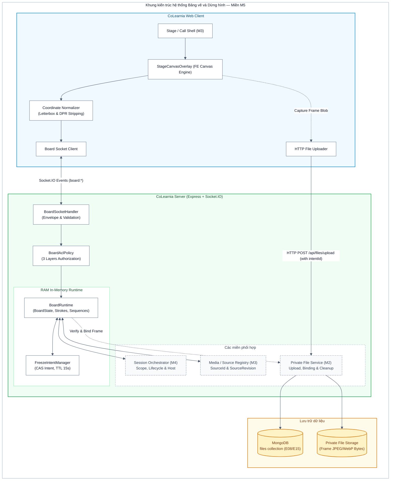

### 5.3 Máy trạng thái của Board

Mỗi scope có đúng một `BoardState`. Riêng phòng chung **MAIN**, trạng thái luôn luôn là `LIVE` và không bao giờ chuyển tiếp sang `FREEZING` hay `FROZEN`.

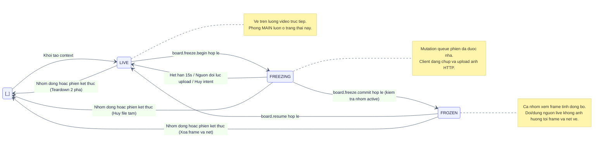

### 5.4 Bảng chuyển trạng thái chi tiết

| Trạng thái từ | Sự kiện kích hoạt                  | Điều kiện kiểm tra                                                                                                                      | Trạng thái đến | Tác dụng phụ trên Server                                                                                                                                                                            |
| :------------ | :--------------------------------- | :-------------------------------------------------------------------------------------------------------------------------------------- | :------------- | :-------------------------------------------------------------------------------------------------------------------------------------------------------------------------------------------------- |
| **LIVE**      | `board.freeze.begin`               | Thuộc nhóm; scope không phải MAIN; có nguồn video active; `boardVersion` và `sourceRevision` khớp; chưa có intent nào đang chờ          | **FREEZING**   | Tạo FreezeIntent `PENDING` (TTL 15s, CAS lock); gán `activeIntentId`; nhả mutation queue của phiên; phát `board.state.updated`                                                                      |
| **FREEZING**  | `board.freeze.commit`              | Đúng actor xin intent; intent còn hạn; `sourceRevision` không đổi; tệp upload hợp lệ; **nhóm vẫn đang ACTIVE và TIMER-01 chưa hết giờ** | **FROZEN**     | Bind file `BOARD_FRAME`, state `READY`; gán `frameId`; intent `COMMITTED`; phát `board.state.updated` kèm `frameId` và `frameUrl`                                                                   |
| **FREEZING**  | `board.freeze.commit`              | Nhóm đã đóng hoặc TIMER-01 hết giờ trong lúc upload                                                                                     | **HỦY**        | Trả về `GROUP_CLOSED` / `CONTEXT_EXPIRED`; hủy intent; xóa tệp STAGED; giải phóng runtime                                                                                                           |
| **FREEZING**  | Quá hạn 15 giây                    | Không nhận được `freeze.commit`                                                                                                         | **LIVE**       | Intent `EXPIRED`; giải phóng khóa CAS; gỡ `activeIntentId`; đặt lịch xóa file STAGED; phát `board.state.updated`                                                                                    |
| **FREEZING**  | `board.freeze.commit`              | `sourceRevision` đã đổi trong lúc upload                                                                                                | **LIVE**       | Trả lỗi `SOURCE_CHANGED`; intent `CANCELLED`; đặt lịch xóa file tạm; phát `board.state.updated` đưa nhóm về LIVE                                                                                    |
| **FREEZING**  | `board.resume`                     | Thành viên nhóm hợp lệ                                                                                                                  | **LIVE**       | Hủy intent đang chờ; tăng `boardVersion`; phát `board.state.updated`                                                                                                                                |
| **FROZEN**    | Nguồn live thay đổi hoặc dừng phát | Nhóm đang ở trạng thái FROZEN                                                                                                           | **FROZEN**     | **Giữ nguyên trạng thái FROZEN**, frameId và các nét vẽ hiện tại; cho phép các thành viên tiếp tục vẽ bình thường trên frame tĩnh                                                                   |
| **FROZEN**    | `board.resume`                     | Thành viên nhóm hợp lệ; `boardVersion` khớp                                                                                             | **LIVE**       | Tăng `boardVersion`; đóng context frame cũ; gỡ bỏ `frameId` và strokes cũ; đặt `cleanupAfter` cho file frame; phát `board.state.updated`                                                            |
| **Bất kỳ**    | Đóng nhóm / Hết giờ TIMER-01       | Tín hiệu từ M4 Session Orchestrator                                                                                                     | **HỦY**        | Thực hiện giao thức 2 pha: giải phóng `BoardRuntime` trong RAM; hủy pending intent; đánh dấu `cleanupAfter` cho các frame hết tham chiếu; gửi Ack xác nhận cho M4 trước khi M4 chuyển người về MAIN |

### 5.5 Entrypoints và lý do lựa chọn

| Entrypoint                   | Công nghệ / Giao thức | Lý do lựa chọn kiến trúc                                                                                                                                                                                                                                                                                              |
| :--------------------------- | :-------------------- | :-------------------------------------------------------------------------------------------------------------------------------------------------------------------------------------------------------------------------------------------------------------------------------------------------------------------- |
| **`board:\*` events**        | Socket.IO WebSocket   | Tương tác vẽ và con trỏ đòi hỏi độ trễ cực thấp (<50ms). Socket.IO cho phép broadcast sự kiện ngay lập tức tới các peers trong cùng room `scopeId` mà không phải chịu chi phí kết nối liên tục của HTTP polling. Hỗ trợ khử trùng lặp (idempotency) khi mất Ack.                                                      |
| **`POST /api/files/upload`** | HTTP Multipart (M2)   | Ảnh chụp frame tĩnh có dung lượng từ vài trăm KB đến 2 MB. Nếu truyền byte nhị phân qua WebSocket signaling sẽ gây tắc nghẽn hàng đợi (head-of-line blocking), làm gián đoạn các gói tin điều khiển phiên họp và nét vẽ thời gian thực. Tách luồng upload ảnh sang HTTP bảo đảm băng thông signaling luôn thông suốt. |

### 5.6 Các thành phần bị tác động

- **Frontend (`apps/web`):**
  - `StageCanvasOverlay.tsx`: Component React phủ lên trên video player trong Call Stage của M3, lắng nghe tương tác pointer (chuột, bút cảm ứng, touch). Tự động gỡ bỏ overlay và chuyển về video trực tiếp khi nhận event tắt tính năng hoặc đóng nhóm.
  - `CanvasRenderer.ts`: Module vẽ Canvas 2D tối ưu hóa (`requestAnimationFrame`, path smoothing với Bezier curves, hỗ trợ vẽ nét thường và animation mờ dần cho nét tự biến mất; thuật toán đơn giản hóa điểm vẽ $\le 500$ điểm).
  - `CoordinateNormalizer.ts`: Bộ tính toán hình học, bóc tách vùng video hiển thị thực, loại bỏ letterbox/pillarbox và chuẩn hóa tọa độ `(x, y)` về khoảng `[0.0, 1.0]`.
  - `useBoardSocket.ts`: React Hook quản lý kết nối Socket.IO của board, xử lý optimistic UI update cho nét vẽ cục bộ, retry idempotent khi mất ack, lắng nghe remote strokes, con trỏ và khôi phục khi mất gói tin qua `board.sync`.
  - `CanvasExport.ts`: Công cụ chụp và xuất ảnh canvas hiện tại kèm nét vẽ để gửi vào chat cuộc họp (M2).
- **Backend (`apps/server`):**
  - `BoardRuntime.ts`: Domain service quản lý vòng đời và trạng thái các bảng vẽ trong RAM, lưu trữ danh sách nét vẽ, bộ đệm khử trùng lặp nét vẽ (idempotency cache), counter `strokeSequence`, cơ chế pruning nét tombstone (tối đa 100 nét, ngân sách $\le 2.0$ MiB/context), broadcast sự kiện và snapshot phân trang.
  - `FreezeIntentManager.ts`: Bộ quản lý đặt chỗ freeze (CAS lock), sinh UUID intent, kiểm tra hạn 15 giây và giải phóng khóa khi quá hạn hoặc bị hủy.
  - `BoardSocketHandler.ts`: Tiếp nhận và xác thực phong bì gói tin Socket.IO, kiểm tra schema Zod từ `@colearnia/contracts`, đối chiếu `sessionId` và `epoch`.
  - `BoardAclPolicy.ts`: Kiểm tra phân quyền 3 lớp tại thời điểm xử lý (Workspace membership, Session state, Scope role/grant VÀ vị trí hiện tại của host `currentLocation === 'MAIN'`).
  - `BoardFileIntegration.ts`: Cầu nối với Private File Service (M2): xác thực tệp tải lên, gắn binding `BOARD_FRAME`, đặt lịch dọn dẹp theo vòng đời.
- **Shared Contracts (`packages/contracts`):**
  - `src/board.ts`: Định nghĩa các Zod schema nghiêm ngặt cho BoardState, Stroke ($\le 500$ points), Freeze commands, events, sync pagination và error codes.

### 5.7 Các phương án đã cân nhắc

| Phương án đề xuất                              | Đánh giá kỹ thuật                                                                                                                                                                                                                                                | Quyết định & Lý do                                                                                                                                                                       |
| :--------------------------------------------- | :--------------------------------------------------------------------------------------------------------------------------------------------------------------------------------------------------------------------------------------------------------------- | :--------------------------------------------------------------------------------------------------------------------------------------------------------------------------------------- |
| **1. Lưu toàn bộ nét vẽ vào MongoDB**          | Một phiên thảo luận có thể sinh ra hàng chục nghìn điểm vẽ mỗi phút. Việc ghi từng nét hoặc từng điểm vào MongoDB sẽ làm tê liệt I/O cơ sở dữ liệu, phá vỡ baseline kiến trúc 13 collection và vi phạm nguyên tắc vòng đời.                                      | **Bác bỏ**. Toàn bộ nét vẽ được lưu trữ trong RAM `BoardRuntime`, phục vụ đồng bộ tức thời và snapshot khi socket reconnect ngắn hạn. Khi phiên kết thúc, RAM được giải phóng hoàn toàn. |
| **2. Truyền frame ảnh qua WebRTC DataChannel** | mediasoup SFU trong scaffold được thiết kế tối ưu cho Media Stream (Audio/Video). Mở thêm DataChannel cho từng client để truyền ảnh tĩnh dung lượng lớn làm tăng độ phức tạp của media worker, khó kiểm soát quota và khó áp dụng phân quyền tải tệp thống nhất. | **Bác bỏ**. Tận dụng Private File Service (M2) sẵn có để lưu trữ byte và kiểm tra quyền tải theo ACL của nhóm.                                                                           |
| **3. Lưu tọa độ pixel tuyệt đối**              | Kích thước cửa sổ trình duyệt và độ phân giải màn hình của mỗi người dùng là hoàn toàn khác nhau. Lưu tọa độ tuyệt đối sẽ khiến nét vẽ bị lệch hoàn toàn khi hiển thị trên các màn hình khác nhau.                                                               | **Bác bỏ**. Bắt buộc sử dụng hệ tọa độ chuẩn hóa tương đối `[0, 1]` trên khung hình gốc của video.                                                                                       |

---

## 6. Detailed design

### 6.1 Cấu trúc dữ liệu

#### 6.1.1 Lưu trữ bền vững (MongoDB)

Miền M5 tuân thủ nghiêm ngặt nguyên tắc **không tạo collection mới** trong MongoDB (giữ nguyên 13 collection đã chốt). M5 chỉ tương tác với collection `files` (E08/E15) để lưu metadata của ảnh frame dừng hình.

Vòng đời trạng thái của document trong collection `files`:

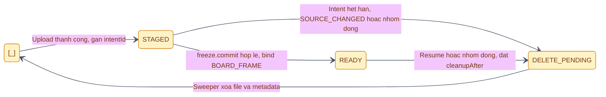

Cấu trúc document trong collection `files` khi lưu frame tĩnh:

```ts
{
_id: ObjectId("..."),
storageKey: "workspaces/.../sessions/.../frames/frame-uuid.webp",
purpose: "FRAME", // Đánh dấu rõ mục đích sử dụng
mimeType: "image/webp",
sizeBytes: 458920,
dimensions: { width: 1920, height: 1080 },
state: "READY", // STAGED -> READY -> DELETE_PENDING
scope: {
sessionId: ObjectId("..."),
epoch: "epoch-uuid",
boardId: "board-uuid",
contextVersion: 1,
groupId: "group-uuid" // Bắt buộc cho DISCUSSION / ACTIVITY; MAIN không có
},
authorization: {
memberships: [{ membershipId: ObjectId("..."), incarnation: 1, revision: 0 }],
channel: { channelId: ObjectId("..."), revision: 0 }
},
binding: {
kind: "BOARD_FRAME",
intentId: "intent-uuid" // Gắn kết với freeze intent đã được cấp
},
expiresAt: null, // Null sau khi đã commit thành công
cleanupAfter: null, // Sẽ được đặt lịch khi resume hoặc nhóm đóng
createdAt: ISODate("2026-11-03T..."),
updatedAt: ISODate("2026-11-03T...")
}
```

#### 6.1.2 Cấu trúc dữ liệu trong bộ nhớ (RAM BoardRuntime)

Toàn bộ trạng thái hoạt động của bảng vẽ được quản lý bởi `BoardRuntime` trong RAM server:

```ts
export type BoardStatus = 'LIVE' | 'FREEZING' | 'FROZEN';

export interface BoardState {
  id: string; // RuntimeId UUID
  sessionId: string; // LiveSession ID
  scopeId: string; // MAIN scope ID hoặc Group ID
  scopeType: 'MAIN' | 'DISCUSSION' | 'ACTIVITY';
  version: number; // Tăng mỗi khi resume hoặc đổi context
  status: BoardStatus; // MAIN luôn luôn là 'LIVE'
  sourceScopeId: string; // MAIN cho DISCUSSION; Group scope cho ACTIVITY
  sourceId: string | null; // ID của producer/stream màn hình đang share
  sourceRevision: number; // Phiên bản của nguồn video từ M3
  frameId: string | null; // ID tệp frame tĩnh trong files collection (khi FROZEN)
  frameUrl: string | null; // URL có chữ ký/kiểm tra quyền để client tải frame
  strokeSequence: number; // Counter tăng dần cho mỗi nét vẽ commit
  activeIntentId: string | null; // IntentId đang trong quá trình freeze (khi FREEZING)
  createdAt: number;
  updatedAt: number;
}

export interface Stroke {
  id: string; // UUID do client sinh (dùng cho idempotency check)
  boardId: string;
  sessionId: string; // Xác thực đúng phiên làm việc
  contextVersion: number; // Khớp với version của BoardState tại thời điểm vẽ
  frameId: string | null; // Gắn với frame cụ thể nếu vẽ trong trạng thái FROZEN
  sourceScopeId: string;
  sourceId: string | null;
  sourceRevision: number;
  authorParticipantId: string; // Server gán từ session token, không tin client
  points: Array<{ x: number; y: number }>; // Tọa độ chuẩn hóa 0.0 .. 1.0 (tối đa 500 điểm)
  color: string; // Mã màu HEX (vd: "#FF0000")
  width: number; // Độ dày nét vẽ (tỷ lệ chuẩn hóa hoặc pixel quy chuẩn)
  isVanishing: boolean; // True nếu là nét tự biến mất (chỉ MAIN hoặc LIVE nhóm)
  createdAt: number; // Server timestamp (epoch ms)
  isTombstoned: boolean; // True khi bị undo (đánh dấu xóa mềm trong runtime)
}

export interface FreezeIntent {
  intentId: string; // UUID
  boardId: string;
  scopeId: string;
  requestedByParticipantId: string;
  sourceRevision: number; // Bắt buộc khớp với revision tại thời điểm begin
  expiresAt: number; // Timestamp hết hạn (hiệu lực 15 giây)
  status: 'PENDING' | 'COMMITTED' | 'EXPIRED' | 'CANCELLED';
}
```

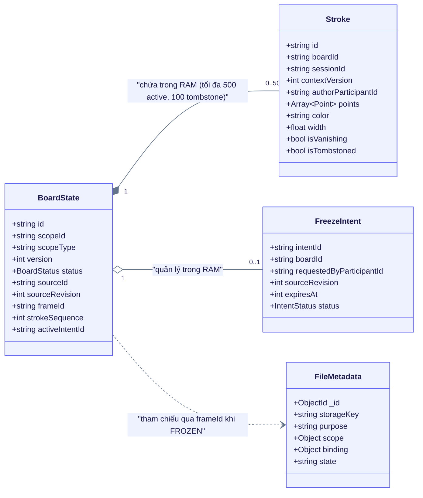

#### 6.1.3 Bất biến dữ liệu (Invariants)

|   #    | Mã bất biến | Nội dung bất biến bắt buộc duy trì                                                                                                                                                                            |
| :----: | :---------- | :------------------------------------------------------------------------------------------------------------------------------------------------------------------------------------------------------------ |
| **1**  | **I1**      | Mỗi scope có tối đa một `BoardState` và tối đa một intent `PENDING` tại mọi thời điểm.                                                                                                                        |
| **2**  | **I2**      | `status = 'FREEZING'` khi và chỉ khi `activeIntentId` khác null.                                                                                                                                              |
| **3**  | **I3**      | `status = 'FROZEN'` khi và chỉ khi `frameId` khác null.                                                                                                                                                       |
| **4**  | **I4**      | Scope **MAIN** luôn có `status = 'LIVE'`, `frameId = null`, `activeIntentId = null`.                                                                                                                          |
| **5**  | **I5**      | Mọi `Stroke` hợp lệ phải có `contextVersion` bằng `BoardState.version` hiện tại; nét thuộc version cũ bị loại bỏ khi version tăng.                                                                            |
| **6**  | **I6**      | `authorParticipantId` bắt buộc do server gán từ session token; mọi giá trị client tự gửi lên cho trường này đều bị bỏ qua.                                                                                    |
| **7**  | **I7**      | Số lượng nét vẽ hoạt động (chưa tombstone) trong một context không vượt quá **500 nét**; số nét tombstone không vượt quá **100 nét** (tự động purge FIFO); tổng dung lượng RAM một context $\le$ **2.0 MiB**. |
| **8**  | **I8**      | Counter `strokeSequence` tăng đơn điệu nghiêm ngặt, không bao giờ giảm trong suốt vòng đời của một `BoardState`.                                                                                              |
| **9**  | **I9**      | Khi `status === 'FROZEN'`, lệnh vẽ chỉ gắn với `frameId` và `contextVersion`; việc thay đổi `sourceRevision` của nguồn video live bên dưới không làm gián đoạn nét vẽ.                                        |
| **10** | **I10**     | Lệnh vẽ gửi lại với cùng một `strokeId` đã commit sẽ trả về Ack thành công cũ và không tạo nét mới hoặc tăng sequence (Idempotent).                                                                           |

---

### 6.2 Hợp đồng Socket.IO và HTTP

#### 6.2.1 Danh mục lệnh Client gửi lên Server (Commands)

| Tên sự kiện / Command | Hướng           | Dữ liệu gửi (Payload)                                                                        | Phản hồi (Ack / Broadcast)                                                                             | Xử lý lỗi / Error codes                                                                                                                                    |
| :-------------------- | :-------------- | :------------------------------------------------------------------------------------------- | :----------------------------------------------------------------------------------------------------- | :--------------------------------------------------------------------------------------------------------------------------------------------------------- |
| `board.freeze.begin`  | Client → Server | `{ scopeId, boardVersion, sourceRevision }`                                                  | Ack: `{ intentId, expiresAt, uploadUrl }`<br/>Broadcast: `board.state.updated` (`status: 'FREEZING'`)  | `NOT_IN_GROUP`, `FREEZE_NOT_ALLOWED_IN_MAIN`, `NO_ACTIVE_SOURCE`, `CONCURRENT_FREEZE_IN_PROGRESS`, `STALE_REVISION`                                        |
| `board.freeze.commit` | Client → Server | `{ intentId, fileId, dimensions: { width, height } }`                                        | Ack: `{ success: true, frameId }`<br/>Broadcast: `board.state.updated` (`status: 'FROZEN'`, `frameId`) | `INTENT_EXPIRED`, `INTENT_INVALID`, `SOURCE_CHANGED`, `FILE_NOT_FOUND`, `INVALID_DIMENSIONS`, `GROUP_CLOSED`                                               |
| `board.resume`        | Client → Server | `{ scopeId, boardVersion }`                                                                  | Ack: `{ success: true, newVersion }`<br/>Broadcast: `board.state.updated` (`status: 'LIVE'`)           | `NOT_IN_GROUP`, `NOT_FROZEN`, `STALE_VERSION`, `PERMISSION_DENIED`                                                                                         |
| `board.stroke.draw`   | Client → Server | `{ strokeId, scopeId, sessionId, epoch, contextVersion, points, color, width, isVanishing }` | Ack: `{ strokeId, sequence, isDuplicate?: boolean }`<br/>Broadcast: `board.stroke.added`               | `PERMISSION_DENIED`, `NOT_HOST`, `HOST_NOT_IN_MAIN`, `INVALID_CONTEXT`, `STALE_EPOCH`, `PAYLOAD_TOO_LARGE`, `INVALID_COORDINATES`, `MEMORY_LIMIT_EXCEEDED` |
| `board.stroke.undo`   | Client → Server | `{ scopeId, strokeId }`                                                                      | Ack: `{ success: true }`<br/>Broadcast: `board.stroke.undone` (`{ strokeId }`)                         | `STROKE_NOT_FOUND`, `NOT_STROKE_AUTHOR`, `CONTEXT_EXPIRED`                                                                                                 |
| `board.clear`         | Client → Server | `{ scopeId, contextVersion }`                                                                | Ack: `{ success: true }`<br/>Broadcast: `board.cleared` (`{ scopeId, contextVersion }`)                | `PERMISSION_DENIED`, `NOT_AUTHORIZED_TO_CLEAR`, `CONTEXT_EXPIRED`                                                                                          |
| `board.cursor`        | Client → Server | `{ scopeId, x, y, isDrawing, color }`                                                        | Không ack; Broadcast: `board.cursor.moved` (throttle 20Hz)                                             | Bỏ qua nếu sai scope (loss-tolerant)                                                                                                                       |
| `board.sync`          | Client → Server | `{ scopeId, sinceSequence?, limit? }`                                                        | Ack: `{ state: BoardState, activeStrokes: Stroke[], hasMore: boolean, nextSequence?: number }`         | `SCOPE_NOT_FOUND`, `PERMISSION_DENIED`                                                                                                                     |

#### 6.2.2 Danh mục sự kiện Server phát xuống Client (Broadcast Events)

| Tên sự kiện           | Khi nào phát ra                                                                   | Dữ liệu kèm theo (Payload)                                                           | Phạm vi nhận (Room)                                                              |
| :-------------------- | :-------------------------------------------------------------------------------- | :----------------------------------------------------------------------------------- | :------------------------------------------------------------------------------- |
| `board.state.updated` | Mọi chuyển trạng thái (`FREEZING`, `FROZEN`, `LIVE`) hoặc tăng version            | `BoardState` đã cập nhật; khi FROZEN kèm theo `frameId` và `frameUrl`                | Toàn bộ thành viên trong room `scopeId`                                          |
| `board.stroke.added`  | Nét vẽ mới vừa được commit thành công vào RAM                                     | Đối tượng `Stroke` đầy đủ kèm theo `strokeSequence`                                  | Toàn bộ thành viên trong room `scopeId` (trừ người gửi nếu đã render optimistic) |
| `board.stroke.undone` | Nét vẽ được hoàn tác (undo) thành công                                            | `{ strokeId: string }`                                                               | Toàn bộ thành viên trong room `scopeId`                                          |
| `board.cleared`       | Toàn bộ nét bị xóa bởi người có quyền, hoặc overlay MAIN bị xóa do đổi/dừng nguồn | `{ scopeId: string, contextVersion: number, reason?: string }`                       | Toàn bộ thành viên trong room `scopeId`                                          |
| `board.cursor.moved`  | Tọa độ con trỏ của peer di chuyển (đã throttle)                                   | `{ participantId: string, x: number, y: number, isDrawing: boolean, color: string }` | Toàn bộ thành viên trong room `scopeId` (trừ chính người gửi)                    |
| `board.disabled`      | Tính năng bảng vẽ bị tắt qua feature flag khẩn cấp                                | `{ scopeId: string, resetToLive: true }`                                             | Toàn bộ thành viên trong phiên họp                                               |

#### 6.2.3 Quy tắc xử lý chung cho mọi lệnh (Pipeline Rules)

1. **Feature flag check:** Kiểm tra `feature.board.enabled`. Nếu tắt, từ chối ngay lập tức mà không làm ảnh hưởng luồng media.
2. **Schema validation:** Kiểm tra payload bằng Zod schema tương ứng từ `@colearnia/contracts`. Giới hạn số điểm nét vẽ $\le 500$ điểm. Nếu sai cấu trúc, trả lỗi validation và ngừng xử lý.
3. **Session authentication & Epoch check:** Xác thực socket connection; trích xuất `participantId` từ session token của server; kiểm tra `sessionId` và `epoch` khớp với phiên hiện tại.
4. **Phân quyền 3 lớp & Vị trí hiện tại:** Kiểm tra quyền theo ma trận tại Mục 6.3. Nếu vẽ tại MAIN, bắt buộc kiểm tra `role === 'HOST'` VÀ `currentLocation === 'MAIN'`.
5. **Idempotency check (Chống mất Ack):** Nếu nhận lệnh vẽ có `strokeId` đã tồn tại trong cache của context hiện tại, trả về ngay Ack cũ kèm `isDuplicate: true` mà không thêm nét mới.
6. **Phiên bản & Tương tranh:** Kiểm tra `boardVersion` và `contextVersion` khớp với trạng thái hiện tại. (Lưu ý: khi `status === 'FROZEN'`, không từ chối nét vẽ khi `sourceRevision` của nguồn live thay đổi).
7. **Thực thi trong runtime & Pruning:** Cập nhật `BoardRuntime` trong RAM, tăng `strokeSequence` tuần tự. Nếu nét tombstone $> 100$, thực hiện pruning FIFO để giải phóng RAM.
8. **Broadcast & Observability:** Phát broadcast tới room `scopeId`, ghi structured log và cập nhật Prometheus metric.

---

#### 6.2.4 Sequence Diagram 1: Quy trình Dừng hình (Freeze Flow)

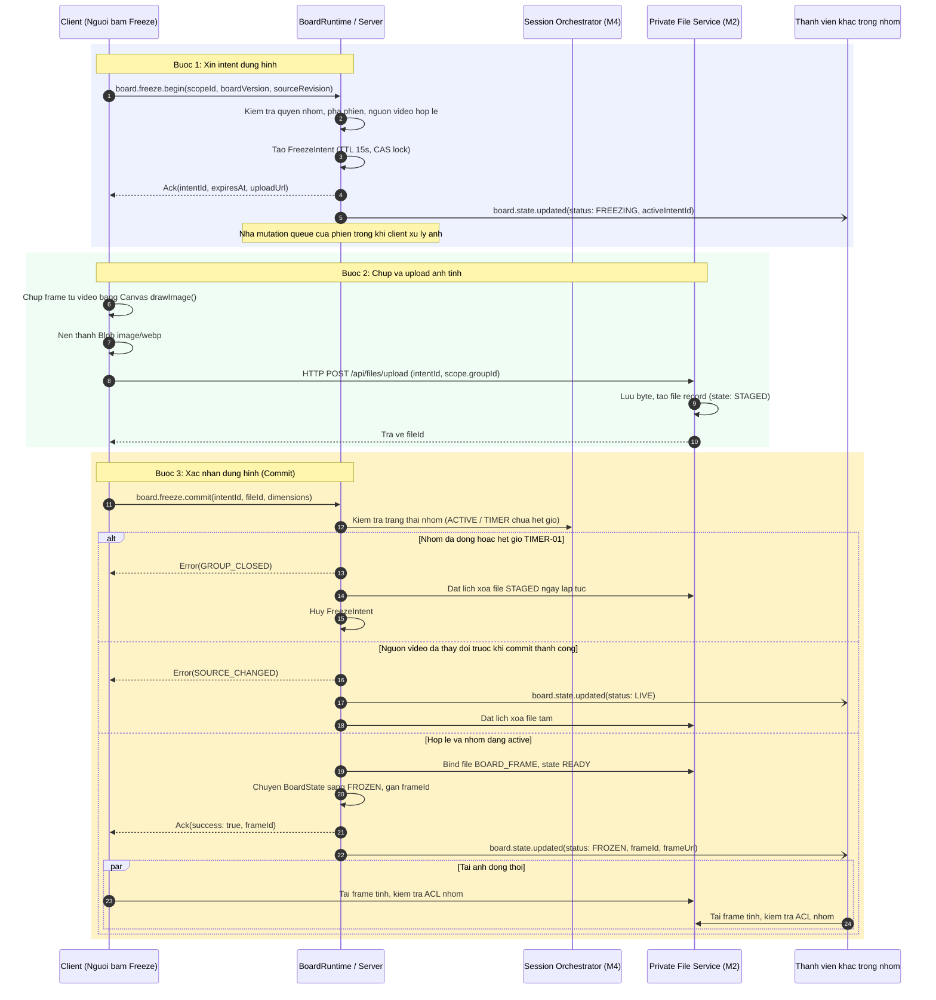

---

#### 6.2.5 Sequence Diagram 2: Quy trình Trở lại trực tiếp (Resume Flow)

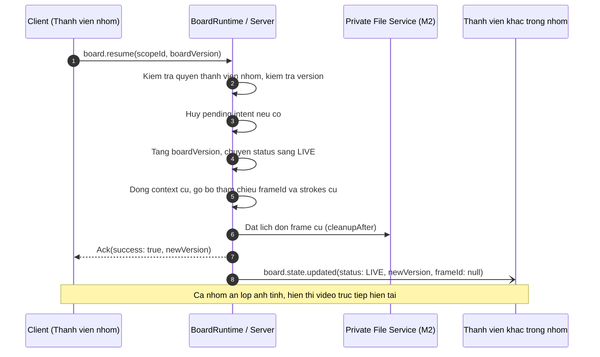

---

#### 6.2.6 Sequence Diagram 3: Luồng Vẽ nét và Hoàn tác (Draw & Undo Flow)

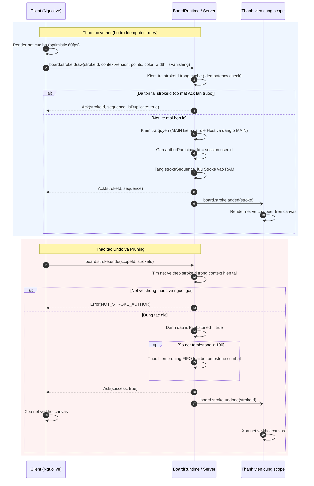

---

#### 6.2.7 Sequence Diagram 4: Khôi phục khi lệch Sequence (Sequence Gap Recovery & Pagination)

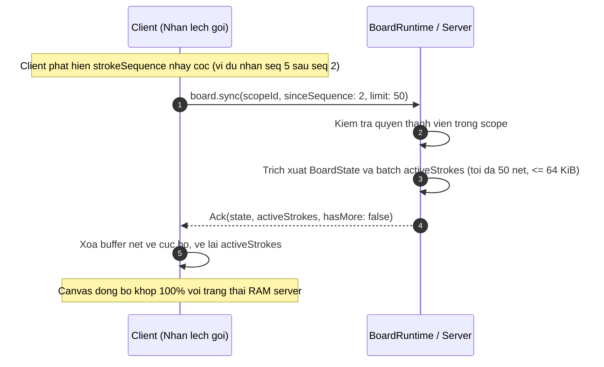

---

### 6.3 Phân quyền

#### 6.3.1 Phân quyền chi tiết (3 Layers Authorization Matrix)

| Thao tác                                 | MAIN                                      | DISCUSSION                              | ACTIVITY                                                        | Ghi chú kiểm tra phân quyền                                                                            |
| :--------------------------------------- | :---------------------------------------- | :-------------------------------------- | :-------------------------------------------------------------- | :----------------------------------------------------------------------------------------------------- |
| **Vẽ nét (`stroke.draw`)**               | Chỉ Host hiện hành **VÀ đang ở tại MAIN** | Mọi thành viên trong nhóm               | Mọi thành viên trong nhóm; Host đang hỗ trợ ACTIVITY được vẽ    | Host đang hỗ trợ ACTIVITY bị từ chối vẽ tại MAIN; người share không phải host bị từ chối vẽ tại MAIN.  |
| **Bắt đầu dừng hình (`freeze.begin`)**   | **BỊ TỪ CHỐI (Deny)**                     | Mọi thành viên trong nhóm               | Mọi thành viên trong nhóm                                       | MAIN trả về `FREEZE_NOT_ALLOWED_IN_MAIN`; DISCUSSION chụp bài giảng MAIN; ACTIVITY chụp màn hình nhóm. |
| **Xác nhận dừng hình (`freeze.commit`)** | **BỊ TỪ CHỐI (Deny)**                     | Đúng người đã xin intent                | Đúng người đã xin intent                                        | Kiểm tra intent hợp lệ, chưa hết hạn (15s), khớp `sourceRevision`, nhóm đang `ACTIVE`.                 |
| **Trở lại trực tiếp (`resume`)**         | **BỊ TỪ CHỐI (Deny)**                     | Mọi thành viên trong nhóm               | Mọi thành viên trong nhóm                                       | Đóng context ảnh tĩnh, chuyển về video trực tiếp của nhóm.                                             |
| **Hoàn tác (`stroke.undo`)**             | Chỉ Host (nét của mình)                   | Tác giả của nét vẽ                      | Tác giả của nét vẽ                                              | Không cho phép undo nét vẽ của thành viên khác bằng cách sửa ID.                                       |
| **Xóa toàn bộ (`board.clear`)**          | Chỉ Host hiện hành khi đang ở MAIN        | Chủ frame / Thành viên nhóm có xác nhận | Chủ frame / Chủ nguồn share LIVE / Host đang hỗ trợ ACTIVITY đó | **Không có luồng host hỗ trợ trong DISCUSSION**; yêu cầu xác nhận ở UI; server kiểm tra quyền.         |
| **Đồng bộ con trỏ (`cursor`)**           | Chỉ Host hiện hành khi đang ở MAIN        | Mọi thành viên trong nhóm               | Mọi thành viên trong nhóm                                       | Loss-tolerant, giới hạn tần suất 20Hz.                                                                 |

#### 6.3.2 Cây quyết định phân quyền vẽ nét

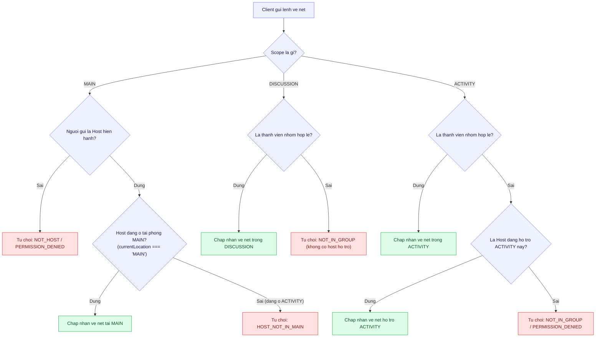

#### 6.3.3 Thu hồi quyền theo sự kiện

| Sự kiện từ hệ thống                | Quyền bị thu hồi                          | Hệ quả đối với các mutation đang chờ                                           |
| :--------------------------------- | :---------------------------------------- | :----------------------------------------------------------------------------- |
| **Đổi host tại MAIN**              | Quyền vẽ và clear của host cũ             | Mọi mutation đang chờ bị kiểm tra lại, bị từ chối nếu host không còn hiệu lực. |
| **Host vào phòng ACTIVITY hỗ trợ** | Tạm dừng quyền vẽ tại phòng MAIN          | Lệnh vẽ gửi lên MAIN trong thời gian này bị từ chối (`HOST_NOT_IN_MAIN`).      |
| **Thành viên rời nhóm**            | Quyền vẽ, undo, cursor cá nhân trong nhóm | Board chung của nhóm không bị xóa, nét vẽ cũ của thành viên vẫn hiển thị.      |
| **Thành viên rời Workspace**       | Toàn bộ quyền trong phiên (qua M1 revoke) | Socket bị ngắt kết nối khỏi room ngay lập tức; mutation đang chờ bị từ chối.   |
| **Host hỗ trợ rời ACTIVITY**       | Quyền vẽ trong ACTIVITY đó                | Các nét đã commit trước đó vẫn được giữ nguyên.                                |

---

### 6.4 Chuẩn hóa tọa độ và khử trôi nét

Khi video được render trong khung hiển thị (video container), tùy thuộc vào tỷ lệ khung hình của video gốc $A_{video} = W_v / H_v$ và tỷ lệ của vùng chứa $A_{container} = W_c / H_c$, trình duyệt sẽ chèn thêm các dải đen (letterbox ở trên/dưới hoặc pillarbox ở hai bên).

#### 6.4.1 Thuật toán chuẩn hóa hình học

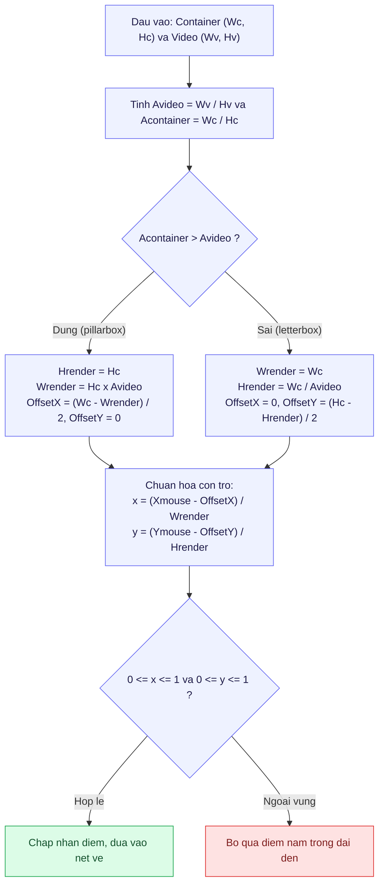

Công thức toán học chuẩn xác:

$$\text{Nếu } A_{container} > A_{video}: \quad H_{render} = H_c, \quad W_{render} = H_c \times A_{video}, \quad \text{Offset}_X = \frac{W_c - W_{render}}{2}, \quad \text{Offset}_Y = 0$$

$$\text{Nếu } A_{container} \le A_{video}: \quad W_{render} = W_c, \quad H_{render} = \frac{W_c}{A_{video}}, \quad \text{Offset}_X = 0, \quad \text{Offset}_Y = \frac{H_c - H_{render}}{2}$$

$$x_{norm} = \frac{X_{mouse} - \text{Offset}_X}{W_{render}}, \quad y_{norm} = \frac{Y_{mouse} - \text{Offset}_Y}{H_{render}} \quad (0.0 \le x_{norm}, y_{norm} \le 1.0)$$

#### 6.4.2 Ví dụ minh họa cụ thể

Giả sử Container có kích thước $1280 \times 720$ (tỷ lệ 16:9), nguồn video gốc là $1440 \times 1080$ (tỷ lệ 4:3):

| Đại lượng hình học       | Giá trị tính toán                                  | Ý nghĩa thực tế                             |
| :----------------------- | :------------------------------------------------- | :------------------------------------------ |
| $A_{container}$          | $1280 / 720 \approx 1.778$                         | Tỷ lệ màn hình hiển thị rộng                |
| $A_{video}$              | $1440 / 1080 \approx 1.333$                        | Tỷ lệ video vuông hơn container             |
| **Trường hợp**           | $A_{container} > A_{video}$                        | Xuất hiện dải đen hai bên (**Pillarbox**)   |
| $H_{render}$             | $720\text{ px}$                                    | Chiều cao hiển thị khớp chiều cao container |
| $W_{render}$             | $720 \times 1.333 = 960\text{ px}$                 | Chiều rộng hiển thị thực của nội dung video |
| $\text{Offset}_X$        | $(1280 - 960) / 2 = 160\text{ px}$                 | Dải đen mỗi bên dày 160 px                  |
| **Điểm chạm (640, 360)** | $x = (640 - 160) / 960 = 0.5, y = 360 / 720 = 0.5$ | Điểm chính giữa tâm video, hợp lệ           |
| **Điểm chạm (100, 360)** | $x = (100 - 160) / 960 < 0$                        | Nằm trong dải đen bên trái, bị bỏ qua       |

#### 6.4.3 Quy tắc tọa độ chuẩn hóa

- Mọi tọa độ truyền qua mạng đều là số thực trong khoảng `[0.0, 1.0]` (làm tròn 4 chữ số thập phân). Server từ chối ngay lập tức điểm nằm ngoài khoảng với mã lỗi `INVALID_COORDINATES`.
- Khi hiển thị, thiết bị nhận tính ngược lại tọa độ pixel dựa trên $W_{render}, H_{render}$ và offset của chính thiết bị đó.
- Tọa độ hoàn toàn độc lập với DPR (`window.devicePixelRatio`); chỉ có canvas backing store được nhân với DPR để hiển thị sắc nét.
- Bắt buộc tính toán lại vùng render khi: resize cửa sổ, thay đổi nguồn chia sẻ, hoặc chuyển giữa video trực tiếp và frame tĩnh.
- Khi `FROZEN`, vùng render dựa trên `dimensions` của frame ảnh tĩnh, không phụ thuộc vào kích thước video track trước đó.

---

### 6.5 Giới hạn và biên an toàn

| Tham số cấu hình                              | Giá trị giới hạn                         | Cơ sở kỹ thuật và hành vi khi vượt ngưỡng                                                                      |
| :-------------------------------------------- | :--------------------------------------- | :------------------------------------------------------------------------------------------------------------- |
| **Số điểm tối đa mỗi nét**                    | **500 điểm**                             | Khống chế gói tin Socket.IO $\le 15$ KiB JSON (an toàn dưới trần 32 KiB). Vượt quá trả về `PAYLOAD_TOO_LARGE`. |
| **Độ dày nét vẽ**                             | 1 đến 20 pixel (quy chuẩn)               | Kiểm tra nghiêm ngặt tại Zod schema.                                                                           |
| **Số nét hoạt động (Active)**                 | Tối đa **500 nét**                       | Ngăn chặn quá tải bộ nhớ. Vượt quá từ chối vẽ thêm.                                                            |
| **Số nét Tombstone (Undo)**                   | Tối đa **100 nét**                       | Thuật toán pruning tự động purge FIFO nét tombstone cũ nhất khi vượt 100 nét, chống rò rỉ RAM khi undo spam.   |
| **Ngân sách bộ nhớ RAM Context**              | Tối đa **2.0 MiB / board**               | Bảo vệ RAM server. Vượt quá từ chối nhận nét mới (`MEMORY_LIMIT_EXCEEDED`).                                    |
| **Dung lượng tệp frame ảnh tĩnh**             | Tối đa **2.0 MiB / ảnh**                 | Khống chế tại Private File Service M2. Quá dung lượng từ chối upload.                                          |
| **Độ phân giải frame (Giới hạn cứng Server)** | Tối đa 2560x1440                         | Trả về `INVALID_DIMENSIONS` nếu vượt quá.                                                                      |
| **Độ phân giải chụp mặc định (Client)**       | Tối đa 1920x1080                         | Client tự động scale về 1080p trước khi nén để tiết kiệm băng thông.                                           |
| **Định dạng tệp frame**                       | `image/webp` (fallback `image/jpeg`)     | Tối ưu dung lượng và tốc độ nén Canvas.                                                                        |
| **Quota frame theo phiên**                    | Tối đa **20 MiB / phiên**                | Khống chế tại M2; vượt quota báo lỗi không thể dừng hình thêm.                                                 |
| **Thời hạn Freeze Intent (TTL)**              | **15 giây**                              | CAS lock tự giải phóng sau 15 giây nếu client không commit; dọn tệp dở dang.                                   |
| **Tần suất con trỏ (Cursor Throttle)**        | Tối đa 20 gói/giây (50ms/gói)            | Client throttle trước khi gửi; server drop gói thừa (loss-tolerant).                                           |
| **Gói tin Snapshot Sync (`board.sync`)**      | Tối đa **50 nét / batch** ($\le 64$ KiB) | Phân trang qua `hasMore` và `nextSequence`, chống nghẽn socket frame.                                          |

---

### 6.6 Quản lý vòng đời

#### 6.6.1 Ma trận sự kiện và tác động

| Sự kiện từ hệ thống khác                             | Phạm vi áp dụng               | Tác động lên BoardRuntime trong RAM                                                                                                                                                           | Tác động lên File Storage (M2)       |
| :--------------------------------------------------- | :---------------------------- | :-------------------------------------------------------------------------------------------------------------------------------------------------------------------------------------------- | :----------------------------------- |
| **Nguồn MAIN dừng hoặc đổi (`sourceRevision` tăng)** | MAIN                          | Xóa overlay LIVE, phát `board.cleared`                                                                                                                                                        | Không có (MAIN không có file)        |
| **Đổi host phiên họp (M4)**                          | MAIN, ACTIVITY có host hỗ trợ | Thu hồi quyền vẽ/clear của host cũ; kiểm tra lại mutation đang chờ                                                                                                                            | Không có                             |
| **Nguồn của nhóm dừng khi đang LIVE**                | DISCUSSION, ACTIVITY          | Overlay LIVE của nhóm bị xóa                                                                                                                                                                  | Không có                             |
| **Nguồn đổi hoặc dừng khi đang FROZEN**              | DISCUSSION, ACTIVITY          | **Giữ nguyên trạng thái FROZEN**, frame tĩnh và nét vẽ; các thành viên tiếp tục vẽ bình thường trên frame tĩnh                                                                                | Giữ nguyên tệp frame                 |
| **Nguồn đổi khi đang FREEZING**                      | DISCUSSION, ACTIVITY          | Commit trả về `SOURCE_CHANGED`, đưa nhóm về LIVE                                                                                                                                              | Tệp `STAGED` bị đặt lịch xóa         |
| **Thành viên rời nhóm**                              | DISCUSSION, ACTIVITY          | Thu quyền cá nhân; không xóa board chung của nhóm                                                                                                                                             | Không có                             |
| **Nhóm kích hoạt Resume**                            | DISCUSSION, ACTIVITY          | Tăng `boardVersion`, đóng context cũ, xóa nét cũ trong RAM                                                                                                                                    | Đặt `cleanupAfter` cho tệp frame cũ  |
| **Nhóm đóng hoặc hết giờ TIMER-01**                  | DISCUSSION, ACTIVITY          | **Giao thức 2 pha:** M4 gửi teardown $\rightarrow$ M5 giải phóng BoardRuntime, hủy pending intent, đặt `cleanupAfter` và gửi Ack $\rightarrow$ M4 nhận Ack xong mới chuyển thành viên về MAIN | Đặt `cleanupAfter` cho toàn bộ frame |
| **Phiên họp kết thúc (Session ended)**               | Tất cả scopes                 | Giải phóng toàn bộ runtime RAM                                                                                                                                                                | Dọn dẹp toàn bộ frame của phiên      |
| **Server restart đột ngột**                          | Tất cả scopes                 | Mất toàn bộ board trong RAM (theo thiết kế Non-goal NG4)                                                                                                                                      | Sweeper tự động dọn dẹp file mồ côi  |

#### 6.6.2 Hành vi khi Client Reconnect

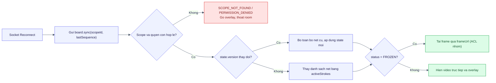

---

### 6.7 Rollout, flag và observability

#### 6.7.1 Feature Flags & Graceful Kill-Switch

| Feature Flag                      | Mặc định             | Phạm vi áp dụng | Mục đích sử dụng                                                                                                                                                                       |
| :-------------------------------- | :------------------- | :-------------- | :------------------------------------------------------------------------------------------------------------------------------------------------------------------------------------- |
| `feature.board.enabled`           | `true` (dev/staging) | Toàn hệ thống   | Bật/tắt toàn bộ tính năng bảng vẽ và dừng hình. Khi tắt, server chủ động emit `board.disabled`, chuyển mọi nhóm FROZEN về LIVE mượt mà, dọn file tạm; sau đó mới từ chối mutation mới. |
| `feature.board.vanishing_strokes` | `true`               | Client & Server | Bật/tắt chế độ nét tự biến mất cho host tại MAIN.                                                                                                                                      |

#### 6.7.2 Structured Logs

Mỗi thao tác quan trọng ghi một log JSON gồm các trường:

| Trường               | Kiểu dữ liệu       | Ý nghĩa                                                                                 |
| :------------------- | :----------------- | :-------------------------------------------------------------------------------------- |
| `timestamp`          | ISO String / Epoch | Thời điểm thực hiện                                                                     |
| `scopeId`, `boardId` | UUID String        | Định danh phạm vi và bảng vẽ                                                            |
| `action`             | Enum String        | `FREEZE_BEGIN`, `FREEZE_COMMIT`, `RESUME`, `STROKE_COMMIT`, `CLEAR`, `PRUNE_TOMBSTONES` |
| `actorId`            | String             | Định danh người dùng thực hiện                                                          |
| `sourceRevision`     | Number             | Phiên bản nguồn chia sẻ tại thời điểm xử lý                                             |
| `durationMs`         | Number             | Thời gian xử lý thao tác (ms)                                                           |

> [!WARNING]
> Tuyệt đối không log tọa độ chi tiết của nét vẽ hoặc dữ liệu nhị phân của ảnh để tránh làm tràn đĩa cứng log.

#### 6.7.3 Metrics (Prometheus)

| Metric                                      | Kiểu      | Nhãn (Labels)                | Mục đích giám sát                                              |
| :------------------------------------------ | :-------- | :--------------------------- | :------------------------------------------------------------- |
| `colearnia_board_freeze_intent_total`       | Counter   | `scope_type`, `status`       | Đếm số lần yêu cầu freeze (thành công, quá hạn, xung đột race) |
| `colearnia_board_freeze_commit_duration_ms` | Histogram | —                            | Biểu đồ thời gian từ khi begin đến khi commit hoàn tất         |
| `colearnia_board_strokes_total`             | Counter   | `scope_type`, `is_vanishing` | Tổng số nét vẽ được commit thành công                          |
| `colearnia_board_active_contexts`           | Gauge     | —                            | Số lượng bảng vẽ đang hoạt động đồng thời trong RAM server     |
| `colearnia_board_memory_bytes`              | Gauge     | `scopeId`                    | Giám sát dung lượng RAM tiêu thụ của từng board context        |

#### 6.7.4 Cảnh báo (Alerts)

| Điều kiện cảnh báo                                     | Ngưỡng kích hoạt                | Mức độ             | Hành động ứng phó                                                     |
| :----------------------------------------------------- | :------------------------------ | :----------------- | :-------------------------------------------------------------------- |
| Tỷ lệ freeze commit thất bại (timeout hoặc lỗi upload) | Vượt 15% trong 10 phút liên tục | Cảnh báo (Warning) | Kiểm tra băng thông upload client và kết nối Private File Service M2. |
| Số lượng frame mồ côi chưa dọn                         | Vượt 50 tệp trong 1 giờ         | Cảnh báo (Warning) | Kiểm tra hoạt động của sweeper dọn dẹp file định kỳ.                  |
| Bộ nhớ context vượt ngưỡng cảnh báo                    | Vượt 1.8 MiB trong RAM          | Cảnh báo (Warning) | Kích hoạt pruning khẩn cấp và kiểm tra nguy cơ spam vẽ.               |

#### 6.7.5 Kế hoạch Rollback và dọn dẹp

- Khi cần tắt tính năng khẩn cấp: Tắt feature flag `feature.board.enabled = false`.
- **Quy trình tắt êm ái (Graceful teardown):**
  1. Server quét toàn bộ board context đang ở `FROZEN` hoặc `FREEZING`, hủy pending intent, reset trạng thái về `LIVE`, gỡ bỏ `frameId` và đặt lịch dọn dẹp tệp ảnh trong M2.
  2. Server phát sự kiện `board.disabled` tới tất cả client đang kết nối.
  3. Client tự động gỡ bỏ lớp hiển thị ảnh tĩnh, đưa người học trở lại xem luồng video WebRTC trực tiếp hiện tại, đồng thời ẩn toàn bộ thanh công cụ vẽ trên giao diện.
  4. Server kích hoạt cổng từ chối (reject gate) với các lệnh mutation tiếp theo.
- Không cần rollback schema database vì không có bảng/collection mới nào được tạo trong MongoDB.

---

### 6.8 Chiến lược kiểm thử

#### 6.8.1 Unit Tests

| Module                 | Nội dung kiểm thử                                                                                                                                                                                    |
| :--------------------- | :--------------------------------------------------------------------------------------------------------------------------------------------------------------------------------------------------- |
| `CoordinateNormalizer` | Kiểm tra chính xác với tỷ lệ 16:9, 4:3, 21:9; loại bỏ hoàn toàn letterbox/pillarbox; DPR 1x, 2x, 3x không làm lệch tọa độ; loại bỏ điểm chạm nằm trong dải đen.                                      |
| `FreezeIntentManager`  | Cấp intent thành công; từ chối intent thứ 2 khi intent thứ 1 đang chờ (CAS lock); tự động hết hạn sau 15 giây; giải phóng khóa khi bị hủy.                                                           |
| `BoardAclPolicy`       | Host vẽ được tại MAIN khi đang ở MAIN; host đang hỗ trợ ACTIVITY bị từ chối vẽ tại MAIN (`HOST_NOT_IN_MAIN`); thành viên nhóm vẽ được trong nhóm; không cho phép host hỗ trợ clear trong DISCUSSION. |
| `BoardRuntime`         | `strokeSequence` tăng tuần tự; undo đánh dấu `isTombstoned`; pruning FIFO khi tombstone $> 100$; giới hạn cứng 500 nét active; xử lý idempotent khi gửi lại cùng `strokeId`.                         |

#### 6.8.2 Datastore & File Integration Tests

|   Mã   | Kịch bản kiểm thử              | Kết quả mong đợi                                                    |
| :----: | :----------------------------- | :------------------------------------------------------------------ |
| **D1** | Upload frame ảnh tĩnh          | Tạo record trong `files` với `purpose: 'FRAME'`, `state: 'STAGED'`. |
| **D2** | Commit dừng hình hợp lệ        | Chuyển file sang `state: 'READY'`, gắn binding `BOARD_FRAME`.       |
| **D3** | Commit khi nhóm đã đóng        | Bị từ chối (`GROUP_CLOSED`), tệp `STAGED` bị đặt lịch xóa ngay.     |
| **D4** | Intent hết hạn hoặc bị hủy     | Sweeper tự động dọn dẹp tệp frame mồ côi.                           |
| **D5** | Tải frame bởi người ngoài nhóm | Bị từ chối truy cập theo ACL nhóm của Private File Service.         |

#### 6.8.3 Integration Tests (Socket.IO & Lifecycle)

|   Mã    | Kịch bản kiểm thử                                                                    | Kết quả mong đợi                                                                            |
| :-----: | :----------------------------------------------------------------------------------- | :------------------------------------------------------------------------------------------ |
| **I1**  | **MAIN Host Draw:** Host vẽ tại MAIN khi đang ở MAIN                                 | Nét vẽ được đồng bộ tức thì tới tất cả participant tại MAIN.                                |
| **I2**  | **MAIN Host Elsewhere Deny:** Host đang ở ACTIVITY gửi lệnh vẽ tại MAIN              | Server từ chối với mã lỗi `HOST_NOT_IN_MAIN`.                                               |
| **I3**  | **MAIN Member Deny:** Thành viên thường gửi event vẽ tại MAIN                        | Server từ chối với mã lỗi `PERMISSION_DENIED`.                                              |
| **I4**  | **MAIN Freeze Deny:** Bất kỳ ai (kể cả host) gửi `freeze.begin` tại MAIN             | Server từ chối với mã lỗi `FREEZE_NOT_ALLOWED_IN_MAIN`.                                     |
| **I5**  | **Group Freeze Race:** Hai thành viên trong nhóm cùng bấm freeze đồng thời           | Chỉ 1 người nhận được intent thành công; người thứ 2 nhận `CONCURRENT_FREEZE_IN_PROGRESS`.  |
| **I6**  | **FROZEN Live Source Change:** Nguồn live thay đổi khi nhóm đang FROZEN              | Nhóm vẫn giữ nguyên frame và tiếp tục vẽ bình thường trên frame tĩnh.                       |
| **I7**  | **Lost Ack Retry (Idempotency):** Client gửi lại `board.stroke.draw` cùng `strokeId` | Server trả về Ack cũ, không tạo nét trùng lặp, không broadcast thêm.                        |
| **I8**  | **Group Close 2-Phase Cleanup:** M4 đóng nhóm hoặc hết giờ TIMER-01                  | M5 dọn sạch context/RAM/file, gửi Ack cho M4; M4 nhận Ack xong mới chuyển học viên về MAIN. |
| **I9**  | **Kill-Switch Graceful:** Tắt feature flag `feature.board.enabled`                   | Nhóm đang FROZEN tự động chuyển về video trực tiếp mượt mà, UI ẩn nút.                      |
| **I10** | **Sync Pagination:** Bảng có 120 nét, client gọi `board.sync(limit: 50)`             | Nhận batch 50 nét đầu kèm `hasMore: true` và `nextSequence`.                                |

#### 6.8.4 Self-test Matrix (Thủ công / E2E)

| Loại kịch bản       | Thao tác thực hiện                                          | Kết quả quan sát thực tế                                               |
| :------------------ | :---------------------------------------------------------- | :--------------------------------------------------------------------- |
| **Thành công**      | Host vẽ tại MAIN khi đang ở MAIN                            | Nét hiển thị tức thì trên client học viên.                             |
| **Thành công**      | Nhóm 3 người bấm dừng hình đồng bộ                          | 1 người chụp, 3 người cùng thấy 1 frame và cùng vẽ lên frame đó.       |
| **Đổi nguồn live**  | Người share đổi cửa sổ chia sẻ khi nhóm đang dừng hình      | Frame tĩnh không đổi, học viên tiếp tục vẽ bình thường.                |
| **Trường hợp rỗng** | Mở nhóm chưa có ai chia sẻ màn hình, bấm freeze             | Hiển thị thông báo "Chưa có nguồn chia sẻ để dừng hình".               |
| **Lỗi mạng**        | Tắt mạng client trong khi đang upload frame ảnh             | Sau 15 giây server tự động hủy intent và đưa nhóm về trạng thái LIVE.  |
| **Resize**          | Thay đổi kích thước cửa sổ khi đang có nét vẽ trên màn hình | Nét vẽ bám dính chính xác 100% vào nội dung video, không bị trôi lệch. |

#### 6.8.5 Tiêu chí nghiệm thu theo FR

| Yêu cầu      | Tiêu chí nghiệm thu cụ thể                                                                                                                               |
| :----------- | :------------------------------------------------------------------------------------------------------------------------------------------------------- |
| **FR-06-01** | Chỉ host hiện hành và đang ở MAIN mới vẽ được tại MAIN; nét hiện trên mọi client MAIN; đổi/dừng nguồn xóa sạch overlay.                                  |
| **FR-06-02** | Freeze thành công trong nhóm, cả nhóm thấy cùng frame; MAIN từ chối freeze; race chỉ có 1 người thắng; kiểm tra nhóm active trước commit.                |
| **FR-06-03** | Nét khớp trên các tỷ lệ màn hình và DPR; giới hạn $\le 500$ điểm; xuất được ảnh canvas gửi vào chat cuộc họp.                                            |
| **FR-06-04** | Undo chỉ xóa nét của mình; pruning tombstone $> 100$; clear đúng quyền có xác nhận (không có host hỗ trợ trong DISCUSSION); đổi host thu hồi quyền ngay. |
| **FR-06-05** | Resume đưa nhóm về live ngay, hủy intent chờ; đóng nhóm giải phóng toàn bộ frame và nét vẽ qua giao thức 2 pha.                                          |

---

## 7. Ảnh hưởng tới các miền khác

| Miền liên quan              | Nội dung phối hợp                                                                                                                                                                                         | Thay đổi breaking? | Thứ tự triển khai                                          | Đầu mối phối hợp    |
| :-------------------------- | :-------------------------------------------------------------------------------------------------------------------------------------------------------------------------------------------------------- | :----------------- | :--------------------------------------------------------- | :------------------ |
| **M1 (Auth & Workspace)**   | Cung cấp danh tính `userId`, kiểm tra membership hợp lệ và cơ chế revoke token/quyền tức thì khi rời Workspace.                                                                                           | Không              | Độc lập, dùng nền M1 sẵn có                                | M1 Owner            |
| **M2 (Chat & Files)**       | Cung cấp HTTP Upload endpoint cho frame (`purpose: 'FRAME'`), orphan file sweeper; tiếp nhận ảnh chụp canvas để gửi vào chat cuộc họp.                                                                    | Không              | M2 cung cấp upload trước khi M5 tích hợp commit            | M2 Owner & M5 Owner |
| **M3 (Media & Call Shell)** | Cung cấp `MediaStream`, `sourceId`, `sourceRevision` từ Media Registry; cung cấp vùng Stage để nhúng `StageCanvasOverlay`.                                                                                | Không              | Cần M3 hoàn thiện khung Stage và video player              | M3 Owner & M5 Owner |
| **M4 (Session & Groups)**   | Cung cấp trạng thái phiên, `scopeId`, danh sách nhóm, host hiện hành và vị trí host; thực hiện giao thức đóng nhóm 2 pha (M4 gửi teardown $\rightarrow$ M5 dọn và gửi Ack $\rightarrow$ M4 chuyển phòng). | Không              | M4 cung cấp event vòng đời trước khi M5 hoàn thiện cleanup | M4 Owner & M5 Owner |
| **Packages / Contracts**    | Bổ sung schemas cho các event `board:*`, `BoardState`, `Stroke` ($\le 500$ points), `syncResponse` vào `@colearnia/contracts`.                                                                            | Không              | **Làm đầu tiên**, chặn các task server và web              | M5 Owner            |

### 7.1 Hợp đồng kỳ vọng với từng miền

| Miền   | M5 cần từ miền đó                                                                                                     | M5 cung cấp cho miền đó                                                                         |
| :----- | :-------------------------------------------------------------------------------------------------------------------- | :---------------------------------------------------------------------------------------------- |
| **M1** | Xác thực socket, danh tính người dùng, sự kiện revoke tức thì                                                         | Không                                                                                           |
| **M2** | Endpoint upload tạm, verify file, bind `BOARD_FRAME`, ACL tải file theo nhóm, sweeper định kỳ                         | Ảnh chụp canvas xuất ra như một tệp đính kèm độc lập                                            |
| **M3** | `sourceId`, `sourceRevision`, thông báo nguồn dừng/đổi; tham chiếu `videoElement` để chụp                             | Overlay canvas gắn lên trên Video Stage                                                         |
| **M4** | `scopeId`, phân loại scope, host hiện hành, vị trí hiện tại của host (`currentLocation`), tín hiệu teardown đóng nhóm | Ack xác nhận đã dọn dẹp xong tài nguyên và thu quyền phòng trước khi M4 di dời học viên về MAIN |

---

## 8. Design evaluation

### 8.1 Effort

| Hạng mục                      | Nội dung đánh giá                                                                                                                                                                                                                                                                                                                                       |
| :---------------------------- | :------------------------------------------------------------------------------------------------------------------------------------------------------------------------------------------------------------------------------------------------------------------------------------------------------------------------------------------------------ |
| **Phân loại quy mô**          | **Size L (Lớn)**                                                                                                                                                                                                                                                                                                                                        |
| **Lý do đánh giá**            | Bao phủ toàn diện từ Canvas 2D phía frontend (xử lý hình học phức tạp, khử trôi nét letterbox, tối ưu hóa điểm vẽ, render 60fps), giao thức Socket.IO thời gian thực (idempotency, phân trang snapshot), state machine quản lý intent tương tranh trong RAM server, đến tích hợp luồng upload tệp HTTP và tuân thủ ma trận phân quyền 3 lớp kèm vị trí. |
| **Tầng mã nguồn bị tác động** | `packages/contracts`, `apps/server` (Socket handlers, RAM runtime, ACL policy), `apps/web` (Canvas overlay component, rendering engine, socket hooks).                                                                                                                                                                                                  |

### 8.2 Risk & Mitigation

|   #    | Rủi ro kỹ thuật / nghiệp vụ                                                                                                                  | Khả năng   | Tác động   | Mức độ         | Biện pháp giảm thiểu                                                                                                                                                    |
| :----: | :------------------------------------------------------------------------------------------------------------------------------------------- | :--------- | :--------- | :------------- | :---------------------------------------------------------------------------------------------------------------------------------------------------------------------- |
| **R1** | **Xung đột tranh chấp dừng hình (Freeze Race Condition):** Hai thành viên cùng bấm dừng hình tại một thời điểm làm ghi đè trạng thái.        | Trung bình | Cao        | **Cao**        | Sử dụng cơ chế CAS (Compare-And-Swap) với `FreezeIntentManager` trong RAM server: chỉ intent đầu tiên được cấp phát, các request đến sau bị từ chối ngay lập tức.       |
| **R2** | **Trôi lệch nét vẽ khi thay đổi kích thước cửa sổ (Letterbox drift):** Nét vẽ bị trượt khỏi vị trí hình ảnh đối tượng.                       | Cao        | Cao        | **Cao**        | Bắt buộc bóc tách vùng video thực tế bằng thuật toán `CoordinateNormalizer`, chuẩn hóa toàn bộ tọa độ về tỷ lệ tương đối `[0.0, 1.0]` trước khi truyền đi hoặc lưu trữ. |
| **R3** | **Tắc nghẽn Socket.IO do kích thước nét vẽ hoặc sync quá lớn:** Nét vẽ 2.000 điểm vượt trần 32 KiB hoặc sync hàng trăm nét làm nghẽn socket. | Cao        | Cao        | **Cao**        | Giới hạn nét vẽ $\le 500$ điểm ($\le 15$ KiB); client làm mượt và giảm điểm; `board.sync` phân trang tối đa 50 nét / batch ($\le 64$ KiB).                              |
| **R4** | **Rò rỉ bộ nhớ RAM do tích tụ nét vẽ và undo liên tục:** Người dùng vẽ và undo spam liên tục làm RAM phình to dù active ít.                  | Trung bình | Cao        | **Cao**        | Giới hạn tối đa 500 nét active, 100 nét tombstone; tự động purge FIFO nét tombstone cũ; khống chế ngân sách RAM $\le 2.0$ MiB/context.                                  |
| **R5** | **Nhóm đã đóng nhưng commit dừng hình vẫn lọt vào:** Client upload xong mới commit khi nhóm đã hết giờ.                                      | Trung bình | Trung bình | **Trung bình** | Server gọi M4 xác thực trạng thái nhóm trước khi commit; từ chối `GROUP_CLOSED` và xóa file tạm ngay nếu nhóm đã đóng.                                                  |
| **R6** | **Mất Ack khiến client gửi lại trùng nét vẽ (Duplicate Stroke):** Mạng chập chờn gây nhân đôi nét vẽ trên canvas.                            | Trung bình | Trung bình | **Trung bình** | Cơ chế Idempotency cache trong BoardRuntime: nếu nhận cùng `strokeId` đã commit, trả về ngay Ack cũ mà không tạo thêm nét mới.                                          |
| **R7** | **Tắt feature flag làm treo màn hình học viên:** Tắt cờ chặn socket khiến nhóm FROZEN không thể resume.                                      | Trung bình | Cao        | **Cao**        | Graceful kill-switch: server broadcast `board.disabled`, tự động reset board FROZEN về LIVE để client chuyển về video trực tiếp trước khi đóng cổng.                    |

### 8.3 Ma trận rủi ro

| Mức độ rủi ro                 | Rủi ro thành phần                                                                                                                       | Chiến lược xử lý                                                                                         |
| :---------------------------- | :-------------------------------------------------------------------------------------------------------------------------------------- | :------------------------------------------------------------------------------------------------------- |
| **Ưu tiên cao (Critical)**    | **R1** (Freeze Race), **R2** (Trôi nét Canvas), **R3** (Tắc nghẽn Socket frame), **R4** (Rò rỉ RAM khi undo), **R7** (Tắt cờ treo hình) | Giảm thiểu bằng CAS lock, chuẩn hóa tọa độ, giới hạn 500 điểm, pruning tombstone và graceful kill-switch |
| **Theo dõi sát (Medium)**     | **R5** (Nhóm đóng lúc upload), **R6** (Mất Ack duplicate nét)                                                                           | Kiểm soát bằng xác thực M4 trước commit và idempotency cache                                             |
| **Chấp nhận / Tự động (Low)** | Tệp frame mồ côi                                                                                                                        | Xử lý triệt để qua sweeper định kỳ và TTL 15s                                                            |

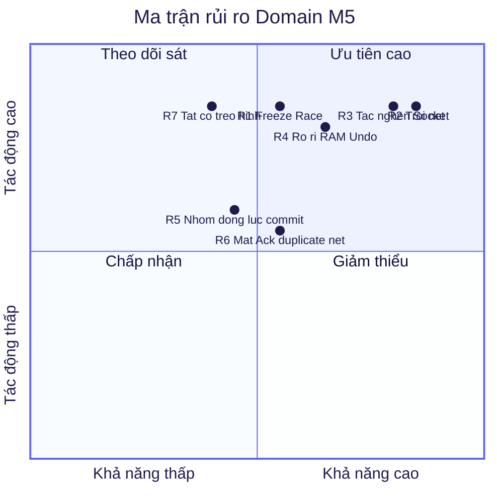

---

## 9. WBS (Work Breakdown Structure)

### 9.1 Danh sách công việc

| Mã Task  | Tên công việc chi tiết                                                                                                      | Tầng kiến trúc / File phụ trách                         | Phụ thuộc  | Dev (pd) | Test/Docs (pd) | Tổng công số (pd) | Phục vụ mục tiêu |
| :------- | :-------------------------------------------------------------------------------------------------------------------------- | :------------------------------------------------------ | :--------- | :------: | :------------: | :---------------: | :--------------- |
| **T1**   | Định nghĩa Zod schemas cho Board contracts (`board.ts`), State, Stroke ($\le 500$ pts), Sync pagination, Error codes        | `packages/contracts/src/board.ts`                       | —          |   0.4    |      0.1       |      **0.5**      | G1–G8            |
| **T2**   | Xây dựng thuật toán hình học `CoordinateNormalizer` (Letterbox stripping, aspect ratio & DPR)                               | `apps/web/src/modules/board/CoordinateNormalizer.ts`    | —          |   0.8    |      0.2       |      **1.0**      | G6               |
| **T3**   | Xây dựng Canvas 2D Rendering Engine (Freehand path smoothing, Bezier, Vanishing animation, point reduction $\le 500$)       | `apps/web/src/modules/board/CanvasRenderer.ts`          | T2         |   1.2    |      0.3       |      **1.5**      | G1, G3           |
| **T4**   | Xây dựng `FreezeIntentManager` trong RAM server (CAS reservation, TTL 15s, concurrency lock)                                | `apps/server/src/modules/board/FreezeIntentManager.ts`  | T1         |   0.8    |      0.2       |      **1.0**      | G2, G4           |
| **T5**   | Xây dựng `BoardRuntime` (RAM state machine, BoardState, Stroke log, Sequence, Idempotency cache, Pruning tombstone)         | `apps/server/src/modules/board/BoardRuntime.ts`         | T1, T4     |   1.2    |      0.3       |      **1.5**      | G1–G5, G7        |
| **T6**   | Cài đặt `BoardAclPolicy` (Xác thực 3 lớp quyền: MAIN host-only + check `currentLocation`, Group membership, Help role)      | `apps/server/src/modules/board/BoardAclPolicy.ts`       | T5         |   0.8    |      0.2       |      **1.0**      | G1, G3, G4       |
| **T7**   | Cài đặt Socket.IO Handlers & Envelopes cho toàn bộ sự kiện bảng vẽ (`board:*`), Sync pagination, Graceful kill-switch       | `apps/server/src/modules/board/BoardSocketHandler.ts`   | T1, T5, T6 |   0.8    |      0.2       |      **1.0**      | G1–G5            |
| **T8**   | Tích hợp upload frame với M2 & Kiểm tra trạng thái nhóm M4 trước khi commit                                                 | `apps/server/src/modules/board/BoardFileIntegration.ts` | T4, T7     |   0.8    |      0.2       |      **1.0**      | G2, G4           |
| **T9**   | Xây dựng Component `StageCanvasOverlay.tsx` và Hook `useBoardSocket.ts` (Optimistic UI, Lost Ack retry, Teardown listener)  | `apps/web/src/modules/board/StageCanvasOverlay.tsx`     | T1, T2, T3 |   1.2    |      0.3       |      **1.5**      | G1–G6            |
| **T10**  | Tích hợp công cụ xuất ảnh canvas để gửi vào chat cuộc họp (M2)                                                              | `apps/web/src/modules/board/CanvasExport.ts`            | T9         |   0.4    |      0.1       |      **0.5**      | G8               |
| **T11**  | Kiểm thử tự động: Unit tests (Normalizer, Runtime, Intent) & Integration tests (Socket, ACL, 2-phase teardown, Idempotency) | `apps/server/test/board/`, `apps/web/test/board/`       | T1–T10     |   0.5    |      1.0       |      **1.5**      | G1–G8            |
| **T12**  | Tài liệu hướng dẫn tích hợp, Metric dashboards, Runbook và rà soát nghiệm thu                                               | `docs/runbooks/`, `docs/board/`                         | T11        |   0.3    |      0.2       |      **0.5**      | —                |
| **Tổng** | **Tổng hợp toàn bộ 12 task phân rã kỹ thuật**                                                                               | —                                                       | —          | **9.2**  |    **3.3**     |     **12.5**      | —                |

### 9.2 Đồ thị phụ thuộc

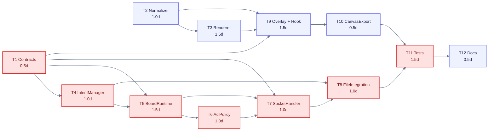

---

## 10. Estimation

### 10.1 Bảng tổng hợp ước lượng công số

| Kịch bản ước lượng     | Phát triển (Dev) | Kiểm thử & Tài liệu (Test/Docs) | Review & Tích hợp | Dự phòng (Buffer) | Tổng ngày công (Person-Days) | Lịch trình dự kiến (Working Days) |
| :--------------------- | :--------------: | :-----------------------------: | :---------------: | :---------------: | :--------------------------: | :-------------------------------: |
| **Tốt nhất (Best)**    |       7.0        |               1.5               |        0.5        |        0.5        |           **9.5**            |              **6.0**              |
| **Dự kiến (Expected)** |     **9.2**      |             **1.8**             |      **0.5**      |      **1.0**      |           **12.5**           |           **7.5 – 8.0**           |
| **Xấu nhất (Worst)**   |       12.5       |               2.5               |        1.0        |        1.5        |           **17.5**           |             **11.0**              |

### 10.2 Giả định và tỷ lệ độ biến động

1. Đã có sẵn nền tảng Socket.IO gateway và cấu trúc phiên làm việc từ M4.
2. Private File Service (M2) đã sẵn sàng endpoint upload tệp tạm thời theo HTTP multipart.
3. Call Stage (M3) đã cung cấp sẵn video player element để lấy tham chiếu video frame cho Web API Canvas.
4. Tỷ lệ giữa cận trên (Worst) và cận dưới (Best) là $17.5 / 9.5 \approx 1.84\times$ (nằm an toàn dưới ngưỡng 2.0x theo chuẩn công nghiệp cho thiết kế mức Size L).

### 10.3 Đối soát công số WBS và Lịch trình triển khai

- **Phân định rõ Tổng ngày công nỗ lực (Effort) và Lịch trình thời gian (Duration):**
  - **Tổng ngày công nỗ lực (Total Effort): 12.5 person-days.** Đây là tổng lượng công việc tính toán chính xác từ 12 task WBS: **9.2 ngày công Dev** (T1–T10) + **3.3 ngày công Test & Docs** (T11, T12 và phần test con của từng task). Con số này phản ánh đúng khối lượng công việc cần trả lương/tính chi phí nỗ lực.
  - **Lịch trình thời gian thực tế (Calendar Duration / Lead Time): 7.5 – 8.0 ngày làm việc.**
    - Khi dự án bố trí **2 kỹ sư phần mềm** làm việc song song sau khi hoàn thành T1 (Contracts - 0.5d):
      - Kỹ sư Frontend phụ trách: T2 (1.0d) $\rightarrow$ T3 (1.5d) $\rightarrow$ T9 (1.5d) $\rightarrow$ T10 (0.5d) = **4.5 ngày**.
      - Kỹ sư Backend phụ trách: T4 (1.0d) $\rightarrow$ T5 (1.5d) $\rightarrow$ T6 (1.0d) $\rightarrow$ T7 (1.0d) $\rightarrow$ T8 (1.0d) = **5.5 ngày**.
      - Hai nhánh hoàn thành song song tại mốc ngày thứ 6.0, sau đó tiến hành ghép luồng kiểm thử tích hợp chuyên biệt T11 (1.5d) và tài liệu T12 (0.5d).
    - Do đó, tổng thời gian chiếm dụng lịch trình của sprint là **7.5 – 8.0 ngày làm việc**. Nếu chỉ có 1 kỹ sư thực hiện tuần tự từ đầu đến cuối, lịch trình sẽ kéo dài đủ 12.5 ngày làm việc.

---

## Appendix

### A. Đề xuất Zod Schemas (`packages/contracts/src/board.ts`)

```ts
import { z } from 'zod';

export const boardStatusSchema = z.enum(['LIVE', 'FREEZING', 'FROZEN']);

export const pointSchema = z.object({
  x: z.number().min(0).max(1),
  y: z.number().min(0).max(1),
});

export const strokeSchema = z.object({
  id: z.string().uuid(),
  boardId: z.string().uuid(),
  sessionId: z.string().uuid(),
  contextVersion: z.number().int().nonnegative(),
  frameId: z.string().nullable(),
  sourceScopeId: z.string(),
  sourceId: z.string().nullable(),
  sourceRevision: z.number().int().nonnegative(),
  authorParticipantId: z.string(),
  points: z.array(pointSchema).min(1).max(500), // Khống chế tối đa 500 điểm
  color: z.string().regex(/^#[0-9A-Fa-f]{6}$/),
  width: z.number().min(1).max(20),
  isVanishing: z.boolean().default(false),
  createdAt: z.number().int().positive(),
  isTombstoned: z.boolean().default(false),
});

export const freezeBeginInputSchema = z.object({
  scopeId: z.string(),
  boardVersion: z.number().int().nonnegative(),
  sourceRevision: z.number().int().nonnegative(),
});

export const freezeCommitInputSchema = z.object({
  intentId: z.string().uuid(),
  fileId: z.string(),
  dimensions: z.object({
    width: z.number().int().positive().max(2560),
    height: z.number().int().positive().max(1440),
  }),
});

export const resumeInputSchema = z.object({
  scopeId: z.string(),
  boardVersion: z.number().int().nonnegative(),
});

export const strokeDrawInputSchema = z.object({
  strokeId: z.string().uuid(),
  scopeId: z.string(),
  sessionId: z.string().uuid(),
  epoch: z.string(),
  contextVersion: z.number().int().nonnegative(),
  points: z.array(pointSchema).min(1).max(500), // Tối đa 500 điểm (<= 15 KiB JSON)
  color: z.string().regex(/^#[0-9A-Fa-f]{6}$/),
  width: z.number().min(1).max(20),
  isVanishing: z.boolean().default(false),
});

export const strokeUndoInputSchema = z.object({
  scopeId: z.string(),
  strokeId: z.string().uuid(),
});

export const boardClearInputSchema = z.object({
  scopeId: z.string(),
  contextVersion: z.number().int().nonnegative(),
});

export const cursorInputSchema = z.object({
  scopeId: z.string(),
  x: z.number().min(0).max(1),
  y: z.number().min(0).max(1),
  isDrawing: z.boolean(),
  color: z.string().regex(/^#[0-9A-Fa-f]{6}$/),
});

export const syncInputSchema = z.object({
  scopeId: z.string(),
  sinceSequence: z.number().int().nonnegative().optional(),
  limit: z.number().int().positive().max(50).default(50),
});
```

---

### B. Danh mục mã lỗi nghiệp vụ

#### B.1 Các mã lỗi cốt lõi

| Mã lỗi                          | Ý nghĩa kỹ thuật                                                                             | Hành động của Client                                                    |
| :------------------------------ | :------------------------------------------------------------------------------------------- | :---------------------------------------------------------------------- |
| `PERMISSION_DENIED`             | Người gọi không có quyền trong scope này (ví dụ member cố vẽ tại MAIN).                      | Hiển thị thông báo quyền bị từ chối; vô hiệu hóa công cụ vẽ.            |
| `HOST_NOT_IN_MAIN`              | Host cố gắng vẽ tại MAIN trong khi đang có mặt hỗ trợ phòng ACTIVITY.                        | Hiển thị thông báo yêu cầu quay lại MAIN để vẽ; chặn lệnh vẽ tại MAIN.  |
| `FREEZE_NOT_ALLOWED_IN_MAIN`    | Yêu cầu dừng hình tại phòng chung MAIN.                                                      | Chặn trên UI; không gửi request.                                        |
| `CONCURRENT_FREEZE_IN_PROGRESS` | Đã có một thành viên khác đang trong quá trình dừng hình.                                    | Hiển thị thông báo "Đang có người thực hiện dừng hình, vui lòng chờ".   |
| `SOURCE_CHANGED`                | Nguồn chia sẻ video đã thay đổi hoặc dừng trong khi đang upload ảnh dừng hình.               | Hủy bỏ frame, thông báo "Nguồn chia sẻ đã thay đổi", đưa nhóm về LIVE.  |
| `GROUP_CLOSED`                  | Nhóm đã bị đóng hoặc TIMER-01 đã hết giờ trước khi kịp commit frame.                         | Hủy bỏ frame tạm, đóng bảng vẽ và chuyển giao diện theo chỉ thị của M4. |
| `INTENT_EXPIRED`                | Quá thời hạn 15 giây mà client chưa commit tệp ảnh.                                          | Khôi phục trạng thái LIVE, cho phép người dùng thử lại.                 |
| `NOT_STROKE_AUTHOR`             | Yêu cầu undo nét vẽ không phải do chính mình tạo ra.                                         | Từ chối undo, giữ nguyên nét vẽ.                                        |
| `NOT_AUTHORIZED_TO_CLEAR`       | Người gọi không đủ quyền để xóa toàn bộ bảng (không phải host ở MAIN, không phải chủ frame). | Hiển thị thông báo không có quyền clear.                                |
| `STALE_VERSION`                 | Version của client không khớp với phiên bản hiện tại của board.                              | Yêu cầu gọi `board.sync` để đồng bộ lại trạng thái mới nhất.            |

#### B.2 Các mã lỗi mở rộng

| Mã lỗi                  | Ý nghĩa kỹ thuật                                                                                  | Hành động của Client                                           |
| :---------------------- | :------------------------------------------------------------------------------------------------ | :------------------------------------------------------------- |
| `NOT_IN_GROUP`          | Người gọi không phải thành viên nhóm của scope chỉ định (hoặc host ngoài nhóm cố vào DISCUSSION). | Ẩn công cụ freeze và vẽ của nhóm.                              |
| `NO_ACTIVE_SOURCE`      | Chưa có nguồn chia sẻ video để thực hiện dừng hình.                                               | Hiển thị thông báo "Chưa có nguồn chia sẻ để dừng hình".       |
| `STALE_REVISION`        | `sourceRevision` gửi lên không khớp với nguồn video hiện tại (chỉ áp dụng khi LIVE).              | Lấy lại state từ server và cho phép thử lại.                   |
| `STALE_EPOCH`           | Lệnh gửi từ kết nối hoặc epoch phiên làm việc cũ đã kết thúc.                                     | Từ chối lệnh, yêu cầu kết nối lại phiên.                       |
| `INTENT_INVALID`        | Intent không tồn tại, không thuộc người gọi, hoặc đã kết thúc.                                    | Đưa về trạng thái LIVE và đồng bộ lại.                         |
| `FILE_NOT_FOUND`        | Tệp tải lên không tồn tại trong Private File Service hoặc sai intent.                             | Cho phép người dùng thử lại quy trình freeze từ đầu.           |
| `INVALID_DIMENSIONS`    | Kích thước frame vượt quá giới hạn cứng (2560x1440).                                              | Tự động resize ảnh chụp và thử lại.                            |
| `NOT_FROZEN`            | Gửi lệnh resume khi board không ở trạng thái FROZEN/FREEZING.                                     | Bỏ qua lệnh và đồng bộ lại state từ server.                    |
| `NOT_HOST`              | Người vẽ tại MAIN không phải là host của phiên họp.                                               | Vô hiệu hóa công cụ vẽ tại phòng MAIN.                         |
| `INVALID_CONTEXT`       | Context không hợp lệ hoặc phiên họp không còn hoạt động.                                          | Đồng bộ lại hoặc đóng overlay canvas.                          |
| `PAYLOAD_TOO_LARGE`     | Nét vẽ vượt quá 500 điểm hoặc vượt trần kích thước cho phép.                                      | Client kích hoạt thuật toán giảm điểm và gửi lại.              |
| `MEMORY_LIMIT_EXCEEDED` | Ngân sách RAM của board context vượt quá 2.0 MiB do spam vẽ/undo.                                 | Server kích hoạt pruning khẩn cấp; tạm thời chặn nhận nét mới. |
| `INVALID_COORDINATES`   | Tọa độ điểm vẽ nằm ngoài dải chuẩn hóa `[0.0, 1.0]`.                                              | Loại bỏ điểm vẽ; kiểm tra lại thuật toán CoordinateNormalizer. |
| `STROKE_NOT_FOUND`      | Không tìm thấy nét vẽ cần thao tác trong context hiện tại.                                        | Bỏ qua thao tác và đồng bộ lại.                                |
| `CONTEXT_EXPIRED`       | Context của bảng vẽ đã đóng hoặc đã chuyển version mới.                                           | Gọi `board.sync` và xóa buffer nét vẽ cục bộ cũ.               |
| `SCOPE_NOT_FOUND`       | Scope phòng hoặc nhóm không tồn tại hoặc đã bị hủy.                                               | Gỡ bỏ overlay canvas và thoát khỏi room.                       |

---

### C. Từ điển thuật ngữ (Glossary)

| Thuật ngữ                             | Định nghĩa và giải thích                                                                                                  | Ngữ cảnh sử dụng trong hệ thống    |
| :------------------------------------ | :------------------------------------------------------------------------------------------------------------------------ | :--------------------------------- |
| **MAIN**                              | Phòng họp chung của phiên LiveSession, nơi giảng viên trình bày bài giảng chính cho toàn bộ người tham gia.               | Scope gốc của phiên họp            |
| **DISCUSSION**                        | Nhóm thảo luận nhỏ được chia tự động; kế thừa bài giảng từ MAIN làm nguồn video để dừng hình; không có host hỗ trợ.       | Scope nhóm kế thừa                 |
| **ACTIVITY**                          | Nhóm hoạt động độc lập; các thành viên làm việc nhóm và có nguồn chia sẻ màn hình riêng của nhóm; host có thể vào hỗ trợ. | Scope nhóm độc lập                 |
| **Freeze / FROZEN**                   | Trạng thái dừng hình: toàn bộ thành viên trong nhóm chuyển sang quan sát cùng một frame ảnh tĩnh đồng nhất.               | State của BoardState               |
| **Resume**                            | Thao tác đưa cả nhóm từ trạng thái dừng hình trở lại xem luồng video trực tiếp thời gian thực.                            | Transition trong State Machine     |
| **Intent**                            | Quyền đặt chỗ tạm thời (TTL 15 giây) để một client thực hiện chụp và tải ảnh tĩnh lên server.                             | Cơ chế chống race condition        |
| **CAS (Compare-And-Swap)**            | Kỹ thuật cấp phát khóa nguyên tử: chỉ cấp intent nếu trạng thái hiện tại chưa có intent nào khác đang chờ.                | Kiểm soát tương tranh trong RAM    |
| **`sourceRevision`**                  | Phiên bản của nguồn video do Media Registry (M3) cấp; tự động tăng khi nguồn chia sẻ thay đổi hoặc dừng.                  | Kiểm tra tính hợp lệ của nguồn     |
| **`contextVersion` / `boardVersion`** | Số phiên bản của bảng vẽ; tự động tăng mỗi khi resume hoặc chuyển đổi ngữ cảnh vẽ.                                        | Kiểm tra tính nhất quán của nét vẽ |
| **Tombstone**                         | Kỹ thuật xóa mềm trong bộ nhớ: đánh dấu nét vẽ đã bị undo mà không xáo trộn chỉ số mảng nét vẽ.                           | Quản lý Stroke trong RAM           |
| **Tombstone Pruning**                 | Cơ chế dọn dẹp bộ nhớ: tự động giải phóng vĩnh viễn các nét tombstone cũ nhất khi vượt ngưỡng 100 nét.                    | Kiểm soát rò rỉ RAM                |
| **Idempotency**                       | Tính chất bảo đảm khi một client gửi lại cùng một lệnh vẽ (`strokeId`) do mất Ack, server không sinh nét mới.             | Chống duplicate stroke             |
| **Letterbox / Pillarbox**             | Các dải đen xuất hiện ở cạnh trên/dưới hoặc hai bên khi tỷ lệ video khác tỷ lệ khung hiển thị của trình duyệt.            | Hình học Canvas                    |
| **DPR (Device Pixel Ratio)**          | Tỷ lệ giữa độ phân giải vật lý của màn hình và độ phân giải logic CSS.                                                    | Tối ưu hóa render Canvas           |
| **Vanishing stroke**                  | Nét vẽ tự động mờ dần và biến mất sau một khoảng thời gian ngắn, dùng cho chỉ dẫn trực tiếp.                              | Overlay host tại MAIN              |
| **Loss-tolerant**                     | Cơ chế truyền tin cho phép mất gói mà không làm gãy logic hệ thống (áp dụng cho tọa độ con trỏ).                          | Tối ưu hóa băng thông Socket.IO    |
| **Graceful Kill-Switch**              | Quy trình tắt cờ tính năng an toàn: tự động đưa các nhóm đang FROZEN về xem video trực tiếp trước khi khóa cổng API.      | Vận hành & Phục hồi sự cố          |
