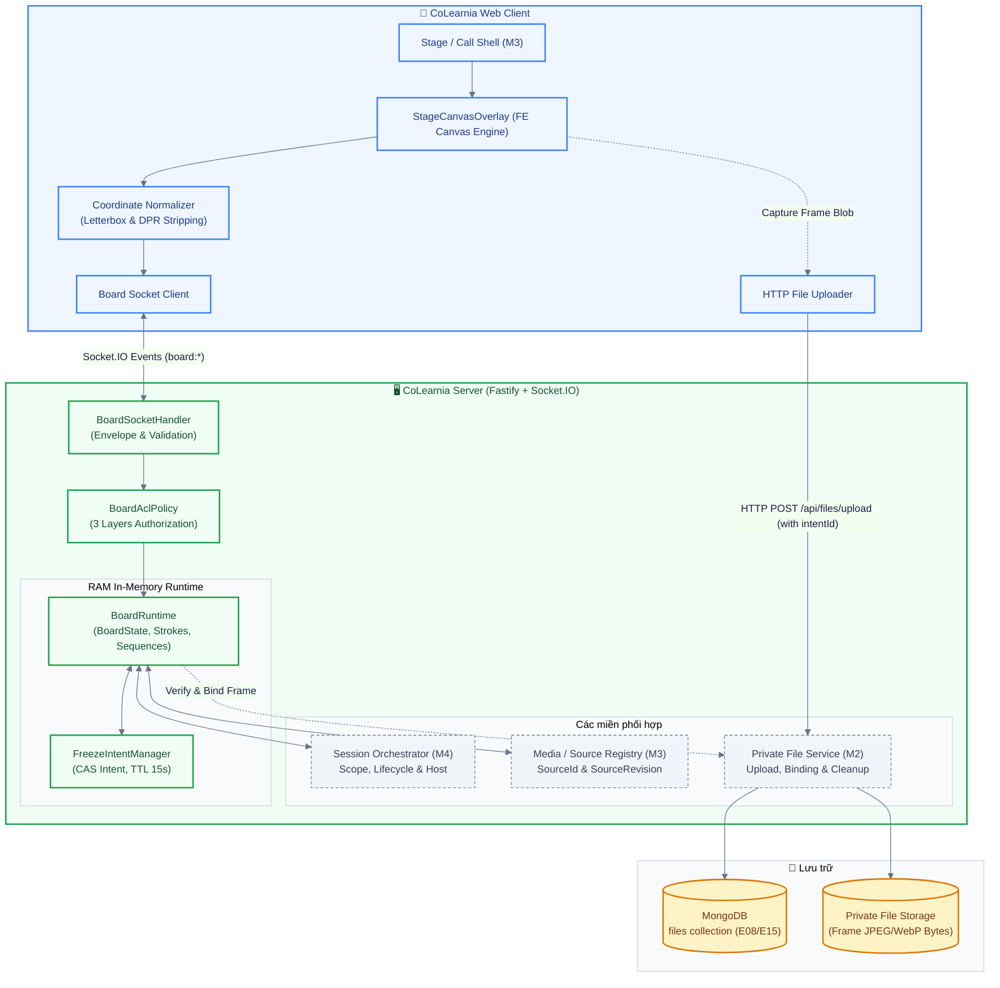
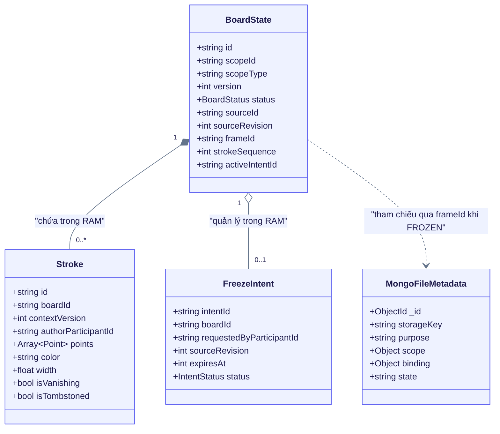
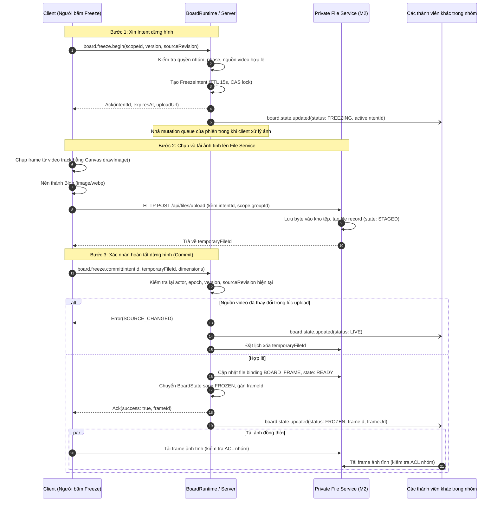
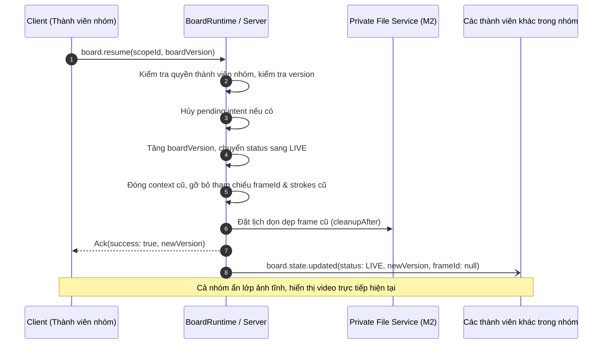
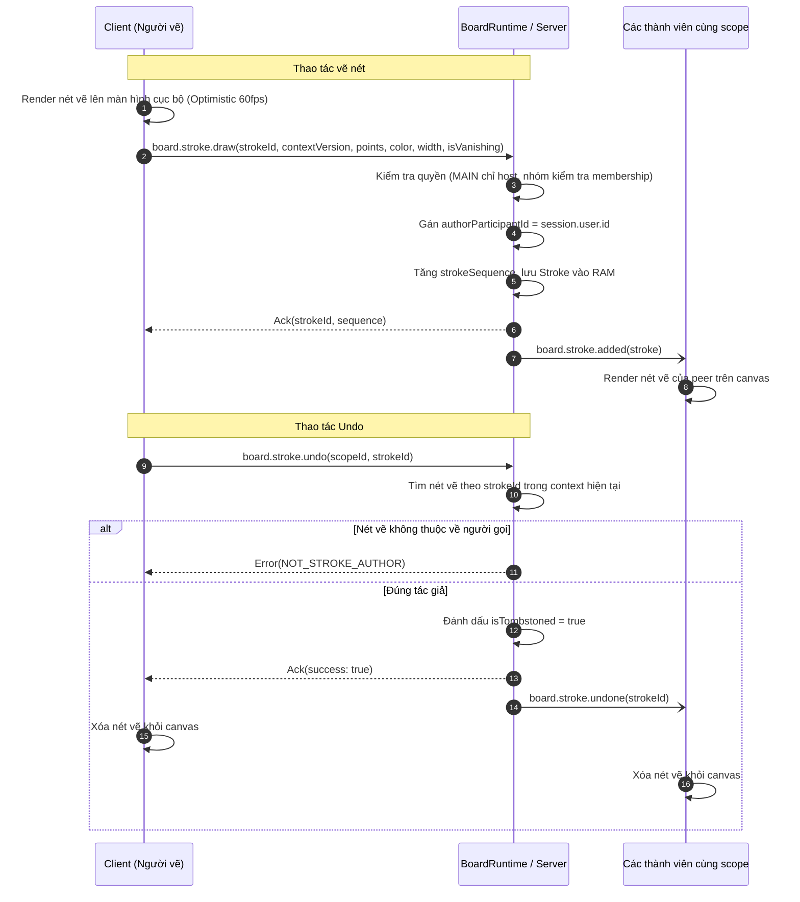

# Thiết kế hệ thống bảng vẽ, dừng hình và chú thích trực tiếp (Board, Freeze & Drawing) — Miền M5 (BOARD-01, BOARD-02, BOARD-05, FREEZE-01)

Status: Bản nháp | Author: Domain M5 Owner | Size: L

> **TL;DR** — Miền M5 cung cấp tính năng vẽ chỉ dẫn trực tiếp (live overlay annotation) tại phòng chung MAIN và môi trường dừng hình / vẽ thảo luận đồng bộ (collaborative freeze & canvas drawing) cho các nhóm DISCUSSION và ACTIVITY trong phiên LiveSession.
>
> - **MAIN:** Tuyệt đối không freeze/resume. Chỉ host hiện hành ở MAIN/hướng dẫn được vẽ trực tiếp trên nguồn video chia sẻ bất kỳ tại MAIN (người tham gia khác chỉ xem). Hỗ trợ bút, bảng màu, con trỏ tạm, undo nét của chính mình, clear toàn bộ nét có xác nhận; tùy chọn nét thường (giữ tới khi xóa hoặc nguồn kết thúc) hoặc nét tự biến mất (vanishing strokes). Đổi hoặc dừng nguồn MAIN tự động xóa overlay; chuyển host thu hồi quyền vẽ/clear cũ.
> - **DISCUSSION:** Thành viên trong nhóm cùng freeze/vẽ/resume trên frame ảnh tĩnh chụp từ bài giảng MAIN được kế thừa; cấm share riêng; chỉ tác động phạm vi nhóm thảo luận; luồng âm thanh tiếp tục bình thường.
> - **ACTIVITY:** Thành viên trong nhóm cùng freeze/vẽ/resume trên nguồn screen share duy nhất của nhóm. Nếu đã FROZEN, frame hợp lệ được bảo toàn để giải thích/thảo luận ngay cả khi người đang chia sẻ dừng phát.
> - **Quy trình Freeze 3 bước:** Client chụp hình từ video bằng Canvas `drawImage` -> gọi `board.freeze.begin` lấy intentId (nhả mutation queue của phiên trong thời gian chờ I/O) -> upload ảnh HTTP vào Private File Service (M2) -> gọi `board.freeze.commit` xác nhận (kiểm tra lại quyền, epoch, contextVersion, sourceRevision và kích thước ảnh) -> server chuyển trạng thái sang `FROZEN`, phát event kèm frameId để cả nhóm tải frame tĩnh qua ACL nhóm.
> - **Dữ liệu & Vòng đời:** 100% in-memory trong RAM server cho `BoardRuntime` (BoardState, active intents, danh sách strokes, sequence tracking). Tuyệt đối không tạo collection MongoDB cho nét/board và không ghi điểm vẽ vào DB. Frame ảnh tĩnh sử dụng collection `files` có sẵn (E08/E15) với `purpose: 'FRAME'`, `scope.groupId` bắt buộc, liên kết binding `BOARD_FRAME`. Khi resume hoặc nhóm đóng, context cũ kết thúc và dọn dẹp frame/nét hết tham chiếu theo lifecycle.
> - **Ước lượng:** Size L (gồm Canvas engine FE, Socket.IO real-time protocol, state machine RAM, HTTP upload integration, ACL verification), dự kiến **11.0 ngày công** (khoảng dao động 8.5 – 16.0 ngày công).

---

## 1. Context

Trong nền tảng học tập trực tuyến CoLearnia, trải nghiệm tương tác thị giác trong các buổi học trực tiếp (LiveSession) đòi hỏi sự kết hợp giữa:

1. Giảng viên/host giải thích, ghi chú trực tiếp lên bài giảng hoặc màn hình chia sẻ tại phòng chung (MAIN).
2. Người học khi thảo luận nhóm (DISCUSSION) cần "chụp lại" một khoảnh khắc bài giảng để cùng khoanh vùng, ghi chú, trao đổi mà không làm gián đoạn bài giảng chung.
3. Người học trong nhóm hoạt động (ACTIVITY) cần cùng phân tích, chú thích trên màn hình làm việc nhóm độc lập.

### Hiện trạng mã nguồn và kiến trúc

- Monorepo tổ chức bằng `pnpm`, backend Fastify + Socket.IO (`apps/server`), frontend React + Vite + Canvas (`apps/web`), hợp đồng giao tiếp chung (`packages/contracts`), mediasoup SFU cho media WebRTC và MongoDB replica set.
- Hiện tại chưa có mã nguồn nghiệp vụ cho tính năng bảng vẽ, dừng hình hay canvas overlay trong scaffold (chỉ có khung vỏ ứng dụng và media worker mẫu).
- Dữ liệu bền vững của hệ thống đã chốt gồm **13 collection** tại [mô hình dữ liệu](../database/model.md); các trạng thái realtime của phiên, nhóm và bảng vẽ được lưu trữ trong **RAM server** theo [vòng đời dữ liệu](../database/lifecycle.md).

### Các quyết định nền tảng đã chốt (Baseline)

Theo [tài liệu cộng tác bảng vẽ](../product/board-collaboration.md), [chế độ nhóm](../product/group-modes.md), [chính sách media](../product/groups-media-policy.md) và [trạng thái quyết định](../decision-status.md):

- **Phân định quyền 3 lớp:** Quyền Workspace (owner/admin/member) -> Quyền Session (host/member) -> Quyền Scope/Grant cụ thể (quyền vẽ, quyền freeze theo ngữ cảnh).
- **MAIN:** Tuyệt đối không có thao tác freeze/resume. Chỉ host hiện hành ở MAIN có quyền vẽ và clear. Nét vẽ gắn với `sourceRevision` của nguồn chia sẻ; khi nguồn dừng hoặc đổi, server xóa overlay LIVE. Đổi host sẽ thu hồi quyền vẽ/clear của host cũ, kiểm tra lại mọi mutation đang chờ.
- **DISCUSSION & ACTIVITY:** Freeze/resume và vẽ chung là thao tác đồng thuận trong nhóm, tác động tới toàn bộ thành viên nhóm nhưng hoàn toàn cách ly với MAIN và nhóm khác.
- **Hệ tọa độ Canvas chuẩn hóa:** Tọa độ nét vẽ được lưu và truyền đi dưới dạng tỷ lệ tương đối `[0, 1]` trên vùng hình ảnh thực tế (loại bỏ letterbox/pillarbox), bảo đảm không trôi nét khi thay đổi kích thước cửa sổ (resize) hoặc mật độ điểm ảnh (DPR).
- **Tách bạch lưu trữ:** Nét vẽ và trạng thái bảng chỉ tồn tại trong RAM runtime trong suốt thời gian context còn sống; frame ảnh tĩnh dùng hạ tầng của Private File Service (M2); không lưu trữ bài làm vĩnh viễn (không `artifact.save`, không export thư viện bài giảng).

Tài liệu tham chiếu chính:

- `docs/product/board-collaboration.md`: Đặc tả nghiệp vụ vẽ MAIN và freeze/vẽ trong nhóm.
- `docs/product/delivery-domains.md`: Phân chia trách nhiệm Miền M5 và các giao điểm M1–M4.
- `docs/product/functional-requirements.md`: FR-06-01 đến FR-06-05 (PB-06).
- `docs/database/collection-design.md`: Thiết kế collection `files` và cấu trúc scope `FRAME`.
- `docs/database/lifecycle.md`: Vòng đời dữ liệu, dọn dẹp frame và dọn dẹp RAM runtime.

---

## 2. Objective

Xây dựng hệ thống bảng vẽ và dừng hình tương tác trực tiếp (Domain M5) đáp ứng trọn vẹn 5 yêu cầu chức năng từ **FR-06-01 đến FR-06-05**:

1. Cung cấp overlay vẽ trực tiếp tại phòng chung MAIN dành riêng cho host hiện hành, hỗ trợ vẽ ghi chú trên luồng video trực tiếp với độ trễ thấp (<50ms phản hồi cục bộ).
2. Cho phép các thành viên trong nhóm thảo luận (DISCUSSION) và nhóm hoạt động (ACTIVITY) cùng đồng thuận dừng hình một frame video, chuyển nhóm sang trạng thái `FROZEN` để cùng quan sát một hình ảnh tĩnh đồng nhất mà không làm gián đoạn luồng âm thanh.
3. Cho phép các thành viên trong nhóm cùng vẽ, đánh dấu, tương tác đồng thời trên frame tĩnh (hoặc vẽ chỉ dẫn tạm trên luồng trực tiếp của nhóm), hỗ trợ undo nét của chính mình và clear toàn bộ nét theo quyền.
4. Đảm bảo tính nhất quán và an toàn tuyệt đối về phân quyền (concurrency race condition, CAS intent reservation, nhả queue phiên trong thời gian upload, kiểm tra epoch/version/sourceRevision trước khi commit).
5. Cho phép thành viên nhóm hoàn tác trạng thái dừng hình (resume), đưa cả nhóm trở lại luồng video trực tiếp mượt mà, đồng thời giải phóng triệt để tài nguyên frame/stroke khi nhóm đóng hoặc phiên kết thúc.

---

## 3. Goals / Non-goals

### Goals

- **G1 (Host vẽ tại MAIN):** Chỉ host hiện hành ở MAIN/hướng dẫn được vẽ trên nguồn chia sẻ màn hình bất kỳ tại MAIN; hỗ trợ công cụ bút, bảng màu, con trỏ chỉ dẫn, undo nét của mình, clear có xác nhận; hỗ trợ nét thường và nét tự biến mất (FR-06-01, FR-06-03, FR-06-04).
- **G2 (Dừng hình đồng thuận trong nhóm):** Thành viên có quyền trong nhóm DISCUSSION/ACTIVITY khởi tạo dừng hình thành công; toàn bộ thành viên nhóm nhận cùng một frame tĩnh; âm thanh và media nền tiếp tục hoạt động bình thường (FR-06-02).
- **G3 (Vẽ cộng tác và hoàn tác trong nhóm):** Các thành viên cùng nhóm vẽ đồng thời trên frame tĩnh; hiển thị con trỏ của nhau theo thời gian thực (throttle 20Hz); undo nét vẽ gần nhất của chính mình; clear toàn bộ bảng theo quyền (chủ frame, chủ nguồn share hoặc host đang hỗ trợ) có hộp thoại xác nhận (FR-06-03, FR-06-04).
- **G4 (Kiểm soát tương tranh và race condition):** Xử lý an toàn khi nhiều thành viên cùng bấm freeze một lúc: chỉ duy nhất một intent được phê duyệt; nhả mutation queue của phiên trong suốt thời gian client chụp và upload ảnh HTTP; từ chối commit nếu nguồn video đã thay đổi trong lúc chờ upload (FR-06-02, board-collaboration.md).
- **G5 (Trở lại trực tiếp - Resume):** Thành viên nhóm kích hoạt resume đưa nhóm về luồng trực tiếp ngay lập tức, hủy pending intent nếu có, tăng `boardVersion`, đóng context frame cũ và không phát lại đoạn video bị trễ (FR-06-05).
- **G6 (Khử trôi nét vẽ - Normalized Coordinates):** Chuyển đổi và chuẩn hóa tọa độ nét vẽ theo tỷ lệ `[0, 1]` dựa trên vùng hiển thị thực của video (đã trừ phần letterbox/pillarbox đen); đảm bảo nét vẽ khớp chính xác 100% trên các thiết bị có kích thước màn hình, tỷ lệ khung hình và DPR khác nhau (FR-06-03).
- **G7 (Quản lý vòng đời và giải phóng tài nguyên):** Tự động xóa overlay MAIN khi nguồn chia sẻ MAIN dừng hoặc đổi; giữ frame hợp lệ của nhóm khi nguồn live dừng trong trạng thái FROZEN; thu hồi quyền khi đổi host; thu quyền cá nhân khi thành viên rời nhóm mà không xóa board chung; dọn dẹp frame/nét khi nhóm đóng (FR-06-04, FR-06-05, lifecycle.md).
- **G8 (Chụp canvas phục vụ chat cuộc họp):** Hỗ trợ xuất ảnh chụp màn hình canvas hiện tại kèm nét vẽ thành tệp ảnh để gửi vào chat cuộc họp (M2) dưới dạng tệp đính kèm độc lập có kiểm tra quyền (FR-06-03, delivery-domains.md).

### Non-goals

- **NG1 (Không freeze tại MAIN):** Tuyệt đối không cung cấp tính năng freeze/resume tại phòng chung MAIN; mọi yêu cầu freeze tại MAIN bị server từ chối ngay lập tức.
- **NG2 (Không tracking vật thể):** Không nhận diện hoặc neo nét vẽ theo đối tượng hình ảnh, slide thuyết trình hay cuộn trang web; nét vẽ cố định trên khung tọa độ video.
- **NG3 (Không lưu nét vào MongoDB):** Không tạo collection MongoDB cho bảng vẽ hay nét vẽ; không thực hiện ghi điểm vẽ xuống cơ sở dữ liệu bền vững.
- **NG4 (Không lưu trữ vĩnh viễn bài làm):** Không cung cấp tính năng lưu bài làm lâu dài (`artifact.save`), thư viện bài giảng hay export bảng vẽ ra ngoài phạm vi phiên làm việc; dữ liệu board mất khi phiên kết thúc hoặc server restart.
- **NG5 (Không công bố board nhóm ra MAIN):** Khi kết thúc thảo luận/hoạt động hoặc hết giờ TIMER-01, không tự động mang frame/nét của nhóm trình chiếu ra phòng chung MAIN.
- **NG6 (Không công cụ hình học nâng cao):** Bản phát hành này không hỗ trợ vẽ hình học vector (hình tròn, chữ nhật, mũi tên phức tạp), không có text box soạn thảo văn bản hay nhận diện chữ viết; chỉ hỗ trợ nét vẽ tự do (freehand stroke), tẩy/clear và con trỏ tạm.
- **NG7 (Không freeze cá nhân):** Không hỗ trợ chế độ dừng hình riêng cho từng cá nhân; freeze là trạng thái đồng thuận chung của cả nhóm.

---

## 4. Open questions & assumptions

| #   | Câu hỏi mở / Giả định                                                                        | Tại sao quan trọng                                                                                                           | Người phụ trách            | Cần chốt trước         | Trạng thái hiện tại                                                                                                                                                                                                                             |
| --- | -------------------------------------------------------------------------------------------- | ---------------------------------------------------------------------------------------------------------------------------- | -------------------------- | ---------------------- | ----------------------------------------------------------------------------------------------------------------------------------------------------------------------------------------------------------------------------------------------- |
| 1   | **Thời gian tồn tại (TTL) và hiệu ứng mờ dần (fade) của nét tự biến mất (vanishing stroke)** | Ảnh hưởng trực tiếp đến trải nghiệm giảng dạy của host tại MAIN và cấu hình animation phía client Canvas.                    | UI/UX Designer & M5 Owner  | Sprint UI Review       | **Chưa chốt**. Baseline quy định không tự bịa số giây cố định. Giải pháp đề xuất: Tham số hóa cấu hình ở client (dự kiến default 3.0s, fade trong 1.0s) cho tới khi thống nhất sản phẩm.                                                        |
| 2   | **Định dạng và giới hạn kích thước tệp ảnh frame tĩnh khi upload**                           | Ảnh hưởng đến băng thông upload của client, dung lượng lưu trữ Private File Service (M2) và tốc độ tải của peers trong nhóm. | M5 Owner phối hợp M2 Owner | Review Contract M2–M5  | **Giả định**: Chụp canvas dưới dạng `image/webp` (fallback `image/jpeg`), chất lượng 0.85, độ phân giải tối đa 1920x1080 (hoặc theo kích thước video track gốc), dung lượng khống chế ≤ 2.0 MiB/frame; quota phiên tối đa 20 MiB theo baseline. |
| 3   | **Xử lý hiện tượng khung hình đen khi chụp video remote chưa giải mã xong**                  | Tránh trường hợp client chụp phải frame đen hoặc frame rỗng khi vừa bắt đầu freeze.                                          | M5 Owner & M3 Owner        | Tích hợp Client Canvas | **Giả định**: Client kiểm tra `videoElement.readyState >= 2` và `videoWidth > 0` trước khi capture. Nếu frame đen hoàn toàn do video track chưa render, hiển thị toast cảnh báo người dùng thử lại; không coi mọi ảnh đen là lỗi mạng.          |
| 4   | **Tần suất throttle của con trỏ (cursor) và phân đoạn nét vẽ (stroke points chunking)**      | Cân bằng giữa độ mượt của con trỏ/nét vẽ và tải xử lý của Socket.IO server.                                                  | M5 Owner                   | Performance Testing    | **Đã thiết kế**: Con trỏ preview batching tối đa 20Hz (mỗi 50ms), cho phép mất gói tin (unreliable). Nét vẽ gửi điểm theo cụm trong khi kéo chuột và commit trọn gói khi nhả chuột (`pointerup`).                                               |
| 5   | **Cơ chế khôi phục khi mất gói tin nét vẽ (sequence gap recovery)**                          | Đảm bảo tính toàn vẹn của bảng vẽ khi mạng gián đoạn nhẹ mà không cần kết nối lại toàn bộ phiên.                             | M5 Owner                   | Implementation         | **Đã thiết kế**: Mỗi nét vẽ commit có `strokeSequence` tăng dần; nếu client nhận sequence không liên tục (gap), client tự động gửi yêu cầu `board.sync` để nhận snapshot các nét active hiện tại.                                               |

---

## 5. High-level design

Hệ thống Bảng vẽ (Domain M5) được xây dựng dựa trên sự phân tách rõ ràng giữa:

1. **Rendering & Normalization (Client):** Xử lý vẽ canvas 60fps mượt mà, khử trôi nét vẽ bằng phép biến đổi tọa độ chuẩn hóa, chụp frame video qua Web API Canvas.
2. **Real-time Synchronization (Socket.IO):** Đồng bộ nét vẽ, vị trí con trỏ, thao tác undo/clear và trạng thái board với độ trễ thấp thông qua room của Socket.IO phân theo `scopeId`.
3. **State Machine & Intent Management (BoardRuntime - RAM):** Quản lý trạng thái bảng theo từng scope (`LIVE`, `FREEZING`, `FROZEN`), xử lý tranh chấp khóa CAS cho freeze intent, kiểm tra phân quyền 3 lớp và điều phối vòng đời context.
4. **File Storage Integration (Private File Service - M2):** Tách luồng truyền byte ảnh tĩnh lớn ra khỏi WebSocket bằng cách sử dụng HTTP POST upload có kiểm tra quyền và gắn binding với intent.



### Entrypoints and Why

1. **Socket.IO Real-time Gateway (`board:*` namespace/events):**
   - _Lý do:_ Tương tác vẽ và con trỏ đòi hỏi độ trễ cực thấp (<50ms). Socket.IO cho phép broadcast sự kiện ngay lập tức tới các peers trong cùng room `scopeId` mà không tạo tải kết nối liên tục như HTTP polling.
2. **HTTP POST REST Endpoint (`/api/files/upload` - M2):**
   - _Lý do:_ Ảnh chụp frame tĩnh có dung lượng từ vài trăm KB đến 2 MB. Nếu truyền byte nhị phân qua WebSocket signaling sẽ gây tắc nghẽn hàng đợi (head-of-line blocking), làm gián đoạn các gói tin điều khiển phiên họp và nét vẽ thời gian thực. Tách luồng upload ảnh sang HTTP bảo đảm băng thông signaling luôn thông suốt.

### Components Touched

- **Frontend (`apps/web`):**
  - `StageCanvasOverlay.tsx`: Component React phủ lên trên video player trong Call Stage của M3, lắng nghe tương tác pointer (chuột, bút cảm ứng, touch).
  - `CanvasRenderer.ts`: Module vẽ Canvas 2D tối ưu hóa (requestAnimationFrame, path smoothing với Bezier curves, hỗ trợ vẽ nét thường và animation mờ dần cho nét tự biến mất).
  - `CoordinateNormalizer.ts`: Bộ tính toán hình học, bóc tách vùng video hiển thị thực, loại bỏ letterbox/pillarbox và chuẩn hóa tọa độ `(x, y)` về khoảng `[0.0, 1.0]`.
  - `useBoardSocket.ts`: React Hook quản lý kết nối Socket.IO của board, xử lý optimistic UI update cho nét vẽ cục bộ, lắng nghe remote strokes, con trỏ và khôi phục khi mất gói tin.
- **Backend (`apps/server`):**
  - `BoardRuntime.ts`: Domain service quản lý vòng đời và trạng thái các bảng vẽ trong RAM, lưu trữ danh sách nét vẽ, counter `strokeSequence`, broadcast sự kiện và snapshot.
  - `FreezeIntentManager.ts`: Bộ quản lý đặt chỗ freeze (CAS lock), sinh UUID intent, kiểm tra hạn 15 giây và giải phóng khóa khi quá hạn hoặc bị hủy.
  - `BoardSocketHandler.ts`: Tiếp nhận và xác thực phong bì gói tin Socket.IO, kiểm tra schema Zod từ `@colearnia/contracts`.
  - `BoardAclPolicy.ts`: Kiểm tra phân quyền 3 lớp tại thời điểm xử lý (Workspace membership, Session state, Scope role/grant).
- **Shared Contracts (`packages/contracts`):**
  - `src/board.ts`: Định nghĩa các Zod schema nghiêm ngặt cho BoardState, Stroke, Freeze commands, events và error codes.

### Alternatives Considered

- **Phương án 1: Lưu toàn bộ nét vẽ vào cơ sở dữ liệu MongoDB.**
  - _Đánh giá:_ Một phiên thảo luận có thể sinh ra hàng chục nghìn điểm vẽ mỗi phút. Việc ghi từng nét hoặc từng điểm vào MongoDB sẽ làm tê liệt I/O cơ sở dữ liệu, phá vỡ baseline kiến trúc 13 collection và vi phạm nguyên tắc vòng đời (bảng vẽ chỉ có giá trị trong phiên làm việc).
  - _Quyết định:_ **Bác bỏ**. Toàn bộ nét vẽ được lưu trữ trong RAM `BoardRuntime`, phục vụ đồng bộ tức thời và snapshot khi socket reconnect ngắn hạn. Khi phiên kết thúc, RAM được giải phóng hoàn toàn.
- **Phương án 2: Truyền frame ảnh dừng hình trực tiếp qua WebRTC DataChannel.**
  - _Đánh giá:_ mediasoup SFU trong scaffold được thiết kế tối ưu cho Media Stream (Audio/Video). Mở thêm DataChannel cho từng client để truyền ảnh tĩnh dung lượng lớn làm tăng độ phức tạp của media worker, khó kiểm soát quota lưu trữ và khó áp dụng cơ chế phân quyền tải tệp thống nhất.
  - _Quyết định:_ **Bác bỏ**. Tận dụng Private File Service (M2) sẵn có để lưu trữ byte và kiểm tra quyền tải theo ACL của nhóm.
- **Phương án 3: Lưu tọa độ pixel tuyệt đối (Absolute Pixel Coordinates).**
  - _Đánh giá:_ Kích thước cửa sổ trình duyệt và độ phân giải màn hình của mỗi người dùng là hoàn toàn khác nhau. Lưu tọa độ tuyệt đối sẽ khiến nét vẽ bị lệch hoàn toàn khi hiển thị trên các màn hình khác nhau.
  - _Quyết định:_ **Bác bỏ**. Bắt buộc sử dụng hệ tọa độ chuẩn hóa tương đối `[0, 1]` trên khung hình gốc của video.

---

## 6. Detailed design

### 6.1 Database & Data Structures

#### 1. Lưu trữ bền vững (MongoDB)

Miền M5 tuân thủ nghiêm ngặt nguyên tắc **không tạo collection mới** trong MongoDB (giữ nguyên 13 collection đã chốt). M5 chỉ tương tác với collection `files` (E08/E15) để lưu metadata của ảnh frame dừng hình.

Cấu trúc document trong collection `files` khi lưu frame tĩnh:

```ts
{
  _id: ObjectId("..."),
  storageKey: "workspaces/.../sessions/.../frames/frame-uuid.webp",
  purpose: "FRAME",                          // Đánh dấu rõ mục đích
  mimeType: "image/webp",
  sizeBytes: 458920,
  dimensions: { width: 1920, height: 1080 },
  state: "READY",                            // STAGED -> READY -> DELETE_PENDING
  scope: {
    sessionId: ObjectId("..."),
    epoch: "epoch-uuid",
    boardId: "board-uuid",
    contextVersion: 1,
    groupId: "group-uuid"                    // Bắt buộc cho DISCUSSION / ACTIVITY; MAIN không có
  },
  authorization: {
    memberships: [{ membershipId: ObjectId("..."), incarnation: 1, revision: 0 }],
    channel: { channelId: ObjectId("..."), revision: 0 }
  },
  binding: {
    kind: "BOARD_FRAME",
    intentId: "intent-uuid"                  // Gắn kết với freeze intent đã được cấp
  },
  expiresAt: null,                           // Null sau khi đã commit thành công
  cleanupAfter: null,                        // Sẽ được đặt lịch khi resume hoặc nhóm đóng
  createdAt: ISODate("2026-11-03T..."),
  updatedAt: ISODate("2026-11-03T...")
}
```

#### 2. Cấu trúc dữ liệu trong bộ nhớ (RAM BoardRuntime)

Toàn bộ trạng thái hoạt động của bảng vẽ được quản lý bởi `BoardRuntime` trong RAM server:

```ts
// Trạng thái bảng vẽ theo từng scope
export type BoardStatus = 'LIVE' | 'FREEZING' | 'FROZEN';

export interface BoardState {
  id: string; // RuntimeId UUID
  sessionId: string; // LiveSession ID
  scopeId: string; // MAIN scope ID hoặc Group ID
  scopeType: 'MAIN' | 'DISCUSSION' | 'ACTIVITY';
  version: number; // Tăng mỗi khi resume hoặc đổi context
  status: BoardStatus; // MAIN luôn luôn là 'LIVE'
  sourceScopeId: string; // MAIN cho DISCUSSION; Group scope cho ACTIVITY
  sourceId: string | null; // ID của producer/stream màn hình đang share
  sourceRevision: number; // Phiên bản của nguồn video từ M3
  frameId: string | null; // ID tệp frame tĩnh trong files collection (khi FROZEN)
  frameUrl: string | null; // URL có chữ ký/kiểm tra quyền để client tải frame
  strokeSequence: number; // Counter tăng dần cho mỗi nét vẽ commit
  activeIntentId: string | null; // IntentId đang trong quá trình freeze (khi FREEZING)
  createdAt: number;
  updatedAt: number;
}

// Nét vẽ đã commit
export interface Stroke {
  id: string; // UUID do client sinh
  boardId: string;
  contextVersion: number; // Khớp với version của BoardState tại thời điểm vẽ
  frameId: string | null; // Gắn với frame cụ thể nếu vẽ trong trạng thái FROZEN
  sourceScopeId: string;
  sourceId: string | null;
  sourceRevision: number;
  authorParticipantId: string; // Server gán từ session token, không tin client
  points: Array<{ x: number; y: number }>; // Tọa độ chuẩn hóa 0.0 .. 1.0
  color: string; // Mã màu HEX (vd: "#FF0000")
  width: number; // Độ dày nét vẽ (tỷ lệ chuẩn hóa hoặc pixel quy chuẩn)
  isVanishing: boolean; // True nếu là nét tự biến mất (chỉ MAIN hoặc LIVE nhóm)
  createdAt: number; // Server timestamp (epoch ms)
  isTombstoned: boolean; // True khi bị undo (đánh dấu xóa mềm trong runtime)
}

// Đặt chỗ Freeze (CAS Intent)
export interface FreezeIntent {
  intentId: string; // UUID
  boardId: string;
  scopeId: string;
  requestedByParticipantId: string;
  sourceRevision: number; // Bắt buộc khớp với revision tại thời điểm begin
  expiresAt: number; // Timestamp hết hạn (hiệu lực 15 giây)
  status: 'PENDING' | 'COMMITTED' | 'EXPIRED' | 'CANCELLED';
}
```



---

### 6.2 API & Real-time Contracts (Socket.IO + HTTP)

Giao tiếp thời gian thực sử dụng các sự kiện Socket.IO được định nghĩa chặt chẽ trong `@colearnia/contracts`.

| Tên sự kiện / Command | Hướng            | Dữ liệu gửi (Payload)                                                      | Phản hồi (Ack / Broadcast)                                                                             | Xử lý lỗi / Error codes                                                                                             |
| --------------------- | ---------------- | -------------------------------------------------------------------------- | ------------------------------------------------------------------------------------------------------ | ------------------------------------------------------------------------------------------------------------------- |
| `board.freeze.begin`  | Client -> Server | `{ scopeId, boardVersion, sourceRevision }`                                | Ack: `{ intentId, expiresAt, uploadUrl }`<br/>Broadcast: `board.state.updated` (`status: 'FREEZING'`)  | `NOT_IN_GROUP`, `FREEZE_NOT_ALLOWED_IN_MAIN`, `NO_ACTIVE_SOURCE`, `CONCURRENT_FREEZE_IN_PROGRESS`, `STALE_REVISION` |
| `board.freeze.commit` | Client -> Server | `{ intentId, fileId, dimensions: { width, height } }`                      | Ack: `{ success: true, frameId }`<br/>Broadcast: `board.state.updated` (`status: 'FROZEN'`, `frameId`) | `INTENT_EXPIRED`, `INTENT_INVALID`, `SOURCE_CHANGED`, `FILE_NOT_FOUND`, `INVALID_DIMENSIONS`                        |
| `board.resume`        | Client -> Server | `{ scopeId, boardVersion }`                                                | Ack: `{ success: true, newVersion }`<br/>Broadcast: `board.state.updated` (`status: 'LIVE'`)           | `NOT_IN_GROUP`, `NOT_FROZEN`, `STALE_VERSION`, `PERMISSION_DENIED`                                                  |
| `board.stroke.draw`   | Client -> Server | `{ strokeId, scopeId, contextVersion, points, color, width, isVanishing }` | Ack: `{ strokeId, sequence }`<br/>Broadcast: `board.stroke.added`                                      | `PERMISSION_DENIED`, `NOT_HOST`, `INVALID_CONTEXT`, `PAYLOAD_TOO_LARGE`, `INVALID_COORDINATES`                      |
| `board.stroke.undo`   | Client -> Server | `{ scopeId, strokeId }`                                                    | Ack: `{ success: true }`<br/>Broadcast: `board.stroke.undone` (`{ strokeId }`)                         | `STROKE_NOT_FOUND`, `NOT_STROKE_AUTHOR`, `CONTEXT_EXPIRED`                                                          |
| `board.clear`         | Client -> Server | `{ scopeId, contextVersion }`                                              | Ack: `{ success: true }`<br/>Broadcast: `board.cleared` (`{ scopeId, contextVersion }`)                | `PERMISSION_DENIED`, `NOT_AUTHORIZED_TO_CLEAR`, `CONTEXT_EXPIRED`                                                   |
| `board.cursor`        | Client -> Server | `{ scopeId, x, y, isDrawing, color }`                                      | Không ack; Broadcast: `board.cursor.moved` (throttle 20Hz)                                             | Bỏ qua nếu sai scope (loss-tolerant)                                                                                |
| `board.sync`          | Client -> Server | `{ scopeId, lastSequence }`                                                | Ack: `{ state: BoardState, activeStrokes: Stroke[] }`                                                  | `SCOPE_NOT_FOUND`, `PERMISSION_DENIED`                                                                              |

---

#### Sequence Diagram 1: Quy trình Dừng hình (Freeze Flow)



---

#### Sequence Diagram 2: Quy trình Trở lại trực tiếp (Resume Flow)



---

#### Sequence Diagram 3: Luồng Vẽ nét và Hoàn tác (Draw & Undo Flow)



---

#### Phân quyền chi tiết (3 Layers Authorization Matrix)

| Thao tác                                 | MAIN                    | DISCUSSION                                     | ACTIVITY                                       | Ghi chú kiểm tra phân quyền                                                                            |
| ---------------------------------------- | ----------------------- | ---------------------------------------------- | ---------------------------------------------- | ------------------------------------------------------------------------------------------------------ |
| **Vẽ nét (`stroke.draw`)**               | Chỉ Host hiện hành      | Mọi thành viên trong nhóm                      | Mọi thành viên trong nhóm                      | MAIN: Người share khác host bị từ chối; Host hỗ trợ vào ACTIVITY được vẽ trong ACTIVITY đó.            |
| **Bắt đầu dừng hình (`freeze.begin`)**   | **BỊ TỪ CHỐI (Deny)**   | Mọi thành viên trong nhóm                      | Mọi thành viên trong nhóm                      | MAIN trả về `FREEZE_NOT_ALLOWED_IN_MAIN`; DISCUSSION chụp bài giảng MAIN; ACTIVITY chụp màn hình nhóm. |
| **Xác nhận dừng hình (`freeze.commit`)** | **BỊ TỪ CHỐI (Deny)**   | Đúng người đã xin intent                       | Đúng người đã xin intent                       | Kiểm tra intent hợp lệ, chưa hết hạn (15s), khớp `sourceRevision`.                                     |
| **Trở lại trực tiếp (`resume`)**         | **BỊ TỪ CHỐI (Deny)**   | Mọi thành viên trong nhóm                      | Mọi thành viên trong nhóm                      | Đóng context ảnh tĩnh, chuyển về video trực tiếp của nhóm.                                             |
| **Hoàn tác (`stroke.undo`)**             | Chỉ Host (nét của mình) | Tác giả của nét vẽ                             | Tác giả của nét vẽ                             | Không cho phép undo nét vẽ của thành viên khác bằng cách sửa ID.                                       |
| **Xóa toàn bộ (`board.clear`)**          | Chỉ Host hiện hành      | Chủ frame / Chủ nguồn share LIVE / Host hỗ trợ | Chủ frame / Chủ nguồn share LIVE / Host hỗ trợ | Yêu cầu xác nhận ở UI; server kiểm tra quyền trước khi xóa nét trong context.                          |
| **Đồng bộ con trỏ (`cursor`)**           | Chỉ Host hiện hành      | Mọi thành viên trong nhóm                      | Mọi thành viên trong nhóm                      | Loss-tolerant, giới hạn tần suất 20Hz.                                                                 |

---

#### Nguyên lý chuẩn hóa tọa độ và khử trôi nét (Coordinate Normalization)

Khi video được render trong khung hiển thị (video container), tùy thuộc vào tỷ lệ khung hình của video gốc $A_{video} = W_v / H_v$ và tỷ lệ của vùng chứa $A_{container} = W_c / H_c$, trình duyệt sẽ chèn thêm các dải đen (letterbox ở trên/dưới hoặc pillarbox ở hai bên).

Để đảm bảo nét vẽ không bị trôi khi thay đổi kích thước cửa sổ:

1. Client xác định vùng hiển thị thực của nội dung video trong container:
   $$\text{Nếu } A_{container} > A_{video}: \quad H_{render} = H_c, \quad W_{render} = H_c \times A_{video}, \quad \text{Offset}_X = \frac{W_c - W_{render}}{2}, \quad \text{Offset}_Y = 0$$
   $$\text{Nếu } A_{container} \le A_{video}: \quad W_{render} = W_c, \quad H_{render} = W_c / A_{video}, \quad \text{Offset}_X = 0, \quad \text{Offset}_Y = \frac{H_c - H_{render}}{2}$$
2. Chuẩn hóa tọa độ con trỏ $(X_{mouse}, Y_{mouse})$ sang khoảng $[0.0, 1.0]$:
   $$x_{norm} = \frac{X_{mouse} - \text{Offset}_X}{W_{render}}, \quad y_{norm} = \frac{Y_{mouse} - \text{Offset}_Y}{H_{render}} \quad (0.0 \le x_{norm}, y_{norm} \le 1.0)$$
3. Nét vẽ chỉ được chấp nhận nếu nằm trong vùng $[0.0, 1.0]$. Khi render lên màn hình của người nhận, tọa độ thực được tính ngược lại dựa trên $W_{render}, H_{render}$ và offsets của thiết bị nhận. Tọa độ này hoàn toàn độc lập với DPR (`window.devicePixelRatio`).

---

#### Giới hạn và biên an toàn (Limits & Constraints)

- **Kích thước nét vẽ:** Tối đa 2.000 điểm cho mỗi nét vẽ; độ dày nét từ 1 đến 20 pixel (chuẩn hóa); tối đa 500 nét vẽ hoạt động đồng thời trong một context (vượt quá từ chối vẽ thêm để bảo vệ bộ nhớ).
- **Kích thước tệp frame:** Dung lượng tối đa 2.0 MiB/ảnh; độ phân giải tối đa 2560x1440; định dạng chấp nhận: `image/webp`, `image/jpeg`.
- **Thời hạn Intent:** Intent dừng hình có hiệu lực tối đa **15 giây**. Quá 15 giây không commit sẽ tự động giải phóng khóa, dọn tệp upload dở dang.
- **Tần suất con trỏ:** Client throttle gửi sự kiện con trỏ ở mức tối đa 20 gói/giây (50ms/gói).

---

### 6.3 Rollout, flag & observability

#### 1. Feature Flags

- `feature.board.enabled`: Bật/tắt toàn bộ tính năng bảng vẽ và dừng hình. Mặc định: `true` trong môi trường dev/staging, cấu hình theo Workspace/Channel trong production.
- `feature.board.vanishing_strokes`: Bật/tắt tính năng nét tự biến mất. Mặc định: `true`.

#### 2. Giám sát & Logs (Observability)

Mỗi thao tác quan trọng ghi một log có cấu trúc (structured log JSON) gồm:

- `timestamp`, `scopeId`, `boardId`, `action` (`FREEZE_BEGIN`, `FREEZE_COMMIT`, `RESUME`, `STROKE_COMMIT`, `CLEAR`), `actorId`, `sourceRevision`, `durationMs`.
- Tuyệt đối không log nội dung tọa độ chi tiết của nét vẽ hoặc dữ liệu nhị phân ảnh để tránh đầy disk log.

#### 3. Metrics (Prometheus)

- `colearnia_board_freeze_intent_total{scope_type, status}`: Đếm số lần yêu cầu freeze (thành công, quá hạn, xung đột race).
- `colearnia_board_freeze_commit_duration_ms`: Biểu đồ thời gian từ khi begin đến khi commit hoàn tất.
- `colearnia_board_strokes_total{scope_type, is_vanishing}`: Đếm tổng số nét vẽ được commit.
- `colearnia_board_active_contexts`: Số lượng bảng vẽ đang hoạt động trong RAM.

#### 4. Cảnh báo (Alerts)

- Cảnh báo nếu tỷ lệ freeze commit thất bại (do timeout hoặc lỗi upload) vượt quá 15% trong 10 phút liên tục.
- Cảnh báo nếu số lượng frame mồ côi (orphan files) không được dọn dẹp vượt quá 50 tệp trong 1 giờ.

#### 5. Kế hoạch Rollback & Dọn dẹp

- Nếu xảy ra lỗi nghiêm trọng, tắt feature flag `feature.board.enabled`. Khi cờ tắt, client ẩn nút vẽ/freeze; server từ chối các event Socket.IO liên quan tới board mà không ảnh hưởng tới luồng media âm thanh/video chính.
- Không cần rollback schema database vì không có bảng/collection mới nào được tạo trong MongoDB.

---

### 6.4 Test strategy

#### 1. Unit Tests (`BoardRuntime`, `Normalizer`, `Policy`)

- `CoordinateNormalizer`: Kiểm tra tính toán tọa độ chính xác với các tỷ lệ 16:9, 4:3, 21:9; kiểm tra loại bỏ hoàn toàn letterbox; kiểm tra DPR 1x, 2x, 3x không làm lệch tọa độ.
- `FreezeIntentManager`: Kiểm tra cấp intent thành công; kiểm tra từ chối intent thứ 2 khi intent thứ 1 đang chờ (CAS lock); kiểm tra tự động hết hạn sau 15 giây.
- `BoardAclPolicy`: Kiểm tra host có quyền vẽ tại MAIN; participant thường tại MAIN bị từ chối; thành viên nhóm có quyền vẽ trong nhóm; host ngoài nhóm bị từ chối vẽ trong nhóm (trừ khi đang hỗ trợ ACTIVITY).
- `BoardRuntime`: Kiểm tra tăng `strokeSequence` tuần tự; kiểm tra undo đánh dấu `isTombstoned` đúng nét của tác giả; từ chối undo nét của người khác.

#### 2. Datastore & File Integration Tests

- Kiểm tra tạo record trong `files` với `purpose: 'FRAME'`, `state: 'STAGED'`.
- Kiểm tra commit chuyển trạng thái file sang `'READY'` và liên kết binding `BOARD_FRAME`.
- Kiểm tra sweeper dọn dẹp các tệp frame mồ côi khi intent bị hủy hoặc quá hạn.

#### 3. Integration Tests (Socket.IO & Lifecycle)

- **MAIN Host Draw:** Host vẽ tại MAIN khi người khác đang chia sẻ màn hình -> Nét vẽ được đồng bộ tới tất cả participant tại MAIN.
- **MAIN Member Deny:** Thành viên thường gửi event vẽ tại MAIN -> Server từ chối với lỗi `PERMISSION_DENIED`.
- **MAIN Freeze Deny:** Bất kỳ ai (kể cả host) gửi `board.freeze.begin` tại MAIN -> Server từ chối với lỗi `FREEZE_NOT_ALLOWED_IN_MAIN`.
- **Group Freeze Race:** Hai thành viên trong nhóm cùng bấm freeze đồng thời -> Chỉ 1 người nhận được intent thành công, người thứ 2 nhận lỗi `CONCURRENT_FREEZE_IN_PROGRESS`.
- **Source Change Conflict:** Client xin intent freeze, trong lúc đang upload ảnh thì người chia sẻ đổi màn hình (tăng `sourceRevision`) -> Khi client gọi `freeze.commit`, server trả về lỗi `SOURCE_CHANGED` và hủy bỏ frame.
- **FROZEN Source Stop:** Nhóm đã dừng hình thành công (`FROZEN`); người chia sẻ dừng phát video -> Frame tĩnh của nhóm vẫn được giữ nguyên để nhóm tiếp tục thảo luận.
- **Group Close Cleanup:** Host đóng nhóm thảo luận hoặc hết giờ ACTIVITY -> Context của bảng vẽ bị hủy, toàn bộ pending intent bị hủy, frame hết tham chiếu được đánh dấu `cleanupAfter`.

#### 4. Self-test Matrix (Thủ công / E2E)

- _Success case:_ Host vẽ tại MAIN -> nét hiển thị tức thì trên client học viên; Nhóm 3 người bấm dừng hình -> 1 người chụp, 3 người cùng xem 1 frame và cùng vẽ lên frame đó.
- _Empty case:_ Mở nhóm chưa có ai chia sẻ màn hình -> Bấm freeze hiển thị thông báo "Chưa có nguồn chia sẻ để dừng hình".
- _Error case:_ Tắt kết nối mạng của client khi đang upload frame ảnh -> Sau 15 giây server tự động hủy intent và đưa nhóm về trạng thái LIVE.

---

## 7. Impact on other services / domains

| Miền liên quan              | Nội dung giao tiếp / Phối hợp                                                                                                                                                | Thay đổi có gây breaking? | Thứ tự triển khai                                          | Đầu mối phối hợp    |
| --------------------------- | ---------------------------------------------------------------------------------------------------------------------------------------------------------------------------- | ------------------------- | ---------------------------------------------------------- | ------------------- |
| **M1 (Auth & Workspace)**   | Cung cấp danh tính `userId`, kiểm tra membership hợp lệ và cơ chế revoke token/quyền tức thì khi rời Workspace.                                                              | Không                     | Độc lập / Dùng nền M1 sẵn có                               | M1 Owner            |
| **M2 (Chat & Files)**       | Cung cấp HTTP Upload endpoint cho tệp frame tĩnh (`purpose: 'FRAME'`), dọn dẹp tệp mồ côi (orphan file sweeper); tiếp nhận ảnh chụp canvas xuất ra để gửi vào chat cuộc họp. | Không                     | M2 cung cấp upload trước khi M5 tích hợp commit            | M2 Owner & M5 Owner |
| **M3 (Media & Call Shell)** | Cung cấp luồng video WebRTC (`MediaStream`), `sourceId` và `sourceRevision` từ Media Registry; cung cấp vùng chứa (Stage panel) để nhúng `StageCanvasOverlay`.               | Không                     | Cần M3 hoàn thiện khung Stage và video player              | M3 Owner & M5 Owner |
| **M4 (Session & Groups)**   | Cung cấp trạng thái phiên, `scopeId`, danh sách nhóm, thông tin host hiện hành; phát tín hiệu đóng nhóm, hết giờ TIMER-01 hoặc đổi host để M5 dọn dẹp tài nguyên.            | Không                     | M4 cung cấp event vòng đời trước khi M5 hoàn thiện cleanup | M4 Owner & M5 Owner |
| **Packages / Contracts**    | Bổ sung schemas cho các event `board:*`, `BoardState`, `Stroke` vào `@colearnia/contracts`.                                                                                  | Không                     | **Làm đầu tiên**, chặn các task server và web              | M5 Owner            |

---

## 8. Design evaluation

### 8.1 Effort

- **Phân loại: Size L (Lớn)**
- _Lý do:_ Miền M5 bao phủ toàn diện từ tầng giao diện đồ họa Canvas 2D phía frontend (yêu cầu xử lý hình học phức tạp, khử trôi nét letterbox, render 60fps), giao thức Socket.IO thời gian thực, state machine quản lý intent tương tranh trong RAM server, đến tích hợp luồng upload tệp HTTP và tuân thủ ma trận phân quyền 3 lớp.
- _Các tầng mã nguồn bị tác động:_ `packages/contracts`, `apps/server` (Socket handlers, RAM runtime, ACL policy), `apps/web` (Canvas overlay component, rendering engine, socket hooks).

### 8.2 Risk & Mitigation

| Rủi ro kỹ thuật / nghiệp vụ                                                                                                                                 | Khả năng   | Tác động   | Mức độ         | Biện pháp giảm thiểu                                                                                                                                                    |
| ----------------------------------------------------------------------------------------------------------------------------------------------------------- | ---------- | ---------- | -------------- | ----------------------------------------------------------------------------------------------------------------------------------------------------------------------- |
| **Xung đột tranh chấp dừng hình (Freeze Race Condition):** Hai thành viên cùng bấm dừng hình tại một thời điểm làm ghi đè trạng thái.                       | Trung bình | Cao        | **Cao**        | Sử dụng cơ chế CAS (Compare-And-Swap) với `FreezeIntentManager` trong RAM server: chỉ intent đầu tiên được cấp phát, các request đến sau bị từ chối ngay lập tức.       |
| **Trôi lệch nét vẽ khi thay đổi kích thước cửa sổ hoặc khác biệt tỷ lệ màn hình (Letterbox drift):** Nét vẽ bị trượt khỏi vị trí hình ảnh đối tượng.        | Cao        | Cao        | **Cao**        | Bắt buộc bóc tách vùng video thực tế bằng thuật toán `CoordinateNormalizer`, chuẩn hóa toàn bộ tọa độ về tỷ lệ tương đối `[0.0, 1.0]` trước khi truyền đi hoặc lưu trữ. |
| **Lệnh vẽ đến muộn (Stale Mutation) sau khi đã đổi host hoặc đổi nguồn chia sẻ:** Host cũ bị mất mạng rồi gửi nét vẽ cũ, hoặc nét vẽ gửi lên nguồn đã dừng. | Trung bình | Trung bình | **Trung bình** | Server gắn `sourceRevision` và `contextVersion` vào mỗi nét vẽ; kiểm tra lại quyền host và phiên bản nguồn tại thời điểm nhận lệnh; từ chối nếu revision không khớp.    |
| **Tắc nghẽn hàng đợi Socket.IO do dữ liệu ảnh tĩnh dung lượng lớn:** Truyền trực tiếp ảnh frame qua socket làm nghẽn kênh điều khiển.                       | Cao        | Cao        | **Cao**        | Tách rời 100% việc truyền ảnh tĩnh sang đường HTTP POST upload của Private File Service (M2), giải phóng mutation queue trong thời gian chờ upload.                     |
| **Rò rỉ bộ nhớ RAM do tích tụ nét vẽ trong phiên dài:** Số lượng nét vẽ tăng không giới hạn làm cạn kiệt RAM server.                                        | Thấp       | Cao        | **Trung bình** | Giới hạn tối đa 500 nét vẽ hoạt động cho mỗi context; khi resume hoặc đổi context thì giải phóng toàn bộ nét cũ; giải phóng toàn bộ runtime khi phiên kết thúc.         |

---

## 9. WBS (Work Breakdown Structure)

| Mã Task | Tên công việc chi tiết                                                                                      | Tầng kiến trúc / File phụ trách                         | Phụ thuộc  | Ước lượng (ngày công) | Phục vụ mục tiêu |
| ------- | ----------------------------------------------------------------------------------------------------------- | ------------------------------------------------------- | ---------- | --------------------- | ---------------- |
| **T1**  | Định nghĩa Zod schemas cho Board contracts (`board.ts`), State, Stroke, Commands & Events                   | `packages/contracts/src/board.ts`                       | —          | 0.5                   | G1–G8            |
| **T2**  | Xây dựng thuật toán hình học `CoordinateNormalizer` (Letterbox stripping, aspect ratio & DPR normalization) | `apps/web/src/modules/board/CoordinateNormalizer.ts`    | —          | 1.0                   | G6               |
| **T3**  | Xây dựng Canvas 2D Rendering Engine (Freehand path smoothing, Bezier curves, Vanishing animation)           | `apps/web/src/modules/board/CanvasRenderer.ts`          | T2         | 1.5                   | G1, G3           |
| **T4**  | Xây dựng `FreezeIntentManager` trong RAM server (CAS reservation, TTL 15s, concurrency lock)                | `apps/server/src/modules/board/FreezeIntentManager.ts`  | T1         | 1.0                   | G2, G4           |
| **T5**  | Xây dựng `BoardRuntime` (RAM state machine, BoardState, Stroke log, Sequence tracking, Undo tombstone)      | `apps/server/src/modules/board/BoardRuntime.ts`         | T1, T4     | 1.5                   | G1–G5, G7        |
| **T6**  | Cài đặt `BoardAclPolicy` (Xác thực 3 lớp quyền: MAIN host-only, Group membership, Help role)                | `apps/server/src/modules/board/BoardAclPolicy.ts`       | T5         | 1.0                   | G1, G3, G4       |
| **T7**  | Cài đặt Socket.IO Handlers & Envelopes cho toàn bộ sự kiện bảng vẽ (`board:*`)                              | `apps/server/src/modules/board/BoardSocketHandler.ts`   | T1, T5, T6 | 1.0                   | G1–G5            |
| **T8**  | Tích hợp luồng Upload Frame ảnh tĩnh với Private File Service M2 (HTTP Upload, verify & bind `BOARD_FRAME`) | `apps/server/src/modules/board/BoardFileIntegration.ts` | T4, T7     | 1.0                   | G2, G4           |
| **T9**  | Xây dựng Component `StageCanvasOverlay.tsx` và Hook `useBoardSocket.ts` trên giao diện web                  | `apps/web/src/modules/board/StageCanvasOverlay.tsx`     | T1, T2, T3 | 1.5                   | G1–G6            |
| **T10** | Tích hợp công cụ xuất ảnh canvas để gửi vào chat cuộc họp (M2)                                              | `apps/web/src/modules/board/CanvasExport.ts`            | T9         | 0.5                   | G8               |
| **T11** | Kiểm thử tự động: Unit tests (Normalizer, Runtime, Intent) & Integration tests (Socket, Concurrency, ACL)   | `apps/server/test/board/`, `apps/web/test/board/`       | T1–T10     | 1.5                   | G1–G8            |
| **T12** | Tài liệu hướng dẫn tích hợp, Metric dashboards và rà soát nghiệm thu                                        | `docs/runbooks/`, `docs/board/`                         | T11        | 0.5                   | —                |

---

## 10. Estimation

### Bảng tổng hợp ước lượng công số (Person-Days)

| Kịch bản               | Phát triển (Dev) | Kiểm thử (Test) | Review & Tích hợp | Dự phòng (Buffer) | Tổng cộng (Person-Days) |
| ---------------------- | ---------------- | --------------- | ----------------- | ----------------- | ----------------------- |
| **Tốt nhất (Best)**    | 6.5              | 1.0             | 0.5               | 0.5               | **8.5**                 |
| **Dự kiến (Expected)** | **8.0**          | **1.5**         | **0.5**           | **1.0**           | **11.0**                |
| **Xấu nhất (Worst)**   | 11.0             | 2.5             | 1.0               | 1.5               | **16.0**                |

### Giả định và điều kiện của ước lượng

1. Đã có sẵn nền tảng Socket.IO gateway và cấu trúc phiên làm việc từ M4.
2. Private File Service (M2) đã sẵn sàng endpoint upload tệp tạm thời theo HTTP multipart.
3. Call Stage (M3) đã cung cấp sẵn video player element để lấy tham chiếu video frame cho Web API Canvas.
4. Tỷ lệ giữa cận trên (Worst) và cận dưới (Best) là $16.0 / 8.5 \approx 1.88\times$ (dưới ngưỡng 2.0x theo chuẩn công nghiệp cho thiết kế mức Size L).

---

## Appendix

### A. Đề xuất Zod Schemas (`packages/contracts/src/board.ts`)

```ts
import { z } from 'zod';

export const boardStatusSchema = z.enum(['LIVE', 'FREEZING', 'FROZEN']);

export const pointSchema = z.object({
  x: z.number().min(0).max(1),
  y: z.number().min(0).max(1),
});

export const strokeSchema = z.object({
  id: z.string().uuid(),
  boardId: z.string().uuid(),
  contextVersion: z.number().int().nonnegative(),
  frameId: z.string().nullable(),
  sourceScopeId: z.string(),
  sourceId: z.string().nullable(),
  sourceRevision: z.number().int().nonnegative(),
  authorParticipantId: z.string(),
  points: z.array(pointSchema).min(1).max(2000),
  color: z.string().regex(/^#[0-9A-Fa-f]{6}$/),
  width: z.number().min(1).max(20),
  isVanishing: z.boolean().default(false),
  createdAt: z.number().int().positive(),
  isTombstoned: z.boolean().default(false),
});

export const freezeBeginInputSchema = z.object({
  scopeId: z.string(),
  boardVersion: z.number().int().nonnegative(),
  sourceRevision: z.number().int().nonnegative(),
});

export const freezeCommitInputSchema = z.object({
  intentId: z.string().uuid(),
  fileId: z.string(),
  dimensions: z.object({
    width: z.number().int().positive(),
    height: z.number().int().positive(),
  }),
});

export const resumeInputSchema = z.object({
  scopeId: z.string(),
  boardVersion: z.number().int().nonnegative(),
});

export const strokeDrawInputSchema = z.object({
  strokeId: z.string().uuid(),
  scopeId: z.string(),
  contextVersion: z.number().int().nonnegative(),
  points: z.array(pointSchema).min(1).max(2000),
  color: z.string().regex(/^#[0-9A-Fa-f]{6}$/),
  width: z.number().min(1).max(20),
  isVanishing: z.boolean().default(false),
});

export const strokeUndoInputSchema = z.object({
  scopeId: z.string(),
  strokeId: z.string().uuid(),
});

export const boardClearInputSchema = z.object({
  scopeId: z.string(),
  contextVersion: z.number().int().nonnegative(),
});
```

### B. Danh mục mã lỗi nghiệp vụ (Error Codes)

| Mã lỗi                          | Ý nghĩa                                                                                     | Hành động của Client                                                   |
| ------------------------------- | ------------------------------------------------------------------------------------------- | ---------------------------------------------------------------------- |
| `PERMISSION_DENIED`             | Người gọi không có quyền thực hiện thao tác trong scope này (vd: member cố vẽ tại MAIN).    | Hiển thị thông báo quyền bị từ chối; vô hiệu hóa công cụ vẽ.           |
| `FREEZE_NOT_ALLOWED_IN_MAIN`    | Yêu cầu dừng hình tại phòng chung MAIN.                                                     | Chặn trên UI; không gửi request.                                       |
| `CONCURRENT_FREEZE_IN_PROGRESS` | Đã có một thành viên khác đang trong quá trình dừng hình.                                   | Hiển thị thông báo "Đang có người thực hiện dừng hình, vui lòng chờ".  |
| `SOURCE_CHANGED`                | Nguồn chia sẻ video đã thay đổi hoặc dừng trong khi đang upload ảnh dừng hình.              | Hủy bỏ frame, thông báo "Nguồn chia sẻ đã thay đổi", đưa nhóm về LIVE. |
| `INTENT_EXPIRED`                | Quá thời hạn 15 giây mà client chưa commit tệp ảnh.                                         | Khôi phục trạng thái LIVE, cho phép người dùng thử lại.                |
| `NOT_STROKE_AUTHOR`             | Yêu cầu undo nét vẽ không phải do chính mình tạo ra.                                        | Từ chối undo, giữ nguyên nét vẽ.                                       |
| `NOT_AUTHORIZED_TO_CLEAR`       | Người gọi không đủ quyền để xóa toàn bộ bảng (không phải host, không phải chủ frame/nguồn). | Hiển thị thông báo không có quyền clear.                               |
| `STALE_VERSION`                 | Version của client không khớp với phiên bản hiện tại của board.                             | Yêu cầu gọi `board.sync` để đồng bộ lại trạng thái mới nhất.           |
