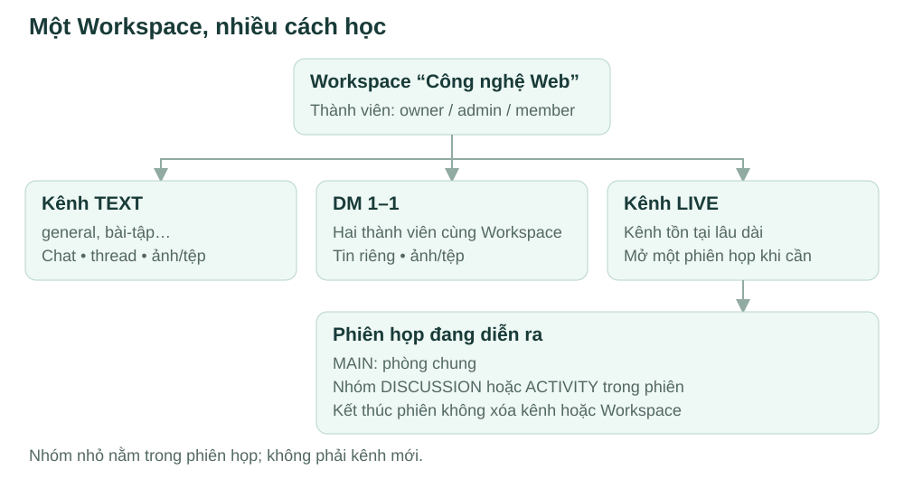
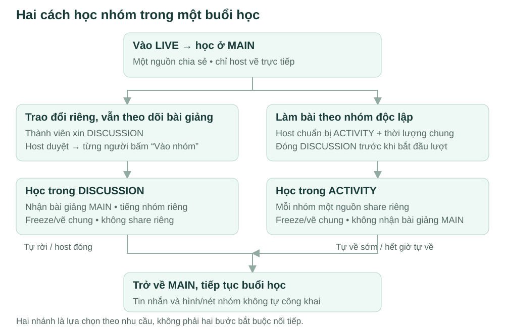
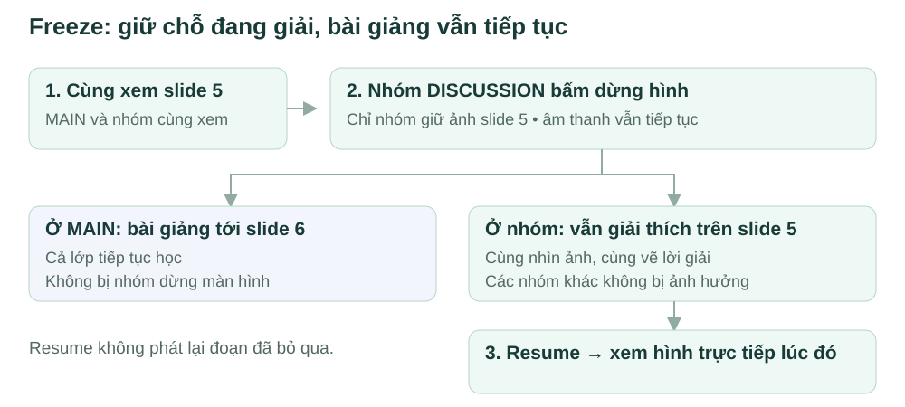
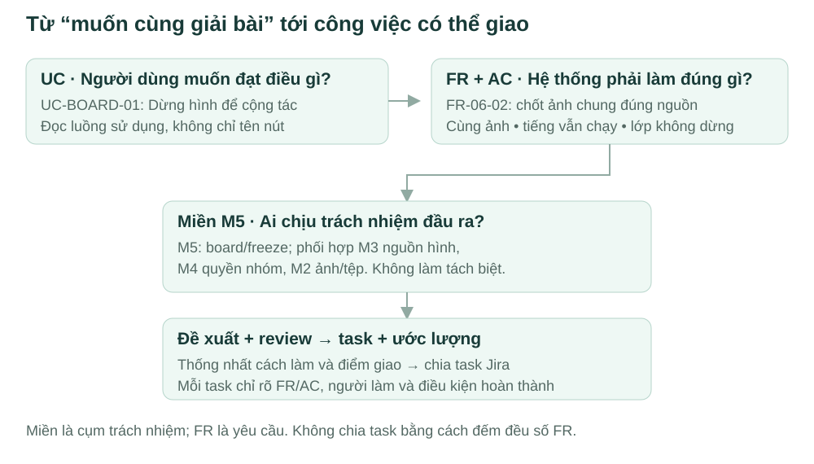

# Bắt đầu cùng CoLearnia

**Dành cho:** thành viên mới tham gia team · **Cập nhật:** 02/11/2026.

CoLearnia giúp lớp hoặc nhóm học **trao đổi lâu dài, gọi trực tuyến và cùng giải bài trong nhóm nhỏ ngay trong buổi học**. Tài liệu này giới thiệu sản phẩm, cách chia việc và những bước cần chuẩn bị để tham gia phát triển.

**Cách đọc:** mục 1–4 giúp hiểu sản phẩm; mục 5–7 giúp nhận việc và tìm nguồn chi tiết. Các sơ đồ mô tả nghiệp vụ cần xây dựng, chưa phải chức năng đã hoàn thành. Figma đang được phát triển; bạn có thể hiểu dự án và chuẩn bị proposal từ tài liệu này mà chưa cần xem Figma.

### Dự án đang ở giai đoạn nào?

- **Đã có:** tài liệu nghiệp vụ, sơ đồ mục tiêu sử dụng (UC) và thiết kế dữ liệu; bộ khung mã nguồn web/server, phần khai báo dữ liệu giao tiếp dùng chung, cấu hình môi trường chạy trên máy cá nhân (local) và các lệnh kiểm tra.
- **Chưa hoàn thành:** các luồng sản phẩm xuyên suốt như chat, gọi và học nhóm. Phần chạy local hiện phục vụ kiểm tra nền ứng dụng và trạng thái thành phần; chưa có bản sản phẩm hoàn chỉnh để trải nghiệm các luồng trong bài.
- **Việc team đang chuẩn bị:** thống nhất miền phụ trách, đọc yêu cầu, viết đề xuất triển khai (proposal), review các phần giao nhau rồi chia task và ước lượng. Figma chưa hoàn thiện không cản việc nghiên cứu này; luồng giao diện liên quan vẫn cần được xem xét trước khi viết phần code phụ thuộc.

Đây là hiện trạng ngày 02/11/2026. Khi có luồng chạy được, cập nhật phần này cùng hướng dẫn thử tương ứng.

## 1. Vì sao có CoLearnia?

Trong lớp học trực tuyến, ba bạn có thể chưa hiểu một phần trong khi bài giảng vẫn tiếp tục. Các bạn muốn trao đổi riêng, giữ lại hình đang học và vẽ giải thích cho nhau. Có lúc giáo viên lại muốn cả lớp chia nhóm làm bài độc lập.

**Host** là người điều hành phiên họp. CoLearnia hỗ trợ hai nhu cầu đó:

- **DISCUSSION — nhóm trao đổi:** thành viên tạo nhóm khi hợp lệ, không chờ host, vẫn theo dõi bài giảng chung nhưng trao đổi/vẽ riêng.
- **ACTIVITY — nhóm hoạt động:** host tổ chức một lượt làm việc độc lập có thời lượng chung, mỗi nhóm được chia sẻ màn hình riêng.

Người bắt đầu phiên là host và có thể chuyển quyền trực tiếp cho người khác. Nhóm bạn cũng có thể gọi bình thường, chỉ dùng công cụ điều hành khi cần; không phải bật một “chế độ lớp học” riêng.

## 2. Sản phẩm được tổ chức như thế nào?

**Workspace** là không gian lâu dài của một lớp hoặc nhóm học, chứa thành viên và các **kênh**. Mỗi kênh là nơi trao đổi bằng tin nhắn hoặc nơi mở cuộc gọi, tùy loại. **Phiên họp** là một lần gọi diễn ra trong kênh, có lúc bắt đầu và kết thúc.

_Workspace và kênh tồn tại lâu dài. Một phiên họp diễn ra trong kênh LIVE; kết thúc phiên không xóa Workspace/kênh._

- **TEXT:** kênh nhắn tin bằng văn bản/ảnh/tệp. Workspace mới có sẵn `general` — kênh trao đổi chung mặc định; chủ Workspace (owner) hoặc quản trị viên (admin) tạo thêm kênh.
- **DM:** tin nhắn riêng 1–1 giữa hai thành viên cùng Workspace.
- **Thread:** chuỗi trả lời một cấp gắn với một tin gốc trong TEXT, giúp thảo luận không làm trôi dòng chat chính.
- **LIVE:** kênh để bắt đầu/tham gia cuộc gọi. **MAIN** là phòng chung trong phiên, DISCUSSION/ACTIVITY là nhóm bên trong phiên đó, không phải kênh mới.

Tên “Công nghệ Web”, “bài-tập” trên hình là ví dụ. Hai loại nhóm DISCUSSION và ACTIVITY không hoạt động đồng thời.

## 3. Một buổi học diễn ra như thế nào?

Đầu tiên: đăng nhập → tạo hoặc nhận lời mời vào Workspace → trao đổi trong TEXT/DM → mở LIVE, kiểm tra thiết bị và vào MAIN.

Trong phần này, **share** là chia sẻ màn hình; **nguồn share** là hình và âm thanh được gửi từ lần chia sẻ đó nếu có. **Board** là phần hình và nét vẽ dùng chung để giải thích trên nội dung chia sẻ. **Freeze** giữ một khung hình cho nhóm cùng vẽ; **resume** đưa nhóm trở lại hình trực tiếp hiện tại. Mục 4 minh họa cụ thể hai thao tác này. **Member** là thành viên thông thường.

_Đây là sơ đồ giải thích luồng chính. Sơ đồ hoạt động (Activity Diagram) và các bản vẽ theo ký pháp UML được dẫn ở mục 6 để đọc sâu hơn. Không bắt buộc đi qua cả hai loại nhóm._

| Cần phân biệt | MAIN                                                   | DISCUSSION                             | ACTIVITY                                           |
| ------------- | ------------------------------------------------------ | -------------------------------------- | -------------------------------------------------- |
| Mục đích      | Học/trao đổi chung                                     | Trao đổi riêng, vẫn theo dõi bài giảng | Làm bài độc lập theo lượt                          |
| Share         | Một nguồn chung, ai ở MAIN cũng có thể share khi trống | Nhận nguồn MAIN; không share riêng     | Mỗi nhóm một nguồn; member tự share khi trống      |
| Vẽ            | Chỉ host vẽ trực tiếp; không freeze                    | Nhóm freeze/vẽ/resume chung            | Nhóm freeze/vẽ/resume chung                        |
| Về MAIN       | Đã ở MAIN                                              | Thành viên tự rời hoặc host đóng       | Tự về sớm; hết thời lượng chung hệ thống tự đưa về |

**Ba điều cần nhớ trong luồng này:**

- Hệ thống tạo DISCUSSION khi hợp lệ **chưa tự đưa người vào**: từng người được chọn chủ động bấm “Vào nhóm”; người ngoài danh sách không tự vào.
- Trước khi bắt đầu ACTIVITY phải kết thúc DISCUSSION. Trong lượt ACTIVITY không nhận DISCUSSION mới. Hết giờ tự kết thúc lượt, không chờ host; người trở về được tạm tắt mic để tự bật lại. Một người về sớm không kết thúc hoạt động của người khác.
- Trong nhóm có chat riêng và có thể nhắn host. Với DISCUSSION, host trả lời qua chat riêng và tiếp tục hướng dẫn ở phòng chung; với ACTIVITY, host có thể vào hỗ trợ có thông báo, tiếng hỗ trợ chỉ tới nhóm đích. Chat/board nhóm không tự công khai khi về MAIN.

Sau khi trở về có thể tiếp tục học hoặc xin DISCUSSION tiếp. Host chủ động rời khi còn giữ quyền thì kết thúc cuộc họp cho mọi người; muốn cuộc họp tiếp tục, chuyển host trước rồi rời như thành viên.

DISCUSSION được tạo hợp lệ nhưng chưa ai vào vẫn chờ tham gia. Khi còn người trong nhóm, người trong danh sách hợp lệ có thể chủ động vào lại; khi người cuối cùng chủ động rời thì nhóm kết thúc, muốn tạo lại phải tạo nhóm hợp lệ mới. Mất mạng không được coi ngay là chủ động rời. ACTIVITY vẫn kết thúc theo thời lượng chung.

Chi tiết: [group modes](product/group-modes.md), [phiên họp và host](product/live-session.md), [chat/hỗ trợ nhóm](product/groups-media-policy.md).

## 4. Freeze và quyền: những điểm cần phân biệt

### Giữ hình để cùng giải thích

**Freeze** là giữ một khung hình chung để nhóm cùng giải thích; **resume** là trở lại hình trực tiếp hiện tại.

_Nhóm giữ hình, không dừng bài giảng hoặc phát lại video. Âm thanh vẫn tiếp tục; mỗi nhóm có khung hình riêng._

Ví dụ trên dùng nguồn MAIN vì nhóm là DISCUSSION. Với ACTIVITY, thao tác giống vậy nhưng dùng nguồn share của chính nhóm, không nhận bài giảng MAIN mặc định. MAIN không freeze; host có thể vẽ nét thường hoặc nét tự biến mất trực tiếp trên nguồn chung, kể cả người khác đang share. Chi tiết thời gian nét tạm chưa chốt. Xem [board](product/board-collaboration.md).

### Quyền Workspace và host là hai việc khác nhau

| Vai trò / phạm vi | Trách nhiệm                                                                                                  |
| ----------------- | ------------------------------------------------------------------------------------------------------------ |
| Owner Workspace   | Sở hữu Workspace, quản lý thành viên/kênh, cấp hoặc thu vai trò admin; có thể chuyển owner và xóa Workspace. |
| Admin Workspace   | Hỗ trợ quản lý thành viên/kênh trong quyền được phép; không có toàn bộ quyền owner.                          |
| Member Workspace  | Chat, tham gia LIVE, share đúng phòng khi trống, xin DISCUSSION.                                             |
| Host phiên họp    | Điều hành phiên: đóng DISCUSSION, tổ chức ACTIVITY, hỗ trợ, chuyển host/kết thúc phiên.                      |

Một member có thể đồng thời là host; giáo viên phải bắt đầu phiên hoặc được chuyển quyền, hệ thống không tự nhận diện giáo viên. Owner/admin không mặc nhiên được nghe các nhóm hay đọc DM. Host mất mạng quá thời gian chờ có cơ chế thay tạm và hoàn quyền, khác thao tác chủ động kết thúc; xem [nguồn host](product/live-session.md#83-chuyển-host-và-host-mất-mạng).

**PRIVATE** là kênh riêng tư với danh sách người được cấp quyền truy cập, độc lập với loại TEXT/LIVE. Owner/admin quản lý danh sách nhưng muốn đọc nội dung vẫn cần quyền truy cập; DM chỉ hai bên. **Everyone (Mọi người) trong chat họp** là những người ở MAIN hoặc nhóm hiện tại, không phải tất cả nhóm. Chat họp chỉ text/ảnh; chat TEXT/DM có thêm file, thread chỉ có trong TEXT.

### Những phần thuộc và ngoài phạm vi

**Phạm vi hiện tại:** tài khoản; Workspace, kênh và thành viên; chat/DM/thread/tệp; mic/camera/chia sẻ màn hình; nhóm, hỗ trợ, vẽ/freeze và kết nối lại. **Ngoài phạm vi:** quiz/bình chọn, thư viện hoặc xuất bài làm lâu dài, công cụ vẽ nâng cao, freeze cá nhân, đồng hồ riêng từng nhóm. Thời lượng chung ACTIVITY vẫn thuộc phạm vi. Xem [scope](product/scope.md).

## 5. Từ hiểu sản phẩm tới nhận việc

**Miền phụ trách** là nhóm chức năng liên quan mà một người chịu trách nhiệm từ giao diện (FE), xử lý phía server (BE), dữ liệu đến kiểm thử. Ví dụ, phụ trách board gồm cả thao tác vẽ trên trình duyệt và việc kiểm tra quyền, đồng bộ hình/nét giữa các thành viên. Năm miền dưới đây cùng thuộc một ứng dụng; các phần giao nhau cần được thống nhất trước khi triển khai.

| Miền đề xuất | Đầu ra chính                                                                    |
| ------------ | ------------------------------------------------------------------------------- |
| M1           | Tài khoản, Workspace, thành viên và quyền kênh                                  |
| M2           | Hội thoại, tin nhắn, thread, DM và tệp                                          |
| M3           | Giao diện cuộc gọi, mic/camera/chia sẻ màn hình và âm thanh                     |
| M4           | Vòng đời phiên, host, nhóm, hỗ trợ, thời điểm hết lượt và điều phối kết nối lại |
| M5           | Board, freeze và vẽ                                                             |

Team sẽ thống nhất người phụ trách và người review cho từng miền dựa trên độ khó, kinh nghiệm và thời gian thực tế. [Bản chia miền](product/delivery-domains.md) mô tả phạm vi, yêu cầu chức năng (FR) chính và những phần cần phối hợp.

Các thuật ngữ dưới đây xuất hiện trong tài liệu và khi chia task. Lấy chức năng freeze làm ví dụ:

- **UC (Use Case) — mục tiêu sử dụng:** UC-BOARD-01 “Dừng hình để cộng tác” mô tả người dùng muốn làm gì và luồng thực hiện.
- **FR (Functional Requirement) — yêu cầu chức năng:** FR-06-02 yêu cầu hệ thống chốt ảnh chung từ nguồn nhóm được phép nhận.
- **AC (Acceptance Criteria) — tiêu chí chấp nhận:** cả nhóm thấy cùng ảnh, tiếng vẫn chạy, MAIN không dừng; nguồn đổi trước khi chốt không được báo thành công. Đây là căn cứ kiểm tra chức năng đã làm đúng hay chưa.
- **M5:** chịu đầu ra board, phối hợp M3 về nguồn hình, M4 về quyền nhóm, M2 về ảnh/tệp.
- **Proposal — đề xuất triển khai:** người phụ trách trình bày cách làm, thỏa thuận dữ liệu/hành vi giao tiếp (**contract**), phụ thuộc, công việc cụ thể (**task**), công sức dự kiến (**effort**) và rủi ro. Các bên review phần giao nhau rồi chốt task và ước lượng. Ví dụ này chưa phải task đã giao.

_Đọc miền để biết mình chịu phần nào; đọc FR/AC để biết phải làm được gì; đọc UC để hiểu luồng sử dụng._

Một miền có nhiều FR; một UC có thể liên quan nhiều FR. Khi chia task, xác định kết quả vừa đủ để thực hiện và review, không tạo máy móc một task cho mỗi FR. Dùng mẫu proposal mentor gửi khi có. Việc ghép các phần và trình diễn luồng sử dụng (demo) bắt đầu sớm; người phụ trách phải hiểu và kiểm tra phần code do AI hỗ trợ.

**Công cụ đã chọn:** Jira quản lý task, phụ thuộc và sprint — một đợt làm việc có mục tiêu cùng nhóm công việc đã thống nhất. GitHub lưu mã nguồn, tài liệu và PR (Pull Request) — đề nghị đưa thay đổi vào nhánh đích để người khác kiểm tra, góp ý (review) trước khi gộp. Không tạo hai bản trạng thái cho cùng task. Bộ hướng dẫn và kiểm tra hỗ trợ làm việc với AI (harness) còn ghi GitHub Issues/Projects cần đồng bộ sang Jira trước khi tạo task; đây là các công cụ theo dõi việc trước đây, không phải nơi nhập thêm task Jira. Khung 6–7 tuần cần ước lượng (estimate) và giờ thực tế để chốt lịch; các mốc 4 tuần trong plan là mục tiêu tham khảo.

## 6. Đọc gì, vào lúc nào?

**Không cần đọc cả kho tài liệu ngay từ đầu.** Đi theo việc mình đang chuẩn bị làm:

1. **Trước buổi giới thiệu:** đọc mục 1–4 và các sơ đồ trong trang này. Mục tiêu: kể lại luồng học, phân biệt hai loại nhóm và ghi câu hỏi nghiệp vụ. Chưa cần xem Figma hoặc đọc toàn bộ tài liệu kỹ thuật.
2. **Khi team chọn người phụ trách:** đọc bảng tổng hợp rồi phần chi tiết miền mình quan tâm trong [5 miền](product/delivery-domains.md). Mục tiêu: hiểu đầu ra/điểm giao, trao đổi kỹ năng và giờ làm trước khi nhận.
3. **Đã nhận miền, chuẩn bị proposal:** lấy mã FR từ bảng M1–M5, tìm đúng dòng ở [FR/AC](product/functional-requirements.md), theo link UC/product của dòng đó. Mục tiêu: biết phạm vi, AC phải đạt, câu hỏi và người cần phối hợp; chưa cần đọc hết 56 FR.
4. **Đề xuất thiết kế và estimate:** đọc [technical plan](technical-plan.md), [architecture](architecture.md), [decision status](decision-status.md); tra [DB](database/model.md) và [contracts](contracts/README.md) theo phần liên quan. Mục tiêu: proposal và task sơ bộ phù hợp nền chung, đủ để review điểm giao trước code phụ thuộc.
5. **Task đã rõ, bắt đầu code:** theo [hướng dẫn chạy local](runbooks/local-development.md), [quy ước đóng góp](../CONTRIBUTING.md), [cách làm việc với AI](ai/workflow.md) và [mẫu mô tả task](ai/task-template.md); agent đọc [AGENTS.md](../AGENTS.md). Mục tiêu: chạy môi trường, triển khai đúng task, kiểm AC và mở PR có kết quả kiểm tra thực tế.

### Chuẩn bị để bắt đầu đóng góp

- Kiểm tra mình truy cập được repository và Jira của team; báo người phụ trách dự án nếu thiếu quyền.
- Chạy web/server theo hướng dẫn local và kiểm tra trạng thái các thành phần. Ghi lại bước lỗi cùng thông báo cụ thể nếu chưa chạy được; không cần tự xử lý mọi vấn đề trước khi hỏi.
- Khi có task đầu tiên đã thống nhất, cùng người review làm rõ FR/AC, phạm vi và cách kiểm tra trước khi code. Với PR đầu tiên, nhờ người review hướng dẫn quy trình nếu chưa quen.

**Hỏi ai khi chưa rõ?** Câu hỏi về nghiệp vụ/phạm vi cần trao đổi với người phụ trách dự án; câu hỏi kỹ thuật trong miền trao đổi với người phụ trách và người review miền đó. Khi có phụ thuộc giữa hai miền, cả hai bên cùng thống nhất contract. Ghi câu hỏi hoặc vướng mắc đang cản tiến độ (blocker) vào task Jira liên quan để người khác theo dõi được; không cần chờ tới buổi họp mới báo.

Tên người phụ trách và reviewer sẽ được thống nhất trong buổi phân công. Phần này chưa tự gán người hoặc đặt thêm lịch họp cho team.

### Sơ đồ và đặc tả để xem sâu hơn

**UC** trả lời ai dùng chức năng nào; **Activity** nối thành luồng hoạt động; **Figma** mô phỏng màn hình/thao tác. Astah và ảnh UC là bản mới nhất theo xác nhận của người phụ trách. Các hình giải thích trong trang này không thay mô hình UML hoặc tạo thêm UC mới.

| Khi cần hiểu kỹ                         | Mở trực tiếp                                                                                                                            |
| --------------------------------------- | --------------------------------------------------------------------------------------------------------------------------------------- |
| Toàn bộ nhóm chức năng / luồng tổng thể | [UC tổng quan](product/diagrams/use-case-overview.png), [Activity đầy đủ](product/diagrams/activity-overview.png)                       |
| Workspace, lời mời, thành viên, kênh    | [UC tổ chức không gian học tập](product/diagrams/use-case-workspace-organization.png)                                                   |
| Chat, DM, thread                        | [UC trao đổi trong Workspace](product/diagrams/use-case-workspace-messaging.png)                                                        |
| Cuộc gọi, share, board                  | [UC tham gia cuộc họp](product/diagrams/use-case-meeting.png)                                                                           |
| Xin/vào/rời nhóm và điều hành nhóm      | [UC tham gia nhóm](product/diagrams/use-case-group-participation.png), [UC điều hành nhóm](product/diagrams/use-case-group-control.png) |
| Luồng và nhánh lỗi                      | [Danh mục UC](product/use-case-catalog.md), [6 hồ sơ trọng tâm](product/use-cases/README.md)                                            |
| Chỉnh mô hình / tra nguồn khác          | [File Astah](product/diagrams/CoLearnia-use-cases.asta), [mục lục sơ đồ](product/diagrams/README.md), [mục lục tài liệu](README.md)     |

Chỉ xem ảnh thì không cần cài Astah. Hình và nội dung bổ sung cho nhau; quy tắc chi tiết vẫn ở nguồn nghiệp vụ được dẫn. [Nguồn các hình onboarding](assets/onboarding/README.md) ghi cách duy trì các sơ đồ giải thích.

## 7. Nền kỹ thuật và tự kiểm tra

Repository (kho mã nguồn) có scaffold — bộ khung ban đầu cho web/server và phần khai báo dữ liệu giao tiếp dùng chung. MongoDB là cơ sở dữ liệu, chạy local (trên máy cá nhân) bằng Docker. Harness là bộ chỉ dẫn và kiểm tra hỗ trợ làm việc với AI trong dự án. Các công nghệ chính: React/TypeScript/Vite ở web; Express/Socket.IO/Mongoose/mediasoup ở server; Zod khai báo và kiểm tra cấu trúc dữ liệu giao tiếp. Chưa cần nắm hết các thư viện này để hiểu sản phẩm; khi bắt đầu phát triển, làm theo hướng dẫn local.

Thiết kế và bộ khung hiện có **chưa chứng minh các luồng sản phẩm đã chạy đầy đủ**. Phần truyền âm thanh/hình ảnh (media) cần PoC — thử nghiệm nhỏ để kiểm chứng cách triển khai — với 5 người qua mạng thực, gồm cả TURN (máy chủ chuyển tiếp khi không kết nối trực tiếp được). Sau đó mới thử 25 rồi 50 người nếu đạt [điều kiện sức chứa](capacity.md), chưa cam kết các mức này. Thiết kế cơ sở dữ liệu (DB) cũng cần triển khai/kiểm thử thực tế.

Trước buổi giới thiệu, thử tự trả lời:

1. DISCUSSION và ACTIVITY phục vụ hai nhu cầu gì? Ai tạo/đóng nhóm, có được share riêng không?
2. Nhóm giữ slide 5 trong khi lớp tới slide 6 thì chuyện gì xảy ra? Resume xem gì?
3. Owner/admin khác host thế nào? Ai có quyền tạo kênh và vẽ tại MAIN?
4. ACTIVITY hết giờ ai đưa người về MAIN? Một người về sớm có kết thúc nhóm không?
5. Nhận M5 nghĩa là nhận một màn hình hay một kết quả xuyên FE/BE? Dùng FR/AC để chuẩn bị proposal thế nào?

Chưa trả lời được thì ghi câu hỏi để cùng làm rõ. Sau buổi khởi động, mỗi người cần biết miền mình phụ trách, người review, những phần cần phối hợp và nội dung phải chuẩn bị cho proposal. Giờ làm và lịch sẽ chốt theo ước lượng; nhãn M1–M5 hoặc A–E trong plan chưa phải phân công người thật.

## 8. Figma đang phát triển — tham khảo tùy chọn

**Prototype** là bản mẫu mô phỏng giao diện và thao tác, chưa phải ứng dụng kết nối đầy đủ với xử lý và dữ liệu thật. **UI** là giao diện người dùng; **demo** là buổi hoặc phần trình diễn một luồng sử dụng.

[Mở prototype CoLearnia trên Figma Make](https://www.figma.com/make/4ATlhcdwYqUYUlcRgB9jCn/D%E1%BB%B1ng-Workspace-v%C3%A0-Chat-CoLearnia). Hướng giao diện đang theo cấu trúc Workspace của Slack, bố cục họp của Google Meet và cách trình bày tiết chế của Linear.

Prototype chưa hoàn thiện và chưa được xác nhận khớp toàn bộ nghiệp vụ. Bạn có thể xem phần đã có để hình dung giao diện; không cần chờ Figma hoàn chỉnh mới nhận miền hoặc nghiên cứu proposal. Khi làm phần UI phụ thuộc một luồng cụ thể, người phụ trách cần review luồng đó cùng team trước khi triển khai. Nếu prototype khác tài liệu nghiệp vụ, ghi lại điểm khác biệt để thống nhất, không tự lấy giao diện làm quyết định thay thế.

Khi các luồng được hoàn thiện và review, phần này sẽ bổ sung hướng dẫn demo tương ứng. Yêu cầu UI hiện hành ở [brief Figma](ui/figma-make-brief.md). Tài liệu onboarding không giữ các screenshot cũ để tránh người mới nhầm chúng với giao diện đã chốt.

### Cơ sở biên soạn

Cách tổ chức trang này tham khảo [Diátaxis](https://diataxis.fr/start-here/) về phân biệt giải thích và tra cứu; [Google](https://developers.google.com/style/images) về dùng hình đúng mục đích; [GitLab](https://about.gitlab.com/blog/quickly-onboarding-engineers-successfully/) về hỗ trợ thành viên bắt đầu đóng góp; [Atlassian Engineering Handbook](https://www.atlassian.com/blog/how-we-build/handbook) về giải thích quy trình, lý do và cách áp dụng. Đây là nguồn tham khảo cho cách viết, không phải quy định bắt buộc hoặc nguồn nghiệp vụ của CoLearnia.

## Cập nhật sau kickoff 02/11

DISCUSSION không chờ host: thành viên chọn Tạo nhóm trao đổi, hệ thống kiểm hợp lệ rồi cho người trong danh sách chủ động vào. Host vẫn đóng được nhóm. ACTIVITY thêm chia ngẫu nhiên, host xem/chỉnh trước khi bắt đầu; thời lượng và isolation giữ nguyên.

Host có ghi hình MAIN gồm màn hình, camera và âm thanh; mọi người biết đang ghi. Video theo phiên để thành viên còn quyền kênh xem lại, không ghi nhóm riêng. Demo dự kiến clip vài phút; pipeline/lưu trữ chưa triển khai, Figma/ảnh minh họa có thể còn bước duyệt cũ. [Recording](product/recording.md).
