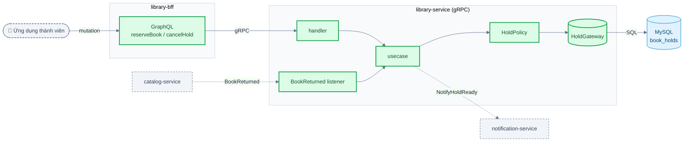
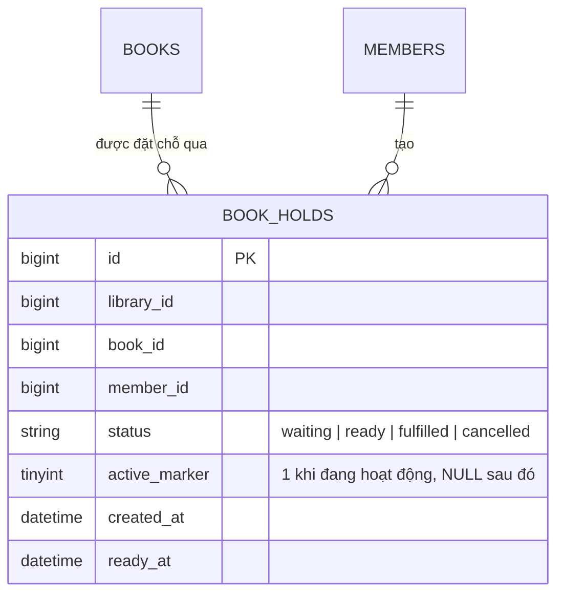
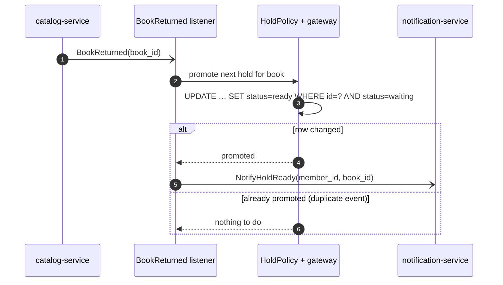

# Đặt chỗ cho sách đang được mượn (hàng đợi đặt chỗ) — LIB-1234

> Proposal mẫu được viết theo `skills/templates/proposal-feature.md` cho một hệ thống quản lý sách giả định.
> Tên, số liệu và ước lượng đều là giả định; hãy tham khảo cấu trúc, không sao chép nội dung.

Status: Bản nháp Author: A. Nguyen Size: L

> **TL;DR** — Thành viên có thể đặt chỗ cho một đầu sách khi tất cả bản sách đều đang được mượn. Người đầu hàng đợi được tự động chuyển sang trạng thái có thể nhận sách khi một bản sách được trả lại.
> Bổ sung một bảng, một cặp phương thức gRPC (reserve / cancel) và một listener cho event “trả sách” hiện có.
> Size L (schema + API + BFF), khoảng 10 ngày công (8–15). Việc hết hạn các lượt đặt chỗ chưa đến nhận sẽ được làm sau.

## 1. Context

Hiện tại, khi một đầu sách đã được mượn hết, thành viên chỉ có thể quay lại kiểm tra sau. Thủ thư ghi danh sách người yêu cầu trước trên giấy,
nhưng các danh sách này không khớp với hệ thống. Ticket (LIB-1234) yêu cầu hệ thống tự quản lý việc đặt chỗ.

Hiện trạng: `catalog-service` quản lý các bản sách của từng đầu sách và phát event `BookReturned` khi một bản sách được trả.
`member-service` trả lời câu hỏi “người này có vai trò gì trong thư viện này”. Hiện chưa có khái niệm đặt chỗ trong hệ thống.
Tài liệu liên quan: `docs/loans.md` (vòng đời mượn sách), `docs/permissions.md` (vai trò theo từng thư viện).

## 2. Objective

Cho phép thành viên vào hàng đợi của một đầu sách không còn bản sách trống, và dành bản sách được trả lại cho người đầu hàng đợi.

## 3. Goals / Non-goals

**Goals**

- G1: Thành viên có thể đặt chỗ cho đầu sách không còn bản sách khả dụng; kết quả trả về vị trí của họ trong hàng đợi.
- G2: Mỗi thành viên được có tối đa 5 lượt đặt chỗ đang hoạt động; lượt thứ 6 bị từ chối với `FailedPrecondition`.
- G3: Từ chối đặt chỗ nếu đầu sách còn bản sách trống (thành viên nên mượn trực tiếp), và từ chối đặt chỗ trùng lặp.
- G4: Khi một bản sách được trả, lượt đặt chỗ đang chờ đầu tiên chuyển sang `ready` và thành viên được thông báo một lần, kể cả khi event được nhận hai lần.
- G5: Thành viên có thể hủy lượt đặt chỗ của mình; thủ thư có thể hủy lượt đặt chỗ của bất kỳ ai trong thư viện mình.
- G6: Thành viên không bao giờ được xem hoặc hủy lượt đặt chỗ của thành viên khác.

**Non-goals**

- Cho lượt đặt chỗ `ready` hết hạn sau N ngày (làm sau, LIB-1250).
- Thiết kế nội dung email hoặc thông báo đẩy (chỉ phát yêu cầu gửi thông báo).
- Đặt chỗ cho sách điện tử, vì loại sách này không giới hạn số bản.

## 4. Open questions & assumptions

| #   | Question / assumption                                                                | Why it matters                                                 | Owner                | Needed by            | Status                                                                 |
| --- | ------------------------------------------------------------------------------------ | -------------------------------------------------------------- | -------------------- | -------------------- | ---------------------------------------------------------------------- |
| 1   | `BookReturned` có thể được gửi đến nhiều lần                                         | Quyết định cách chuyển trạng thái có tính idempotent ở mục 6.2 | Dana (catalog)       | Trước T6             | Đã trả lời: at-least-once, xem `docs/events.md`                        |
| 2   | Giới hạn 5 lượt đặt chỗ mỗi thành viên là phù hợp                                    | Trở thành quy tắc sản phẩm mà người dùng thấy được             | Priya (PM)           | Buổi review thiết kế | Chưa chốt. Nếu giới hạn là 10 thì chỉ cần đổi một hằng số              |
| 3   | Thủ thư đã có vai trò “quản lý mượn sách” để dùng lại                                | Sai vai trò sẽ dẫn đến thiếu hoặc thừa quyền                   | Sam (member-service) | Trước T4             | CHƯA XÁC MINH, kiểm tra bằng `reverse-engineer.md`                     |
| 4   | Hàng đợi theo nguyên tắc “yêu cầu trước được phục vụ trước”, không ưu tiên nhân viên | Ảnh hưởng đến key sắp xếp                                      | Priya                | Buổi review thiết kế | Chưa chốt. Nếu có ưu tiên thì cần thêm một cột và một tiêu chí sắp xếp |

## 5. High-level design

Bổ sung bảng `book_holds` và domain service `HoldPolicy` để quyết định yêu cầu đặt chỗ có được phép hay không và ai là người tiếp theo trong hàng đợi.
Reserve và cancel là các lời gọi gRPC đồng bộ vì thành viên cần nhận kết quả ngay. Việc chuyển lượt đặt chỗ sang trạng thái sẵn sàng chạy trong event
listener hiện có, vì thao tác này phản ứng với việc trả sách và có thể mất thời gian. Mọi thông tin đều được lưu lại, nên không request nào gọi một service khác hai lần.

Màu xanh lá = phần mới, viền nét đứt màu xám = thành phần bên ngoài.

- **Entrypoint and why:** gRPC cho reserve/cancel (bên gọi chờ kết quả); event listener cho việc chuyển trạng thái sẵn sàng (phản ứng khi sách được trả, có thể retry). Không dùng polling.
- **Components touched:**
  - handler: thêm `ReserveBook`, `CancelHold`, `ListMyHolds`
  - usecase: thêm mới, điều phối policy + gateway + một transaction
  - domain service: thêm `HoldPolicy` (quy tắc thuần, không cần mock)
  - gateway: thêm `HoldGateway` (tách query và command)
  - infra: thêm implementation MySQL; phần phát thông báo dùng lại publisher hiện có
- **Alternatives considered:**
  - _Lưu hàng đợi trong bảng `loans` hiện có._ Không chọn: lượt đặt chỗ có vòng đời khác (waiting, ready, cancelled), khiến mọi truy vấn mượn sách đều phải lọc bỏ chúng.
  - _Job chạy hằng đêm để phân bổ các bản sách được trả._ Không chọn: thành viên có thể phải chờ đến một ngày để nhận bản sách đã có sẵn trên kệ.

## 6. Detailed design

### 6.1 Database

Thêm một bảng. Không cần soft delete vì lịch sử được giữ trong `status`.

Indexes:

- unique `(book_id, member_id, active_marker)`: ngăn thành viên đặt chỗ cùng một đầu sách hai lần. MySQL cho phép nhiều giá trị `NULL`, nên các lượt đặt chỗ đã kết thúc không xung đột với nhau.
- `(book_id, status, created_at, id)`: tìm lượt đặt chỗ đang chờ tiếp theo theo đúng thứ tự.
- `(member_id, status)`: đếm và liệt kê các lượt đặt chỗ đang hoạt động của thành viên.

Backfill: `N/A — bảng mới, chưa có dữ liệu. Không nhập các danh sách trên giấy.`

### 6.2 API

Thay đổi contract được đưa vào `library-apis` trước, sau đó cập nhật phiên bản tham chiếu tại đây. Tất cả thay đổi đều chỉ bổ sung.

| Method        | Request                                        | Response                                   | Errors                                                                                                                |
| ------------- | ---------------------------------------------- | ------------------------------------------ | --------------------------------------------------------------------------------------------------------------------- |
| `ReserveBook` | `book_id`                                      | `hold_id`, `position`                      | `FailedPrecondition` (còn bản sách trống, hoặc đã có 5 lượt đặt chỗ), `AlreadyExists`, `PermissionDenied`, `NotFound` |
| `CancelHold`  | `hold_id`                                      | rỗng                                       | `PermissionDenied`, `NotFound`                                                                                        |
| `ListMyHolds` | `status` không bắt buộc, kích thước trang ≤ 20 | các lượt đặt chỗ kèm vị trí trong hàng đợi | `PermissionDenied`                                                                                                    |

**Permissions.** `ReserveBook` và `ListMyHolds` yêu cầu thư viện đã bật feature `holds` (feature layer) và người gọi có một vai trò thành viên bất kỳ (role layer).
`CancelHold` có cùng yêu cầu, đồng thời người gọi phải là chủ lượt đặt chỗ hoặc có vai trò thủ thư. Khi từ chối, trả về `PermissionDenied` mà không tiết lộ lượt đặt chỗ có tồn tại hay không.
Quyền truy cập `hold_id` luôn được kiểm tra theo người gọi, không tin tưởng dữ liệu trong request.

**Idempotency and order.** Bước chuyển sang sẵn sàng dùng conditional update, nên event trùng lặp không làm thay đổi dữ liệu và không gửi thông báo lần hai.
Bước đặt chỗ khóa dòng dữ liệu của thành viên, đếm số lượt đặt chỗ đang hoạt động rồi insert, tất cả trong một transaction, để hai request đồng thời không vượt qua giới hạn 5 lượt.
Thứ tự hàng đợi là `created_at, id`, bảo đảm ổn định ngay cả khi hai lượt đặt chỗ có cùng timestamp.

**Limits.** Kích thước trang danh sách ≤ 20. Một lần đặt chỗ thực hiện 1 query đếm, 1 insert và 1 lần đọc để lấy vị trí. Không gọi ra bên ngoài trên đường xử lý request.

### 6.3 Rollout, flag & observability

Flag `holds_enabled` mặc định tắt, được đánh giá trong handler theo từng thư viện. Phía sản phẩm bật flag cho từng thư viện sau khi self-test đạt;
flag được gỡ bỏ sau một bản phát hành kể từ khi tất cả thư viện đã được bật.
Logs: một dòng cho mỗi lần reserve, cancel và chuyển sang sẵn sàng, có `book_id` và `hold_id` (không ghi tên thành viên). Metrics: số lượt đặt chỗ được tạo, số lần chuyển sang sẵn sàng, số lần không cần chuyển trạng thái (do trùng lặp),
và số lần phát thông báo thất bại. Cảnh báo nếu có hơn 5 lần phát thông báo thất bại trong 10 phút.
Rollback: tắt flag. Giữ nguyên bảng; không có thành phần nào đọc bảng khi flag tắt. Nếu cần bỏ cả schema, chỉ drop bảng sau khi xác nhận bảng không còn được sử dụng.

### 6.4 Test strategy

- **Unit (`HoldPolicy`)**: còn bản sách trống → từ chối (G3); đã có 5 lượt đặt chỗ đang hoạt động → từ chối (G2); đặt chỗ trùng → từ chối (G3); chọn người tiếp theo theo `created_at, id` (G4).
- **Datastore**: unique key từ chối lượt đặt chỗ đang hoạt động thứ hai; lượt đặt chỗ đã kết thúc cho phép thành viên đặt lại; conditional update chuyển trạng thái một dòng.
- **Integration**: đặt chỗ → trả sách → chuyển sang sẵn sàng → yêu cầu gửi thông báo (G1, G4); cùng một event được nhận hai lần → chỉ một thông báo (G4); thành viên A hủy lượt đặt chỗ của thành viên B → `PermissionDenied` (G6); thủ thư hủy → thành công (G5).
- **BFF**: resolver ánh xạ từng error code sang thông báo rõ ràng.
- **Self-test (success / empty / error)**: đặt chỗ cho sách đang được mượn; liệt kê khi chưa có lượt đặt chỗ; đặt chỗ lần thứ 6.

## 7. Impact on other services

| Service / consumer           | Change needed                                                 | Breaking? | Order                                         | Owner           |
| ---------------------------- | ------------------------------------------------------------- | --------- | --------------------------------------------- | --------------- |
| library-bff                  | Thêm mutations và một query                                   | Không     | Sau khi service được deploy                   | A. Nguyen       |
| catalog-service              | Không — chỉ phát event đang có sẵn                            | Không     | —                                             | Dana            |
| member-service (permissions) | Có thể cần feature key `holds`; xác nhận vai trò thủ thư (Q3) | Không     | Trước khi bật flag của service                | Sam             |
| notification-service         | Tiếp nhận `NotifyHoldReady`                                   | Không     | Trước lần chuyển trạng thái sẵn sàng đầu tiên | Lee             |
| web / mobile clients         | Nút đặt chỗ và màn hình “Lượt đặt chỗ của tôi”                | Không     | Sau BFF                                       | Các team client |
| library-apis                 | Thêm messages và methods                                      | Không     | Làm đầu tiên, chặn toàn bộ phần còn lại       | A. Nguyen       |

## 8. Design evaluation

### 8.1 Effort

Size L theo tiêu chí phân loại: thêm bảng, thêm API, thay đổi BFF và liên quan đến hai team khác (notification, member). Các layer: handler, usecase, domain service,
gateway, infra, listener, BFF. Không thêm dependency mới. Đã cân nhắc tách reserve/cancel khỏi phần chuyển sang sẵn sàng, nhưng một lượt đặt chỗ không bao giờ được chuyển sang sẵn sàng thì không có giá trị, nên các phần này được phát hành cùng nhau; phần được cắt là xử lý hết hạn.

### 8.2 Risk

| Risk                                                                                                      | Likelihood | Impact | Level      | Mitigation                                                                    |
| --------------------------------------------------------------------------------------------------------- | ---------- | ------ | ---------- | ----------------------------------------------------------------------------- |
| Event trùng lặp làm gửi hai thông báo                                                                     | M          | L      | Thấp       | Conditional update; integration test                                          |
| Thành viên vượt giới hạn qua các request đồng thời                                                        | L          | M      | Thấp       | Khóa dòng trong transaction đặt chỗ                                           |
| Sai vai trò khiến thành viên có thể thực hiện thao tác hủy vốn chỉ dành cho nhân viên                     | L          | H      | Trung bình | Xác minh Q3 trước T4; test các trường hợp từ chối quyền                       |
| Lượt đặt chỗ đã chuyển sang sẵn sàng nhưng thành viên không nhận được thông báo (phát thông báo thất bại) | M          | M      | Trung bình | Metric và cảnh báo lỗi; lượt đặt chỗ vẫn ở `ready` và hiển thị trong ứng dụng |
| Bảng mới làm chậm truy vấn hàng đợi khi danh mục sách lớn                                                 | L          | M      | Thấp       | Index `(book_id, status, created_at, id)`; kiểm tra khi review                |

Không có thay đổi nào ở đây là không thể đảo ngược: bảng được tạo mới và có thể tắt tính năng bằng flag.

## 9. WBS

| ID  | Task                                                                         | Layer / file    | Depends on | Est. (pd) | Serves         |
| --- | ---------------------------------------------------------------------------- | --------------- | ---------- | --------- | -------------- |
| T1  | Thêm messages và methods trong `library-apis`, cập nhật phiên bản tham chiếu | contract        | —          | 0.5       | G1–G6          |
| T2  | Schema và indexes của `book_holds`                                           | database        | —          | 0.5       | G1–G3          |
| T3  | Interface `HoldGateway` + implementation MySQL                               | gateway, infra  | T2         | 1.0       | G1–G6          |
| T4  | `HoldPolicy` và kiểm tra quyền                                               | domain service  | T3         | 1.0       | G2, G3, G5, G6 |
| T5  | Usecases đặt chỗ / hủy / liệt kê                                             | usecase         | T4         | 0.5       | G1–G5          |
| T6  | Handlers, validators, `BookReturned` listener                                | handler         | T1, T5     | 1.0       | G1, G4         |
| T7  | Mutations và query của BFF                                                   | library-bff     | T1, T6     | 0.5       | G1, G5         |
| T8  | Unit + datastore + integration tests (6.4)                                   | tests           | T3–T6      | 2.0       | Tất cả         |
| T9  | Các ca self-test và flag `holds_enabled`                                     | self-test, flag | T6         | 0.5       | Tất cả         |
| T10 | Ghi chú rollout, dashboards, alert                                           | docs            | T9         | 0.5       | —              |

## 10. Estimation

|          | Dev | Test | Review / rollout | Buffer | Total |
| -------- | --- | ---- | ---------------- | ------ | ----- |
| Tốt nhất | 4.5 | 2.0  | 0.5              | 1.0    | 8.0   |
| Dự kiến  | 5.5 | 2.5  | 0.5              | 1.5    | 10.0  |
| Xấu nhất | 7.5 | 3.5  | 1.5              | 2.5    | 15.0  |

Giả định team notification tiếp nhận message mới mà không cần thay đổi schema của họ, và vai trò thủ thư đã tồn tại (Q3).
Nếu Q3 không đúng, cần thêm khoảng 2 ngày để bổ sung vai trò mới. Tỷ lệ giữa cận trên và cận dưới của khoảng ước lượng là 1.9×; trả lời Q3 và Q2 sớm sẽ giúp thu hẹp khoảng này.

## Appendix

Định nghĩa Ridgepole cho `book_holds`, bảng error code đầy đủ và các field của message `NotifyHoldReady` sẽ được đặt tại đây.
