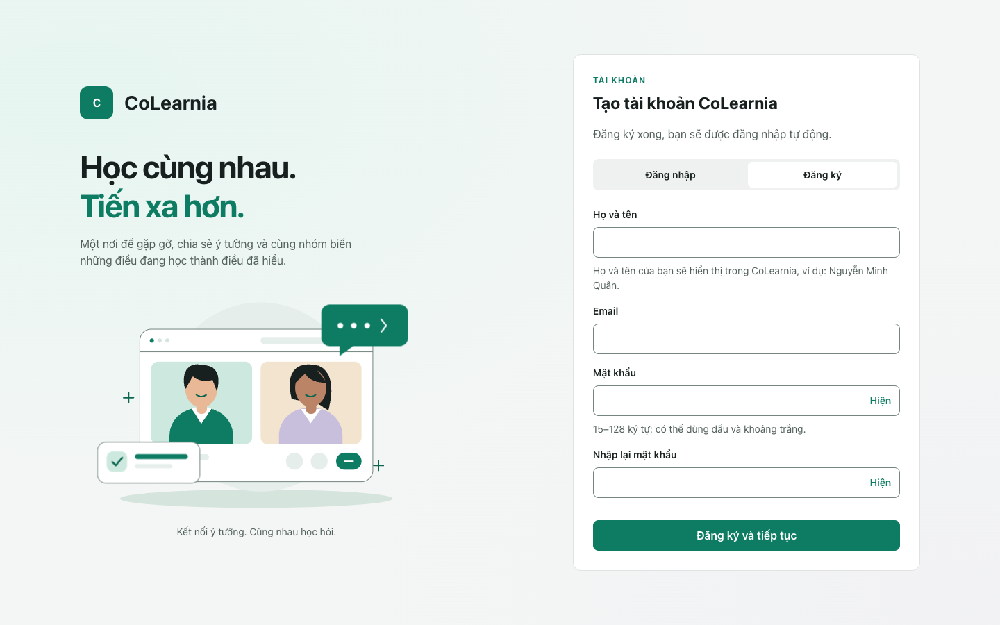
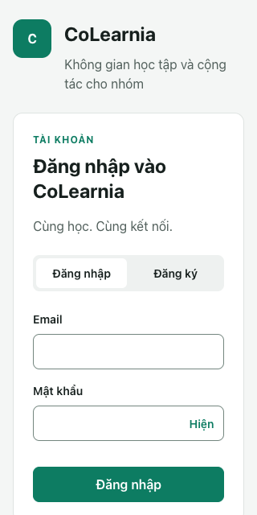

# SCRUM-25 — form auth và khôi phục phiên

Ngày kiểm: 12/11/2026. Node 26.12.1, pnpm 11.5.2, Chrome headless trên macOS arm64. Bản build web chạy qua HTTPS local với chứng chỉ tự ký trong profile Chrome tạm; backend dùng router/registration/login/session reader thật và MongoDB 8.0.16 replica set trong container riêng, không dùng dữ liệu dự án. Chỉ bỏ qua xác minh chứng chỉ trong trình duyệt kiểm thử; cookie sản phẩm vẫn giữ Secure/HttpOnly/SameSite=Lax.

## Phần đã triển khai

- `/login`, `/register`, điểm vào `/` dùng danh tính từ `/auth/me`. Đăng ký tự đăng nhập; reload đọc lại phiên. Lỗi dịch vụ đọc phiên có màn thử lại riêng, không giả thành anonymous.
- Đăng ký có ô nhập lại mật khẩu bắt buộc khớp chính xác; chỉ kiểm frontend, không gửi field này vào API. Hai ô có nút hiện/ẩn độc lập; không chặn dán hoặc password manager. Nhãn tên được thống nhất thành **Họ và tên**, dùng làm tên hiển thị (`displayName`); autocomplete dùng `name`.
- View tham khảo `AuthScreen`/CSS trong `docs/figma-ui`; áp foundations/tokens cho màu, cỡ chữ, field, focus và reflow. Export giữ nguyên. Chưa thêm thư viện form, font asset hoặc bộ UI mới.
- Theo yêu cầu bổ sung thị giác, auth có minh họa SVG học nhóm tự vẽ, nội dung giới thiệu và gradient nhẹ riêng cho trang auth. Không tải ảnh/font ngoài hoặc thêm animation library. Minh họa ẩn khỏi accessibility tree và thu gọn trên mobile; chuyển động chạy hai lượt (tổng 4,8 giây), tắt khi `prefers-reduced-motion: reduce`.
- Query `['auth', 'session']` giữ User/CSRF/expiry trong bộ nhớ. Form giữ input local; không persist credential. Query phiên bị hủy/tạm dừng trong khi gửi form; form bị hủy khi rời route, không áp response cũ.
- API client dùng shared schema, bootstrap CSRF, retry guard CSRF tối đa một lần. Kết quả mutation chưa rõ được đối soát qua `/auth/me`, chỉ nhận thành công khi email khớp; không tự phát lại mutation vì timeout/mất mạng/503.
- Trang sau đăng nhập là điểm ghép cho SCRUM-34, chỉ hiển thị tài khoản thật. `/workspace` vẫn là fixture có nhãn; chưa nối nó thành Workspace của tài khoản.

## Kết quả

| Kiểm                                                               | Kết quả                                                                                                                                                        |
| ------------------------------------------------------------------ | -------------------------------------------------------------------------------------------------------------------------------------------------------------- |
| `pnpm exec vitest run apps/web/src/features/auth/auth-api.test.ts` | 18/18: bootstrap/cookie options, schema, phiên hết hạn, CSRF tối đa một lần, lỗi xác định, Retry-After, read-back, identity khác, hủy request                  |
| `pnpm check`                                                       | Đạt harness, format, lint, typecheck, 751/751 test và build. Lượt sandbox đầu bị EPERM do HTTP tests cần mở cổng local; lượt chạy lại với quyền phù hợp đã đạt |
| Gitleaks 8.30.1, binary kiểm checksum chính thức                   | Không phát hiện leak trong source auth mới và 242 commit ở lịch sử `--all` tại thời điểm kiểm                                                                  |

Luồng nền đã kiểm qua HTTPS + DB riêng và chạy lại trên bản mới nhất có Họ và tên/nhập lại mật khẩu trong lượt review:

1. Submit rỗng: bốn field lỗi, focus tới Họ và tên theo thứ tự form; nhãn và autocomplete `name` khớp quyết định hiện hành.
2. Đăng ký với email/tên có khoảng trắng và mật khẩu Unicode có khoảng trắng: trả danh tính chuẩn hóa, tự đăng nhập; reload khôi phục đúng user.
3. Cookie phiên/CSRF đều Secure, HttpOnly, SameSite=Lax; `document.cookie` rỗng, localStorage/sessionStorage không lưu auth.
4. Xóa cookie phiên, đăng nhập sai: thông báo chung và focus summary; đăng nhập đúng và reload thành công.
5. Cookie giả bị từ chối; đăng ký email trùng báo lỗi đúng. Sau khi đặt phiên hết hạn trong DB tạm, reload quay về đăng nhập. Các ca này gọi guard/router/MongoDB thật.

Browser có mô phỏng lỗi ở transport, dùng cùng app build:

- `/auth/me` trả 503: màn lỗi kiểm phiên; Thử lại phục hồi form khi endpoint trả 401.
- Lần POST đầu bị CSRF_INVALID: bootstrap lại và lần thứ hai qua guard thật, không lặp thêm.
- 429 với Retry-After: countdown và chặn submit trong thời gian chờ.
- POST thật đã commit nhưng mất response: đọc lại phiên thành công, chỉ một POST.
- Submit hai lần cùng lượt; điều hướng khi pending rồi trả success đến muộn: không gửi trùng hoặc áp danh tính cũ lên màn mới.
- Mất phản hồi và chưa có phiên: giữ trạng thái chưa xác nhận, có nút kiểm phiên lại.

Lượt bổ sung xác nhận mật khẩu đã kiểm trên Chrome với Vite cổng riêng và transport giả có nhãn: bốn field bắt buộc; mật khẩu Unicode/khoảng trắng phải khớp nguyên trạng; lỗi focus vào ô xác nhận và không gọi POST; hiện/ẩn từng ô bằng chuột và Enter không submit; payload đăng ký chỉ có email/password/displayName; không tràn ngang ở 320 CSS px. Login không có ô xác nhận và mặc định ẩn mật khẩu. Không có JavaScript exception. Lượt review sau đó đã chạy lại đăng ký/đăng nhập/reload, email trùng, cookie giả và thuộc tính cookie với bản form mới nhất trên backend/MongoDB thật trong DB riêng; tất cả đạt. API client và schema không đổi.

Bố cục nền đã kiểm ở 1440×900, 1280×800, 767/768 px, 640×400 (bề rộng tương đương zoom 200% từ 1280) và 320×640/400. Không tràn ngang; ở viewport thấp có thể cuộn tới submit. Đã kiểm Tab tới navigation và focus lỗi. Không có JavaScript exception ở các lượt browser trên.

Lượt bổ sung minh họa đã chạy lint, typecheck và build web; kiểm lại form trên Chrome với transport giả có nhãn: xác nhận mật khẩu, hiện/ẩn, keyboard Enter, payload không chứa confirmation đều đạt. Không tràn ngang ở 320/768/1024/1280/1440 CSS px; mobile ẩn minh họa, reduced motion không có animation và chuyển động trang trí có đúng hai lượt. Không có JavaScript exception. Delta này không đổi API hoặc logic session; chưa chạy lại toàn bộ backend/MongoDB sau delta thị giác.

Ảnh desktop dưới đây được cập nhật sau lượt bổ sung minh họa, gồm nhãn Họ và tên và ô nhập lại mật khẩu. Ảnh login mobile từ lượt review luồng auth; phần mobile không thêm minh họa.

## Tự thử lại và điểm giao

Dùng backend auth hiện có theo [local runbook](../runbooks/local-development.md#đăng-ký-tài-khoản), DB test riêng đã có index và APP_ORIGIN khớp origin HTTPS. Build web (`pnpm --filter @colearnia/web build`) và phục vụ SPA cùng origin với `/api/v1` qua HTTPS proxy. Thử lần lượt đăng ký → reload, xóa cookie phiên → đăng nhập → reload, input sai/email trùng, sửa cookie rồi reload; kiểm Network/Application mà không chép giá trị cookie vào log/PR.

Màn sau đăng nhập chưa có danh sách/tạo Workspace (SCRUM-34); pending invite sẽ ghép cùng luồng lời mời ở task tương ứng, chưa có autojoin. Logout/thu socket/media thuộc task vòng đời phiên, không được nghiệm thu từ form auth. Chưa kiểm staging, screen reader, Safari/Firefox, thiết bị mobile thật hoặc hai tab đồng thời; ca CSRF đổi proof được kiểm bằng transport test, không thay bằng chứng multi-tab thật. Reflow 640 CSS px không là bằng chứng đã thao tác zoom browser 200%.

Build còn cảnh báo chunk >500 kB; không đổi ngưỡng cảnh báo. Chưa commit/push từ lượt triển khai này.
