# SCRUM-78 — Camera tiles và trạng thái server pause

M3-T5.3 / FR-05-03; reviewer theo kế hoạch: M3. Nhánh `feat/SCRUM-78-camera-server-state`, base `867e72c` ngày 17/11/2026. Nguồn: [Sprint 1](../planning/sprint-1.md), [thiết kế media §6.2.3–4, §6.3.6](../proposals/m3-media.md), [contract hiện hành](../contracts/media-source-sync.md). Prompt tham chiếu `a5fce0a`; implementation dùng schema/code tại checkout hiện tại. Jira trực tiếp yêu cầu đăng nhập, chưa đối chiếu được cập nhật riêng trên ticket.

## Khảo sát dependency và khoảng trống

- Chưa có CameraTile. RoomShell có stage tùy chọn và binding video mượn stream; không có camera projection để React subscribe.
- M3-T5.1 đã có trong SCRUM-71 / PR #120: `DeviceMedia` giữ ý định/lifecycle capture; `createDeviceMediaSocket` dùng `media.producer.create` và `media.producer.close`. Tắt đóng nguồn, không tự bổ sung protocol toggle pause/resume.
- Contract export `MediaSourceDescriptor`, `media.source.changed/ended`, `media.producer.stateChanged` và `media.consumer.closed` đã có. Descriptor chỉ có `PUBLISHING/PAUSED/SWITCHING`; `CLOSED` là event riêng, không tạo enum mới trong UI.
- `MediaSnapshotRuntime` đã ghép snapshot, kiểm audience/sequence, revision/generation, tombstone và đối soát Consumer. Paused-ready và adapter audio đã có; track và tài nguyên thuộc runtime, không thuộc store/UI.
- Trạng thái nút thiết bị không chứng minh server đang publish. Trước task chưa có camera tile dùng toggle/stream để báo active, cũng chưa có state camera bị nhân bản trong UI store.
- Participant roster thuộc projection M4. Task không suy người tham gia từ camera, không thêm pin/viewport, không đổi policy hoặc schema backend.

## Thay đổi và điểm ghép

- Camera projection chỉ đọc từ runtime hiện có, chuyển qua `CallControllerOwner` / `useSyncExternalStore`. `ownProducers` ưu tiên hơn public source cho owner-only pause đến trước public delta.
- Local preview chỉ được liên kết với descriptor từ ACK create bằng `bindCameraPreview`. Association này không tạo source và không tự cấp trạng thái publishing. Khi ghép MAIN, truyền runtime media làm đối số thứ năm của `createDeviceMediaSocket(socket, send, lifetime, preferences, media)`.
- Adapter Consumer video hiện hành có thể truyền `videoTrack` vào `attachConsumer(snapshot, binding, handle)`, sau đó đi `confirmConsumerReady` khi ACK ready hợp lệ. Tile không tạo Consumer/Producer hay join phiên. Chưa thêm một luồng receive/transport khác trong task này.
- Chỉ source `PUBLISHING`, projection còn đồng bộ, đúng binding và Consumer ready/không paused mới cung cấp track cho tile. Local preview cũng cần source owner đã đối soát. UI chờ sự kiện playback của video trước nhãn đang phát/nhận; lỗi, chờ hoặc track kết thúc làm ẩn hình cũ.
- PAUSED/SWITCHING tháo video và hiện placeholder. Ended/CLOSED/revoke bỏ tile; generation và callback cũ không đóng binding mới. Tombstone đối chiếu revision owner hiện hành để source-ended cũ không ẩn camera mới hơn.
- Gap, policy thay đổi hoặc signaling disconnect hạ trạng thái về đang đồng bộ, không tự đóng RTP. Reconnect cần snapshot mới. Đổi audience/thu context dọn nguồn cũ.
- Video luôn muted, playsInline và chỉ chứa một video track. Cleanup tháo `srcObject`/listeners, không stop track mượn và không ảnh hưởng AudioGraph.
- Nhãn người tham gia hiện dùng “Camera người tham gia” / “Camera của bạn”; chưa có display name từ roster được ghép trong RoomShell. Không đưa raw participant/source ID ra UI.

## Môi trường và cách kiểm

Windows; Node `v26.12.1`, pnpm `11.5.2`, React `19.3.1`, Vitest `5.1.0`. `pnpm.exe install --frozen-lockfile --fetch-retries=0` thành công, không sửa lockfile. Lượt đầu registry/TLS lỗi; không tắt kiểm chứng chữ ký, TLS hoặc supply-chain policy. `pnpm.exe doctor` xác nhận Node đúng target; Docker engine không chạy/không khả dụng. Không reset/seed/migration DB.

Fixture trình duyệt: chạy `pnpm --filter @colearnia/web dev --port 5191 --strictPort`, mở `http://127.0.0.1:5191/test/browser/camera-tiles/`. Trang tự chạy assertion và ghi PASS/FAIL. **Event/snapshot server là typed fixture mô phỏng; video track là canvas thật. Không có mediasoup server trong ca UI này.**

## Ma trận state transitions

| Ca                    | State/event                                                             | Kết quả thực                                                           | Bằng chứng                       |
| --------------------- | ----------------------------------------------------------------------- | ---------------------------------------------------------------------- | -------------------------------- |
| Publishing + ready    | Consumer chưa ready → ready → video playing                             | Chờ hình trước ready/frame; chỉ sau playback mới báo nhận hình         | PASS unit + Chrome fixture       |
| Server pause          | PUBLISHING → PAUSED                                                     | Không còn video; `srcObject` cũ bằng null; placeholder pause           | PASS unit + Chrome fixture       |
| Local enabled + pause | Track enabled/live, owner event PAUSED, public descriptor cũ PUBLISHING | Pause ưu tiên, không báo đang phát; track vẫn thuộc call               | PASS unit + Chrome fixture       |
| Resume                | PAUSED → PUBLISHING                                                     | Chờ frame mới, sau đó nhận hình; không tạo thêm Consumer               | PASS unit + Chrome fixture       |
| Switching             | PUBLISHING → SWITCHING → PUBLISHING                                     | Placeholder switching, sau resume vẫn cần readiness                    | PASS unit; Chrome kiểm switching |
| Ended                 | PUBLISHING → source.ended                                               | Bỏ tile, detach binding; participant còn nguyên                        | PASS unit + Chrome fixture       |
| Closed                | Own producer CLOSED                                                     | Bỏ camera dù track cục bộ còn enabled                                  | PASS unit                        |
| Stale/duplicate       | PAUSED revision mới → PUBLISHING revision cũ; event lặp                 | Giữ PAUSED, không nhân tile                                            | PASS unit                        |
| Generation cũ         | B đang active → ended/consumer.closed/callback A đến muộn               | B vẫn active; không đóng Consumer B                                    | PASS unit                        |
| Owner revision mới    | PAUSED revision 3 → ended revision 2                                    | Giữ camera PAUSED revision 3                                           | PASS unit                        |
| Consumer closed       | Đang ready → consumer.closed                                            | Đóng binding tương ứng; source còn nhưng chờ hình                      | PASS unit                        |
| Thu quyền             | ended PERMISSION_REVOKED hoặc updateContext(null)                       | Không giữ track/source trái quyền hoặc hồi từ cache                    | PASS unit                        |
| Mất đồng bộ           | Sequence gap / disconnect / policy / audience / abort                   | Không cung cấp track; reconnect cần snapshot mới                       | PASS unit                        |
| StrictMode/remount    | Mount → unmount → remount RoomShell khi active/paused                   | Một controller, một attachment; không đóng track, không hồi publishing | PASS Chrome fixture              |
| Server media thật     | Pause/resume Producer thực, physical camera, hai mạng/TURN              | Chưa kiểm; không suy từ mock/native smoke                              | NOT TESTED                       |

## Kết quả lệnh

- Regression camera: 22 test; runtime camera + snapshot: 52 test đạt.
- Trước khi cài lại dependency đúng lockfile: 980 test toàn repo đạt trên dependency có sẵn và Node 24; kết quả này chỉ là kiểm bổ sung, không thay cổng runtime chuẩn.
- `pnpm.exe check`: exit 0, harness 54 PASS / 1 skip Windows, format/lint/contracts + web + server typecheck đều đạt, Vitest 981/981 đạt (70 file), build cả ba package đạt. Web build vẫn có cảnh báo bundle trên 500 kB, không đổi ngưỡng cảnh báo.
- `pnpm.exe media:smoke`: exit 0, worker mediasoup và Router Opus/VP8 khởi động thành công. Smoke không chứng minh camera, isolation hoặc TURN.
- Chrome fixture hiển thị PASS cho ready/frame/pause/resume/remount/switching/ended và local enabled + server PAUSED. Đây là kiểm UI với media canvas, không là bằng chứng Producer phía server đã pause.

## Giới hạn và bước sau

SCRUM-88 / M4-T11.1 cần ghép join có xác thực, SEND/RECV, projection/context và lifecycle vào đường LIVE production. Camera tiles tái sử dụng cùng controller, source reconciler và toggle adapter; task này không tự ghép toàn bộ MAIN hoặc thêm orchestration pause backend. Trước gate MAIN cần kiểm native Producer pause/resume và frame remote qua luồng thật, physical camera và hai mạng/TURN. Chưa đánh dấu Jira Done hoặc nghiệm thu gate MAIN.

## Kiểm lại ba góp ý trên PR #122 — 17/11/2026

- Dùng worktree riêng của cùng nhánh để giữ tác vụ SCRUM-81 trong checkout gốc. Dependency cài bằng frozen lockfile từ cache; Node 26.12.1, pnpm 11.5.2, không thay dependency hoặc lockfile.
- Trước sửa, regression mới tái hiện 3 lỗi: hai ca snapshot mới giữ Consumer paused (ready true hoặc false) bị ready ACK cũ ghi đè, và local track disabled vẫn có nhãn đang phát. Ca đối chứng snapshot ready true/paused false vẫn đạt.
- Sau sửa, `confirmConsumerReady` không ghi đè binding đã đối soát bằng snapshot request mới hơn. Giữ nguyên cả `ready` và `paused`; callback cùng snapshot vẫn xác nhận readiness theo luồng cũ.
- Local track chỉ được hiện hình và nhãn đang phát khi còn enabled. Vì browser không phát event khi thuộc tính enabled thay đổi, tile theo dõi frame video để cập nhật tắt/bật của cùng track mà không cần server delta/remount; cleanup hủy frame callback. Server PAUSED vẫn được ưu tiên.
- Token camera trong global.css dùng nền #29302e cho tile/surface, nền nhãn rgb(19 24 23 / 0.75), chữ #d5dcda và vị trí góc trên phải theo export Figma. Giữ nguyên nhãn nghiệp vụ.
- Regression camera có 26 test; camera + snapshot + audio có 58 test đạt. `pnpm.exe check` exit 0: harness 54 PASS/1 skip Windows, format/lint/typecheck và build ba package đạt, 985/985 test trên 70 file đạt. `pnpm.exe media:smoke` exit 0, native worker/Router Opus/VP8 đạt.
- Chrome ở fixture cổng 5193 hiển thị PASS: attach Consumer → snapshot paused mới → ready ACK cũ không hiện video; snapshot resumed mới hiện video; local enabled → disabled → enabled đổi cả visibility và nhãn mà không đổi source; computed styles của tile/placeholder/nhãn khớp màu và vị trí Figma. Các ca pause/resume/ended/StrictMode/remount cũ vẫn đạt. Snapshot/event là fixture, canvas track thật; chưa mở rộng nghiệm thu server media thật.

## Kiểm lại ready ACK sau snapshot pending — 17/11/2026

- Review tại `5244fff` chỉ ra snapshot mới có thể được chụp trước khi server hoàn tất ready. Giữ binding pending mà không yêu cầu đọc lại sẽ làm tile chờ mãi dù ACK đã thành công.
- Trước sửa, hai regression mới đều fail vì chỉ có lần resync khởi tạo, không có yêu cầu resync sau ready ACK. Sau sửa, khi snapshot mới hơn vẫn có `ready: false`, `confirmConsumerReady` dùng cơ chế resync/retry/budget hiện có. Không tự ghi đè ready/paused bằng ACK cũ, không tự tạo Consumer hoặc resume.
- Ca pending snapshot → ready ACK → resync → snapshot `ready: true, paused: false` cung cấp lại đúng track, không nhân attachment. Ca snapshot trả về vẫn `paused: true` tiếp tục ẩn track. Trạng thái pause đã xác nhận ở snapshot mới vẫn không bị ACK cũ ghi đè; ca này giữ projection đồng bộ và không cần resync vì Consumer đã ready.
- Camera có 28 test; camera + snapshot + audio có 60 test đạt. Typecheck web đạt.
- Chrome fixture cổng 5193 hiển thị PASS cho đúng thứ tự pending snapshot → ready ACK → yêu cầu resync mới → snapshot ready/hết pause → nhận hình, cùng các ca pause cũ, local enabled hai chiều, token Figma và StrictMode/remount. Event/snapshot vẫn là fixture mô phỏng và video canvas thật; chưa bổ sung nghiệm thu server media thật.
- `pnpm.exe check` exit 0: harness 54 PASS/1 skip Windows, format/lint/typecheck và build contracts/web/server đạt, 987/987 test trên 70 file đạt. `pnpm.exe media:smoke` exit 0, worker/Router Opus/VP8 đạt. Không thay config, dependency hoặc giới hạn retry để làm xanh kiểm tra.

## Hai ready ACK trong cùng lượt resync — 18/11/2026

- Góp ý tại `706588f`: ACK đầu tiên bật needsResync nên guard chung từ chối ACK hợp lệ của Consumer thứ hai; caller có thể đi cleanup và đóng nhầm Consumer này. Hai regression mới (ACK cùng lượt JS và ACK khi request resync đã gửi) đều tái hiện lỗi trước sửa.
- Runtime giữ tham chiếu tới snapshot đã đối soát chỉ trong lượt resync do ready ACK khởi tạo. Consumer đã gắn, đúng handle/Consumer ID/source binding và snapshot đã được runtime chấp nhận có thể hoàn tất ACK trong cùng lượt. Các ACK không tự ghi đè ready/paused khi đang chờ, không hủy/tạo lại request resync.
- Đổi audience/policy, mất signaling, resync vì nguyên nhân khác, thông tin lifecycle mới hoặc kết thúc lượt đối soát đều thu tham chiếu này. Public attach không được tạo binding mới trong lúc chờ; guard revision/generation/Consumer ID hiện có tiếp tục áp dụng. Không mở rộng quyền server hoặc cấp media từ cache chưa xác minh.
- Camera có 38 test; camera + snapshot + audio có 71 test đạt. Test `receiveMainAudio` dùng controller media thật cùng Consumer/ACK giả lập xác nhận cả hai lời gọi thành công và không gửi `media.consumer.close` khi ACK thứ hai đến trước snapshot. Các ca guard kiểm audience, policy, disconnect, resync khác, source replacement, Consumer closed, sequence gap và Consumer ID khác.
- Browser tích hợp (Chrome extension không khả dụng ở lượt kiểm này) hiển thị PASS: hai camera pending → hai ACK → một request resync chung → snapshot ready nhưng camera B vẫn paused; không đóng Consumer nào trong lượt chờ, chỉ camera A có video sau snapshot. Các ca local enabled hai chiều, pause/resume/ended, StrictMode/remount và token Figma cũ vẫn đạt. Snapshot/signaling mô phỏng; video là canvas và track clone thật, chưa là nghiệm thu SFU/TURN.
- Worktree fast-forward tới `b50902b` trước kiểm toàn repo. `pnpm.exe check` exit 0: harness 54 PASS/1 skip Windows, 139 nguồn/links, format/lint/typecheck/build ba package đạt, 1001/1001 test trên 70 file đạt. `pnpm.exe media:smoke` exit 0, native worker và Router Opus/VP8 đạt. Không thay dependency, config audit hoặc cổng CI trong lần sửa này.

## ACK từng Consumer và event không liên quan — 19/11/2026

- Kiểm trên worktree riêng, fast-forward tới PR head `b4d50d6`, giữ nguyên thay đổi có sẵn ở checkout gốc. Trước sửa, 3 regression fail: R1 còn pending B đến sau ACK thành công của B không kích hoạt R2 (cả hai giá trị paused cuối), và event thêm camera C làm ACK hợp lệ của B bị từ chối.
- Mỗi Consumer đã gắn giữ dấu ACK riêng đến khi snapshot xác nhận ready hoặc context/binding bị vô hiệu. Nếu snapshot vẫn pending một Consumer đã ACK, runtime giữ trạng thái chưa đồng bộ và đọc lại theo retry/budget hiện có. Snapshot pending không đặt lại budget; regression fake timer xác nhận dừng sau 3 retry, không đóng Consumer, và explicit resync phục hồi được. Không tự lấy ACK cũ để đổi paused.
- Baseline gom ACK không còn bị thu bởi mọi lifecycle event. Guard kiểm chuỗi event đang buffer đúng sequence/policy qua cùng logic đối soát nguồn, Consumer và transport; chỉ dùng kết quả để xác minh callback của binding đã gắn. Public attach vẫn không được tạo tài nguyên khi chưa đồng bộ. Các ca source ended/replacement, Consumer closed, audience/policy/disconnect, resync khác và sequence gap tiếp tục bị chặn.
- Camera có 44 test; camera + snapshot + caller audio có 78/78 test đạt. Ca `receiveMainAudio` dùng runtime thật và signaling/Consumer giả lập kiểm event thêm C → ACK B → R1 vẫn pending B → R2 ready/paused; cả hai caller thành công, không gửi `media.consumer.close`, không đóng nhầm Consumer.
- Browser tích hợp tại fixture cổng 5193 hiển thị PASS cho A ACK → thêm C → B ACK → R1 còn pending B → đọc lại → R2 ready nhưng B vẫn paused. Chỉ A hiện video sau đối soát, không đóng nhầm Consumer. Các ca ACK cũ không ghi đè pause, local enabled hai chiều, token Figma, pause/resume/ended và StrictMode/remount vẫn đạt. Snapshot/event mô phỏng; canvas/track clone thật, chưa là nghiệm thu SFU, camera vật lý hoặc TURN.
- `pnpm.exe check` exit 0: harness 54 PASS/1 skip Windows, 139 nguồn/links, format/lint/typecheck/build contracts/web/server đạt, 1012/1012 test trên 71 file đạt. `pnpm.exe media:smoke` exit 0, native worker/Router Opus/VP8 đạt. Không thay dependency, config audit hoặc cổng CI trong lần sửa này.

## Camera rail cạnh share stage — 19/11/2026

- Review tại `8c20399` yêu cầu ghép layout ngay trong SCRUM-78. Nguồn đối chiếu: [Call shell và panel](../design-system/frontend/layouts.md#call-shell-và-panel), `.media-layout/.camera-rail` trong `docs/figma-ui/src/index.css`. Không chuyển việc bố trí stage/rail sang task sau.
- Trước sửa, fixture mới tái hiện `FAIL: Có share nhưng thiếu camera rail`. Khi có `stage` hoặc `stageMedia` hợp lệ trong call đang active, RoomShell nay đặt stage và camera thành hai vùng cạnh nhau; rail rộng 180 px, stage nhận phần rộng còn lại. Rail cuộn riêng khi thiếu chiều cao, giữ tỷ lệ 16:9, không bỏ camera để vừa khung. Không share vẫn dùng camera grid; error/call identity guards không đổi.
- Container media dưới 560 px xếp stage rồi camera phía dưới để tránh ép stage quá hẹp. Đây là reflow bên trong vùng media; ngưỡng shell/panel 1280 px hiện hành không đổi. Header/toolbar và panel chat vẫn có hàng/vùng riêng. Không đổi policy, camera demand, controller hoặc protocol share.
- Fixture `/test/browser/camera-share-layout/` dùng **WorkspaceShell + RoomShell thật**, canvas video/track clone thật và snapshot server mô phỏng với 5 camera (đang nhận, paused, switching, pending). Không dùng iframe/laptop frame cho hai ảnh desktop. Viewport và shell đều đúng 1280/1440 CSS px; các kích thước stage/rail dưới đây là khung ngoài, video dùng object-contain để giữ letterbox.

| Viewport | Panel   | Stage   | Rail    | Kết quả                                                 |
| -------- | ------- | ------- | ------- | ------------------------------------------------------- |
| 1280×800 | Đóng    | 774×460 | 180×460 | PASS; rail cuộn tới camera cuối, không cuộn ngang trang |
| 1280×800 | Chat mở | 438×460 | 180×460 | PASS; panel 320 px, toolbar còn tới được                |
| 1440×900 | Đóng    | 934×520 | 180×520 | PASS; stage chiếm phần lớn vùng media                   |
| 1440×900 | Chat mở | 598×520 | 180×520 | PASS; stage/rail/panel cạnh nhau                        |

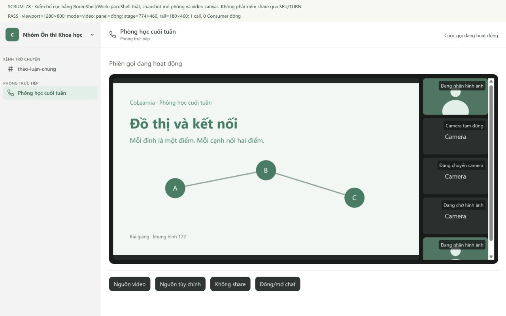

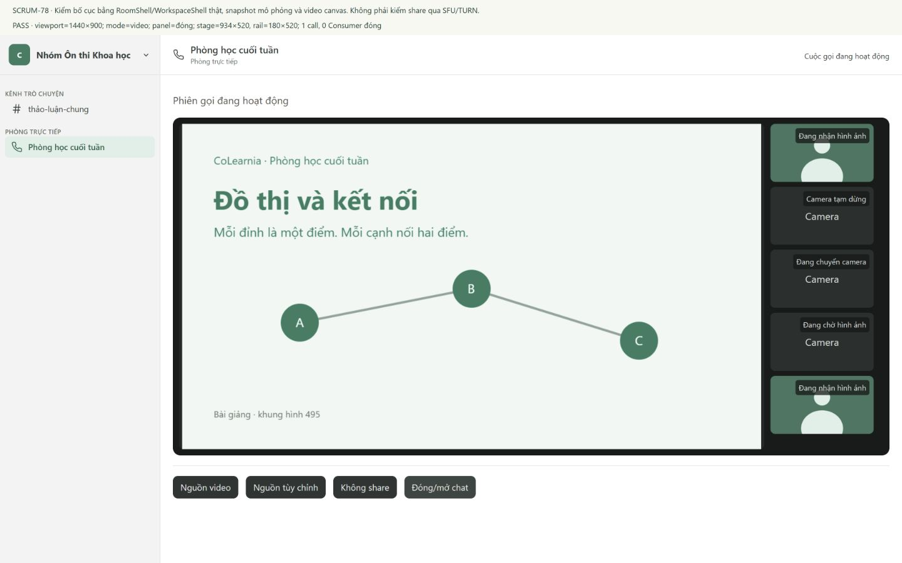

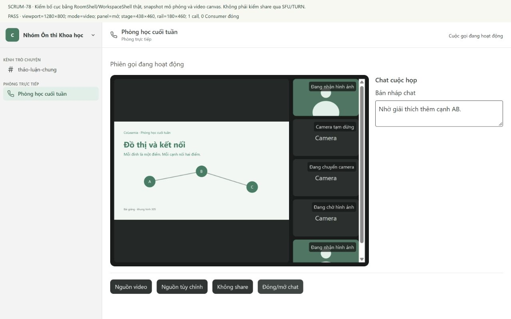

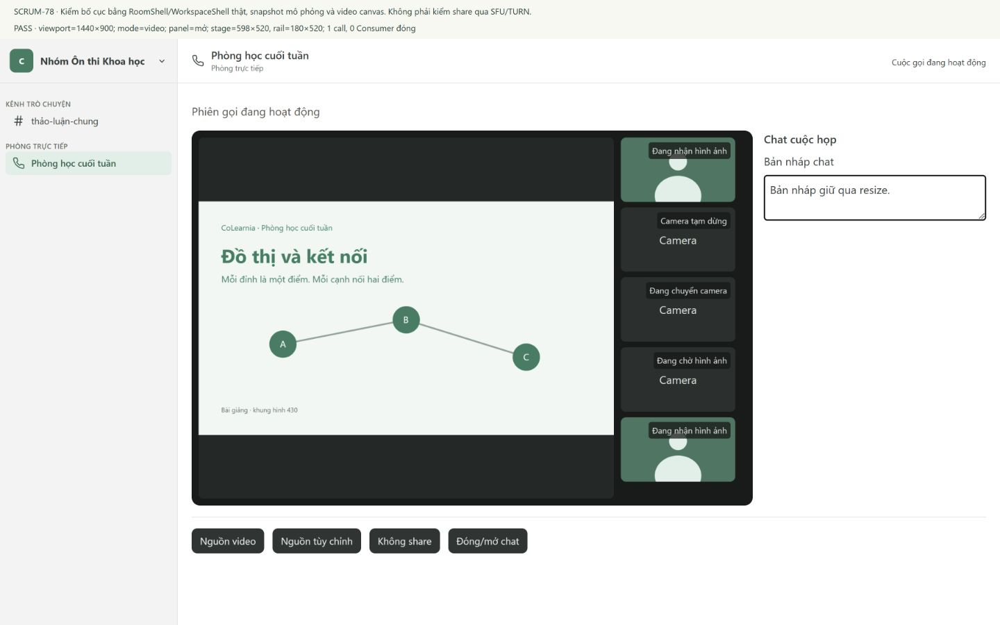

- Browser PASS thêm: `stageMedia` video → `stage` tùy chỉnh → không share/grid → video; 1279/1280, 767/768 và 320 CSS px; mở panel thay stage ở chế độ hẹp, Về sân khấu trả focus về trigger. Bản nháp giữ qua resize 1279→1440. Một call initialization, không Consumer bị đóng, borrowed tracks còn live qua các lần đổi layout. Các nhãn “Camera tạm dừng”, “Đang chuyển camera”, “Đang chờ hình ảnh” và regression camera/ready ACK cũ vẫn PASS.
- Cập nhật fixture lifecycle theo ba subscription call/audio/camera hiện có (cộng một badge); vẫn kiểm StrictMode đăng ký lại đúng một lần và cleanup về 0. Lifecycle PASS: subscriptions=68, remaining=0, video attach/detach=16/16, peak=1, call init/dispose=1/1, observers=0; cả hai ca focus resize đạt. **Fixture tổng hợp room-shell vẫn FAIL ở bước route TEXT `/workspace` sau lifecycle**, vì selector cũ `article[aria-label^="Chat "]` không khớp TextTimeline hiện tại; không gọi toàn bộ fixture này là PASS hoặc giảm assertion TEXT để làm xanh. Đây không phải bằng chứng về chat production.
- Bộ unit camera/snapshot/audio: 78/78 PASS; typecheck web PASS. Ảnh chứng minh layout ứng dụng đang chạy với canvas, chưa chứng minh share/RTP qua SFU, camera vật lý, isolation hoặc TURN.
- `pnpm.exe check` exit 0: harness 54 PASS/1 skip Windows, 139 nguồn/links, format/lint/typecheck (kể cả tsconfig integration) và build contracts/web/server đạt; 1012/1012 test trên 71 file PASS. `pnpm.exe media:smoke` exit 0, worker/Router Opus/VP8 PASS. Không đổi config audit, dependency hoặc test gate.

## Đồng bộ style khung cuộc gọi — 19/11/2026

- Sau phản hồi về ảnh ở `c0851f9`, đọc lại [global.css](../../apps/web/src/styles/global.css), [tokens.css](../../apps/web/src/styles/tokens.css), [foundations](../design-system/frontend/foundations.md), [Call shell và panel](../design-system/frontend/layouts.md#call-shell-và-panel), [quy ước styling](../design-system/frontend/coding-conventions.md#styling) và các selector meeting-stage/meeting-controls/meeting-panel/camera-rail trong [CSS export](../figma-ui/src/index.css). Worktree fast-forward tới `eb13ab1`, cài đúng frozen lockfile; không sửa export gốc, Workspace navigation hoặc dependency.
- Bỏ bố cục card bo góc nổi trên nền trắng và chiều cao media 60dvh cố định. RoomShell dùng header ngữ cảnh gọn, vùng media tối nhận chiều cao còn lại, toolbar tối cùng surface và panel sáng có header/divider riêng. Bản nhúng Workspace không lặp lớp card/padding quanh nội dung; standalone vẫn có khung và token viền riêng. Viewport thấp có chiều cao tối thiểu để cuộn tới control, không thu nhỏ chữ để ép vừa.
- Màu/viền/spacing lấy từ token trong global.css và giá trị đang dùng ở export: media #161b1a, stage #222826, camera #29302e, control theo live-toolbar-control hiện có. Chữ kế thừa font ứng dụng, nhãn/control trong toolbar tối thiểu 12px; không copy metadata 9px thành chuẩn mới. Placeholder dùng silhouette trung tính, không bịa tên participant; scrollbar media dùng màu tối, mảnh. Ready/paused/policy và quyền nhận media không đổi.
- Fixture chuyển PASS log và nút chọn kịch bản sang mục “Dữ liệu mô phỏng · Kiểm thử” thu gọn bên ngoài app. Toolbar hiển thị DeviceMediaControls thật với adapter capture/publish mô phỏng và mic/camera mặc định tắt, cùng các control share/chat fixture hoạt động theo state. Không giả vờ đã nối signaling production; đồ thị là video canvas của nguồn chia sẻ minh họa, không phải component sản phẩm.

| Viewport | Chat | Stage   | Rail    | Kết quả                                       |
| -------- | ---- | ------- | ------- | --------------------------------------------- |
| 1280×800 | Đóng | 810×601 | 180×601 | PASS, toolbar trong viewport                  |
| 1280×800 | Mở   | 490×601 | 180×601 | PASS, panel 320px phân vùng riêng             |
| 1440×900 | Đóng | 970×701 | 180×701 | PASS, không còn khoảng trắng/card quanh media |
| 1440×900 | Mở   | 650×701 | 180×701 | PASS, nháp giữ qua resize                     |

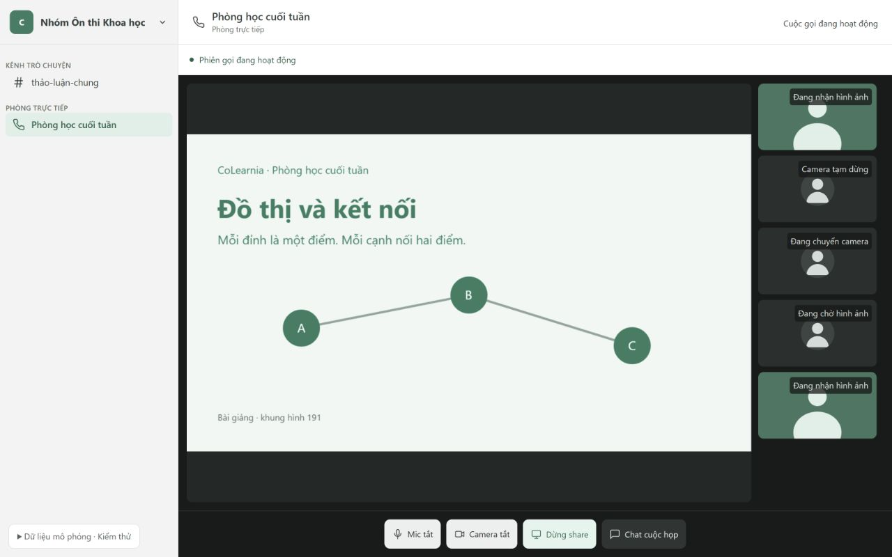

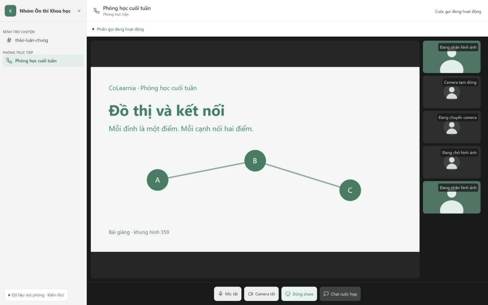

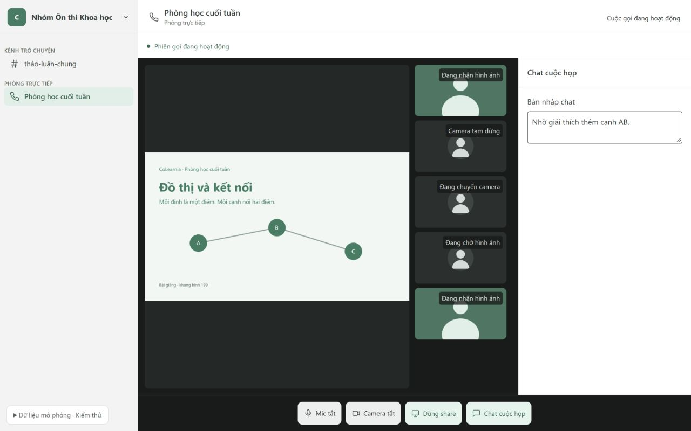

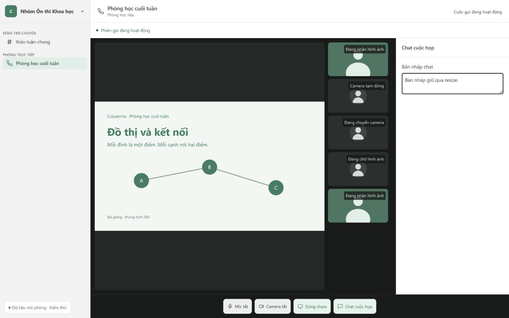

- Browser PASS cho video/custom/grid, reflow 320px, panel ở 767/768 và 1279/1280px, nháp giữ qua 1279→1440, Về sân khấu trả focus tới trigger. Một call initialization, không Consumer bị đóng, borrowed tracks còn live. Fixture camera/ACK/pause/local enabled/StrictMode vẫn PASS. Lifecycle RoomShell riêng PASS: subscription remaining=0, attach/detach=16/16, peak=1, call init/dispose=1/1, observers=0, hai ca focus resize đạt.
- Fixture room-shell tổng hợp tiếp tục FAIL ở selector Chat cũ trong route TEXT `/workspace` sau khi lifecycle đã PASS; không giảm assertion hoặc đổi product TEXT trong task style này. Cập nhật phép đo panel so với media region ngoài, vì stage video nay có inset 12px theo layout. Bộ unit camera/snapshot/audio 78/78 PASS. Ảnh là ứng dụng đang render canvas/snapshot mô phỏng, chưa là bằng chứng SFU/TURN hoặc camera vật lý.
- `pnpm.exe check` exit 0: harness 54 PASS/1 skip Windows, 140 nguồn/links, format/lint/typecheck (contracts/web/server và tsconfig integration), 1040/1040 test trên 74 file và build cả ba package PASS. `pnpm.exe media:smoke` exit 0: native worker/Router Opus/VP8 PASS. Không sửa dependency, config audit, cổng check hoặc assertion TEXT để làm xanh.

## Đồng nhất với giao diện app hiện có — 20/11/2026

### Nguồn đối chiếu

Phần này thay thế kết luận style của lượt 19/11 ở trên. Figma là draft tham khảo, không phải thiết kế đã duyệt để sao chép nguyên mẫu. Chuẩn triển khai lấy từ [global.css](../../apps/web/src/styles/global.css), [tokens.css](../../apps/web/src/styles/tokens.css), [WorkspaceShell](../../apps/web/src/features/workspaces/WorkspaceShell.tsx), [channel-list.css](../../apps/web/src/features/channels/channel-list.css), [text-timeline.css](../../apps/web/src/features/text/text-timeline.css) và [auth.css](../../apps/web/src/features/auth/auth.css). Đã xem màn Workspace và preview kiểm tra thiết bị đang render; route login báo không kết nối được API, nên không ghi nhận nghiệm thu form đăng nhập qua browser.

Tham khảo cách ưu tiên nội dung chia sẻ và giữ người tham gia bên cạnh trong [Google Meet](https://support.google.com/meet/answer/9292748?hl=en), [Microsoft Teams](https://support.microsoft.com/en-us/teams/meetings/customize-your-meeting-view-in-microsoft-teams). Chỉ tham khảo tổ chức không gian, không nhập bảng màu hoặc toàn bộ tính năng của hai sản phẩm.

### Thay đổi và bằng chứng browser

- RoomShell standalone có header 64px, vùng media tối liền mạch, stage lớn và camera rail, panel đọc sáng; vẫn hỗ trợ nhúng Workspace và dùng cùng controller. Header/tên người tham gia/nhãn nguồn là dữ liệu trình bày do caller cấp, không tạo nguồn camera hoặc cấp quyền mới.
- Dùng font `--cl-font-sans`, radius control và màu Workspace đang dùng. Avatar chữ có kích thước 36px, nền/foreground giống avatar chat; bỏ bảng bốn màu avatar riêng. Các control chính cao 44px, chữ 14px, icon 20px, focus ring có token chung. Nhãn camera trạng thái vẫn 12px và giữ “Camera tạm dừng”, “Đang đồng bộ camera”.
- Tái sử dụng DeviceMediaControls và RoomShell/CameraTiles thật; CSS demo tách riêng, dùng token cho slide và bản nháp chat. Không tạo bộ primitive giả khi app chưa có component tương ứng. Màu media tối dùng token media đã có trong global.css, không đổi theme các trang khác.
- Browser xác nhận computed font đúng token, control cao 44px/chữ 14px, avatar dùng `#dcefe8` như chat. Không tràn ngang; camera thứ năm vẫn còn trong rail có cuộn; video/custom/grid đều PASS. Resize 1279→1280 giữ nháp và không khởi tạo lại call/đóng Consumer.

| Viewport | Chat | Stage    | Rail    | Kết quả                            |
| -------- | ---- | -------- | ------- | ---------------------------------- |
| 1280×800 | Đóng | 1066×553 | 180×553 | PASS; toolbar trong viewport       |
| 1280×800 | Mở   | 746×553  | 180×553 | PASS; panel cạnh media             |
| 1440×900 | Đóng | 1226×653 | 180×653 | PASS; stage ưu tiên nội dung share |
| 1440×900 | Mở   | 906×653  | 180×653 | PASS; giữ nháp khi resize          |

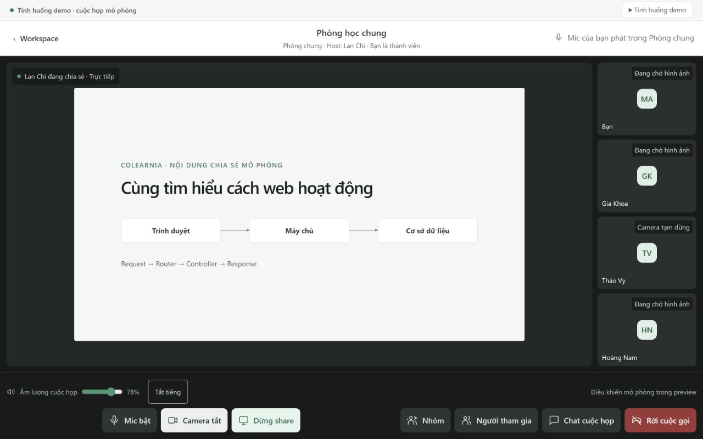

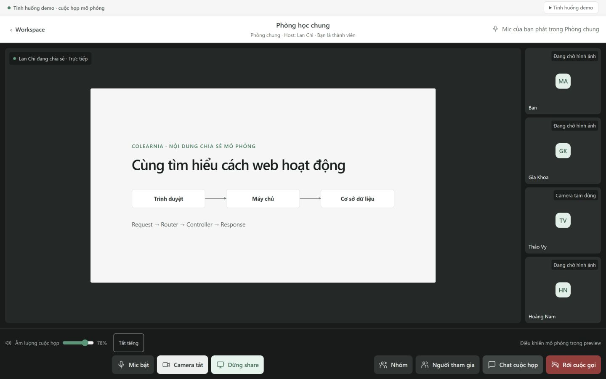

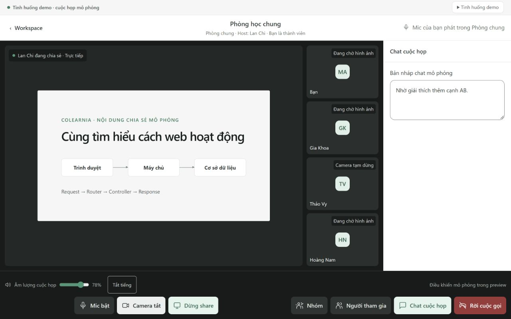

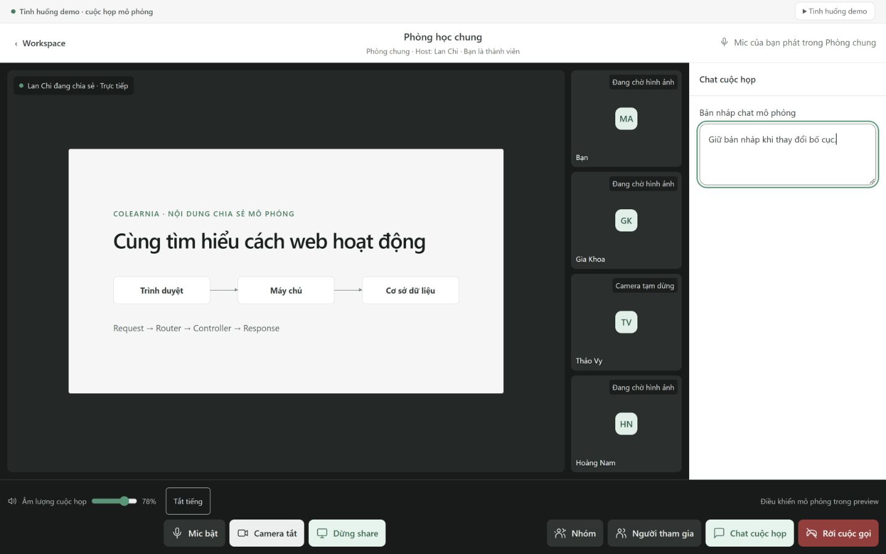

### Kiểm thử và giới hạn

- Fixture camera PASS: ACK A → camera C không liên quan → ACK B → snapshot B pending → đọc lại → snapshot ready vẫn pause B; ACK cũ không ghi đè pause; local enabled → disabled → enabled; pause/resume/remount/switching/ended/StrictMode. Browser phát canvas track thật, snapshot/signaling và capture/publish được mô phỏng.
- Lifecycle RoomShell riêng PASS: subscriptions=68, remaining=0, attach/detach=16/16, peak=1, init/dispose=1/1, observers=0, resizeFocus=true/true. Fixture tổng hợp vẫn FAIL sau đó ở selector TEXT cũ `article[aria-label^="Chat "]`; TextTimeline hiện là section “Tin nhắn văn bản”. Không đổi product TEXT hoặc giảm assertion để làm xanh. Console fixture còn cảnh báo React act; kết quả assertion được ghi riêng, không gọi toàn bộ browser suite là PASS.
- `pnpm.exe media:smoke` exit 0: native worker/Router Opus/VP8. Không chứng minh SFU/TURN, camera vật lý hoặc cuộc gọi xuyên mạng. Các slot âm lượng/nhóm trong demo chỉ kiểm bố cục; chưa nghiệm thu AudioGraph/nhóm production. Đường ghép LIVE production vẫn theo SCRUM-88 / M4-T11.1 như phạm vi đã ghi ở đầu evidence.
- `pnpm.exe check` exit 0: harness 54 PASS/1 skip Windows, 140 nguồn/links; format/lint/typecheck; 1040/1040 test trên 74 file; build contracts/web/server. Bộ regression runtime camera/ACK/audio nằm trong lượt test đầy đủ này. Không đổi dependency, audit config hoặc cổng check.
- Kiểm thử trong checkout độc lập để tránh chat khác đổi nhánh giữa lượt chạy; sau đó chép đủ 13 file về checkout SCRUM-78 chính và đối chiếu hash. Đã xóa `.worktrees` theo yêu cầu sau khi xác minh hai lượt SCRUM-81 đã kết thúc, worktree sạch, commit có trên remote và không có process sử dụng; giữ nguyên nhánh/PR SCRUM-81. Thay đổi `.vscode/settings.json` staged có sẵn được giữ nguyên và không đưa vào commit SCRUM-78.
