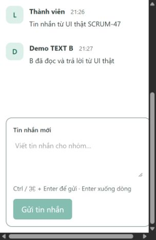

# SCRUM-47 — Tích hợp UI chat TEXT với hai tài khoản

Nhánh `feat/SCRUM-47-text-chat-integration` từ main `226f2eb`, ngày 19/11/2026. Reviewer M1. Phạm vi là tin gốc văn bản trong kênh TEXT, nối send/history/subscribe với session thật, tải bù khi reconnect và dọn cache khi mất quyền. [Contract TEXT](../contracts/text-messaging.md) · [Messaging](../product/messaging.md)

## Luồng UI

Người dùng đăng nhập rồi mở Workspace ở `/workspaces/:workspaceId` và chọn kênh TEXT. `ChannelWorkspace` mount `TextChannel` theo user/session/kênh. Adapter gửi REST POST có CSRF, đọc history qua REST và subscribe/unsubscribe qua Socket.IO với cookie/session và CSRF handshake. Controller SCRUM-43 gắn listener trước subscribe, tải snapshot/catch-up đến H, gộp theo ID và chỉ tiến checkpoint sau đủ trang. Composer SCRUM-46 giữ clientMessageId khi retry, gỡ outbox khi event commit đến trước ACK. Nội dung chỉ nằm trong RAM.

UI dùng trang 30 tin, projection tối đa 500 tin/2 MB, buffer tối đa 128 event, 64 trang/lượt, deadline 12 giây và đối soát mỗi 5 giây. Đây là budget client thử tích hợp. Budget server vẫn được khai báo riêng. Khởi tạo trang bằng toàn bộ trần projection có thể bị server từ chối vì response reserve vượt budget history, nên `pageSize` được tách thành tùy chọn controller. Nếu projection vượt budget thì controller resync hoặc báo blocked theo contract, không nâng checkpoint giả.

Nút “Xem tin nhắn cũ” đọc history bằng cursor server cấp, gộp vào cùng projection hữu hạn. Tải trang cũ không tiến checkpoint, chỉ lấy tin gốc đúng scope và không nhận response của lượt đã bị thu. Khi không còn cursor, nút được bỏ khỏi UI. Ca tích hợp mở lại cửa sổ một tin rồi đọc hai trang cũ, xác nhận ba ID duy nhất, cursor kết thúc và checkpoint giữ nguyên.

Thu quyền hoặc lỗi AUTH_REQUIRED/FORBIDDEN/NOT_FOUND xóa projection/checkpoint, đóng socket/lease, unmount composer để bỏ draft/outbox và reset danh sách kênh của Workspace đang mở. Đổi kênh, phiên hoặc logout hủy request/listener cũ. Subscribe ACK tới sau abort được adapter unsubscribe để trả lease. Fixture `/workspace` tiếp tục dùng provider được gắn nhãn riêng.

## Ca tích hợp thật đã kiểm

[Test tích hợp](../../tests/integration/text-chat.integration.ts) dùng [harness auth/media](../../apps/server/test/main-auth-media-harness.ts) với `text: true`, hai tài khoản đăng ký qua API thật, một MongoDB replica set dùng một lần, session cookie/CSRF thật và client API/controller của web. Harness bind adapter messaging thật cùng MAIN registry/native media thật vào coordinator thu quyền. Schema/model/index của fixture chỉ tạo trong database tên ngẫu nhiên `colearnia_test_scrum88_*`, một client/pool và coordinator được dùng chung. Membership/grant là dữ liệu fixture, không kiểm luồng mời thành viên sản phẩm.

| Ca                                             | Kết quả thực chạy                                                                                                                                                   |
| ---------------------------------------------- | ------------------------------------------------------------------------------------------------------------------------------------------------------------------- |
| Gửi và đọc giữa hai tài khoản                  | POST commit thật, Socket.IO đưa tin vào projection tài khoản còn lại                                                                                                |
| Mất ACK sau commit                             | Fetch của test nhận đủ response rồi cố ý làm rơi phản hồi tại caller. Retry cùng clientMessageId trả cùng ID, DB chỉ có một tin cho intent                          |
| Disconnect rồi gửi trong lúc offline           | B reconnect, controller tải bù đúng tin thiếu, không lặp ID                                                                                                         |
| B gửi sau reconnect                            | Projection A nhận tin B, tổng ba tin trong conversation                                                                                                             |
| Gỡ grant PRIVATE của B trong fixture dưới gate | History/subscription bị ACL thật từ chối, controller B về revoked với messages rỗng, bỏ checkpoint/olderCursor; gửi sau gỡ trả NOT_FOUND theo quy tắc che giấu kênh |
| Phạm vi còn quyền                              | A vẫn giữ đủ ba tin và DB có đúng ba document, không bị xóa cùng B                                                                                                  |

Fixture gỡ grant trong database dùng một lần rồi đối soát qua ACL thật. Ca này xác nhận dọn cache khi đọc lại bị từ chối, chưa nghiệm thu HTTP quản trị quyền hoặc race của toàn bộ coordinator thu quyền. Unit của adapter kiểm riêng ACK subscribe đến muộn sau abort không giữ lease. Các ca invalidation/overflow/checkpoint của controller tiếp tục ở SCRUM-43.

## Kiểm UI bằng trình duyệt

Đã mở UI qua Vite trên loopback với proxy tới harness. Đăng ký tài khoản demo A qua UI, tạo Workspace/general bằng API thật, chọn general và gửi tin. Đăng xuất rồi đăng ký B qua UI, thêm membership B trong đúng database fixture do lượt demo sở hữu, mở Workspace, đọc tin A và trả lời bằng Ctrl+Enter. UI hiển thị một dòng cho mỗi tin, không có provider tin nhắn giả trong luồng này.

Khi B đang có draft, thu membership B trong database fixture. Lượt đối soát định kỳ nhận từ chối quyền, UI chuyển sang “Không tìm thấy Workspace”, bỏ cả nội dung và draft đang mở. Việc setup/thu membership bằng fixture được tách khỏi kiểm gửi/đọc bằng API thật. Reconnect và mất ACK được kiểm bằng test tự động bên trên.



## Chạy lại

Dùng replica set Mongo riêng cho test, không dùng DB dev/staging đang có dữ liệu. Ví dụ lượt này dùng container `colearnia-scrum47-mongo`, Mongo 8.0.16, cổng loopback 27047, `rs0`. Harness tạo và dọn database ngẫu nhiên của chính lượt kiểm.

```powershell
pnpm install --frozen-lockfile
pnpm --filter @colearnia/contracts build
$env:COLEARNIA_DB_TEST_PORT = '27047'
pnpm exec vitest run --config vitest.database.config.ts tests/integration/text-chat.integration.ts tests/integration/main-auth-media.integration.ts
pnpm check
```

Để mở server cho walkthrough local, dùng terminal riêng. Ca demo giữ server tối đa 5 phút rồi chạy cleanup. Có thể đặt `COLEARNIA_TEXT_UI_STOP_FILE` tới đường dẫn file đánh dấu thuộc lượt test để kết thúc sớm khi file xuất hiện.

```powershell
$env:COLEARNIA_DB_TEST_PORT = '27047'
$env:COLEARNIA_TEXT_UI_DEMO = '1'
pnpm exec vitest run --config vitest.database.config.ts tests/integration/text-chat.integration.ts -t 'keeps the real integration server'
```

Ở terminal web đặt `PORT=30047` rồi chạy `pnpm --filter @colearnia/web dev`. Origin walkthrough là `http://127.0.0.1:5173`. Tài khoản tạo bằng UI trong lượt trước không còn sau cleanup. Hai tài khoản và quyền kênh trong test tự động luôn được tạo lại.

## Điều kiện bàn giao còn mở

Main vẫn chỉ bật history, chưa bật send và chưa bind composition messaging/LIVE thật cho subscribe. Các fixture tích hợp có server thật riêng để kiểm đường dữ liệu, không thay quyết định rollout history-only của PR #117 và điều kiện SCRUM-43. M1/M4 cần review P2/recovery và composition trước khi bật đường gửi/subscription ở main. UI hiện báo chưa đồng bộ/chưa gửi được nếu server chưa sẵn sàng. Chưa có bằng chứng hai tài khoản chạy qua entry point `apps/server/src/main.ts` hoặc staging trong lượt này.

M1 review cache/identity/abort và bằng chứng hai tài khoản. Task có đầu ra tích hợp local để review, nghiệm thu rollout đầy đủ còn phụ thuộc bước bật main được các bên xác nhận. DM/thread/ảnh/file tiếp tục theo các task riêng.

## Kết quả lệnh đã chạy

- Windows x64, pnpm 11.5.2, `pnpm exec node --version` trả v26.12.1, Docker 29.9.3. Root `.env` chưa có, harness dùng cấu hình và secret test tạo trong tiến trình.
- `pnpm install --frozen-lockfile` exit 0.
- `pnpm check` exit 0, gồm harness 54 pass/1 skip, format, lint, typecheck web/server/contracts và integration, 74 file/998 test pass, build ba package.
- Hai file integration TEXT và MAIN đạt 10 test, 1 walkthrough tùy chọn được bỏ qua theo mặc định. Lượt kiểm TEXT cuối sau bổ sung phân trang đạt 1 test, 1 walkthrough mặc định bỏ qua. Lượt walkthrough đã bật riêng và kết thúc exit 0 sau kiểm trình duyệt.
- Ba file unit text-api/text-sync/text-intent đạt 23 test, gồm ACK subscribe muộn, HTTP 401 không phải JSON và lỗi quyền/cursor khi đọc trang cũ.
- Build web thành công, còn cảnh báo bundle chính 542,40 kB minified (165,48 kB gzip) vượt ngưỡng cảnh báo 500 kB. Giữ cảnh báo để review hiệu năng.
- `git diff --check` sạch. Vite/server demo đã dừng, container Mongo dùng một lần và file dừng walkthrough đã được dọn. Các database ngoài container thử được giữ nguyên.

## Bổ sung review P2 retry kết nối — 20/11/2026

Mốc đối chiếu: review trên `8fa64db`. Bản sửa giữ handle kết nối ngay khi tạo socket,
trước lần `connect` thành công. Nút “Thử kết nối lại” gọi cùng handle này: socket chưa
kết nối thì `connect()`; khi đã nối thì chỉ `reconcile()`. Event `connect` mới bắt đầu
đối soát. Không tạo thêm socket/listener mỗi lần bấm. Cleanup gỡ đúng listener sở hữu,
stop controller và disconnect; handle đã dispose/thu quyền bỏ qua retry và callback muộn.
`AUTH_REQUIRED`/`CSRF_INVALID` là lỗi phiên terminal, không retry trong lifetime cũ.

### Lệnh và bằng chứng của lượt sửa

```powershell
pnpm exec vitest run apps/web/src/features/text/text-connection.test.ts apps/web/src/features/text/text-api.test.ts apps/web/src/features/text/text-sync.test.ts
pnpm exec vitest run --config vitest.database.config.ts test/text-connection.integration.mjs
pnpm --filter @colearnia/web typecheck
pnpm check
```

- Unit gần thay đổi: **24/24 đạt**, gồm 5 ca mới: retry trước connect, reconcile khi đã nối,
  hai lỗi phiên terminal, cleanup/listener và callback/retry sau dispose/deny.
- Native Socket.IO loopback: **4/4 đạt**. Middleware từ chối handshake đầu với
  `DEPENDENCY_UNAVAILABLE`, client `active=false`; chính action nút dùng khôi phục về
  `live` sau dependency hồi phục, handshake tăng 1 → 2. Server chủ động disconnect rồi
  retry cũng về live. Hai lỗi phiên không mở lại kết nối. REST/history ở đây là fixture,
  không chạy MongoDB hoặc auth/ACL server thật.
- Browser Chrome headless/Playwright: mount **TextChannel thật** qua Vite với server
  Socket.IO loopback và REST/session fixture tạm. Bấm nút thật sau lỗi handshake đầu:
  thấy `browser-recovered`, attempts=2, main-frame navigation=1. Server disconnect,
  bấm nút lần nữa: chat live, attempts=3, navigation vẫn 1 (không reload).
  Reload riêng từng fixture `AUTH_REQUIRED`/`CSRF_INVALID`: thông báo mất quyền,
  không còn nút retry và không mở lại handshake sau khi server hồi phục.
  Fixture tạm đã gỡ; không thêm đường thử vào entry sản phẩm. Có thể tái kiểm đường
  điều phối bằng file integration ở trên; walkthrough nút thật cần mount TextChannel
  với middleware từ chối lần đầu rồi cho phép, REST trả snapshot hợp lệ.
- Typecheck Web đạt. `pnpm check` đạt: harness 54 pass/1 skip theo baseline, format/lint/typecheck, 1.003/1.003 unit và build. Bundle Web 542,78 kB còn cảnh báo >500 kB; `git diff --check` sạch.

Các kết quả Mongo/native 10 ca và walkthrough hai tài khoản ở phần trước thuộc
`8fa64db`, không được ghi thành chạy lại trong lượt sửa retry này. Browser lượt này
chỉ chứng minh nút/transport React với fixture; không thay nghiệm thu staging/ACL.

### Bàn giao rollout còn mở

| Đầu việc                                              | Nguồn theo dõi                                                | Đầu mối và điều kiện                                                                                                                     |
| ----------------------------------------------------- | ------------------------------------------------------------- | ---------------------------------------------------------------------------------------------------------------------------------------- |
| Recovery gửi TEXT / ambiguous commit / durable revoke | [#126](https://github.com/Lightning1507/CoLearnia/issues/126) | M2 `WANNAREST` nhận đầu mối; M1/M4 review giải pháp và bằng chứng trước bật send.                                                        |
| Entry thật và binding M2/LIVE cleanup                 | [#135](https://github.com/Lightning1507/CoLearnia/issues/135) | M2 `WANNAREST` nhận phối hợp; M4 cần xác nhận phần composition SCRUM-88/cleanup, M1 review quyền/config. Chưa tự coi M4 đã nhận/approve. |

PR này giao đầu ra UI đã kiểm; **không bật send/sync trong main**, không đổi mặc định,
không deploy. SCRUM-47 và nghiệm thu demo/rollout vẫn mở đến khi các điều kiện trên
được kiểm và M1/M4 review; merge UI không tự hoàn thành các tiêu chí đó.
